# Chapter 1 基本概念：例題與練習題

本頁面彙整 Alexander & Sadiku《Fundamentals of Electric Circuits》第 1 章之核心 Example、Practice Problem 與章末 Problems 1.1–1.39。已有詳解的題目可點擊「查看詳解」；章末奇數題附有課本附錄 D 的原版答案，偶數題提供標明「自行推導」的解答。每題均可勾選標記學習進度。

<PracticeFilter prefix="ch1-" />
<PracticeProgress :total="59" prefix="ch1-" />

<PracticeCard id="ch1-ex1" type="example" title="Example 1.1：電子所代表的電荷" source="課本 p.14" topic="電荷">

一個電子的電荷為 $-1.602\times10^{-19}\,\mathrm{C}$。求 $4{,}600$ 個電子所代表的總電荷。

<template #solution>

電子數與每個電子的電荷相乘：

$$
q=(-1.602\times10^{-19}\,\mathrm{C/electron})(4{,}600\,\mathrm{electrons})
=-7.369\times10^{-16}\,\mathrm{C}.
$$

因此，總電荷為 $-7.369\times10^{-16}\,\mathrm{C}$。

</template>

</PracticeCard>

<PracticeCard id="ch1-pr2" type="practice" title="Practice Problem 1.2：質子所代表的電荷" source="課本 p.14" topic="電荷">

求 $100$ 億個質子所代表的電荷量。

<template #solution>

每個質子的電荷為 $+1.6021\times10^{-19}\,\mathrm{C}$，而 $100$ 億為 $10^{10}$；因此

$$
q=(10^{10})(1.6021\times10^{-19})
=1.6021\times10^{-9}\,\mathrm{C}.
$$

課本答案：$1.6021\times10^{-9}\,\mathrm{C}$。

</template>

</PracticeCard>

<PracticeCard id="ch1-ex2" type="example" title="Example 1.2：由電荷函數求瞬時電流" source="課本 p.14" topic="電流與電荷">

進入一端點的總電荷為

$$
q=5t\sin(4\pi t)\,\mathrm{mC}.
$$

求 $t=0.5\,\mathrm{s}$ 時的電流。

<template #solution>

以 $i=dq/dt$ 微分：

$$
i(t)=\frac{d}{dt}\left[5t\sin(4\pi t)\right]
=5\sin(4\pi t)+20\pi t\cos(4\pi t)\quad\mathrm{mA}.
$$

在 $t=0.5\,\mathrm{s}$，$4\pi t=2\pi$，所以

$$
i(0.5)=5\sin(2\pi)+10\pi\cos(2\pi)=31.42\,\mathrm{mA}.
$$

因此電流為 $31.42\,\mathrm{mA}$。

</template>

</PracticeCard>

<PracticeCard id="ch1-pr1" type="practice" title="Practice Problem 1.1：由電荷求電流" source="課本 p.14" topic="電流與電荷">

在 Example 1.2 的情境中，若進入端點的總電荷為

$$
q=(20-15t-10e^{-3t})\,\mathrm{mC},
$$

求 $t=1.0\,\mathrm{s}$ 時的電流。

<template #solution>

由 $i=dq/dt$：

$$
i(t)=\left(-15+30e^{-3t}\right)\,\mathrm{mA}.
$$

代入 $t=1.0\,\mathrm{s}$：

$$
i(1)=-15+30e^{-3}=-13.506\,\mathrm{mA}.
$$

負號表示實際電流方向與「進入端點」的參考方向相反。課本答案：$-13.506\,\mathrm{mA}$。

</template>

</PracticeCard>

<PracticeCard id="ch1-ex3" type="example" title="Example 1.3：由電流求區間電荷" source="課本 p.14" topic="電流與電荷">

若通過端點的電流為 $i=(3t^2-t)\,\mathrm{A}$，求從 $t=1\,\mathrm{s}$ 至 $t=2\,\mathrm{s}$ 進入端點的總電荷。

<template #solution>

總電荷為電流在指定時間區間的積分：

$$
Q=\int_1^2(3t^2-t)\,dt
=\left(t^3-\frac{t^2}{2}\right)\bigg|_1^2.
$$

$$
Q=(8-2)-\left(1-\frac12\right)=5.5\,\mathrm{C}.
$$

因此進入端點的總電荷為 $5.5\,\mathrm{C}$。

</template>

</PracticeCard>

<PracticeCard id="ch1-pr3" type="practice" title="Practice Problem 1.3：分段電流的電荷" source="課本 p.15" topic="電流與電荷">

流入元件的電流為

$$
i(t)=
\begin{cases}
8\,\mathrm{A}, & 0<t<1,\\
8t^2\,\mathrm{A}, & t>1.
\end{cases}
$$

求從 $t=0$ 至 $t=2\,\mathrm{s}$ 進入元件的電荷。

<template #solution>

依分段定義積分：

$$
Q=\int_0^1 8\,dt+\int_1^2 8t^2\,dt
=8+\frac{8}{3}\left(2^3-1^3\right).
$$

$$
Q=8+\frac{56}{3}=\frac{80}{3}\,\mathrm{C}=26.67\,\mathrm{C}.
$$

課本答案：$26.67\,\mathrm{C}$。

</template>

</PracticeCard>

<PracticeCard id="ch1-ex4" type="example" title="Example 1.4：燈泡兩端的電壓降" source="課本 p.18" topic="電壓與能量">

一能量源使 $2\,\mathrm{A}$ 的定電流流過燈泡 $10\,\mathrm{s}$。若以光與熱形式釋放 $2.4\,\mathrm{kJ}$ 能量，求燈泡兩端的電壓降。

<template #solution>

先求通過的電荷：

$$
\Delta q=i\Delta t=(2\,\mathrm{A})(10\,\mathrm{s})=20\,\mathrm{C}.
$$

電壓降為每單位電荷的能量：

$$
v=\frac{\Delta w}{\Delta q}
=\frac{2.4\times10^3\,\mathrm{J}}{20\,\mathrm{C}}
=120\,\mathrm{V}.
$$

因此燈泡的電壓降為 $120\,\mathrm{V}$。

</template>

</PracticeCard>

<PracticeCard id="ch1-pr4" type="practice" title="Practice Problem 1.4：電荷符號與電壓" source="課本 p.18" topic="電壓與能量">

將電荷 $q$ 由點 $b$ 移至點 $a$ 需 $100\,\mathrm{J}$。求電壓降 $v_{ab}$（$a$ 點相對於 $b$ 點為正），其中：(a) $q=5\,\mathrm{C}$；(b) $q=-10\,\mathrm{C}$。

<template #solution>

由電壓定義 $v_{ab}=\Delta w/\Delta q$。

對 (a)：

$$
v_{ab}=\frac{100\,\mathrm{J}}{5\,\mathrm{C}}=20\,\mathrm{V}.
$$

對 (b)：

$$
v_{ab}=\frac{100\,\mathrm{J}}{-10\,\mathrm{C}}=-10\,\mathrm{V}.
$$

課本答案：(a) $20\,\mathrm{V}$；(b) $-10\,\mathrm{V}$。

</template>

</PracticeCard>

<PracticeCard id="ch1-ex5" type="example" title="Example 1.5：元件吸收的功率" source="課本 p.18" topic="功率">

在 $t=3\,\mathrm{ms}$，電流進入元件的正端，且

$$
i=5\cos(60\pi t)\,\mathrm{A}.
$$

求元件所吸收的功率：(a) $v=3i$；(b) $v=3\,di/dt$。

<template #solution>

因電流進入正端，依被動符號約定 $p=vi$。

對 (a)，

$$
p=3i^2=75\cos^2(60\pi t)\,\mathrm{W},
$$

$$
p(3\,\mathrm{ms})=75\cos^2(0.18\pi)=53.47\,\mathrm{W}.
$$

對 (b)，

$$
v=3\frac{di}{dt}=-900\pi\sin(60\pi t)\,\mathrm{V},
$$

$$
p=vi=-4500\pi\sin(60\pi t)\cos(60\pi t)\,\mathrm{W},
$$

$$
p(3\,\mathrm{ms})=-6.396\,\mathrm{kW}.
$$

因此答案為：(a) $53.47\,\mathrm{W}$；(b) $-6.396\,\mathrm{kW}$。負號表示元件在此時刻供應功率。

</template>

</PracticeCard>

<PracticeCard id="ch1-pr5" type="practice" title="Practice Problem 1.5：含積分項的瞬時功率" source="課本 p.19" topic="功率">

給定電流

$$
i=5\cos(60\pi t)\,\mathrm{A}.
$$

在 $t=5\,\mathrm{ms}$ 求元件吸收的功率；電壓分別為：(a) $v=6i\,\mathrm{V}$；(b) $v=\left(6+10\int_0^t i\,dt\right)\,\mathrm{V}$。

<template #solution>

先在 $t=5\,\mathrm{ms}$ 求電流：

$$
i(5\,\mathrm{ms})=5\cos(60\pi\times0.005)
=5\cos(0.3\pi)=2.938926\,\mathrm{A}.
$$

對 (a)，

$$
v=6i=6(2.938926)=17.633558\,\mathrm{V},
$$

$$
p=vi=6i^2=6(2.938926)^2
=51.823725\,\mathrm{W}\approx51.82\,\mathrm{W}.
$$

對 (b)，積分項為

$$
q(t)=\int_0^t i(\tau)\,d\tau
=\frac{5}{60\pi}\sin(60\pi t).
$$

在 $t=5\,\mathrm{ms}$ 時，

$$
q=\frac{5}{60\pi}\sin(0.3\pi)=0.02145984\,\mathrm{C},
$$

$$
v=6+10q=6+10(0.02145984)=6.214598\,\mathrm{V},
$$

$$
p=vi=(6.214598)(2.938926)
=18.264247\,\mathrm{W}\approx18.264\,\mathrm{W}.
$$

因電流流入元件的正端，依被動符號約定，正號表示元件吸收功率。

</template>

</PracticeCard>

<PracticeCard id="ch1-ex6" type="example" title="Example 1.6：電燈的能量消耗" source="課本 p.20" topic="功率與能量">

一個 $100\ \mathrm{W}$ 電燈泡連續使用 $2\ \mathrm{h}$，求它消耗的能量。

<template #solution>

由能量與功率的關係 $w=pt$：

$$
w=(100\ \mathrm{W})(2\ \mathrm{h})(60\ \mathrm{min/h})(60\ \mathrm{s/min})
=720{,}000\ \mathrm{J}=720\ \mathrm{kJ}.
$$

以瓦時表示時，$w=(100\ \mathrm{W})(2\ \mathrm{h})=200\ \mathrm{Wh}$。兩種結果一致，因為 $200\ \mathrm{Wh}=720\ \mathrm{kJ}$。

</template>

</PracticeCard>

<PracticeCard id="ch1-pr6" type="practice" title="Practice Problem 1.6：電暖器的能量消耗" source="課本 p.20" topic="功率與能量">

家用電暖器接在 $120\ \mathrm{V}$ 插座時汲取 $12\ \mathrm{A}$。若持續使用 $24\ \mathrm{h}$，求消耗的能量。

<template #solution>

先求輸入功率：

$$
p=vi=(120\ \mathrm{V})(12\ \mathrm{A})=1440\ \mathrm{W}=1.44\ \mathrm{kW}.
$$

因此

$$
w=pt=(1.44\ \mathrm{kW})(24\ \mathrm{h})=34.56\ \mathrm{kWh}.
$$

課本答案：$34.56\ \mathrm{kWh}$。

</template>

</PracticeCard>

<PracticeCard id="ch1-ex7" type="example" title="Example 1.7：元件供給或吸收的功率" source="課本 p.21" topic="被動符號約定">

求圖中每一元件 $p_1$、$p_2$、$p_3$、$p_4$ 所供給或吸收的功率。

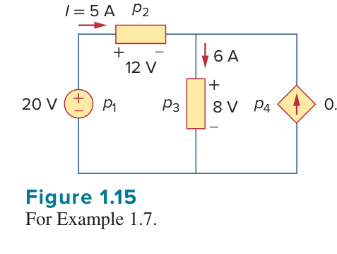

<template #solution>

依被動符號約定，電流流入正端時 $p=vi$ 為正（吸收）；流出正端時電流取負。

$$
p_1=20(-5)=-100\ \mathrm{W},\qquad
p_2=12(5)=60\ \mathrm{W},\qquad
p_3=8(6)=48\ \mathrm{W}.
$$

對受控電流源，兩端電壓與 $p_3$ 相同，皆為 $8\ \mathrm{V}$；且 $I=5\ \mathrm{A}$，其電流由正端流出：

$$
p_4=8(-0.2I)=8[-0.2(5)]=-8\ \mathrm{W}.
$$

檢查：$-100+60+48-8=0$。因此 $p_1$ 與 $p_4$ 分別供給 $100\ \mathrm{W}$、$8\ \mathrm{W}$；$p_2$、$p_3$ 分別吸收 $60\ \mathrm{W}$、$48\ \mathrm{W}$。

</template>

</PracticeCard>

<PracticeCard id="ch1-pr7" type="practice" title="Practice Problem 1.7：各元件的功率" source="課本 p.22" topic="被動符號約定">

計算圖中電路各元件 $p_1$、$p_2$、$p_3$、$p_4$ 所吸收或供給的功率。

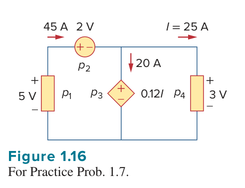

<template #solution>

對每個元件依圖示極性與電流方向套用被動符號約定 $p=vi$；電流流入正端取正，流出正端取負。圖示給定 $I=25\ \mathrm{A}$，故受控源電流為

$$
0.12I=0.12(25)=3\ \mathrm{A}.
$$

逐一代入各元件的標示電壓與對應帶符號電流，可得課本答案：

$$
p_1=-225\ \mathrm{W},\qquad p_2=90\ \mathrm{W},\qquad
p_3=60\ \mathrm{W},\qquad p_4=75\ \mathrm{W}.
$$

負號表示 $p_1$ 供給 $225\ \mathrm{W}$；其餘三個元件吸收功率。驗算為 $-225+90+60+75=0$。

</template>

</PracticeCard>

<PracticeCard id="ch1-ex8" type="example" title="Example 1.8：映像管電子束的加速電壓" source="課本 p.23" topic="電流與功率">

電視映像管的電子束每秒含有 $10^{15}$ 個電子。若要使電子束功率達到 $4\ \mathrm{W}$，求所需加速電壓 $V_o$。

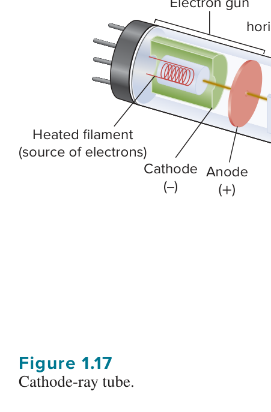

<template #solution>

電子電荷為 $e=-1.6\times10^{-19}\ \mathrm{C}$，所以約定電流為

$$
i=e\frac{dn}{dt}=(-1.6\times10^{-19})(10^{15})
=-1.6\times10^{-4}\ \mathrm{A}.
$$

負號表示約定電流方向與電子束方向相反。由功率關係 $p=V_oi$，取電流量值計算所需電壓大小：

$$
V_o=\frac{p}{|i|}=\frac{4}{1.6\times10^{-4}}
=25{,}000\ \mathrm{V}=25\ \mathrm{kV}.
$$

因此所需加速電壓為 $25\ \mathrm{kV}$。

</template>

</PracticeCard>

<PracticeCard id="ch1-pr8" type="practice" title="Practice Problem 1.8：電子束的功率" source="課本 p.24" topic="電流與功率">

電視映像管電子束每秒含有 $10^{13}$ 個電子，並通過電位差 $25\ \mathrm{kV}$ 的極板。求電子束的功率。

<template #solution>

先由電子通量求電流大小：

$$
|i|=|e|\frac{dn}{dt}=(1.6\times10^{-19})(10^{13})
=1.6\times10^{-6}\ \mathrm{A}.
$$

再用 $p=V|i|$：

$$
p=(25\times10^3)(1.6\times10^{-6})
=4.0\times10^{-2}\ \mathrm{W}=40\ \mathrm{mW}.
$$

課本答案：$40\ \mathrm{mW}$。

</template>

</PracticeCard>

<PracticeCard id="ch1-ex9" type="example" title="Example 1.9：分級電價的電費" source="課本 p.25" topic="能量計費">

某住戶一月用電 $700\ \mathrm{kWh}$。住宅電價為：基本月費 \$12.00；前 $100\ \mathrm{kWh}$ 為每度 \$0.16；接續 $200\ \mathrm{kWh}$ 為每度 \$0.10；超過 $300\ \mathrm{kWh}$ 的部分為每度 \$0.06。求本月電費及平均每度電成本。

<template #solution>

分段計費：

$$
\begin{aligned}
\text{基本月費} &= \$12.00,\\
100(\$0.16/\mathrm{kWh}) &= \$16.00,\\
200(\$0.10/\mathrm{kWh}) &= \$20.00,\\
400(\$0.06/\mathrm{kWh}) &= \$24.00.
\end{aligned}
$$

總費用與平均成本為

$$
\text{總電費}=12+16+20+24=\$72.00,
\qquad
\frac{\$72.00}{700\ \mathrm{kWh}}=10.286\ \text{cents/kWh}.
$$

因此本月電費為 \$72.00，平均成本為 $10.286\ \text{cents/kWh}$。

</template>

</PracticeCard>

<PracticeCard id="ch1-pr9" type="practice" title="Practice Problem 1.9：低用電量的平均電價" source="課本 p.25" topic="能量計費">

住宅電價為基本月費 12.00 元；前 $100\ \mathrm{kWh}$ 為每度 0.16 元；接續 $200\ \mathrm{kWh}$ 為每度 0.10 元；超過 $300\ \mathrm{kWh}$ 的部分為每度 0.06 元。若七月全家外出度假，整月僅用電 $260\ \mathrm{kWh}$，求平均每度電成本。

<template #solution>

用電量未超過 $300\ \mathrm{kWh}$，所以只有前兩級電價：

$$
\text{總電費}=\$12.00+100(\$0.16)+160(\$0.10)
=\$44.00.
$$

平均成本為

$$
\frac{\$44.00}{260\ \mathrm{kWh}}
=\$0.16923/\mathrm{kWh}
=16.923\ \text{cents/kWh}.
$$

課本答案：$16.923\ \text{cents/kWh}$。

</template>

</PracticeCard>

<PracticeCard id="ch1-ex10" type="example" title="Example 1.10：以節點分析求 $8\ \Omega$ 電阻電流" source="課本 p.27" topic="節點分析">

求圖中流過 $8\ \Omega$ 電阻的電流 $i_{8\Omega}$。題目確認 $3\ \mathrm{V}$ 電壓源的正端在下方，並以圖中的箭頭為 $i_{8\Omega}$ 正方向。

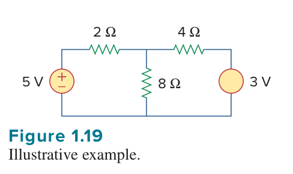

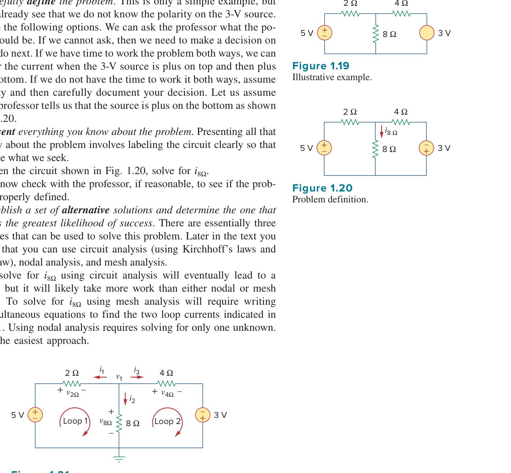

<template #solution>

取下端導線為參考節點，未知節點電壓為 $v_1$。對該節點寫 KCL：

$$
\frac{v_1-5}{2}+\frac{v_1}{8}+\frac{v_1+3}{4}=0.
$$

兩邊乘以 $8$ 後：

$$
(4v_1-20)+v_1+(2v_1+6)=0
\quad\Rightarrow\quad 7v_1=14,
$$

故 $v_1=2\ \mathrm{V}$，且

$$
i_{8\Omega}=\frac{v_1}{8}=\frac{2}{8}=0.25\ \mathrm{A}.
$$

驗算 KCL：$(-1.5)+0.25+1.25=0$；依圖示方向，電流向下流過 $8\ \Omega$ 電阻。

</template>

</PracticeCard>

<PracticeCard id="ch1-pr10" type="practice" title="Practice Problem 1.10：練習問題解決流程" source="課本 p.28" topic="問題解決流程">

請將本章介紹的問題解決流程，套用到本章末較困難的題目。流程包括：

1. 仔細界定問題。
2. 列出你對問題所知的一切。
3. 建立一組替代解法，並選擇最有可能成功的方法。
4. 嘗試解決問題。
5. 評估解答並檢查其正確性。
6. 判斷問題是否已獲得滿意解決；若尚未解決，便回到第 3 步繼續進行。

<template #solution>

教材對 `Practice Problem 1.10` 僅提供上述開放式練習指示，沒有指定章末題號，也沒有提供唯一的數值標準答案。因此本題目前無法進行特定電路的代數回代驗算；待指定欲套用的章末題目後，再依該題教材答案核對。

</template>

</PracticeCard>

## 章末 Problems（1.1–1.39）

以下保留課本英文原題與原圖，題幹中的數值、符號和圖表可直接對照。奇數題的「查看詳解」附上課本附錄 D（PDF 第 931 頁）原版答案；偶數題因附錄未提供答案，改附標明來源的自行推導。附錄只提供最終答案，未附計算過程。

<PracticeCard id="ch1-problem-01" type="exercise" title="章末習題 1.1" source="課本 p.24" topic="電荷與電流">

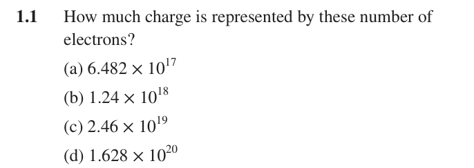

<template #solution>

課本附錄 D「Answers to Odd-Numbered Problems」對習題 1.1 的原版答案（PDF 第 931 頁）：

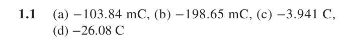

</template>

</PracticeCard>

<PracticeCard id="ch1-problem-02" type="exercise" title="章末習題 1.2" source="課本 p.24" topic="電荷與電流">

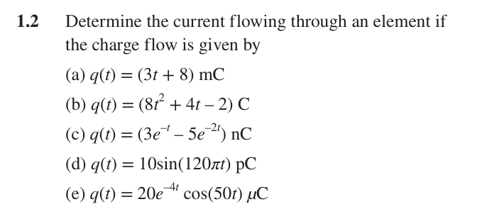

<template #solution>

**自行推導**（課本附錄 D 未列此偶數題答案）。由 $i=dq/dt$，各小題逐項微分：

- (a) $i=3\,\mathrm{mA}$。
- (b) $i=(16t+4)\,\mathrm{A}$。
- (c) $i=(-3e^{-t}+10e^{-2t})\,\mathrm{nA}$。
- (d) $i=1200\pi\cos(120\pi t)\,\mathrm{pA}$。
- (e) $i=20e^{-4t}[-4\cos(50t)-50\sin(50t)]\,\mathrm{\mu A}$。

</template>

</PracticeCard>

<PracticeCard id="ch1-problem-03" type="exercise" title="章末習題 1.3" source="課本 p.24" topic="電荷與電流">

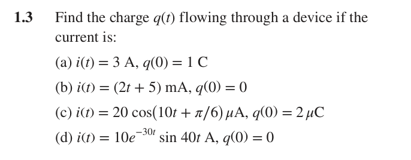

<template #solution>

課本附錄 D「Answers to Odd-Numbered Problems」對習題 1.3 的原版答案（PDF 第 931 頁）：

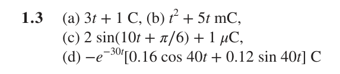

</template>

</PracticeCard>

<PracticeCard id="ch1-problem-04" type="exercise" title="章末習題 1.4" source="課本 p.24" topic="電荷與電流">

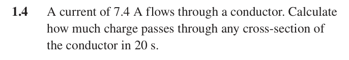

<template #solution>

**自行推導**（課本附錄 D 未列此偶數題答案）。恆定電流下 $q=I\Delta t=(7.4\,\mathrm{A})(20\,\mathrm{s})=148\,\mathrm{C}$。回代 $148/20=7.4\,\mathrm{A}$。

</template>

</PracticeCard>

<PracticeCard id="ch1-problem-05" type="exercise" title="章末習題 1.5" source="課本 p.24" topic="電荷與電流">

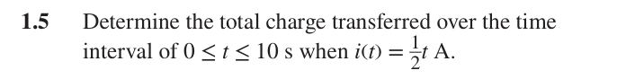

<template #solution>

課本附錄 D「Answers to Odd-Numbered Problems」對習題 1.5 的原版答案（PDF 第 931 頁）：

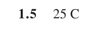

</template>

</PracticeCard>

<PracticeCard id="ch1-problem-06" type="exercise" title="章末習題 1.6" source="課本 p.24" topic="電荷與電流">

**老師指定練習題**（CH001 課堂投影片第 47–48 頁 Homework 清單）。

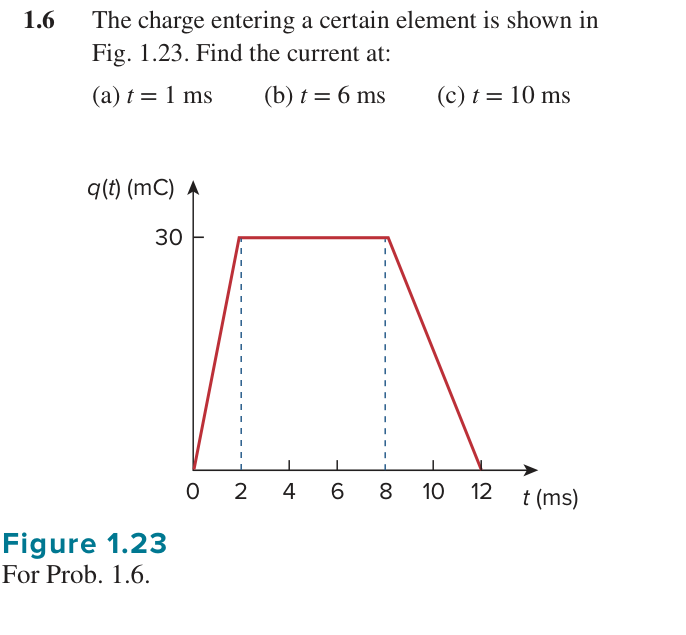

<template #solution>

**自行推導**（課本附錄 D 未列此偶數題答案）。圖 1.23 的電流是電荷曲線的斜率 $i=dq/dt$：

- (a) $0$ 至 $2\,\mathrm{ms}$：$i=(30-0)\,\mathrm{mC}/(2-0)\,\mathrm{ms}=15\,\mathrm{A}$，故 $i(1\,\mathrm{ms})=15\,\mathrm{A}$。
- (b) $2$ 至 $8\,\mathrm{ms}$ 電荷不變，故 $i(6\,\mathrm{ms})=0$。
- (c) $8$ 至 $12\,\mathrm{ms}$：$i=(0-30)\,\mathrm{mC}/(12-8)\,\mathrm{ms}=-7.5\,\mathrm{A}$，故 $i(10\,\mathrm{ms})=-7.5\,\mathrm{A}$。

</template>

</PracticeCard>

<PracticeCard id="ch1-problem-07" type="exercise" title="章末習題 1.7" source="課本 p.24" topic="電荷與電流">

**老師指定練習題**（CH001 課堂投影片第 47–48 頁 Homework 清單）。

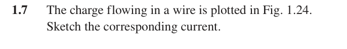

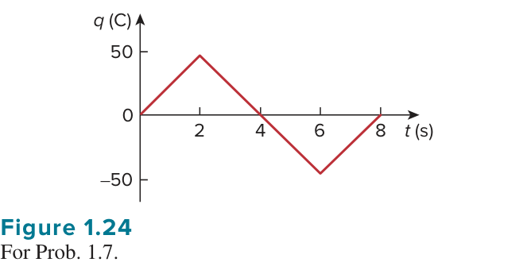

<template #solution>

課本附錄 D「Answers to Odd-Numbered Problems」對習題 1.7 的原版答案（PDF 第 931 頁）：

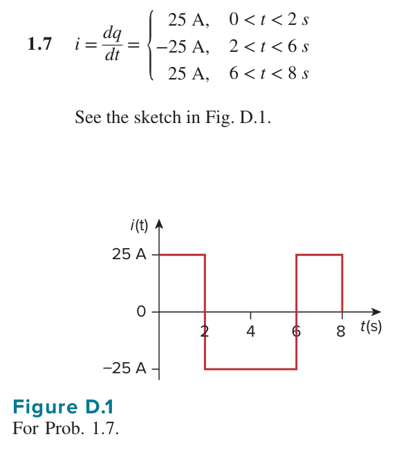

</template>

</PracticeCard>

<PracticeCard id="ch1-problem-08" type="exercise" title="章末習題 1.8" source="課本 p.24" topic="電荷與電流">

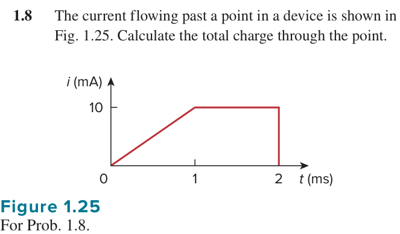

<template #solution>

**自行推導**（課本附錄 D 未列此偶數題答案）。通過的電荷等於圖 1.25 下的面積；$0$ 至 $1\,\mathrm{ms}$ 是三角形，$1$ 至 $2\,\mathrm{ms}$ 是長方形：

$$q=\tfrac12(1\,\mathrm{ms})(10\,\mathrm{mA})+(1\,\mathrm{ms})(10\,\mathrm{mA})=15\,\mathrm{\mu C}.$$

</template>

</PracticeCard>

<PracticeCard id="ch1-problem-09" type="exercise" title="章末習題 1.9" source="課本 p.24" topic="電荷與電流">

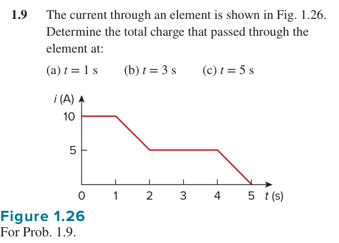

<template #solution>

課本附錄 D「Answers to Odd-Numbered Problems」對習題 1.9 的原版答案（PDF 第 931 頁）：

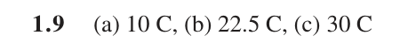

</template>

</PracticeCard>

<PracticeCard id="ch1-problem-10" type="exercise" title="章末習題 1.10" source="課本 p.24" topic="電壓、功率與能量">

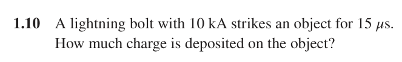

<template #solution>

**自行推導**（課本附錄 D 未列此偶數題答案）。$q=I\Delta t=(10\times10^3\,\mathrm{A})(15\times10^{-6}\,\mathrm{s})=0.15\,\mathrm{C}$。

</template>

</PracticeCard>

<PracticeCard id="ch1-problem-11" type="exercise" title="章末習題 1.11" source="課本 p.24" topic="電壓、功率與能量">

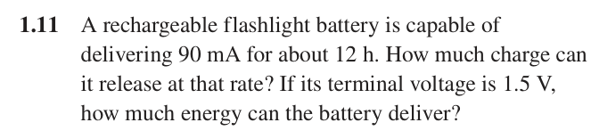

<template #solution>

課本附錄 D「Answers to Odd-Numbered Problems」對習題 1.11 的原版答案（PDF 第 931 頁）：

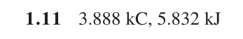

</template>

</PracticeCard>

<PracticeCard id="ch1-problem-12" type="exercise" title="章末習題 1.12" source="課本 p.24" topic="電壓、功率與能量">

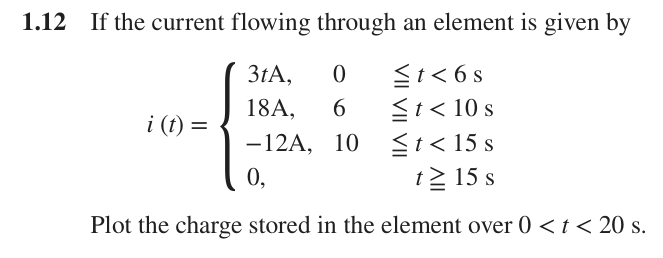

<template #solution>

**自行推導**（課本附錄 D 未列此偶數題答案）。以 $q(0)=0$ 為繪圖基準，逐段積分 $dq/dt=i(t)$：

$$
q(t)=\begin{cases}
1.5t^2, &0\le t<6,\\
54+18(t-6), &6\le t<10,\\
126-12(t-10), &10\le t<15,\\
66, &15\le t\le20,
\end{cases}\qquad\mathrm{C}.
$$

依序連結 $(0,0)$、$(6,54)$、$(10,126)$、$(15,66)$、$(20,66)$；第一段為拋物線，其餘為直線。各段求導均回到題給電流，分段交界的電荷也連續。題目未指定初始電荷，若 $q(0)\ne0$，整條曲線需再加上該常數。

</template>

</PracticeCard>

<PracticeCard id="ch1-problem-13" type="exercise" title="章末習題 1.13" source="課本 p.25" topic="電壓、功率與能量">

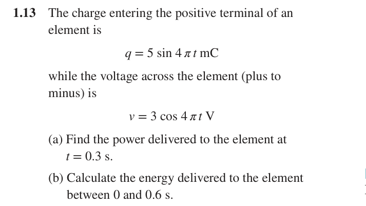

<template #solution>

課本附錄 D「Answers to Odd-Numbered Problems」對習題 1.13 的原版答案（PDF 第 931 頁）：

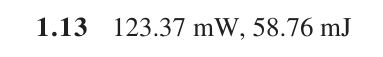

</template>

</PracticeCard>

<PracticeCard id="ch1-problem-14" type="exercise" title="章末習題 1.14" source="課本 p.25" topic="電壓、功率與能量">

**老師指定練習題**（CH001 課堂投影片第 47–48 頁 Homework 清單）。

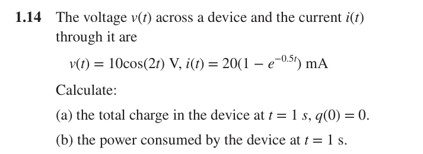

<template #solution>

**自行推導**（課本附錄 D 未列此偶數題答案）。由 $q(0)=0$ 與 $i=dq/dt$：

$$q(1)=\int_0^1 20(1-e^{-0.5t})\,dt=20[-1+2e^{-0.5}]\,\mathrm{mC}\approx4.261\,\mathrm{mC}.$$

以被動符號慣例計算瞬時功率：

$$p(1)=v(1)i(1)=200\cos(2)(1-e^{-0.5})\,\mathrm{mW}\approx-32.748\,\mathrm{mW}.$$

負值表示在該瞬間裝置淨輸出 $32.748\,\mathrm{mW}$，而非吸收功率。

> **有疑慮｜講義答案與課本題幹不一致：** CH001 投影片第 48 頁寫 $q=13.65\,\mathrm{mC}$、$p=171.71\,\mathrm{mW}$，但與本頁課本題幹給的 $v(t)=10\cos(2t)$、$i(t)=20(1-e^{-0.5t})$ 不符。以上依題給函數積分與代入 $t=1\,\mathrm{s}$，故保留可回算的數值，並明列此差異。

</template>

</PracticeCard>

<PracticeCard id="ch1-problem-15" type="exercise" title="章末習題 1.15" source="課本 p.25" topic="電壓、功率與能量">

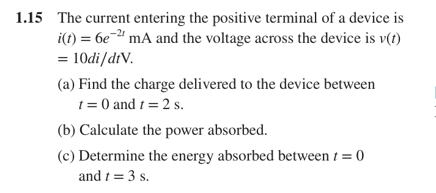

<template #solution>

課本附錄 D「Answers to Odd-Numbered Problems」對習題 1.15 的原版答案（PDF 第 931 頁）：

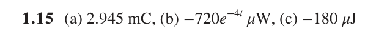

</template>

</PracticeCard>

<PracticeCard id="ch1-problem-16" type="exercise" title="章末習題 1.16" source="課本 p.25" topic="電路元件">

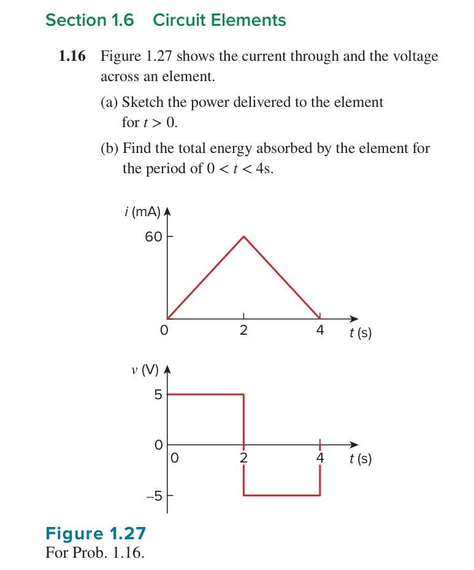

<template #solution>

**自行推導**（課本附錄 D 未列此偶數題答案）。圖 1.27 的電流在前 $2\,\mathrm{s}$ 以 $30\,\mathrm{mA/s}$ 上升，後 $2\,\mathrm{s}$ 以同斜率下降。取 $p=vi$ 為元件吸收功率：

$$p(t)=\begin{cases}150t\,\mathrm{mW},&0<t<2,\\-150(4-t)\,\mathrm{mW},&2<t<4,\\0,&t>4.\end{cases}$$

因此功率圖在 $t=0$ 至 $2$ 從 $0$ 線性上升至 $+300\,\mathrm{mW}$，於 $t=2$ 瞬間跳到 $-300\,\mathrm{mW}$，再於 $t=4$ 升回 $0$。正、負三角形面積各為 $+0.300\,\mathrm{J}$ 與 $-0.300\,\mathrm{J}$，所以 $0<t<4$ 的**淨吸收能量**為 $0\,\mathrm{J}$。

</template>

</PracticeCard>

<PracticeCard id="ch1-problem-17" type="exercise" title="章末習題 1.17" source="課本 p.25" topic="電路元件">

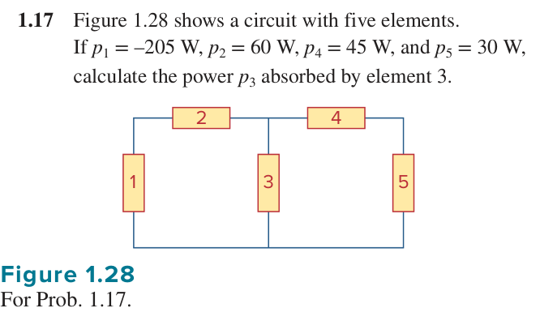

<template #solution>

課本附錄 D「Answers to Odd-Numbered Problems」對習題 1.17 的原版答案（PDF 第 931 頁）：

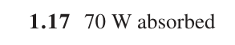

</template>

</PracticeCard>

<PracticeCard id="ch1-problem-18" type="exercise" title="章末習題 1.18" source="課本 p.25" topic="電路元件">

**老師指定練習題**（CH001 課堂投影片第 47–48 頁 Homework 清單）。

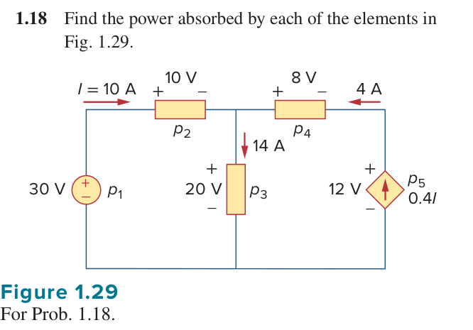

<template #solution>

**自行推導**（課本附錄 D 未列此偶數題答案）。依圖 1.29 的箭頭和極性，電流進入正端時取正吸收功率；進入負端時取負值。$0.4I=4\,\mathrm{A}$。

| 元件 | 計算 | 吸收功率 |
|---|---:|---:|
| $p_1$（30 V 電壓源） | $-30(10)$ | $-300\,\mathrm{W}$ |
| $p_2$（10 V） | $10(10)$ | $100\,\mathrm{W}$ |
| $p_3$（20 V） | $20(14)$ | $280\,\mathrm{W}$ |
| $p_4$（8 V） | $-8(4)$ | $-32\,\mathrm{W}$ |
| $p_5$（12 V 受控源） | $-12(4)$ | $-48\,\mathrm{W}$ |

功率閉合：$-300+100+280-32-48=0\,\mathrm{W}$。

**講義對照**：上述五個功率值與 CH001 投影片第 48 頁相符。

</template>

</PracticeCard>

<PracticeCard id="ch1-problem-19" type="exercise" title="章末習題 1.19" source="課本 p.25" topic="電路元件">

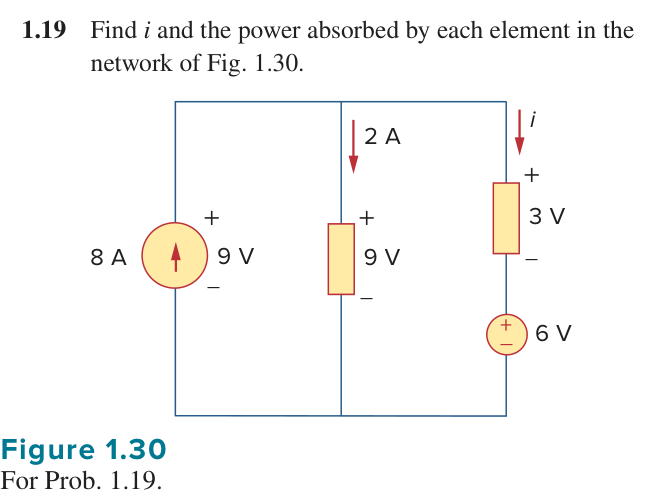

<template #solution>

課本附錄 D「Answers to Odd-Numbered Problems」對習題 1.19 的原版答案（PDF 第 931 頁）：

</template>

</PracticeCard>

<PracticeCard id="ch1-problem-20" type="exercise" title="章末習題 1.20" source="課本 p.25" topic="電路元件">

**老師指定練習題**（CH001 課堂投影片第 47–48 頁 Homework 清單）。

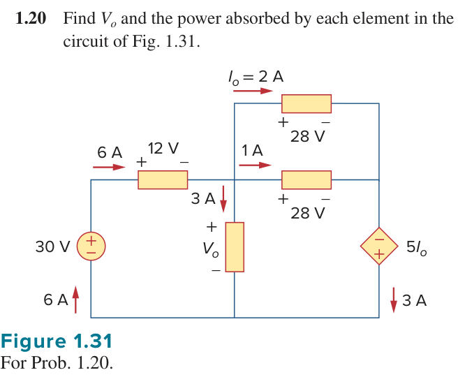

<template #solution>

**自行推導**（課本附錄 D 未列此偶數題答案）。沿左側電源與 12 V 元件往中間節點走，$V_o=30-12=18\,\mathrm{V}$。右側受控源電壓 $5I_o=5(2)=10\,\mathrm{V}$。依電流箭頭與極性計算各元件的吸收功率：

| 元件 | 計算 | 吸收功率 |
|---|---:|---:|
| 30 V 電壓源 | $-30(6)$ | $-180\,\mathrm{W}$ |
| 12 V 元件 | $12(6)$ | $72\,\mathrm{W}$ |
| $V_o$ 元件 | $18(3)$ | $54\,\mathrm{W}$ |
| 上方 28 V 元件 | $28(2)$ | $56\,\mathrm{W}$ |
| 中間 28 V 元件 | $28(1)$ | $28\,\mathrm{W}$ |
| $5I_o$ 受控源 | $-10(3)$ | $-30\,\mathrm{W}$ |

回代節點電流 $6=3+2+1\,\mathrm{A}$；功率總和 $-180+72+54+56+28-30=0\,\mathrm{W}$。

**講義對照**：$V_o=18\,\mathrm{V}$ 與各元件功率均與 CH001 投影片第 48 頁相符。

</template>

</PracticeCard>

<PracticeCard id="ch1-problem-21" type="exercise" title="章末習題 1.21" source="課本 p.26" topic="應用題">

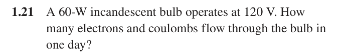

<template #solution>

課本附錄 D「Answers to Odd-Numbered Problems」對習題 1.21 的原版答案（PDF 第 931 頁）：

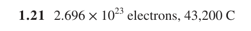

</template>

</PracticeCard>

<PracticeCard id="ch1-problem-22" type="exercise" title="章末習題 1.22" source="課本 p.26" topic="應用題">

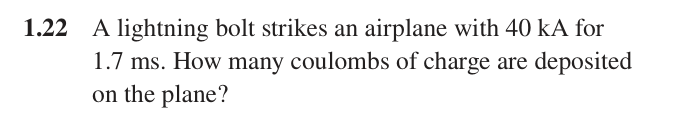

<template #solution>

**自行推導**（課本附錄 D 未列此偶數題答案）。$q=I\Delta t=(40\times10^3\,\mathrm{A})(1.7\times10^{-3}\,\mathrm{s})=68\,\mathrm{C}$。

</template>

</PracticeCard>

<PracticeCard id="ch1-problem-23" type="exercise" title="章末習題 1.23" source="課本 p.26" topic="應用題">

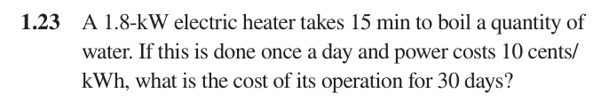

<template #solution>

課本附錄 D「Answers to Odd-Numbered Problems」對習題 1.23 的原版答案（PDF 第 931 頁）：

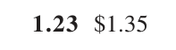

</template>

</PracticeCard>

<PracticeCard id="ch1-problem-24" type="exercise" title="章末習題 1.24" source="課本 p.26" topic="應用題">

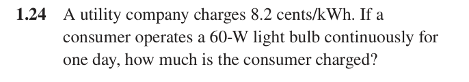

<template #solution>

**自行推導**（課本附錄 D 未列此偶數題答案）。一天用電量 $E=(0.060\,\mathrm{kW})(24\,\mathrm{h})=1.44\,\mathrm{kWh}$；費用為 $1.44(8.2)=11.808$ 美分，約 **11.81 美分**。

</template>

</PracticeCard>

<PracticeCard id="ch1-problem-25" type="exercise" title="章末習題 1.25" source="課本 p.26" topic="應用題">

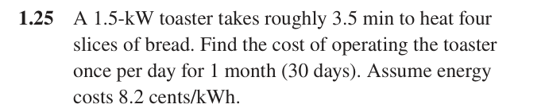

<template #solution>

課本附錄 D「Answers to Odd-Numbered Problems」對習題 1.25 的原版答案（PDF 第 931 頁）：

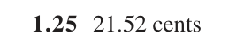

</template>

</PracticeCard>

<PracticeCard id="ch1-problem-26" type="exercise" title="章末習題 1.26" source="課本 p.26" topic="應用題">

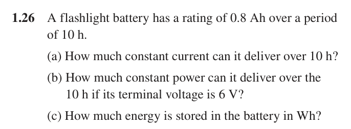

<template #solution>

**自行推導**（課本附錄 D 未列此偶數題答案）。額定容量 $0.8\,\mathrm{Ah}=I(10\,\mathrm{h})$：

- (a) $I=0.08\,\mathrm{A}=80\,\mathrm{mA}$。
- (b) $P=VI=(6)(0.08)=0.48\,\mathrm{W}$。
- (c) $E=P\Delta t=(0.48\,\mathrm{W})(10\,\mathrm{h})=4.8\,\mathrm{Wh}$。

</template>

</PracticeCard>

<PracticeCard id="ch1-problem-27" type="exercise" title="章末習題 1.27" source="課本 p.26" topic="應用題">

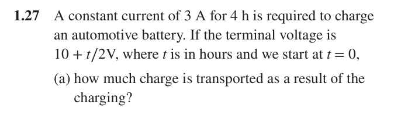

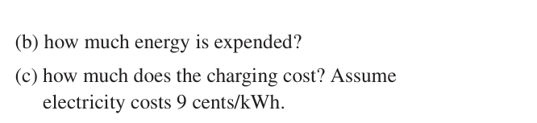

<template #solution>

課本附錄 D「Answers to Odd-Numbered Problems」對習題 1.27 的原版答案（PDF 第 931 頁）：

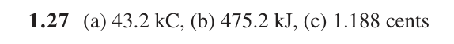

</template>

</PracticeCard>

<PracticeCard id="ch1-problem-28" type="exercise" title="章末習題 1.28" source="課本 p.26" topic="應用題">

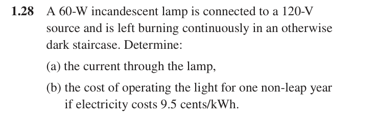

<template #solution>

**自行推導**（課本附錄 D 未列此偶數題答案）。

- (a) $I=P/V=60/120=0.5\,\mathrm{A}$。
- (b) 平年共 $365\times24=8760\,\mathrm{h}$。用電量 $(0.060\,\mathrm{kW})(8760\,\mathrm{h})=525.6\,\mathrm{kWh}$，費用 $525.6(9.5\,\mathrm{cents/kWh})=4993.2$ 美分，即 **$49.932$ 美元**（約 $49.93）。

</template>

</PracticeCard>

<PracticeCard id="ch1-problem-29" type="exercise" title="章末習題 1.29" source="課本 p.26" topic="應用題">

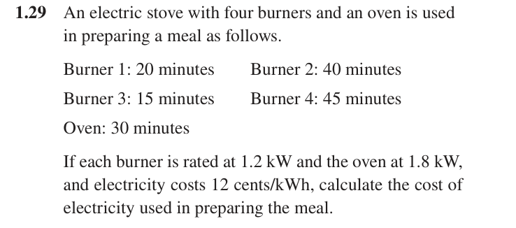

<template #solution>

課本附錄 D「Answers to Odd-Numbered Problems」對習題 1.29 的原版答案（PDF 第 931 頁）：

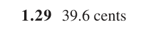

</template>

</PracticeCard>

<PracticeCard id="ch1-problem-30" type="exercise" title="章末習題 1.30" source="課本 p.26" topic="應用題">

<template #solution>

**自行推導**（課本附錄 D 未列此偶數題答案）。本月用量超過 250 kWh，額外用量為 $2436-250=2186\,\mathrm{kWh}$。月費

$$6+250(0.02)+2186(0.07)=\$164.02.$$

</template>

</PracticeCard>

<PracticeCard id="ch1-problem-31" type="exercise" title="章末習題 1.31" source="課本 p.26" topic="應用題">

**老師指定練習題**（CH001 課堂投影片第 47–48 頁 Homework 清單）。

<template #solution>

課本附錄 D「Answers to Odd-Numbered Problems」對習題 1.31 的原版答案（PDF 第 931 頁）：

</template>

</PracticeCard>

<PracticeCard id="ch1-problem-32" type="exercise" title="章末習題 1.32" source="課本 p.26" topic="綜合題">

<template #solution>

**自行推導**（課本附錄 D 未列此偶數題答案）。由 $t=q/I$：

$$t=\frac{15\,\mathrm{C}}{20\times10^{-6}\,\mathrm{A}}=750{,}000\,\mathrm{s}\approx208.33\,\mathrm{h}\approx8.68\,\mathrm{days}.$$

</template>

</PracticeCard>

<PracticeCard id="ch1-problem-33" type="exercise" title="章末習題 1.33" source="課本 p.26" topic="綜合題">

<template #solution>

課本附錄 D「Answers to Odd-Numbered Problems」對習題 1.33 的原版答案（PDF 第 931 頁）：

</template>

</PracticeCard>

<PracticeCard id="ch1-problem-34" type="exercise" title="章末習題 1.34" source="課本 p.26" topic="綜合題">

<template #solution>

**自行推導**（課本附錄 D 未列此偶數題答案）。由圖 1.32，基礎功率 200 W 持續 $18\,\mathrm{h}$；800 W 持續 $2\,\mathrm{h}$；1200 W 持續 $4\,\mathrm{h}$，共 24 h。

- (a) $E=0.2(18)+0.8(2)+1.2(4)=10.0\,\mathrm{kWh}$。
- (b) $P_{\mathrm{avg}}=E/(24\,\mathrm{h})=0.4167\,\mathrm{kW}\approx416.7\,\mathrm{W}$。

</template>

</PracticeCard>

<PracticeCard id="ch1-problem-35" type="exercise" title="章末習題 1.35" source="課本 p.27" topic="綜合題">

<template #solution>

課本附錄 D「Answers to Odd-Numbered Problems」對習題 1.35 的原版答案（PDF 第 931 頁）：

</template>

</PracticeCard>

<PracticeCard id="ch1-problem-36" type="exercise" title="章末習題 1.36" source="課本 p.27" topic="綜合題">

<template #solution>

**自行推導**（課本附錄 D 未列此偶數題答案）。容量 $Q=160\,\mathrm{Ah}$，故

- (a) $I=Q/t=160/40=4\,\mathrm{A}$。
- (b) $t=Q/I=160\,\mathrm{Ah}/0.001\,\mathrm{A}=160{,}000\,\mathrm{h}\approx6666.7\,\mathrm{days}$。此為理想容量估算，未計自放電。

</template>

</PracticeCard>

<PracticeCard id="ch1-problem-37" type="exercise" title="章末習題 1.37" source="課本 p.27" topic="綜合題">

<template #solution>

課本附錄 D「Answers to Odd-Numbered Problems」對習題 1.37 的原版答案（PDF 第 931 頁）：

</template>

</PracticeCard>

<PracticeCard id="ch1-problem-38" type="exercise" title="章末習題 1.38" source="課本 p.27" topic="綜合題">

<template #solution>

**自行推導**（課本附錄 D 未列此偶數題答案）。馬達功率 $P=(10\,\mathrm{hp})(746\,\mathrm{W/hp})=7460\,\mathrm{W}$。30 分鐘為 $1800\,\mathrm{s}$，故 $E=P\Delta t=7460(1800)=13{,}428{,}000\,\mathrm{J}=13.428\,\mathrm{MJ}$。

</template>

</PracticeCard>

<PracticeCard id="ch1-problem-39" type="exercise" title="章末習題 1.39" source="課本 p.27" topic="綜合題">

<template #solution>

課本附錄 D「Answers to Odd-Numbered Problems」對習題 1.39 的原版答案（PDF 第 931 頁）：

</template>

</PracticeCard>
