# Chapter 3 分析方法：例題與練習題

本頁面彙整 Alexander & Sadiku《Fundamentals of Electric Circuits》第 3 章之核心 Example 與 Practice Problem。前 26 張例題與課中練習卡附有詳解；下方另收錄課本第 3 章章末習題 3.1–3.93。章末習題依原書題幹與電路圖呈現；詳解區收錄附錄 D 的奇數題標準答案，偶數題則標明課本未提供答案。完成題目後可勾選標記學習進度。

<PracticeFilter prefix="ch3-" />
<PracticeProgress :total="119" prefix="ch3-" />

<PracticeCard id="ch3-ex1" type="example" title="例題 3.1：兩節點電壓法" source="課本 p.88" topic="節點分析">

求圖 3.3(a) 電路的節點電壓 $v_1$ 與 $v_2$。

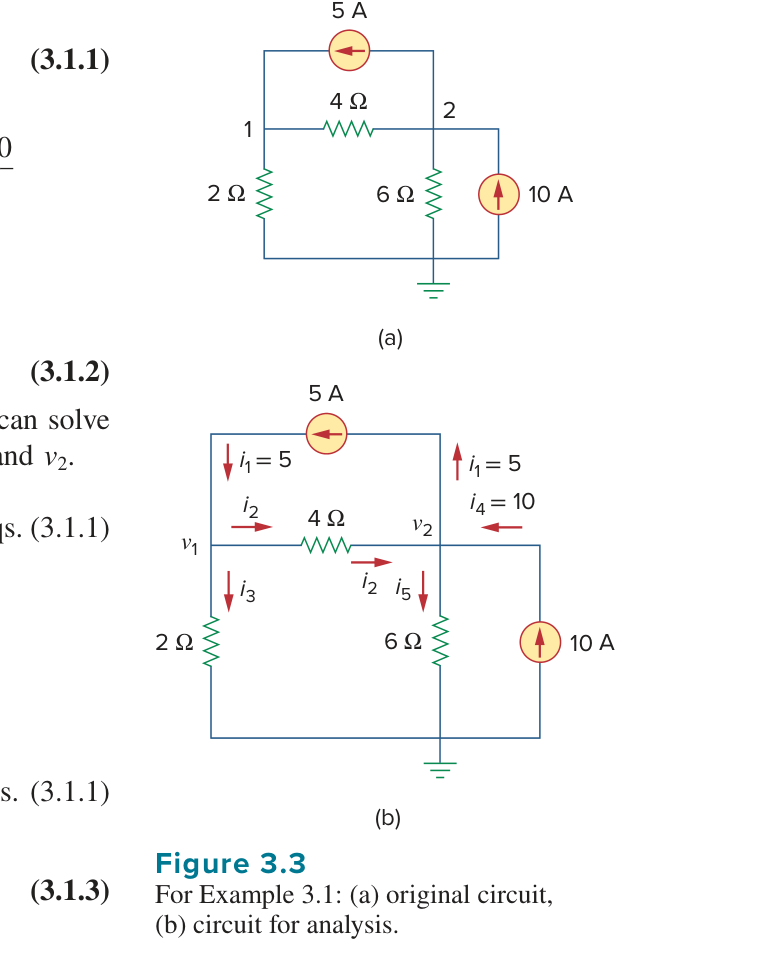

<template #solution>

以底部導線為參考節點。由節點 1 的 KCL：

$$
5=\frac{v_1-v_2}{4}+\frac{v_1}{2}
\quad\Longrightarrow\quad
3v_1-v_2=20.
$$

由節點 2 的 KCL：

$$
\frac{v_1-v_2}{4}+10=5+\frac{v_2}{6}
\quad\Longrightarrow\quad
-3v_1+5v_2=60.
$$

兩式相加得 $4v_2=80$，故 $v_2=20\ \mathrm{V}$；代回第一式得

$$
v_1=\frac{40}{3}\ \mathrm{V}=13.333\ \mathrm{V}.
$$

驗算：代回兩個 KCL 式皆成立；例如 $i_2=(v_1-v_2)/4=-1.6668\ \mathrm{A}$，負號表示實際方向與假設相反。

</template>

</PracticeCard>

<PracticeCard id="ch3-pr1" type="practice" title="練習題 3.1：兩節點電壓" source="課本 p.89" topic="節點分析">

求圖 3.4 電路的節點電壓 $v_1$ 與 $v_2$。

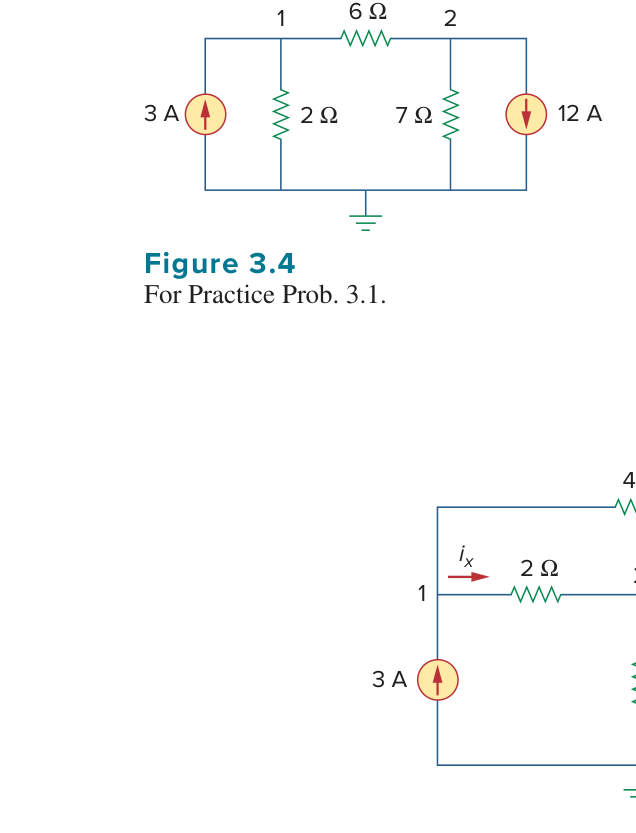

<template #solution>

以圖中的參考節點為 $0\ \mathrm{V}$，依電流源箭頭方向在兩個非參考節點分別套用 KCL，並以歐姆定律將每個電阻支路電流改寫為節點電壓差除以電阻；解該二元聯立式。

**課本答案：**

$$
v_1=-6\ \mathrm{V},\qquad v_2=-42\ \mathrm{V}.
$$

驗算時，以這兩個節點電壓重算各電阻電流，代回兩個節點的 KCL；電流源方向須以圖 3.4 的箭頭為準。

</template>

</PracticeCard>

<PracticeCard id="ch3-ex2" type="example" title="例題 3.2：三節點與受控電流源" source="課本 p.90" topic="節點分析">

求圖 3.5(a) 三個非參考節點的電壓 $v_1$、$v_2$、$v_3$。

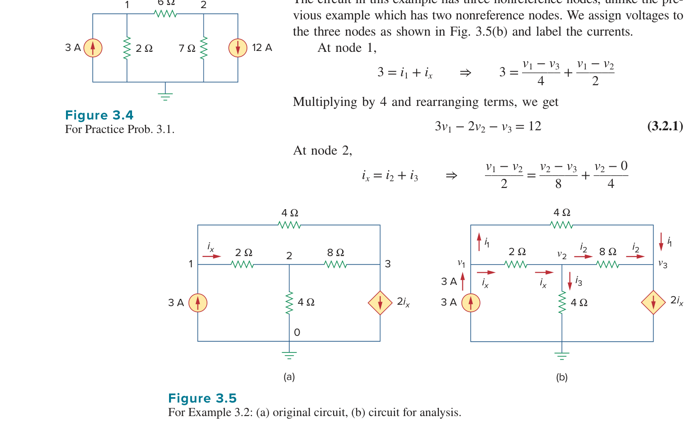

<template #solution>

由圖中的 $i_x=(v_1-v_2)/2$，在三個節點套用 KCL，得到

$$
\begin{aligned}
3v_1-2v_2-v_3&=12,\\
-4v_1+7v_2-v_3&=0,\\
2v_1-3v_2+v_3&=0.
\end{aligned}
$$

第一式加第三式，及第二式加第三式，分別給出

$$
v_1-v_2=2.4,\qquad v_1=2v_2.
$$

因此 $v_2=2.4\ \mathrm{V}$、$v_1=4.8\ \mathrm{V}$；再代入第三式，$v_3=-2.4\ \mathrm{V}$。三個結果代回上列 KCL 方程式，殘差皆為零。

</template>

</PracticeCard>

<PracticeCard id="ch3-pr2" type="practice" title="練習題 3.2：受控源節點分析" source="課本 p.92" topic="節點分析">

求圖 3.6 三個非參考節點的電壓 $v_1$、$v_2$、$v_3$。

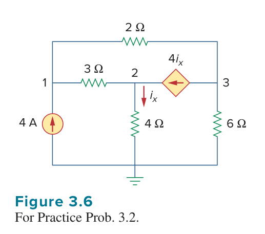

<template #solution>

先依圖示電阻與 $i_x$ 的定義，以節點電壓表示各支路電流；再於節點 1、2、3 套用 KCL，受控電流源的值須保持為圖示的 $4i_x$，最後解三元聯立方程式。

**課本答案：**

$$
v_1=32\ \mathrm{V},\qquad v_2=-25.6\ \mathrm{V},\qquad v_3=62.4\ \mathrm{V}.
$$

驗算時將結果代回每一節點的 KCL，並特別核對 $i_x$ 的參考方向與受控源 $4i_x$ 的箭頭方向。

</template>

</PracticeCard>

<PracticeCard id="ch3-ex3" type="example" title="例題 3.3：超節點" source="課本 p.94" topic="含電壓源的節點分析">

求圖 3.9 電路的節點電壓。

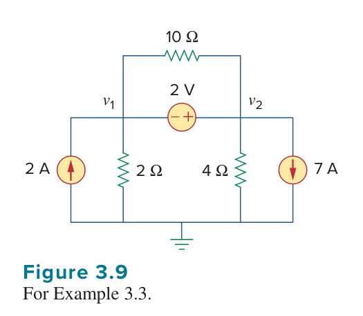

<template #solution>

將 2-V 電壓源兩端的節點 1、2 與其並聯元件視為超節點。對超節點寫 KCL：

$$
2=\frac{v_1}{2}+\frac{v_2}{4}+7
\quad\Longrightarrow\quad
v_2=-20-2v_1.
$$

穿過 2-V 電壓源寫 KVL，依圖的極性有

$$
-v_1-2+v_2=0
\quad\Longrightarrow\quad
v_2=v_1+2.
$$

聯立後得到

$$
v_1=-7.333\ \mathrm{V},\qquad v_2=-5.333\ \mathrm{V}.
$$

回代兩個方程式可得零殘差。跨接超節點的 $10\ \Omega$ 電阻不會出現在超節點的外部 KCL 方程式中。

</template>

</PracticeCard>

<PracticeCard id="ch3-pr3" type="practice" title="練習題 3.3：含電壓源的節點分析" source="課本 p.94" topic="超節點">

求圖 3.11 電路的 $v$ 與 $i$。

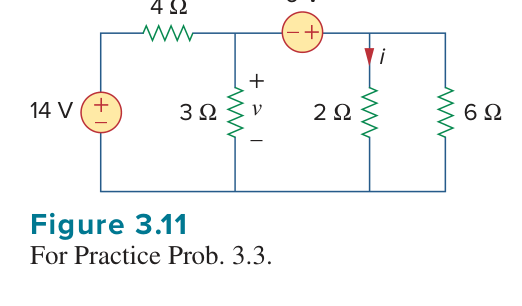

<template #solution>

以圖中電壓源連接的兩個非參考節點建立超節點：先對超節點邊界套用 KCL，再依兩個獨立電壓源的極性列出電壓拘束式；聯立後以題圖的 $v$ 正負標示及 $i$ 箭頭取值。

**課本答案：**

$$
v=-400\ \mathrm{mV},\qquad i=2.8\ \mathrm{A}.
$$

驗算時，代回超節點 KCL 與所有電壓源拘束式；$v$ 的負號表示實際極性與圖中指定極性相反。

</template>

</PracticeCard>

<PracticeCard id="ch3-ex4" type="example" title="例題 3.4：雙超節點與受控電壓源" source="課本 p.95" topic="超節點">

求圖 3.12 電路的節點電壓。

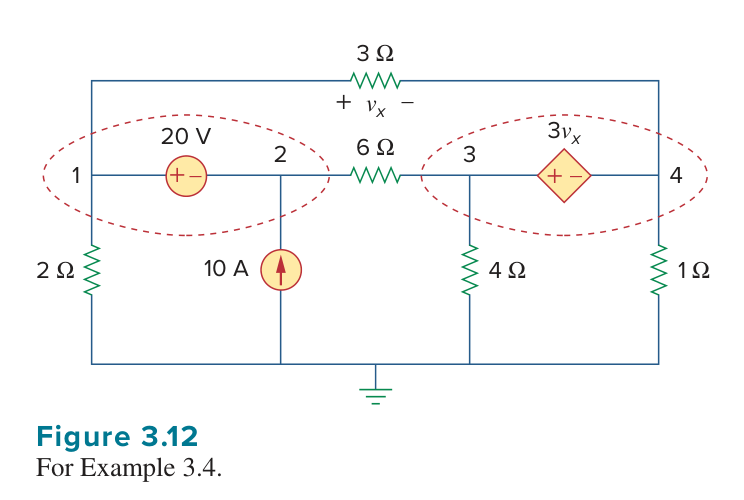

<template #solution>

節點 1–2 與節點 3–4 各形成一個超節點。由兩個超節點的 KCL 得

$$
\begin{aligned}
5v_1+v_2-v_3-2v_4&=60,\\
4v_1+2v_2-5v_3-16v_4&=0.
\end{aligned}
$$

再由電壓源支路的 KVL，取四個獨立方程中的另外兩式：

$$
v_1-v_2=20,\qquad 3v_1-v_3-2v_4=0.
$$

令 $v_2=v_1-20$ 後解聯立式，得到

$$
v_1=26.67\ \mathrm{V},\quad v_2=6.667\ \mathrm{V},\quad
v_3=173.33\ \mathrm{V},\quad v_4=-46.67\ \mathrm{V}.
$$

將結果代入未用的 KVL 式 $-2v_1-v_2+v_3+2v_4=20$，左右同為 $20\ \mathrm{V}$，完成回代驗算。

</template>

</PracticeCard>

<PracticeCard id="ch3-pr4" type="practice" title="練習題 3.4：含受控電壓源的節點分析" source="課本 p.97" topic="節點分析">

使用節點分析，求圖 3.14 電路的 $v_1$、$v_2$、$v_3$。

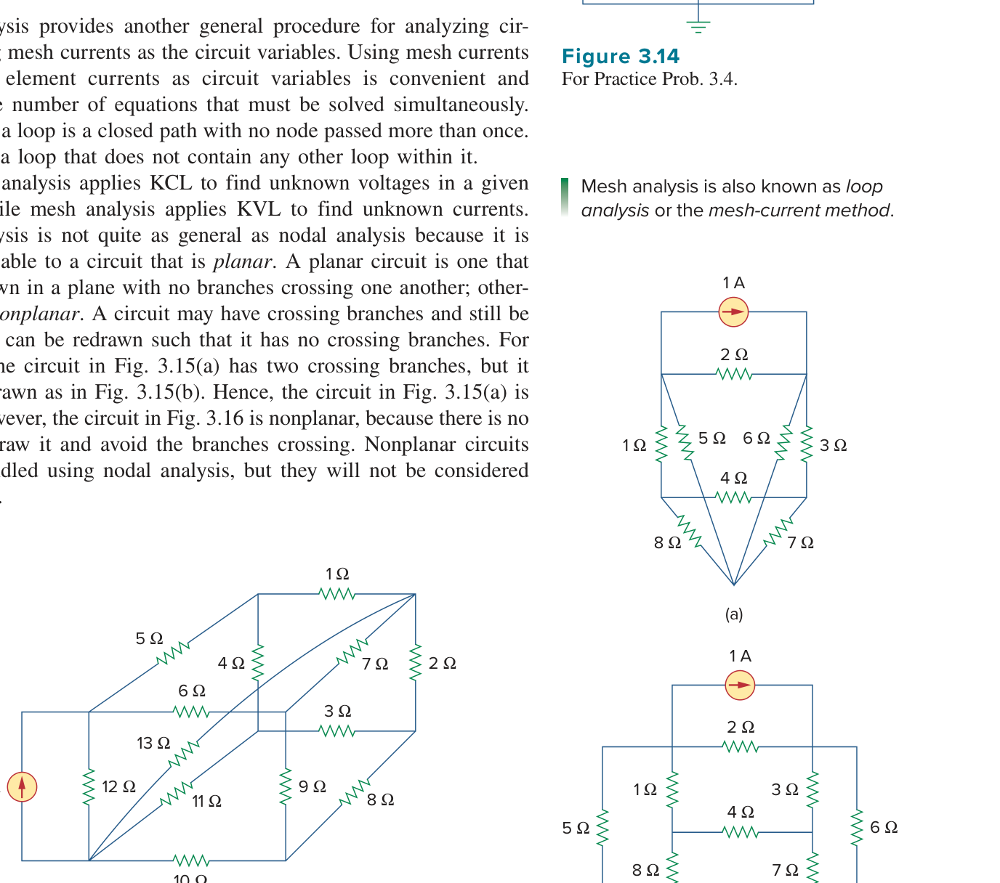

<template #solution>

依圖 3.14 的 $i$ 參考方向表示受控電壓源 $5i$；對各非參考節點（或必要的超節點）寫 KCL，並將 $25\ \mathrm{V}$ 電壓源與 $5i$ 的極性各自列為電壓拘束式後解聯立方程式。

**課本答案：**

$$
v_1=7.608\ \mathrm{V},\qquad v_2=-17.39\ \mathrm{V},\qquad v_3=1.6305\ \mathrm{V}.
$$

驗算時須以圖 3.14 的電流箭頭重新計算 $i$，並確認受控源的值與極性皆為 $5i$；圖 3.15、3.16 為本段關於平面與非平面電路的隨附圖。

</template>

</PracticeCard>

<PracticeCard id="ch3-ex5" type="example" title="例題 3.5：網孔分析求支路電流" source="課本 p.99" topic="網孔分析">

使用網孔分析，求圖 3.18 的支路電流 $I_1$、$I_2$、$I_3$。

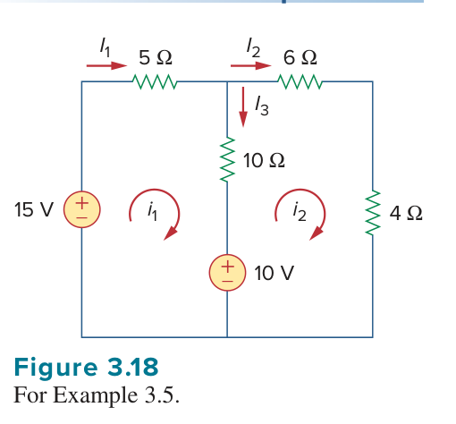

<template #solution>

令兩個網孔電流皆為順時針 $i_1$、$i_2$。套用 KVL 後得到

$$
3i_1-2i_2=1,
\qquad
i_1=2i_2-1.
$$

代入解得

$$
i_2=1\ \mathrm{A},\qquad i_1=1\ \mathrm{A}.
$$

由支路與網孔電流的關係

$$
I_1=i_1,\qquad I_2=i_2,\qquad I_3=i_1-i_2,
$$

故

$$
I_1=1\ \mathrm{A},\qquad I_2=1\ \mathrm{A},\qquad I_3=0\ \mathrm{A}.
$$

回代兩個 KVL 方程式分別為 $3(1)-2(1)=1$ 與 $1=2(1)-1$，均成立。

</template>

</PracticeCard>

<PracticeCard id="ch3-pr5" type="practice" title="Practice Problem 3.5：兩網孔電流" source="課本 p.100" topic="網孔分析">

求圖 3.19 電路的網孔電流 $i_1$ 與 $i_2$。

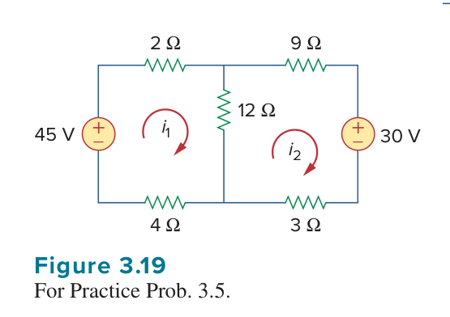

<template #solution>

依圖示的順時針網孔方向，先為兩個網孔各寫一條 KVL 方程；共用的 $4\,\Omega$ 支路電流須以兩網孔電流之差表示。聯立兩式後，依原題的參考方向得到：

$$
i_1=2.5\ \mathrm{A},\qquad i_2=0\ \mathrm{A}.
$$

回代時，兩個網孔的電壓升與壓降代數和皆應為零。上述為課本答案。

</template>

</PracticeCard>

<PracticeCard id="ch3-ex6" type="example" title="Example 3.6：含受控源的網孔分析" source="課本 p.100" topic="網孔分析、受控源">

以網孔分析求圖 3.20 中的電流 $I_o$。

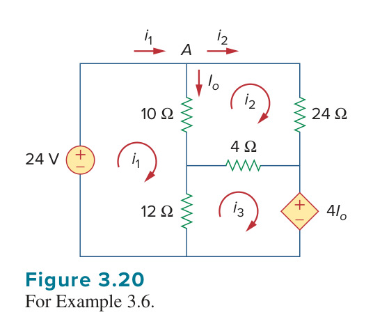

<template #solution>

三個網孔的 KVL 方程（同除以 $2$ 後）為：

$$
\begin{aligned}
11i_1-5i_2-6i_3&=12,\\
-5i_1+19i_2-2i_3&=0.
\end{aligned}
$$

節點 $A$ 的控制關係為 $I_o=i_1-i_2$；代入第三個網孔的 KVL，得

$$
-i_1-i_2+2i_3=0.
$$

解此聯立方程，課本得到

$$
i_1=2.25\ \mathrm{A},\quad i_2=0.75\ \mathrm{A},\quad i_3=1.5\ \mathrm{A}.
$$

故

$$
I_o=i_1-i_2=1.5\ \mathrm{A}.
$$

將此三個網孔電流代回上列三式，殘差皆為零。

</template>

</PracticeCard>

<PracticeCard id="ch3-pr6" type="practice" title="Practice Problem 3.6：受控源網孔電流" source="課本 p.102" topic="網孔分析、受控源">

以網孔分析求圖 3.21 中的 $I_o$。

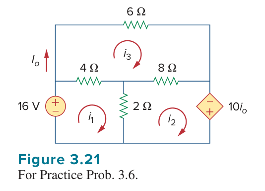

<template #solution>

依圖中兩個順時針網孔電流，分別寫出 KVL；中間 $2\,\Omega$ 電阻的支路電流要寫成兩網孔電流之差，並以圖示極性把受控電壓源 $10I_o$ 納入方程。再以 $I_o$ 的圖示參考方向建立控制關係並聯立求解。

課本答案為

$$
I_o=-4\ \mathrm{A}.
$$

負號表示實際電流方向與圖中 $I_o$ 的參考箭頭相反。

</template>

</PracticeCard>

<PracticeCard id="ch3-ex7" type="example" title="Example 3.7：交疊超網孔" source="課本 p.103" topic="超網孔分析">

利用網孔分析求圖 3.24 的 $i_1$ 至 $i_4$。

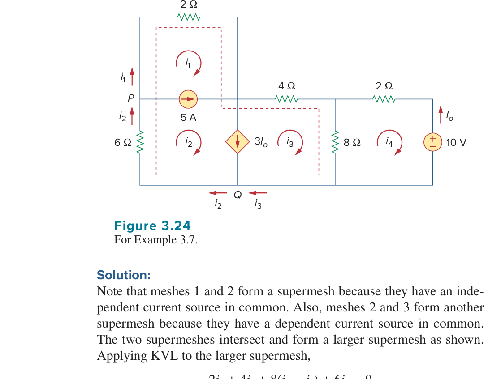

<template #solution>

網孔 1、2 與網孔 2、3 各有一個共用電流源；兩個超網孔相交，因此取其外圍形成較大的超網孔。KVL 與兩個電流源拘束式為

$$
\begin{aligned}
i_1+3i_2+6i_3-4i_4&=0,\\
i_2&=i_1+5,\\
i_2&=i_3-3i_4.
\end{aligned}
$$

又 $I_o=-i_4$，網孔 4 的 KVL 為

$$
5i_4-4i_3=-5.
$$

聯立後，課本結果為

$$
i_1=-7.5\ \mathrm{A},\quad i_2=-2.5\ \mathrm{A},\quad
i_3=3.93\ \mathrm{A},\quad i_4=2.143\ \mathrm{A}.
$$

代回兩個拘束式可分別得到 $-2.5=-7.5+5$ 與 $-2.5=3.93-3(2.143)$（四捨五入誤差除外）。

</template>

</PracticeCard>

<PracticeCard id="ch3-pr7" type="practice" title="Practice Problem 3.7：網孔法求三個電流" source="課本 p.104" topic="網孔分析">

使用網孔分析求圖 3.25 的 $i_1$、$i_2$ 與 $i_3$。

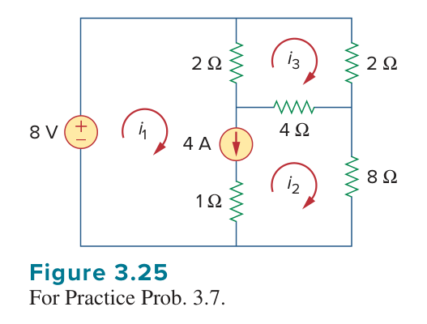

<template #solution>

依圖示三個順時針網孔設定 $i_1,i_2,i_3$。對各網孔寫 KVL；兩網孔共用的 $2\,\Omega$ 與 $4\,\Omega$ 支路，須用相鄰網孔電流之差表示。右側 $4\,\mathrm{A}$ 電流源提供相應的拘束式，將三式聯立即可求解。

課本答案為

$$
i_1=4.632\ \mathrm{A},\qquad
i_2=631.6\ \mathrm{mA},\qquad
i_3=1.4736\ \mathrm{A}.
$$

驗算時應以 $i_2=0.6316\ \mathrm{A}$ 代入各網孔 KVL，並確認電流源支路的拘束式成立。

</template>

</PracticeCard>

<PracticeCard id="ch3-ex8" type="example" title="Example 3.8：由檢視法建立節點電壓矩陣" source="課本 p.106" topic="節點分析、檢視法">

以檢視法寫出圖 3.27 的節點電壓矩陣方程。

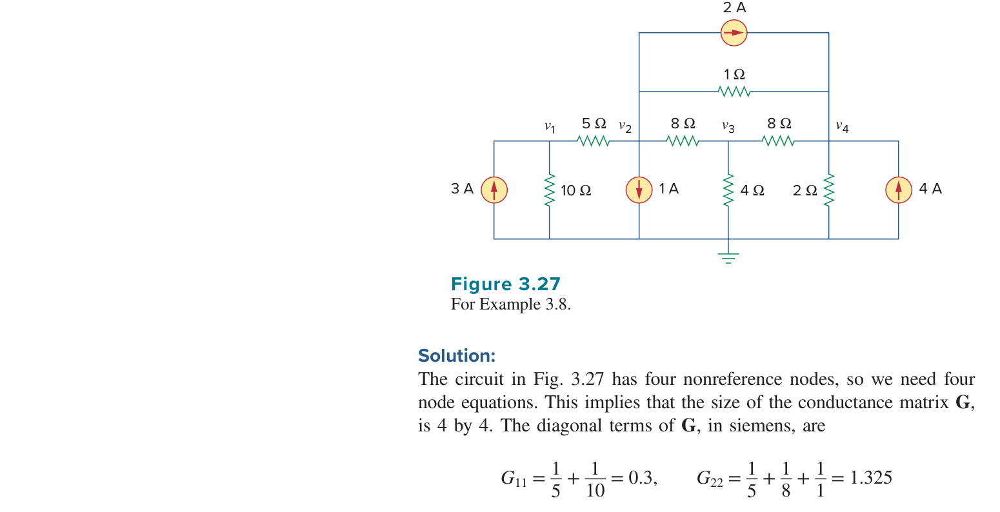

<template #solution>

四個非參考節點形成 $4\times4$ 導納矩陣。對角元素是接到該節點的導納和，非對角元素是兩節點間導納的負值；電流向節點流入取正。因此

$$
\begin{bmatrix}
0.3 & -0.2 & 0 & 0\\
-0.2 & 1.325 & -0.125 & -1\\
0 & -0.125 & 0.5 & -0.125\\
0 & -1 & -0.125 & 1.625
\end{bmatrix}
\begin{bmatrix}v_1\\v_2\\v_3\\v_4\end{bmatrix}
=
\begin{bmatrix}3\\-3\\0\\6\end{bmatrix}.
$$

例如 $G_{22}=1/5+1/8+1/1=1.325\ \mathrm{S}$，且 $i_2=-1-2=-3\ \mathrm{A}$；其餘項目以相同規則得到。這就是課本的矩陣方程。

</template>

</PracticeCard>

<PracticeCard id="ch3-pr8" type="practice" title="Practice Problem 3.8：節點方程的檢視法" source="課本 p.107" topic="節點分析、檢視法">

以檢視法求出圖 3.28 的節點電壓方程。

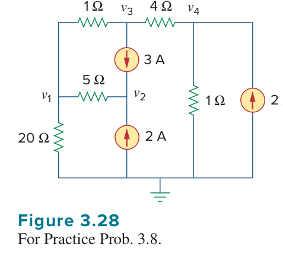

<template #solution>

各對角元素取該節點相連電阻的導納和，節點間的非對角元素取負導納；右側向量為流入節點的獨立電流源代數和。課本答案為

$$
\begin{bmatrix}
1.25 & -0.2 & -1 & 0\\
-0.2 & 0.2 & 0 & 0\\
-1 & 0 & 1.25 & -0.25\\
0 & 0 & -0.25 & 1.25
\end{bmatrix}
\begin{bmatrix}v_1\\v_2\\v_3\\v_4\end{bmatrix}
=
\begin{bmatrix}0\\5\\-3\\2\end{bmatrix}.
$$

例如 $G_{13}=-1\ \mathrm{S}$ 對應節點 1 與 3 間的 $1\,\Omega$ 電阻；逐項套用此規則即可驗證矩陣。

</template>

</PracticeCard>

<PracticeCard id="ch3-ex9" type="example" title="Example 3.9：由檢視法建立網孔電流矩陣" source="課本 p.107" topic="網孔分析、檢視法">

以檢視法寫出圖 3.29 的網孔電流方程。

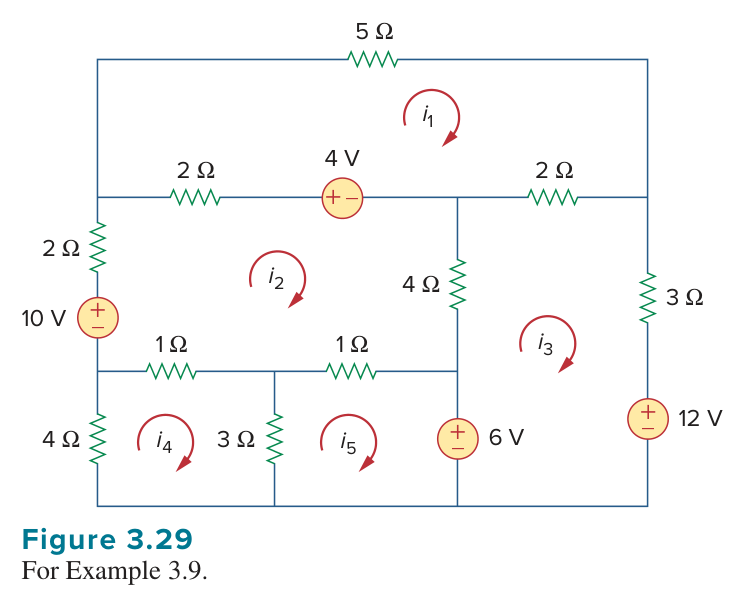

<template #solution>

共有五個網孔。電阻矩陣對角元素為各網孔電阻和，非對角元素為兩網孔共用電阻的負值；右側向量為沿順時針方向取的電壓源代數和。故

$$
\begin{bmatrix}
9 & -2 & -2 & 0 & 0\\
-2 & 10 & -4 & -1 & -1\\
-2 & -4 & 9 & 0 & 0\\
0 & -1 & 0 & 8 & -3\\
0 & -1 & 0 & -3 & 4
\end{bmatrix}
\begin{bmatrix}i_1\\i_2\\i_3\\i_4\\i_5\end{bmatrix}
=
\begin{bmatrix}4\\6\\-6\\0\\-6\end{bmatrix}.
$$

例如 $R_{22}=2+4+1+1+2=10\,\Omega$，而 $v_2=10-4=6\ \mathrm{V}$。這是課本建立的網孔方程。

</template>

</PracticeCard>

<PracticeCard id="ch3-pr9" type="practice" title="Practice Problem 3.9：網孔方程的檢視法" source="課本 p.108" topic="網孔分析、檢視法">

以檢視法求出圖 3.30 的網孔電流方程。

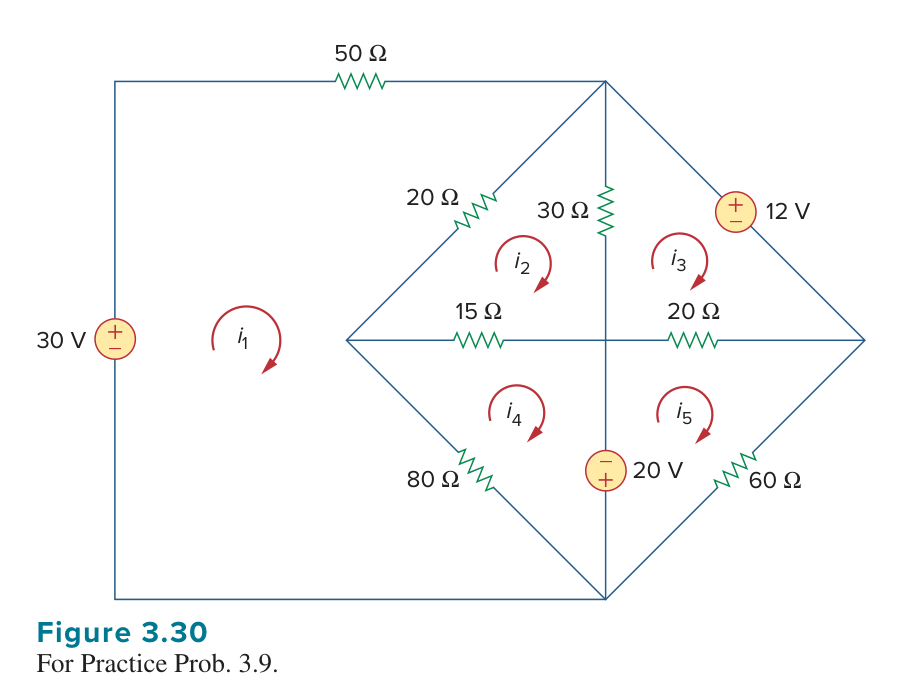

<template #solution>

以每個網孔電阻總和填入對角線、以共用電阻的負值填入非對角線，並按順時針方向計算各網孔的獨立電壓源代數和。課本答案為

$$
\begin{bmatrix}
150 & -20 & 0 & -80 & 0\\
-20 & 65 & -30 & -15 & 0\\
0 & -30 & 50 & 0 & -20\\
-80 & -15 & 0 & 95 & 0\\
0 & 0 & -20 & 0 & 80
\end{bmatrix}
\begin{bmatrix}i_1\\i_2\\i_3\\i_4\\i_5\end{bmatrix}
=
\begin{bmatrix}30\\0\\-12\\20\\-20\end{bmatrix}.
$$

例如 $R_{12}=-20\,\Omega$ 表示網孔 1、2 共用 $20\,\Omega$ 電阻，且第一列右側為 $30\ \mathrm{V}$。逐列核對電阻及電源極性即可驗證結果。

</template>

</PracticeCard>

<PracticeCard id="ch3-ex10" type="example" title="Example 3.10：以 PSpice 求節點電壓" source="課本 p.109" topic="PSpice 直流節點分析">

使用 PSpice 求圖 3.31 電路的節點電壓。

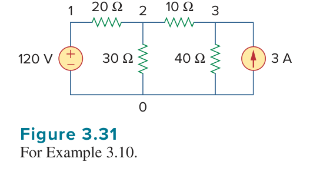

<template #solution>

1. 依圖 3.31 建立直流電路圖；獨立電壓源使用 `VDC`、獨立電流源使用 `IDC`，並以 `VIEWPOINTS` 顯示所需節點電壓。
2. 執行直流模擬後，輸出檔的 `NODE VOLTAGE` 欄列出各節點電壓。
3. 讀取結果：$V_1=120\ \mathrm{V}$、$V_2=81.29\ \mathrm{V}$、$V_3=89.032\ \mathrm{V}$。

課本答案：$V_1=120\ \mathrm{V}$、$V_2=81.29\ \mathrm{V}$、$V_3=89.032\ \mathrm{V}$。

</template>

</PracticeCard>

<PracticeCard id="ch3-pr10" type="practice" title="Practice Problem 3.10：PSpice 節點電壓" source="課本 p.110" topic="PSpice 直流節點分析">

對圖 3.33 的電路使用 PSpice，求節點電壓 $V_1$、$V_2$ 與 $V_3$。

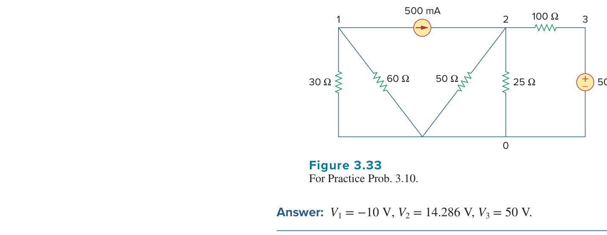

<template #solution>

1. 依圖 3.33 輸入元件數值，將 $50\ \mathrm{V}$ 電壓源與 $500\ \mathrm{mA}$ 電流源設為直流源，並將節點 $1$、$2$、$3$ 設為量測點。
2. 執行直流偏壓模擬，從節點電壓輸出讀取三個節點的結果。

課本答案：$V_1=-10\ \mathrm{V}$、$V_2=14.286\ \mathrm{V}$、$V_3=50\ \mathrm{V}$。

</template>

</PracticeCard>

<PracticeCard id="ch3-ex11" type="example" title="Example 3.11：以 PSpice 求受控源電路電流" source="課本 p.110" topic="PSpice 與受控電壓源">

在圖 3.34 的電路中，求電流 $i_1$、$i_2$ 與 $i_3$。

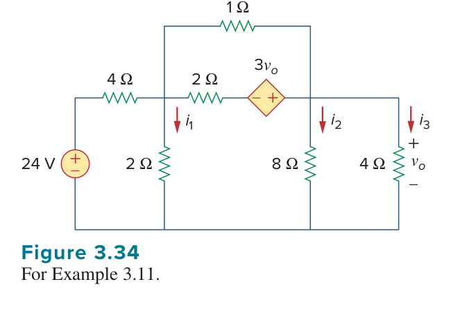

<template #solution>

1. 在 PSpice 中建立圖 3.34；以電壓控制電壓源 `E1` 表示受控源，其控制電壓為 $4\ \Omega$ 電阻兩端電壓，增益設為 $3$。
2. 在欲量測的支路插入 `IPROBES`，執行直流模擬並讀取各探針電流。
3. 模擬結果為 $i_1=i_2=1.333\ \mathrm{A}$，且 $i_3=2.667\ \mathrm{A}$。

課本答案：$i_1=i_2=1.333\ \mathrm{A}$、$i_3=2.667\ \mathrm{A}$。

</template>

</PracticeCard>

<PracticeCard id="ch3-pr11" type="practice" title="Practice Problem 3.11：PSpice 支路電流" source="課本 p.111" topic="PSpice 直流支路電流">

使用 PSpice，求圖 3.36 電路中的 $i_1$、$i_2$ 與 $i_3$。

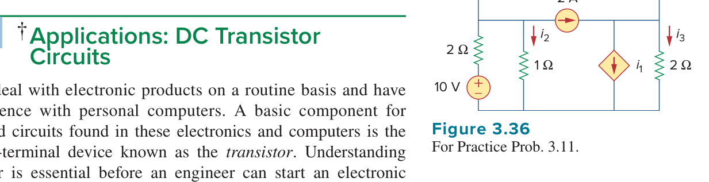

<template #solution>

1. 依圖 3.36 建立直流電路，並在標示 $i_1$、$i_2$、$i_3$ 的支路放置電流探針。
2. 執行直流模擬；電流讀值的正負號均以圖中的參考箭頭為準。

課本答案：$i_1=-428.6\ \mathrm{mA}$、$i_2=2.286\ \mathrm{A}$、$i_3=2\ \mathrm{A}$。

</template>

</PracticeCard>

<PracticeCard id="ch3-ex12" type="example" title="Example 3.12：BJT 主動模式偏壓" source="課本 p.114" topic="BJT 直流分析">

求圖 3.41 電晶體電路中的 $I_B$、$I_C$ 與 $v_o$。假設電晶體工作於主動模式，且 $\beta=50$。

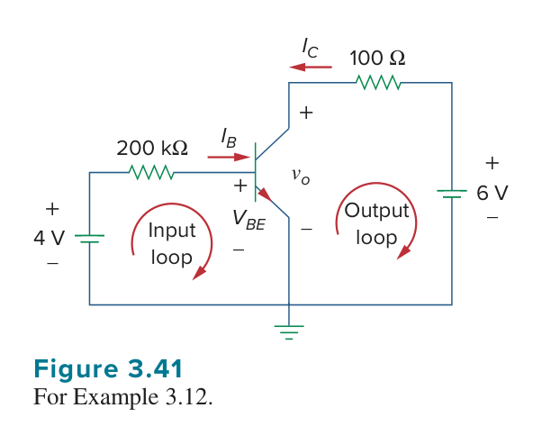

<template #solution>

主動模式下取 $V_{BE}=0.7\ \mathrm{V}$。輸入迴路套用 KVL：

$$
-4+I_B(200\times10^3)+V_{BE}=0
$$

因此

$$
I_B=\frac{4-0.7}{200\times10^3}=16.5\ \mu\mathrm{A}
$$

集極電流為

$$
I_C=\beta I_B=50(16.5\ \mu\mathrm{A})=0.825\ \mathrm{mA}
$$

輸出迴路給出

$$
v_o=6-100I_C=6-0.0825=5.917\ \mathrm{V}
$$

此處 $v_o=V_{CE}$。課本答案：$I_B=16.5\ \mu\mathrm{A}$、$I_C=0.825\ \mathrm{mA}$、$v_o=5.917\ \mathrm{V}$。

</template>

</PracticeCard>

<PracticeCard id="ch3-pr12" type="practice" title="Practice Problem 3.12：BJT 輸出電壓與 VCE" source="課本 p.114" topic="BJT 直流分析">

對圖 3.42 的電晶體電路，令 $\beta=100$、$V_{BE}=0.7\ \mathrm{V}$，求 $v_o$ 與 $V_{CE}$。

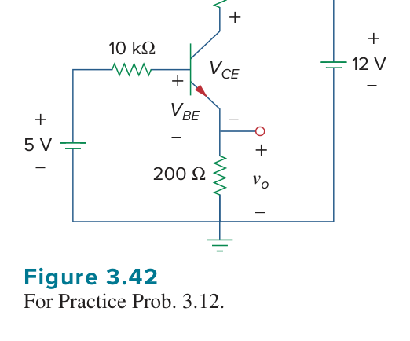

<template #solution>

1. 以主動模式的固定壓降模型 $V_{BE}=0.7\ \mathrm{V}$ 取代基極—射極接面。
2. 由輸入迴路求 $I_B$，再用 $I_C=\beta I_B$ 求集極電流。
3. 將所得電流代回集極與射極電阻的電壓關係，即可得到輸出電壓與 $V_{CE}$。

課本答案：$v_o=2.876\ \mathrm{V}$、$V_{CE}=2.005\ \mathrm{V}$。

</template>

</PracticeCard>

<PracticeCard id="ch3-ex13" type="example" title="Example 3.13：以網孔與節點法分析 BJT" source="課本 p.115" topic="BJT 網孔分析與節點分析">

圖 3.43 的 BJT 電路中，$\beta=150$、$V_{BE}=0.7\ \mathrm{V}$。求輸出電壓 $v_o$。

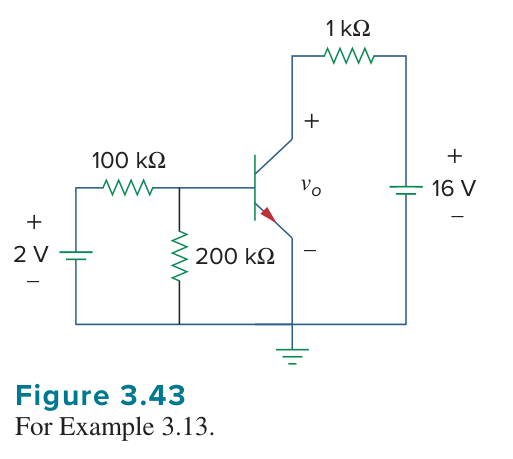

<template #solution>

以圖 3.44(a) 的網孔電流列 KVL：

$$
3I_1-2I_2=2\times10^{-5},\qquad -2I_1+2I_2=-0.7\times10^{-5}
$$

解得

$$
I_1=1.3\times10^{-5}\ \mathrm{A},\qquad I_2=9.5\ \mu\mathrm{A}
$$

受控電流為

$$
I_3=-150I_2=-1.425\ \mathrm{mA}
$$

最後一個迴路：

$$
-v_o+(1\ \mathrm{k}\Omega)I_3+16=0
$$

所以

$$
v_o=16-1.425=14.575\ \mathrm{V}
$$

以圖 3.44(b) 的節點法亦有 $I_B=9.5\ \mu\mathrm{A}$，故結果相符。課本答案：$v_o=14.575\ \mathrm{V}$。

</template>

</PracticeCard>

<PracticeCard id="ch3-pr13" type="practice" title="Practice Problem 3.13：BJT 輸出電壓與電流" source="課本 p.116" topic="BJT 直流分析">

圖 3.45 的電晶體電路具有 $\beta=80$ 與 $V_{BE}=0.7\ \mathrm{V}$。求 $v_o$ 與 $I_o$。

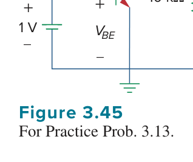

<template #solution>

1. 以主動模式模型，令基極—射極電壓為 $V_{BE}=0.7\ \mathrm{V}$。
2. 由基極支路的 KVL 或等效電路求得基極電流，再以 $I_C=\beta I_B$ 決定集極支路電流。
3. 將集極電流代回輸出支路的電阻壓降，得到 $v_o$；$I_o$ 的方向則依圖中的箭頭定義。

課本答案：$v_o=9\ \mathrm{V}$、$I_o=900\ \mu\mathrm{A}$。

</template>

</PracticeCard>

## 章末習題（Problems）

題幹與圖表直接裁自課本，保留原書符號、數值及電路極性。跨題引用的原電路也附在同一張卡內。

### 節點分析（3.1–3.32）

<PracticeCard id="ch3-prob1" type="exercise" title="章末習題 3.1" source="課本 p.112" topic="節點分析">

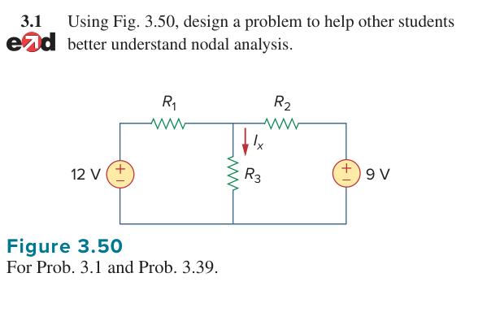

<template #solution>

**課本附錄 D 答案**（PDF 第 932 頁）：

</template>
</PracticeCard>

<PracticeCard id="ch3-prob2" type="exercise" title="章末習題 3.2" source="課本 p.112" topic="節點分析">

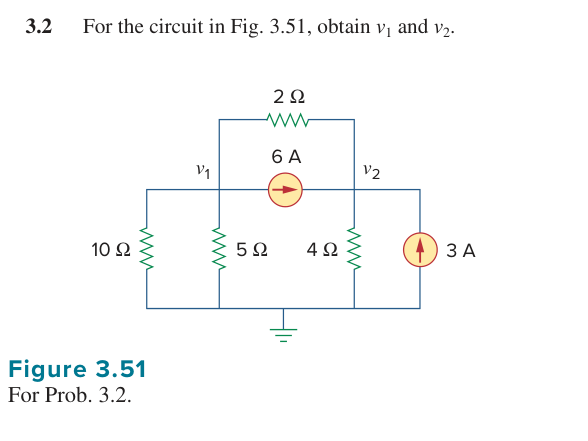

<template #solution>

**自行推導**（依圖 3.51 的電流方向）：設兩節點電壓為 $v_1,v_2$，KCL 為

$$\frac{v_1}{10}+\frac{v_1}{5}+\frac{v_1-v_2}{2}=-6,\qquad \frac{v_2}{4}+\frac{v_2-v_1}{2}=6+3=9.$$

解得 **$v_1=0\,\mathrm V$、$v_2=12\,\mathrm V$**。回代兩式分別為 $0+0-6=-6$ 與 $3+6=9\,\mathrm A$。

</template>
</PracticeCard>

<PracticeCard id="ch3-prob3" type="exercise" title="章末習題 3.3" source="課本 p.112" topic="節點分析">

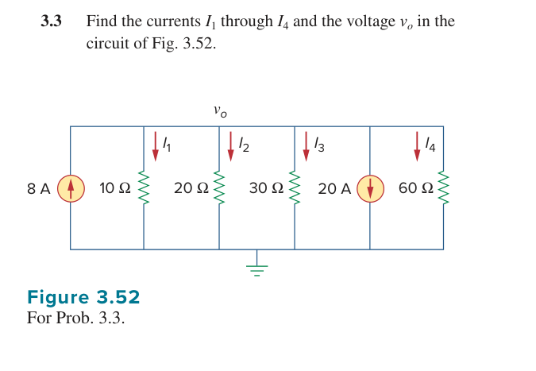

<template #solution>

**課本附錄 D 答案**（PDF 第 932 頁）：

</template>
</PracticeCard>

<PracticeCard id="ch3-prob4" type="exercise" title="章末習題 3.4" source="課本 p.112" topic="節點分析">

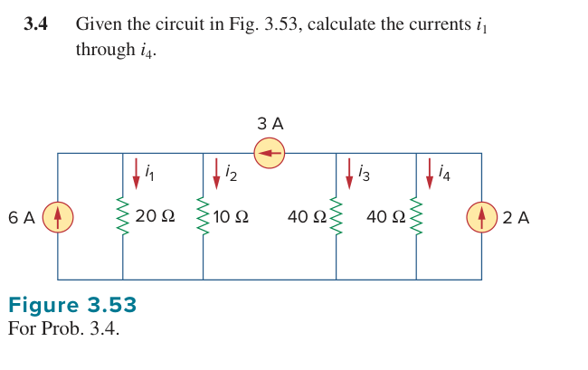

<template #solution>

**自行推導**：3 A 電流源由右節點流向左節點。左側總注入為 $6+3=9\,\mathrm A$，右側為 $2-3=-1\,\mathrm A$。故

$$\left(\frac1{20}+\frac1{10}\right)v_L=9,\qquad \left(\frac1{40}+\frac1{40}\right)v_R=-1.$$

得 $v_L=60\,\mathrm V$、$v_R=-20\,\mathrm V$，因此 **$i_1=3\,\mathrm A$、$i_2=6\,\mathrm A$、$i_3=-0.5\,\mathrm A$、$i_4=-0.5\,\mathrm A$**（負號表示與圖上箭頭相反）。回代：$i_1+i_2=9\,\mathrm A$，$i_3+i_4=-1\,\mathrm A$。

</template>
</PracticeCard>

<PracticeCard id="ch3-prob5" type="exercise" title="章末習題 3.5" source="課本 p.113" topic="節點分析">

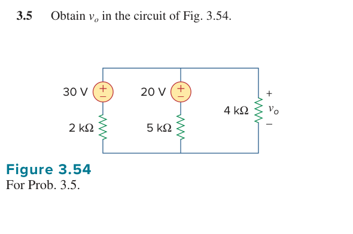

<template #solution>

**課本附錄 D 答案**（PDF 第 932 頁）：

</template>
</PracticeCard>

<PracticeCard id="ch3-prob6" type="exercise" title="章末習題 3.6" source="課本 p.113" topic="節點分析">

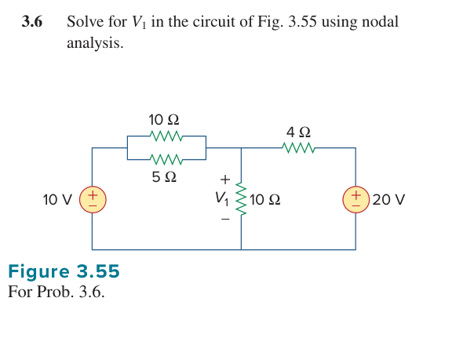

<template #solution>

**自行推導**：以底線為參考節點，中央節點電壓為 $V_1$。KCL：

$$\frac{V_1-10}{10}+\frac{V_1-10}{5}+\frac{V_1-20}{4}+\frac{V_1}{10}=0.$$

解得 **$V_1=\frac{160}{13}\,\mathrm V\approx12.31\,\mathrm V$**。回代左、右與下方支路電流的代數和為零。

</template>
</PracticeCard>

<PracticeCard id="ch3-prob7" type="exercise" title="章末習題 3.7" source="課本 p.113" topic="節點分析">

**老師指定練習**（CH003 講義第 73–74 頁 Homework）

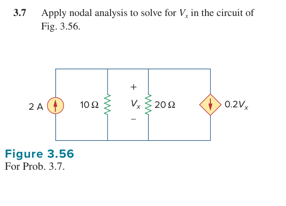

<template #solution>

**課本附錄 D 答案**（PDF 第 932 頁）：

</template>
</PracticeCard>

<PracticeCard id="ch3-prob8" type="exercise" title="章末習題 3.8" source="課本 p.113" topic="節點分析">

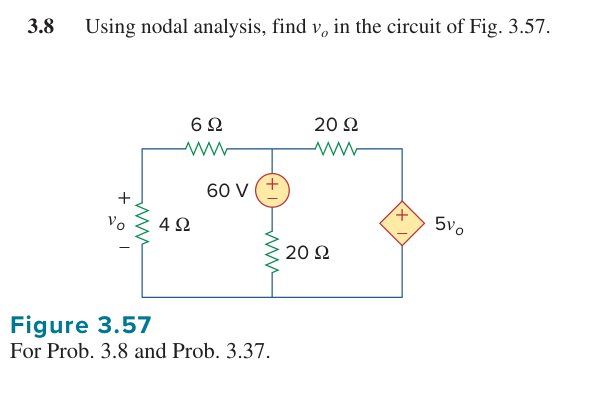

<template #solution>

**自行推導**：令中間上方節點為 $v_b$，右端受控源頂端為 $5v_o$。左節點 KCL 得 $v_o/4+(v_o-v_b)/6=0$，故 $v_b=2.5v_o$。中間節點 KCL 為

$$\frac{v_b-v_o}{6}+\frac{v_b-5v_o}{20}+\frac{v_b-60}{20}=0.$$

聯立得 **$v_o=12\,\mathrm V$**、$v_b=30\,\mathrm V$。回代中間節點：$3-1.5-1.5=0\,\mathrm A$。

</template>
</PracticeCard>

<PracticeCard id="ch3-prob9" type="exercise" title="章末習題 3.9" source="課本 p.113" topic="節點分析">

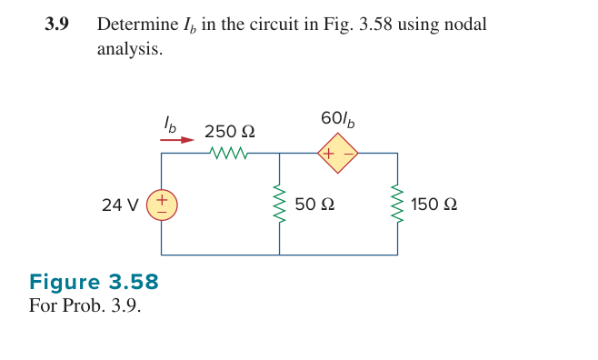

<template #solution>

**課本附錄 D 答案**（PDF 第 932 頁）：

</template>
</PracticeCard>

<PracticeCard id="ch3-prob10" type="exercise" title="章末習題 3.10" source="課本 p.113" topic="節點分析">

**老師指定練習**（CH003 講義第 73–74 頁 Homework）

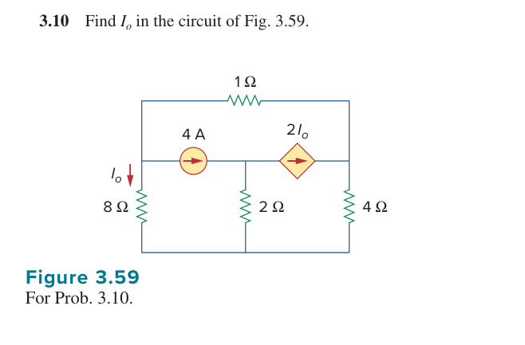

<template #solution>

**自行推導**：設左、中、右節點電壓分別為 $v_L,v_C,v_R$，依圖中箭頭 $I_o=v_L/8$。三個節點的 KCL 為

$$\frac{v_L}{8}+v_L-v_R+4=0,\quad \frac{v_C}{2}+2I_o-4=0,\quad \frac{v_R}{4}+v_R-v_L-2I_o=0.$$

解得 $v_L=v_R=-32\,\mathrm V$、$v_C=24\,\mathrm V$，所以 **$I_o=-4\,\mathrm A$**，實際方向向上。回代三個 KCL 等式，殘差皆為零。

**老師講義對照**：CH003 講義第 74 頁列 $I_o=-4\,\mathrm A$，與上述推導一致。

</template>
</PracticeCard>

<PracticeCard id="ch3-prob11" type="exercise" title="章末習題 3.11" source="課本 p.113" topic="節點分析">

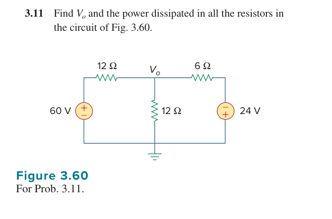

<template #solution>

**課本附錄 D 答案**（PDF 第 932 頁）：

</template>
</PracticeCard>

<PracticeCard id="ch3-prob12" type="exercise" title="章末習題 3.12" source="課本 p.113" topic="節點分析">

**老師指定練習**（CH003 講義第 73–74 頁 Homework）

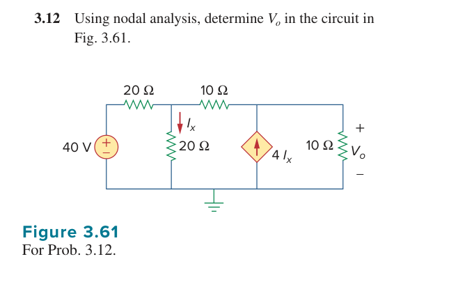

<template #solution>

**自行推導**：設左側未知節點為 $v_a$，右側為 $V_o$；$I_x=v_a/20$。KCL：

$$\frac{v_a-40}{20}+\frac{v_a}{20}+\frac{v_a-V_o}{10}=0,\qquad \frac{V_o-v_a}{10}+\frac{V_o}{10}=4I_x.$$

解得 $v_a=40\,\mathrm V$，**$V_o=60\,\mathrm V$**，$I_x=2\,\mathrm A$。回代兩式各為 $0\,\mathrm A$。

**老師講義對照**：CH003 講義第 74 頁列 $V_o=60\,\mathrm V$，與上述推導一致。

</template>
</PracticeCard>

<PracticeCard id="ch3-prob13" type="exercise" title="章末習題 3.13" source="課本 p.114" topic="節點分析">

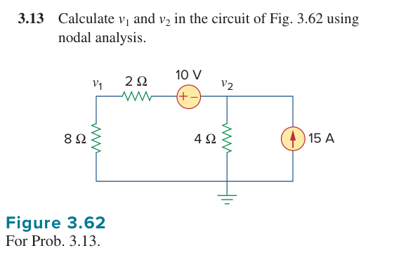

<template #solution>

**課本附錄 D 答案**（PDF 第 932 頁）：

</template>
</PracticeCard>

<PracticeCard id="ch3-prob14" type="exercise" title="章末習題 3.14" source="課本 p.114" topic="節點分析">

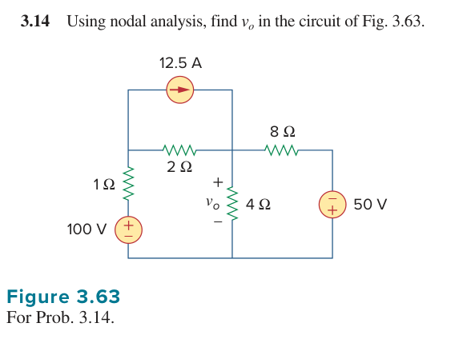

<template #solution>

**自行推導**：以底線為零電位，左邊 100 V 電源上端為 $100\,\mathrm V$，右邊 50 V 電源上端為 $-50\,\mathrm V$。設左上節點 $v_a$，中間節點 $v_o$。電流源由左流向中間，KCL 為

$$v_a-100+\frac{v_a-v_o}{2}+12.5=0,\qquad \frac{v_o}{4}+\frac{v_o+50}{8}+\frac{v_o-v_a}{2}-12.5=0.$$

解得 $v_a=75\,\mathrm V$，**$v_o=50\,\mathrm V$**。回代兩節點 KCL 殘差為零。

</template>
</PracticeCard>

<PracticeCard id="ch3-prob15" type="exercise" title="章末習題 3.15" source="課本 p.114" topic="節點分析">

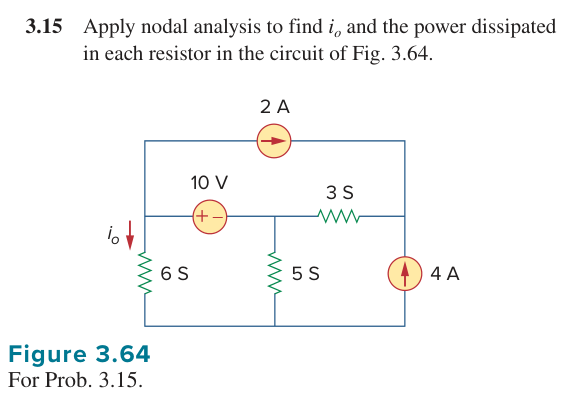

<template #solution>

**課本附錄 D 答案**（PDF 第 932 頁）：

</template>
</PracticeCard>

<PracticeCard id="ch3-prob16" type="exercise" title="章末習題 3.16" source="課本 p.114" topic="節點分析">

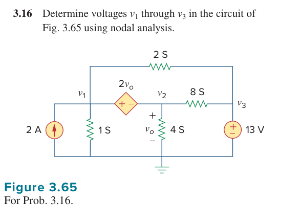

<template #solution>

**自行推導**：右側獨立電壓源給 $v_3=13\,\mathrm V$；$v_o=v_2$。受控源極性給 $v_1-v_2=2v_o$，所以 $v_1=3v_2$。對 $v_1,v_2$ 超節點寫 KCL：

$$v_1+2(v_1-13)+4v_2+8(v_2-13)=2.$$

故 **$v_1=\frac{132}{7}\,\mathrm V\approx18.86\,\mathrm V$、$v_2=\frac{44}{7}\,\mathrm V\approx6.286\,\mathrm V$、$v_3=13\,\mathrm V$**。回代受控源拘束式與超節點 KCL 均成立。

</template>
</PracticeCard>

<PracticeCard id="ch3-prob17" type="exercise" title="章末習題 3.17" source="課本 p.114" topic="節點分析">

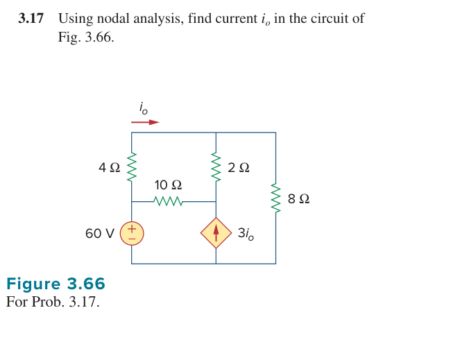

<template #solution>

**課本附錄 D 答案**（PDF 第 932 頁）：

</template>
</PracticeCard>

<PracticeCard id="ch3-prob18" type="exercise" title="章末習題 3.18" source="課本 p.114" topic="節點分析">

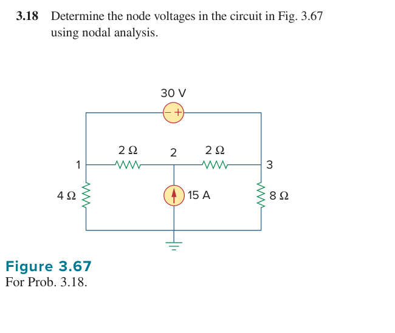

<template #solution>

**自行推導**：依圖 3.67，電壓源極性為 $v_3-v_1=30\,\mathrm V$。對 $v_1,v_3$ 超節點和節點 2 寫 KCL：

$$\frac{v_1}{4}+\frac{v_1-v_2}{2}+\frac{v_3-v_2}{2}+\frac{v_3}{8}=0,\qquad \frac{v_2-v_1}{2}+\frac{v_2-v_3}{2}=15.$$

解得 **$v_1=30\,\mathrm V$、$v_2=60\,\mathrm V$、$v_3=60\,\mathrm V$**。回代：超節點 $7.5-15+0+7.5=0\,\mathrm A$，節點 2 為 $15+0=15\,\mathrm A$。

</template>
</PracticeCard>

<PracticeCard id="ch3-prob19" type="exercise" title="章末習題 3.19" source="課本 p.114" topic="節點分析">

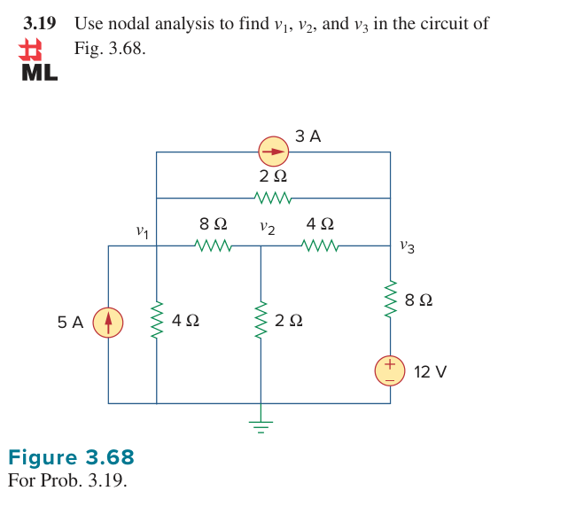

<template #solution>

**課本附錄 D 答案**（PDF 第 932 頁）：

</template>
</PracticeCard>

<PracticeCard id="ch3-prob20" type="exercise" title="章末習題 3.20" source="課本 p.115" topic="節點分析">

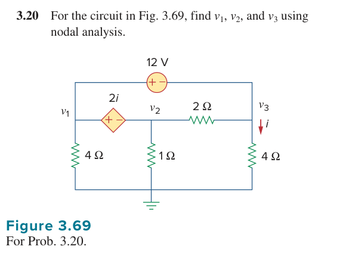

<template #solution>

**自行推導**：右側 $4\,\Omega$ 電阻的參考電流 $i=v_3/4$。電壓源拘束式為 $v_1-v_3=12$、$v_1-v_2=2i=v_3/2$。對三個節點組成的超節點寫 KCL：

$$\frac{v_1}{4}+v_2+\frac{v_3}{4}=0.$$

解得 **$v_1=-3\,\mathrm V$、$v_2=4.5\,\mathrm V$、$v_3=-15\,\mathrm V$**（$i=-3.75\,\mathrm A$）。回代兩個拘束式分別為 $12=12$、$-7.5=-7.5\,\mathrm V$，超節點 KCL 為 $-0.75+4.5-3.75=0\,\mathrm A$。

</template>
</PracticeCard>

<PracticeCard id="ch3-prob21" type="exercise" title="章末習題 3.21" source="課本 p.115" topic="節點分析">

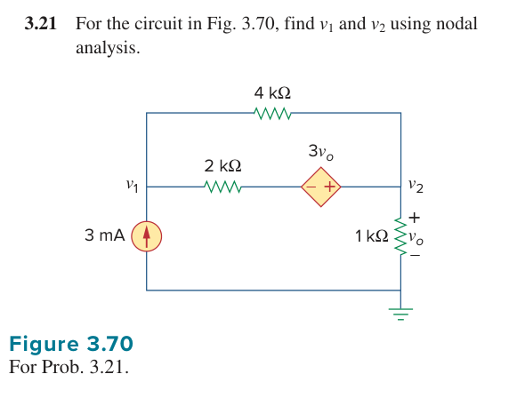

<template #solution>

**課本附錄 D 答案**（PDF 第 932 頁）：

</template>
</PracticeCard>

<PracticeCard id="ch3-prob22" type="exercise" title="章末習題 3.22" source="課本 p.115" topic="節點分析">

**老師指定練習**（CH003 講義第 73–74 頁 Homework）

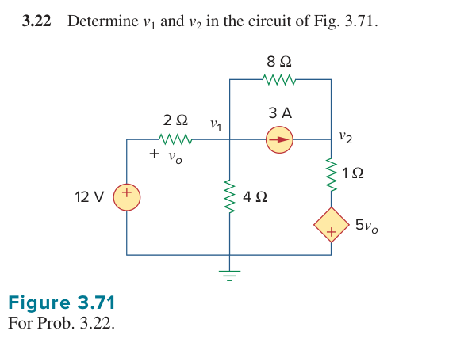

<template #solution>

**自行推導**：左側 12 V 電源上端為 $12\,\mathrm V$，$v_o=12-v_1$。右側受控源上端因圖示極性為 $-5v_o=5v_1-60$。兩個未知節點的 KCL 為

$$\frac{v_1-12}{2}+\frac{v_1}{4}+\frac{v_1-v_2}{8}+3=0,$$
$$\frac{v_2-v_1}{8}+\frac{v_2-(5v_1-60)}{1}-3=0.$$

解得 **$v_1=-\frac{120}{11}\,\mathrm V\approx-10.91\,\mathrm V$、$v_2=-\frac{1104}{11}\,\mathrm V\approx-100.36\,\mathrm V$**。回代 $v_o=\frac{252}{11}\,\mathrm V$，受控源上端 $-\frac{1260}{11}\,\mathrm V$，兩個 KCL 殘差均為零。

**老師講義對照**：CH003 講義第 74 頁列 $v_1=-10.91\,\mathrm V$、$v_2=-100.37\,\mathrm V$；依題圖參數聯立的精確值為 $-1104/11\,\mathrm V\approx-100.364\,\mathrm V$，與講義第二個小數位相差 $0.01\,\mathrm V$。

</template>
</PracticeCard>

<PracticeCard id="ch3-prob23" type="exercise" title="章末習題 3.23" source="課本 p.115" topic="節點分析">

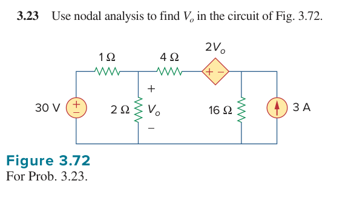

<template #solution>

**課本附錄 D 答案**（PDF 第 932 頁）：

</template>
</PracticeCard>

<PracticeCard id="ch3-prob24" type="exercise" title="章末習題 3.24" source="課本 p.115" topic="節點分析">

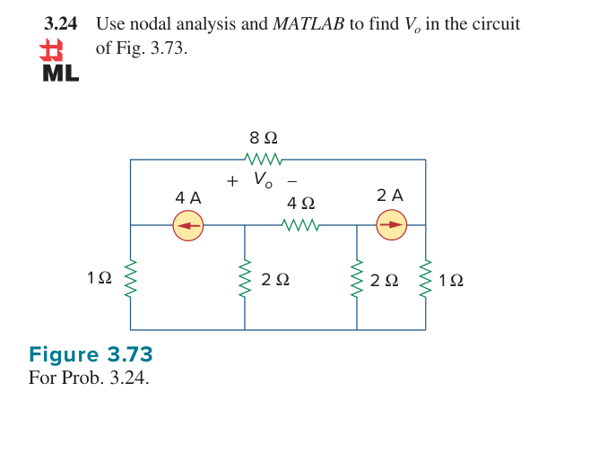

<template #solution>

**自行推導**：依圖 3.73 左至右四個節點設為 $v_L,v_A,v_B,v_R$。電流源 4 A 從 $A$ 流往 $L$，2 A 從 $B$ 流往 $R$。KCL：

$$v_L+\frac{v_L-v_R}{8}=4,\quad \frac{v_A}{2}+\frac{v_A-v_B}{4}=-4,$$
$$\frac{v_B}{2}+\frac{v_B-v_A}{4}=-2,\quad v_R+\frac{v_R-v_L}{8}=2.$$

解得 $v_L=3.8\,\mathrm V$、$v_A=-7\,\mathrm V$、$v_B=-5\,\mathrm V$、$v_R=2.2\,\mathrm V$，故依 8 Ω 上標示的極性，**$V_o=v_L-v_R=1.6\,\mathrm V$**。四個 KCL 方程式回代殘差皆為零。

</template>
</PracticeCard>

<PracticeCard id="ch3-prob25" type="exercise" title="章末習題 3.25" source="課本 p.115" topic="節點分析">

<template #solution>

**課本附錄 D 答案**（PDF 第 932 頁）：

</template>
</PracticeCard>

<PracticeCard id="ch3-prob26" type="exercise" title="章末習題 3.26" source="課本 p.115" topic="節點分析">

<template #solution>

**自行推導**：依 10 Ω 上箭頭 $i_o=(v_1-v_3)/10$；右下 10 V 電源上端為 $-10\,\mathrm V$，左下 15 V 電源上端為 $15\,\mathrm V$。三個節點的 KCL 為

$$\frac{v_1-15}{20}+\frac{v_1-v_2}{5}+\frac{v_1-v_3}{10}+3=0,$$
$$\frac{v_2-v_1}{5}+\frac{v_2-v_3}{5}+\frac{v_2-4i_o}{5}=0,$$
$$\frac{v_3+10}{15}+\frac{v_3-v_2}{5}+\frac{v_3-v_1}{10}-3=0.$$

解得 **$v_1=-\frac{525}{73}\,\mathrm V\approx-7.192\,\mathrm V$、$v_2=-\frac{1420}{511}\,\mathrm V\approx-2.779\,\mathrm V$、$v_3=\frac{1475}{511}\,\mathrm V\approx2.886\,\mathrm V$**。將這三值及 $i_o=(v_1-v_3)/10$ 回代，三個 KCL 殘差皆為零。

</template>
</PracticeCard>

<PracticeCard id="ch3-prob27" type="exercise" title="章末習題 3.27" source="課本 p.116" topic="節點分析">

<template #solution>

**課本附錄 D 答案**（PDF 第 932 頁）：

</template>
</PracticeCard>

<PracticeCard id="ch3-prob28" type="exercise" title="章末習題 3.28" source="課本 p.116" topic="節點分析">

<template #solution>

**自行推導**：取圖中中央節點為接地。左 60 V 電源上端為 $v_a-60$，右 90 V 電源上端為 $v_a+90$。依序對 $c,d,b$ 與底部超節點寫 KCL：

$$\frac{v_c}{5}+\frac{v_c-v_d}{10}+\frac{v_c-v_b}{4}=0,$$
$$\frac{v_d}{20}+\frac{v_d-v_c}{10}+\frac{v_d-v_a+60}{4}=0,$$
$$\frac{v_b}{8}+\frac{v_b-v_c}{4}+\frac{v_b-v_a-90}{8}=0,$$
$$\frac{v_a}{16}+\frac{v_a-60-v_d}{4}+\frac{v_a+90-v_b}{8}=0.$$

電阻單位為 $\Omega$。解得 **$v_a=-\frac{95}{9}\,\mathrm V\approx-10.56\,\mathrm V$、$v_b=\frac{185}{9}\,\mathrm V\approx20.56\,\mathrm V$、$v_c=\frac{25}{18}\,\mathrm V\approx1.389\,\mathrm V$、$v_d=-\frac{175}{4}\,\mathrm V=-43.75\,\mathrm V$**。四個 KCL 方程式回代殘差均為零。

</template>
</PracticeCard>

<PracticeCard id="ch3-prob29" type="exercise" title="章末習題 3.29" source="課本 p.116" topic="節點分析">

<template #solution>

**課本附錄 D 答案**（PDF 第 932 頁）：

</template>
</PracticeCard>

<PracticeCard id="ch3-prob30" type="exercise" title="章末習題 3.30" source="課本 p.116" topic="節點分析">

<template #solution>

**自行推導**：設 10、20、40 Ω 交點為 $v_a$，96 V 電源左端為 $v_b$；右端 $v_o=v_b+96$，依向上參考箭頭 $i_o=(v_a-v_b)/40$。受控電壓源上端為 $4v_o$。對節點 $v_a$ 與 $v_b,v_o$ 超節點寫 KCL：

$$\frac{v_a-80}{10}+\frac{v_a-4v_o}{20}+\frac{v_a-v_b}{40}=0,$$
$$\frac{v_b-v_a}{40}+\frac{v_o}{80}-2i_o=0.$$

代入 $v_b=v_o-96$ 與 $i_o=(v_a-v_b)/40$ 後，解得 **$v_o=-1075.2\,\mathrm V=-1.0752\,\mathrm{kV}$、$i_o=-4.48\,\mathrm A$**。負號表示 $i_o$ 實際向下；回代兩個 KCL 及 96 V 拘束式殘差均為零。

</template>
</PracticeCard>

<PracticeCard id="ch3-prob31" type="exercise" title="章末習題 3.31" source="課本 p.116" topic="節點分析">

<template #solution>

**課本附錄 D 答案**（PDF 第 932 頁）：

</template>
</PracticeCard>

<PracticeCard id="ch3-prob32" type="exercise" title="章末習題 3.32" source="課本 p.116" topic="節點分析">

<template #solution>

**自行推導**：底線接地；12 V 電源直接給 $v_2=12\,\mathrm V$。左邊 10 V 電源右端為正，故 $v_2-v_1=10$；右邊 20 V 電源左端為正，故 $v_2-v_3=20$。因此 **$v_1=2\,\mathrm V$、$v_2=12\,\mathrm V$、$v_3=-8\,\mathrm V$**。回代兩個電壓拘束式分別為 $10$ 與 $20\,\mathrm V$；流經電源的電流可由超節點 KCL 求得。

</template>
</PracticeCard>

### 網孔分析（3.33–3.66）

<PracticeCard id="ch3-prob33" type="exercise" title="章末習題 3.33" source="課本 p.117" topic="網孔分析">

**老師指定練習**（CH003 講義第 73–74 頁 Homework）

<template #solution>

**課本附錄 D 答案**（PDF 第 932、933 頁）：

</template>
</PracticeCard>

<PracticeCard id="ch3-prob34" type="exercise" title="章末習題 3.34" source="課本 p.117" topic="網孔分析">

圖 3.83(b)（原書排在右欄）：

<template #solution>

**自行推導**：兩個電路都可重新排列成沒有支路交叉的平面圖。以下以黑白節點圖重畫；節點 $A,B,C,D,E$ 在 (a) 對應原圖的左上、左中、左下、右上、右下，在 (b) 對應左上、中央、右上、左下、右下。圖中的每一條邊都保留了原電路的元件值；(a) 的 10 V 電源 $B$ 端為正，(b) 的 4 A 電流源由 $D$ 指向 $C$。

以原圖逐條核對邊的端點後，(a) 有 5 個節點、8 條支路，(b) 有 5 個節點、9 條支路，圖中均沒有不相連支路相交。

</template>
</PracticeCard>

<PracticeCard id="ch3-prob35" type="exercise" title="章末習題 3.35" source="課本 p.117" topic="網孔分析">

本題引用習題 3.5 的電路，原圖如下：

<template #solution>

**課本附錄 D 答案**（PDF 第 933 頁）：

</template>
</PracticeCard>

<PracticeCard id="ch3-prob36" type="exercise" title="章末習題 3.36" source="課本 p.117" topic="網孔分析">

<template #solution>

**自行推導**：令左右兩個網孔電流 $m_1,m_2$ 均為順時針。依 12 V 與 10 V 電源極性寫 KVL：$10m_1-6m_2=12$、$-6m_1+8m_2=-10$，得 $m_1=9/11\,\mathrm A$、$m_2=-7/11\,\mathrm A$。依圖示向下參考方向，**$i_1=-9/11\,\mathrm A$、$i_2=m_1-m_2=16/11\,\mathrm A$、$i_3=-7/11\,\mathrm A$**。回代兩個 KVL 等式及節點 KCL：$i_1+i_2+i_3=0$。

</template>
</PracticeCard>

<PracticeCard id="ch3-prob37" type="exercise" title="章末習題 3.37" source="課本 p.117" topic="網孔分析">

本題引用習題 3.8 的電路，原圖如下：

<template #solution>

**課本附錄 D 答案**（PDF 第 933 頁）：

</template>
</PracticeCard>

<PracticeCard id="ch3-prob38" type="exercise" title="章末習題 3.38" source="課本 p.117" topic="網孔分析">

<template #solution>

**自行推導**：取下方中央節點為地，中央 1 Ω 上端電壓為 $v_m$，則圖示向下的 $I_o=v_m/1\,\Omega$。以 60 V 與 22.5 V 電源兩端作超節點，並納入 10 A、5 A 電流源，聯立 KCL 可得 $v_m=-29/8\,\mathrm V$。所以 **$I_o=-29/8\,\mathrm A=-3.625\,\mathrm A$**，實際流向向上。檢核其餘節點電壓：左中 $-11.5\,\mathrm V$、左下 $-16.5\,\mathrm V$、上中 $52.75\,\mathrm V$、右上 $25.9375\,\mathrm V$、右中 $17\,\mathrm V$；代入各節點 KCL 殘差為零。

</template>
</PracticeCard>

<PracticeCard id="ch3-prob39" type="exercise" title="章末習題 3.39" source="課本 p.117" topic="網孔分析">

**老師指定練習**（CH003 講義第 73–74 頁 Homework）

本題引用習題 3.1 的電路，原圖如下：

<template #solution>

**課本附錄 D 答案**（PDF 第 933 頁）：

</template>
</PracticeCard>

<PracticeCard id="ch3-prob40" type="exercise" title="章末習題 3.40" source="課本 p.118" topic="網孔分析">

<template #solution>

**自行推導**：電橋兩邊的上方電阻同為 $6\,\mathrm{k}\Omega$、下方同為 $4\,\mathrm{k}\Omega$，故兩個中點等電位，中間 $2\,\mathrm{k}\Omega$ 無電流。每條路徑為 $6+4=10\,\mathrm{k}\Omega$，並聯等效 $5\,\mathrm{k}\Omega$，再與左上 $2\,\mathrm{k}\Omega$ 串聯。總電阻 $7\,\mathrm{k}\Omega$，因此 **$i_o=56/7\,\mathrm{mA}=8\,\mathrm{mA}$**（向右）。回代電源 KVL：$8\,\mathrm{mA}\times2\,\mathrm{k}\Omega+4\,\mathrm{mA}\times10\,\mathrm{k}\Omega$ 的兩路電壓皆為 $56\,\mathrm V$。

</template>
</PracticeCard>

<PracticeCard id="ch3-prob41" type="exercise" title="章末習題 3.41" source="課本 p.118" topic="網孔分析">

<template #solution>

**課本附錄 D 答案**（PDF 第 933 頁）：

</template>
</PracticeCard>

<PracticeCard id="ch3-prob42" type="exercise" title="章末習題 3.42" source="課本 p.118" topic="網孔分析">

<template #solution>

**自行推導／自行設計的一個有效例題**：令圖中 $V_1=10\,\mathrm V$、$V_2=20\,\mathrm V$、$V_3=30\,\mathrm V$，三個網孔電流依圖示均為順時針。矩陣方程式為

$$\begin{bmatrix}50&-30&0\\-30&100&-40\\0&-40&50\end{bmatrix}\begin{bmatrix}i_1\\i_2\\i_3\end{bmatrix}=\begin{bmatrix}10\\20\\30\end{bmatrix}.$$

解得 **$i_1=0.8\,\mathrm A$、$i_2=1\,\mathrm A$、$i_3=1.4\,\mathrm A$**。回代三列分別為 $10$、$20$、$30\,\mathrm V$，殘差為零。

</template>
</PracticeCard>

<PracticeCard id="ch3-prob43" type="exercise" title="章末習題 3.43" source="課本 p.118" topic="網孔分析">

<template #solution>

**課本附錄 D 答案**（PDF 第 933 頁）：

</template>
</PracticeCard>

<PracticeCard id="ch3-prob44" type="exercise" title="章末習題 3.44" source="課本 p.118" topic="網孔分析">

**老師指定練習**（CH003 講義第 73–74 頁 Homework）

<template #solution>

**自行推導**：以下方導線為地。右側 180 V 電源上端為 $180\,\mathrm V$；左上 90 V 電源左端為 $270\,\mathrm V$。令 1 Ω 兩端的左、右節點為 $v_a,v_b$，KCL：

$$\frac{v_a-270}{2}+\frac{v_a}{5}+v_a-v_b=0,\qquad \frac{v_b-180}{4}+v_b-v_a=45.$$

解得 $v_a=230\,\mathrm V$、$v_b=256\,\mathrm V$，所以 **$i_o=(v_a-v_b)/1\,\Omega=-26\,\mathrm A$**，實際向左。回代兩個 KCL 殘差為零。

**老師講義對照**：CH003 講義第 74 頁列 $i_o=-26\,\mathrm A$，與上述推導一致。

</template>
</PracticeCard>

<PracticeCard id="ch3-prob45" type="exercise" title="章末習題 3.45" source="課本 p.118" topic="網孔分析">

<template #solution>

**課本附錄 D 答案**（PDF 第 933 頁）：

</template>
</PracticeCard>

<PracticeCard id="ch3-prob46" type="exercise" title="章末習題 3.46" source="課本 p.118" topic="網孔分析">

<template #solution>

**自行推導**：依圖示順時針方向，$v_o=3i_1$。兩個網孔 KVL 為

$$3i_1+8(i_1-i_2)=12,\qquad 6i_2+8(i_2-i_1)+2v_o=0.$$

聯立得 **$i_1=28/23\,\mathrm A\approx1.2174\,\mathrm A$、$i_2=4/23\,\mathrm A\approx0.1739\,\mathrm A$**。回代兩式左邊依序為 $12\,\mathrm V$、$0\,\mathrm V$。

</template>
</PracticeCard>

<PracticeCard id="ch3-prob47" type="exercise" title="章末習題 3.47" source="課本 p.118" topic="網孔分析">

本題引用習題 3.19 的電路，原圖如下：

<template #solution>

**課本附錄 D 答案**（PDF 第 933 頁）：

</template>
</PracticeCard>

<PracticeCard id="ch3-prob48" type="exercise" title="章末習題 3.48" source="課本 p.119" topic="網孔分析">

<template #solution>

**自行推導**：以下方導線為地，左電源上端 $6\,\mathrm V$，右電源上端 $-3\,\mathrm V$，中間 4 V 電源上端 $4\,\mathrm V$。令 4、2 kΩ 交點為 $v_a$，2、5、10 kΩ 交點為 $v_b$，KCL（電阻以 kΩ 計）為

$$\frac{v_a-6}{4}+\frac{v_a-v_b}{2}+v_a-4=0,\qquad \frac{v_b-v_a}{2}+\frac{v_b+3}{5}+\frac{v_b}{10}=0.$$

解得 $v_a=82/23\,\mathrm V$、$v_b=34/23\,\mathrm V$。**10 kΩ 電流由上往下為 $v_b/(10\,\mathrm{k}\Omega)=0.14783\,\mathrm{mA}$**。回代兩個 KCL 殘差皆為零。

</template>
</PracticeCard>

<PracticeCard id="ch3-prob49" type="exercise" title="章末習題 3.49" source="課本 p.119" topic="網孔分析">

**老師指定練習**（CH003 講義第 73–74 頁 Homework）

<template #solution>

**課本附錄 D 答案**（PDF 第 933 頁）：

</template>
</PracticeCard>

<PracticeCard id="ch3-prob50" type="exercise" title="章末習題 3.50" source="課本 p.119" topic="網孔分析">

<template #solution>

**自行推導**：以下方導線為地，左中節點為 $35\,\mathrm V$。令上方節點 $v_t$、中央節點 $v_c$，則依向右箭頭 $i_o=(35-v_t)/4$。KCL 為

$$\frac{v_t-35}{4}+\frac{v_t-v_c}{2}+\frac{v_t}{8}=0,\qquad \frac{v_c-v_t}{2}+\frac{v_c-35}{10}=3i_o.$$

解得 $v_t=805/26\,\mathrm V$、$v_c=3815/104\,\mathrm V$，故 **$i_o=105/104\,\mathrm A\approx1.0096\,\mathrm A$**。兩個 KCL 回代殘差為零。

</template>
</PracticeCard>

<PracticeCard id="ch3-prob51" type="exercise" title="章末習題 3.51" source="課本 p.119" topic="網孔分析">

<template #solution>

**課本附錄 D 答案**（PDF 第 933 頁）：

</template>
</PracticeCard>

<PracticeCard id="ch3-prob52" type="exercise" title="章末習題 3.52" source="課本 p.119" topic="網孔分析">

<template #solution>

**自行推導**：三個網孔電流依圖均為順時針。3 A 電流源在兩個右側網孔共用支路，且箭頭向右，故 $i_3-i_2=3$。上方 2 Ω 的電壓 $v_o=2(i_1-i_2)$。左側網孔 KVL 及右側超網孔 KVL 可寫成

$$2(i_1-i_2)+4(i_1-i_3)=12,\qquad 8i_2+2v_o+4(i_3-i_1)+2(i_2-i_1)=0.$$

解得 **$i_1=3.5\,\mathrm A$、$i_2=-0.5\,\mathrm A$、$i_3=2.5\,\mathrm A$**。回代 $i_3-i_2=3\,\mathrm A$、$v_o=8\,\mathrm V$，兩個 KVL 殘差皆為零。

</template>
</PracticeCard>

<PracticeCard id="ch3-prob53" type="exercise" title="章末習題 3.53" source="課本 p.119" topic="網孔分析">

<template #solution>

**課本附錄 D 答案**（PDF 第 933 頁）：

</template>
</PracticeCard>

<PracticeCard id="ch3-prob54" type="exercise" title="章末習題 3.54" source="課本 p.120" topic="網孔分析">

<template #solution>

**自行推導**：將 1 kΩ 保留為 $1000\,\Omega$，三個順時針網孔的 KVL 為

$$2000i_1-1000i_2=2,\quad -1000i_1+2001i_2-i_3=10,\quad -i_2+1001i_3=12.$$

解得 **$i_1\approx4.668\,\mathrm{mA}$、$i_2\approx7.336\,\mathrm{mA}$、$i_3\approx11.995\,\mathrm{mA}$**。以未四捨五入的聯立解回代三個 KVL，殘差均為零。

</template>
</PracticeCard>

<PracticeCard id="ch3-prob55" type="exercise" title="章末習題 3.55" source="課本 p.120" topic="網孔分析">

<template #solution>

**課本附錄 D 答案**（PDF 第 933 頁）：

</template>
</PracticeCard>

<PracticeCard id="ch3-prob56" type="exercise" title="章末習題 3.56" source="課本 p.120" topic="網孔分析">

<template #solution>

**自行推導**：左側電源上端為 $12\,\mathrm V$。令中間及右側節點分別為 $v_m,v_r$，每支電阻都是 2 Ω，KCL 得 $3v_m-v_r=12$、$3v_r-v_m=12$，故 $v_m=v_r=6\,\mathrm V$。依圖中極性，**$v_1=12-v_r=6\,\mathrm V$、$v_2=v_r=6\,\mathrm V$**。兩個 KCL 回代殘差為零。

</template>
</PracticeCard>

<PracticeCard id="ch3-prob57" type="exercise" title="章末習題 3.57" source="課本 p.120" topic="網孔分析">

**老師指定練習**（CH003 講義第 73–74 頁 Homework）

<template #solution>

**課本附錄 D 答案**（PDF 第 933 頁）：

</template>
</PracticeCard>

<PracticeCard id="ch3-prob58" type="exercise" title="章末習題 3.58" source="課本 p.120" topic="網孔分析">

<template #solution>

**自行推導**：依圖示三個順時針網孔，KVL 為

$$40i_1-10i_2=-120,\qquad -10i_1+50i_2-10i_3=0,\qquad -10i_2+40i_3=120.$$

解得 **$i_1=-3\,\mathrm A$、$i_2=0\,\mathrm A$、$i_3=3\,\mathrm A$**。負號表示左下網孔實際為逆時針；回代三式分別得到 $-120$、$0$、$120\,\mathrm V$。

</template>
</PracticeCard>

<PracticeCard id="ch3-prob59" type="exercise" title="章末習題 3.59" source="課本 p.120" topic="網孔分析">

本題引用習題 3.30 的電路，原圖如下：

<template #solution>

**課本附錄 D 答案**（PDF 第 933 頁）：

</template>
</PracticeCard>

<PracticeCard id="ch3-prob60" type="exercise" title="章末習題 3.60" source="課本 p.120" topic="網孔分析">

<template #solution>

**自行推導**：以下方導線為地，電壓源上端為 $56\,\mathrm V$。令左、右側節點為 $v_L,v_R$，圖示 $i_o=v_L/1\,\Omega$。KCL：

$$v_L+\frac{v_L-56}{4}+0.5i_o=0,\qquad \frac{v_R}{2}+\frac{v_R-56}{8}=0.5i_o.$$

解得 $v_L=8\,\mathrm V$、$v_R=17.6\,\mathrm V$、$i_o=8\,\mathrm A$。依 $P=V^2/R$，**1 Ω：$64\,\mathrm W$；2 Ω：$154.88\,\mathrm W$；4 Ω：$576\,\mathrm W$；8 Ω：$184.32\,\mathrm W$**。回代左右節點 KCL 均為零。

</template>
</PracticeCard>

<PracticeCard id="ch3-prob61" type="exercise" title="章末習題 3.61" source="課本 p.120" topic="網孔分析">

<template #solution>

**課本附錄 D 答案**（PDF 第 933 頁）：

</template>
</PracticeCard>

<PracticeCard id="ch3-prob62" type="exercise" title="章末習題 3.62" source="課本 p.120" topic="網孔分析">

<template #solution>

**自行推導**：以 mA 為網孔電流單位，兩個電流源拘束式依箭頭為 $i_2-i_1=4$、$i_2-i_3=2i_1$。沿外框寫 KVL：$4i_1+8i_2+2i_3=60$（kΩ·mA = V）。故 **$i_1=2\,\mathrm{mA}$、$i_2=6\,\mathrm{mA}$、$i_3=2\,\mathrm{mA}$**。回代兩個電流源式得 $4=4$ 與 $4=4\,\mathrm{mA}$，外框得 $8+48+4=60\,\mathrm V$。

</template>
</PracticeCard>

<PracticeCard id="ch3-prob63" type="exercise" title="章末習題 3.63" source="課本 p.121" topic="網孔分析">

<template #solution>

**課本附錄 D 答案**（PDF 第 933 頁）：

</template>
</PracticeCard>

<PracticeCard id="ch3-prob64" type="exercise" title="章末習題 3.64" source="課本 p.121" topic="網孔分析">

<template #solution>

**自行推導**：令上中、右上、中央節點分別為 $v_a,v_b,v_c$。依圖示 $i_o=(v_a-v_c)/10$、$v_o=v_a-v_b$，受控電壓源拘束式 $v_b-v_c=4i_o$。KCL：

$$\frac{v_a-250}{50}+\frac{v_a-v_b}{10}+\frac{v_a-v_c}{10}=0,$$
$$\frac{v_b-v_a}{10}+\frac{v_b}{40}+\frac{v_c-v_a}{10}+0.2v_o-5=0.$$

解得 **$v_o=50/17\,\mathrm V\approx2.941\,\mathrm V$、$i_o=25/51\,\mathrm A\approx0.4902\,\mathrm A$**。把節點電壓 $v_a=10750/51$、$v_b=10600/51$、$v_c=3500/17\,\mathrm V$ 回代，兩個 KCL 和受控源拘束式殘差均為零。

</template>
</PracticeCard>

<PracticeCard id="ch3-prob65" type="exercise" title="章末習題 3.65" source="課本 p.121" topic="網孔分析">

<template #solution>

**課本附錄 D 答案**（PDF 第 933 頁）：

</template>
</PracticeCard>

<PracticeCard id="ch3-prob66" type="exercise" title="章末習題 3.66" source="課本 p.121" topic="網孔分析">

<template #solution>

**自行推導**：依圖示五個順時針網孔，列 KVL 矩陣（Ω、A、V）：

$$\begin{bmatrix}30&-4&-6&-2&0\\-4&30&0&-2&-6\\-6&0&18&-4&0\\-2&-2&-4&12&-4\\0&-6&0&-4&18\end{bmatrix}\begin{bmatrix}i_1\\i_2\\i_3\\i_4\\i_5\end{bmatrix}=\begin{bmatrix}-12\\-16\\30\\0\\-32\end{bmatrix}.$$

解得 **$i_1\approx-0.27793\,\mathrm A$、$i_2\approx-1.04876\,\mathrm A$、$i_3\approx1.46822\,\mathrm A$、$i_4\approx-0.47610\,\mathrm A$、$i_5\approx-2.23316\,\mathrm A$**。以未四捨五入的解回代矩陣方程式，五列殘差均為零。

</template>
</PracticeCard>

### 方程式檢視法（3.67–3.74）

<PracticeCard id="ch3-prob67" type="exercise" title="章末習題 3.67" source="課本 p.121" topic="檢視法">

<template #solution>

**課本附錄 D 答案**（PDF 第 933 頁）：

</template>
</PracticeCard>

<PracticeCard id="ch3-prob68" type="exercise" title="章末習題 3.68" source="課本 p.121" topic="檢視法">

<template #solution>

**自行推導／自行設計的一個有效例題**：取 $R_1=R_2=R_3=R_4=1\,\Omega$，$I_1=4\,\mathrm A$（向上）、$I_2=1\,\mathrm A$（向左）、$V_1=1\,\mathrm V$。左節點電壓記 $v_L$，中央 $V_o$；KCL 為 $2v_L-V_o=I_1+I_2=5$、$3V_o-v_L=V_1-I_2=0$。解得 **$v_L=3\,\mathrm V$、$V_o=1\,\mathrm V$**。回代兩個 KCL 等式分別為 $5=5$、$0=0\,\mathrm A$。

</template>
</PracticeCard>

<PracticeCard id="ch3-prob69" type="exercise" title="章末習題 3.69" source="課本 p.122" topic="檢視法">

<template #solution>

**課本附錄 D 答案**（PDF 第 933 頁）：

</template>
</PracticeCard>

<PracticeCard id="ch3-prob70" type="exercise" title="章末習題 3.70" source="課本 p.122" topic="檢視法">

<template #solution>

**自行推導**：圖中 $i_x=2V_1$，受控電流源由 $V_2$ 指向 $V_1$，大小 $4i_x=8V_1$。檢視即可列節點方程式：

$$3V_1=20+8V_1,\qquad 5V_2=-7-8V_1.$$

故 **$V_1=-4\,\mathrm V$、$V_2=5\,\mathrm V$**；$i_x=-8\,\mathrm A$，表示實際向上。回代兩個節點 KCL：$-12=20-32$、$25=-7+32\,\mathrm A$。

</template>
</PracticeCard>

<PracticeCard id="ch3-prob71" type="exercise" title="章末習題 3.71" source="課本 p.122" topic="檢視法">

<template #solution>

**課本附錄 D 答案**（PDF 第 933 頁）：

</template>
</PracticeCard>

<PracticeCard id="ch3-prob72" type="exercise" title="章末習題 3.72" source="課本 p.122" topic="檢視法">

<template #solution>

**自行推導**：以圖示順時針網孔方向檢視共用電阻與電源極性，得到

$$\begin{bmatrix}7&0&-2&0\\0&5&0&-1\\-2&0&6&-4\\0&-1&-4&5\end{bmatrix}\begin{bmatrix}i_1\\i_2\\i_3\\i_4\end{bmatrix}=\begin{bmatrix}8\\-4\\4\\-10\end{bmatrix}.$$

例如第一列是 $5i_1+2(i_1-i_3)=8$；第二列含 4 V 電源由正端往負端，因此右邊為 $-4\,\mathrm V$。此題只要求網孔方程式。

</template>
</PracticeCard>

<PracticeCard id="ch3-prob73" type="exercise" title="章末習題 3.73" source="課本 p.122" topic="檢視法">

<template #solution>

**課本附錄 D 答案**（PDF 第 933 頁）：

</template>
</PracticeCard>

<PracticeCard id="ch3-prob74" type="exercise" title="章末習題 3.74" source="課本 p.122" topic="檢視法">

<template #solution>

**自行推導**：依圖示順時針網孔與各電源極性，直接得到

$$\begin{bmatrix}R_1+R_4+R_6&-R_4&-R_6&0\\-R_4&R_2+R_4+R_5&0&-R_5\\-R_6&0&R_6+R_7+R_8&-R_8\\0&-R_5&-R_8&R_3+R_5+R_8\end{bmatrix}\begin{bmatrix}i_1\\i_2\\i_3\\i_4\end{bmatrix}=\begin{bmatrix}V_1\\-V_2\\V_3\\V_2-V_4\end{bmatrix}.$$

共用電阻在非對角線取負號；例如 $i_2$ 沿 $V_2$ 由正端到負端，故第二列右端是 $-V_2$。此題只要求網孔方程式。

</template>
</PracticeCard>

### PSpice 與 MultiSim（3.75–3.83）

<PracticeCard id="ch3-prob75" type="exercise" title="章末習題 3.75" source="課本 p.122" topic="電路模擬">

本題引用習題 3.58 的電路，原圖如下：

<template #solution>

**課本附錄 D 答案**（PDF 第 933 頁）：

</template>
</PracticeCard>

<PracticeCard id="ch3-prob76" type="exercise" title="章末習題 3.76" source="課本 p.122" topic="電路模擬">

本題引用習題 3.27 的電路，原圖如下：

<template #solution>

**自行推導（沿用習題 3.27 的同一電路）**：依圖 3.76，$i_o=4v_2$（4 S 支路），受控源電流為 $3i_o$。節點 KCL：

$$2v_1+(v_1-v_2)+4(v_1-v_3)+3i_o=2,$$
$$4v_2+(v_2-v_1)+(v_2-v_3)=0,$$
$$2v_3+(v_3-v_2)+4(v_3-v_1)-3i_o=4.$$

解得 **$v_1=0.625\,\mathrm V$、$v_2=0.375\,\mathrm V$、$v_3=1.625\,\mathrm V$**，與課本附錄 D 對習題 3.27 的答案相同。回代三個 KCL 殘差均為零。

</template>
</PracticeCard>

<PracticeCard id="ch3-prob77" type="exercise" title="章末習題 3.77" source="課本 p.123" topic="電路模擬">

<template #solution>

**課本附錄 D 答案**（PDF 第 933 頁）：

</template>
</PracticeCard>

<PracticeCard id="ch3-prob78" type="exercise" title="章末習題 3.78" source="課本 p.123" topic="電路模擬">

本題引用習題 3.20 的電路，原圖如下：

<template #solution>

**自行推導（沿用習題 3.20 的同一電路）**：依圖 3.69，$i=v_3/4$，拘束式為 $v_1-v_3=12$、$v_1-v_2=2i$。三節點超節點 KCL 為 $v_1/4+v_2+v_3/4=0$。解得 **$v_1=-3\,\mathrm V$、$v_2=4.5\,\mathrm V$、$v_3=-15\,\mathrm V$**，與本頁習題 3.20 的推導一致。回代兩個拘束式及 KCL 殘差皆為零。

</template>
</PracticeCard>

<PracticeCard id="ch3-prob79" type="exercise" title="章末習題 3.79" source="課本 p.123" topic="電路模擬">

本題引用習題 3.28 的電路，原圖如下：

<template #solution>

**課本附錄 D 答案**（PDF 第 933 頁）：

</template>
</PracticeCard>

<PracticeCard id="ch3-prob80" type="exercise" title="章末習題 3.80" source="課本 p.123" topic="電路模擬">

<template #solution>

**自行推導**：右側 20 V 電源固定 $v_3=20\,\mathrm V$。圖示 $I_o=(0-v_4)/2=-v_4/2$，受控電壓源給 $v_2-v_3=6I_o=-3v_4$。左下與左上的 KCL 為 $v_4+v_4/2+8=0$、$(v_1-v_2)/10=8$。因此 **$v_1=116\,\mathrm V$、$v_2=36\,\mathrm V$、$v_3=20\,\mathrm V$、$v_4=-16/3\,\mathrm V\approx-5.333\,\mathrm V$**。回代 $I_o=8/3\,\mathrm A$，受控源兩端 $16\,\mathrm V=6I_o$，兩個 KCL 殘差為零。

</template>
</PracticeCard>

<PracticeCard id="ch3-prob81" type="exercise" title="章末習題 3.81" source="課本 p.123" topic="電路模擬">

本題引用例題 3.4 的電路：

<template #solution>

**課本附錄 D 答案**（PDF 第 933 頁）：

</template>
</PracticeCard>

<PracticeCard id="ch3-prob82" type="exercise" title="章末習題 3.82" source="課本 p.123" topic="電路模擬">

<template #solution>

**自行重畫**：依網表把節點 0 當接地，以節點 1–5 及元件連線畫出網路。箭頭表示電流源方向；VS 的正端在節點 4，VF1 的正端在節點 5，E1 的輸出正端在節點 3、負端在節點 2。

逐項核對：$R_1:1\!\leftrightarrow\!2$（2 kΩ）、$R_2:2\!\leftrightarrow\!0$（4 kΩ）、$R_3:3\!\leftrightarrow\!0$（8 kΩ）、$R_4:3\!\leftrightarrow\!4$（6 kΩ）、$R_5:1\!\leftrightarrow\!3$（3 kΩ）；IS 自 0 至 1 為 4 A；F1 自 1 至 3 為 $2I(\mathrm{VF1})$；E1 在 3 與 2 間，滿足 $V_3-V_2=3(V_1-V_3)$。VF1 為節點 5 至地的 0 V 量測電源；原網表沒有其他元件連至節點 5，因此 $I(\mathrm{VF1})=0$。

</template>
</PracticeCard>

<PracticeCard id="ch3-prob83" type="exercise" title="章末習題 3.83" source="課本 p.123" topic="電路模擬">

<template #solution>

**課本附錄 D 答案**（PDF 第 933 頁）：

</template>
</PracticeCard>

### 應用與綜合題（3.84–3.93）

<PracticeCard id="ch3-prob84" type="exercise" title="章末習題 3.84" source="課本 p.123" topic="電路應用">

<template #solution>

**自行推導**：左側 15 mV 電源上端為 $0.015\,\mathrm V$；受控電壓源上端為 $v_o/100$。依圖中向左箭頭，$I_o=(v_o/100-0.015)/(4000\,\Omega)$。右側節點 KCL 為 $v_o/(20\,000\,\Omega)=50I_o$。聯立得到 **$v_o=2.5\,\mathrm V$、$I_o=2.5\,\mu\mathrm A$**。回代左邊 4 kΩ 兩端電壓 $0.025-0.015=0.010\,\mathrm V$，右邊 $50I_o=125\,\mu\mathrm A=v_o/20\,\mathrm{k}\Omega$。

</template>
</PracticeCard>

<PracticeCard id="ch3-prob85" type="exercise" title="章末習題 3.85" source="課本 p.123" topic="電路應用">

<template #solution>

**課本附錄 D 答案**（PDF 第 933 頁）：

</template>
</PracticeCard>

<PracticeCard id="ch3-prob86" type="exercise" title="章末習題 3.86" source="課本 p.123" topic="電路應用">

<template #solution>

**自行推導**：設 1 kΩ 右端／2 kΩ 上端電壓為 $v_x$。左側 $I=(0.047-v_x)/1000$；中央節點 KCL 給 $v_x/2000=(400+1)I$，所以 $I=0.047/803000\,\mathrm A\approx58.53\,\mathrm{nA}$。右側節點 KCL 為 $v_o/5000+400I=0$，故 **$v_o\approx-0.11706\,\mathrm V=-117.06\,\mathrm{mV}$**。負號表示輸出端低於地；兩節點 KCL 回代殘差為零。

</template>
</PracticeCard>

<PracticeCard id="ch3-prob87" type="exercise" title="章末習題 3.87" source="課本 p.123" topic="電路應用">

<template #solution>

**課本附錄 D 答案**（PDF 第 933 頁）：

</template>
</PracticeCard>

<PracticeCard id="ch3-prob88" type="exercise" title="章末習題 3.88" source="課本 p.124" topic="電路應用">

<template #solution>

**自行推導**：輸出端 KCL 給 $v_o/10000+40I_o=0$，故 $v_o=-400000I_o$。受控電壓源上端為 $-v_o/1000=400I_o$；因此 2 kΩ 左端節點為 $v_a=400I_o+2000I_o=2400I_o$。該節點 KCL：$(v_a-v_s)/200+v_a/100+I_o=0$，得 $v_s=7400I_o$。所以 **$v_o/v_s=-400000/7400=-2000/37\approx-54.05$**。三個關係回代均成立。

</template>
</PracticeCard>

<PracticeCard id="ch3-prob89" type="exercise" title="章末習題 3.89" source="課本 p.124" topic="電路應用">

<template #solution>

**課本附錄 D 答案**（PDF 第 933 頁）：

</template>
</PracticeCard>

<PracticeCard id="ch3-prob90" type="exercise" title="章末習題 3.90" source="課本 p.124" topic="電路應用">

<template #solution>

**自行推導**：射極電流 $I_E=v_o/500\,\Omega=4/500=8\,\mathrm{mA}$。若電晶體在主動區，$I_B=I_E/(\beta+1)=8/151\,\mathrm{mA}$，基極電壓 $V_B=V_E+V_{BE}=4.7\,\mathrm V$。因此 **$v_s=V_B+(10\,\mathrm{k}\Omega)I_B=4.7+80/151\approx5.230\,\mathrm V$**。驗算集極電壓 $18-(1\,\mathrm{k}\Omega)(150I_B)\approx10.053\,\mathrm V$，高於基極與射極，主動區假設自洽。

</template>
</PracticeCard>

<PracticeCard id="ch3-prob91" type="exercise" title="章末習題 3.91" source="課本 p.124" topic="電路應用">

<template #solution>

**課本附錄 D 答案**（PDF 第 933 頁）：

</template>
</PracticeCard>

<PracticeCard id="ch3-prob92" type="exercise" title="章末習題 3.92" source="課本 p.124" topic="電路應用">

<template #solution>

**自行推導／自行設計的一個有效例題**：取圖中 $V_1=12.7\,\mathrm V$、$R_1=100\,\mathrm{k}\Omega$、$R_2=R_3=1\,\mathrm{k}\Omega$，並給定電晶體 $\beta=99$、$V_{BE}=0.7\,\mathrm V$，求 $I_B$ 與 $V_C$。設主動區，$I_E=100I_B$，$V_E=R_3I_E$，$V_B=V_E+0.7$。集極節點 KCL：$(V_1-V_C)/R_2=I_C+I_B=100I_B$；基極回授電阻給 $(V_C-V_B)/R_1=I_B$。聯立得 **$I_B=40\,\mu\mathrm A$、$I_C=3.96\,\mathrm{mA}$、$I_E=4\,\mathrm{mA}$、$V_C=8.7\,\mathrm V$、$V_B=4.7\,\mathrm V$、$V_E=4\,\mathrm V$**。回代 $V_{CE}=4.7\,\mathrm V$，大於飽和壓降，主動區假設成立。

</template>
</PracticeCard>

<PracticeCard id="ch3-prob93" type="exercise" title="章末習題 3.93" source="課本 p.124" topic="電路應用">

本題引用例題 3.11 的電路：

<template #solution>

**課本附錄 D 答案**（PDF 第 933 頁）：

</template>
</PracticeCard>
