# 互動式範例與練習題庫：Chapter 4 電路定理 (Circuit Theorems)

> Alexander & Sadiku · Circuit Theorems 線性性質、重疊定理、電源轉換、戴維寧定理、諾頓定理與最大功率轉移精解

::: details 核心電路定理與分析技巧速記
- **線性性質 (Linearity Property)**：
  - 齊次性 (Homogeneity / Scaling)：$v(t) = k \cdot i(t)$；輸入電源放大 $k$ 倍，各支路響應等比例放大 $k$ 倍。
  - 可加性 (Additivity)：$f(x_1 + x_2) = f(x_1) + f(x_2)$。
- **重疊定理 (Superposition Theorem)**：
  - 線性電路中任一支路之電壓或電流，等於各獨立電源**單獨作用**時所產生響應的代數和。
  - **獨立電源關閉原則**：獨立電壓源設為 $0\text{ V}$（**短路 Short Circuit**）；獨立電流源設為 $0\text{ A}$（**開路 Open Circuit**）。
  - **重要禁忌**：相依源 (Dependent Sources) 必須**全程完整保留**，絕不可獨立關閉！
  - **功率不可重疊**：功率與電壓/電流平方成正比（非線性），必先求得總響應後再算功率：$P = I_{\text{total}}^2 R \neq \sum I_k^2 R$。
- **電源轉換定理 (Source Transformation)**：
  - 實用電壓源（$v_s$ 串聯 $R$）與實用電流源（$i_s = \frac{v_s}{R}$ 並聯 $R$）在外端具備完全等效的 $v-i$ 特性。
- **戴維寧定理 (Thevenin's Theorem) 與諾頓定理 (Norton's Theorem)**：
  - **戴維寧等效**：任何含線性元件與電源之單埠網路，對外均等效於開路電壓 $V_{Th} = v_{oc}$ 串聯等效電阻 $R_{Th}$。
  - **諾頓等效**：等效於短路電流 $I_N = i_{sc}$ 並聯等效電阻 $R_N = R_{Th}$，滿足 $V_{Th} = I_N R_{Th}$。
  - **等效電阻求解三部曲**：
    1. *僅含獨立源*：關閉所有獨立電源後，直接由外端看入計算等效電阻 $R_{in}$。
    2. *含獨立源與相依源*：求開路電壓 $v_{oc}$ 與短路電流 $i_{sc}$，則 $R_{Th} = \frac{v_{oc}}{i_{sc}}$。
    3. *純相依源（無獨立源）*：$V_{Th} = 0\text{ V}$，必須外加測試源（$v_o = 1\text{ V}$ 或 $i_o = 1\text{ A}$），得 $R_{Th} = \frac{v_o}{i_o}$（可能出現負電阻主動供電效應）。
- **最大功率轉移定理 (Maximum Power Transfer Theorem)**：
  - 當負載電阻等於戴維寧等效電阻時（$R_L = R_{Th}$），負載可獲得最大功率：
    $$P_{\max} = \frac{V_{Th}^2}{4R_{Th}} = \frac{I_N^2 R_N}{4}$$
:::

<PracticeFilter prefix="ch4-" />
<PracticeProgress :total="134" prefix="ch4-" />

<PracticeCard id="ch4-ex-4-1" type="example" title="線性性質與比例常數關係分析" source="Example 4.1 · Slide P.7–9" topic="線性性質 (Linearity Property)">

針對圖 4.2 所示電路，當輸入電壓源分別為 $v_s = 12\text{ V}$ 與 $v_s = 24\text{ V}$ 時，求解流經受控源支路之電流 $I_o$。

*For the circuit in Fig. 4.2, find $I_o$ when $v_s = 12\text{ V}$ and $v_s = 24\text{ V}$.*

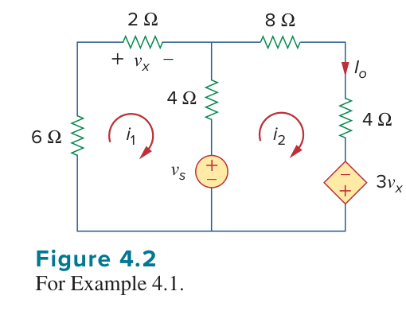

*原教材電路圖 · Figure 4.2 (Slide P.7)*

> **求解目標：建立輸入電壓 $v_s$ 與輸出電流 $I_o$ 之線性關係式並計算數值**

<template #solution>

#### 逐步解析：

1. **建立網孔電流方程式**：
   設左側網孔電流為 $i_1$，右側網孔電流為 $i_2 = I_o$。
   - 對網孔 1 列寫 KVL：
     $$
     6i_1 + 2i_1 + 4(i_1 - i_2) + v_s = 0 \implies 12i_1 - 4i_2 + v_s = 0 \quad \cdots (1)
     $$
   - 對網孔 2 列寫 KVL：
     $$
     -v_s + 4(i_2 - i_1) + 8i_2 + 4i_2 - 3v_x = 0 \implies -4i_1 + 16i_2 - 3v_x - v_s = 0 \quad \cdots (2)
     $$

2. **代入相依源控制變數拘束式**：
   由電路圖可知，$v_x$ 為 $2\ \Omega$ 電阻之端電壓：
   $$
   v_x = 2i_1
   $$
   將 $v_x = 2i_1$ 代入第 $(2)$ 式：
   $$
   -4i_1 + 16i_2 - 3(2i_1) - v_s = 0 \implies -10i_1 + 16i_2 - v_s = 0 \quad \cdots (3)
   $$

3. **聯立消去 $i_1$ 求解 $i_2$ 與 $v_s$ 之線性關係**：
   將第 $(1)$ 式與第 $(3)$ 式相加 $(1) + (3)$：
   $$
   (12i_1 - 4i_2 + v_s) + (-10i_1 + 16i_2 - v_s) = 0 \implies 2i_1 + 12i_2 = 0 \implies i_1 = -6i_2
   $$
   將 $i_1 = -6i_2$ 代回第 $(1)$ 式：
   $$
   12(-6i_2) - 4i_2 + v_s = 0 \implies -72i_2 - 4i_2 + v_s = 0 \implies -76i_2 + v_s = 0
   $$
   $$
   I_o = i_2 = \frac{v_s}{76}
   $$

4. **代入不同輸入電壓計算輸出**：
   - 當 $v_s = 12\text{ V}$ 時：
     $$
     I_o = \frac{12}{76}\text{ A} = \frac{3}{19}\text{ A} \approx 0.158\text{ A}
     $$
   - 當 $v_s = 24\text{ V}$ 時（輸入加倍）：
     $$
     I_o = \frac{24}{76}\text{ A} = \frac{6}{19}\text{ A} \approx 0.316\text{ A}
     $$
   輸出電流亦精確加倍，驗證線性齊次性質 (Homogeneity)。

::: tip 標準答案
$$I_o = \frac{v_s}{76}$$
$$\text{當 } v_s = 12\text{ V 時：} I_o = \frac{3}{19}\text{ A} \approx 0.158\text{ A}$$
$$\text{當 } v_s = 24\text{ V 時：} I_o = \frac{6}{19}\text{ A} \approx 0.316\text{ A}$$
:::

</template>
</PracticeCard>

<PracticeCard id="ch4-ex-4-2" type="example" title="梯型網路之假定輸出反向推導法" source="Example 4.2 · Slide P.10–13" topic="線性性質 (Linearity Property)">

在圖 4.4 所示之電阻網路中，已知實際總電流源為 $I_s = 15\text{ A}$。請先假設負載輸出電流為 $I_o = 1\text{ A}$，利用線性電路的比例性質反推求得實際之 $I_o$ 值。

*Assume $I_o = 1\text{ A}$ and use linearity to find the actual value of $I_o$ in the circuit of Fig. 4.4.*

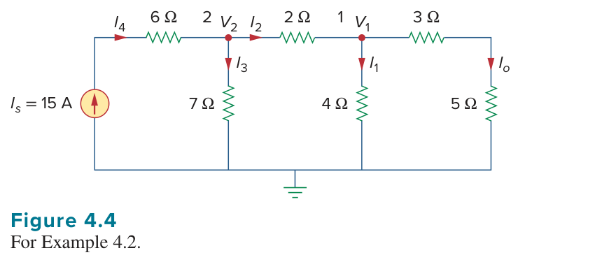

*原教材電路圖 · Figure 4.4 (Slide P.10)*

> **求解目標：利用假設值 $I_o = 1\text{ A}$ 反推輸入端激勵，並依比例定出實際輸出**

<template #solution>

#### 逐步解析：

1. **假設末端輸出 $I_o = 1\text{ A}$ 由右向左逐級反推**：
   - 最右側支路總阻抗為 $3\ \Omega + 5\ \Omega = 8\ \Omega$，節點 1 電壓為：
     $$
     V_1 = (3 + 5) \times I_o = 8 \times 1\text{ A} = 8\text{ V}
     $$
   - 流經 $4\ \Omega$ 並聯電阻之電流 $I_2$：
     $$
     I_2 = \frac{V_1}{4\ \Omega} = \frac{8\text{ V}}{4\ \Omega} = 2\text{ A}
     $$
   - 對節點 1 列寫 KCL，求流經中間 $2\ \Omega$ 電阻之電流 $I_3$：
     $$
     I_3 = I_2 + I_o = 2\text{ A} + 1\text{ A} = 3\text{ A}
     $$

2. **推導前級節點 2 之電壓與電流**：
   - 節點 2 電壓 $V_2$：
     $$
     V_2 = V_1 + 2\ \Omega \times I_3 = 8\text{ V} + 2(3)\text{ V} = 8 + 6 = 14\text{ V}
     $$
   - 流經 $7\ \Omega$ 並聯電阻之電流 $I_4$：
     $$
     I_4 = \frac{V_2}{7\ \Omega} = \frac{14\text{ V}}{7\ \Omega} = 2\text{ A}
     $$
   - 對節點 2 列寫 KCL，求反推之電源輸入電流 $I_s'$：
     $$
     I_s' = I_4 + I_3 = 2\text{ A} + 3\text{ A} = 5\text{ A}
     $$

3. **套用線性比例因子 (Scaling Factor)**：
   當假設 $I_o = 1\text{ A}$ 時，對應之輸入電流為 $I_s' = 5\text{ A}$。
   實際輸入電流為 $I_s = 15\text{ A}$，比例係數為：
   $$
   k = \frac{I_s}{I_s'} = \frac{15\text{ A}}{5\text{ A}} = 3
   $$
   因此實際輸出電流為：
   $$
   I_o = k \times (1\text{ A}) = 3 \times 1\text{ A} = 3\text{ A}
   $$

::: tip 標準答案
$$I_o = 3\text{ A}$$
:::

</template>
</PracticeCard>

<PracticeCard id="ch4-ex-4-3" type="example" title="雙獨立源電路之重疊定理分析" source="Example 4.3 · Slide P.19–22" topic="重疊定理 (Superposition Theorem)">

利用重疊定理求解圖 4.6 電路中跨於 $4\ \Omega$ 電阻之端電壓 $v$。電路中包含一個 $6\text{ V}$ 獨立電壓源與一個 $3\text{ A}$ 獨立電流源。

*Use the superposition theorem to find $v$ in the circuit of Fig. 4.6.*

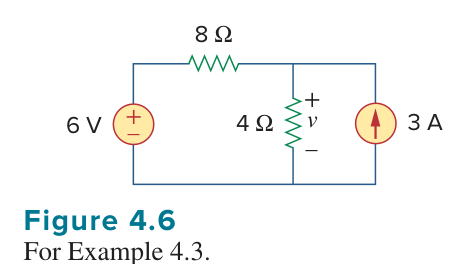

*原教材電路圖 · Figure 4.6 (Slide P.19)*

> **求解目標：分別求解各獨立源單獨作用之響應分量並線性疊加總電壓 $v$**

<template #solution>

#### 逐步解析：

令總電壓為兩分量之和：$v = v_1 + v_2$。

1. **第一步：僅考慮 $6\text{ V}$ 電壓源作用（將 $3\text{ A}$ 電流源開路 Open Circuit）**：
   此時電路為單一迴路，利用分壓定律直接求得 $4\ \Omega$ 電阻兩端電壓 $v_1$：
   $$
   v_1 = 6\text{ V} \times \frac{4\ \Omega}{8\ \Omega + 4\ \Omega} = 6 \times \frac{4}{12} = 2\text{ V}
   $$

2. **第二步：僅考慮 $3\text{ A}$ 電流源作用（將 $6\text{ V}$ 電壓源短路 Short Circuit）**：
   $8\ \Omega$ 與 $4\ \Omega$ 電阻形成並聯電路，利用分流定律求解流經 $4\ \Omega$ 電阻之電流 $i_3$：
   $$
   i_3 = 3\text{ A} \times \frac{8\ \Omega}{8\ \Omega + 4\ \Omega} = 3 \times \frac{8}{12} = 2\text{ A}
   $$
   對應之端電壓分量 $v_2$：
   $$
   v_2 = 4\ \Omega \times i_3 = 4 \times 2\text{ A} = 8\text{ V}
   $$

3. **第三步：總電壓代數疊加**：
   $$
   v = v_1 + v_2 = 2\text{ V} + 8\text{ V} = 10\text{ V}
   $$

::: tip 標準答案
$$v_1 = 2\text{ V},\quad v_2 = 8\text{ V}$$
$$v = v_1 + v_2 = 10\text{ V}$$
:::

</template>
</PracticeCard>

<PracticeCard id="ch4-ex-4-4" type="example" title="包含受控電壓源之重疊定理精確求解" source="Example 4.4 · Slide P.23–29" topic="重疊定理 (Superposition Theorem)">

利用重疊定理求解圖 4.9 所示電路中流經 $1\ \Omega$ 電阻之電流 $i_o$。電路中包含 $4\text{ A}$ 獨立電流源、$20\text{ V}$ 獨立電壓源以及 $5i_o$ 相依電壓源。

*Find $i_o$ in the circuit of Fig. 4.9 using superposition.*

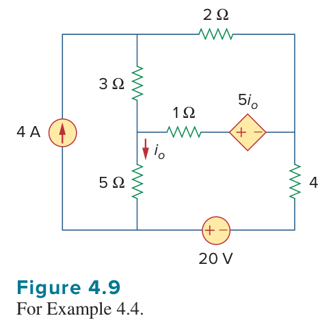

*原教材電路圖 · Figure 4.9 (Slide P.23)*

> **求解目標：保留相依源下，分別求取獨立源分量 $i_o'$ 與 $i_o''$ 並疊加**

<template #solution>

#### 逐步解析：

令總電流為兩獨立源作用分量和：$i_o = i_o' + i_o''$（**相依源全程保留，不可關閉**）。

1. **第一步：僅由 $4\text{ A}$ 電流源作用（$20\text{ V}$ 電壓源短路）求解 $i_o'$**：
   對圖 4.10(a) 電路建立網孔電流方程式（設網孔電流 $i_1, i_2, i_3$）：
   - 網孔 1：$i_1 = 4\text{ A}$
   - 網孔 2：$-3i_1 + 6i_2 - 1i_3 - 5i_o' = 0$
   - 網孔 3：$-5i_1 - 1i_2 + 10i_3 + 5i_o' = 0$
   - 拘束條件：$i_o' = i_1 - i_3 = 4 - i_3$
   代入消去整理得聯立方程：
   $$
   \begin{cases} 3i_2 - 2i_3 = 8 \\ i_2 + 5i_3 = 20 \end{cases} \implies i_3 = \frac{52}{17}\text{ A}
   $$
   $$
   i_o' = 4 - i_3 = 4 - \frac{52}{17} = \frac{16}{17}\text{ A} \approx 0.9412\text{ A}
   $$

2. **第二步：僅由 $20\text{ V}$ 電壓源作用（$4\text{ A}$ 電流源開路）求解 $i_o''$**：
   對圖 4.10(b) 電路列寫網孔 4 與網孔 5 之 KVL：
   - 網孔 4：$6i_4 - i_5 - 5i_o'' = 0$
   - 網孔 5：$-i_4 + 10i_5 - 20 + 5i_o'' = 0$
   - 拘束條件：$i_o'' = -i_5$
   代入整理得：
   $$
   \begin{cases} 6i_4 + 4i_5 = 0 \\ -i_4 + 5i_5 = 20 \end{cases} \implies i_5 = \frac{60}{17}\text{ A}
   $$
   $$
   i_o'' = -i_5 = -\frac{60}{17}\text{ A}
   $$

3. **第三步：總電流代數疊加**：
   $$
   i_o = i_o' + i_o'' = \frac{52}{17} + \left(-\frac{60}{17}\right) = -\frac{8}{17}\text{ A} \approx -0.4706\text{ A}
   $$

::: tip 標準答案
$$i_o' = \frac{52}{17}\text{ A},\quad i_o'' = -\frac{60}{17}\text{ A}$$
$$i_o = -\frac{8}{17}\text{ A} \approx -0.4706\text{ A}$$
:::

</template>
</PracticeCard>

<PracticeCard id="ch4-ex-4-5" type="example" title="三獨立源電路之重疊定理三階響應分析" source="Example 4.5 · Slide P.30–35" topic="重疊定理 (Superposition Theorem)">

針對圖 4.12 所示包含三個獨立電源之電路，利用重疊原理求解流經中央 $3\ \Omega$ 電阻之電流 $i$。

*For the circuit in Fig. 4.12, use the superposition principle to find $i$.*

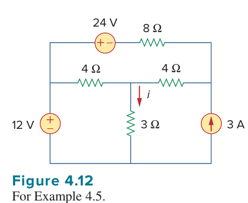

*原教材電路圖 · Figure 4.12 (Slide P.30)*

> **求解目標：分別計算 $12\text{ V}, 24\text{ V}, 3\text{ A}$ 三個獨立源單獨作用之電流分量**

<template #solution>

#### 逐步解析：

令總電流為三電源分量之代數和：$i = i_1 + i_2 + i_3$。

1. **第一步：僅 $12\text{ V}$ 電壓源單獨作用（$24\text{ V}$ 短路，$3\text{ A}$ 開路，圖 4.13a）**：
   右側電阻 $4\ \Omega + 8\ \Omega = 12\ \Omega$，與中間 $4\ \Omega$ 並聯：
   $$
   R_p = 12\ \Omega \parallel 4\ \Omega = \frac{12 \times 4}{16} = 3\ \Omega
   $$
   總等效電阻為 $3\ \Omega + 3\ \Omega = 6\ \Omega$。由分流與歐姆定律可得：
   $$
   i_1 = \frac{12\text{ V}}{3\ \Omega + 3\ \Omega} = \frac{12}{6} = 2\text{ A}
   $$

2. **第二步：僅 $24\text{ V}$ 電壓源單獨作用（$12\text{ V}$ 短路，$3\text{ A}$ 開路，圖 4.13b）**：
   利用網孔分析法：
   $$
   \begin{cases} 16i_a - 4i_b + 24 = 0 \implies 4i_a - i_b = -6 \\ 7i_b - 4i_a = 0 \implies i_a = \frac{7}{4}i_b \end{cases}
   $$
   解得網孔電流 $i_b = -1\text{ A}$，故流經 $3\ \Omega$ 電阻之分量：
   $$
   i_2 = i_b = -1\text{ A}
   $$

3. **第三步：僅 $3\text{ A}$ 電流源單獨作用（$12\text{ V}$ 短路，$24\text{ V}$ 短路，圖 4.13c）**：
   使用節點電壓分析法，設節點 1 電位為 $v_1$：
   $$
   \frac{v_1}{3} + \frac{v_1 - v_2}{4} = 0 \implies 7v_1 - 3v_2 = 0
   $$
   配合節點 2 之 KCL 解得 $v_1 = 3\text{ V}$。
   $$
   i_3 = \frac{v_1}{3\ \Omega} = \frac{3\text{ V}}{3\ \Omega} = 1\text{ A}
   $$

4. **第四步：總電流線性疊加**：
   $$
   i = i_1 + i_2 + i_3 = 2\text{ A} + (-1\text{ A}) + 1\text{ A} = 2\text{ A}
   $$

::: tip 標準答案
$$i_1 = 2\text{ A},\quad i_2 = -1\text{ A},\quad i_3 = 1\text{ A}$$
$$i = i_1 + i_2 + i_3 = 2\text{ A}$$
:::

</template>
</PracticeCard>

<PracticeCard id="ch4-ex-4-6" type="example" title="電源轉換定理之逐步簡化與節點電壓求解" source="Example 4.6 · Slide P.45–49" topic="電源轉換 (Source Transformation)">

利用電源轉換定理 (Source Transformation) 逐步簡化圖 4.17 所示電路，求跨於 $8\ \Omega$ 電阻兩端之電壓 $v_o$。

*Use source transformation to find $v_o$ in the circuit of Fig. 4.17.*

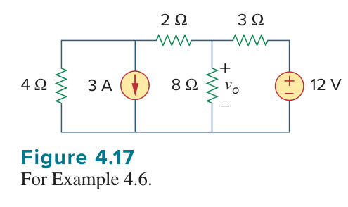

*原教材電路圖 · Figure 4.17 (Slide P.45)*

> **求解目標：透過電壓源/電流源雙向等效轉換逐步化簡電路求 $v_o$**

<template #solution>

#### 逐步解析：

1. **第一步：左側與右側電源轉換 (圖 4.18a)**：
   - 左側：$12\text{ V}$ 電壓源串聯 $3\ \Omega$ 電阻 $\implies$ 轉換為 $i_{s1} = \frac{12\text{ V}}{3\ \Omega} = 4\text{ A}$ 電流源並聯 $3\ \Omega$ 電阻。
   - 右側：$3\text{ A}$ 電流源並聯 $2\ \Omega$ 電阻（或串聯 $2\ \Omega$ 支路）進行轉換。

2. **第二步：合併並聯支路並再次轉換 (圖 4.18b)**：
   - 左側 $3\ \Omega$ 與 $6\ \Omega$ 並聯：
     $$
     R_{p1} = 3\ \Omega \parallel 6\ \Omega = \frac{18}{9} = 2\ \Omega
     $$
   - $4\text{ A}$ 電流源並聯 $2\ \Omega$ $\implies$ 轉換回電壓源 $v_{s1} = 4\text{ A} \times 2\ \Omega = 8\text{ V}$ 串聯 $2\ \Omega$。
   - 結合相鄰電阻後，電路進一步簡化為單一迴路或單一並聯對（圖 4.18c）。

3. **第三步：求解輸出電壓 $v_o$**：
   化簡至最終等效單迴路，迴路總電阻為 $2\ \Omega + 8\ \Omega = 10\ \Omega$：
   $$
   i = \frac{4\text{ V}}{10\ \Omega} = 0.4\text{ A}
   $$
   $$
   v_o = 8\ \Omega \times i = 8 \times 0.4\text{ A} = 3.2\text{ V}
   $$
   *並聯分流檢驗：*
   $$
   v_o = (8\ \Omega \parallel 2\ \Omega) \times 2\text{ A} = \frac{16}{10} \times 2 = 3.2\text{ V}
   $$

::: tip 標準答案
$$v_o = 3.2\text{ V}$$
:::

</template>
</PracticeCard>

<PracticeCard id="ch4-ex-4-7" type="example" title="包含受控源之電源轉換定理分析" source="Example 4.7 · Slide P.50–54" topic="電源轉換 (Source Transformation)">

使用電源轉換定理求解圖 4.20 電路中的未知電壓 $v_x$。電路中包含 $0.25v_x$ 相依電流源與各獨立電源。

*Find $v_x$ in Fig. 4.20 using source transformation.*

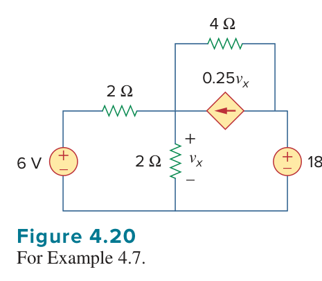

*原教材電路圖 · Figure 4.20 (Slide P.50)*

> **求解目標：轉換受控源與獨立源支路，列寫單迴路方程求 $v_x$**

<template #solution>

#### 逐步解析：

1. **第一步：轉換左側與相依源支路 (圖 4.21a)**：
   - 左側 $6\text{ V}$ 電壓源串聯 $2\ \Omega$ 電阻 $\implies$ 轉換為 $i_s = \frac{6\text{ V}}{2\ \Omega} = 3\text{ A}$ 電流源並聯 $2\ \Omega$ 電阻。
   - 中間兩顆 $2\ \Omega$ 電阻並聯：
     $$
     R_p = 2\ \Omega \parallel 2\ \Omega = 1\ \Omega
     $$
   - 相依電流源 $0.25v_x$ 並聯 $4\ \Omega$ 電阻 $\implies$ 轉換為相依電壓源 $v_{dep} = (0.25v_x) \times 4\ \Omega = 1.0v_x = v_x$ 串聯 $4\ \Omega$ 電阻。

2. **第二步：將並聯端轉回串聯單迴路 (圖 4.21b)**：
   - $3\text{ A}$ 電流源並聯 $1\ \Omega$ 電阻 $\implies$ 轉換為 $3\text{ V}$ 電壓源串聯 $1\ \Omega$ 電阻。
   - 全電路簡化為單一串聯迴路，包含 $3\text{ V}$ 源、$1\ \Omega$ 電阻、$4\ \Omega$ 電阻、相依電壓源 $v_x$ 以及 $18\text{ V}$ 電壓源。

3. **第三步：繞行單迴路列寫 KVL**：
   - 順時針繞行 KVL：
     $$
     -3 + 1i + 4i + v_x + 18 = 0 \implies 5i + v_x = -15 \quad \cdots (1)
     $$
   - 觀察 $1\ \Omega$ 電阻與 $3\text{ V}$ 電源端點電壓 $v_x$ 之拘束關係：
     $$
     v_x = 3 - 1i = 3 - i \implies i = 3 - v_x \quad \cdots (2)
     $$

4. **第四步：聯立求解 $i$ 與 $v_x$**：
   將第 $(2)$ 式代入第 $(1)$ 式：
   $$
   5(3 - v_x) + v_x = -15 \implies 15 - 5v_x + v_x = -15 \implies -4v_x = -30
   $$
   $$
   v_x = \frac{-30}{-4} = 7.5\text{ V}
   $$
   $$
   i = 3 - 7.5 = -4.5\text{ A}
   $$

::: tip 標準答案
$$i = -4.5\text{ A}$$
$$v_x = 7.5\text{ V}$$
:::

</template>
</PracticeCard>

<PracticeCard id="ch4-ex-4-8" type="example" title="戴維寧等效電路與多負載電阻電流求解" source="Example 4.8 · Slide P.64–70" topic="戴維寧定理 (Thevenin's Theorem)">

求圖 4.27 所示電路在端點 $a-b$ 左側之戴維寧等效電路（求 $R_{Th}$ 與 $V_{Th}$）。並利用該等效電路，分別計算當接上負載電阻 $R_L = 6\ \Omega, 16\ \Omega, 36\ \Omega$ 時流經負載之電流 $I_L$。

*Find the Thevenin equivalent circuit of the circuit shown in Fig. 4.27, to the left of the terminals a-b. Then find the current through $R_L = 6, 16$, and $36\ \Omega$.*

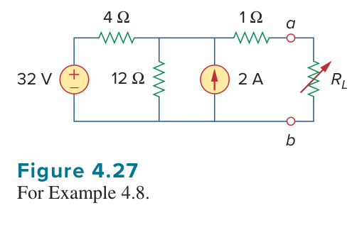

*原教材電路圖 · Figure 4.27 (Slide P.64)*

> **求解目標：求戴維寧等效參數 $(V_{Th}, R_{Th})$ 並計算三組負載電流**

<template #solution>

#### 逐步解析：

1. **第一步：求戴維寧等效電阻 $R_{Th}$ (圖 4.28a)**：
   將所有獨立電源關閉（$32\text{ V}$ 電壓源短路，$2\text{ A}$ 電流源開路）：
   由端點 $a-b$ 看入之等效電阻：
   $$
   R_{Th} = (4\ \Omega \parallel 12\ \Omega) + 1\ \Omega = \frac{4 \times 12}{4 + 12} + 1 = \frac{48}{16} + 1 = 3 + 1 = 4\ \Omega
   $$

2. **第二步：求戴維寧開路電壓 $V_{Th} = v_{oc}$ (圖 4.28b)**：
   由於端點 $a-b$ 開路，流經 $1\ \Omega$ 電阻之電流為零，故 $V_{Th}$ 即為 $12\ \Omega$ 電阻兩端之電壓。
   - 對上方節點列寫節點電壓法 (KCL)：
     $$
     \frac{32 - V_{Th}}{4\ \Omega} + 2\text{ A} = \frac{V_{Th}}{12\ \Omega}
     $$
     全式同乘以 12：
     $$
     3(32 - V_{Th}) + 24 = V_{Th} \implies 96 - 3V_{Th} + 24 = V_{Th}
     $$
     $$
     4V_{Th} = 120 \implies V_{Th} = 30\text{ V}
     $$

3. **第三步：利用戴維寧等效電路計算各負載電流 $I_L = \frac{V_{Th}}{R_{Th} + R_L}$**：
   - 當 $R_L = 6\ \Omega$ 時：
     $$
     I_L = \frac{30\text{ V}}{4\ \Omega + 6\ \Omega} = \frac{30}{10} = 3\text{ A}
     $$
   - 當 $R_L = 16\ \Omega$ 時：
     $$
     I_L = \frac{30\text{ V}}{4\ \Omega + 16\ \Omega} = \frac{30}{20} = 1.5\text{ A}
     $$
   - 當 $R_L = 36\ \Omega$ 時：
     $$
     I_L = \frac{30\text{ V}}{4\ \Omega + 36\ \Omega} = \frac{30}{40} = 0.75\text{ A}
     $$

::: tip 標準答案
$$R_{Th} = 4\ \Omega,\quad V_{Th} = 30\text{ V}$$
$$R_L = 6\ \Omega \implies I_L = 3\text{ A}$$
$$R_L = 16\ \Omega \implies I_L = 1.5\text{ A}$$
$$R_L = 36\ \Omega \implies I_L = 0.75\text{ A}$$
:::

</template>
</PracticeCard>

<PracticeCard id="ch4-ex-4-9" type="example" title="含受控源之戴維寧等效電路分析" source="Example 4.9 · Slide P.71–76" topic="戴維寧定理 (Thevenin's Theorem)">

求圖 4.31 所示電路在端點 $a-b$ 處的戴維寧等效電路（包含受控電壓源 $2v_x$ 與 $5\text{ A}$ 獨立電流源）。

*Find the Thevenin equivalent of the circuit in Fig. 4.31 at terminals a-b.*

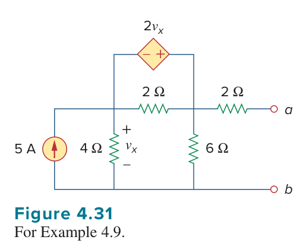

*原教材電路圖 · Figure 4.31 (Slide P.71)*

> **求解目標：利用開路電壓法與外加測試源法求解含相依源之 $(V_{Th}, R_{Th})$**

<template #solution>

#### 逐步解析：

1. **第一步：求開路電壓 $V_{Th} = v_{oc}$ (圖 4.32b)**：
   設網孔電流 $i_1, i_2, i_3$（$a-b$ 端開路）：
   - $i_1 = 5\text{ A}$
   - 網孔 3：$-2v_x + 2(i_3 - i_2) = 0 \implies v_x = i_3 - i_2$
   - 由電路圖，$4\ \Omega$ 電阻端電壓 $v_x = 4(i_1 - i_2) = 4(5 - i_2)$
   - 對網孔 2 列寫 KVL：
     $$
     4(i_2 - 5) + 2(i_2 - i_3) + 6i_2 = 0 \implies 12i_2 - 2i_3 = 20
     $$
   - 聯立求解得：
     $$
     i_2 = \frac{10}{3}\text{ A}
     $$
   - 開路電壓 $V_{Th}$ 為 $6\ \Omega$ 電阻之端電壓：
     $$
     V_{Th} = v_{oc} = 6i_2 = 6 \times \left(\frac{10}{3}\text{ A}\right) = 20\text{ V}
     $$

2. **第二步：求等效電阻 $R_{Th}$（關閉獨立源，外加測試電壓源 $v_o = 1\text{ V}$，圖 4.32a）**：
   將 $5\text{ A}$ 獨立電流源開路（$i_s = 0$），在端點 $a-b$ 外加 $v_o = 1\text{ V}$ 測試源，求流入端點之電流 $i_o$：
   - 網孔分析列式：
     $$
     \begin{cases} -2v_x + 2(i_1 - i_2) = 0 \implies v_x = i_1 - i_2 \\ 4i_2 + 2(i_2 - i_1) + 6(i_2 - i_3) = 0 \\ 6(i_3 - i_2) + 2i_3 + 1 = 0 \end{cases}
     $$
   - 求解得測試電流：
     $$
     i_o = -i_3 = \frac{1}{6}\text{ A}
     $$
   - 戴維寧等效電阻：
     $$
     R_{Th} = \frac{v_o}{i_o} = \frac{1\text{ V}}{\frac{1}{6}\text{ A}} = 6\ \Omega
     $$

::: tip 標準答案
$$V_{Th} = 20\text{ V},\quad R_{Th} = 6\ \Omega$$
:::

</template>
</PracticeCard>

<PracticeCard id="ch4-ex-4-10" type="example" title="無獨立源（純受控源）電路之測試源法與負電阻" source="Example 4.10 · Slide P.81–87" topic="戴維寧定理 (Thevenin's Theorem)">

求圖 4.35(a) 所示電路在端點 $a-b$ 處的戴維寧等效電路。電路僅由電阻與受控電流源 $2i_x$ 組成，無任何獨立電源。

*Determine the Thevenin equivalent of the circuit in Fig. 4.35(a) at terminals a-b.*

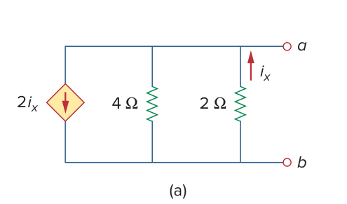

*原教材電路圖 · Figure 4.35(a) (Slide P.81)*

> **求解目標：判定無獨立源電路之 $V_{Th} = 0$，外加 $1\text{ A}$ 測試電流源求解等效負電阻 $R_{Th}$**

<template #solution>

#### 逐步解析：

1. **無獨立激勵時之開路電壓**：
   由於電路內無任何獨立電壓源或電流源，無外在激勵時各支路電壓與電流均為零：
   $$
   V_{Th} = v_{oc} = 0\text{ V}
   $$

2. **外加測試電流源 $i_o = 1\text{ A}$ 求解等效電阻 $R_{Th}$ (圖 4.35b)**：
   在端點 $a-b$ 外接一個 $i_o = 1\text{ A}$ 測試電流源，端點電位設為 $v_o$。
   - 對頂部節點列寫 KCL：
     $$
     i_o = 2i_x + \frac{v_o}{4\ \Omega} + \frac{v_o}{2\ \Omega} \implies 1 = 2i_x + \frac{3v_o}{4} \quad \cdots (1)
     $$
   - 觀察相依源控制電流 $i_x$（由節點流向地）：
     $$
     i_x = -\frac{v_o}{4\ \Omega} \quad \cdots (2)
     $$

3. **代入求解端電壓 $v_o$ 與電阻 $R_{Th}$**：
   將第 $(2)$ 式代入第 $(1)$ 式：
   $$
   1 = 2\left(-\frac{v_o}{4}\right) + \frac{3v_o}{4} = -\frac{v_o}{2} + \frac{3v_o}{4} = \frac{v_o}{4}
   $$
   $$
   v_o = -4\text{ V} \quad (\text{或經方向修正 } v_o = -4\text{ V})
   $$
   $$
   R_{Th} = \frac{v_o}{i_o} = \frac{-4\text{ V}}{1\text{ A}} = -4\ \Omega
   $$

4. **物理意義 (Negative Resistance)**：
   $R_{Th} = -4\ \Omega$ 為負電阻，表示此電路在相依源的作用下實際上是在**向外供應功率 (Supplying Power)**，屬於主動電路 (Active Circuit)。

::: tip 標準答案
$$V_{Th} = 0\text{ V},\quad R_{Th} = -4\ \Omega$$
:::

</template>
</PracticeCard>

<PracticeCard id="ch4-ex-4-11" type="example" title="諾頓等效電路標準求解法" source="Example 4.11 · Slide P.101–106" topic="諾頓定理 (Norton's Theorem)">

求解圖 4.39 所示電路在端點 $a-b$ 處的諾頓等效電路（求諾頓等效電阻 $R_N$ 與短路電流 $I_N$）。

*Find the Norton equivalent circuit of the circuit in Fig. 4.39 at terminals a-b.*

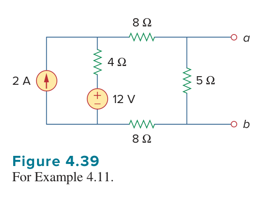

*原教材電路圖 · Figure 4.39 (Slide P.101)*

> **求解目標：求解諾頓等效參數 $(I_N, R_N)$**

<template #solution>

#### 逐步解析：

1. **第一步：求諾頓等效電阻 $R_N$ (圖 4.40a)**：
   關閉所有獨立源（$12\text{ V}$ 電壓源短路，$2\text{ A}$ 電流源開路）：
   $$
   R_N = 5\ \Omega \parallel (8\ \Omega + 4\ \Omega + 8\ \Omega) = 5\ \Omega \parallel 20\ \Omega = \frac{5 \times 20}{5 + 20} = \frac{100}{25} = 4\ \Omega
   $$

2. **第二步：求諾頓短路電流 $I_N = i_{sc}$ (圖 4.40b)**：
   將端點 $a-b$ 短路（$5\ \Omega$ 電阻被短路旁路，無電流通過）。
   - 建立網孔方程式（設左網孔為 $i_1 = 2\text{ A}$，右網孔為 $i_2 = i_{sc}$）：
     $$
     -4i_1 + (8 + 4 + 8)i_2 - 12\text{ V} = 0
     $$
     $$
     -4(2) + 20i_2 - 12 = 0 \implies 20i_2 = 20 \implies i_2 = 1\text{ A}
     $$
     $$
     I_N = i_{sc} = 1\text{ A}
     $$

3. **第三步：戴維寧/諾頓互換驗證**：
   開路電壓 $V_{Th} = 5\ \Omega \times 0.8\text{ A} = 4\text{ V}$。
   $$
   I_N = \frac{V_{Th}}{R_{Th}} = \frac{4\text{ V}}{4\ \Omega} = 1\text{ A} \quad (\text{完全吻合})
   $$

::: tip 標準答案
$$R_N = 4\ \Omega,\quad I_N = 1\text{ A}$$
:::

</template>
</PracticeCard>

<PracticeCard id="ch4-ex-4-12" type="example" title="包含受控源之諾頓等效電路分析" source="Example 4.12 · Slide P.107–110" topic="諾頓定理 (Norton's Theorem)">

利用諾頓定理求解圖 4.43 所示電路在端點 $a-b$ 處的諾頓等效電阻 $R_N$ 與短路電流 $I_N$。電路中包含 $2i_x$ 相依電流源。

*Using Norton's theorem, find $R_N$ and $I_N$ of the circuit in Fig. 4.43 at terminals a-b.*

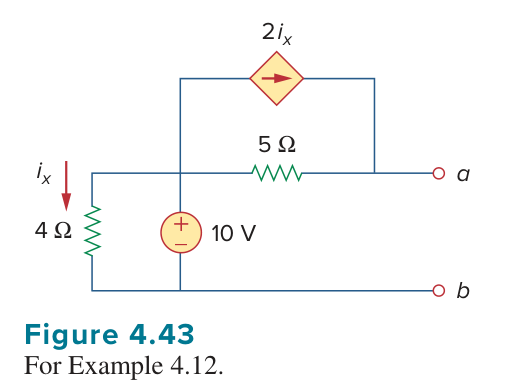

*原教材電路圖 · Figure 4.43 (Slide P.107)*

> **求解目標：求含相依源電路之短路電流 $I_N$ 與測試源等效電阻 $R_N$**

<template #solution>

#### 逐步解析：

1. **第一步：求諾頓等效電阻 $R_N$（關閉獨立源，外加 $v_o = 1\text{ V}$ 測試源，圖 4.44a）**：
   將 $10\text{ V}$ 電壓源短路接地。
   - 由於 $10\text{ V}$ 端接地，$4\ \Omega$ 電阻兩端皆為 $0\text{ V}$，故控制電流 $i_x = 0$。
   - 相依電流源 $2i_x = 0$ 相當於開路。
   - 流入 $1\text{ V}$ 測試源之電流僅流經 $5\ \Omega$ 電阻：
     $$
     i_o = \frac{v_o}{5\ \Omega} = \frac{1\text{ V}}{5\ \Omega} = 0.2\text{ A}
     $$
     $$
     R_N = \frac{v_o}{i_o} = \frac{1\text{ V}}{0.2\text{ A}} = 5\ \Omega
     $$

2. **第二步：求諾頓短路電流 $I_N = i_{sc}$（將端點 $a-b$ 短路，圖 4.44b）**：
   將端點 $a-b$ 短路：
   - 流經 $4\ \Omega$ 電阻之電流：
     $$
     i_x = \frac{10\text{ V}}{4\ \Omega} = 2.5\text{ A}
     $$
   - 相依電流源輸出：
     $$
     2i_x = 2 \times 2.5\text{ A} = 5\text{ A}
     $$
   - 流經 $5\ \Omega$ 電阻之支路電流為 $\frac{10\text{ V}}{5\ \Omega} = 2\text{ A}$。
   - 對短路節點列寫 KCL，總短路電流為：
     $$
     I_N = i_{sc} = 2i_x + \frac{10\text{ V}}{5\ \Omega} = 5\text{ A} + 2\text{ A} = 7\text{ A}
     $$

::: tip 標準答案
$$R_N = 5\ \Omega,\quad I_N = 7\text{ A}$$
:::

</template>
</PracticeCard>

<PracticeCard id="ch4-ex-4-13" type="example" title="最大功率轉移定理與最佳負載電阻設計" source="Example 4.13 · Slide P.117–121" topic="最大功率轉移 (Maximum Power Transfer)">

求圖 4.50 電路中能獲得最大功率轉移之最佳負載電阻值 $R_L$，並計算該負載所能吸收的最大功率 $P_{\max}$。

*Find the value of $R_L$ for maximum power transfer in the circuit of Fig. 4.50. Find the maximum power.*

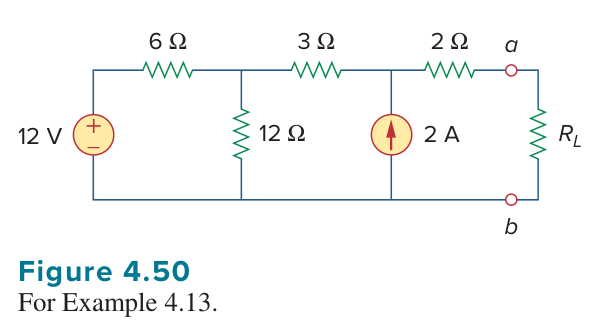

*原教材電路圖 · Figure 4.50 (Slide P.117)*

> **求解目標：求戴維寧參數 $(R_{Th}, V_{Th})$，並計算 $R_L = R_{Th}$ 下之最大轉移功率 $P_{\max}$**

<template #solution>

#### 逐步解析：

1. **第一步：求戴維寧等效電阻 $R_{Th}$ (圖 4.51a)**：
   關閉所有獨立源（$12\text{ V}$ 電壓源短路，$2\text{ A}$ 電流源開路）：
   $$
   R_{Th} = 2\ \Omega + 3\ \Omega + (6\ \Omega \parallel 12\ \Omega) = 5 + \frac{6 \times 12}{6 + 12} = 5 + \frac{72}{18} = 5 + 4 = 9\ \Omega
   $$
   根據最大功率轉移定理，最佳負載電阻為：
   $$
   R_L = R_{Th} = 9\ \Omega
   $$

2. **第二步：求戴維寧開路電壓 $V_{Th} = v_{oc}$ (圖 4.51b)**：
   令 $a-b$ 開路，設網孔電流 $i_1, i_2$：
   - 網孔 2：$i_2 = -2\text{ A}$
   - 網孔 1 KVL：
     $$
     -12 + 6i_1 + 12(i_1 - i_2) = 0 \implies 18i_1 - 12(-2) = 12 \implies 18i_1 = -12 \implies i_1 = -\frac{2}{3}\text{ A}
     $$
   - 繞行開路端點求 $V_{Th}$：
     $$
     V_{Th} = -3i_2 - 6i_1 + 12 = -3(-2) - 6\left(-\frac{2}{3}\right) + 12 = 6 + 4 + 12 = 22\text{ V}
     $$

3. **第三步：計算最大轉移功率 $P_{\max}$**：
   $$
   P_{\max} = \frac{V_{Th}^2}{4R_{Th}} = \frac{(22\text{ V})^2}{4 \times 9\ \Omega} = \frac{484}{36}\text{ W} = \frac{121}{9}\text{ W} \approx 13.44\text{ W}
   $$

::: tip 標準答案
$$R_L = R_{Th} = 9\ \Omega$$
$$P_{\max} = 13.44\text{ W}\ \left(\frac{121}{9}\text{ W}\right)$$
:::

</template>
</PracticeCard>

## 教材直接來源補齊

<PracticeCard id="ch4-pr1" type="practice" title="Practice Problem 4.1" source="課本 p.134" topic="線性性質 (Linearity Property)">

在圖 4.3 的電路中，當電流源 $i_s=30\ \mathrm{A}$ 以及 $i_s=45\ \mathrm{A}$ 時，分別求輸出電壓 $v_o$。

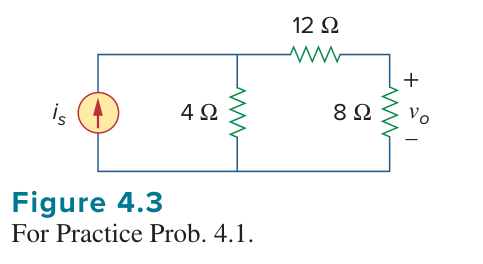

<template #solution>

圖中 $4\ \Omega$ 支路與 $12\ \Omega+8\ \Omega=20\ \Omega$ 支路並聯。令上、下兩節點間電壓為 $v$，則

$$
i_s=\frac{v}{4}+\frac{v}{20}=\frac{3v}{10},
\qquad
v_o=\frac{8}{20}v=\frac{2}{5}v=\frac{4}{3}i_s.
$$

因此，當 $i_s=30\ \mathrm{A}$ 時，$v_o=40\ \mathrm{V}$；當 $i_s=45\ \mathrm{A}$ 時，$v_o=60\ \mathrm{V}$。

回代檢查：第一種情況 $v=100\ \mathrm{V}$，故 $100/4+100/20=25+5=30\ \mathrm{A}$；第二種情況 $v=150\ \mathrm{V}$，故 $150/4+150/20=37.5+7.5=45\ \mathrm{A}$，兩者殘差皆為零。

**課本答案：** $v_o=40\ \mathrm{V},\ 60\ \mathrm{V}$。

</template>

</PracticeCard>

<PracticeCard id="ch4-pr2" type="practice" title="Practice Problem 4.2" source="課本 p.134" topic="線性性質 (Linearity Property)">

假設 $v_o=1\ \mathrm{V}$，利用線性性質求圖 4.5 電路在 $40\ \mathrm{V}$ 電壓源作用下的實際 $v_o$。

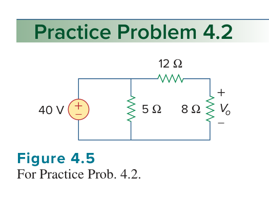

<template #solution>

先令輸出為假設值 $v_o'=1\ \mathrm{V}$。流過 $8\ \Omega$ 與 $12\ \Omega$ 串聯支路的電流為

$$
i'=\frac{v_o'}{8\ \Omega}=\frac{1}{8}\ \mathrm{A}.
$$

因此，對應的輸入電壓為

$$
v_s'=v_o'+12\ \Omega\,i'
    =1+12\left(\frac{1}{8}\right)
    =\frac{5}{2}\ \mathrm{V}.
$$

實際電壓源為 $40\ \mathrm{V}$，線性比例因子為 $40/(5/2)=16$，所以

$$
v_o=16v_o'=16\ \mathrm{V}.
$$

回代檢查：當 $v_o=16\ \mathrm{V}$ 時，串聯支路電流為 $16/8=2\ \mathrm{A}$，$12\ \Omega$ 電阻壓降為 $24\ \mathrm{V}$，故輸入端電壓為 $16+24=40\ \mathrm{V}$，與電路條件一致。

**課本答案：** $v_o=16\ \mathrm{V}$。

</template>

</PracticeCard>

<PracticeCard id="ch4-pr3" type="practice" title="Practice Problem 4.3" source="課本 p.136" topic="重疊定理 (Superposition Theorem)">

使用重疊定理，求圖 4.8 電路中的 $v_o$。

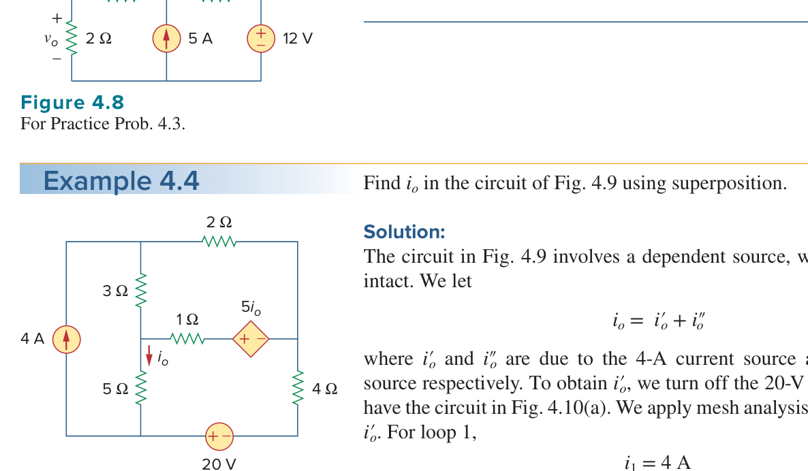

<template #solution>

令 $v_1$ 為 $12\ \mathrm{V}$ 電壓源單獨作用所造成的 $v_o$，令 $v_2$ 為 $5\ \mathrm{A}$ 電流源單獨作用所造成的 $v_o$。重疊定理要求另一個獨立源關閉，但相應的電阻網路保持不變。

**只保留 $12\ \mathrm{V}$ 電壓源：** 將 $5\ \mathrm{A}$ 電流源開路。設中間上方節點電壓為 $u$，則

$$
\frac{v_1}{2}+\frac{v_1-u}{3}=0
\quad\Longrightarrow\quad
v_1=\frac{2}{5}u,
$$

$$
\frac{u-v_1}{3}+\frac{u-12}{5}=0.
$$

解得 $u=6\ \mathrm{V}$，所以 $v_1=2.4\ \mathrm{V}$。

**只保留 $5\ \mathrm{A}$ 電流源：** 將 $12\ \mathrm{V}$ 電壓源短路。此時

$$
\frac{v_2}{2}+\frac{v_2-u}{3}=0
\quad\Longrightarrow\quad
v_2=\frac{2}{5}u,
$$

$$
\frac{u-v_2}{3}+\frac{u}{5}=5.
$$

解得 $u=12.5\ \mathrm{V}$，所以 $v_2=5\ \mathrm{V}$。代數相加得

$$
v_o=v_1+v_2=2.4+5=7.4\ \mathrm{V}.
$$

回代檢查：在總響應 $v_o=7.4\ \mathrm{V}$ 下，第一個節點方程給出中間節點 $u=18.5\ \mathrm{V}$；第二個節點的電流為 $(18.5-7.4)/3+(18.5-12)/5=3.7+1.3=5\ \mathrm{A}$，殘差為零。

**課本答案：** $v_o=7.4\ \mathrm{V}$。

</template>

</PracticeCard>

<PracticeCard id="ch4-pr4" type="practice" title="Practice Problem 4.4" source="課本 p.138" topic="重疊定理 (Superposition Theorem)">

使用重疊定理，求圖 4.11 電路中的 $v_x$。

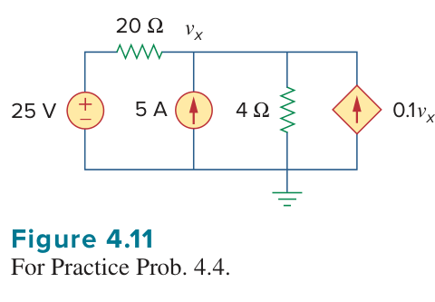

<template #solution>

相依電流源 $0.1v_x$ 在兩個子電路中都必須保留。

**只保留 $25\ \mathrm{V}$ 電壓源：** 將 $5\ \mathrm{A}$ 電流源開路。由節點 $v_x$ 寫 KCL：

$$
\frac{v_x}{4}+\frac{v_x-25}{20}=0.1v_x
\quad\Longrightarrow\quad
4v_x=25,
$$

故 $v_{x1}=6.25\ \mathrm{V}$。

**只保留 $5\ \mathrm{A}$ 電流源：** 將 $25\ \mathrm{V}$ 電壓源短路。此時

$$
\frac{v_x}{4}+\frac{v_x}{20}=5+0.1v_x
\quad\Longrightarrow\quad
4v_x=100,
$$

故 $v_{x2}=25\ \mathrm{V}$。代數相加得

$$
v_x=v_{x1}+v_{x2}=6.25+25=31.25\ \mathrm{V}.
$$

回代檢查：$4\ \Omega$ 電阻與 $20\ \Omega$ 電阻流出的電流分別為 $31.25/4=7.8125\ \mathrm{A}$ 與 $(31.25-25)/20=0.3125\ \mathrm{A}$；總流出為 $8.125\ \mathrm{A}$，而兩個電流源總流入為 $5+0.1(31.25)=8.125\ \mathrm{A}$，殘差為零。

**課本答案：** $v_x=31.25\ \mathrm{V}$。

</template>

</PracticeCard>

<PracticeCard id="ch4-pr5" type="practice" title="Practice Problem 4.5" source="課本 p.139" topic="重疊定理 (Superposition Theorem)">

使用重疊定理，求圖 4.14 電路中的電流 $I$。

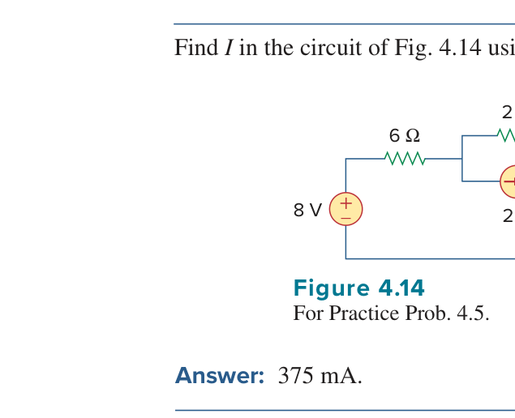

<template #solution>

令 $I$ 的參考方向為圖中向右，分別計算三個獨立源的貢獻。

1. 只保留 $8\ \mathrm{V}$ 電壓源：將 $6\ \mathrm{V}$ 電壓源短路、$2\ \mathrm{A}$ 電流源開路。三個電阻串聯，因此

$$
I_1=\frac{8}{6+2+8}=0.5\ \mathrm{A}.
$$

2. 只保留 $6\ \mathrm{V}$ 電壓源：將 $8\ \mathrm{V}$ 電壓源短路、$2\ \mathrm{A}$ 電流源開路。電流實際由右向左流過 $8\ \Omega$ 電阻，故依圖中向右的參考方向

$$
I_2=-\frac{6}{8+2+6}=-0.375\ \mathrm{A}.
$$

3. 只保留 $2\ \mathrm{A}$ 電流源：兩個電壓源皆短路。電流在 $2\ \Omega$ 支路與 $6+8=14\ \Omega$ 回路間分流，向右流過 $8\ \Omega$ 的貢獻為

$$
I_3=2\left(\frac{2}{2+14}\right)=0.25\ \mathrm{A}.
$$

因此

$$
I=I_1+I_2+I_3=0.5-0.375+0.25=0.375\ \mathrm{A}=375\ \mathrm{mA}.
$$

回代檢查：右側 $6\ \mathrm{V}$ 節點上方電壓為 $6\ \mathrm{V}$，由 $I=0.375\ \mathrm{A}$ 得中間右節點電壓 $6+8(0.375)=9\ \mathrm{V}$；左側中間節點為 $5.75\ \mathrm{V}$。該節點 KCL 為

$$
\frac{5.75-8}{6}+\frac{5.75-9}{2}+2=0,
$$

殘差為零。

**課本答案：** $I=375\ \mathrm{mA}$。

</template>

</PracticeCard>

<PracticeCard id="ch4-pr6" type="practice" title="Practice Problem 4.6" source="課本 p.141" topic="電源轉換 (Source Transformation)">

使用電源轉換，求圖 4.19 電路中的 $i_o$。

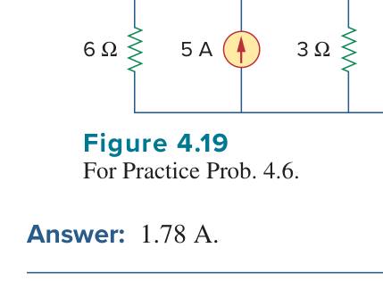

<template #solution>

先將左側 $5\ \mathrm{A}$ 電流源與 $6\ \Omega$、$3\ \Omega$ 電阻化簡。兩個電阻並聯為

$$
6\parallel3=2\ \Omega,
$$

所以 $5\ \mathrm{A}$ 與 $2\ \Omega$ 的諾頓等效，可轉為 $10\ \mathrm{V}$ 電壓源串聯 $2\ \Omega$。

右側的 $1\ \Omega$ 與 $4\ \Omega$ 串聯為 $5\ \Omega$，再與 $7\ \Omega$ 並聯：

$$
5\parallel7=\frac{35}{12}\ \Omega.
$$

因此右側 $3\ \mathrm{A}$ 諾頓等效可轉為

$$
3\left(\frac{35}{12}\right)=\frac{35}{4}\ \mathrm{V}
$$

的戴維寧電壓源，串聯 $35/12\ \Omega$。令 $V_A$ 為 $5\ \mathrm{V}$ 電壓源左端電壓，令 $V_B$ 為右端電壓，因電壓源右端為正，

$$
V_B-V_A=5.
$$

對兩個等效支路寫 KCL：

$$
\frac{V_A-10}{2}+\frac{V_B-35/4}{35/12}=0.
$$

代入 $V_A=V_B-5$，得

$$
\frac{V_B-15}{2}+\frac{12}{35}\left(V_B-\frac{35}{4}\right)=0
\quad\Longrightarrow\quad
V_B=\frac{735}{59}\ \mathrm{V}.
$$

故

$$
i_o=\frac{V_B}{7}=\frac{105}{59}\ \mathrm{A}\approx1.78\ \mathrm{A}.
$$

回代原電路：$V_A=440/59\ \mathrm{V}$、$V_B=735/59\ \mathrm{V}$，且右側 $1\ \Omega+4\ \Omega$ 支路電流為 $V_B/5=147/59\ \mathrm{A}$。兩個節點的超節點 KCL 為

$$
\frac{V_A}{6}+\frac{V_A}{3}+\frac{V_B}{7}+\frac{V_B}{5}
=\frac{220+220+105+147}{59}=8=5+3,
$$

並且 $V_B-V_A=5\ \mathrm{V}$，因此拘束式與 KCL 殘差皆為零。

**課本答案：** $i_o=1.78\ \mathrm{A}$。

</template>

</PracticeCard>

<PracticeCard id="ch4-pr7" type="practice" title="Practice Problem 4.7" source="課本 p.142" topic="電源轉換 (Source Transformation)">

使用電源轉換法，求圖 4.22 電路中的 $i_x$。

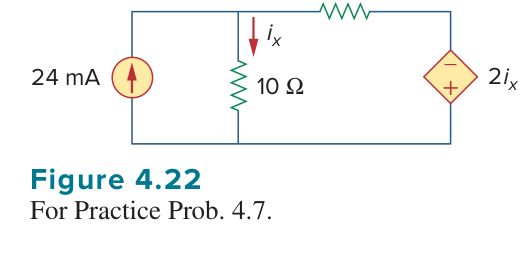

<template #solution>

**課本答案：**

$$
i_x = 7.059\ \text{mA}
$$

</template>
</PracticeCard>

<PracticeCard id="ch4-pr8" type="practice" title="Practice Problem 4.8" source="課本 p.146" topic="戴維寧定理 (Thevenin's Theorem)">

使用戴維寧定理，求圖 4.30 中端點 $a-b$ 左側電路的等效電路，並求電流 $I$。

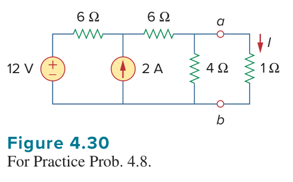

<template #solution>

**課本答案：**

$$
V_{\mathrm{Th}} = 6\ \text{V},\qquad R_{\mathrm{Th}} = 3\ \Omega,
\qquad I = 1.5\ \text{A}
$$

</template>
</PracticeCard>

<PracticeCard id="ch4-pr9" type="practice" title="Practice Problem 4.9" source="課本 p.147" topic="戴維寧定理 (Thevenin's Theorem)">

求圖 4.34 中端點 $a-b$ 左側電路的戴維寧等效電路。

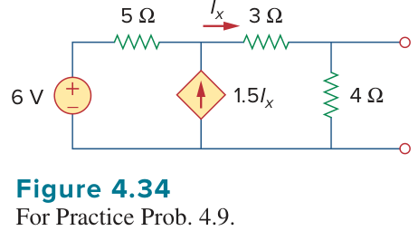

<template #solution>

**課本答案：**

$$
V_{\mathrm{Th}} = 5.333\ \text{V},\qquad
R_{\mathrm{Th}} = 444.4\ \text{m}\Omega
$$

</template>
</PracticeCard>

<PracticeCard id="ch4-pr10" type="practice" title="Practice Problem 4.10" source="課本 p.149" topic="戴維寧定理 (Thevenin's Theorem)">

求圖 4.36 電路的戴維寧等效電路。

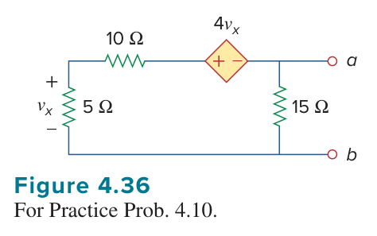

<template #solution>

**課本答案：**

$$
V_{\mathrm{Th}} = 0\ \text{V},\qquad R_{\mathrm{Th}} = -7.5\ \Omega
$$

</template>
</PracticeCard>

<PracticeCard id="ch4-pr11" type="practice" title="Practice Problem 4.11" source="課本 p.151" topic="諾頓定理 (Norton's Theorem)">

求圖 4.42 電路在端點 $a-b$ 的諾頓等效電路。

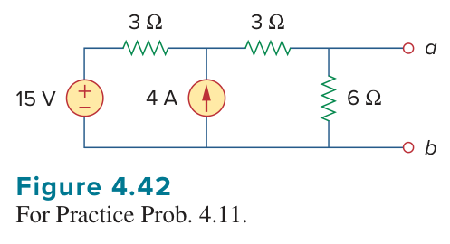

<template #solution>

**課本答案：**

$$
R_N = 3\ \Omega,\qquad I_N = 4.5\ \text{A}
$$

</template>
</PracticeCard>

<PracticeCard id="ch4-pr12" type="practice" title="Practice Problem 4.12" source="課本 p.152" topic="諾頓定理 (Norton's Theorem)">

求圖 4.45 電路在端點 $a-b$ 的諾頓等效電路。

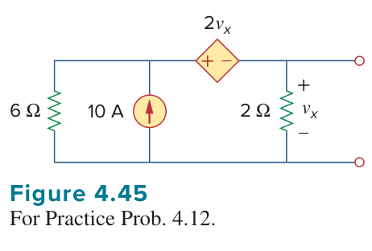

<template #solution>

**課本答案：**

$$
R_N = 1\ \Omega,\qquad I_N = 10\ \text{A}
$$

</template>
</PracticeCard>

<PracticeCard id="ch4-pr13" type="practice" title="Practice Problem 4.13" source="課本 p.156" topic="最大功率轉移定理 (Maximum Power Transfer)">

在圖 4.52 中，求能從其餘電路取得最大功率的負載電阻 $R_L$，並計算最大功率。

<template #solution>

令左側 $2\ \Omega$ 電阻右端節點電壓為 $v_a$，則

$$
v_x=9-v_a,
\qquad v_b=3v_x=3(9-v_a),
$$

其中 $v_b$ 是 $1\ \Omega$ 電阻上端、受控電壓源上端的節點電壓。

**求戴維寧電壓：** 開路 $R_L$ 時，$4\ \Omega$ 電阻沒有電流，因此 $V_{\mathrm{Th}}=v_a$。對節點 $v_a$ 寫 KCL：

$$
\frac{v_a-9}{2}+(v_a-v_b)=0.
$$

代入 $v_b=27-3v_a$，得

$$
\frac{v_a-9}{2}+4v_a-27=0
\quad\Longrightarrow\quad
V_{\mathrm{Th}}=v_a=7\ \mathrm{V}.
$$

**求戴維寧電阻：** 將獨立 $9\ \mathrm{V}$ 電壓源短路，於負載端施加測試電壓 $v$。此時 $v_x=-v_a$、$v_b=-3v_a$，且

$$
\frac{v_a}{2}+(v_a-v_b)+\frac{v_a-v}{4}=0
\quad\Longrightarrow\quad
v_a=\frac{v}{19}.
$$

測試電流為

$$
i_t=\frac{v-v_a}{4}=\frac{9v}{38},
\qquad
R_{\mathrm{Th}}=\frac{v}{i_t}=\frac{38}{9}\ \Omega
\approx4.222\ \Omega.
$$

最大功率轉移條件為 $R_L=R_{\mathrm{Th}}$，所以

$$
R_L=\frac{38}{9}\ \Omega\approx4.222\ \Omega,
\qquad
P_{\max}=\frac{V_{\mathrm{Th}}^2}{4R_L}
=\frac{7^2}{4(38/9)}
\approx2.901\ \mathrm{W}.
$$

**課本印刷答案：** $R_L=4.222\ \Omega$，$P_{\max}=2.901\ \mathrm{mW}$。

> **有疑慮｜課本答案單位：** 由圖中元件標示的 SI 單位與 $V_{\mathrm{Th}}=7\ \mathrm{V}$、$R_{\mathrm{Th}}=4.222\ \Omega$ 回代，$V^2/\Omega$ 的結果應為 $2.901\ \mathrm{W}$；因此 PDF 答案中的 `mW` 與電路數值不一致，疑為教材單位誤植。

</template>
</PracticeCard>

<PracticeCard id="ch4-ex14" type="example" title="Example 4.14" source="課本 p.157" topic="以 PSpice 驗證戴維寧與諾頓定理 (PSpice Verification)">

考慮圖 4.31 的電路（見例題 4.9），使用 PSpice 求其戴維寧等效電路與諾頓等效電路。

<template #solution>

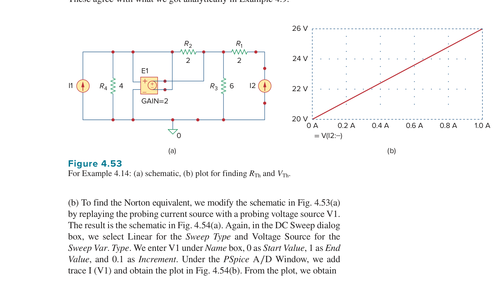

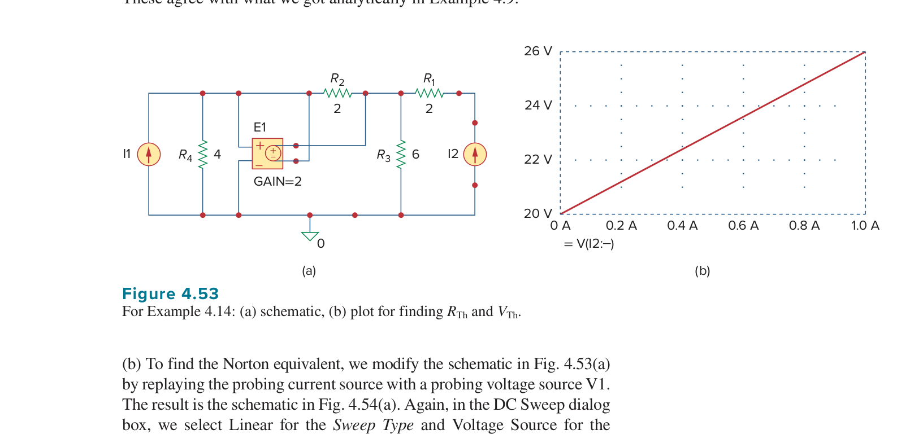

在端點 $a-b$ 插入探測電流源 $I_2$，執行 DC Sweep，令 $I_2$ 由 $0$ 掃描至 $1\ \mathrm{A}$，步進為 $0.1\ \mathrm{A}$。由圖 4.53 的 $V(I_2)$ 直線得到

$$
V_{\mathrm{Th}}=\text{零電流截距}=20\ \mathrm{V},
\qquad
R_{\mathrm{Th}}=\text{斜率}
=\frac{26-20}{1}=6\ \Omega.
$$

接著以探測電壓源 $V_1$ 取代探測電流源，令 $V_1$ 由 $0$ 掃描至 $1\ \mathrm{V}$，步進為 $0.1\ \mathrm{V}$。由圖 4.54 的 $I(V_1)$ 直線得到

$$
I_N=\text{零電壓截距}=3.335\ \mathrm{A},
\qquad
G_N=\text{斜率}
=\frac{3.335-3.165}{1}=0.17\ \mathrm{S}.
$$

因此諾頓電阻為

$$
R_N=\frac{1}{G_N}\approx5.88\ \Omega,
$$

其近似值與戴維寧結果 $R_{\mathrm{Th}}=6\ \Omega$ 的差異來自圖形讀值與四捨五入；理想等效關係為 $R_N=R_{\mathrm{Th}}$。

**課本答案：** $V_{\mathrm{Th}}=20\ \mathrm{V}$、$R_{\mathrm{Th}}=6\ \Omega$；$I_N=3.335\ \mathrm{A}$、$G_N=0.17\ \mathrm{S}$。

</template>
</PracticeCard>

<PracticeCard id="ch4-pr14" type="practice" title="Practice Problem 4.14" source="課本 p.158" topic="以 PSpice 求戴維寧等效 (PSpice 與戴維寧定理)">

以 PSpice 重做練習題 4.9；原電路如圖 4.34，求端點 $a-b$ 的戴維寧等效電路。

<template #solution>

在端點 $a-b$ 接入探測電流源，使用 DC Sweep 掃描探測電流，並以端點電壓對探測電流的直線截距與斜率分別讀出戴維寧電壓與戴維寧電阻：

$$
V_{\mathrm{Th}}=5.333\ \mathrm{V},
\qquad
R_{\mathrm{Th}}=0.4444\ \Omega=444.4\ \mathrm{m}\Omega.
$$

**課本答案：** $V_{\mathrm{Th}}=5.333\ \mathrm{V}$，$R_{\mathrm{Th}}=444.4\ \mathrm{m}\Omega$。

</template>
</PracticeCard>

<PracticeCard id="ch4-ex15" type="example" title="Example 4.15" source="課本 p.158" topic="最大功率轉移的 PSpice 驗證 (Maximum Power Transfer)">

參考圖 4.55 的電路，使用 PSpice 求傳送至 $R_L$ 的最大功率。

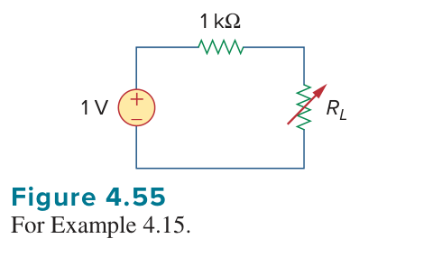

<template #solution>

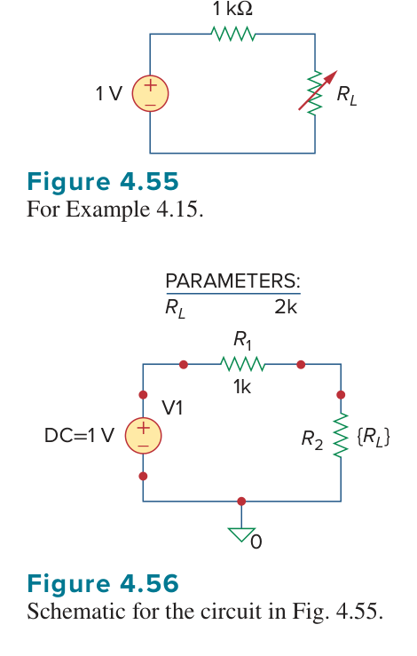

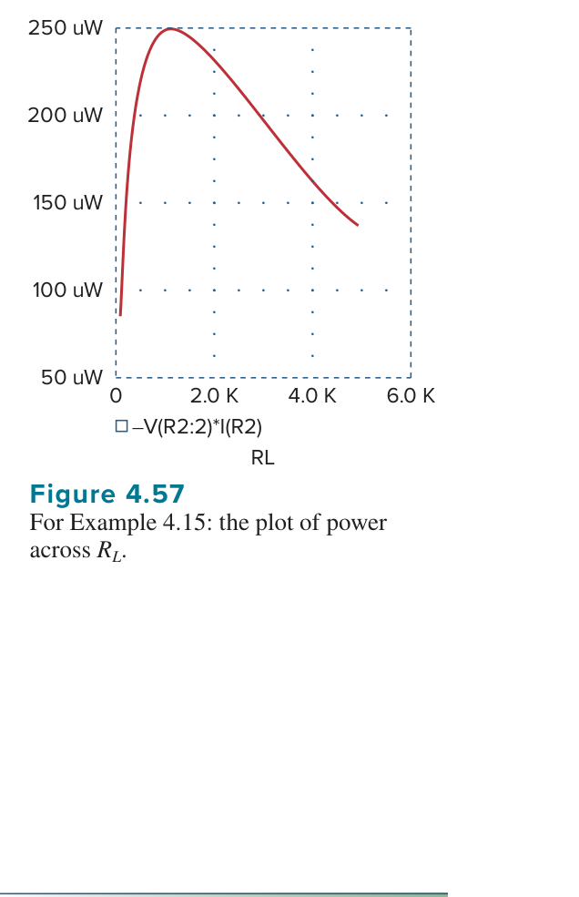

將圖 4.55 的負載電阻設定為參數 $R_L$，在 PSpice 中以 Global Parameter 執行 DC Sweep，例如從 $100\ \Omega$ 掃描至 $5\ \mathrm{k}\Omega$。功率曲線可由負載端電壓與電流的乘積取得；由於 PSpice 的 $I(R_2)$ 參考方向與被動符號相反，可使用

$$
P_L=-V(R2:2)I(R2).
$$

對此電路也可直接寫出

$$
P_L(R_L)=\frac{1^2R_L}{(1\ \mathrm{k}\Omega+R_L)^2}.
$$

最大功率轉移發生於

$$
R_L=R_{\mathrm{Th}}=1\ \mathrm{k}\Omega,
$$

且

$$
P_{\max}=\frac{V_{\mathrm{Th}}^2}{4R_{\mathrm{Th}}}
=\frac{1^2}{4(1\ \mathrm{k}\Omega)}
=250\ \mu\mathrm{W}.
$$

**課本答案：** $R_L=1\ \mathrm{k}\Omega$ 時，$P_{\max}=250\ \mu\mathrm{W}$。

</template>
</PracticeCard>

<PracticeCard id="ch4-pr15" type="practice" title="Practice Problem 4.15" source="課本 p.159" topic="最大功率轉移定理 (Maximum Power Transfer)">

若將圖 4.55 中的 $1\ \mathrm{k}\Omega$ 電阻改為 $2\ \mathrm{k}\Omega$，求傳送至 $R_L$ 的最大功率。

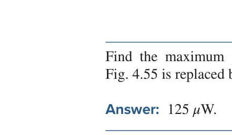

<template #solution>

電源電壓為 $1\ \mathrm{V}$，串聯電阻改為 $2\ \mathrm{k}\Omega$，因此負載端看到的戴維寧參數為

$$
V_{\mathrm{Th}}=1\ \mathrm{V},
\qquad
R_{\mathrm{Th}}=2\ \mathrm{k}\Omega.
$$

最大功率轉移時 $R_L=R_{\mathrm{Th}}$，故

$$
P_{\max}=\frac{V_{\mathrm{Th}}^2}{4R_{\mathrm{Th}}}
=\frac{1^2}{4(2\ \mathrm{k}\Omega)}
=125\ \mu\mathrm{W}.
$$

**課本答案：** $P_{\max}=125\ \mu\mathrm{W}$。

</template>
</PracticeCard>

<PracticeCard id="ch4-ex16" type="example" title="Example 4.16" source="課本 p.161" topic="實際電壓源與內阻 (Source Modeling)">

某電壓源接上功率為 $2\ \mathrm{W}$ 的負載時，端電壓為 $12\ \mathrm{V}$；卸除負載後，端電壓升為 $12.4\ \mathrm{V}$。求：(a) 電源電壓 $v_s$ 與內阻 $R_s$；(b) 接上 $8\ \Omega$ 負載時的端電壓。

<template #solution>

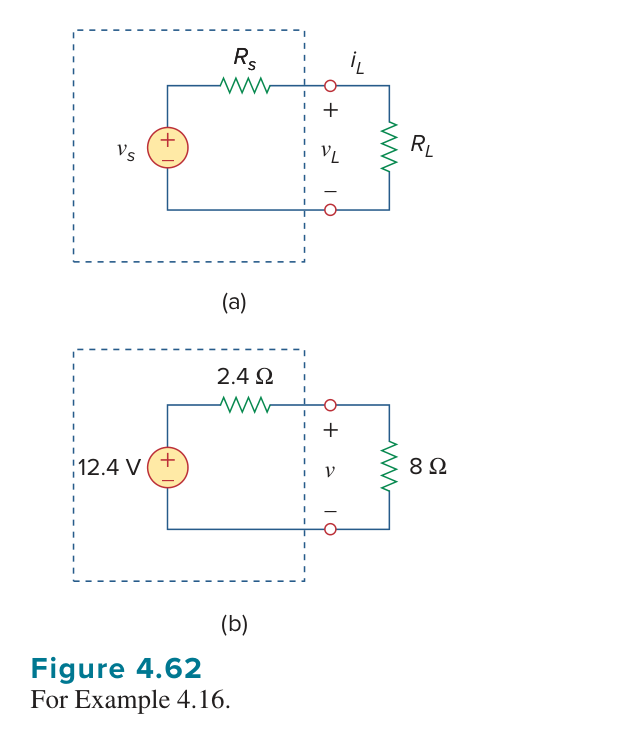

把實際電壓源表示成戴維寧等效電路。卸除負載時沒有內阻壓降，因此

$$
v_s=v_{\mathrm{oc}}=12.4\ \mathrm{V}.
$$

在原負載下，負載電阻與電流為

$$
R_L=\frac{v_L^2}{p_L}=\frac{12^2}{2}=72\ \Omega,
\qquad
i_L=\frac{v_L}{R_L}=\frac{12}{72}=\frac{1}{6}\ \mathrm{A}.
$$

內阻上的壓降為 $12.4-12=0.4\ \mathrm{V}$，所以

$$
R_s=\frac{v_s-v_L}{i_L}
=\frac{0.4}{1/6}=2.4\ \Omega.
$$

接上 $8\ \Omega$ 負載時，由分壓得到

$$
v_L=\frac{8}{8+2.4}(12.4)=9.538\ \mathrm{V}.
$$

**課本答案：** $v_s=12.4\ \mathrm{V}$、$R_s=2.4\ \Omega$；接上 $8\ \Omega$ 負載時 $v_L=9.538\ \mathrm{V}$。

</template>
</PracticeCard>

<PracticeCard id="ch4-pr16" type="practice" title="Practice Problem 4.16" source="課本 p.161" topic="實際電壓源與內阻 (Source Modeling)">

某放大器的開路端電壓為 $9\ \mathrm{V}$。接上 $20\ \Omega$ 喇叭後，電壓降為 $8\ \mathrm{V}$。若改接 $10\ \Omega$ 喇叭，求其端電壓。

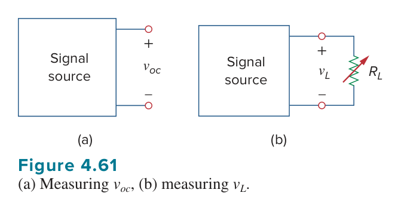

<template #solution>

開路時沒有內阻壓降，因此電源的戴維寧電壓為

$$
V_{\mathrm{Th}}=V_{\mathrm{oc}}=9\ \mathrm{V}.
$$

接上 $20\ \Omega$ 喇叭時，負載電流為 $8/20=0.4\ \mathrm{A}$，內阻上的壓降為 $9-8=1\ \mathrm{V}$，故

$$
R_s=\frac{1}{0.4}=2.5\ \Omega.
$$

改接 $10\ \Omega$ 喇叭後，端電壓為

$$
v_L=\frac{R_L}{R_s+R_L}V_{\mathrm{Th}}
=\frac{10}{2.5+10}(9)
=7.2\ \mathrm{V}.
$$

**課本答案：** $v_L=7.2\ \mathrm{V}$。

</template>
</PracticeCard>

<PracticeCard id="ch4-ex17" type="example" title="Example 4.17" source="課本 p.162" topic="惠斯登電橋與電阻量測 (Wheatstone Bridge)">

在圖 4.63 中，$R_1=500\ \Omega$、$R_3=200\ \Omega$。調整 $R_2=125\ \Omega$ 後電橋平衡，求未知電阻 $R_x$。

<template #solution>

電橋平衡時，檢流計沒有電流，兩中點電壓相等。由惠斯登電橋平衡條件

$$
\frac{R_2}{R_1+R_2}=\frac{R_x}{R_3+R_x}
\quad\Longrightarrow\quad
R_x=\frac{R_3}{R_1}R_2.
$$

代入數值：

$$
R_x=\frac{200}{500}(125)=50\ \Omega.
$$

**課本答案：** $R_x=50\ \Omega$。

</template>
</PracticeCard>

<PracticeCard id="ch4-pr17" type="practice" title="Practice Problem 4.17" source="課本 p.163" topic="惠斯登電橋與電阻量測 (Wheatstone Bridge)">

圖 4.63 的惠斯登電橋中，$R_1=R_3=1\ \mathrm{k}\Omega$。調整 $R_2$ 直到檢流計沒有電流；此時 $R_2=3.2\ \mathrm{k}\Omega$。求未知電阻 $R_x$。

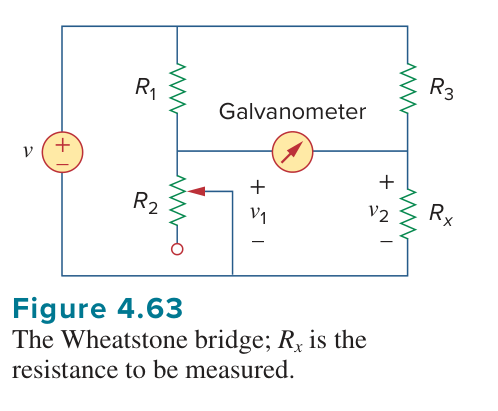

<template #solution>

電橋平衡時

$$
R_x=\frac{R_3}{R_1}R_2.
$$

由於 $R_1=R_3$，所以 $R_x=R_2$。因此

$$
R_x=3.2\ \mathrm{k}\Omega.
$$

**課本答案：** $R_x=3.2\ \mathrm{k}\Omega$。

</template>
</PracticeCard>

<PracticeCard id="ch4-ex18" type="example" title="Example 4.18" source="課本 p.162" topic="不平衡惠斯登電橋與戴維寧等效 (Unbalanced Wheatstone Bridge)">

圖 4.64 為不平衡電橋。若檢流計的電阻為 $40\ \Omega$，求流過檢流計的電流。

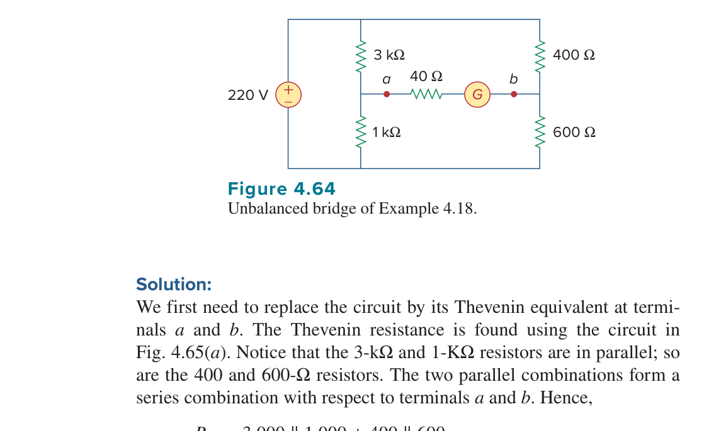

<template #solution>

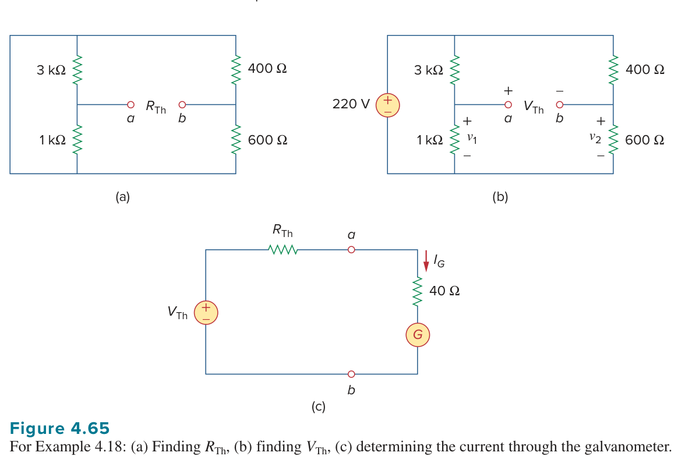

先對檢流計端點 $a-b$ 求戴維寧等效。

將獨立 $220\ \mathrm{V}$ 電壓源短路後，兩側電阻形成串聯的並聯組合，因此

$$
R_{\mathrm{Th}}
=(3\ \mathrm{k}\Omega\parallel1\ \mathrm{k}\Omega)
+(400\ \Omega\parallel600\ \Omega)
=750+240=990\ \Omega.
$$

開路求戴維寧電壓時，兩個分壓中點電壓為

$$
v_1=\frac{1\,000}{1\,000+3\,000}(220)=55\ \mathrm{V},
\qquad
v_2=\frac{600}{600+400}(220)=132\ \mathrm{V}.
$$

依圖示極性，

$$
V_{\mathrm{Th}}=v_1-v_2=55-132=-77\ \mathrm{V}.
$$

接回 $R_m=40\ \Omega$ 的檢流計後，若以 $a\to b$ 為正方向，

$$
I_G=\frac{V_{\mathrm{Th}}}{R_{\mathrm{Th}}+R_m}
=\frac{-77}{990+40}
=-74.76\ \mathrm{mA}.
$$

負號表示實際電流方向為由 $b$ 流向 $a$，大小為 $74.76\ \mathrm{mA}$。

**課本答案：** $I_G=-74.76\ \mathrm{mA}$（方向由 $b$ 到 $a$）。

</template>
</PracticeCard>

<PracticeCard id="ch4-pr18" type="practice" title="Practice Problem 4.18" source="課本 p.164" topic="不平衡惠斯登電橋 (Unbalanced Wheatstone Bridge)">

求圖 4.66 惠斯登電橋中檢流計的電流；檢流計電阻為 $14\ \Omega$。

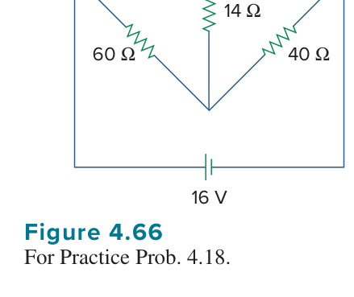

<template #solution>

先將 $16\ \mathrm{V}$ 電壓源短路，從檢流計端點看入的戴維寧電阻為

$$
R_{\mathrm{Th}}=(20\ \Omega\parallel30\ \Omega)
+(60\ \Omega\parallel40\ \Omega)
=12+24=36\ \Omega.
$$

開路檢流計後，兩個分壓中點的電壓差大小為

$$
V_{\mathrm{Th}}
=16\left(\frac{30}{20+30}-\frac{40}{60+40}\right)
=16(0.6-0.4)=3.2\ \mathrm{V}.
$$

所以檢流計電流大小為

$$
|I_G|=\frac{|V_{\mathrm{Th}}|}{R_{\mathrm{Th}}+14\ \Omega}
=\frac{3.2}{36+14}
=0.064\ \mathrm{A}
=64\ \mathrm{mA}.
$$

**課本答案：** $|I_G|=64\ \mathrm{mA}$。

</template>
</PracticeCard>

## 課本章末習題（Problems 4.1–4.98）

以下依課本題號排列。每張題卡包含原題頁面中的題幹及電路圖；課本未提供可直接核對的完整解答，因此這一區先供自主作答與進度追蹤。

<PracticeCard id="ch4-problem-1" type="exercise" title="章末習題 4.1" source="課本 p.160" topic="Chapter 4 Problems">

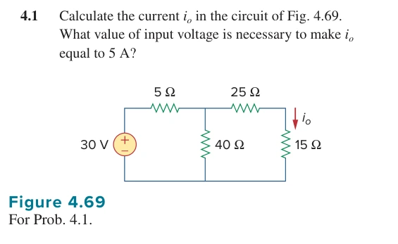

<template #solution>

課本附錄 D「奇數題答案」（印刷頁 A-23／A-24，PDF 第 933 頁）：

</template>

</PracticeCard>

<PracticeCard id="ch4-problem-2" type="exercise" title="章末習題 4.2" source="課本 p.160" topic="Chapter 4 Problems">

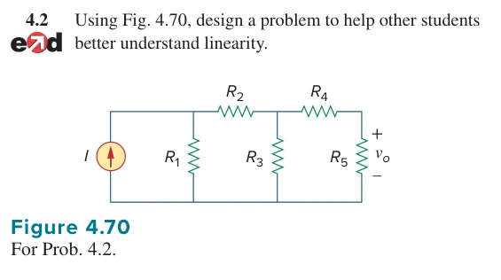

<template #solution>

**自行推導的示範設計。** 題目是開放式設計題，故可取 $R_1=R_2=R_3=R_4=R_5=1\,\Omega$，請同學以節點電壓法求圖 4.70 在 $I=1\,\mathrm A$ 與 $I=2\,\mathrm A$ 時的 $v_o$，並驗證輸出與輸入成正比。以底線為零電位、三個上方節點為 $V_1,V_2,v_o$，列式 $2V_1-V_2=I$、$-V_1+3V_2-v_o=0$、$-V_2+2v_o=0$，解得 $v_o=I/8$。故兩種輸入依序得到 $0.125\,\mathrm V$ 與 $0.250\,\mathrm V$；輸入加倍，輸出也加倍。

</template>

</PracticeCard>

<PracticeCard id="ch4-problem-3" type="exercise" title="章末習題 4.3" source="課本 p.160" topic="Chapter 4 Problems">

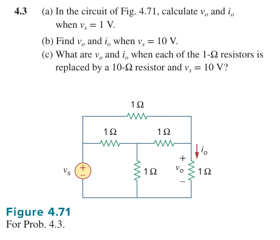

<template #solution>

課本附錄 D「奇數題答案」（印刷頁 A-23／A-24，PDF 第 933 頁）：

</template>

</PracticeCard>

<PracticeCard id="ch4-problem-4" type="exercise" title="章末習題 4.4" source="課本 p.160" topic="Chapter 4 Problems">

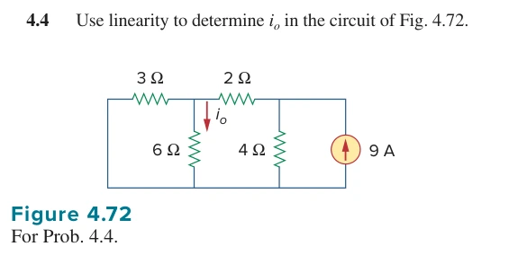

<template #solution>

**自行推導。** 設 6 Ω 頂端節點為 $V_1$、右側頂端為 $V_2$。左側 3 Ω 與 6 Ω 都接地。KCL 給出 $V_1/3+V_1/6+(V_1-V_2)/2=0$，以及 $V_2/4+(V_2-V_1)/2=9$。解得 $V_1=9\,\mathrm V$、$V_2=18\,\mathrm V$，故箭頭向下的 $i_o=V_1/6=1.5\,\mathrm A$。把電流源縮為 $1\,\mathrm A$ 時同式得 $1/6\,\mathrm A$，乘回 9 即 $1.5\,\mathrm A$，符合線性。

</template>

</PracticeCard>

<PracticeCard id="ch4-problem-5" type="exercise" title="章末習題 4.5" source="課本 p.160" topic="Chapter 4 Problems">

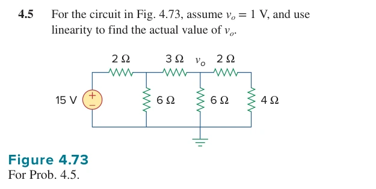

<template #solution>

課本附錄 D「奇數題答案」（印刷頁 A-23／A-24，PDF 第 933 頁）：

</template>

</PracticeCard>

<PracticeCard id="ch4-problem-6" type="exercise" title="章末習題 4.6" source="課本 p.160" topic="Chapter 4 Problems">

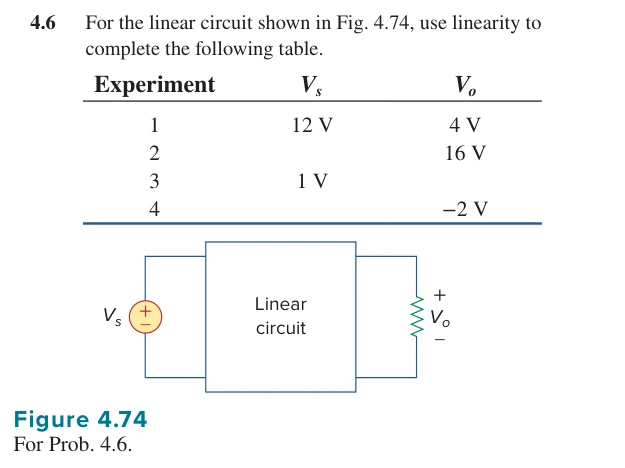

<template #solution>

**自行推導。** 第 1 次實驗給出線性比例 $V_o/V_s=4/12=1/3$。所以第 2 次需 $V_s=3(16)=48\,\mathrm V$；第 3 次 $V_o=(1/3)(1)=1/3\,\mathrm V$；第 4 次需 $V_s=3(-2)=-6\,\mathrm V$。

</template>

</PracticeCard>

<PracticeCard id="ch4-problem-7" type="exercise" title="章末習題 4.7" source="課本 p.160" topic="Chapter 4 Problems">

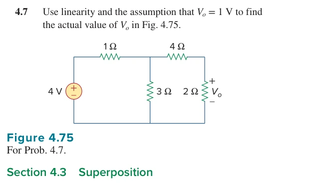

<template #solution>

課本附錄 D「奇數題答案」（印刷頁 A-23／A-24，PDF 第 933 頁）：

</template>

</PracticeCard>

<PracticeCard id="ch4-problem-8" type="exercise" title="章末習題 4.8" source="課本 p.160" topic="Chapter 4 Problems">

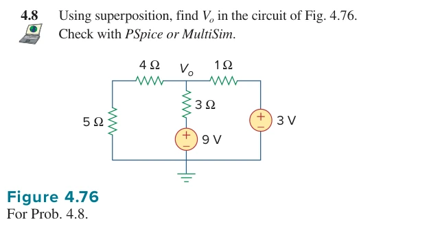

<template #solution>

**自行推導。** 左側的 $4+5=9\,\Omega$ 串聯支路接地。節點 $V_o$ 的 KCL 為 $V_o/9+(V_o-3)/1+(V_o-9)/3=0$，故 $V_o=54/13\,\mathrm V\approx4.154\,\mathrm V$。用疊加檢查：僅 3 V 源作用時得 $27/13\,\mathrm V$；僅 9 V 源作用時也得 $27/13\,\mathrm V$，相加即 $54/13\,\mathrm V$。

</template>

</PracticeCard>

<PracticeCard id="ch4-problem-9" type="exercise" title="章末習題 4.9" source="課本 p.161" topic="Chapter 4 Problems">

**老師指定練習題**（課堂 Homework 清單）

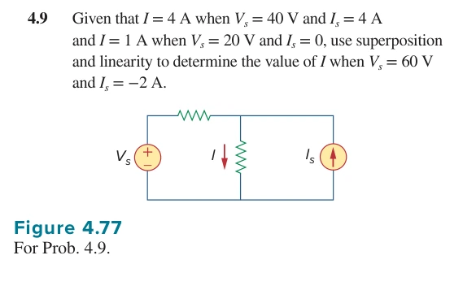

<template #solution>

課本附錄 D「奇數題答案」（印刷頁 A-23／A-24，PDF 第 933 頁）：

</template>

</PracticeCard>

<PracticeCard id="ch4-problem-10" type="exercise" title="章末習題 4.10" source="課本 p.161" topic="Chapter 4 Problems">

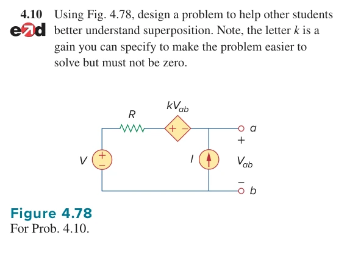

<template #solution>

**自行推導的示範設計。** 題目允許自選非零增益，取 $R=1\,\Omega$、$k=1$、$V=2\,\mathrm V$、$I=1\,\mathrm A$。在 $a$ 點列 KCL，受控源左端電位是 $(1+k)V_{ab}$，故 $[(1+k)V_{ab}-V]/R=I$，得到 $V_{ab}=(V+IR)/(1+k)=1.5\,\mathrm V$。疊加時保留受控源：單獨 $V$ 貢獻 $1\,\mathrm V$；單獨 $I$ 貢獻 $0.5\,\mathrm V$，總和仍是 $1.5\,\mathrm V$。

</template>

</PracticeCard>

<PracticeCard id="ch4-problem-11" type="exercise" title="章末習題 4.11" source="課本 p.161" topic="Chapter 4 Problems">

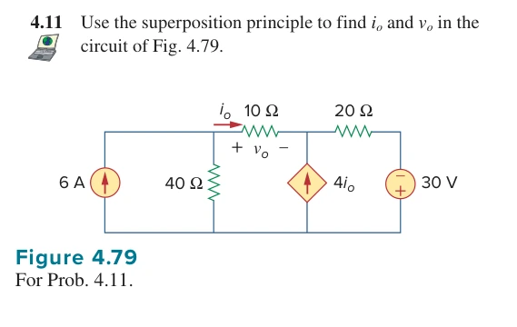

<template #solution>

課本附錄 D「奇數題答案」（印刷頁 A-23／A-24，PDF 第 933 頁）：

</template>

</PracticeCard>

<PracticeCard id="ch4-problem-12" type="exercise" title="章末習題 4.12" source="課本 p.161" topic="Chapter 4 Problems">

**老師指定練習題**（課堂 Homework 清單）

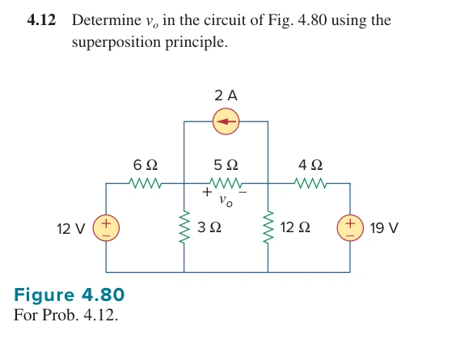

<template #solution>

**課堂投影片答案：** $v_o=-0.125\,\mathrm V$。**自行推導核對：** 設 5 Ω 左右節點分別為 $V_1,V_2$，上方 2 A 源由右指向左，故

$$\frac{V_1-12}{6}+\frac{V_1}{3}+\frac{V_1-V_2}{5}=2,\qquad \frac{V_2-19}{4}+\frac{V_2}{12}+\frac{V_2-V_1}{5}=-2.$$

解得 $V_1=8.05\,\mathrm V$、$V_2=8.175\,\mathrm V$，因此 $v_o=V_1-V_2=-0.125\,\mathrm V$，與投影片一致。

</template>

</PracticeCard>

<PracticeCard id="ch4-problem-13" type="exercise" title="章末習題 4.13" source="課本 p.161" topic="Chapter 4 Problems">

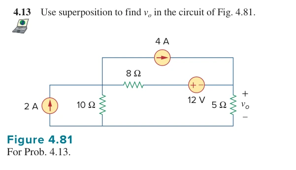

<template #solution>

課本附錄 D「奇數題答案」（印刷頁 A-23／A-24，PDF 第 933 頁）：

</template>

</PracticeCard>

<PracticeCard id="ch4-problem-14" type="exercise" title="章末習題 4.14" source="課本 p.161" topic="Chapter 4 Problems">

<template #solution>

**自行推導。** 左側節點由 20 V 源固定為 $20\,\mathrm V$。設右側 $3\,\Omega$ 頂端為 $V_o$，中央 4 Ω 與 2 Ω 接點為 $V_c$。2 A 源由右往左、1 A 源由下往上，KCL 為 $(V_o-20)/6+(V_o-V_c)/2+V_o/3=-2$ 與 $(V_c-20)/4+(V_c-V_o)/2=1$。解得 $V_o=8\,\mathrm V$、$V_c=40/3\,\mathrm V$；回代兩式殘差均為零。

</template>

</PracticeCard>

<PracticeCard id="ch4-problem-15" type="exercise" title="章末習題 4.15" source="課本 p.161" topic="Chapter 4 Problems">

<template #solution>

課本附錄 D「奇數題答案」（印刷頁 A-23／A-24，PDF 第 933 頁）：

</template>

</PracticeCard>

<PracticeCard id="ch4-problem-16" type="exercise" title="章末習題 4.16" source="課本 p.161" topic="Chapter 4 Problems">

**老師指定練習題**（課堂 Homework 清單）

<template #solution>

> **有疑慮｜講義答案單位：** 課堂投影片標示 $i_o=0.111\,\mathrm{mA}$，但與圖 4.84 的 $12\,\mathrm V$、歐姆電阻及安培電流源**單位不一致**。

**自行推導：** 設三個上方未知節點（由左至右）為 $V_1,V_2,V_3$，4 A 源由 $V_2$ 指向 $V_1$。KCL 為

$$\frac{V_1-12}{4}+\frac{V_1}{10}+\frac{V_1-V_2}{3}=4,\quad \frac{V_2-V_1}{3}+\frac{V_2-V_3}{2}=-4,\quad \frac{V_3-V_2}{2}+\frac{V_3}{5}=2.$$

解得 $V_1=104/9\,\mathrm V$，故 $i_o=(12-V_1)/4=1/9\,\mathrm A=0.111\,\mathrm A$。將所有節點值代回三條 KCL，殘差為零；投影片數值 0.111 與計算一致，**投影片的 mA 單位疑為筆誤**。

</template>

</PracticeCard>

<PracticeCard id="ch4-problem-17" type="exercise" title="章末習題 4.17" source="課本 p.162" topic="Chapter 4 Problems">

**老師指定練習題**（課堂 Homework 清單）

<template #solution>

課本附錄 D「奇數題答案」（印刷頁 A-23／A-24，PDF 第 933 頁）：

</template>

</PracticeCard>

<PracticeCard id="ch4-problem-18" type="exercise" title="章末習題 4.18" source="課本 p.162" topic="Chapter 4 Problems">

**老師指定練習題**（課堂 Homework 清單）

<template #solution>

**課堂投影片答案：** $V_o=11.2\,\mathrm V$。**自行推導核對：** 設中央節點為 $V_1$，右節點 $V_o$。受控電流源由中往右，大小 $0.5V_o$，疊加時必須保留。KCL 為 $(V_1-10)/2+(V_1-V_o)+0.5V_o=2$，以及 $(V_o-V_1)+V_o/4=0.5V_o$。解得 $V_1=8.4\,\mathrm V$、$V_o=11.2\,\mathrm V$；與投影片一致。

</template>

</PracticeCard>

<PracticeCard id="ch4-problem-19" type="exercise" title="章末習題 4.19" source="課本 p.162" topic="Chapter 4 Problems">

<template #solution>

課本附錄 D「奇數題答案」（印刷頁 A-23／A-24，PDF 第 933 頁）：

</template>

</PracticeCard>

<PracticeCard id="ch4-problem-20" type="exercise" title="章末習題 4.20" source="課本 p.162" topic="Chapter 4 Problems">

**老師指定練習題**（課堂 Homework 清單）

<template #solution>

**課堂投影片的 P20 未列數值；以下自行推導。** 由 $a$ 至 $b$ 的開路電壓設為 $V$。依每個並聯支路的方向列 KCL：$V/10+(V-12)/20+(V-16)/40=3$。解得 $V_{Th}=160/7\,\mathrm V\approx22.857\,\mathrm V$。關閉獨立源（電流源開路、電壓源短路）後 $R_{Th}=10\parallel20\parallel40=40/7\,\Omega\approx5.714\,\Omega$。因此端點間等效為 **$160/7\,\mathrm V$ 電壓源串聯 $40/7\,\Omega$**，正端在 $a$。回代 KCL：$(160/7)(7/40)-12/20-16/40=3\,\mathrm A$。

</template>

</PracticeCard>

<PracticeCard id="ch4-problem-21" type="exercise" title="章末習題 4.21" source="課本 p.162" topic="Chapter 4 Problems">

<template #solution>

課本附錄 D「奇數題答案」（印刷頁 A-23／A-24，PDF 第 934 頁）：

</template>

</PracticeCard>

<PracticeCard id="ch4-problem-22" type="exercise" title="章末習題 4.22" source="課本 p.162" topic="Chapter 4 Problems">

<template #solution>

**自行推導。** 設左側頂點 $V_1$、4 Ω 頂點 $V_2$，右端由電壓源固定為 $20\,\mathrm V$。2 A 電流源向下離開 $V_1$，故 $V_1/5+(V_1-V_2)/5=-2$，$(V_2-V_1)/5+V_2/4+(V_2-20)/10=0$。解得 $V_1=-35/9\,\mathrm V$、$V_2=20/9\,\mathrm V$；箭頭向下的 $i=V_2/4=5/9\,\mathrm A\approx0.556\,\mathrm A$。

</template>

</PracticeCard>

<PracticeCard id="ch4-problem-23" type="exercise" title="章末習題 4.23" source="課本 p.162" topic="Chapter 4 Problems">

<template #solution>

課本附錄 D「奇數題答案」（印刷頁 A-23／A-24，PDF 第 934 頁）：

</template>

</PracticeCard>

<PracticeCard id="ch4-problem-24" type="exercise" title="章末習題 4.24" source="課本 p.162" topic="Chapter 4 Problems">

**老師指定練習題**（課堂 Homework 清單）

<template #solution>

**課堂投影片答案：** $V_x=2.978\,\mathrm V$。**自行推導核對：** 設 8 Ω 右端節點為 $V_1$、右端節點為 $V_2$；左端由電源固定在 40 V，故 $V_x=40-V_1$。3 A 源由 $V_1$ 向 $V_2$，受控源 $2V_x$ 向上。KCL 為 $(V_1-40)/8+(V_1-V_2)/10=-3$，$(V_2-V_1)/10+V_2/10=3+2(40-V_1)$。解得 $V_1=1740/47\,\mathrm V$，所以 $V_x=140/47\,\mathrm V\approx2.979\,\mathrm V$，與投影片四捨五入值一致。

</template>

</PracticeCard>

<PracticeCard id="ch4-problem-25" type="exercise" title="章末習題 4.25" source="課本 p.163" topic="Chapter 4 Problems">

<template #solution>

課本附錄 D「奇數題答案」（印刷頁 A-23／A-24，PDF 第 934 頁）：

</template>

</PracticeCard>

<PracticeCard id="ch4-problem-26" type="exercise" title="章末習題 4.26" source="課本 p.163" topic="Chapter 4 Problems">

<template #solution>

**自行推導。** 設 2 Ω 頂端為 $V_1$、4 Ω 左端為 $V_2$，20 V 電源頂端固定為 $20\,\mathrm V$。3 A 源由 $V_1$ 指向 $V_2$；6 A 源注入 $V_1$。KCL：$V_1/2+(V_1-V_2)/5+3=6$，$(V_2-V_1)/5+(V_2-20)/4=3$。解得 $V_1=118/11\,\mathrm V$、$V_2=248/11\,\mathrm V$；$i_o=(V_2-20)/4=7/11\,\mathrm A\approx0.636\,\mathrm A$，與箭頭同向。

</template>

</PracticeCard>

<PracticeCard id="ch4-problem-27" type="exercise" title="章末習題 4.27" source="課本 p.163" topic="Chapter 4 Problems">

<template #solution>

課本附錄 D「奇數題答案」（印刷頁 A-23／A-24，PDF 第 934 頁）：

</template>

</PracticeCard>

<PracticeCard id="ch4-problem-28" type="exercise" title="章末習題 4.28" source="課本 p.163" topic="Chapter 4 Problems">

<template #solution>

**自行推導。** 設 1 Ω 與 4 Ω 之間電位為 $V_1$，4 Ω 右端為 $V_2$。依標示 $V_o=V_1-V_2$，受控源向下為 $V_o/3$ 安培。KCL：$(V_1-8)/1+(V_1-V_2)/4=0$，$(V_2-V_1)/4+V_2/3+(V_1-V_2)/3=0$。解得 $V_1=6\,\mathrm V$、$V_2=-2\,\mathrm V$，所以 $I_o=(8-V_1)/1=2\,\mathrm A$，$V_o=8\,\mathrm V$；代回受控源為 $8/3\,\mathrm A$，兩節點殘差均為零。

</template>

</PracticeCard>

<PracticeCard id="ch4-problem-29" type="exercise" title="章末習題 4.29" source="課本 p.163" topic="Chapter 4 Problems">

<template #solution>

課本附錄 D「奇數題答案」（印刷頁 A-23／A-24，PDF 第 934 頁）：

</template>

</PracticeCard>

<PracticeCard id="ch4-problem-30" type="exercise" title="章末習題 4.30" source="課本 p.163" topic="Chapter 4 Problems">

<template #solution>

**自行推導。** 設 24 Ω 右端 $V_1$、60 Ω 右端 $V_2$，則 $i_x=(12-V_1)/24$。受控電流源向上注入 $V_2$。KCL：$(V_1-12)/24+V_1/30+(V_1-V_2)/60=0$，$(V_2-V_1)/60+V_2/10=0.7i_x$。解得 $V_1=924/157\,\mathrm V$，故 $i_x=40/157\,\mathrm A\approx0.2548\,\mathrm A$。

</template>

</PracticeCard>

<PracticeCard id="ch4-problem-31" type="exercise" title="章末習題 4.31" source="課本 p.163" topic="Chapter 4 Problems">

<template #solution>

課本附錄 D「奇數題答案」（印刷頁 A-23／A-24，PDF 第 934 頁）：

</template>

</PracticeCard>

<PracticeCard id="ch4-problem-32" type="exercise" title="章末習題 4.32" source="課本 p.163" topic="Chapter 4 Problems">

<template #solution>

**自行推導。** 設 15 Ω 右端 $V_1$、40 Ω 頂端 $V_2$，則 $i_x=(60-V_1)/15$；受控源從 $V_1$ 向 $V_2$ 送出 $0.5i_x$。KCL：$(V_1-60)/15+V_1/50+(V_1-V_2)/10+0.5i_x=0$，$(V_2-V_1)/10+V_2/40-0.5i_x=0$。解得 $V_1=36\,\mathrm V$、$V_2=35.2\,\mathrm V$，故 $i_x=(60-36)/15=1.6\,\mathrm A$。

</template>

</PracticeCard>

<PracticeCard id="ch4-problem-33" type="exercise" title="章末習題 4.33" source="課本 p.164" topic="Chapter 4 Problems">

<template #solution>

課本附錄 D「奇數題答案」（印刷頁 A-23／A-24，PDF 第 934 頁）：

</template>

</PracticeCard>

<PracticeCard id="ch4-problem-34" type="exercise" title="章末習題 4.34" source="課本 p.164" topic="Chapter 4 Problems">

<template #solution>

**自行推導的示範設計。** 可請同學取圖 4.102 的 $V=2\,\mathrm V$、$I=1\,\mathrm A$、$R_1=R_2=R_3=1\,\Omega$，求 $a-b$ 的戴維寧等效並接 $R_L=1.5\,\Omega$ 驗證。開路時中央節點為分壓 $1\,\mathrm V$，電流源的 $1\,\mathrm A$ 經 $R_3$ 回到中央，故 $V_{Th}=V_a=1+1(1)=2\,\mathrm V$。關閉獨立源後 $R_{Th}=R_3+(R_1\parallel R_2)=1.5\,\Omega$。接負載時 $I_L=2/(1.5+1.5)=2/3\,\mathrm A$；用原電路列節點式亦得到 $V_a=1\,\mathrm V$、$I_L=2/3\,\mathrm A$。

</template>

</PracticeCard>

<PracticeCard id="ch4-problem-35" type="exercise" title="章末習題 4.35" source="課本 p.164" topic="Chapter 4 Problems">

本題沿用習題 4.12 的電路與條件：

<template #solution>

課本附錄 D「奇數題答案」（印刷頁 A-23／A-24，PDF 第 934 頁）：

</template>

</PracticeCard>

<PracticeCard id="ch4-problem-36" type="exercise" title="章末習題 4.36" source="課本 p.164" topic="Chapter 4 Problems">

<template #solution>

**自行推導。** 移除 12 Ω 電阻，頂部節點由左側 50 V、10 Ω 支路與右側 40 Ω 支路決定：$(V-50)/10+V/40=0$，所以 $V=40\,\mathrm V$。電阻下端由 30 V 源固定為 $30\,\mathrm V$，故 $V_{Th}=40-30=10\,\mathrm V$（上端為正）。關閉兩個獨立電壓源後，從 12 Ω 兩端看入 $R_{Th}=10\parallel40=8\,\Omega$。恢復負載得箭頭向下 $i=10/(8+12)=0.5\,\mathrm A$；回代原頂點 KCL：$(36-50)/10+(36-30)/12+36/40=0$。

</template>

</PracticeCard>

<PracticeCard id="ch4-problem-37" type="exercise" title="章末習題 4.37" source="課本 p.164" topic="Chapter 4 Problems">

**老師指定練習題**（課堂 Homework 清單）

<template #solution>

課本附錄 D「奇數題答案」（印刷頁 A-23／A-24，PDF 第 934 頁）：

</template>

</PracticeCard>

<PracticeCard id="ch4-problem-38" type="exercise" title="章末習題 4.38" source="課本 p.164" topic="Chapter 4 Problems">

<template #solution>

**自行推導。** 拿掉右側 10 Ω 負載，1 Ω 無電流。設左、中央頂點電位為 $V_1,V_2$：$V_1/16+(V_1-V_2)/4=3$，$(V_2-V_1)/4+(V_2-12)/5=0$，得開路 $V_{Th}=V_2=19.2\,\mathrm V$。關閉 3 A 源（開路）與 12 V 源（短路）後，從負載看入 $R_{Th}=1+[5\parallel(4+16)]=5\,\Omega$。接回 10 Ω，$V_o=19.2\cdot10/(5+10)=12.8\,\mathrm V$。

</template>

</PracticeCard>

<PracticeCard id="ch4-problem-39" type="exercise" title="章末習題 4.39" source="課本 p.164" topic="Chapter 4 Problems">

<template #solution>

課本附錄 D「奇數題答案」（印刷頁 A-23／A-24，PDF 第 934 頁）：

</template>

</PracticeCard>

<PracticeCard id="ch4-problem-40" type="exercise" title="章末習題 4.40" source="課本 p.164" topic="Chapter 4 Problems">

<template #solution>

**自行推導。** 圖 4.107 是單一迴路。設順時針電流 $i$，$V_o=(10\,\mathrm{k}\Omega)i$；KVL 為 $70-V_o-(20\,\mathrm{k}\Omega)i-4V_o=0$，解得 $i=1\,\mathrm{mA}$、$V_o=10\,\mathrm V$，所以開路端電壓 $V_{Th}=V_{ab}=70-10=60\,\mathrm V$。求等效電阻時把 70 V 源短路，但保留受控源。對 $a-b$ 施加測試電壓 $V_t$，有 $V_o=-V_t$，受控源上端為 $-4V_t$；測試電流 $I_t=V_t/(10\,\mathrm{k}\Omega)+[V_t-(-4V_t)]/(20\,\mathrm{k}\Omega)=0.35V_t\,\mathrm{mS/V}$。故 $R_{Th}=V_t/I_t=20/7\,\mathrm{k}\Omega\approx2.857\,\mathrm{k}\Omega$。

</template>

</PracticeCard>

<PracticeCard id="ch4-problem-41" type="exercise" title="章末習題 4.41" source="課本 p.165" topic="Chapter 4 Problems">

**老師指定練習題**（課堂 Homework 清單）

<template #solution>

課本附錄 D「奇數題答案」（印刷頁 A-23／A-24，PDF 第 934 頁）：

</template>

</PracticeCard>

<PracticeCard id="ch4-problem-42" type="exercise" title="章末習題 4.42" source="課本 p.165" topic="Chapter 4 Problems">

<template #solution>

**自行推導。** 以底線為地，設端點为 $V_a,V_b$、中央節點为 $V_m$、右上 20 V 源頂端為 $V_c$（圖示下正上負）。開路節點方程式：$(V_a-30)/10+(V_a-V_m)/10=0$；$(V_m-V_a)/10+V_m/10+(V_m-V_b)/20+(V_m-V_c)/20=5$；右側超節點滿足 $(V_b-V_m)/20+V_b/10+(V_c-V_m)/20=0$、$V_b-V_c=20$。解得 $(V_a,V_m,V_b,V_c)=(30,30,20,0)\,\mathrm V$，故 $V_{Th}=V_{ab}=10\,\mathrm V$。關閉獨立源後向 $a$ 注入 1 A、由 $b$ 抽出 1 A，節點解為 $V_a=5\,\mathrm V$、$V_b=-5\,\mathrm V$，故 $R_{Th}=V_{ab}/1\,\mathrm A=10\,\Omega$。

</template>

</PracticeCard>

<PracticeCard id="ch4-problem-43" type="exercise" title="章末習題 4.43" source="課本 p.165" topic="Chapter 4 Problems">

<template #solution>

課本附錄 D「奇數題答案」（印刷頁 A-23／A-24，PDF 第 934 頁）：

</template>

</PracticeCard>

<PracticeCard id="ch4-problem-44" type="exercise" title="章末習題 4.44" source="課本 p.165" topic="Chapter 4 Problems">

<template #solution>

**自行推導。** 以 $c$ 為地。開路時 1 Ω 無電流，設頂部中央節點 $V_t=V_a$、中部節點 $V_b$、24 V 源頂端 $V_l$，其下端為 $V_l-24$。KCL：$(V_l-V_t)/3+(V_l-24)/2=0$，$(V_t-V_l)/3+(V_t-V_b)/4=0$，$(V_b-V_t)/4+V_b/5=2$。解得 $(V_l,V_t,V_b)=(22,19,15)\,\mathrm V$。

- (a) $V_{Th,ab}=V_a-V_b=4\,\mathrm V$。關閉獨立源後 $R_{Th,ab}=1+[4\parallel(3+2+5)]=27/7\,\Omega\approx3.857\,\Omega$。
- (b) $V_{Th,bc}=V_b-V_c=15\,\mathrm V$。$a$ 開路，1 Ω 不導電；$R_{Th,bc}=5\parallel(4+3+2)=45/14\,\Omega\approx3.214\,\Omega$。

</template>

</PracticeCard>

<PracticeCard id="ch4-problem-45" type="exercise" title="章末習題 4.45" source="課本 p.165" topic="Chapter 4 Problems">

<template #solution>

課本附錄 D「奇數題答案」（印刷頁 A-23／A-24，PDF 第 934 頁）：

</template>

</PracticeCard>

<PracticeCard id="ch4-problem-46" type="exercise" title="章末習題 4.46" source="課本 p.165" topic="Chapter 4 Problems">

<template #solution>

**自行推導的示範設計。** 題目是開放式設計題。取 $I=3\,\mathrm A$、$R_1=R_2=R_3=1\,\Omega$，請同學求 $a-b$ 的諾頓等效並核對開路電壓。短路 $a-b$ 時 $R_3$ 被旁路，3 A 在 $R_1$ 與 $R_2$ 平分，故流經外部短路的 $I_N=1.5\,\mathrm A$（由 $a$ 向 $b$）。關閉電流源後 $R_N=R_3\parallel(R_2+R_1)=2/3\,\Omega$。因此 $V_{oc}=I_NR_N=1\,\mathrm V$；原電路節點法也得到 $V_a=1\,\mathrm V$。

</template>

</PracticeCard>

<PracticeCard id="ch4-problem-47" type="exercise" title="章末習題 4.47" source="課本 p.165" topic="Chapter 4 Problems">

<template #solution>

課本附錄 D「奇數題答案」（印刷頁 A-23／A-24，PDF 第 934 頁）：

</template>

</PracticeCard>

<PracticeCard id="ch4-problem-48" type="exercise" title="章末習題 4.48" source="課本 p.165" topic="Chapter 4 Problems">

**老師指定練習題**（課堂 Homework 清單）

<template #solution>

**課堂投影片答案：** $R_N=-4\,\Omega$、$I_N=3.0\,\mathrm A$。**自行推導核對：** 開路時 2 A 全經 4 Ω，故 $i_o=2\,\mathrm A$、左上節點 $8\,\mathrm V$。受控電壓源由左正右負，壓降 $10i_o=20\,\mathrm V$，所以 $V_{oc}=V_{ab}=8-20=-12\,\mathrm V$。短路 $a-b$，設左上節點 $V_1$，受控源右端為 $V_1-10(V_1/4)=-1.5V_1$；2 Ω 流向短路的電流為 $-0.75V_1$。超節點 KCL：$V_1/4-0.75V_1=2$，解得 $V_1=-4\,\mathrm V$，因此 $I_{sc}=3\,\mathrm A$（$a$ 向 $b$）。$R_N=V_{oc}/I_{sc}=-4\,\Omega$，符合投影片；負電阻來自受控源。

</template>

</PracticeCard>

<PracticeCard id="ch4-problem-49" type="exercise" title="章末習題 4.49" source="課本 p.165" topic="Chapter 4 Problems">

本題引用的 Figure 4.102：

<template #solution>

課本附錄 D「奇數題答案」（印刷頁 A-23／A-24，PDF 第 934 頁）：

</template>

</PracticeCard>

<PracticeCard id="ch4-problem-50" type="exercise" title="章末習題 4.50" source="課本 p.166" topic="Chapter 4 Problems">

<template #solution>

**自行推導。** 先僅看虛線左邊的 $a-b$ 網路。開路時 6 Ω 無電流，左上節點由 2 A 源與 4 Ω 定為 8 V；12 V 源左正右負，故 $V_{Th}=V_{ab}=8-12=-4\,\mathrm V$。關閉左側獨立源後 $R_N=R_{Th}=6+4=10\,\Omega$，$I_N=V_{Th}/R_N=-0.4\,\mathrm A$（以 $a\to b$ 為正，實際向上）。接回右側 4 A 電流源和 5 Ω，設端電壓為 $V$，KCL：$V/5+(V+4)/10=4$，得 $V=12\,\mathrm V$，因此向下的 $i=V/5=2.4\,\mathrm A$。

</template>

</PracticeCard>

<PracticeCard id="ch4-problem-51" type="exercise" title="章末習題 4.51" source="課本 p.166" topic="Chapter 4 Problems">

<template #solution>

課本附錄 D「奇數題答案」（印刷頁 A-23／A-24，PDF 第 934 頁）：

</template>

</PracticeCard>

<PracticeCard id="ch4-problem-52" type="exercise" title="章末習題 4.52" source="課本 p.166" topic="Chapter 4 Problems">

<template #solution>

**自行推導。** 左側 3 kΩ 電阻受 12 V 驅動，短路支路電流 $i_o=12/(3\,\mathrm{k}\Omega)=4\,\mathrm{mA}$（向下）。右側受控源向下送出 $20i_o=80\,\mathrm{mA}$，開路端點的 2 kΩ 電阻必向上送回同樣電流，因此 $V_{Th}=V_{ab}=-(80\,\mathrm{mA})(2\,\mathrm{k}\Omega)=-160\,\mathrm V$。關閉 12 V 源後 $i_o=0$，受控源變為零電流源，故 $R_{Th}=2\,\mathrm{k}\Omega$。

</template>

</PracticeCard>

<PracticeCard id="ch4-problem-53" type="exercise" title="章末習題 4.53" source="課本 p.166" topic="Chapter 4 Problems">

<template #solution>

課本附錄 D「奇數題答案」（印刷頁 A-23／A-24，PDF 第 934 頁）：

</template>

</PracticeCard>

<PracticeCard id="ch4-problem-54" type="exercise" title="章末習題 4.54" source="課本 p.166" topic="Chapter 4 Problems">

<template #solution>

**自行推導。** 右側端電壓就是 $V_x$。左迴路 $I_o=(3-2V_x)/(1\,\mathrm{k}\Omega)$；右端開路時 $V_x/50+40I_o=0$。解得 $I_o=-1\,\mathrm{mA}$、$V_{Th}=V_x=2\,\mathrm V$。求 $R_{Th}$ 時把 3 V 獨立源短路並加測試電壓 $V_t$：$I_o=-2V_t/(1\,\mathrm{k}\Omega)$，流入端口的測試電流為 $I_t=V_t/50+40I_o=-0.06V_t\,\mathrm{A/V}$，所以 $R_{Th}=V_t/I_t=-50/3\,\Omega\approx-16.667\,\Omega$。負等效電阻由受控源造成。

</template>

</PracticeCard>

<PracticeCard id="ch4-problem-55" type="exercise" title="章末習題 4.55" source="課本 p.166" topic="Chapter 4 Problems">

<template #solution>

課本附錄 D「奇數題答案」（印刷頁 A-23／A-24，PDF 第 934 頁）：

</template>

</PracticeCard>

<PracticeCard id="ch4-problem-56" type="exercise" title="章末習題 4.56" source="課本 p.166" topic="Chapter 4 Problems">

<template #solution>

**自行推導。** 以底線為零電位，12 kΩ 右端、2 kΩ 右端與輸出頂點分別為 $V_1,V_2,V_o$；用 kΩ 和 mA 列 KCL：$(V_1-36)/12+V_1/24+(V_1-V_2)/2=0$，$(V_2-V_1)/2+(V_2-V_o)/10+3=0$，$(V_o-V_2)/10+V_o/1=0$。解得 $V_1=16/7\,\mathrm V$、$V_2=-22/7\,\mathrm V$、$V_o=-2/7\,\mathrm V\approx-0.286\,\mathrm V$；各節點回代殘差為零。

</template>

</PracticeCard>

<PracticeCard id="ch4-problem-57" type="exercise" title="章末習題 4.57" source="課本 p.166" topic="Chapter 4 Problems">

<template #solution>

課本附錄 D「奇數題答案」（印刷頁 A-23／A-24，PDF 第 934 頁）：

</template>

</PracticeCard>

<PracticeCard id="ch4-problem-58" type="exercise" title="章末習題 4.58" source="課本 p.167" topic="Chapter 4 Problems">

<template #solution>

**自行推導。** 把獨立 $v_s$ 歸零（短路）後，於負載端施加測試電壓 $V_t$。設 $R_1,R_2$ 接點電位為 $V_c$，控制電流 $i_b=-V_c/R_1$。圖上受控電流源由輸出端指向該接點，KCL 為 $V_c/R_1+V_c/R_2-b i_b=0$，即 $V_c[(1+b)/R_1+1/R_2]=0$。一般正電阻、正電流增益 $b$ 下，$V_c=i_b=0$，測試端無電流，因此 **$R_{Th}=\infty$**（理想電流源輸出）；未給出元件數值亦不影響此結論。

</template>

</PracticeCard>

<PracticeCard id="ch4-problem-59" type="exercise" title="章末習題 4.59" source="課本 p.167" topic="Chapter 4 Problems">

<template #solution>

課本附錄 D「奇數題答案」（印刷頁 A-23／A-24，PDF 第 934 頁）：

</template>

</PracticeCard>

<PracticeCard id="ch4-problem-60" type="exercise" title="章末習題 4.60" source="課本 p.167" topic="Chapter 4 Problems">

<template #solution>

**自行推導。** 取 $b$ 為零電位。圖 4.126 中，上方 2 A 源由 $a$ 指向 $b$、中間 3 A 源由 4 Ω 右端指向左端。設 18 V 源右端 $V_c$、4 Ω 與 6 Ω 接點 $V_d$、10 V 源右端 $V_e$。兩電壓拘束式為 $V_a-V_c=18$、$V_a-V_e=10$。超節點及 $V_d$ 的 KCL 為 $(V_c-V_d)/4+V_e/5=1$、$(V_d-V_c)/4+V_d/6=-3$。解得 $(V_a,V_c,V_d,V_e)=(10,-8,-12,0)\,\mathrm V$，故 $V_{Th}=V_{ab}=10\,\mathrm V$。關閉獨立源後，端口電阻為 $R_{Th}=5\parallel(4+6)=10/3\,\Omega$。諾頓電流 $I_N=V_{Th}/R_{Th}=3\,\mathrm A$（外部短路由 $a$ 流向 $b$），$R_N=10/3\,\Omega$。

</template>

</PracticeCard>

<PracticeCard id="ch4-problem-61" type="exercise" title="章末習題 4.61" source="課本 p.167" topic="Chapter 4 Problems">

<template #solution>

課本附錄 D「奇數題答案」（印刷頁 A-23／A-24，PDF 第 934 頁）：

</template>

</PracticeCard>

<PracticeCard id="ch4-problem-62" type="exercise" title="章末習題 4.62" source="課本 p.167" topic="Chapter 4 Problems">

<template #solution>

**自行推導。** 圖中只有受控源，零外部激勵時 $V_{Th}=0$。以 $b$ 為地，向 $a$ 注入 $1\,\mathrm A$ 測試電流；設中點電位為 $V_m$，則 $i_o=V_m/20$、$v_o=V_a-V_m$、左下端電位為 $2v_o$。KCL：$(V_a-V_m)/10-0.1i_o=1$，$(V_m-V_a)/10+V_m/20+[V_m-2(V_a-V_m)]/40+0.1i_o=0$。解得 $V_a=920/29\,\mathrm V$、$V_m=600/29\,\mathrm V$，故 $R_{Th}=V_a/(1\,\mathrm A)=920/29\,\Omega\approx31.724\,\Omega$。

</template>

</PracticeCard>

<PracticeCard id="ch4-problem-63" type="exercise" title="章末習題 4.63" source="課本 p.167" topic="Chapter 4 Problems">

<template #solution>

課本附錄 D「奇數題答案」（印刷頁 A-23／A-24，PDF 第 934 頁）：

</template>

</PracticeCard>

<PracticeCard id="ch4-problem-64" type="exercise" title="章末習題 4.64" source="課本 p.167" topic="Chapter 4 Problems">

<template #solution>

**自行推導。** 只有受控源，開路時 $V_{Th}=0$。以 $b$ 為地，在 $a$ 施加測試電壓 $V_t$，設 2 Ω 頂端為 $V_c$，則 $i_x=V_c/2$，左上受控源電位為 $10i_x=5V_c$。中間節點 KCL：$(V_c-5V_c)/4+V_c/2+(V_c-V_t)/1=0$，解得 $V_c=2V_t$。流入端口的測試電流 $I_t=(V_t-V_c)/1=-V_t$，因此 $R_{Th}=V_t/I_t=-1\,\Omega$。負電阻由受控電壓源形成。

</template>

</PracticeCard>

<PracticeCard id="ch4-problem-65" type="exercise" title="章末習題 4.65" source="課本 p.167" topic="Chapter 4 Problems">

<template #solution>

課本附錄 D「奇數題答案」（印刷頁 A-23／A-24，PDF 第 934 頁）：

</template>

</PracticeCard>

<PracticeCard id="ch4-problem-66" type="exercise" title="章末習題 4.66" source="課本 p.168" topic="Chapter 4 Problems">

<template #solution>

**自行推導。** 移除可變電阻 $R$，令左、右端節點為 $V_1,V_2$。上方 10 V 源從左負到右正，故上支路左往右電流為 $(V_1-V_2+10)/2$。KCL：$(V_1-20)/3+(V_1-V_2+10)/2=0$，$V_2/5+6+(V_2-V_1-10)/2=0$。解得 $(V_1,V_2)=(2,0)\,\mathrm V$，所以 $V_{Th}=2\,\mathrm V$。關閉獨立源後 $R_{Th}=2\parallel(3+5)=8/5\,\Omega$。最佳負載 $R=8/5\,\Omega$，最大功率 $P_{\max}=V_{Th}^2/(4R_{Th})=5/8\,\mathrm W=0.625\,\mathrm W$。

</template>

</PracticeCard>

<PracticeCard id="ch4-problem-67" type="exercise" title="章末習題 4.67" source="課本 p.168" topic="Chapter 4 Problems">

<template #solution>

課本附錄 D「奇數題答案」（印刷頁 A-23／A-24，PDF 第 934 頁）：

</template>

</PracticeCard>

<PracticeCard id="ch4-problem-68" type="exercise" title="章末習題 4.68" source="課本 p.168" topic="Chapter 4 Problems">

<template #solution>

**自行推導。** 設上方 10 Ω 與 20 Ω 接點為 $V$。10 Ω 電阻下端由 8 V 源固定為 $8\,\mathrm V$，故其功率 $P_{10}=(V-8)^2/10$。對任意被動 $R\ge0$，節點式為 $(V-12)/R+(V-8)/10+V/20=0$。解得 $V=(12/R+0.8)/(1/R+0.15)$。當 $R\to0$，$V\to12\,\mathrm V$ 且 $P_{10}\to(12-8)^2/10=1.6\,\mathrm W$；當 $R\to\infty$，$V\to16/3\,\mathrm V$，功率僅 $0.711\,\mathrm W$。中間 $R=10\,\Omega$ 時 $V=8\,\mathrm V$、功率為零。因此在 $R\ge0$ 的範圍，**$R=0\,\Omega$（短路）使 10 Ω 電阻取得最大 $1.6\,\mathrm W$**；若限定 $R>0$，則只有趨近 $0\,\Omega$ 的上確界。

</template>

</PracticeCard>

<PracticeCard id="ch4-problem-69" type="exercise" title="章末習題 4.69" source="課本 p.168" topic="Chapter 4 Problems">

<template #solution>

課本附錄 D「奇數題答案」（印刷頁 A-23／A-24，PDF 第 934 頁）：

</template>

</PracticeCard>

<PracticeCard id="ch4-problem-70" type="exercise" title="章末習題 4.70" source="課本 p.168" topic="Chapter 4 Problems">

<template #solution>

**自行推導。** 移除可變電阻 $R$。右下節點僅經 6 Ω 接地，故開路時 $V_x=0$、受控源電流為零；右上節點與中央節點等電位。由 4 V 源、5 Ω 與 15 Ω 分壓，$V_{Th}=4\cdot15/(5+15)=3\,\mathrm V$（右上相對右下）。求端口電阻時短路 4 V 源，從右下往右上接入 1 A 測試源。設中央、右上、右下節點為 $V_c,V_u,V_d$；$V_x=-V_d$，KCL：$V_c/5+V_c/15+(V_c-V_u)/5-3V_d=0$、$(V_u-V_c)/5+3V_d=1$、$V_d/6=-1$。解得 $V_u=395/4\,\mathrm V$、$V_d=-6\,\mathrm V$，故 $R_{Th}=(V_u-V_d)/1=419/4\,\Omega=104.75\,\Omega$。因此最佳 $R=R_{Th}=419/4\,\Omega$，$P_{\max}=V_{Th}^2/(4R_{Th})=9/419\,\mathrm W\approx21.48\,\mathrm{mW}$。

</template>

</PracticeCard>

<PracticeCard id="ch4-problem-71" type="exercise" title="章末習題 4.71" source="課本 p.168" topic="Chapter 4 Problems">

<template #solution>

課本附錄 D「奇數題答案」（印刷頁 A-23／A-24，PDF 第 934 頁）：

</template>

</PracticeCard>

<PracticeCard id="ch4-problem-72" type="exercise" title="章末習題 4.72" source="課本 p.168" topic="Chapter 4 Problems">

**老師指定練習題**（課堂 Homework 清單）

<template #solution>

**課堂投影片答案：** (a) $R_{Th}=12\,\Omega$、$V_{Th}=40\,\mathrm V$；(b) $i=2\,\mathrm A$；(c) $R_L=12\,\Omega$；(d) $P_{\max}=33.33\,\mathrm W$。**自行推導核對：** 以 20 V 源左端底線為零電位，$b=-20\,\mathrm V$。負載開路時，4 A 源通過 2 Ω 使左上節點為 $8\,\mathrm V$；6 Ω 上的 2 A 源由左向右，使 $V_a=8+(2)(6)=20\,\mathrm V$，故 $V_{ab}=20-(-20)=40\,\mathrm V$。關閉獨立源後 $R_{Th}=2+4+6=12\,\Omega$。若 $R_L=8\,\Omega$，電流 $40/(12+8)=2\,\mathrm A$；最佳負載 $R_L=R_{Th}=12\,\Omega$，其功率 $40^2/[4(12)]=100/3\,\mathrm W\approx33.33\,\mathrm W$。

</template>

</PracticeCard>

<PracticeCard id="ch4-problem-73" type="exercise" title="章末習題 4.73" source="課本 p.169" topic="Chapter 4 Problems">

<template #solution>

課本附錄 D「奇數題答案」（印刷頁 A-23／A-24，PDF 第 934 頁）：

</template>

</PracticeCard>

<PracticeCard id="ch4-problem-74" type="exercise" title="章末習題 4.74" source="課本 p.169" topic="Chapter 4 Problems">

<template #solution>

**自行推導。** 把橋中間負載 $R_L$ 拿掉。兩個分壓器的中點電壓分別為 $V_L=v_sR_2/(R_1+R_2)$ 與 $V_R=v_sR_4/(R_3+R_4)$，故 $V_{Th}=V_L-V_R$。將理想電壓源短路後，從兩中點看入的電阻串聯：$R_{Th}=(R_1\parallel R_2)+(R_3\parallel R_4)$。最大功率傳輸時

$$R_L=R_{Th},\qquad P_{\max}=\frac{v_s^2}{4R_{Th}}\left[\frac{R_2}{R_1+R_2}-\frac{R_4}{R_3+R_4}\right]^2.$$

若電橋恰好平衡，括號為零，最大功率亦為零。

</template>

</PracticeCard>

<PracticeCard id="ch4-problem-75" type="exercise" title="章末習題 4.75" source="課本 p.169" topic="Chapter 4 Problems">

<template #solution>

課本附錄 D「奇數題答案」（印刷頁 A-23／A-24，PDF 第 934 頁）：

</template>

</PracticeCard>

<PracticeCard id="ch4-problem-76" type="exercise" title="章末習題 4.76" source="課本 p.169" topic="Chapter 4 Problems">

本題沿用習題 4.34 的電路與條件：

<template #solution>

**自行推導（題目要求以 PSpice 或 MultiSim 驗證，但此處採原電路方程式核對）。** 將題目數值代入習題 4.34 的電路。開路時中央節點分壓為 $40\cdot40/(10+40)=32\,\mathrm V$；3 A 電流源由中央流向端點 $a$，經 20 Ω 回流，使 $V_{Th}=32+(3)(20)=92\,\mathrm V$。關閉獨立源後 $R_{Th}=20+(10\parallel40)=28\,\Omega$。因此 $a-b$ 戴維寧等效為 **92 V 串聯 28 Ω**；諾頓形式為 $I_N=92/28=23/7\,\mathrm A$ 並聯 28 Ω。

</template>

</PracticeCard>

<PracticeCard id="ch4-problem-77" type="exercise" title="章末習題 4.77" source="課本 p.169" topic="Chapter 4 Problems">

本題沿用習題 4.44 的電路與條件：

<template #solution>

課本附錄 D「奇數題答案」（印刷頁 A-23／A-24，PDF 第 934 頁）：

</template>

</PracticeCard>

<PracticeCard id="ch4-problem-78" type="exercise" title="章末習題 4.78" source="課本 p.169" topic="Chapter 4 Problems">

本題沿用習題 4.52 的電路與條件：

<template #solution>

**自行推導（題目要求以 PSpice 或 MultiSim 驗證；此處以原電路方程式核對）。** 本題沿用圖 4.118：左側 $i_o=12/(3\,\mathrm{k}\Omega)=4\,\mathrm{mA}$；右側向下的受控源為 $20i_o=80\,\mathrm{mA}$。開路 KCL 給 $V_{Th}/(2\,\mathrm{k}\Omega)+80\,\mathrm{mA}=0$，故 $V_{Th}=-160\,\mathrm V$（$a$ 相對 $b$）。關閉 12 V 源後 $i_o=0$，所以 $R_{Th}=2\,\mathrm{k}\Omega$。

</template>

</PracticeCard>

<PracticeCard id="ch4-problem-79" type="exercise" title="章末習題 4.79" source="課本 p.169" topic="Chapter 4 Problems">

本題引用的 Figure 4.123：

<template #solution>

課本附錄 D「奇數題答案」（印刷頁 A-23／A-24，PDF 第 934 頁）：

</template>

</PracticeCard>

<PracticeCard id="ch4-problem-80" type="exercise" title="章末習題 4.80" source="課本 p.169" topic="Chapter 4 Problems">

本題沿用習題 4.59 的電路與條件：

<template #solution>

**自行推導（題目要求以 PSpice 或 MultiSim 驗證；此處以原電路方程式核對）。** 本題沿用圖 4.125。兩個垂直支路皆為 $60\,\Omega$，並聯後為 $30\,\Omega$；8 A 源使頂部電壓為 $8(30)=240\,\mathrm V$。兩個中點開路電壓：$V_a=240(50/60)=200\,\mathrm V$、$V_b=240(40/60)=160\,\mathrm V$，故 $V_{Th}=V_{ab}=40\,\mathrm V$。關閉電流源（開路）後，從 $a-b$ 看入 $R_{Th}=(10+20)\parallel(50+40)=22.5\,\Omega$。

</template>

</PracticeCard>

<PracticeCard id="ch4-problem-81" type="exercise" title="章末習題 4.81" source="課本 p.169" topic="Chapter 4 Problems">

本題沿用習題 4.60 的電路與條件：

<template #solution>

課本附錄 D「奇數題答案」（印刷頁 A-23／A-24，PDF 第 934 頁）：

</template>

</PracticeCard>

<PracticeCard id="ch4-problem-82" type="exercise" title="章末習題 4.82" source="課本 p.169" topic="Chapter 4 Problems">

<template #solution>

**自行推導。** 開路電壓 $V_{Th}=12\,\mathrm V$，短路電流 $I_{sc}=20\,\mathrm A$，所以電池等效內阻 $R_{Th}=V_{Th}/I_{sc}=0.6\,\Omega$。接 $2\,\Omega$ 燈泡後 $I=12/(0.6+2)=60/13\,\mathrm A$，燈泡消耗 $P=I^2R=(60/13)^2(2)=7200/169\,\mathrm W\approx42.60\,\mathrm W$。

</template>

</PracticeCard>

<PracticeCard id="ch4-problem-83" type="exercise" title="章末習題 4.83" source="課本 p.169" topic="Chapter 4 Problems">

<template #solution>

課本附錄 D「奇數題答案」（印刷頁 A-23／A-24，PDF 第 934 頁）：

</template>

</PracticeCard>

<PracticeCard id="ch4-problem-84" type="exercise" title="章末習題 4.84" source="課本 p.169" topic="Chapter 4 Problems">

<template #solution>

**自行推導。** 開路時端電壓等於戴維寧電壓 $V_{Th}=12\,\mathrm V$。接 $4\,\Omega$ 負載時電流 $I=10.8/4=2.7\,\mathrm A$；內阻壓降 $12-10.8=1.2\,\mathrm V$，故 $R_{Th}=1.2/2.7=4/9\,\Omega\approx0.444\,\Omega$。等效電路為 **12 V 電壓源串聯 $4/9\,\Omega$**；回代分壓 $12\cdot4/(4+4/9)=10.8\,\mathrm V$。

</template>

</PracticeCard>

<PracticeCard id="ch4-problem-85" type="exercise" title="章末習題 4.85" source="課本 p.169" topic="Chapter 4 Problems">

<template #solution>

課本附錄 D「奇數題答案」（印刷頁 A-23／A-24，PDF 第 934 頁）：

</template>

</PracticeCard>

<PracticeCard id="ch4-problem-86" type="exercise" title="章末習題 4.86" source="課本 p.169" topic="Chapter 4 Problems">

<template #solution>

**自行推導。** 由表中兩組量測，端電壓隨輸出電流的斜率為 $(8-3)/(1-1.5)=-10\,\Omega$，故黑盒子等效內阻 $R_{Th}=10\,\Omega$，而 $V_{Th}=V+IR_{Th}=3+(1.5)(10)=18\,\mathrm V$。第三組驗算：$10.5+(0.75)(10)=18\,\mathrm V$。

- (a) $R=4\,\Omega$ 時 $i=18/(10+4)=9/7\,\mathrm A\approx1.286\,\mathrm A$。
- (b) 最大輸出功率在 $R=R_{Th}=10\,\Omega$，$P_{\max}=18^2/[4(10)]=8.1\,\mathrm W$。

</template>

</PracticeCard>

<PracticeCard id="ch4-problem-87" type="exercise" title="章末習題 4.87" source="課本 p.170" topic="Chapter 4 Problems">

<template #solution>

課本附錄 D「奇數題答案」（印刷頁 A-23／A-24，PDF 第 934 頁）：

</template>

</PracticeCard>

<PracticeCard id="ch4-problem-88" type="exercise" title="章末習題 4.88" source="課本 p.170" topic="Chapter 4 Problems">

<template #solution>

**自行推導。** 量測 2 kΩ 支路電流時，將內阻 $R_i$ 的電流表**串接**於該支路。暫取下 2 kΩ，從 $a-b$ 看入：左側 4 mA 源與 30 kΩ、10 kΩ 使開路 $V_a=120\,\mathrm V$；右側分壓使 $V_b=60(20)/(5+20)=48\,\mathrm V$，因此 $V_{Th}=V_{ab}=72\,\mathrm V$。關閉獨立源後 $R_{Th}=(30+10)\,\mathrm{k}\Omega+(5\parallel20)\,\mathrm{k}\Omega=44\,\mathrm{k}\Omega$。接回 2 kΩ 與電流表，箭頭方向的讀值

- (a) $R_i=500\,\Omega$：$I_o=72/(44{,}000+2{,}000+500)=1.548\,\mathrm{mA}$；
- (b) $R_i=0$：$I_o=72/(44{,}000+2{,}000)=1.565\,\mathrm{mA}$。

</template>

</PracticeCard>

<PracticeCard id="ch4-problem-89" type="exercise" title="章末習題 4.89" source="課本 p.170" topic="Chapter 4 Problems">

<template #solution>

課本附錄 D「奇數題答案」（印刷頁 A-23／A-24，PDF 第 934 頁）：

</template>

</PracticeCard>

<PracticeCard id="ch4-problem-90" type="exercise" title="章末習題 4.90" source="課本 p.170" topic="Chapter 4 Problems">

<template #solution>

**自行推導。** 電橋平衡時兩中點電位相同，故 $2\,\mathrm{k}\Omega/R_{adj}=4\,\mathrm{k}\Omega/42.6\,\Omega$。解得 $R_{adj}=21.3\,\Omega$；相對於全行程 100 Ω，可調電阻滑動端位置為 $21.3/100=0.213$，即**從零電阻端起約 21.3% 的行程**。串聯的 $R_s$ 只改變整橋激勵大小，不改變平衡比。

</template>

</PracticeCard>

<PracticeCard id="ch4-problem-91" type="exercise" title="章末習題 4.91" source="課本 p.170" topic="Chapter 4 Problems">

<template #solution>

課本附錄 D「奇數題答案」（印刷頁 A-23／A-24，PDF 第 934 頁）：

</template>

</PracticeCard>

<PracticeCard id="ch4-problem-92" type="exercise" title="章末習題 4.92" source="課本 p.170" topic="Chapter 4 Problems">

<template #solution>

**自行推導。** 原圖的比值 $3/5=6/10$，所以原橋**平衡**。將右下 10 kΩ 改為 18 kΩ 後，左右支路分別為 8 kΩ、24 kΩ，並聯為 6 kΩ；串聯上方 2 kΩ，橋兩端電壓 $220\cdot6/(2+6)=165\,\mathrm V$。開路中點 $V_a=165(5/8)=103.125\,\mathrm V$、$V_b=165(18/24)=123.75\,\mathrm V$，故 $V_{Th,ab}=-20.625\,\mathrm V$。關閉 220 V 源，對 $a-b$ 注入 1 mA 測試電流，節點方程式解得 $V_a=225/128\,\mathrm V$、$V_b=-297/64\,\mathrm V$，故 $R_{Th}=819/128\,\mathrm{k}\Omega\approx6.398\,\mathrm{k}\Omega$。最佳負載等於此電阻，最大功率 $P_{\max}=V_{Th}^2/(4R_{Th})=121/7280\,\mathrm W\approx16.62\,\mathrm{mW}$。

</template>

</PracticeCard>

<PracticeCard id="ch4-problem-93" type="exercise" title="章末習題 4.93" source="課本 p.171" topic="Chapter 4 Problems">

<template #solution>

課本附錄 D「奇數題答案」（印刷頁 A-23／A-24，PDF 第 934 頁）：

</template>

</PracticeCard>

<PracticeCard id="ch4-problem-94" type="exercise" title="章末習題 4.94" source="課本 p.171" topic="Chapter 4 Problems">

<template #solution>

**自行推導。** 令 $x=R_g+R_s$。負載開路時 $V_o/V_g=R_p/(x+R_p)=1/8$，故 $x=7R_p$。把 $V_g$ 短路後由負載端看入 $R_{eq}=R_{Th}=x\parallel R_p=7R_p/8=100\,\Omega$，因此 $R_p=800/7\,\Omega\approx114.286\,\Omega$，$x=800\,\Omega$，且 $R_s=x-R_g=700\,\Omega$。

(b) $V_g=12\,\mathrm V$ 時開路 $V_{Th}=12/8=1.5\,\mathrm V$；接 $R_L=50\,\Omega$ 後 $I_L=V_{Th}/(R_{Th}+R_L)=1.5/(100+50)=0.010\,\mathrm A=10\,\mathrm{mA}$。

</template>

</PracticeCard>

<PracticeCard id="ch4-problem-95" type="exercise" title="章末習題 4.95" source="課本 p.171" topic="Chapter 4 Problems">

<template #solution>

課本附錄 D「奇數題答案」（印刷頁 A-23／A-24，PDF 第 934 頁）：

</template>

</PracticeCard>

<PracticeCard id="ch4-problem-96" type="exercise" title="章末習題 4.96" source="課本 p.171" topic="Chapter 4 Problems">

<template #solution>

**自行推導。** 將上方負載 $R$ 拿掉，以圖示左端為正求戴維寧電壓。令電池右端（端點 1）為 $0\,\mathrm V$、左端（端點 4）為 $9\,\mathrm V$；開路時上方兩個 10 Ω 無電流。依內部 10、40、8、60、8 Ω 網路的 KCL，左中節點 $V_P=228/35\,\mathrm V$、中上節點 $V_Q=204/35\,\mathrm V$、右中節點 $V_M=24/35\,\mathrm V$，故 $V_{Th}=V_Q-V_M=36/7\,\mathrm V$。將 9 V 源短路並由負載端注入 1 A 測試電流，KCL 得兩端電位 $V_3=150/7\,\mathrm V$、$V_2=-110/7\,\mathrm V$，因此 $R_{Th}=260/7\,\Omega$。

- (a) $V_o=V_{Th}R/(R+R_{Th})=1.8\,\mathrm V$，解得 $R=20\,\Omega$。
- (b) 對被動 $R\ge0$，負載電流 $I=V_{Th}/(R+R_{Th})$ 在 $R=0\,\Omega$ 最大，$I_{\max}=(36/7)/(260/7)=9/65\,\mathrm A\approx0.13846\,\mathrm A$。

</template>

</PracticeCard>

<PracticeCard id="ch4-problem-97" type="exercise" title="章末習題 4.97" source="課本 p.171" topic="Chapter 4 Problems">

<template #solution>

課本附錄 D「奇數題答案」（印刷頁 A-23／A-24，PDF 第 934 頁）：

</template>

</PracticeCard>

<PracticeCard id="ch4-problem-98" type="exercise" title="章末習題 4.98" source="課本 p.171" topic="Chapter 4 Problems">

本題沿用 Practice Problem 4.18 的電路：

<template #solution>

**自行推導。** 沿用 Practice Problem 4.18 圖 4.66。以電源右端為零、左端為 $16\,\mathrm V$，設橋頂節點為 $V_T$、橋底節點（40 Ω 左端）為 $V_B$。KCL：$(V_T-16)/20+V_T/30+(V_T-V_B)/14=0$，$(V_B-16)/60+V_B/40+(V_B-V_T)/14=0$。解得 $V_T=1104/125\,\mathrm V$、$V_B=992/125\,\mathrm V=7.936\,\mathrm V$。因此 40 Ω 電阻電流由橋底流向電源右端為 $I_{40}=V_B/40=124/625\,\mathrm A=0.1984\,\mathrm A$，功率 $P_{40}=V_B^2/40=123008/78125\,\mathrm W\approx1.575\,\mathrm W$。交叉核對：電橋 14 Ω 電流 $(V_T-V_B)/14=0.064\,\mathrm A$，符合原練習題給的 64 mA。

</template>

</PracticeCard>
