# 互動式範例與練習題庫：Chapter 7 一階電路 (First-Order Circuits)

本頁收錄課本第七章全部 **22 個 Example**、**22 個 Practice Problem** 與 **79 道章末 Problems**。題卡保留原題英文敘述，並將題目引用圖表放在同一卡片內；課本有列答案或解答時，也一併附上來源內容。

::: details Chapter 7 核心公式與解題要點

### 一階暫態通式

對一階電路的狀態量 $x(t)$，由初值與穩態值可寫為：

$$x(t)=x(\infty)+\bigl[x(0^+)-x(\infty)\bigr]e^{-t/\tau},\qquad t>0$$

- **RC 電路時間常數**：$\tau=R_{\mathrm{eq}}C$。求 $R_{\mathrm{eq}}$ 時，將獨立電壓源短路、獨立電流源開路，並依題目切換後的拓樸從電容端看入。
- **RL 電路時間常數**：$\tau=L/R_{\mathrm{eq}}$。依切換後電路由電感端看入求等效電阻。
- **連續性條件**：電容電壓 $v_C(0^+)=v_C(0^-)$；電感電流 $i_L(0^+)=i_L(0^-)$。
- **奇異函數**：單位階躍 $u(t)$、斜坡 $r(t)=t u(t)$、單位衝激 $\delta(t)$；分段訊號可用延遲階躍與斜坡表示。
- **切換分析順序**：先求 $t<0$ 的直流穩態初值，再求切換後的終值與時間常數，最後代入一階暫態通式。

:::

<PracticeFilter prefix="ch7-" />
<PracticeProgress :total="123" prefix="ch7-" />

---

<PracticeCard id="ch7-ex1" type="example" title="Example 7.1" source="課本 p.256" topic="一階電路與暫態響應 (First-Order Circuits)">

In Fig. 7.5, let vC (0) = 15 V . Find vC, vx, and ix for t > 0 .

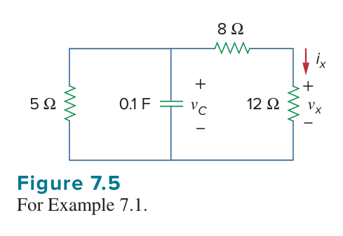

<template #solution>

### 課本解析與答案 (Textbook Solution)

We first need to make the circuit in Fig. 7.5 conform with the standard RC circuit in Fig. 7.1. We find the equivalent resistance or the Thevenin resistance at the capacitor terminals. Our objective is always to first obtain capacitor voltage vC . From this, we can determine vx and ix . The 8-Ω and 12-Ω resistors in series can be combined to give a 20-Ω resistor. This 20-Ω resistor in parallel with the 5-Ω resistor can be combined so that the equivalent resistance is Req = $\frac{20 \times  5}{20 + 5}$ = 4 Ω Hence, the equivalent circuit is as shown in Fig. 7.6, which is analogous to Fig. 7.1. The time constant is τ = ReqC = 4(0.1) = 0.4 s v = v(0) $e^{-t/τ}$ = 15 $e^{-t/0.4}$ V, vC = v = 15 $e^{-2.5t}$ V From Fig. 7.5, we can use voltage division to get vx ; so vx = $\frac{12}{12 + 8}$ v = 0.6(15$e^{-2.5t}$) = 9$e^{-2.5t}$ V Finally, ix = $\frac{vx}{12}$ = 0.75$e^{-2.5t}$ A

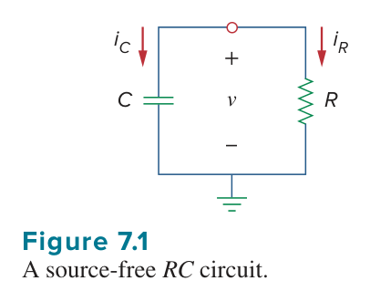

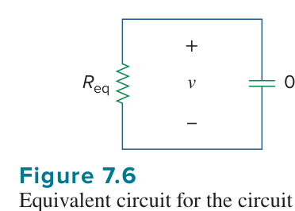

</template>

</PracticeCard>

<PracticeCard id="ch7-pr1" type="practice" title="Practice Problem 7.1" source="課本 p.256" topic="一階電路與暫態響應 (First-Order Circuits)">

Refer to the circuit in Fig. 7.7. Let vC (0) = 60 V . Determine vC, vx, and io for t ≥ 0 .

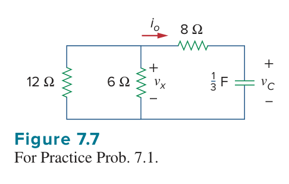

<template #solution>

### 課本解析與答案 (Textbook Solution)

60$e^{-0.25t}$ V, 20$e^{-0.25t}$ V, −5$e^{-0.25t}$ A .

</template>

</PracticeCard>

<PracticeCard id="ch7-ex2" type="example" title="Example 7.2" source="課本 p.256" topic="一階電路與暫態響應 (First-Order Circuits)">

The switch in the circuit in Fig. 7.8 has been closed for a long time, and it is opened at t = 0 . Find v(t) for t ≥ 0 . Calculate the initial energy stored in the capacitor.

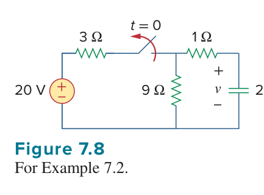

<template #solution>

### 課本解析與答案 (Textbook Solution)

For t < 0 , the switch is closed; the capacitor is an open circuit to dc, as represented in Fig. 7.9(a). Using voltage division vC (t) = $\frac{9}{9 + 3}$ (20) = 15 V, t < 0 Since the voltage across a capacitor cannot change instantaneously, the voltage across the capacitor at t = 0− is the same at t = 0 , or vC (0) = V0 = 15 V For t > 0 , the switch is opened, and we have the RC circuit shown in Fig. 7.9(b). [Notice that the RC circuit in Fig. 7.9(b) is source free; the independent source in Fig. 7.8 is needed to provide V0 or the initial energy in the capacitor.] The 1-Ω and 9-Ω resistors in series give Req = 1 + 9 = 10 Ω The time constant is τ = ReqC = 10 × 20 × $10^{-3}$ = 0.2 s Thus, the voltage across the capacitor for t ≥ 0 is v(t) = vC (0)$e^{-t/\tau}$ = 15$e^{-t/0.2}$ V v(t) = 15$e^{-5t}$ V The initial energy stored in the capacitor is $w_C(0)=\frac{1}{2}Cv_C^2(0)=\frac{1}{2}\times20\times10^{-3}\times15^2=2.25\text{ J}$

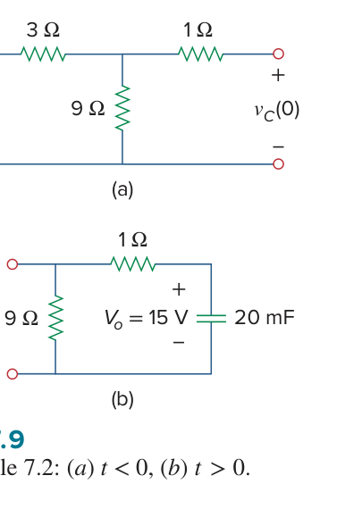

</template>

</PracticeCard>

<PracticeCard id="ch7-pr2" type="practice" title="Practice Problem 7.2" source="課本 p.257" topic="一階電路與暫態響應 (First-Order Circuits)">

If the switch in Fig. 7.10 opens at t = 0 , find v(t) for t ≥ 0 and wC (0) .

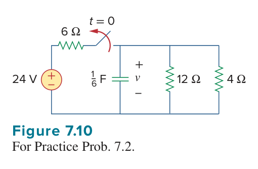

<template #solution>

### 課本解析與答案 (Textbook Solution)

8$e^{-2t}$ V, 5.333 J.

</template>

</PracticeCard>

<PracticeCard id="ch7-ex3" type="example" title="Example 7.3" source="課本 p.259" topic="一階電路與暫態響應 (First-Order Circuits)">

Assuming that i(0) = 10 A , calculate i(t) and ix(t) in the circuit of Fig. 7.13, for t > 0 .

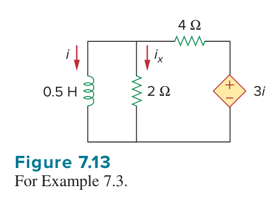

<template #solution>

### 課本解析與答案 (Textbook Solution)

There are two ways we can solve this problem. One way is to obtain the equivalent resistance at the inductor terminals and then use Eq. (7.20). The other way is to start from scratch by using Kirchhoff’s voltage law. Whichever approach is taken, it is always better to first obtain the inductor current. **Method 1.** The equivalent resistance is the same as the Thevenin resistance at the inductor terminals. Because of the dependent source, we insert a voltage source with vo = 1 V at the inductor terminals a-b , as in Fig. 7.14(a). (We could also insert a 1-A current source at the terminals.) Applying KVL to the two loops gives $2(i_1-i_2)+1=0$, so $i_1-i_2=-\frac{1}{2}$ (7.3.1), and $6i_2-2i_1-3i_1=0$, so $i_2=\frac{5}{6}i_1$ (7.3.2). Substituting Eq. (7.3.2) into Eq. (7.3.1) gives $i_1=-3\text{ A},\quad i_o=3\text{ A}$. Then $R_{eq}=\frac{v_o}{i_o}=\frac{1}{3}\,\Omega$. The time constant is $\tau=\frac{L}{R_{\mathrm{eq}}}=\frac{1/2}{1/3}=\frac{3}{2}\text{ s}$ Thus, the current through the inductor is $i(t)=i(0)e^{-t/\tau}=10e^{-2t/3}\text{ A},\quad t>0$ **Method 2.** We may directly apply KVL to the circuit as in Fig. 7.14(b). For loop 1, $\frac{1}{2}\frac{di_1}{dt}+2(i_1-i_2)=0$ $\frac{di_1}{dt}+4i_1-4i_2=0$ (7.3.3) For loop 2, $6i_2-2i_1-3i_1=0$, so $i_2=\frac{5}{6}i_1$ (7.3.4). Substituting Eq. (7.3.4) into Eq. (7.3.3) gives $\frac{di_1}{dt}+\frac{2}{3}i_1=0$ Rearranging terms, $\frac{di_1}{i_1}=-\frac{2}{3}\,dt$ Since $i_1=i$, replace $i_1$ by $i$ and integrate:

$\ln\left(\frac{i(t)}{i(0)}\right)=-\frac{2}{3}t$ Taking the powers of e , we finally obtain i(t) = i(0) $e^{-2t/3}$ = 10 $e^{-2t/3}$ A, t > 0 which is the same as by Method 1. The voltage across the inductor is v = L $\frac{di}{dt}$ = 0.5(10) ($\frac{- 2}{3}$ ) $e^{-2t/3}$ = $\frac{- 10}{3}$ $e^{-2t/3}$ V Since the inductor and the 2-Ω resistor are in parallel, they have the same voltage v . Thus, ix(t) = $\frac{v}{2}$ = −1.6667 $e^{-2t/3}$ A, t > 0

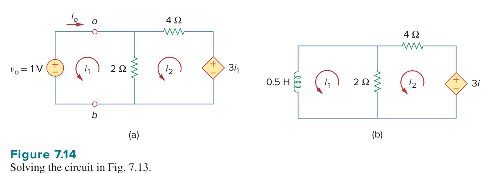

</template>

</PracticeCard>

<PracticeCard id="ch7-pr3" type="practice" title="Practice Problem 7.3" source="課本 p.261" topic="一階電路與暫態響應 (First-Order Circuits)">

Find i and vx in the circuit of Fig. 7.15, for t > 0 . Let i(0) = 12 A .

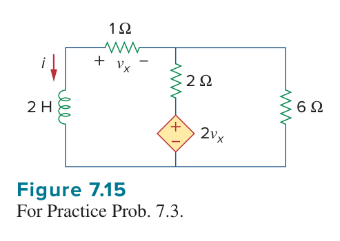

<template #solution>

### 課本解析與答案 (Textbook Solution)

12 $e^{-2t}$ A, −12 $e^{-2t}$ V, t > 0 .

</template>

</PracticeCard>

<PracticeCard id="ch7-ex4" type="example" title="Example 7.4" source="課本 p.261" topic="一階電路與暫態響應 (First-Order Circuits)">

The switch in the circuit of Fig. 7.16 has been closed for a long time. At t = 0 , the switch is opened. Calculate i(t) for t > 0 .

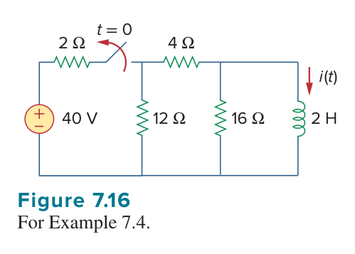

<template #solution>

### 課本解析與答案 (Textbook Solution)

When t < 0 , the switch is closed, and the inductor acts as a short circuit to dc. The 16-Ω resistor is short-circuited; the resulting circuit is shown in Fig. 7.17(a). To get i1 in Fig. 7.17(a), we combine the 4-Ω and 12-Ω resistors in parallel to get $\frac{4 \times  12}{4 + 12}$ = 3 Ω i1 = $\frac{40}{2 + 3}$ = 8 A We obtain i(t) from i1 in Fig. 7.17(a) using current division, i(t) = $\frac{12}{12 + 4}$ i1 = 6 A, t < 0 Since the current through an inductor cannot change instantaneously, i(0) = i(0−) = 6 A When t > 0 , the switch is open and the voltage source is disconnected. We now have the source-free RL circuit in Fig. 7.17(b). Combining the resistors, we have $R_{\mathrm{eq}}=(12+4)\parallel16=8\,\Omega$ The time constant is τ = $\frac{L}{R_{\mathrm{eq}}}$ = $\frac{2}{8}$ = $\frac{1}{4}$ s i(t) = i(0) $e^{-t/τ}$ = 6 $e^{-4t}$ A

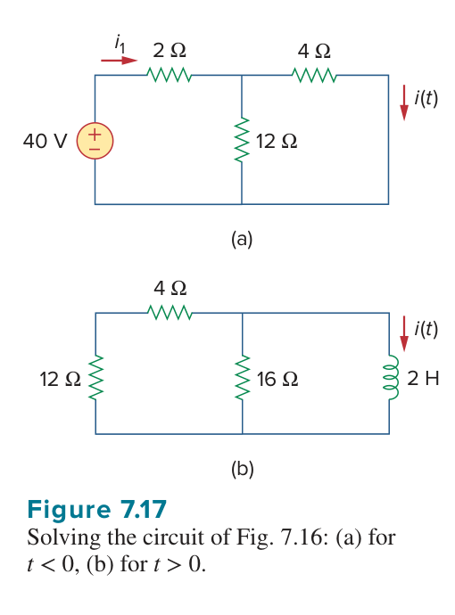

</template>

</PracticeCard>

<PracticeCard id="ch7-pr4" type="practice" title="Practice Problem 7.4" source="課本 p.262" topic="一階電路與暫態響應 (First-Order Circuits)">

For the circuit in Fig. 7.18, find i(t) for t > 0 .

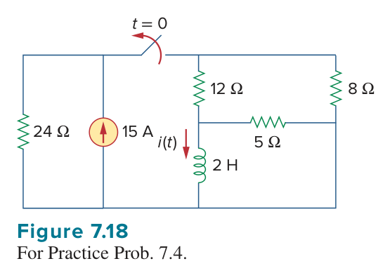

<template #solution>

### 課本解析與答案 (Textbook Solution)

5 $e^{-2t}$ A, t > 0 .

</template>

</PracticeCard>

<PracticeCard id="ch7-ex5" type="example" title="Example 7.5" source="課本 p.262" topic="一階電路與暫態響應 (First-Order Circuits)">

In the circuit shown in Fig. 7.19, find io, vo, and i for all time, assuming that the switch was open for a long time.

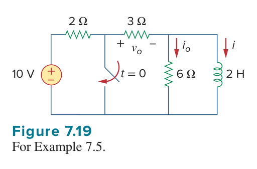

<template #solution>

### 課本解析與答案 (Textbook Solution)

It is better to first find the inductor current i and then obtain other quantities from it. For t < 0 , the switch is open. Since the inductor acts like a short circuit to dc, the 6-Ω resistor is short-circuited, so that we have the circuit shown in Fig. 7.20(a). Hence, io = 0 , and i(t) = $\frac{10}{2 + 3}$ = 2 A, t < 0 vo(t) = 3i(t) = 6 V, t < 0 Thus, i(0) = 2 . For t > 0 , the switch is closed, so that the voltage source is shortcircuited. We now have a source-free RL circuit as shown in Fig. 7.20(b). At the inductor terminals, $R_{\mathrm{Th}}=3\parallel6=2\,\Omega$ so that the time constant is τ = $\frac{L}{R_{\mathrm{Th}}}$ = 1 s i(t) = i(0) $e^{-t/τ}$ = 2$e^{-t}$A, t > 0 Because the inductor is in parallel with the 6- and 3-Ω resistors, vo(t) = −vL = −L $\frac{di}{dt}$ = −2(−2$e^{-t}$) = 4$e^{-t}$ V, t > 0 io(t) = $\frac{v_{L}}{6}$ = $\frac{- 2}{3}$ $e^{-t}$ A, t > 0 Thus, for all time:

$$i_o(t)=\begin{cases}0\text{ A},&t<0\\-\frac{2}{3}e^{-t}\text{ A},&t>0\end{cases},\quad v_o(t)=\begin{cases}6\text{ V},&t<0\\4e^{-t}\text{ V},&t>0\end{cases},\quad i(t)=\begin{cases}2\text{ A},&t<0\\2e^{-t}\text{ A},&t>0\end{cases}$$

We notice that the inductor current is continuous at t = 0 , while the current through the 6-Ω resistor drops from 0 to −2/3 at t = 0 , and the voltage across the 3-Ω resistor drops from 6 to 4 at t = 0 . We also notice that the time constant is the same regardless of what the output is defined to be. Figure 7.21 plots $i(t)$ and $i_o(t)$.

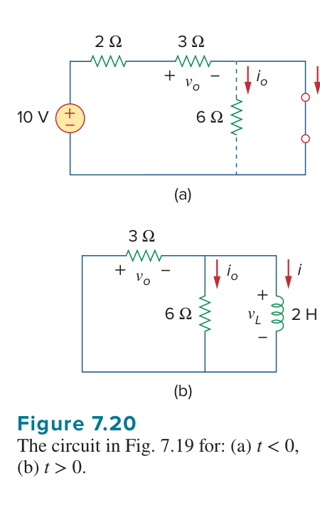

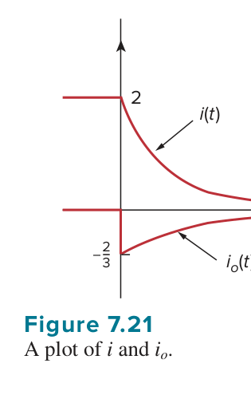

</template>

</PracticeCard>

<PracticeCard id="ch7-pr5" type="practice" title="Practice Problem 7.5" source="課本 p.263" topic="一階電路與暫態響應 (First-Order Circuits)">

Determine i, io, and vo for all t in the circuit shown in Fig. 7.22. Assume that the switch was closed for a long time. It should be noted that opening a switch in series with an ideal current source creates an infinite voltage at the current source terminals. Clearly this is impossible. For the purposes of problem solving, we can place a shunt resistor in parallel with the source (which now makes it a voltage source in series with a resistor). In more practical circuits, devices that act like current sources are, for the most part, electronic circuits. These circuits will allow the source to act like an ideal current source over its operating range but voltage-limit it when the load resistor becomes too large (as in an open circuit).

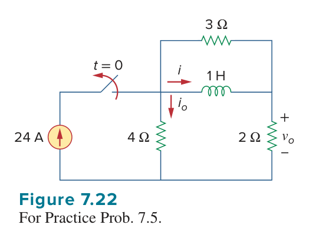

<template #solution>

### 課本解析與答案 (Textbook Solution)

i=16 A for t<0 and i=16$e^{-2t}$ A for t>0; io=8 A for t<0 and io=−5.333$e^{-2t}$ A for t>0.

</template>

</PracticeCard>

<PracticeCard id="ch7-ex6" type="example" title="Example 7.6" source="課本 p.267" topic="一階電路與暫態響應 (First-Order Circuits)">

Express the voltage pulse in Fig. 7.31 in terms of the unit step. Calculate its derivative and sketch it.

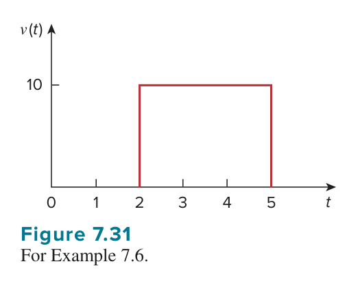

<template #solution>

### 課本解析與答案 (Textbook Solution)

The type of pulse in Fig. 7.31 is called the gate function. It may be regarded as a step function that switches on at one value of t and switches off at another value of t . The gate function shown in Fig. 7.31 switches on at t = 2 s and switches off at t = 5 s . It consists of the sum of two unit step functions as shown in Fig. 7.32(a). From the figure, it is evident that v(t) = 10u (t − 2) − 10u (t − 5) = 10[u (t − 2) − u (t − 5)] Taking the derivative of this gives $\frac{dv}{dt}$ = 10[δ (t − 2) − δ (t − 5)] which is shown in Fig. 7.32(b). We can obtain Fig. 7.32(b) directly from Fig. 7.31 by simply observing that there is a sudden increase by 10 V at t = 2 s leading to 10δ (t − 2) . At t = 5 s , there is a sudden decrease by 10 V leading to −10V δ (t − 5) . 10u(t ‒ 2) ‒10u(t ‒ 5) 3 4 5 t 1 2 0

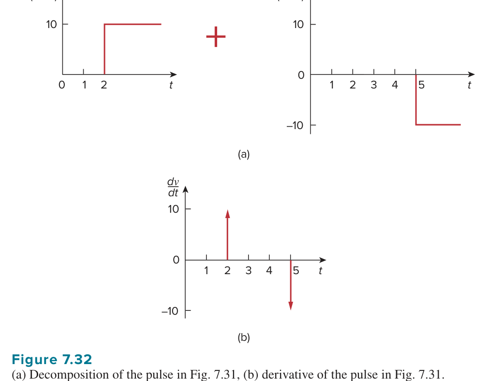

</template>

</PracticeCard>

<PracticeCard id="ch7-pr6" type="practice" title="Practice Problem 7.6" source="課本 p.268" topic="一階電路與暫態響應 (First-Order Circuits)">

Express the current pulse in Fig. 7.33 in terms of the unit step. Find its integral and sketch it.

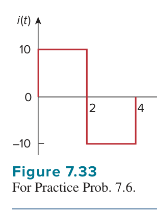

<template #solution>

### 課本解析與答案 (Textbook Solution)

10[u (t) − 2u (t − 2) + u (t − 4)] A, 10[r (t) − 2r (t − 2) + r (t − 4)] amp-sec .

</template>

</PracticeCard>

<PracticeCard id="ch7-ex7" type="example" title="Example 7.7" source="課本 p.268" topic="一階電路與暫態響應 (First-Order Circuits)">

Express the sawtooth function shown in Fig. 7.35 in terms of singularity functions.

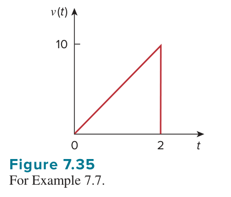

<template #solution>

### 課本解析與答案 (Textbook Solution)

There are three ways of solving this problem. The first method is by mere observation of the given function, while the other methods involve some graphical manipulations of the function. **Method 1.** By looking at the sketch of v(t) in Fig. 7.35, it is not hard to notice that the given function v(t) is a combination of singularity functions. So we let v(t) = v1(t) + v2(t) + ⋯ (7.7.1) The function v1(t) is the ramp function of slope 5, shown in Fig. 7.36(a); that is, v1(t) = 5r (t) (7.7.2) Since v1(t) goes to infinity, we need another function at t = 2s in order to get v(t) . We let this function be v2 , which is a ramp function of slope −5 , as shown in Fig. 7.36(b); that is, v2(t) = −5r(t − 2) (7.7.3) Adding v1 and v2 gives us the signal in Fig. 7.36(c). Obviously, this is not the same as v(t) in Fig. 7.35. But the difference is simply a constant 10 units for t > 2 s . By adding a third signal v3 , where v3 = −10u(t − 2) (7.7.4) we get v(t) , as shown in Fig. 7.37. Substituting Eqs. (7.7.2) through (7.7.4) into Eq. (7.7.1) gives v(t) = 5r(t) − 5r(t − 2) − 10u(t − 2) **Method 2.** A close observation of Fig. 7.35 reveals that v(t) is a multiplication of two functions: a ramp function and a gate function. Thus, v(t) = 5t[u(t) − u(t − 2)] = 5tu(t) − 5tu(t − 2) = 5r(t) − 5(t − 2 + 2)u(t − 2) = 5r(t) − 5(t − 2)u(t − 2) − 10u(t − 2) = 5r(t) − 5r(t − 2) − 10u(t − 2) the same as before. **Method 3.** This method is similar to Method 2. We observe from Fig. 7.35 that v(t) is a multiplication of a ramp function and a unit step function, as shown in Fig. 7.38. Thus, v(t) = 5r(t)u(−t + 2) If we replace u(−t) by 1 − u(t) , then we can replace u(−t + 2) by 1 − u(t − 2) . Hence, v(t) = 5r(t)[1 − u(t − 2)] which can be simplified as in Method 2 to get the same result. u(‒t + 2)

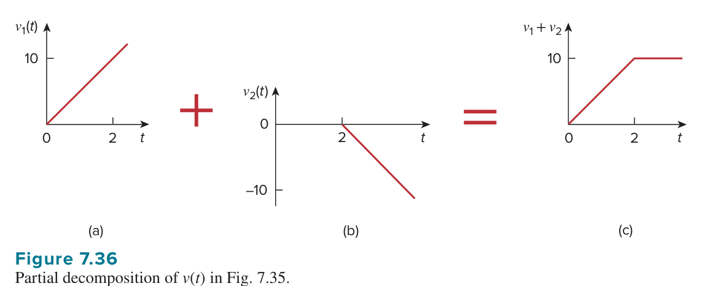

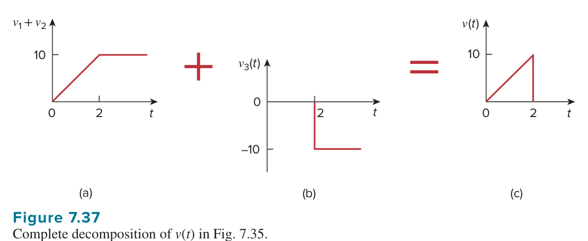

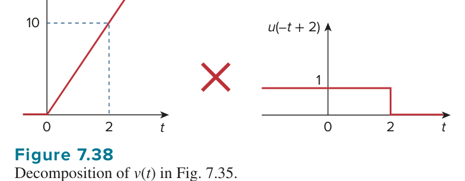

</template>

</PracticeCard>

<PracticeCard id="ch7-pr7" type="practice" title="Practice Problem 7.7" source="課本 p.270" topic="一階電路與暫態響應 (First-Order Circuits)">

Refer to Fig. 7.39. Express i(t) in terms of singularity functions.

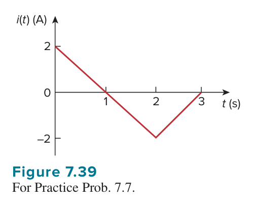

<template #solution>

### 課本解析與答案 (Textbook Solution)

2u (t) − 2r (t) + 4r (t − 2) − 2r (t − 3) A .

</template>

</PracticeCard>

<PracticeCard id="ch7-ex8" type="example" title="Example 7.8" source="課本 p.270" topic="一階電路與暫態響應 (First-Order Circuits)">

Given the signal $g(t)=\begin{cases}3,&t<0\\-2,&0<t<1\\2t-4,&t>1\end{cases}$, express $g(t)$ in terms of step and ramp functions.

<template #solution>

### 課本解析與答案 (Textbook Solution)

The signal g(t) may be regarded as the sum of three functions specified within the three intervals t < 0, 0 < t < 1, and t > 1 . For t < 0, g(t) may be regarded as 3 multiplied by u(−t) , where u(−t) = 1 for t < 0 and 0 for t > 0 . Within the time interval 0 < t < 1 , the function may be considered as −2 multiplied by a gated function [u(t) − u(t − 1)] . For t > 1 , the function may be regarded as 2t − 4 multiplied by the unit step function u(t − 1) . Thus, g(t) = 3u(−t) − 2[u(t) − u(t − 1)] + (2t − 4)u(t − 1) = 3u(−t) − 2u(t) + (2t − 4 + 2)u(t − 1) = 3u(−t) − 2u(t) + 2(t − 1)u(t − 1) = 3u(−t) − 2u(t) + 2r(t −1) One may avoid the trouble of using u(−t) by replacing it with 1 − u(t) . Then g(t) = 3[1 − u(t)] − 2u(t) + 2r(t − 1) = 3 − 5u(t) + 2r(t − 1) Alternatively, we may plot g(t) and apply Method 1 from Example 7.7.

</template>

</PracticeCard>

<PracticeCard id="ch7-pr8" type="practice" title="Practice Problem 7.8" source="課本 p.271" topic="一階電路與暫態響應 (First-Order Circuits)">

If $h(t)=\begin{cases}0,&t<0\\-4,&0<t<2\\3t-8,&2<t<6\\0,&t>6\end{cases}$, express $h(t)$ in terms of the singularity functions.

<template #solution>

### 課本解析與答案 (Textbook Solution)

−4u(t) + 2u(t − 2) + 3r (t − 2) − 10u(t − 6) − 3r(t − 6) .

</template>

</PracticeCard>

<PracticeCard id="ch7-ex9" type="example" title="Example 7.9" source="課本 p.271" topic="一階電路與暫態響應 (First-Order Circuits)">

Evaluate the following integrals involving the impulse function: $\int_0^{10}(t^2+4t-2)\delta(t-2)\,dt$ and $\int_{-\infty}^{\infty}[\delta(t-1)e^{-t}\cos t+\delta(t+1)e^{-t}\sin t]\,dt$.

<template #solution>

### 課本解析與答案 (Textbook Solution)

For the first integral, we apply the sifting property in Eq. (7.32). (t2 + 4t − 2)δ (t − 2) dt = (t2 + 4t −2)+t=2 = 4 + 8 − 2 = 10 Similarly, for the second integral, [δ (t −1) $e^{-t}$ cos t + δ (t + 1) $e^{-t}$ sin t] dt = $e^{-t}$ cos t+t=1 + $e^{-t}$ sin t+t= −1 −1 cos 1 + e1sin (−1) = 0.1988 − 2.2873 = −2.0885

</template>

</PracticeCard>

<PracticeCard id="ch7-pr9" type="practice" title="Practice Problem 7.9" source="課本 p.271" topic="一階電路與暫態響應 (First-Order Circuits)">

Evaluate the following integrals: $\int_{-\infty}^{\infty}(t^3+5t^2+10)\delta(t+3)\,dt$ and $\int_0^{10}\delta(t-\pi)\cos 3t\,dt$.

<template #solution>

### 課本解析與答案 (Textbook Solution)

28, −1 .

</template>

</PracticeCard>

<PracticeCard id="ch7-ex10" type="example" title="Example 7.10" source="課本 p.275" topic="一階電路與暫態響應 (First-Order Circuits)">

The switch in Fig. 7.43 has been in position A for a long time. At t = 0 , the switch moves to B . Determine v(t) for t > 0 and calculate its value at t = 1 and 4 s .

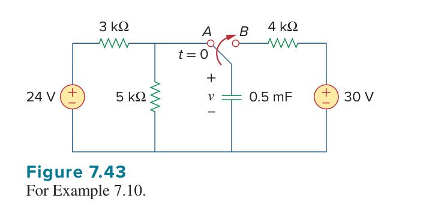

<template #solution>

### 課本解析與答案 (Textbook Solution)

For t < 0 , the switch is at position A . The capacitor acts like an open circuit to dc, but v is the same as the voltage across the 5-kΩ resistor. Hence, the voltage across the capacitor just before t = 0 is obtained by voltage division as v(0−) = $\frac{5}{5 + 3}$ (24) = 15 V Using the fact that the capacitor voltage cannot change instantaneously, v(0) = v(0−) = v( 0 + ) = 15 V For t > 0 , the switch is in position B . The Thevenin resistance connected to the capacitor is R Th = 4 kΩ , and the time constant is $\tau=R_{Th}C=4\times10^3\times0.5\times10^{-3}=2\text{ s}$ Since the capacitor acts like an open circuit to dc at steady state, v(∞) = 30 V . Thus, v(t) = v(∞) + [v(0) − v(∞)] $e^{-t/τ}$ = 30 + (15 − 30) $e^{-t/2}$ = (30 − 15 $e^{-0.5t}$ ) V At t = 1 , v(1) = 30 − 15 $e^{-0.5}$ = 20.9 V At t = 4 , $v(4)=30-15e^{-2}=27.97\text{ V}$.

</template>

</PracticeCard>

<PracticeCard id="ch7-pr10" type="practice" title="Practice Problem 7.10" source="課本 p.276" topic="一階電路與暫態響應 (First-Order Circuits)">

Find v(t) for t > 0 in the circuit of Fig. 7.44. Assume the switch has been open for a long time and is closed at t = 0 . Calculate v(t) at t = 0.5 .

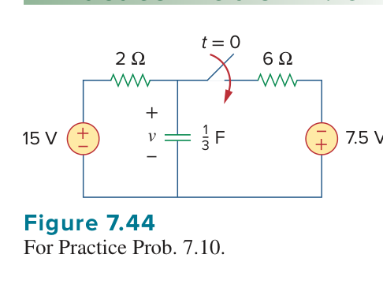

<template #solution>

### 課本解析與答案 (Textbook Solution)

(9.375 + 5.625 $e^{-2t}$ ) V for all t > 0, 11.444 V .

</template>

</PracticeCard>

<PracticeCard id="ch7-ex11" type="example" title="Example 7.11" source="課本 p.276" topic="一階電路與暫態響應 (First-Order Circuits)">

In Fig. 7.45, the switch has been closed for a long time and is opened at t = 0 . Find i and v for all time.

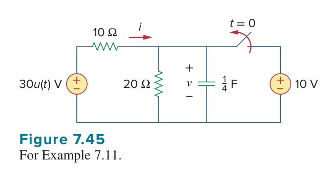

<template #solution>

### 課本解析與答案 (Textbook Solution)

The resistor current i can be discontinuous at t = 0 , while the capacitor voltage v cannot. Hence, it is always better to find v and then obtain i from v . By definition of the unit step function, 30u(t) = { 0, 30, t < 0 t > 0 For t < 0 , the switch is closed and 30u(t) = 0 , so that the 30u(t) voltage source is replaced by a short circuit and should be regarded as contributing nothing to v . Since the switch has been closed for a long time, the capacitor voltage has reached steady state and the capacitor acts like an open circuit. Hence, the circuit becomes that shown in Fig. 7.46(a) for t < 0 . From this circuit we obtain v = 10 V, i = $\frac{- v}{10}$ = −1 A Since the capacitor voltage cannott change instantaneously, v(0) = v(0−) = 10 V For t > 0 , the switch is opened and the 10-V voltage source is disconnected from the circuit. The 30u(t) voltage source is now operative, so the circuit becomes that shown in Fig. 7.46(b). After a long time, the circuit reaches steady state and the capacitor acts like an open circuit again. We obtain v(∞) by using voltage division, writing The Thevenin resistance at the capacitor terminals is R Th = 10∥20 = $\frac{10 \times  20}{30}$ = $\frac{20}{3}$ Ω and the time constant is τ = R Th C = $\frac{20}{3}$ ⋅ $\frac{1}{4}$ = $\frac{5}{3}$ s v(t) = v(∞) + [ v(0) − v(∞) ] $e^{-t/τ}$ = 20 + (10 − 20) $e^{-3t/5}$ = (20 − 10 $e^{-0.6t}$ ) V To obtain i , we notice from Fig. 7.46(b) that i is the sum of the currents through the 20-Ω resistor and the capacitor; that is, i = $\frac{v}{20}+C\frac{dv}{dt}$ = 1 − 0.5 $e^{-0.6t}$ + 0.25(−0.6)(−10) $e^{-0.6t}$ = (1 + $e^{-0.6t}$ ) A Notice from Fig. 7.46(b) that v + 10i = 30 is satisfied, as expected. Hence, v = { 10 V, (20 − 10 $e^{-0.6t}$ ) V, t < 0 t > 0 i = { −1 A, (1 + $e^{-0.6t}$ ) A, t < 0 t > 0 Notice that the capacitor voltage is continuous while the resistor current is not.

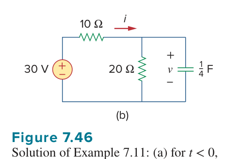

</template>

</PracticeCard>

<PracticeCard id="ch7-pr11" type="practice" title="Practice Problem 7.11" source="課本 p.277" topic="一階電路與暫態響應 (First-Order Circuits)">

The switch in Fig. 7.47 is closed at t = 0 . Find i(t) and v(t) for all time. Note that u(−t) = 1 for t < 0 and 0 for t > 0 . Also, u(−t) = 1 − u(t) .

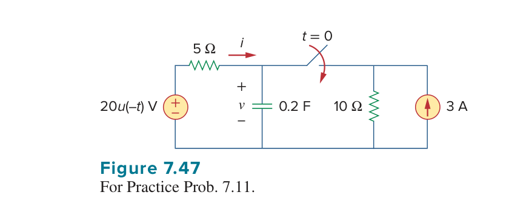

<template #solution>

### 課本解析與答案 (Textbook Solution)

i(t)=0 for t<0 and i(t)=−2(1+$e^{-1.5t}$) A for t>0; v=20 V for t<0 and v=10(1+$e^{-1.5t}$) V for t>0.

</template>

</PracticeCard>

<PracticeCard id="ch7-ex12" type="example" title="Example 7.12" source="課本 p.280" topic="一階電路與暫態響應 (First-Order Circuits)">

Find i(t) in the circuit of Fig. 7.51 for t > 0 . Assume that the switch has been closed for a long time.

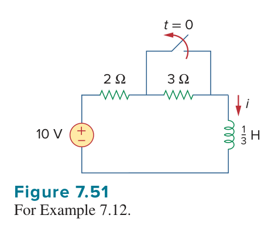

<template #solution>

### 課本解析與答案 (Textbook Solution)

When t < 0 , the 3-Ω resistor is short-circuited, and the inductor acts like a short circuit. The current through the inductor at t = 0− (i.e., just before t = 0 ) is i(0−) = $\frac{10}{2}$ = 5 A Because the inductor current cannot change instantaneously, i(0) = i( 0 + ) = i(0−) = 5 A When t > 0 , the switch is open. The 2- and 3-Ω resistors are in series, so that i(∞) = $\frac{10}{2 + 3}$ = 2 A The Thevenin resistance across the inductor terminals is R Th = 2 + 3 = 5 Ω For the time constant, τ = $\frac{L}{R_{\mathrm{Th}}}$ =  /  5 = $\frac{1}{15}$ s i(t) = i(∞) + [i(0) − i(∞)] $e^{-t/τ}$ = 2 + (5 − 2) $e^{-15t}$ = 2 + 3 $e^{-15t}$ A, t > 0 Check: In Fig. 7.51, for t > 0 , KVL must be satisfied; that is, 10 = 5i + L $\frac{di}{dt}$ 5i + L $\frac{di}{dt}$ = [10 + 15 $e^{-15t}$ ] + [ $\frac{1}{3}$ (3)(−15) $e^{-15t}$ ] = 10 This confirms the result.

</template>

</PracticeCard>

<PracticeCard id="ch7-pr12" type="practice" title="Practice Problem 7.12" source="課本 p.280" topic="一階電路與暫態響應 (First-Order Circuits)">

The switch in Fig. 7.52 has been closed for a long time. It opens at t = 0 . Find i(t) for t > 0 .

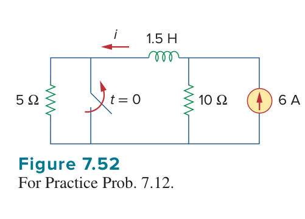

<template #solution>

### 課本解析與答案 (Textbook Solution)

(4 + 2 $e^{-10t}$ ) A for all t > 0 .

</template>

</PracticeCard>

<PracticeCard id="ch7-ex13" type="example" title="Example 7.13" source="課本 p.281" topic="一階電路與暫態響應 (First-Order Circuits)">

At t = 0 , switch 1 in Fig. 7.53 is closed, and switch 2 is closed 4 s later. Find i(t) for t > 0 . Calculate i for t = 2 s and t = 5 s .

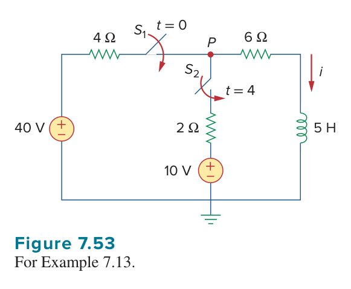

<template #solution>

### 課本解析與答案 (Textbook Solution)

We need to consider the three time intervals t < 0, 0 < t < 4 , and t > 4 separately. For t < 0 , switches S1 and S2 are open so that i = 0 . Since the inductor current cannot change instantly, i(0−) = i(0) = i( 0 + ) = 0 For 0 < t < 4, S1 is closed so that the 4- and 6-Ω resistors are in series. (Remember, at this time, S2 is still open.) Hence, assuming for now that S1 is closed forever, i(∞) = $\frac{40}{4 + 6}$ = 4 A, R Th = 4 + 6 = 10 Ω τ = $\frac{L}{R_{\mathrm{Th}}}$ = $\frac{5}{10}$ = $\frac{1}{2}$ s i(t) = i(∞) + [i(0) − i(∞)] $e^{-t/τ}$ = 4 + (0 − 4) $e^{-2t}$ = 4(1 − $e^{-2t}$ ) A, 0 < t < 4 For t > 4, S2 is closed; the 10-V voltage source is connected, and the circuit changes. This sudden change does not affect the inductor current because the current cannot change abruptly. Thus, the initial current is i(4) = i(4−) = 4(1 − $e^{-8}$) ≃ 4 A To find i(∞) , let v be the voltage at node P in Fig. 7.53. Using KCL, $\frac{40-v}{4}+\frac{10-v}{2}=\frac{v}{6}$, which gives $v=\frac{180}{11}$ V i(∞) = $\frac{v}{6}$ = $\frac{30}{11}$ = 2.727 A The Thevenin resistance at the inductor terminals is R Th = 4∥2 + 6 = $\frac{4 \times  2}{6 + 6}$ = $\frac{22}{3}$ Ω $\tau=\frac{L}{R_{Th}}=\frac{5}{22/3}=\frac{15}{22}\text{ s}$ i(t) = i(∞) + [i(4) − i(∞)] $e^{-(t-4)/\tau}$ , t > 4 We need (t − 4) in the exponential because of the time delay. Thus, i(t) = 2.727 + (4 − 2.727) $e^{-(t-4)/\tau}$ , τ = $\frac{15}{22}$ = 2.727 + 1.273 $e^{-1.4667(t-4)}$ , t > 4 Putting all this together, i(t) = { 4(1 − $e^{-2t}$ ), 2.727 + 1.273 $e^{-1.4667(t-4)}$ , 0 < t < 4 t > 4 At t = 2 , i(2) = 4(1 − $e^{-4}$) = 3.93 A At t = 5 , i(5) = 2.727 + 1.273 $e^{-1.4667}$ = 3.02 A

</template>

</PracticeCard>

<PracticeCard id="ch7-pr13" type="practice" title="Practice Problem 7.13" source="課本 p.282" topic="一階電路與暫態響應 (First-Order Circuits)">

Switch S1 in Fig. 7.54 is closed at t = 0 , and switch S2 is closed at t = 2s . Calculate i(t) for all t . Find i (1) and i (3).

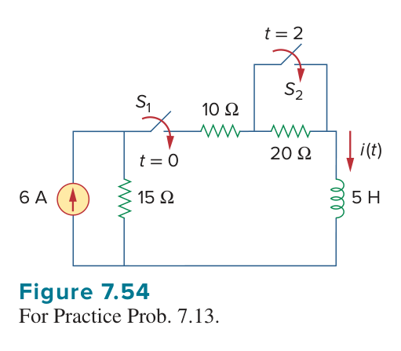

<template #solution>

### 課本解析與答案 (Textbook Solution)

i(t)=0 for t<0; i(t)=2(1−$e^{-9t}$) A for 0<t<2; i(t)=3.6−1.6e^(−5(t−2)) A for t>2.

</template>

</PracticeCard>

<PracticeCard id="ch7-ex14" type="example" title="Example 7.14" source="課本 p.283" topic="一階電路與暫態響應 (First-Order Circuits)">

For the op amp circuit in Fig. 7.55(a), find vo for t > 0 , given that v(0) = 3 V. Let Rf = 80 kΩ, R1 = 20 kΩ , and C = 5 μF .

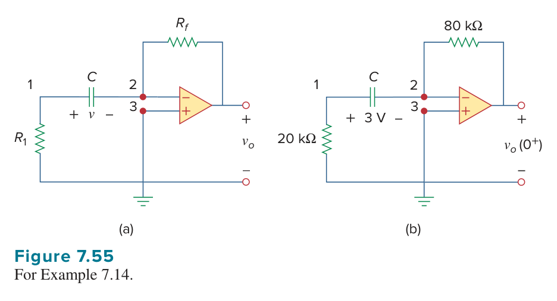

<template #solution>

### 課本解析與答案 (Textbook Solution)

This problem can be solved in two ways: **Method 1.** Consider the circuit in Fig. 7.55(a). Let us derive the appropriate differential equation using nodal analysis. If v1 is the voltage at node 1, at that node, KCL gives $\frac{0 - v1}{R_{1}}$ = C $\frac{dv}{dt}$ (7.14.1) Because nodes 2 and 3 must be at the same potential, the potential at node 2 is zero. Thus, v1 − 0 = v or v1 = v and Eq. (7.14.1) becomes $\frac{dv}{dt}+\frac{v}{CR_1}=0$ (7.14.2) This is similar to Eq. (7.4b) so that the solution is obtained the same way as in Section 7.2, that is, v(t) = V0 $e^{-t/τ}$ , τ = R1C (7.14.3) where V0 is the initial voltage across the capacitor. But v(0) = 3 = V0 and τ = 20 × $10^3$ × 5 × $10^{-6}$ = 0.1 s. Hence, v(t) = 3 $e^{-10t}$ (7.14.4) Applying KCL at node 2 gives $C\frac{dv}{dt}=\frac{0-v_o}{R_f}$, hence $v_o=-R_fC\frac{dv}{dt}$ (7.14.5) Now we can find v0 as vo = −80 × $10^3$ × 5 × $10^{-6}$(−30 $e^{-10t}$ ) = 12 $e^{-10t}$ V, t > 0 **Method 2.** Let us apply the shortcut method from Eq. (7.53). We need to find $v_o(0^+)$, $v_o(\infty)$, and $\tau$. Since v( 0 + ) = $v(0^-)=3\text{ V}$ , we apply KCL at node 2 in the circuit of Fig. 7.55(b) to obtain $\frac{3}{20{,}000}+\frac{0-v_o(0^+)}{80{,}000}=0$ or vo( 0 + ) = 12 V . Since the circuit is source free, v(∞) = 0 V . To find − , we need the equivalent resistance Req across the capacitor terminals. If we remove the capacitor and replace it by a 1-A current source, we have the circuit shown in Fig. 7.55(c). Applying KVL to the input loop yields 20,000(1) − v = 0 + v = 20 kV Req = $\frac{v}{1}$ = 20 kΩ and τ = ReqC = 0.1 . Thus, vo(t) = vo(∞) + [vo(0) − vo(∞)] $e^{-t/τ}$ = 0 + (12 − 0) $e^{-10t}$ = 12 $e^{-10t}$ V, t > 0 as before.

</template>

</PracticeCard>

<PracticeCard id="ch7-pr14" type="practice" title="Practice Problem 7.14" source="課本 p.284" topic="一階電路與暫態響應 (First-Order Circuits)">

For the op amp circuit in Fig. 7.56, find vo for t > 0 if v(0) = 4 V . Assume that Rf = 50 kΩ, R1 = 10 kΩ , and C = 10 μF .

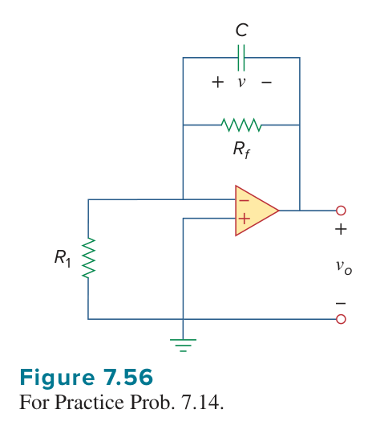

<template #solution>

### 課本解析與答案 (Textbook Solution)

−4 $e^{-2t}$ V, t > 0 .

</template>

</PracticeCard>

<PracticeCard id="ch7-ex15" type="example" title="Example 7.15" source="課本 p.284" topic="一階電路與暫態響應 (First-Order Circuits)">

Determine v(t) and vo(t) in the circuit of Fig. 7.57.

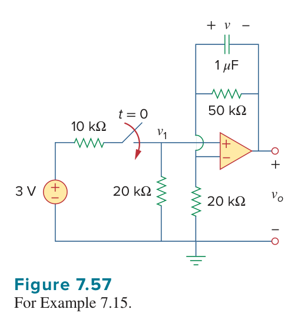

<template #solution>

### 課本解析與答案 (Textbook Solution)

This problem can be solved in two ways, just like the previous example. However, we will apply only the second method. Since what we are looking for is the step response, we can apply Eq. (7.53) and write v(t) = v(∞) + [v(0) − v(∞)] $e^{-t/τ}$ , t > 0 (7.15.1) 20 kΩ 20 kΩ t = 0 10 kΩ where we need only find the time constant τ , the initial value v(0) , and the final value v(∞) . Notice that this applies strictly to the capacitor voltage due a step input. Since no current enters the input terminals of the op amp, the elements on the feedback loop of the op amp constitute an RC circuit, with τ = RC = 50 × $10^3$ × $10^{-6}$ = 0.05 s (7.15.2) For t < 0 , the switch is open and there is no voltage across the capacitor. Hence, v(0) = 0 . For t > 0 , we obtain the voltage at node 1 by voltage division as v1 = $\frac{20}{20 + 10}$ 3 = 2 V (7.15.3) Since there is no storage element in the input loop, v1 remains constant for all t. At steady state, the capacitor acts like an open circuit so that the op amp circuit is a noninverting amplifier. Thus, $v_o(\infty)=\left(1+\frac{50}{20}\right)v_1=3.5\times2=7\text{ V}$ (7.15.4) v1 − vo = v (7.15.5) v(∞) = 2 − 7 = −5 V Substituting −, v(0) , and v(∞) into Eq. (7.15.1) gives v(t) = −5 + [0 − (−5)] $e^{-20t}$ = 5( $e^{-20t}$ − 1) V, t > 0 (7.15.6) From Eqs. (7.15.3), (7.15.5), and (7.15.6), we obtain vo(t) = v1(t) − v(t) = 7 − 5 $e^{-20t}$ V, t > 0 (7.15.7)

</template>

</PracticeCard>

<PracticeCard id="ch7-pr15" type="practice" title="Practice Problem 7.15" source="課本 p.285" topic="一階電路與暫態響應 (First-Order Circuits)">

Find v(t) and vo(t) in the op amp circuit of Fig. 7.58.

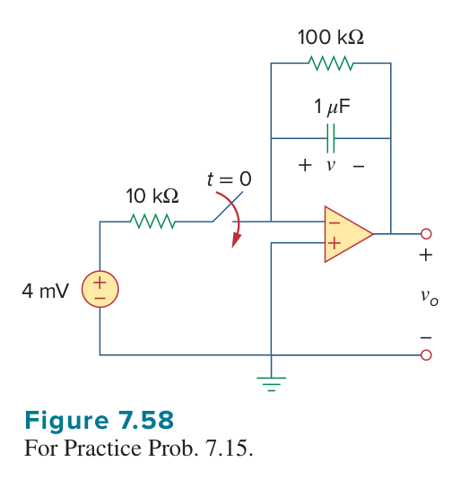

<template #solution>

### 課本解析與答案 (Textbook Solution)

v(t)=40(1−$e^{-10t}$)u(t) mV; vo(t)=40($e^{-10t}$−1)u(t) mV.

</template>

</PracticeCard>

<PracticeCard id="ch7-ex16" type="example" title="Example 7.16" source="課本 p.286" topic="一階電路與暫態響應 (First-Order Circuits)">

Find the step response vo(t) for t > 0 in the op amp circuit of Fig. 7.59. Let vi = 2u(t) V, R1 = 20 kΩ, Rf = 50 kΩ, R2 = R3 = 10 kΩ, C = 2 μF .

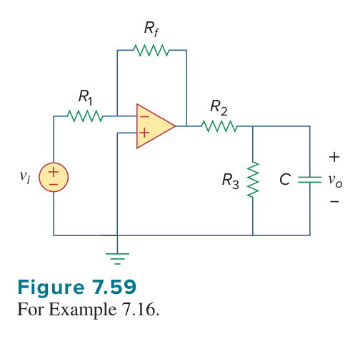

<template #solution>

### 課本解析與答案 (Textbook Solution)

To obtain R Th , consider the circuit in Fig. 7.60(b), where Ro is the output resistance of the op amp. Since we are assuming an ideal op amp, Ro = 0 , and R Th = R2 ∥ R3 = $\frac{R2R3}{R_{2} + R_{3}}$ Substituting the given numerical values, $V_{Th}=-\frac{10}{20}\frac{50}{20}2u(t)=-2.5u(t)$ R Th = $\frac{R2R3}{R_{2} + R_{3}}$ = 5kΩ The Thevenin equivalent circuit is shown in Fig. 7.61, which is similar to Fig. 7.40. Hence, the solution is similar to that in Eq. (7.48); that is, vo(t) = −2.5(1 − $e^{-t/τ}$ )u(t) where τ = R Th C = 5 × $10^3$ × 2 × $10^{-6}$ = 0.01 . Thus, the step response for t > 0 is vo(t) = 2.5( $e^{-100t}$ − 1)u(t) V Notice that the capacitor in Example 7.14 is located in the input loop, while the capacitor in Example 7.15 is located in the feedback loop. In this example, the capacitor is located in the output of the op amp. Again, we can solve this problem directly using nodal analysis. However, using the Thevenin equivalent circuit may simplify the problem. We temporarily remove the capacitor and find the Thevenin equivalent at its terminals. To obtain V Th , consider the circuit in Fig. 7.60(a). Since the circuit is an inverting amplifier, Vab = $\frac{- Rf}{R_{1}}$ vi By voltage division, V Th = $\frac{R_{3}}{R_{2} + R_{3}}$ Vab = $\frac{- R_{3}}{R_{2} + R_{3}}$ $\frac{Rf}{R_{1}}$ vi

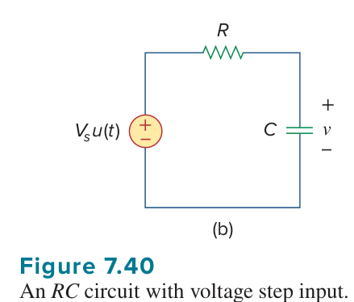

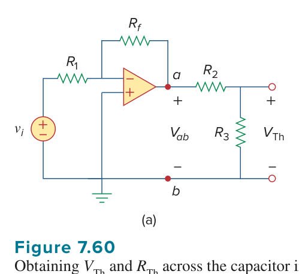

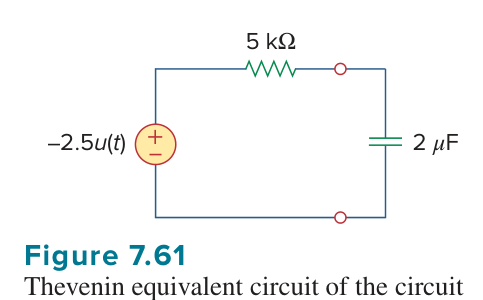

</template>

</PracticeCard>

<PracticeCard id="ch7-pr16" type="practice" title="Practice Problem 7.16" source="課本 p.287" topic="一階電路與暫態響應 (First-Order Circuits)">

Obtain the step response vo(t) for the circuit in Fig. 7.62. Let vi = 4.5u(t) V, R1 = 20 kΩ, Rf = 40 kΩ, R2 = R3 = 10 kΩ, C = 2 μF .

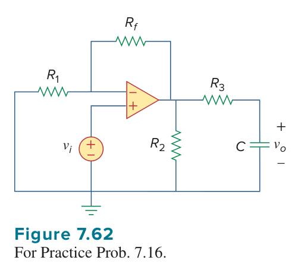

<template #solution>

### 課本解析與答案 (Textbook Solution)

13.5(1 − $e^{-50t}$ )u(t) V .

</template>

</PracticeCard>

<PracticeCard id="ch7-ex17" type="example" title="Example 7.17" source="課本 p.287" topic="一階電路與暫態響應 (First-Order Circuits)">

Use PSpice to find the response i(t) for t > 0 in the circuit of Fig. 7.63.

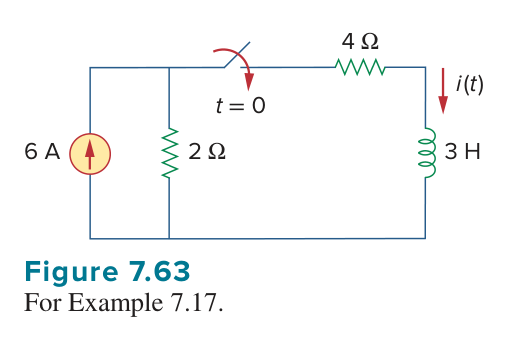

<template #solution>

### 課本解析與答案 (Textbook Solution)

Solving this problem by hand gives i (0) = 0, i(∞) = 2A, R Th = 6, τ = 3/6 = 0.5 s , so that i(t) = i(∞) + [i(0) − i(∞)] $e^{-t/τ}$ = 2(1 − $e^{-2t}$ ), t > 0 To use PSpice, we first draw the schematic as shown in Fig. 7.64. The part name is Sw_tclose. We do not need to specify the initial condition of the inductor because PSpice will determine that from the circuit. By selecting Analysis/Setup/Transient, we set Print Step to 25 ms and Final Step to 5τ = 2.5 s . After saving the circuit, we simulate by selecting Analysis/Simulate. In the PSpice A/D window, we select Trace/Add and display –I(L1) as the current through the inductor. Figure 7.65 shows the plot of i(t) , which agrees with that obtained by hand calculation. 2 6 A 3 H IDC tClose = 0 Note that the negative sign on I(L1) is needed because the current enters through the upper terminal of the inductor, which happens to be the negative terminal after one counterclock wise−rotation. A way to avoid the negative sign is to ensure that current enters pin 1 of the inductor. To obtain this desired direction of positive current flow, the initially horizontal inductor symbol should be rotated counterclockwise 270° and placed in the desired location.

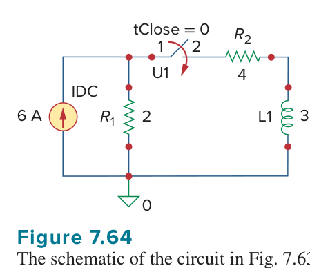

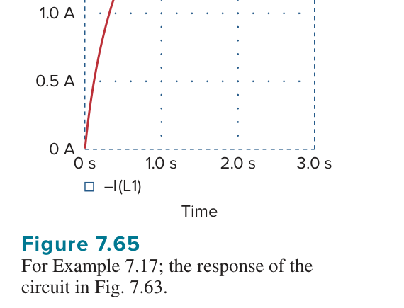

</template>

</PracticeCard>

<PracticeCard id="ch7-pr17" type="practice" title="Practice Problem 7.17" source="課本 p.288" topic="一階電路與暫態響應 (First-Order Circuits)">

For the circuit in Fig. 7.66, use Pspice to find v(t) for t > 0 .

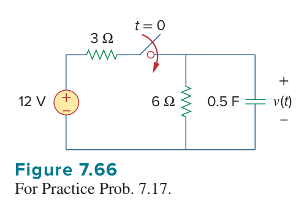

<template #solution>

### 課本解析與答案 (Textbook Solution)

v(t) = 8(1 − $e^{-t}$) V, t > 0 .

</template>

</PracticeCard>

<PracticeCard id="ch7-ex18" type="example" title="Example 7.18" source="課本 p.288" topic="一階電路與暫態響應 (First-Order Circuits)">

In the circuit of Fig. 7.67(a), determine the response v(t) .

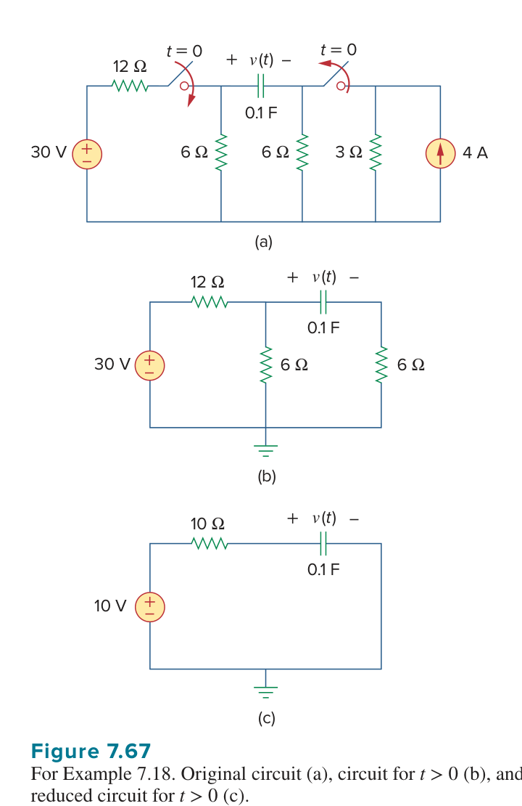

<template #solution>

### 課本解析與答案 (Textbook Solution)

1. Define. The problem is clearly stated and the circuit is clearly labeled. 2. Present. Given the circuit shown in Fig. 7.67(a), determine the response v(t) . 3. Alternative. We can solve this circuit using circuit analysis techniques, nodal analysis, mesh analysis, or PSpice. Let us solve the problem using circuit analysis techniques (this time Thevenin equivalent circuits) and then check the answer using two methods of PSpice. 4. Attempt. For time < 0 , the switch on the left is open and the switch on the right is closed. Assume that the switch on the right has been closed long enough for the circuit to reach steady state; then the capacitor acts like an open circuit and the current from the 4-A source flows through the parallel combination of the 6-Ω and 3-Ω resistors (6 ∥ 3 = 18/9 = 2) , producing a voltage equal to 2 × 4 = 8 V = −v(0) . At t = 0 , the switch on the left closes and the switch on the right opens, producing the circuit shown in Fig. 7.67(b). The easiest way to complete the solution is to find the Thevenin equivalent circuit as seen by the capacitor. The opencircuit voltage (with the capacitor removed) is equal to the voltage drop across the 6-Ω resistor on the left, or 10 V (the voltage drops uniformly across the 12-Ω resistor, 20 V , and across the 6-Ω resistor, 10 V ). This is V Th . The resistance looking in where the capacitor was is equal to 12 ∥ 6 + 6 = 72/18 + 6 = 10 Ω , which is Req . This produces the Thevenin equivalent circuit shown in Fig. 7.67(c). Matching up the boundary conditions (v(0) = −8 V and v(∞) = 10 V) and τ = RC = 1 , we get $v(t)=10-18e^{-t}\text{ V}$ 5. Evaluate. There are two ways of solving the problem using PSpice. **Method 1.** One way is to first do the dc PSpice analysis to determine the initial capacitor voltage. The schematic of the revelant circuit is in Fig. 7.68(a). Two pseudocomponent VIEWPOINTs are inserted to measure the voltages at nodes 1 and 2. When the circuit is simulated, we obtain the displayed values in Fig. 7.68(a) as V1 = 0 V and V2 = 8 V . Thus, the initial capacitor voltage is v(0) = V1 − V2 = −8 V . The PSpice transient analysis uses this value along with the schematic in Fig. 7.68(b). Once the circuit in Fig. 7.68(b) is drawn, we insert the capacitor initial voltage as IC = −8 . We select Analysis/ Setup/Transient and set Print Step to 0.1 s and Final Step to 4τ = 4 s . After saving the circuit, we select Analysis/Simulate to simulate the circuit. In the PSpice A/D window, we select Trace/Add and display V(R2:2) – V(R3:2) or V(C1:1) − V(C1:2) as the capacitor voltage v(t) . The plot of v(t) is shown in Fig. 7.69. This agrees with the result obtained by hand calculation, $v(t)=10-18e^{-t}\text{ V}$ . **Method 2.** We can simulate the circuit in Fig. 7.67 directly, since PSpice can handle the open and closed switches and determine the initial conditions automatically. Using this approach, the schematic is drawn as shown in Fig. 7.70. After drawing the circuit, we select Analysis/Setup/Transient and set Print Step to 0.1 s and Final Step to 4τ = 4 s . We save the circuit, then select Analysis/Simulate to simulate the circuit. In the PSpice A/D window, we select Trace/Add and display V(R2:2) − V(R3:2) as the capacitor voltage v(t) . The plot of v(t) is the same as that shown in Fig. 7.69. 6 30 V 4 A R2 6 R3 3 R4 I1 tClose = 0 1 2 12 U1 tOpen = 0 0.0000 8.0000 R3 3 R4 I1 R2 6 R3 30 V ‒10 V 0 s 1.0 s 2.0 s 3.0 s 4.0 s V(R2 : 2) ‒ V(R3 : 2) 6. Satisfactory? Clearly, we have found the value of the output response v(t) , as required by the problem statement. Checking does validate that solution. We can present all this as a complete solution to the problem.

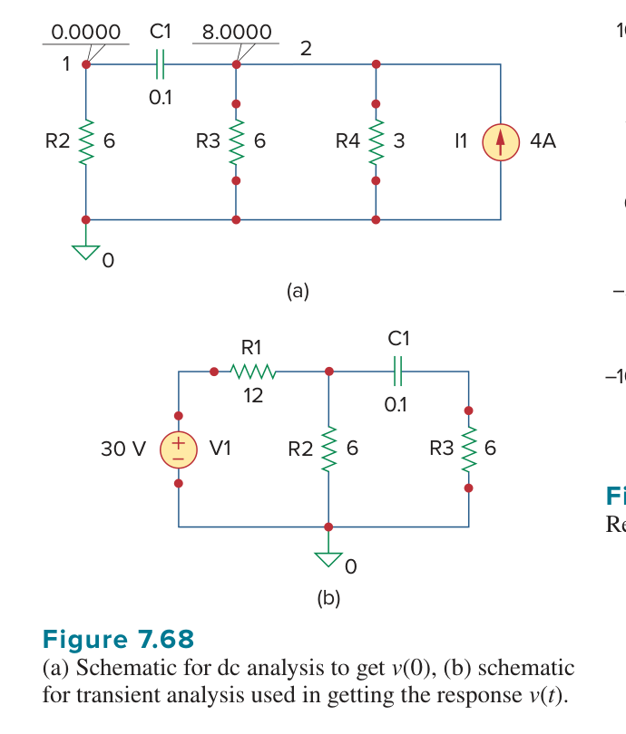

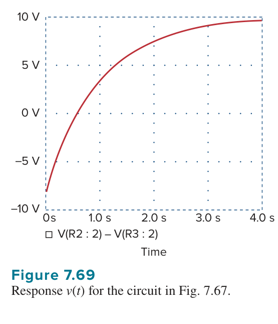

</template>

</PracticeCard>

<PracticeCard id="ch7-pr18" type="practice" title="Practice Problem 7.18" source="課本 p.291" topic="一階電路與暫態響應 (First-Order Circuits)">

The switch in Fig. 7.71 was open for a long time but closed at t = 0 . If i(0) = 10A , find i(t) for t > 0 by hand and also by PSpice.

<template #solution>

### 課本解析與答案 (Textbook Solution)

i(t) = 6 + 4 $e^{-5t}$ A .

</template>

</PracticeCard>

<PracticeCard id="ch7-ex19" type="example" title="Example 7.19" source="課本 p.292" topic="一階電路與暫態響應 (First-Order Circuits)">

Consider the circuit in Fig. 7.73, and assume that R1 = 1.5 MΩ, 0 < R2 < 2.5 MΩ . (a) Calculate the extreme limits of the time constant of the circuit. (b) How long does it take for the lamp to glow for the first time after the switch is closed? Let R2 assume its largest value.

<template #solution>

### 課本解析與答案 (Textbook Solution)

(a) The smallest value for R2 is 0 Ω , and the corresponding time constant for the circuit is τ = (R1 + R2)C = (1.5 × $10^6$ + 0) × 0.1 × $10^{-6}$ = 0.15 s The largest value for R2 is 2.5 MΩ , and the corresponding time constant for the circuit is τ = (R1 + R2)C = (1.5 + 2.5) × $10^6$ × 0.1 × $10^{-6}$ = 0.4 s Thus, by proper circuit design, the time constant can be adjusted to introduce a proper time delay in the circuit. (b) Assuming that the capacitor is initially uncharged, v C (0) = 0 , while v C (∞) = 110 . But vC(t) = vC (∞) + [vC(0) − vC (∞)] $e^{-t/τ}$ = 110[1 − $e^{-t/τ}$ ] where τ = 0.4 s , as calculated in part (a). The lamp glows when vC = 70 V . If vC(t) = 70 V at t = t0 , then $70=110(1-e^{-t_0/\tau})$, so $e^{-t_0/\tau}=\frac{4}{11}$ and $e^{t_0/\tau}=\frac{11}{4}$ Taking the natural logarithm of both sides gives $t_0=\tau\ln\left(\frac{11}{4}\right)=0.4\ln(2.75)=0.4046\text{ s}$ A more general formula for finding t0 is $t_0=\tau\ln\left(\frac{-v(\infty)}{v(t_0)-v(\infty)}\right)$ The lamp will fire repeatedly every t0 seconds if and only if v(t0) < v(∞) .

</template>

</PracticeCard>

<PracticeCard id="ch7-pr19" type="practice" title="Practice Problem 7.19" source="課本 p.293" topic="一階電路與暫態響應 (First-Order Circuits)">

The RC circuit in Fig. 7.74 is designed to operate an alarm which activates when the current through it exceeds 120 μA . If 0 ≤ R ≤ 6 kΩ , find the range of the time delay that the variable resistor can create.

<template #solution>

### 課本解析與答案 (Textbook Solution)

Between 47.23 and 124 ms.

</template>

</PracticeCard>

<PracticeCard id="ch7-ex20" type="example" title="Example 7.20" source="課本 p.294" topic="一階電路與暫態響應 (First-Order Circuits)">

An electronic flashgun has a current-limiting 6-kΩ resistor and 2,000-μF electrolytic capacitor charged to 240 V . If the lamp resistance is 12 Ω , find: (a) the peak charging current, (b) the time required for the capacitor to fully charge, (c) the peak discharging current, (d) the total energy stored in the capacitor, and the average power dissipated by the lamp.

<template #solution>

### 課本解析與答案 (Textbook Solution)

(a) The peak charging current is I1 = $\frac{V_{s}}{R_{1}}$ = $\frac{240}{6\times10^3}=40\text{ mA}$ (b) From Eq. (7.65), tcharge = 5R1C = 5 × 6 × $10^3$ × 2,000 × $10^{-6}$ = 60 s = 1 min (c) The peak discharging current is I2 = $\frac{V_{s}}{R_{2}}$ = $\frac{240}{12}$ = 20 A (d) The energy stored is $W=\frac{1}{2}CV_s^2=\frac{1}{2}\times2{,}000\times10^{-6}\times240^2=57.6\text{ J}$ The energy stored in the capacitor is dissipated across the lamp during the discharging period. From Eq. (7.66), tdischarge = 5R2C = 5 × 12 × 2,000 × $10^{-6}$ = 0.12 s Thus, the average power dissipated is p = $\frac{W}{t_{discharge}}$ = $\frac{57.6}{0.12}$ = 480 watts

</template>

</PracticeCard>

<PracticeCard id="ch7-pr20" type="practice" title="Practice Problem 7.20" source="課本 p.294" topic="一階電路與暫態響應 (First-Order Circuits)">

The flash unit of a camera has a $2\text{-mF}$ capacitor charged to $80\text{ V}$. (a) How much charge is on the capacitor? (b) What is the energy stored in the capacitor? (c) If the flash fires in $0.8\text{ ms}$, what is the average current through the flashtube? (d) How much power is delivered to the flashtube? (e) After a picture has been taken, the capacitor needs to be recharged by a power unit that supplies a maximum of $5\text{ mA}$. How much time does it take to charge the capacitor?

<template #solution>

### 課本解析與答案 (Textbook Solution)

(a) 160 mC , (b) 6.4 J , (c) 200 A , (d) 8 kW , (e) 32 s .

</template>

</PracticeCard>

<PracticeCard id="ch7-ex21" type="example" title="Example 7.21" source="課本 p.295" topic="一階電路與暫態響應 (First-Order Circuits)">

The coil of a certain relay is operated by a 12-V battery. If the coil has a resistance of 150 Ω and an inductance of 30 mH and the current needed to pull in is 50 mA , calculate the relay delay time.

<template #solution>

### 課本解析與答案 (Textbook Solution)

The current through the coil is given by i(t) = i(∞) + [i(0) − i(∞)] $e^{-t/τ}$ i(0) = 0, i(∞) = $\frac{12}{150}$ = 80 mA τ = $\frac{L}{R}$ = $\frac{30\times10^{-3}}{150}$ = 0.2 ms i(t) = 80[1 − $e^{-t/τ}$ ] mA If i(td) = 50 mA , then $50=80(1-e^{-t_d/\tau})$, so $\frac{5}{8}=1-e^{-t_d/\tau}$, $e^{-t_d/\tau}=\frac{3}{8}$, and $e^{t_d/\tau}=\frac{8}{3}$ By taking the natural logarithm of both sides, we get $t_d=\tau\ln\left(\frac{8}{3}\right)=0.2\ln\left(\frac{8}{3}\right)\text{ ms}=0.1962\text{ ms}$ Alternatively, we may find td using $t_d=\tau\ln\left(\frac{i(0)-i(\infty)}{i(t_d)-i(\infty)}\right)$

</template>

</PracticeCard>

<PracticeCard id="ch7-pr21" type="practice" title="Practice Problem 7.21" source="課本 p.296" topic="一階電路與暫態響應 (First-Order Circuits)">

A relay has a resistance of 200 Ω and an inductance of 500 mH . The relay contacts close when the current through the coil reaches 350 mA . What time elapses between the application of 110 V to the coil and contact closure?

<template #solution>

### 課本解析與答案 (Textbook Solution)

2.529 ms.

</template>

</PracticeCard>

<PracticeCard id="ch7-ex22" type="example" title="Example 7.22" source="課本 p.297" topic="一階電路與暫態響應 (First-Order Circuits)">

A solenoid with resistance 4 Ω and inductance 6 mH is used in an automobile ignition circuit similar to that in Fig. 7.78. If the battery supplies 12 V , determine: the final current through the solenoid when the switch is closed, the energy stored in the coil, and the voltage across the air gap, assuming that the switch takes 1 μs to open.

<template #solution>

### 課本解析與答案 (Textbook Solution)

The final current through the coil is I = $\frac{V_{s}}{R}$ = $\frac{12}{4}$ = 3 A The energy stored in the coil is $W=\frac{1}{2}LI^2=\frac{1}{2}\times6\times10^{-3}\times3^2=27\text{ mJ}$ The voltage across the gap is $V=L\frac{\Delta I}{\Delta t}=\frac{6\times10^{-3}\times3}{1\times10^{-6}}=18\text{ kV}$

</template>

</PracticeCard>

<PracticeCard id="ch7-pr22" type="practice" title="Practice Problem 7.22" source="課本 p.297" topic="一階電路與暫態響應 (First-Order Circuits)">

The spark coil of an automobile ignition system has a 20-mH inductance and a 5-Ω resistance. With a supply voltage of 12 V , calculate: the time needed for the coil to fully charge, the energy stored in the coil, and the voltage developed at the spark gap if the switch opens in 2 μs .

<template #solution>

### 課本解析與答案 (Textbook Solution)

20 ms, 57.6 mJ, and 24 kV .

</template>

</PracticeCard>

## 課本章末習題：Problems 7.1–7.79

以下依課本題號排列，收錄標準章末習題（不含 Review Questions 與 Comprehensive Problems）。來源為《Fundamentals of Electric Circuits》Chapter 7，印刷頁 299–308（PDF 第 305–314 頁）。每題引用圖表與其題幹同卡呈現。

<PracticeCard id="ch7-problem-01" type="exercise" title="課本習題 7.1" source="課本 Chapter 7 · Problem 7.1 · 印刷頁 299" topic="RC 自然響應與時間常數">

**原題：** In the circuit shown in Fig. 7.81, v(t) = 56e^(−200t) V, t &gt; 0; i(t) = 8e^(−200t) mA, t &gt; 0. (a) Find R and C. (b) Calculate the time constant τ. (c) Determine the time required for the voltage to decay to half its initial value at t = 0.

<template #solution>

**課本附錄 D 標準答案：** <code>(a) 0.7143 μF; (b) 5 ms; (c) 3.466 ms.</code>

</template>

</PracticeCard>

<PracticeCard id="ch7-problem-02" type="exercise" title="課本習題 7.2" source="課本 Chapter 7 · Problem 7.2 · 印刷頁 299" topic="RC 自然響應與時間常數">

**原題：** Find the time constant for the RC circuit in Fig. 7.82.

</PracticeCard>

<PracticeCard id="ch7-problem-03" type="exercise" title="課本習題 7.3" source="課本 Chapter 7 · Problem 7.3 · 印刷頁 299" topic="RC 自然響應與時間常數">

**原題：** Determine the time constant for the circuit in Fig. 7.83.

<template #solution>

**課本附錄 D 標準答案：** <code>3.222 μs.</code>

</template>

</PracticeCard>

<PracticeCard id="ch7-problem-04" type="exercise" title="課本習題 7.4" source="課本 Chapter 7 · Problem 7.4 · 印刷頁 300" topic="RC 自然響應與時間常數">

**原題：** The switch in Fig. 7.84 has been in position A for a long time. Assume the switch moves instantaneously from A to B at t = 0. Find v for t &gt; 0.

</PracticeCard>

<PracticeCard id="ch7-problem-05" type="exercise" title="課本習題 7.5" source="課本 Chapter 7 · Problem 7.5 · 印刷頁 300" topic="RC 自然響應與時間常數">

**原題：** Using Fig. 7.85, design a problem to help other students better understand source-free RC circuits.

<template #solution>

課本將此題列為設計題，答案依自行設計內容而異。

</template>

</PracticeCard>

<PracticeCard id="ch7-problem-06" type="exercise" title="課本習題 7.6" source="課本 Chapter 7 · Problem 7.6 · 印刷頁 300" topic="RC 自然響應與時間常數">

**原題：** The switch in Fig. 7.86 has been closed for a long time, and it opens at t = 0. Find v(t) for t &gt; 0.

</PracticeCard>

<PracticeCard id="ch7-problem-07" type="exercise" title="課本習題 7.7" source="課本 Chapter 7 · Problem 7.7 · 印刷頁 300" topic="RC 自然響應與時間常數">

**原題：** Assume that the switch in Fig. 7.87 has been in position A for a long time and is moved to position B at t = 0. Then, at t = 1 s, the switch moves from B to C. Find v_C(t) for t &gt; 0.

<template #solution>

**課本附錄 D 標準答案：** <code>12e^(−t) V for 0 &lt; t &lt; 1 s; 4.415e^(−0.5(t − 1)) V for 1 s &lt; t &lt; ∞.</code>

</template>

</PracticeCard>

<PracticeCard id="ch7-problem-08" type="exercise" title="課本習題 7.8" source="課本 Chapter 7 · Problem 7.8 · 印刷頁 300" topic="RC 自然響應與時間常數">

**原題：** For the circuit in Fig. 7.88, if v = 10 e −4t V and i = 0.2 e −4t A, t &gt; 0 (a) Find R and C. (b) Determine the time constant. (c) Calculate the initial energy in the capacitor. (d) Obtain the time it takes to dissipate 50 percent of the initial energy.

</PracticeCard>

<PracticeCard id="ch7-problem-09" type="exercise" title="課本習題 7.9" source="課本 Chapter 7 · Problem 7.9 · 印刷頁 300" topic="RC 自然響應與時間常數">

**原題：** The switch in Fig. 7.89 opens at t = 0. Find vo for t &gt; 0.

<template #solution>

**課本附錄 D 標準答案：** <code>4e^(−t/12) V.</code>

</template>

</PracticeCard>

<PracticeCard id="ch7-problem-10" type="exercise" title="課本習題 7.10" source="課本 Chapter 7 · Problem 7.10 · 印刷頁 300" topic="RC 自然響應與時間常數">

**原題：** For the circuit in Fig. 7.90, find vo(t) for t &gt; 0. Determine the time necessary for the capacitor voltage to decay to one-third of its value at t = 0.

</PracticeCard>

<PracticeCard id="ch7-problem-11" type="exercise" title="課本習題 7.11" source="課本 Chapter 7 · Problem 7.11 · 印刷頁 300" topic="RC 自然響應與時間常數">

**原題：** For the circuit in Fig. 7.91, find io for t &gt; 0.

<template #solution>

**課本附錄 D 標準答案：** <code>1.2e^(−3t) A.</code>

</template>

</PracticeCard>

<PracticeCard id="ch7-problem-12" type="exercise" title="課本習題 7.12" source="課本 Chapter 7 · Problem 7.12 · 印刷頁 301" topic="RL 自然響應與時間常數">

**原題：** Using Fig. 7.92, design a problem to help other students better understand source-free RL circuits.

</PracticeCard>

<PracticeCard id="ch7-problem-13" type="exercise" title="課本習題 7.13" source="課本 Chapter 7 · Problem 7.13 · 印刷頁 301" topic="RL 自然響應與時間常數">

**原題：** In the circuit of Fig. 7.93, v(t) = 80e^(−10^3t) V, t &gt; 0, and i(t) = 5e^(−10^3t) mA, t &gt; 0. (a) Find R, L, and τ. (b) Calculate the energy dissipated in the resistance for 0 &lt; t &lt; 0.5 ms.

<template #solution>

**課本附錄 D 標準答案：** <code>(a) 16 kΩ, 16 H, 1 ms; (b) 126.42 μJ.</code>

</template>

</PracticeCard>

<PracticeCard id="ch7-problem-14" type="exercise" title="課本習題 7.14" source="課本 Chapter 7 · Problem 7.14 · 印刷頁 301" topic="RL 自然響應與時間常數">

**原題：** Calculate the time constant of the circuit in Fig. 7.94.

</PracticeCard>

<PracticeCard id="ch7-problem-15" type="exercise" title="課本習題 7.15" source="課本 Chapter 7 · Problem 7.15 · 印刷頁 301" topic="RL 自然響應與時間常數">

**原題：** Find the time constant for each of the circuits in Fig. 7.95. (a) (b)

<template #solution>

**課本附錄 D 標準答案：** <code>(a) 10 Ω, 500 ms; (b) 80 Ω, 250 μs.</code>

</template>

</PracticeCard>

<PracticeCard id="ch7-problem-16" type="exercise" title="課本習題 7.16" source="課本 Chapter 7 · Problem 7.16 · 印刷頁 301" topic="RL 自然響應與時間常數">

**原題：** Determine the time constant for each of the circuits in Fig. 7.96. (a) (b)

</PracticeCard>

<PracticeCard id="ch7-problem-17" type="exercise" title="課本習題 7.17" source="課本 Chapter 7 · Problem 7.17 · 印刷頁 301" topic="RL 自然響應與時間常數">

**原題：** Consider the circuit of Fig. 7.97. Find vo(t) if i(0) = 6 A and v(t) = 0.

<template #solution>

**課本附錄 D 標準答案：** <code>[−6e^(−16t)u(t)] V for all t &gt; 0.</code>

</template>

</PracticeCard>

<PracticeCard id="ch7-problem-18" type="exercise" title="課本習題 7.18" source="課本 Chapter 7 · Problem 7.18 · 印刷頁 301" topic="RL 自然響應與時間常數">

**原題：** For the circuit in Fig. 7.98, determine vo(t) when i(0) = 5 A and v(t) = 0.

</PracticeCard>

<PracticeCard id="ch7-problem-19" type="exercise" title="課本習題 7.19" source="課本 Chapter 7 · Problem 7.19 · 印刷頁 301" topic="RL 自然響應與時間常數">

**原題：** In the circuit of Fig. 7.99, find i(t) for t &gt; 0 if i(0) = 6 A.

<template #solution>

**課本附錄 D 標準答案：** <code>6e^(−5t)u(t) A.</code>

</template>

</PracticeCard>

<PracticeCard id="ch7-problem-20" type="exercise" title="課本習題 7.20" source="課本 Chapter 7 · Problem 7.20 · 印刷頁 302" topic="RL 自然響應與時間常數">

**原題：** For the circuit in Fig. 7.100, v = 90e^(−50t) V and i = 30e^(−50t) A, t &gt; 0. (a) Find L and R. (b) Determine the time constant. (c) Calculate the initial energy in the inductor. (d) What fraction of the initial energy is dissipated in 10 ms?

</PracticeCard>

<PracticeCard id="ch7-problem-21" type="exercise" title="課本習題 7.21" source="課本 Chapter 7 · Problem 7.21 · 印刷頁 302" topic="RL 自然響應與時間常數">

**原題：** In the circuit of Fig. 7.101, find the value of R for which the steady-state energy stored in the inductor will be 1 J.

<template #solution>

**課本附錄 D 標準答案：** <code>13.333 Ω.</code>

</template>

</PracticeCard>

<PracticeCard id="ch7-problem-22" type="exercise" title="課本習題 7.22" source="課本 Chapter 7 · Problem 7.22 · 印刷頁 302" topic="RL 自然響應與時間常數">

**原題：** Find i(t) and v(t) for t &gt; 0 in the circuit of Fig. 7.102 if i(0) = 10 A.

</PracticeCard>

<PracticeCard id="ch7-problem-23" type="exercise" title="課本習題 7.23" source="課本 Chapter 7 · Problem 7.23 · 印刷頁 302" topic="RL 自然響應與時間常數">

**原題：** Consider the circuit in Fig. 7.103. Given that vo(0) = 10 V, find vo and vx for t &gt; 0.

<template #solution>

**課本附錄 D 標準答案：** <code>v_o(t) = 10e^(−4t) V, t &gt; 0; v_x(t) = 2.5e^(−4t) V, t &gt; 0.</code>

</template>

</PracticeCard>

<PracticeCard id="ch7-problem-24" type="exercise" title="課本習題 7.24" source="課本 Chapter 7 · Problem 7.24 · 印刷頁 302" topic="奇異函數與脈衝響應">

**原題：** Express the following signals in terms of singularity functions: (a) v(t) = 0 for t &lt; 0, −5 for t &gt; 0; (b) i(t) = 0 for t &lt; 1, −10 for 1 &lt; t &lt; 3, 10 for 3 &lt; t &lt; 5, 0 for t &gt; 5; (c) x(t) = t − 1 for 1 &lt; t &lt; 2, 1 for 2 &lt; t &lt; 3, 4 − t for 3 &lt; t &lt; 4, 0 otherwise; (d) y(t) = 2 for t &lt; 0, −5 for 0 &lt; t &lt; 1, 0 for t &gt; 1.

</PracticeCard>

<PracticeCard id="ch7-problem-25" type="exercise" title="課本習題 7.25" source="課本 Chapter 7 · Problem 7.25 · 印刷頁 302" topic="奇異函數與脈衝響應">

**原題：** Design a problem to help other students better understand singularity functions.

<template #solution>

課本將此題列為設計題，答案依自行設計內容而異。

</template>

</PracticeCard>

<PracticeCard id="ch7-problem-26" type="exercise" title="課本習題 7.26" source="課本 Chapter 7 · Problem 7.26 · 印刷頁 302" topic="奇異函數與脈衝響應">

**原題：** Express the signals in Fig. 7.104 in terms of singularity functions.

</PracticeCard>

<PracticeCard id="ch7-problem-27" type="exercise" title="課本習題 7.27" source="課本 Chapter 7 · Problem 7.27 · 印刷頁 302" topic="奇異函數與脈衝響應">

**原題：** Express v(t) in Fig. 7.105 in terms of step functions.

<template #solution>

**課本附錄 D 標準答案：** <code>[5u(t + 1) + 10u(t) − 25u(t − 1) + 15u(t − 2)] V.</code>

</template>

</PracticeCard>

<PracticeCard id="ch7-problem-28" type="exercise" title="課本習題 7.28" source="課本 Chapter 7 · Problem 7.28 · 印刷頁 303" topic="奇異函數與脈衝響應">

**原題：** Sketch the waveform represented by i(t) = r(t) − r(t − 1) − u(t − 2) − r(t − 2)

</PracticeCard>

<PracticeCard id="ch7-problem-29" type="exercise" title="課本習題 7.29" source="課本 Chapter 7 · Problem 7.29 · 印刷頁 303" topic="奇異函數與脈衝響應">

**原題：** Sketch the following functions: (a) x(t) = 10e^(−t)u(t − 1), (b) y(t) = 10e^(−(t − 1))u(t), (c) z(t) = cos(4t)δ(t − 1).

<template #solution>

**課本附錄 D.14 圖示答案：**

課本附錄文字：<code>See Fig. D.14 for the sketches; for (c), z(t) = cos(4t)δ(t − 1) = cos(4)δ(t − 1) ≈ −0.6536δ(t − 1).</code>

</template>

</PracticeCard>

<PracticeCard id="ch7-problem-30" type="exercise" title="課本習題 7.30" source="課本 Chapter 7 · Problem 7.30 · 印刷頁 303" topic="奇異函數與脈衝響應">

**原題：** Evaluate the following integrals involving the impulse function: (a) ∫ from −∞ to ∞ 4t²δ(t − 1) dt; (b) ∫ from −∞ to ∞ 4t² cos(2πt)δ(t − 0.5) dt.

</PracticeCard>

<PracticeCard id="ch7-problem-31" type="exercise" title="課本習題 7.31" source="課本 Chapter 7 · Problem 7.31 · 印刷頁 303" topic="奇異函數與脈衝響應">

**原題：** Evaluate the following integrals: (a) ∫ from −∞ to ∞ e^(−4t²)δ(t − 2) dt; (b) ∫ from −∞ to ∞ [5δ(t) + e^(−t)δ(t) + cos(2πt)δ(t)] dt.

<template #solution>

**課本附錄 D 標準答案：** <code>(a) 1.1254 × 10^(−7); (b) 7.</code>

</template>

</PracticeCard>

<PracticeCard id="ch7-problem-32" type="exercise" title="課本習題 7.32" source="課本 Chapter 7 · Problem 7.32 · 印刷頁 303" topic="奇異函數與脈衝響應">

**原題：** Evaluate the following integrals: (a) ∫ from 1 to t u(λ) dλ; (b) ∫ from 0 to 4 r(t − 1) dt; (c) ∫ from 1 to 5 (t − 6)²δ(t − 2) dt.

</PracticeCard>

<PracticeCard id="ch7-problem-33" type="exercise" title="課本習題 7.33" source="課本 Chapter 7 · Problem 7.33 · 印刷頁 303" topic="奇異函數與脈衝響應">

**原題：** The voltage across a 10-mH inductor is 15δ(t − 2) mV. Find the inductor current, assuming the inductor is initially uncharged.

<template #solution>

**課本附錄 D 標準答案：** <code>1.5u(t − 2) A.</code>

</template>

</PracticeCard>

<PracticeCard id="ch7-problem-34" type="exercise" title="課本習題 7.34" source="課本 Chapter 7 · Problem 7.34 · 印刷頁 303" topic="奇異函數與脈衝響應">

**原題：** Evaluate the following derivatives: (a) d/dt [u(t − 1)u(t + 1)]; (b) d/dt [r(t − 6)u(t − 2)]; (c) d/dt [sin(4t)u(t − 3)].

</PracticeCard>

<PracticeCard id="ch7-problem-35" type="exercise" title="課本習題 7.35" source="課本 Chapter 7 · Problem 7.35 · 印刷頁 303" topic="一階微分方程">

**原題：** Find the solution to the following differential equations: (a) dv/dt + 2v = 0, v(0) = −1 V (b) 2 di/dt − 3i = 0, i(0) = 2

<template #solution>

**課本附錄 D 標準答案：** <code>(a) −e^(−2t)u(t) V; (b) 2e^(1.5t)u(t) A.</code>

</template>

</PracticeCard>

<PracticeCard id="ch7-problem-36" type="exercise" title="課本習題 7.36" source="課本 Chapter 7 · Problem 7.36 · 印刷頁 303" topic="一階微分方程">

**原題：** Solve for v in the following differential equations, subject to the stated initial condition. (a) dv/dt + v = u(t), v(0) = 0 (b) 2 dv/dt − v = 3u(t), v(0) = −6

</PracticeCard>

<PracticeCard id="ch7-problem-37" type="exercise" title="課本習題 7.37" source="課本 Chapter 7 · Problem 7.37 · 印刷頁 303" topic="一階微分方程">

**原題：** A circuit is described by 4 dv/dt + v = 10 (a) What is the time constant of the circuit? (b) What is v(∞), the final value of v ? (c) If v(0) = 2, find v(t) for t ≥ 0.

<template #solution>

**課本附錄 D 標準答案：** <code>(a) 4 s; (b) 10 V; (c) (10 − 8e^(−t/4))u(t) V.</code>

</template>

</PracticeCard>

<PracticeCard id="ch7-problem-38" type="exercise" title="課本習題 7.38" source="課本 Chapter 7 · Problem 7.38 · 印刷頁 303" topic="一階微分方程">

**原題：** A circuit is described by di/dt + 3i = 2u(t) Find i(t) for t &gt; 0 given that i(0) = 0.

</PracticeCard>

<PracticeCard id="ch7-problem-39" type="exercise" title="課本習題 7.39" source="課本 Chapter 7 · Problem 7.39 · 印刷頁 303" topic="RC 階躍響應">

**原題：** Calculate the capacitor voltage for t &lt; 0 and t &gt; 0 for each of the circuits in Fig. 7.106.

<template #solution>

**課本附錄 D 標準答案：** <code>(a) 4 V for t &lt; 0; 20 − 16e^(−t/8) V for t &gt; 0. (b) 4 V for t &lt; 0; 12 − 8e^(−t/6) V for t &gt; 0.</code>

</template>

</PracticeCard>

<PracticeCard id="ch7-problem-40" type="exercise" title="課本習題 7.40" source="課本 Chapter 7 · Problem 7.40 · 印刷頁 303" topic="RC 階躍響應">

**原題：** Find the capacitor voltage for t &lt; 0 and t &gt; 0 for each of the circuits in Fig. 7.107.

</PracticeCard>

<PracticeCard id="ch7-problem-41" type="exercise" title="課本習題 7.41" source="課本 Chapter 7 · Problem 7.41 · 印刷頁 304" topic="RC 階躍響應">

**原題：** Using Fig. 7.108, design a problem to help other students better understand the step response of an RC circuit.

<template #solution>

課本將此題列為設計題，答案依自行設計內容而異。

</template>

</PracticeCard>

<PracticeCard id="ch7-problem-42" type="exercise" title="課本習題 7.42" source="課本 Chapter 7 · Problem 7.42 · 印刷頁 304" topic="RC 階躍響應">

**原題：** (a) If the switch in Fig. 7.109 has been open for a long time and is closed at t = 0, find vo(t). (b) Suppose that the switch has been closed for a long time and is opened at t = 0. Find vo(t).

</PracticeCard>

<PracticeCard id="ch7-problem-43" type="exercise" title="課本習題 7.43" source="課本 Chapter 7 · Problem 7.43 · 印刷頁 304" topic="RC 階躍響應">

**原題：** Consider the circuit in Fig. 7.110. Find i(t) for t &lt; 0 and t &gt; 0.

<template #solution>

**課本附錄 D 標準答案：** <code>0.8 A; 0.8e^(−t/480)u(t) A.</code>

</template>

</PracticeCard>

<PracticeCard id="ch7-problem-44" type="exercise" title="課本習題 7.44" source="課本 Chapter 7 · Problem 7.44 · 印刷頁 304" topic="RC 階躍響應">

**原題：** The switch in Fig. 7.111 has been in position a for a long time. At t = 0, it moves to position b. Calculate i(t) for all t &gt; 0.

</PracticeCard>

<PracticeCard id="ch7-problem-45" type="exercise" title="課本習題 7.45" source="課本 Chapter 7 · Problem 7.45 · 印刷頁 304" topic="RC 階躍響應">

**原題：** Find v_o in the circuit of Fig. 7.112 when v_s = 30u(t) V. Assume that v_o(0) = 5 V.

<template #solution>

**課本附錄 D 標準答案：** <code>[20 − 15e^(−14.286t)]u(t) V.</code>

</template>

</PracticeCard>

<PracticeCard id="ch7-problem-46" type="exercise" title="課本習題 7.46" source="課本 Chapter 7 · Problem 7.46 · 印刷頁 304" topic="RC 階躍響應">

**原題：** For the circuit in Fig. 7.113, is(t) = 5u(t). Find v(t).

</PracticeCard>

<PracticeCard id="ch7-problem-47" type="exercise" title="課本習題 7.47" source="課本 Chapter 7 · Problem 7.47 · 印刷頁 304" topic="RC 階躍響應">

**原題：** Determine v(t) for t &gt; 0 in the circuit of Fig. 7.114 if v(0) = 0.

<template #solution>

**課本附錄 D 標準答案：** <code>24(1 − e^(−t)) V for 0 &lt; t &lt; 1; 30 − 14.83e^(−(t − 1)) V for t &gt; 1.</code>

</template>

</PracticeCard>

<PracticeCard id="ch7-problem-48" type="exercise" title="課本習題 7.48" source="課本 Chapter 7 · Problem 7.48 · 印刷頁 305" topic="RC 階躍響應">

**原題：** Find v(t) and i(t) in the circuit of Fig. 7.115.

</PracticeCard>

<PracticeCard id="ch7-problem-49" type="exercise" title="課本習題 7.49" source="課本 Chapter 7 · Problem 7.49 · 印刷頁 305" topic="RC 階躍響應">

**原題：** If the waveform in Fig. 7.116(a) is applied to the circuit of Fig. 7.116(b), find v(t). Assume v(0) = 0. (a) (b)

<template #solution>

**課本附錄 D 標準答案：** <code>8(1 − e^(−t/5)) V for 0 &lt; t &lt; 1; [−16 + 31.17e^(−(t − 1))] V for t &gt; 1.</code>

</template>

</PracticeCard>

<PracticeCard id="ch7-problem-50" type="exercise" title="課本習題 7.50" source="課本 Chapter 7 · Problem 7.50 · 印刷頁 305" topic="RC 階躍響應">

**原題：** In the circuit of Fig. 7.117, find i_x for t &gt; 0. Let R_1 = R_2 = 1 kΩ, R_3 = 2 kΩ, and C = 0.25 mF. At time t = 0, the switch moves from position a to b.

</PracticeCard>

<PracticeCard id="ch7-problem-51" type="exercise" title="課本習題 7.51" source="課本 Chapter 7 · Problem 7.51 · 印刷頁 305" topic="RC 階躍響應">

**原題：** Rather than applying the shortcut technique used in Section 7.6, use KVL to obtain Eq. (7.60).

<template #solution>

**課本附錄 D 所列關係式：** <code>The answer-key derivation gives i(t) = V_S/R + (I_0 − V_S/R)e^(−t/τ), with τ = L/R.</code>

</template>

</PracticeCard>

<PracticeCard id="ch7-problem-52" type="exercise" title="課本習題 7.52" source="課本 Chapter 7 · Problem 7.52 · 印刷頁 305" topic="RC 階躍響應">

**原題：** Using Fig. 7.118, design a problem to help other students better understand the step response of an RL circuit.

</PracticeCard>

<PracticeCard id="ch7-problem-53" type="exercise" title="課本習題 7.53" source="課本 Chapter 7 · Problem 7.53 · 印刷頁 305" topic="RL 階躍響應">

**原題：** Determine the inductor current i(t) for both t &lt; 0 and t &gt; 0 for each of the circuits in Fig. 7.119. (a) (b)

<template #solution>

**課本附錄 D 標準答案：** <code>(a) 5 A, 5e^(−t/2)u(t) A; (b) 6 A, 6e^(−2t/3)u(t) A.</code>

</template>

</PracticeCard>

<PracticeCard id="ch7-problem-54" type="exercise" title="課本習題 7.54" source="課本 Chapter 7 · Problem 7.54 · 印刷頁 305" topic="RL 階躍響應">

**原題：** Obtain the inductor current for both t &lt; 0 and t &gt; 0 in each of the circuits in Fig. 7.120. (a) (b)

</PracticeCard>

<PracticeCard id="ch7-problem-55" type="exercise" title="課本習題 7.55" source="課本 Chapter 7 · Problem 7.55 · 印刷頁 306" topic="RL 階躍響應">

**原題：** Find v(t) for t &lt; 0 and t &gt; 0 in the circuit of Fig. 7.121.

<template #solution>

**課本附錄 D 標準答案：** <code>96 V; 96e^(−4t)u(t) V.</code>

</template>

</PracticeCard>

<PracticeCard id="ch7-problem-56" type="exercise" title="課本習題 7.56" source="課本 Chapter 7 · Problem 7.56 · 印刷頁 306" topic="RL 階躍響應">

**原題：** For the network shown in Fig. 7.122, find v(t) for t &gt; 0.

</PracticeCard>

<PracticeCard id="ch7-problem-57" type="exercise" title="課本習題 7.57" source="課本 Chapter 7 · Problem 7.57 · 印刷頁 306" topic="RL 階躍響應">

**原題：** Find i1(t) and i2(t) for t &gt; 0 in the circuit of Fig. 7.123.

<template #solution>

**課本附錄 D 標準答案：** <code>2.4e^(−2t)u(t) A; 600e^(−5t)u(t) mA.</code>

</template>

</PracticeCard>

<PracticeCard id="ch7-problem-58" type="exercise" title="課本習題 7.58" source="課本 Chapter 7 · Problem 7.58 · 印刷頁 306" topic="RL 階躍響應">

**原題：** Rework Prob. 7.17 if i(0) = 10 A and v(t) = 20u(t) V.

</PracticeCard>

<PracticeCard id="ch7-problem-59" type="exercise" title="課本習題 7.59" source="課本 Chapter 7 · Problem 7.59 · 印刷頁 306" topic="RL 階躍響應">

**原題：** Determine the step response vo(t) to vs = 18 u(t) V in the circuit of Fig. 7.124.

<template #solution>

**課本附錄 D 標準答案：** <code>6e^(−4t)u(t) V.</code>

</template>

</PracticeCard>

<PracticeCard id="ch7-problem-60" type="exercise" title="課本習題 7.60" source="課本 Chapter 7 · Problem 7.60 · 印刷頁 306" topic="RL 階躍響應">

**原題：** Find v(t) for t &gt; 0 in the circuit of Fig. 7.125 if the initial current in the inductor is zero.

</PracticeCard>

<PracticeCard id="ch7-problem-61" type="exercise" title="課本習題 7.61" source="課本 Chapter 7 · Problem 7.61 · 印刷頁 306" topic="RL 階躍響應">

**原題：** In the circuit in Fig. 7.126, is changes from 5 A to 10 A at t = 0; that is, is = 5u(−t) + 10u(t). Find v and i.

<template #solution>

**課本附錄 D 標準答案：** <code>20e^(−8t)u(t) V; (10 − 5e^(−8t))u(t) A.</code>

</template>

</PracticeCard>

<PracticeCard id="ch7-problem-62" type="exercise" title="課本習題 7.62" source="課本 Chapter 7 · Problem 7.62 · 印刷頁 306" topic="RL 階躍響應">

**原題：** For the circuit in Fig. 7.127, calculate i(t) if i(0) = 0.

</PracticeCard>

<PracticeCard id="ch7-problem-63" type="exercise" title="課本習題 7.63" source="課本 Chapter 7 · Problem 7.63 · 印刷頁 306" topic="RL 階躍響應">

**原題：** Obtain v(t) and i(t) in the circuit of Fig. 7.128.

<template #solution>

**課本附錄 D 標準答案：** <code>2e^(−8t)u(t) A; −8e^(−8t)u(t) V.</code>

</template>

</PracticeCard>

<PracticeCard id="ch7-problem-64" type="exercise" title="課本習題 7.64" source="課本 Chapter 7 · Problem 7.64 · 印刷頁 306" topic="RL 階躍響應">

**原題：** Determine the value of iL(t) and the total energy dissipated by the circuit from t = 0 sec to t = ∞ sec. The value of vin(t) is equal to [40 – 40u(t)] volts.

</PracticeCard>

<PracticeCard id="ch7-problem-65" type="exercise" title="課本習題 7.65" source="課本 Chapter 7 · Problem 7.65 · 印刷頁 307" topic="一階運算放大器電路">

**原題：** If the input pulse in Fig. 7.130(a) is applied to the circuit in Fig. 7.130(b), determine the response i(t). (b) (a)

<template #solution>

**課本附錄 D 標準答案：** <code>2(1 − e^(−2t)) A for 0 &lt; t &lt; 1; 1.729e^(−2(t − 1)) A for t &gt; 1.</code>

</template>

</PracticeCard>

<PracticeCard id="ch7-problem-66" type="exercise" title="課本習題 7.66" source="課本 Chapter 7 · Problem 7.66 · 印刷頁 307" topic="一階運算放大器電路">

**原題：** Using Fig. 7.131, design a problem to help other students better understand first-order op amp circuits.

</PracticeCard>

<PracticeCard id="ch7-problem-67" type="exercise" title="課本習題 7.67" source="課本 Chapter 7 · Problem 7.67 · 印刷頁 307" topic="一階運算放大器電路">

**原題：** If v(0) = 5 V, find v_o(t) for t &gt; 0 in the op amp circuit in Fig. 7.132. Let R = 10 kΩ and C = 1 μF.

<template #solution>

**課本附錄 D 標準答案：** <code>5e^(−100t/3)u(t) V.</code>

</template>

</PracticeCard>

<PracticeCard id="ch7-problem-68" type="exercise" title="課本習題 7.68" source="課本 Chapter 7 · Problem 7.68 · 印刷頁 307" topic="一階運算放大器電路">

**原題：** Obtain vo for t &gt; 0 in the circuit of Fig. 7.133.

</PracticeCard>

<PracticeCard id="ch7-problem-69" type="exercise" title="課本習題 7.69" source="課本 Chapter 7 · Problem 7.69 · 印刷頁 307" topic="一階運算放大器電路">

**原題：** For the op amp circuit in Fig. 7.134, find vo(t) for t &gt; 0.

<template #solution>

**課本附錄 D 標準答案：** <code>48(e^(−t/3000) − 1)u(t) V.</code>

</template>

</PracticeCard>

<PracticeCard id="ch7-problem-70" type="exercise" title="課本習題 7.70" source="課本 Chapter 7 · Problem 7.70 · 印刷頁 307" topic="一階運算放大器電路">

**原題：** Determine vo for t &gt; 0 when vs = 20 mV in the op amp circuit of Fig. 7.135.

</PracticeCard>

<PracticeCard id="ch7-problem-71" type="exercise" title="課本習題 7.71" source="課本 Chapter 7 · Problem 7.71 · 印刷頁 307" topic="一階運算放大器電路">

**原題：** For the op amp circuit in Fig. 7.136, suppose v(0) = 0 and vs = 3V. Find v(t) for t &gt; 0.

<template #solution>

**課本附錄 D 標準答案：** <code>[6(1 − e^(−5t))]u(t) V.</code>

</template>

</PracticeCard>

<PracticeCard id="ch7-problem-72" type="exercise" title="課本習題 7.72" source="課本 Chapter 7 · Problem 7.72 · 印刷頁 308" topic="一階運算放大器電路">

**原題：** Find i_o in the op amp circuit in Fig. 7.137. Assume that v(0) = −2 V, R = 10 kΩ, and C = 10 μF.

</PracticeCard>

<PracticeCard id="ch7-problem-73" type="exercise" title="課本習題 7.73" source="課本 Chapter 7 · Problem 7.73 · 印刷頁 308" topic="一階運算放大器電路">

**原題：** For the op amp circuit of Fig. 7.138, let R_1 = 10 kΩ, R_f = 20 kΩ, C = 20 μF, and v(0) = 1 V. Find v_o.

<template #solution>

**課本附錄 D 標準答案：** <code>−6e^(−5t)u(t) V.</code>

</template>

</PracticeCard>

<PracticeCard id="ch7-problem-74" type="exercise" title="課本習題 7.74" source="課本 Chapter 7 · Problem 7.74 · 印刷頁 308" topic="一階運算放大器電路">

**原題：** Determine v_o(t) for t &gt; 0 in the circuit of Fig. 7.139. Let i_s = 10u(t) μA and assume that the capacitor is initially uncharged.

</PracticeCard>

<PracticeCard id="ch7-problem-75" type="exercise" title="課本習題 7.75" source="課本 Chapter 7 · Problem 7.75 · 印刷頁 308" topic="一階運算放大器電路">

**原題：** In the circuit of Fig. 7.140, find vo and io, given that vs = 4 u(t) V and v(0) = 1 V.

<template #solution>

**課本附錄 D 標準答案：** <code>[6 − 3e^(−50t)]u(t) V; −200 μA.</code>

</template>

</PracticeCard>

<PracticeCard id="ch7-problem-76" type="exercise" title="課本習題 7.76" source="課本 Chapter 7 · Problem 7.76 · 印刷頁 308" topic="PSpice 與 MultiSim 模擬">

**原題：** Repeat Prob. 7.49 using PSpice or MultiSim.

</PracticeCard>

<PracticeCard id="ch7-problem-77" type="exercise" title="課本習題 7.77" source="課本 Chapter 7 · Problem 7.77 · 印刷頁 308" topic="PSpice 與 MultiSim 模擬">

**原題：** The switch in Fig. 7.141 opens at t = 0. Use PSpice or MultiSim to determine v(t) for t &gt; 0.

<template #solution>

**課本附錄 D.15 圖示答案：**

</template>

</PracticeCard>

<PracticeCard id="ch7-problem-78" type="exercise" title="課本習題 7.78" source="課本 Chapter 7 · Problem 7.78 · 印刷頁 308" topic="PSpice 與 MultiSim 模擬">

**原題：** The switch in Fig. 7.142 moves from position a to b at t = 0. Use PSpice or MultiSim to find i(t) for t &gt; 0.

</PracticeCard>

<PracticeCard id="ch7-problem-79" type="exercise" title="課本習題 7.79" source="課本 Chapter 7 · Problem 7.79 · 印刷頁 308" topic="PSpice 與 MultiSim 模擬">

**原題：** In the circuit in Fig. 7.143, the switch has been in position a for a long time but moves instantaneously to position b at t = 0. Determine io(t).

<template #solution>

**課本附錄 D 標準答案：** <code>[−0.5 + 4.5e^(−2t)]u(t) A.</code>

</template>

</PracticeCard>
