# 互動式範例與練習題庫：Chapter 7 一階電路 (First-Order Circuits)

本頁收錄課本第七章全部 **22 個 Example**、**22 個 Practice Problem** 與 **79 道章末 Problems**。題卡保留原題英文敘述與引用圖表。Example 7.1–7.16 依老師 Chapter 7 投影片重整解法；Practice Problem 7.1–7.16 對照投影片答案，其中 7.13 另有講義推導。投影片未涵蓋的 Example 與 Practice 保留課本內容。

::: details Chapter 7 核心公式與解題要點

### 一階暫態通式

對一階電路的狀態量 $x(t)$，由初值與穩態值可寫為：

$$x(t)=x(\infty)+\bigl[x(0^+)-x(\infty)\bigr]e^{-t/\tau},\qquad t>0$$

- **RC 電路時間常數**：$\tau=R_{\mathrm{eq}}C$。求 $R_{\mathrm{eq}}$ 時，將獨立電壓源短路、獨立電流源開路，並依題目切換後的拓樸從電容端看入。
- **RL 電路時間常數**：$\tau=L/R_{\mathrm{eq}}$。依切換後電路由電感端看入求等效電阻。
- **連續性條件**：電容電壓 $v_C(0^+)=v_C(0^-)$；電感電流 $i_L(0^+)=i_L(0^-)$。
- **奇異函數**：單位階躍 $u(t)$、斜坡 $r(t)=t u(t)$、單位衝激 $\delta(t)$；分段訊號可用延遲階躍與斜坡表示。
- **切換分析順序**：先求 $t<0$ 的直流穩態初值，再求切換後的終值與時間常數，最後代入一階暫態通式。

:::

<PracticeFilter prefix="ch7-" />
<PracticeProgress :total="123" prefix="ch7-" />

---

<PracticeCard id="ch7-ex1" type="example" title="Example 7.1" source="課本 p.256" topic="一階電路與暫態響應 (First-Order Circuits)">

In Fig. 7.5, let vC (0) = 15 V . Find vC, vx, and ix for t > 0 .

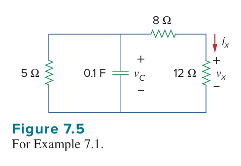

<template #solution>

### 老師講義解法

依 Chapter 7 投影片第 11–13 頁。

先從電容端求等效電阻，再求時間常數與分壓：

$$
R_{\mathrm{eq}}=(8+12)\parallel5=4\,\Omega,\qquad \tau=R_{\mathrm{eq}}C=4(0.1)=0.4\,\mathrm{s}.
$$

$$
v_C(t)=15e^{-2.5t}\,\mathrm V,\quad v_x(t)=\frac{12}{8+12}v_C(t)=9e^{-2.5t}\,\mathrm V,\quad i_x(t)=\frac{v_x(t)}{12}=0.75e^{-2.5t}\,\mathrm A.
$$

講義第 13 頁將 $0.6\times15$ 誤寫為 $90$；依分壓計算與課本答案應為 $9$。

</template>

</PracticeCard>

<PracticeCard id="ch7-pr1" type="practice" title="Practice Problem 7.1" source="課本 p.256" topic="一階電路與暫態響應 (First-Order Circuits)">

Refer to the circuit in Fig. 7.7. Let vC (0) = 60 V . Determine vC, vx, and io for t ≥ 0 .

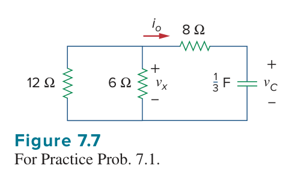

<template #solution>

### 講義答案

老師 Chapter 7 投影片第 17 頁列出答案，未提供逐步解法。

60$e^{-0.25t}$ V, 20$e^{-0.25t}$ V, −5$e^{-0.25t}$ A .

</template>

</PracticeCard>

<PracticeCard id="ch7-ex2" type="example" title="Example 7.2" source="課本 p.256" topic="一階電路與暫態響應 (First-Order Circuits)">

The switch in the circuit in Fig. 7.8 has been closed for a long time, and it is opened at t = 0 . Find v(t) for t ≥ 0 . Calculate the initial energy stored in the capacitor.

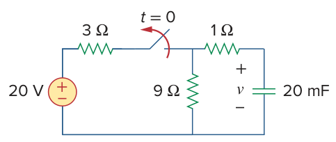

<template #solution>

### 老師講義解法

依 Chapter 7 投影片第 14–16 頁。

開關閉合已久，電容為開路；由分壓及電容電壓連續性，

$$
v_C(0^+)=v_C(0^-)=\frac{9}{3+9}(20)=15\,\mathrm V.
$$

開關打開後 $R_{\mathrm{eq}}=1+9=10\,\Omega$，因此 $\tau=10(20\times10^{-3})=0.2\,\mathrm s$。代入自然響應及儲能公式：

$$
v(t)=15e^{-5t}\,\mathrm V,\qquad w_C(0)=\frac12(20\times10^{-3})(15)^2=2.25\,\mathrm J.
$$

</template>

</PracticeCard>

<PracticeCard id="ch7-pr2" type="practice" title="Practice Problem 7.2" source="課本 p.257" topic="一階電路與暫態響應 (First-Order Circuits)">

If the switch in Fig. 7.10 opens at t = 0 , find v(t) for t ≥ 0 and wC (0) .

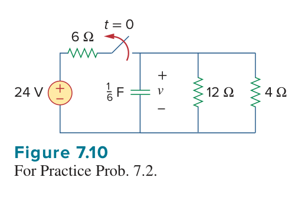

<template #solution>

### 講義答案

老師 Chapter 7 投影片第 17 頁列出答案，未提供逐步解法。

8$e^{-2t}$ V, 5.333 J.

</template>

</PracticeCard>

<PracticeCard id="ch7-ex3" type="example" title="Example 7.3" source="課本 p.259" topic="一階電路與暫態響應 (First-Order Circuits)">

Assuming that i(0) = 10 A , calculate i(t) and ix(t) in the circuit of Fig. 7.13, for t > 0 .

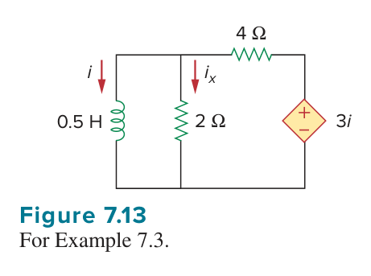

<template #solution>

### 老師講義解法

依 Chapter 7 投影片第 24–28 頁。

依講義的直接微分方程法，對兩個網孔列 KVL：

$$
0.5\frac{di_1}{dt}+2(i_1-i_2)=0,\qquad 6i_2-5i_1=0.
$$

由 $i_2=5i_1/6$ 得 $di_1/dt+2i_1/3=0$。代入 $i_1(0)=10\,\mathrm A$，並以電感電壓求平行的 $2\,\Omega$ 電阻電流：

$$
i(t)=10e^{-2t/3}\,\mathrm A,\qquad v_L=0.5\frac{di}{dt}=-\frac{10}{3}e^{-2t/3}\,\mathrm V,\qquad i_x=\frac{v_L}{2}=-\frac53e^{-2t/3}\,\mathrm A.
$$

回代兩條 KVL 均為零。

</template>

</PracticeCard>

<PracticeCard id="ch7-pr3" type="practice" title="Practice Problem 7.3" source="課本 p.261" topic="一階電路與暫態響應 (First-Order Circuits)">

Find i and vx in the circuit of Fig. 7.15, for t > 0 . Let i(0) = 12 A .

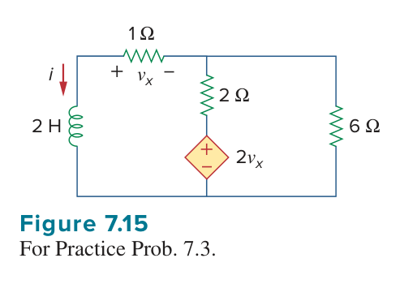

<template #solution>

### 講義答案

老師 Chapter 7 投影片第 39 頁列出答案，未提供逐步解法。

12 $e^{-2t}$ A, −12 $e^{-2t}$ V, t > 0 .

</template>

</PracticeCard>

<PracticeCard id="ch7-ex4" type="example" title="Example 7.4" source="課本 p.261" topic="一階電路與暫態響應 (First-Order Circuits)">

The switch in the circuit of Fig. 7.16 has been closed for a long time. At t = 0 , the switch is opened. Calculate i(t) for t > 0 .

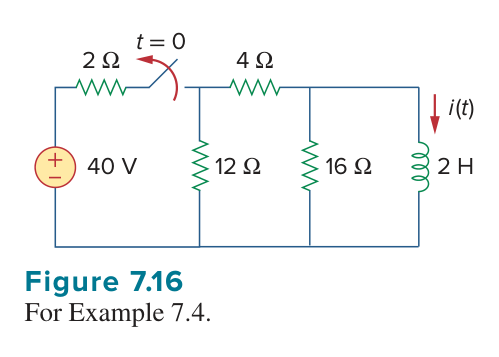

<template #solution>

### 老師講義解法

依 Chapter 7 投影片第 29–32 頁。

切換前以電感短路及分流求初值：

$$
i_1(0^-)=\frac{40}{2+(12\parallel4)}=8\,\mathrm A,\qquad i_L(0^+)=i_L(0^-)=\frac{12}{12+4}(8)=6\,\mathrm A.
$$

切換後 $R_{\mathrm{eq}}=(4+12)\parallel16=8\,\Omega$，$\tau=L/R_{\mathrm{eq}}=2/8=0.25\,\mathrm s$，所以

$$
i(t)=6e^{-4t}\,\mathrm A,\qquad t>0.
$$

</template>

</PracticeCard>

<PracticeCard id="ch7-pr4" type="practice" title="Practice Problem 7.4" source="課本 p.262" topic="一階電路與暫態響應 (First-Order Circuits)">

For the circuit in Fig. 7.18, find i(t) for t > 0 .

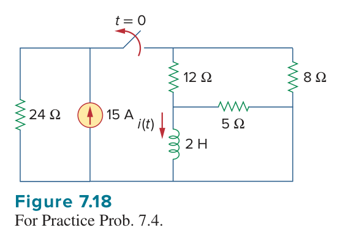

<template #solution>

### 講義答案

老師 Chapter 7 投影片第 39 頁列出答案，未提供逐步解法。

5 $e^{-2t}$ A, t > 0 .

</template>

</PracticeCard>

<PracticeCard id="ch7-ex5" type="example" title="Example 7.5" source="課本 p.262" topic="一階電路與暫態響應 (First-Order Circuits)">

In the circuit shown in Fig. 7.19, find io, vo, and i for all time, assuming that the switch was open for a long time.

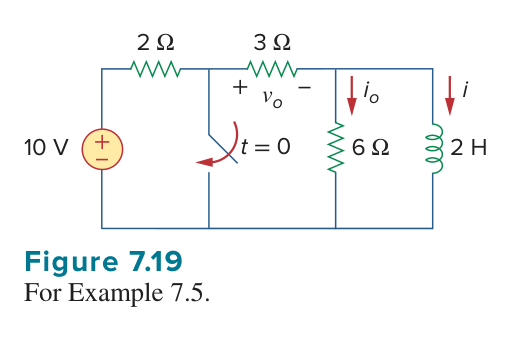

<template #solution>

### 老師講義解法

依 Chapter 7 投影片第 33–38 頁。

切換前電感在直流穩態為短路，故 $i=10/(2+3)=2\,\mathrm A$、$v_o=3i=6\,\mathrm V$、$i_o=0$。切換後由電感端看入 $R_{\mathrm{eq}}=3\parallel6=2\,\Omega$，$\tau=2/2=1\,\mathrm s$。

由電流連續性及圖示參考方向，

$$
i(t)=\begin{cases}2,&t<0\\2e^{-t},&t>0\end{cases}\mathrm A,\quad v_o(t)=\begin{cases}6,&t<0\\4e^{-t},&t>0\end{cases}\mathrm V,\quad i_o(t)=\begin{cases}0,&t<0\\-\frac23e^{-t},&t>0\end{cases}\mathrm A.
$$

其中 $v_o=-L\,di/dt$，而 $i_o=-v_o/6$。

</template>

</PracticeCard>

<PracticeCard id="ch7-pr5" type="practice" title="Practice Problem 7.5" source="課本 p.263" topic="一階電路與暫態響應 (First-Order Circuits)">

Determine i, io, and vo for all t in the circuit shown in Fig. 7.22. Assume that the switch was closed for a long time. It should be noted that opening a switch in series with an ideal current source creates an infinite voltage at the current source terminals. Clearly this is impossible. For the purposes of problem solving, we can place a shunt resistor in parallel with the source (which now makes it a voltage source in series with a resistor). In more practical circuits, devices that act like current sources are, for the most part, electronic circuits. These circuits will allow the source to act like an ideal current source over its operating range but voltage-limit it when the load resistor becomes too large (as in an open circuit).

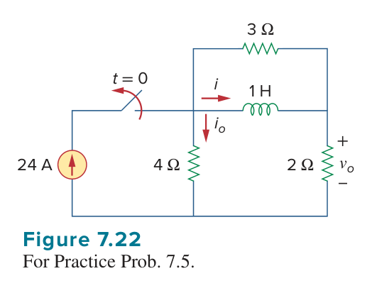

<template #solution>

### 講義答案

老師 Chapter 7 投影片第 40 頁列出答案，未提供逐步解法。

i=16 A for t<0 and i=16$e^{-2t}$ A for t>0; io=8 A for t<0 and io=−5.333$e^{-2t}$ A for t>0.

講義另列 $v_o=32\,\mathrm V$（$t<0$），$v_o=\frac{32}{3}e^{-2t}\,\mathrm V$（$t>0$）。

</template>

</PracticeCard>

<PracticeCard id="ch7-ex6" type="example" title="Example 7.6" source="課本 p.267" topic="一階電路與暫態響應 (First-Order Circuits)">

Express the voltage pulse in Fig. 7.31 in terms of the unit step. Calculate its derivative and sketch it.

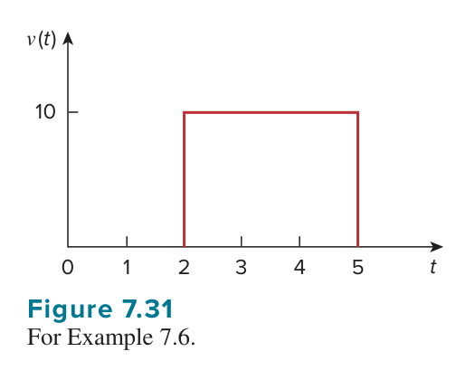

<template #solution>

### 老師講義解法

依 Chapter 7 投影片第 56–58 頁。

投影片將脈波分解為在 $t=2$ 上升與 $t=5$ 下降的兩個階躍：

$$
v(t)=10[u(t-2)-u(t-5)]\,\mathrm V,\qquad \frac{dv}{dt}=10[\delta(t-2)-\delta(t-5)].
$$

因此導數圖在 $t=2$ 與 $t=5$ 分別有強度 $+10$、$-10$ 的衝激。

</template>

</PracticeCard>

<PracticeCard id="ch7-pr6" type="practice" title="Practice Problem 7.6" source="課本 p.268" topic="一階電路與暫態響應 (First-Order Circuits)">

Express the current pulse in Fig. 7.33 in terms of the unit step. Find its integral and sketch it.

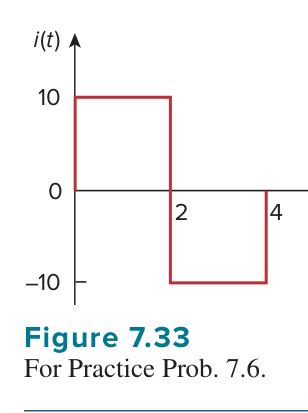

<template #solution>

### 講義答案

老師 Chapter 7 投影片第 70 頁列出答案，未提供逐步解法。

10[u (t) − 2u (t − 2) + u (t − 4)] A, 10[r (t) − 2r (t − 2) + r (t − 4)] amp-sec .

</template>

</PracticeCard>

<PracticeCard id="ch7-ex7" type="example" title="Example 7.7" source="課本 p.268" topic="一階電路與暫態響應 (First-Order Circuits)">

Express the sawtooth function shown in Fig. 7.35 in terms of singularity functions.

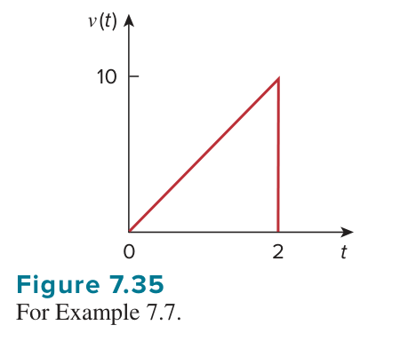

<template #solution>

### 老師講義解法

依 Chapter 7 投影片第 59–64 頁。

講義先將斜率為 5 的斜坡限制在 $0<t<2$ 的時間窗，再展開為奇異函數。令 $r(t)=tu(t)$：

$$
\begin{aligned}
v(t)&=5t[u(t)-u(t-2)]\\
&=5r(t)-5(t-2)u(t-2)-10u(t-2)\\
&=5r(t)-5r(t-2)-10u(t-2).
\end{aligned}
$$

代入各區間可得 $t<0$ 時為 0、$0<t<2$ 時為 $5t$、$t>2$ 時回到 0。

</template>

</PracticeCard>

<PracticeCard id="ch7-pr7" type="practice" title="Practice Problem 7.7" source="課本 p.270" topic="一階電路與暫態響應 (First-Order Circuits)">

Refer to Fig. 7.39. Express i(t) in terms of singularity functions.

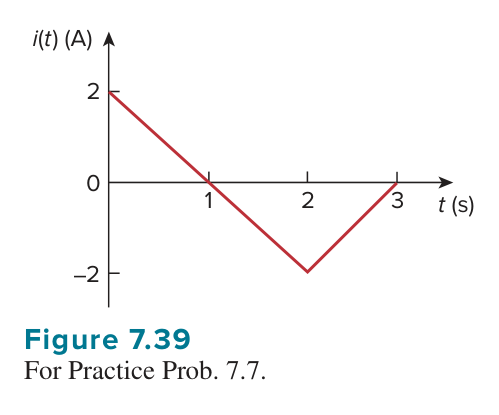

<template #solution>

### 講義答案

老師 Chapter 7 投影片第 71 頁列出答案，未提供逐步解法。

2u (t) − 2r (t) + 4r (t − 2) − 2r (t − 3) A .

</template>

</PracticeCard>

<PracticeCard id="ch7-ex8" type="example" title="Example 7.8" source="課本 p.270" topic="一階電路與暫態響應 (First-Order Circuits)">

Given the signal $g(t)=\begin{cases}3,&t<0\\-2,&0<t<1\\2t-4,&t>1\end{cases}$, express $g(t)$ in terms of step and ramp functions.

<template #solution>

### 老師講義解法

依 Chapter 7 投影片第 65–67 頁。

依講義將三個時間區間各自乘上時間窗，令 $r(t)=tu(t)$：

$$
\begin{aligned}
g(t)&=3u(-t)-2[u(t)-u(t-1)]+(2t-4)u(t-1)\\
&=3u(-t)-2u(t)+2r(t-1)\\
&=3-5u(t)+2r(t-1).
\end{aligned}
$$

三個區間分別得到 $3$、$-2$ 與 $2t-4$。

</template>

</PracticeCard>

<PracticeCard id="ch7-pr8" type="practice" title="Practice Problem 7.8" source="課本 p.271" topic="一階電路與暫態響應 (First-Order Circuits)">

If $h(t)=\begin{cases}0,&t<0\\-4,&0<t<2\\3t-8,&2<t<6\\0,&t>6\end{cases}$, express $h(t)$ in terms of the singularity functions.

<template #solution>

### 講義答案

老師 Chapter 7 投影片第 72 頁列出答案，未提供逐步解法。

−4u(t) + 2u(t − 2) + 3r (t − 2) − 10u(t − 6) − 3r(t − 6) .

</template>

</PracticeCard>

<PracticeCard id="ch7-ex9" type="example" title="Example 7.9" source="課本 p.271" topic="一階電路與暫態響應 (First-Order Circuits)">

Evaluate the following integrals involving the impulse function: $\int_0^{10}(t^2+4t-2)\delta(t-2)\,dt$ and $\int_{-\infty}^{\infty}[\delta(t-1)e^{-t}\cos t+\delta(t+1)e^{-t}\sin t]\,dt$.

<template #solution>

### 老師講義解法

依 Chapter 7 投影片第 68–69 頁。

依講義的衝激取樣性質，在每個衝激位置代入其餘函數：

$$
\int_0^{10}(t^2+4t-2)\delta(t-2)\,dt=2^2+4(2)-2=10.
$$

$$
\begin{aligned}
\int_{-\infty}^{\infty}[\delta(t-1)e^{-t}\cos t+\delta(t+1)e^{-t}\sin t]dt
&=e^{-1}\cos1+e\sin(-1)\\
&\approx-2.0886.
\end{aligned}
$$

角度以弧度計算。講義列約 $-2.0885$；由完整數值四捨五入至小數第四位為 $-2.0886$。

</template>

</PracticeCard>

<PracticeCard id="ch7-pr9" type="practice" title="Practice Problem 7.9" source="課本 p.271" topic="一階電路與暫態響應 (First-Order Circuits)">

Evaluate the following integrals: $\int_{-\infty}^{\infty}(t^3+5t^2+10)\delta(t+3)\,dt$ and $\int_0^{10}\delta(t-\pi)\cos 3t\,dt$.

<template #solution>

### 講義答案

老師 Chapter 7 投影片第 72 頁列出答案，未提供逐步解法。

28, −1 .

</template>

</PracticeCard>

<PracticeCard id="ch7-ex10" type="example" title="Example 7.10" source="課本 p.275" topic="一階電路與暫態響應 (First-Order Circuits)">

The switch in Fig. 7.43 has been in position A for a long time. At t = 0 , the switch moves to B . Determine v(t) for t > 0 and calculate its value at t = 1 and 4 s .

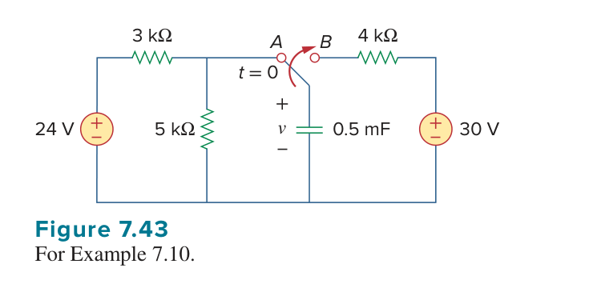

<template #solution>

### 老師講義解法

依 Chapter 7 投影片第 89–92 頁。

依講義先求初值、終值與時間常數：

$$
v(0^+)=v(0^-)=\frac5{3+5}(24)=15\,\mathrm V,\qquad v(\infty)=30\,\mathrm V.
$$

$$
\tau=R_{\mathrm{eq}}C=(4\times10^3)(0.5\times10^{-3})=2\,\mathrm s.
$$

故 $v(t)=30+(15-30)e^{-t/2}=30-15e^{-0.5t}\,\mathrm V$；$v(1)\approx20.9\,\mathrm V$，$v(4)\approx27.97\,\mathrm V$。

</template>

</PracticeCard>

<PracticeCard id="ch7-pr10" type="practice" title="Practice Problem 7.10" source="課本 p.276" topic="一階電路與暫態響應 (First-Order Circuits)">

Find v(t) for t > 0 in the circuit of Fig. 7.44. Assume the switch has been open for a long time and is closed at t = 0 . Calculate v(t) at t = 0.5 .

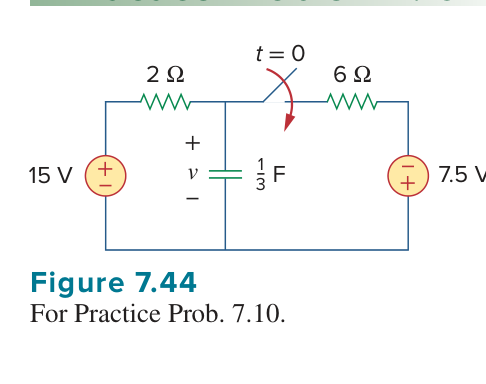

<template #solution>

### 講義答案

老師 Chapter 7 投影片第 98 頁列出答案，未提供逐步解法。

(9.375 + 5.625 $e^{-2t}$ ) V for all t > 0, 11.444 V .

</template>

</PracticeCard>

<PracticeCard id="ch7-ex11" type="example" title="Example 7.11" source="課本 p.276" topic="一階電路與暫態響應 (First-Order Circuits)">

In Fig. 7.45, the switch has been closed for a long time and is opened at t = 0 . Find i and v for all time.

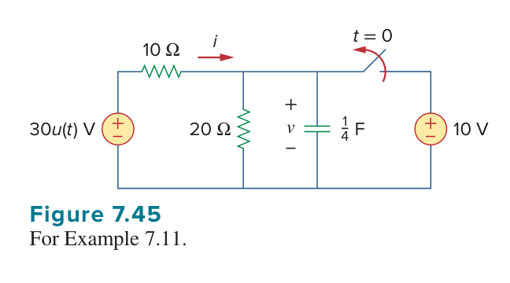

<template #solution>

### 老師講義解法

依 Chapter 7 投影片第 93–97 頁。

切換前 $v(0^-)=10\,\mathrm V$，由電容電壓連續性 $v(0^+)=10\,\mathrm V$。切換後以分壓求終值，並將獨立源歸零求等效電阻：

$$
v(\infty)=\frac{20}{10+20}(30)=20\,\mathrm V,\qquad R_{\mathrm{eq}}=10\parallel20=\frac{20}{3}\,\Omega,\qquad \tau=\frac{20}{3}\cdot\frac14=\frac53\,\mathrm s.
$$

$$
v(t)=\begin{cases}10,&t<0\\20-10e^{-0.6t},&t>0\end{cases}\mathrm V,\qquad i(t)=\begin{cases}-1,&t<0\\1+e^{-0.6t},&t>0\end{cases}\mathrm A.
$$

切換後回代 $30=10i+v$，等式兩側均為 $30\,\mathrm V$。

</template>

</PracticeCard>

<PracticeCard id="ch7-pr11" type="practice" title="Practice Problem 7.11" source="課本 p.277" topic="一階電路與暫態響應 (First-Order Circuits)">

The switch in Fig. 7.47 is closed at t = 0 . Find i(t) and v(t) for all time. Note that u(−t) = 1 for t < 0 and 0 for t > 0 . Also, u(−t) = 1 − u(t) .

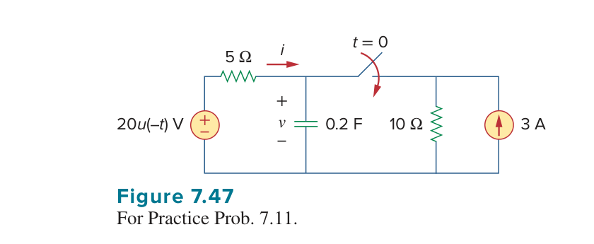

<template #solution>

### 講義答案

老師 Chapter 7 投影片第 99 頁列出答案，未提供逐步解法。

i(t)=0 for t<0 and i(t)=−2(1+$e^{-1.5t}$) A for t>0; v=20 V for t<0 and v=10(1+$e^{-1.5t}$) V for t>0.

</template>

</PracticeCard>

<PracticeCard id="ch7-ex12" type="example" title="Example 7.12" source="課本 p.280" topic="一階電路與暫態響應 (First-Order Circuits)">

Find i(t) in the circuit of Fig. 7.51 for t > 0 . Assume that the switch has been closed for a long time.

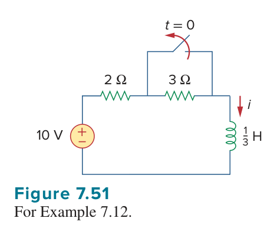

<template #solution>

### 老師講義解法

依 Chapter 7 投影片第 108–111 頁。

切換前電感短路，$i(0^+)=i(0^-)=10/2=5\,\mathrm A$。切換後 $i(\infty)=10/(2+3)=2\,\mathrm A$、$R_{\mathrm{eq}}=5\,\Omega$、$\tau=(1/3)/5=1/15\,\mathrm s$。

$$
i(t)=2+(5-2)e^{-15t}=2+3e^{-15t}\,\mathrm A,\qquad t>0.
$$

回代切換後 KVL：$5i+\frac13di/dt=10\,\mathrm V$。

</template>

</PracticeCard>

<PracticeCard id="ch7-pr12" type="practice" title="Practice Problem 7.12" source="課本 p.280" topic="一階電路與暫態響應 (First-Order Circuits)">

The switch in Fig. 7.52 has been closed for a long time. It opens at t = 0 . Find i(t) for t > 0 .

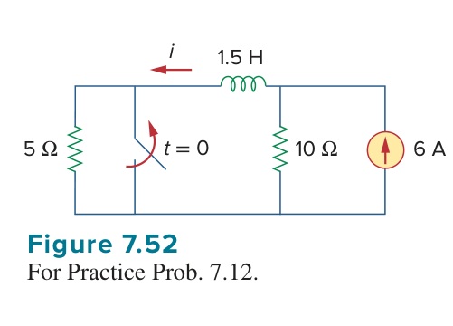

<template #solution>

### 講義答案

老師 Chapter 7 投影片第 119 頁列出答案，未提供逐步解法。

(4 + 2 $e^{-10t}$ ) A for all t > 0 .

</template>

</PracticeCard>

<PracticeCard id="ch7-ex13" type="example" title="Example 7.13" source="課本 p.281" topic="一階電路與暫態響應 (First-Order Circuits)">

At t = 0 , switch 1 in Fig. 7.53 is closed, and switch 2 is closed 4 s later. Find i(t) for t > 0 . Calculate i for t = 2 s and t = 5 s .

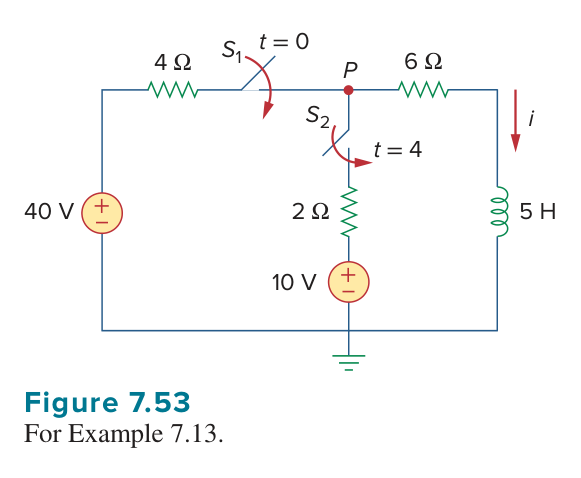

<template #solution>

### 老師講義解法

依 Chapter 7 投影片第 112–118 頁。

依講義分兩次切換求解。$t<0$ 時兩開關皆開，故 $i(0^+)=0$。第一階段 $0<t<4$ 的終值與時間常數為

$$
i_{\infty,1}=\frac{40}{4+6}=4\,\mathrm A,\quad \tau_1=\frac5{4+6}=0.5\,\mathrm s,\quad i(t)=4(1-e^{-2t})\,\mathrm A.
$$

第二階段以節點 $P$ 的 KCL 求終值：

$$
\frac{v_P-40}{4}+\frac{v_P-10}{2}+\frac{v_P}{6}=0,\quad v_P=\frac{180}{11}\,\mathrm V,\quad i_{\infty,2}=\frac{30}{11}\,\mathrm A.
$$

此時 $R_{\mathrm{eq}}=4\parallel2+6=22/3\,\Omega$，$\tau_2=15/22\,\mathrm s$。電流在第二次切換時連續，故保留精確初值：

$$
i(t)=\frac{30}{11}+\left[4(1-e^{-8})-\frac{30}{11}\right]e^{-\frac{22}{15}(t-4)}\,\mathrm A,\qquad t\ge4.
$$

$i(2)\approx3.93\,\mathrm A$，$i(5)\approx3.02\,\mathrm A$。講義第 116 頁初值行誤寫 $5\,\mathrm A$；依切換前開路及同頁後續計算應為 0。講義以 $i(4)\approx4\,\mathrm A$ 計算，以上保留精確值。

</template>

</PracticeCard>

<PracticeCard id="ch7-pr13" type="practice" title="Practice Problem 7.13" source="課本 p.282" topic="一階電路與暫態響應 (First-Order Circuits)">

Switch S1 in Fig. 7.54 is closed at t = 0 , and switch S2 is closed at t = 2s . Calculate i(t) for all t . Find i (1) and i (3).

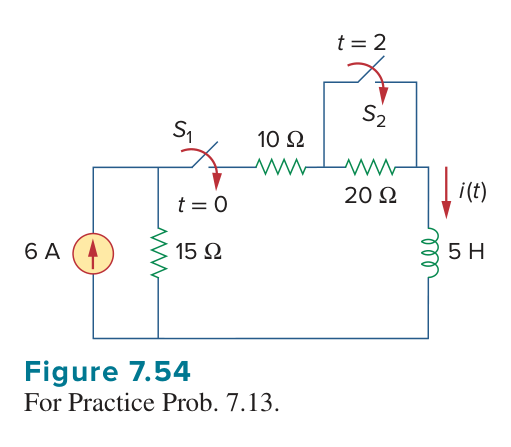

<template #solution>

### 老師講義解法

依 Chapter 7 投影片第 120 頁，分兩個切換階段求電感電流。$t<0$ 時 $i=0$。在 $0<t<2$，$R_{\mathrm{eq}}=15+10+20=45\,\Omega$，$\tau=5/45=1/9\,\mathrm s$，終值為 $6(15/45)=2\,\mathrm A$，所以

$$
i(t)=2(1-e^{-9t})\,\mathrm A.
$$

$t>2$ 時 $R_{\mathrm{eq}}=15+10=25\,\Omega$，$\tau=5/25=1/5\,\mathrm s$，終值為 $6(15/25)=3.6\,\mathrm A$。保留第二次切換的精確初值 $i(2)=2(1-e^{-18})$，得到

$$
i(t)=3.6+\bigl[2(1-e^{-18})-3.6\bigr]e^{-5(t-2)}\,\mathrm A.
$$

$i(1)\approx1.9998\,\mathrm A$，$i(3)\approx3.5892\,\mathrm A$。第 120 頁將 $i(2)$ 近似為 $2\,\mathrm A$，得到 $3.6-1.6e^{-5(t-2)}$；第 119 頁另列的係數 $4$、$7.2$、$3.2$ 與電路及第 120 頁不符。

</template>

</PracticeCard>

<PracticeCard id="ch7-ex14" type="example" title="Example 7.14" source="課本 p.283" topic="一階電路與暫態響應 (First-Order Circuits)">

For the op amp circuit in Fig. 7.55(a), find vo for t > 0 , given that v(0) = 3 V. Let Rf = 80 kΩ, R1 = 20 kΩ , and C = 5 μF .

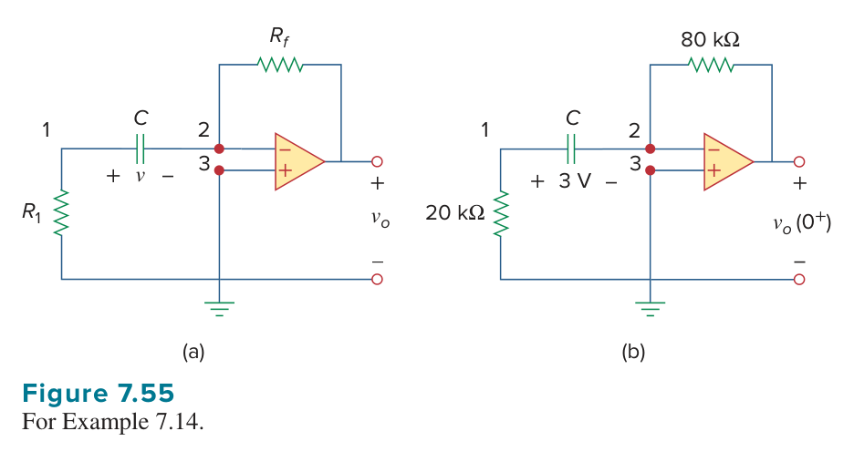

<template #solution>

### 老師講義解法

依 Chapter 7 投影片第 121–128 頁。

講義以理想運算放大器虛短及 KCL 建立方程：

$$
-\frac{v}{R_1}=C\frac{dv}{dt},\qquad \frac{dv}{dt}+\frac{v}{R_1C}=0.
$$

$\tau=R_1C=(20\times10^3)(5\times10^{-6})=0.1\,\mathrm s$，由 $v(0)=3\,\mathrm V$ 得 $v(t)=3e^{-10t}\,\mathrm V$。再由輸出端 KCL：

$$
v_o=-R_fC\frac{dv}{dt}=12e^{-10t}\,\mathrm V,\qquad t>0.
$$

</template>

</PracticeCard>

<PracticeCard id="ch7-pr14" type="practice" title="Practice Problem 7.14" source="課本 p.284" topic="一階電路與暫態響應 (First-Order Circuits)">

For the op amp circuit in Fig. 7.56, find vo for t > 0 if v(0) = 4 V . Assume that Rf = 50 kΩ, R1 = 10 kΩ , and C = 10 μF .

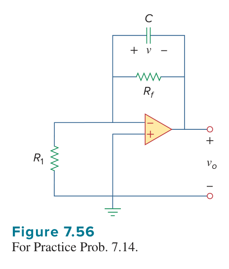

<template #solution>

### 講義答案

老師 Chapter 7 投影片第 139 頁列出答案，未提供逐步解法。

−4 $e^{-2t}$ V, t > 0 .

</template>

</PracticeCard>

<PracticeCard id="ch7-ex15" type="example" title="Example 7.15" source="課本 p.284" topic="一階電路與暫態響應 (First-Order Circuits)">

Determine v(t) and vo(t) in the circuit of Fig. 7.57.

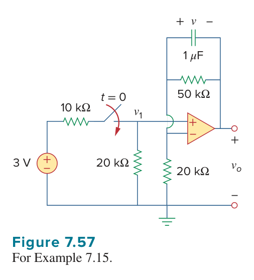

<template #solution>

### 老師講義解法

依 Chapter 7 投影片第 129–132 頁。

依講義先求電容電壓的初值與終值。$v(0^+)=0$；切換後正輸入端電壓 $v_1=20(3)/(20+10)=2\,\mathrm V$。直流穩態下：

$$
v_o(\infty)=\left(1+\frac{50}{20}\right)(2)=7\,\mathrm V,\qquad v(\infty)=v_1-v_o(\infty)=-5\,\mathrm V.
$$

$\tau=RC=(50\times10^3)(1\times10^{-6})=0.05\,\mathrm s$，因此

$$
v(t)=5(e^{-20t}-1)\,\mathrm V,\qquad v_o(t)=v_1-v(t)=7-5e^{-20t}\,\mathrm V,\quad t>0.
$$

</template>

</PracticeCard>

<PracticeCard id="ch7-pr15" type="practice" title="Practice Problem 7.15" source="課本 p.285" topic="一階電路與暫態響應 (First-Order Circuits)">

Find v(t) and vo(t) in the op amp circuit of Fig. 7.58.

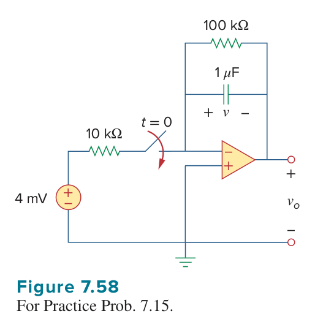

<template #solution>

### 講義答案

老師 Chapter 7 投影片第 140 頁列出答案，未提供逐步解法。

v(t)=40(1−$e^{-10t}$)u(t) mV; vo(t)=40($e^{-10t}$−1)u(t) mV.

</template>

</PracticeCard>

<PracticeCard id="ch7-ex16" type="example" title="Example 7.16" source="課本 p.286" topic="一階電路與暫態響應 (First-Order Circuits)">

Find the step response vo(t) for t > 0 in the op amp circuit of Fig. 7.59. Let vi = 2u(t) V, R1 = 20 kΩ, Rf = 50 kΩ, R2 = R3 = 10 kΩ, C = 2 μF .

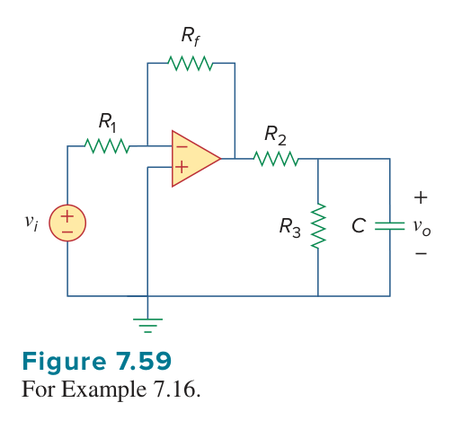

<template #solution>

### 老師講義解法

依 Chapter 7 投影片第 133–138 頁。

依講義移除電容，先求其端點的戴維寧等效。理想反相放大器輸出為 $v_{ab}=-(R_f/R_1)v_i$，再由分壓得

$$
V_{\mathrm{Th}}=-\frac{R_3}{R_2+R_3}\frac{R_f}{R_1}v_i=-2.5u(t)\,\mathrm V,\qquad R_{\mathrm{Th}}=R_2\parallel R_3=5\,\mathrm{k}\Omega.
$$

$\tau=R_{\mathrm{Th}}C=0.01\,\mathrm s$，故

$$
v_o(t)=-2.5(1-e^{-100t})u(t)\,\mathrm V.
$$

</template>

</PracticeCard>

<PracticeCard id="ch7-pr16" type="practice" title="Practice Problem 7.16" source="課本 p.287" topic="一階電路與暫態響應 (First-Order Circuits)">

Obtain the step response vo(t) for the circuit in Fig. 7.62. Let vi = 4.5u(t) V, R1 = 20 kΩ, Rf = 40 kΩ, R2 = R3 = 10 kΩ, C = 2 μF .

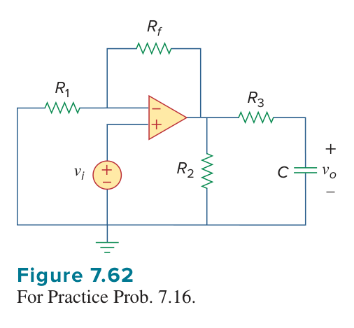

<template #solution>

### 講義答案

老師 Chapter 7 投影片第 141 頁列出答案，未提供逐步解法。

13.5(1 − $e^{-50t}$ )u(t) V .

</template>

</PracticeCard>

<PracticeCard id="ch7-ex17" type="example" title="Example 7.17" source="課本 p.287" topic="一階電路與暫態響應 (First-Order Circuits)">

Use PSpice to find the response i(t) for t > 0 in the circuit of Fig. 7.63.

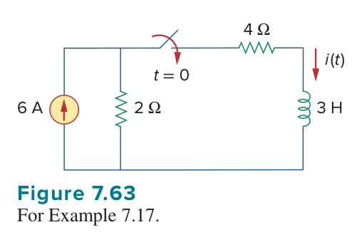

<template #solution>

### 課本解析與答案 (Textbook Solution)

Solving this problem by hand gives i (0) = 0, i(∞) = 2A, R Th = 6, τ = 3/6 = 0.5 s , so that i(t) = i(∞) + [i(0) − i(∞)] $e^{-t/τ}$ = 2(1 − $e^{-2t}$ ), t > 0 To use PSpice, we first draw the schematic as shown in Fig. 7.64. The part name is Sw_tclose. We do not need to specify the initial condition of the inductor because PSpice will determine that from the circuit. By selecting Analysis/Setup/Transient, we set Print Step to 25 ms and Final Step to 5τ = 2.5 s . After saving the circuit, we simulate by selecting Analysis/Simulate. In the PSpice A/D window, we select Trace/Add and display –I(L1) as the current through the inductor. Figure 7.65 shows the plot of i(t) , which agrees with that obtained by hand calculation. 2 6 A 3 H IDC tClose = 0 Note that the negative sign on I(L1) is needed because the current enters through the upper terminal of the inductor, which happens to be the negative terminal after one counterclock wise−rotation. A way to avoid the negative sign is to ensure that current enters pin 1 of the inductor. To obtain this desired direction of positive current flow, the initially horizontal inductor symbol should be rotated counterclockwise 270° and placed in the desired location.

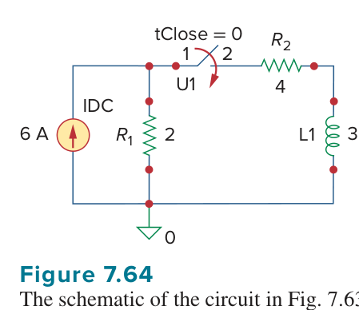

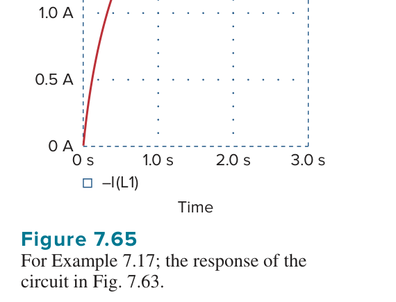

</template>

</PracticeCard>

<PracticeCard id="ch7-pr17" type="practice" title="Practice Problem 7.17" source="課本 p.288" topic="一階電路與暫態響應 (First-Order Circuits)">

For the circuit in Fig. 7.66, use Pspice to find v(t) for t > 0 .

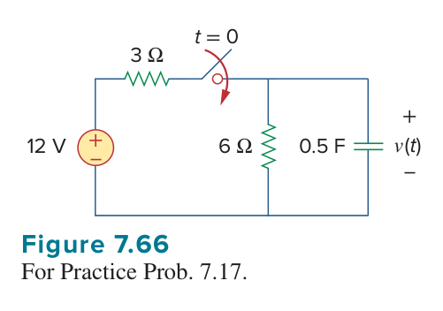

<template #solution>

### 課本解析與答案 (Textbook Solution)

v(t) = 8(1 − $e^{-t}$) V, t > 0 .

</template>

</PracticeCard>

<PracticeCard id="ch7-ex18" type="example" title="Example 7.18" source="課本 p.288" topic="一階電路與暫態響應 (First-Order Circuits)">

In the circuit of Fig. 7.67(a), determine the response v(t) .

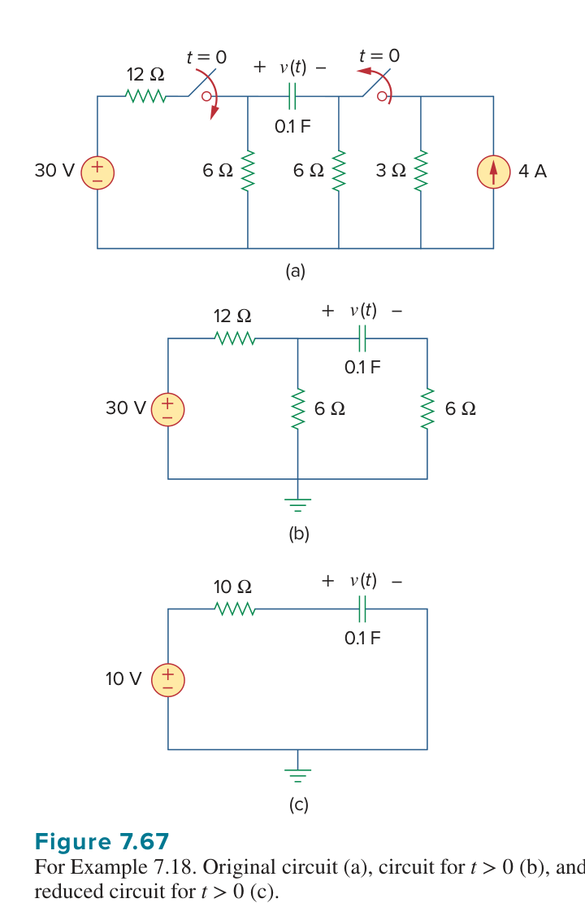

<template #solution>

### 課本解析與答案 (Textbook Solution)

1. Define. The problem is clearly stated and the circuit is clearly labeled. 2. Present. Given the circuit shown in Fig. 7.67(a), determine the response v(t) . 3. Alternative. We can solve this circuit using circuit analysis techniques, nodal analysis, mesh analysis, or PSpice. Let us solve the problem using circuit analysis techniques (this time Thevenin equivalent circuits) and then check the answer using two methods of PSpice. 4. Attempt. For time < 0 , the switch on the left is open and the switch on the right is closed. Assume that the switch on the right has been closed long enough for the circuit to reach steady state; then the capacitor acts like an open circuit and the current from the 4-A source flows through the parallel combination of the 6-Ω and 3-Ω resistors (6 ∥ 3 = 18/9 = 2) , producing a voltage equal to 2 × 4 = 8 V = −v(0) . At t = 0 , the switch on the left closes and the switch on the right opens, producing the circuit shown in Fig. 7.67(b). The easiest way to complete the solution is to find the Thevenin equivalent circuit as seen by the capacitor. The opencircuit voltage (with the capacitor removed) is equal to the voltage drop across the 6-Ω resistor on the left, or 10 V (the voltage drops uniformly across the 12-Ω resistor, 20 V , and across the 6-Ω resistor, 10 V ). This is V Th . The resistance looking in where the capacitor was is equal to 12 ∥ 6 + 6 = 72/18 + 6 = 10 Ω , which is Req . This produces the Thevenin equivalent circuit shown in Fig. 7.67(c). Matching up the boundary conditions (v(0) = −8 V and v(∞) = 10 V) and τ = RC = 1 , we get $v(t)=10-18e^{-t}\text{ V}$ 5. Evaluate. There are two ways of solving the problem using PSpice. **Method 1.** One way is to first do the dc PSpice analysis to determine the initial capacitor voltage. The schematic of the revelant circuit is in Fig. 7.68(a). Two pseudocomponent VIEWPOINTs are inserted to measure the voltages at nodes 1 and 2. When the circuit is simulated, we obtain the displayed values in Fig. 7.68(a) as V1 = 0 V and V2 = 8 V . Thus, the initial capacitor voltage is v(0) = V1 − V2 = −8 V . The PSpice transient analysis uses this value along with the schematic in Fig. 7.68(b). Once the circuit in Fig. 7.68(b) is drawn, we insert the capacitor initial voltage as IC = −8 . We select Analysis/ Setup/Transient and set Print Step to 0.1 s and Final Step to 4τ = 4 s . After saving the circuit, we select Analysis/Simulate to simulate the circuit. In the PSpice A/D window, we select Trace/Add and display V(R2:2) – V(R3:2) or V(C1:1) − V(C1:2) as the capacitor voltage v(t) . The plot of v(t) is shown in Fig. 7.69. This agrees with the result obtained by hand calculation, $v(t)=10-18e^{-t}\text{ V}$ . **Method 2.** We can simulate the circuit in Fig. 7.67 directly, since PSpice can handle the open and closed switches and determine the initial conditions automatically. Using this approach, the schematic is drawn as shown in Fig. 7.70. After drawing the circuit, we select Analysis/Setup/Transient and set Print Step to 0.1 s and Final Step to 4τ = 4 s . We save the circuit, then select Analysis/Simulate to simulate the circuit. In the PSpice A/D window, we select Trace/Add and display V(R2:2) − V(R3:2) as the capacitor voltage v(t) . The plot of v(t) is the same as that shown in Fig. 7.69. 6 30 V 4 A R2 6 R3 3 R4 I1 tClose = 0 1 2 12 U1 tOpen = 0 0.0000 8.0000 R3 3 R4 I1 R2 6 R3 30 V ‒10 V 0 s 1.0 s 2.0 s 3.0 s 4.0 s V(R2 : 2) ‒ V(R3 : 2) 6. Satisfactory? Clearly, we have found the value of the output response v(t) , as required by the problem statement. Checking does validate that solution. We can present all this as a complete solution to the problem.

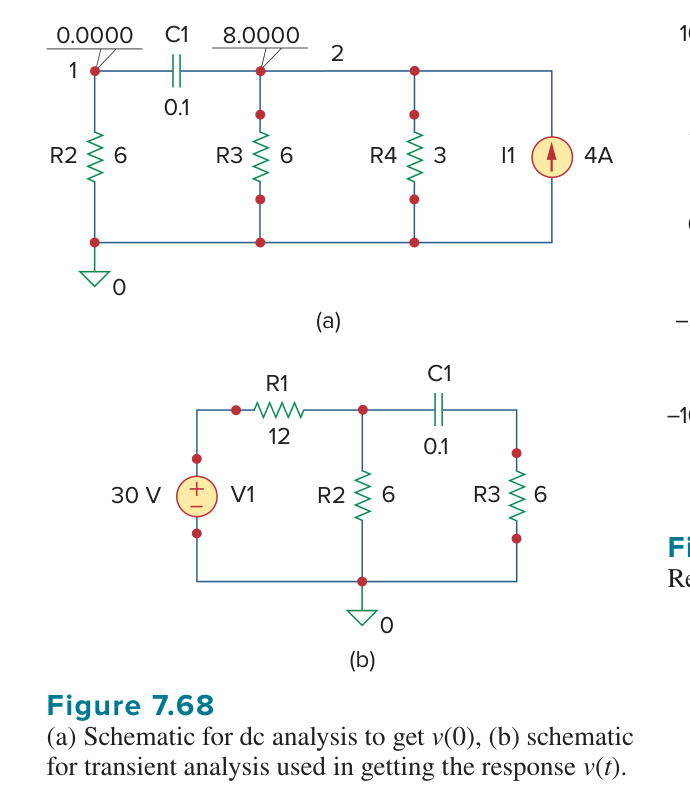

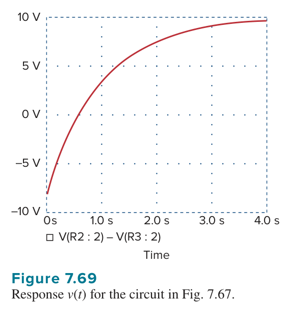

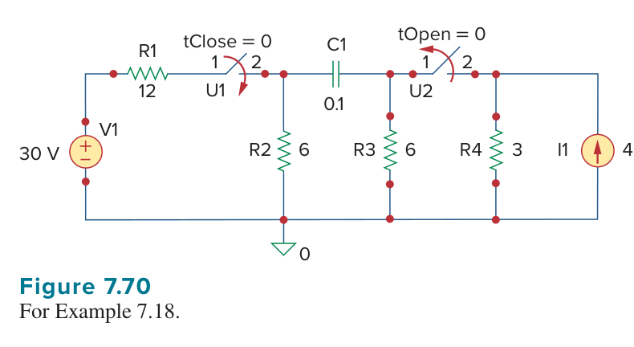

</template>

</PracticeCard>

<PracticeCard id="ch7-pr18" type="practice" title="Practice Problem 7.18" source="課本 p.291" topic="一階電路與暫態響應 (First-Order Circuits)">

The switch in Fig. 7.71 was open for a long time but closed at t = 0 . If i(0) = 10A , find i(t) for t > 0 by hand and also by PSpice.

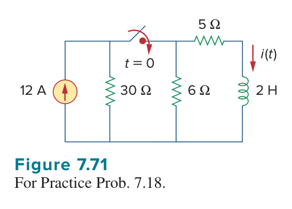

<template #solution>

### 課本解析與答案 (Textbook Solution)

i(t) = 6 + 4 $e^{-5t}$ A .

</template>

</PracticeCard>

<PracticeCard id="ch7-ex19" type="example" title="Example 7.19" source="課本 p.292" topic="一階電路與暫態響應 (First-Order Circuits)">

Consider the circuit in Fig. 7.73, and assume that R1 = 1.5 MΩ, 0 < R2 < 2.5 MΩ . (a) Calculate the extreme limits of the time constant of the circuit. (b) How long does it take for the lamp to glow for the first time after the switch is closed? Let R2 assume its largest value.

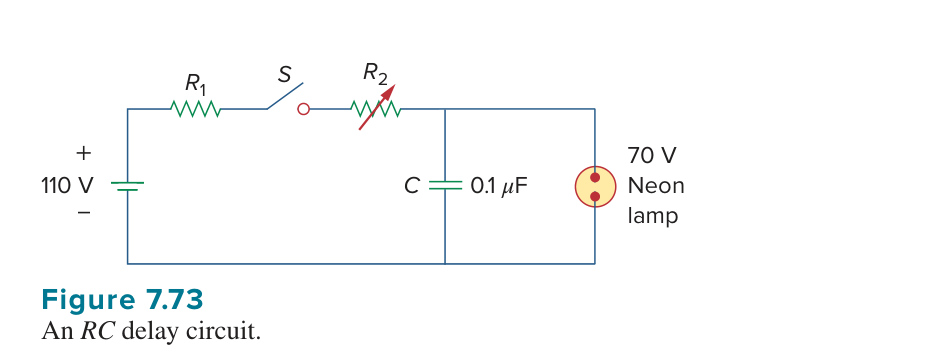

<template #solution>

### 課本解析與答案 (Textbook Solution)

(a) The smallest value for R2 is 0 Ω , and the corresponding time constant for the circuit is τ = (R1 + R2)C = (1.5 × $10^6$ + 0) × 0.1 × $10^{-6}$ = 0.15 s The largest value for R2 is 2.5 MΩ , and the corresponding time constant for the circuit is τ = (R1 + R2)C = (1.5 + 2.5) × $10^6$ × 0.1 × $10^{-6}$ = 0.4 s Thus, by proper circuit design, the time constant can be adjusted to introduce a proper time delay in the circuit. (b) Assuming that the capacitor is initially uncharged, v C (0) = 0 , while v C (∞) = 110 . But vC(t) = vC (∞) + [vC(0) − vC (∞)] $e^{-t/τ}$ = 110[1 − $e^{-t/τ}$ ] where τ = 0.4 s , as calculated in part (a). The lamp glows when vC = 70 V . If vC(t) = 70 V at t = t0 , then $70=110(1-e^{-t_0/\tau})$, so $e^{-t_0/\tau}=\frac{4}{11}$ and $e^{t_0/\tau}=\frac{11}{4}$ Taking the natural logarithm of both sides gives $t_0=\tau\ln\left(\frac{11}{4}\right)=0.4\ln(2.75)=0.4046\text{ s}$ A more general formula for finding t0 is $t_0=\tau\ln\left(\frac{-v(\infty)}{v(t_0)-v(\infty)}\right)$ The lamp will fire repeatedly every t0 seconds if and only if v(t0) < v(∞) .

</template>

</PracticeCard>

<PracticeCard id="ch7-pr19" type="practice" title="Practice Problem 7.19" source="課本 p.293" topic="一階電路與暫態響應 (First-Order Circuits)">

The RC circuit in Fig. 7.74 is designed to operate an alarm which activates when the current through it exceeds 120 μA . If 0 ≤ R ≤ 6 kΩ , find the range of the time delay that the variable resistor can create.

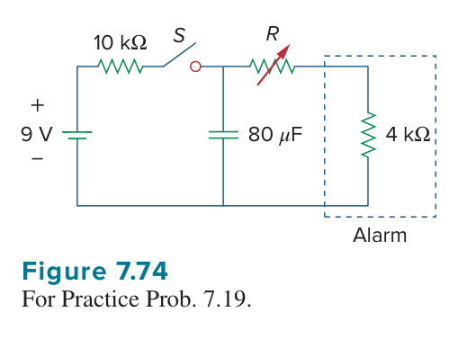

<template #solution>

### 課本解析與答案 (Textbook Solution)

Between 47.23 and 124 ms.

</template>

</PracticeCard>

<PracticeCard id="ch7-ex20" type="example" title="Example 7.20" source="課本 p.294" topic="一階電路與暫態響應 (First-Order Circuits)">

An electronic flashgun has a current-limiting 6-kΩ resistor and 2,000-μF electrolytic capacitor charged to 240 V . If the lamp resistance is 12 Ω , find: (a) the peak charging current, (b) the time required for the capacitor to fully charge, (c) the peak discharging current, (d) the total energy stored in the capacitor, and the average power dissipated by the lamp.

<template #solution>

### 課本解析與答案 (Textbook Solution)

(a) The peak charging current is I1 = $\frac{V_{s}}{R_{1}}$ = $\frac{240}{6\times10^3}=40\text{ mA}$ (b) From Eq. (7.65), tcharge = 5R1C = 5 × 6 × $10^3$ × 2,000 × $10^{-6}$ = 60 s = 1 min (c) The peak discharging current is I2 = $\frac{V_{s}}{R_{2}}$ = $\frac{240}{12}$ = 20 A (d) The energy stored is $W=\frac{1}{2}CV_s^2=\frac{1}{2}\times2{,}000\times10^{-6}\times240^2=57.6\text{ J}$ The energy stored in the capacitor is dissipated across the lamp during the discharging period. From Eq. (7.66), tdischarge = 5R2C = 5 × 12 × 2,000 × $10^{-6}$ = 0.12 s Thus, the average power dissipated is p = $\frac{W}{t_{discharge}}$ = $\frac{57.6}{0.12}$ = 480 watts

</template>

</PracticeCard>

<PracticeCard id="ch7-pr20" type="practice" title="Practice Problem 7.20" source="課本 p.294" topic="一階電路與暫態響應 (First-Order Circuits)">

The flash unit of a camera has a $2\text{-mF}$ capacitor charged to $80\text{ V}$. (a) How much charge is on the capacitor? (b) What is the energy stored in the capacitor? (c) If the flash fires in $0.8\text{ ms}$, what is the average current through the flashtube? (d) How much power is delivered to the flashtube? (e) After a picture has been taken, the capacitor needs to be recharged by a power unit that supplies a maximum of $5\text{ mA}$. How much time does it take to charge the capacitor?

<template #solution>

### 課本解析與答案 (Textbook Solution)

(a) 160 mC , (b) 6.4 J , (c) 200 A , (d) 8 kW , (e) 32 s .

</template>

</PracticeCard>

<PracticeCard id="ch7-ex21" type="example" title="Example 7.21" source="課本 p.295" topic="一階電路與暫態響應 (First-Order Circuits)">

The coil of a certain relay is operated by a 12-V battery. If the coil has a resistance of 150 Ω and an inductance of 30 mH and the current needed to pull in is 50 mA , calculate the relay delay time.

<template #solution>

### 課本解析與答案 (Textbook Solution)

The current through the coil is given by i(t) = i(∞) + [i(0) − i(∞)] $e^{-t/τ}$ i(0) = 0, i(∞) = $\frac{12}{150}$ = 80 mA τ = $\frac{L}{R}$ = $\frac{30\times10^{-3}}{150}$ = 0.2 ms i(t) = 80[1 − $e^{-t/τ}$ ] mA If i(td) = 50 mA , then $50=80(1-e^{-t_d/\tau})$, so $\frac{5}{8}=1-e^{-t_d/\tau}$, $e^{-t_d/\tau}=\frac{3}{8}$, and $e^{t_d/\tau}=\frac{8}{3}$ By taking the natural logarithm of both sides, we get $t_d=\tau\ln\left(\frac{8}{3}\right)=0.2\ln\left(\frac{8}{3}\right)\text{ ms}=0.1962\text{ ms}$ Alternatively, we may find td using $t_d=\tau\ln\left(\frac{i(0)-i(\infty)}{i(t_d)-i(\infty)}\right)$

</template>

</PracticeCard>

<PracticeCard id="ch7-pr21" type="practice" title="Practice Problem 7.21" source="課本 p.296" topic="一階電路與暫態響應 (First-Order Circuits)">

A relay has a resistance of 200 Ω and an inductance of 500 mH . The relay contacts close when the current through the coil reaches 350 mA . What time elapses between the application of 110 V to the coil and contact closure?

<template #solution>

### 課本解析與答案 (Textbook Solution)

2.529 ms.

</template>

</PracticeCard>

<PracticeCard id="ch7-ex22" type="example" title="Example 7.22" source="課本 p.297" topic="一階電路與暫態響應 (First-Order Circuits)">

A solenoid with resistance 4 Ω and inductance 6 mH is used in an automobile ignition circuit similar to that in Fig. 7.78. If the battery supplies 12 V , determine: the final current through the solenoid when the switch is closed, the energy stored in the coil, and the voltage across the air gap, assuming that the switch takes 1 μs to open.

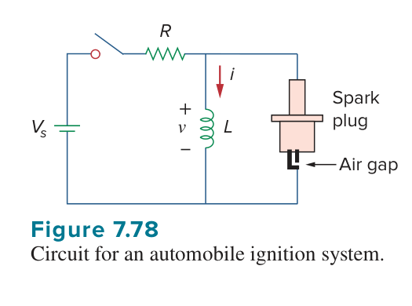

<template #solution>

### 課本解析與答案 (Textbook Solution)

The final current through the coil is I = $\frac{V_{s}}{R}$ = $\frac{12}{4}$ = 3 A The energy stored in the coil is $W=\frac{1}{2}LI^2=\frac{1}{2}\times6\times10^{-3}\times3^2=27\text{ mJ}$ The voltage across the gap is $V=L\frac{\Delta I}{\Delta t}=\frac{6\times10^{-3}\times3}{1\times10^{-6}}=18\text{ kV}$

</template>

</PracticeCard>

<PracticeCard id="ch7-pr22" type="practice" title="Practice Problem 7.22" source="課本 p.297" topic="一階電路與暫態響應 (First-Order Circuits)">

The spark coil of an automobile ignition system has a 20-mH inductance and a 5-Ω resistance. With a supply voltage of 12 V , calculate: the time needed for the coil to fully charge, the energy stored in the coil, and the voltage developed at the spark gap if the switch opens in 2 μs .

<template #solution>

### 課本解析與答案 (Textbook Solution)

20 ms, 57.6 mJ, and 24 kV .

</template>

</PracticeCard>

## 課本章末習題：Problems 7.1–7.79

以下依課本題號排列，收錄標準章末習題（不含 Review Questions 與 Comprehensive Problems）。來源為《Fundamentals of Electric Circuits》Chapter 7，印刷頁 299–308（PDF 第 305–314 頁）。每題引用圖表與其題幹同卡呈現。

<PracticeCard id="ch7-problem-01" type="exercise" title="課本習題 7.1" source="課本 Chapter 7 · Problem 7.1 · 印刷頁 299" topic="RC 自然響應與時間常數">

**原題：** In the circuit shown in Fig. 7.81, v(t) = 56e^(−200t) V, t &gt; 0; i(t) = 8e^(−200t) mA, t &gt; 0. (a) Find R and C. (b) Calculate the time constant τ. (c) Determine the time required for the voltage to decay to half its initial value at t = 0.

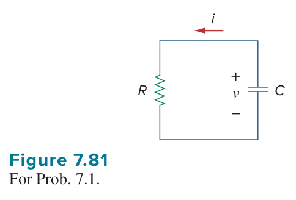

<template #solution>

**課本附錄 D 標準答案：** <code>(a) 0.7143 μF; (b) 5 ms; (c) 3.466 ms.</code>

</template>

</PracticeCard>

<PracticeCard id="ch7-problem-02" type="exercise" title="課本習題 7.2" source="課本 Chapter 7 · Problem 7.2 · 印刷頁 299" topic="RC 自然響應與時間常數">

**原題：** Find the time constant for the RC circuit in Fig. 7.82.

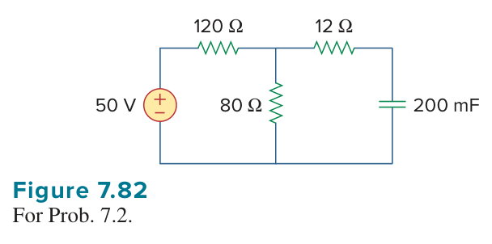

</PracticeCard>

<PracticeCard id="ch7-problem-03" type="exercise" title="課本習題 7.3" source="課本 Chapter 7 · Problem 7.3 · 印刷頁 299" topic="RC 自然響應與時間常數">

**原題：** Determine the time constant for the circuit in Fig. 7.83.

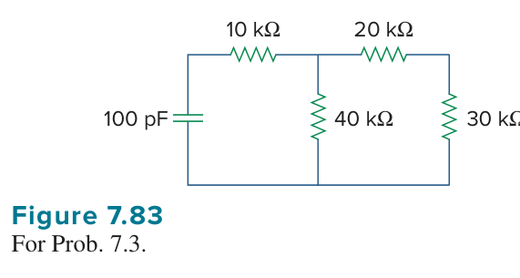

<template #solution>

**課本附錄 D 標準答案：** <code>3.222 μs.</code>

</template>

</PracticeCard>

<PracticeCard id="ch7-problem-04" type="exercise" title="課本習題 7.4" source="課本 Chapter 7 · Problem 7.4 · 印刷頁 300" topic="RC 自然響應與時間常數">

**原題：** The switch in Fig. 7.84 has been in position A for a long time. Assume the switch moves instantaneously from A to B at t = 0. Find v for t &gt; 0.

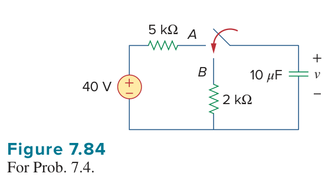

</PracticeCard>

<PracticeCard id="ch7-problem-05" type="exercise" title="課本習題 7.5" source="課本 Chapter 7 · Problem 7.5 · 印刷頁 300" topic="RC 自然響應與時間常數">

**原題：** Using Fig. 7.85, design a problem to help other students better understand source-free RC circuits.

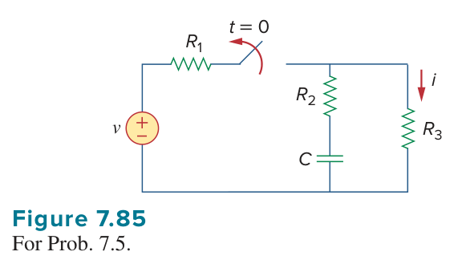

<template #solution>

課本將此題列為設計題，答案依自行設計內容而異。

</template>

</PracticeCard>

<PracticeCard id="ch7-problem-06" type="exercise" title="課本習題 7.6" source="課本 Chapter 7 · Problem 7.6 · 印刷頁 300" topic="RC 自然響應與時間常數">

**原題：** The switch in Fig. 7.86 has been closed for a long time, and it opens at t = 0. Find v(t) for t &gt; 0.

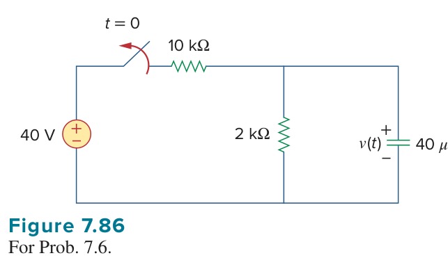

</PracticeCard>

<PracticeCard id="ch7-problem-07" type="exercise" title="課本習題 7.7" source="課本 Chapter 7 · Problem 7.7 · 印刷頁 300" topic="RC 自然響應與時間常數">

**原題：** Assume that the switch in Fig. 7.87 has been in position A for a long time and is moved to position B at t = 0. Then, at t = 1 s, the switch moves from B to C. Find v_C(t) for t &gt; 0.

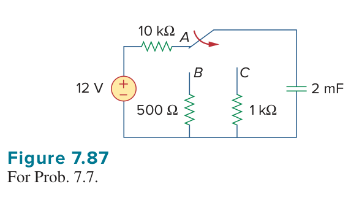

<template #solution>

**課本附錄 D 標準答案：** <code>12e^(−t) V for 0 &lt; t &lt; 1 s; 4.415e^(−0.5(t − 1)) V for 1 s &lt; t &lt; ∞.</code>

</template>

</PracticeCard>

<PracticeCard id="ch7-problem-08" type="exercise" title="課本習題 7.8" source="課本 Chapter 7 · Problem 7.8 · 印刷頁 300" topic="RC 自然響應與時間常數">

**原題：** For the circuit in Fig. 7.88, if v = 10 e −4t V and i = 0.2 e −4t A, t &gt; 0 (a) Find R and C. (b) Determine the time constant. (c) Calculate the initial energy in the capacitor. (d) Obtain the time it takes to dissipate 50 percent of the initial energy.

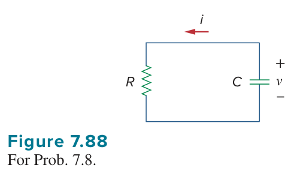

</PracticeCard>

<PracticeCard id="ch7-problem-09" type="exercise" title="課本習題 7.9" source="課本 Chapter 7 · Problem 7.9 · 印刷頁 300" topic="RC 自然響應與時間常數">

**原題：** The switch in Fig. 7.89 opens at t = 0. Find vo for t &gt; 0.

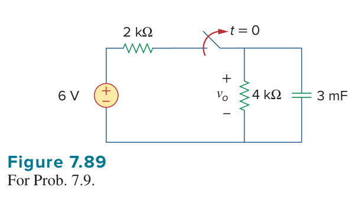

<template #solution>

**課本附錄 D 標準答案：** <code>4e^(−t/12) V.</code>

</template>

</PracticeCard>

<PracticeCard id="ch7-problem-10" type="exercise" title="課本習題 7.10" source="課本 Chapter 7 · Problem 7.10 · 印刷頁 300" topic="RC 自然響應與時間常數">

**原題：** For the circuit in Fig. 7.90, find vo(t) for t &gt; 0. Determine the time necessary for the capacitor voltage to decay to one-third of its value at t = 0.

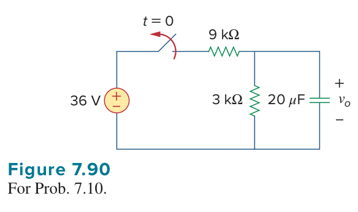

</PracticeCard>

<PracticeCard id="ch7-problem-11" type="exercise" title="課本習題 7.11" source="課本 Chapter 7 · Problem 7.11 · 印刷頁 300" topic="RC 自然響應與時間常數">

**原題：** For the circuit in Fig. 7.91, find io for t &gt; 0.

<template #solution>

**課本附錄 D 標準答案：** <code>1.2e^(−3t) A.</code>

</template>

</PracticeCard>

<PracticeCard id="ch7-problem-12" type="exercise" title="課本習題 7.12" source="課本 Chapter 7 · Problem 7.12 · 印刷頁 301" topic="RL 自然響應與時間常數">

**原題：** Using Fig. 7.92, design a problem to help other students better understand source-free RL circuits.

</PracticeCard>

<PracticeCard id="ch7-problem-13" type="exercise" title="課本習題 7.13" source="課本 Chapter 7 · Problem 7.13 · 印刷頁 301" topic="RL 自然響應與時間常數">

**原題：** In the circuit of Fig. 7.93, v(t) = 80e^(−10^3t) V, t &gt; 0, and i(t) = 5e^(−10^3t) mA, t &gt; 0. (a) Find R, L, and τ. (b) Calculate the energy dissipated in the resistance for 0 &lt; t &lt; 0.5 ms.

<template #solution>

**課本附錄 D 標準答案：** <code>(a) 16 kΩ, 16 H, 1 ms; (b) 126.42 μJ.</code>

</template>

</PracticeCard>

<PracticeCard id="ch7-problem-14" type="exercise" title="課本習題 7.14" source="課本 Chapter 7 · Problem 7.14 · 印刷頁 301" topic="RL 自然響應與時間常數">

**原題：** Calculate the time constant of the circuit in Fig. 7.94.

</PracticeCard>

<PracticeCard id="ch7-problem-15" type="exercise" title="課本習題 7.15" source="課本 Chapter 7 · Problem 7.15 · 印刷頁 301" topic="RL 自然響應與時間常數">

**原題：** Find the time constant for each of the circuits in Fig. 7.95. (a) (b)

<template #solution>

**課本附錄 D 標準答案：** <code>(a) 10 Ω, 500 ms; (b) 80 Ω, 250 μs.</code>

</template>

</PracticeCard>

<PracticeCard id="ch7-problem-16" type="exercise" title="課本習題 7.16" source="課本 Chapter 7 · Problem 7.16 · 印刷頁 301" topic="RL 自然響應與時間常數">

**原題：** Determine the time constant for each of the circuits in Fig. 7.96. (a) (b)

</PracticeCard>

<PracticeCard id="ch7-problem-17" type="exercise" title="課本習題 7.17" source="課本 Chapter 7 · Problem 7.17 · 印刷頁 301" topic="RL 自然響應與時間常數">

**原題：** Consider the circuit of Fig. 7.97. Find vo(t) if i(0) = 6 A and v(t) = 0.

<template #solution>

**課本附錄 D 標準答案：** <code>[−6e^(−16t)u(t)] V for all t &gt; 0.</code>

</template>

</PracticeCard>

<PracticeCard id="ch7-problem-18" type="exercise" title="課本習題 7.18" source="課本 Chapter 7 · Problem 7.18 · 印刷頁 301" topic="RL 自然響應與時間常數">

**原題：** For the circuit in Fig. 7.98, determine vo(t) when i(0) = 5 A and v(t) = 0.

</PracticeCard>

<PracticeCard id="ch7-problem-19" type="exercise" title="課本習題 7.19" source="課本 Chapter 7 · Problem 7.19 · 印刷頁 301" topic="RL 自然響應與時間常數">

**原題：** In the circuit of Fig. 7.99, find i(t) for t &gt; 0 if i(0) = 6 A.

<template #solution>

**課本附錄 D 標準答案：** <code>6e^(−5t)u(t) A.</code>

</template>

</PracticeCard>

<PracticeCard id="ch7-problem-20" type="exercise" title="課本習題 7.20" source="課本 Chapter 7 · Problem 7.20 · 印刷頁 302" topic="RL 自然響應與時間常數">

**原題：** For the circuit in Fig. 7.100, v = 90e^(−50t) V and i = 30e^(−50t) A, t &gt; 0. (a) Find L and R. (b) Determine the time constant. (c) Calculate the initial energy in the inductor. (d) What fraction of the initial energy is dissipated in 10 ms?

</PracticeCard>

<PracticeCard id="ch7-problem-21" type="exercise" title="課本習題 7.21" source="課本 Chapter 7 · Problem 7.21 · 印刷頁 302" topic="RL 自然響應與時間常數">

**原題：** In the circuit of Fig. 7.101, find the value of R for which the steady-state energy stored in the inductor will be 1 J.

<template #solution>

**課本附錄 D 標準答案：** <code>13.333 Ω.</code>

</template>

</PracticeCard>

<PracticeCard id="ch7-problem-22" type="exercise" title="課本習題 7.22" source="課本 Chapter 7 · Problem 7.22 · 印刷頁 302" topic="RL 自然響應與時間常數">

**原題：** Find i(t) and v(t) for t &gt; 0 in the circuit of Fig. 7.102 if i(0) = 10 A.

</PracticeCard>

<PracticeCard id="ch7-problem-23" type="exercise" title="課本習題 7.23" source="課本 Chapter 7 · Problem 7.23 · 印刷頁 302" topic="RL 自然響應與時間常數">

**原題：** Consider the circuit in Fig. 7.103. Given that vo(0) = 10 V, find vo and vx for t &gt; 0.

<template #solution>

**課本附錄 D 標準答案：** <code>v_o(t) = 10e^(−4t) V, t &gt; 0; v_x(t) = 2.5e^(−4t) V, t &gt; 0.</code>

</template>

</PracticeCard>

<PracticeCard id="ch7-problem-24" type="exercise" title="課本習題 7.24" source="課本 Chapter 7 · Problem 7.24 · 印刷頁 302" topic="奇異函數與脈衝響應">

**原題：** Express the following signals in terms of singularity functions: (a) v(t) = 0 for t &lt; 0, −5 for t &gt; 0; (b) i(t) = 0 for t &lt; 1, −10 for 1 &lt; t &lt; 3, 10 for 3 &lt; t &lt; 5, 0 for t &gt; 5; (c) x(t) = t − 1 for 1 &lt; t &lt; 2, 1 for 2 &lt; t &lt; 3, 4 − t for 3 &lt; t &lt; 4, 0 otherwise; (d) y(t) = 2 for t &lt; 0, −5 for 0 &lt; t &lt; 1, 0 for t &gt; 1.

</PracticeCard>

<PracticeCard id="ch7-problem-25" type="exercise" title="課本習題 7.25" source="課本 Chapter 7 · Problem 7.25 · 印刷頁 302" topic="奇異函數與脈衝響應">

**原題：** Design a problem to help other students better understand singularity functions.

<template #solution>

課本將此題列為設計題，答案依自行設計內容而異。

</template>

</PracticeCard>

<PracticeCard id="ch7-problem-26" type="exercise" title="課本習題 7.26" source="課本 Chapter 7 · Problem 7.26 · 印刷頁 302" topic="奇異函數與脈衝響應">

**原題：** Express the signals in Fig. 7.104 in terms of singularity functions.

</PracticeCard>

<PracticeCard id="ch7-problem-27" type="exercise" title="課本習題 7.27" source="課本 Chapter 7 · Problem 7.27 · 印刷頁 302" topic="奇異函數與脈衝響應">

**原題：** Express v(t) in Fig. 7.105 in terms of step functions.

<template #solution>

**課本附錄 D 標準答案：** <code>[5u(t + 1) + 10u(t) − 25u(t − 1) + 15u(t − 2)] V.</code>

</template>

</PracticeCard>

<PracticeCard id="ch7-problem-28" type="exercise" title="課本習題 7.28" source="課本 Chapter 7 · Problem 7.28 · 印刷頁 303" topic="奇異函數與脈衝響應">

**原題：** Sketch the waveform represented by i(t) = r(t) − r(t − 1) − u(t − 2) − r(t − 2)

</PracticeCard>

<PracticeCard id="ch7-problem-29" type="exercise" title="課本習題 7.29" source="課本 Chapter 7 · Problem 7.29 · 印刷頁 303" topic="奇異函數與脈衝響應">

**原題：** Sketch the following functions: (a) x(t) = 10e^(−t)u(t − 1), (b) y(t) = 10e^(−(t − 1))u(t), (c) z(t) = cos(4t)δ(t − 1).

<template #solution>

**課本附錄 D.14 圖示答案：**

課本附錄文字：<code>See Fig. D.14 for the sketches; for (c), z(t) = cos(4t)δ(t − 1) = cos(4)δ(t − 1) ≈ −0.6536δ(t − 1).</code>

</template>

</PracticeCard>

<PracticeCard id="ch7-problem-30" type="exercise" title="課本習題 7.30" source="課本 Chapter 7 · Problem 7.30 · 印刷頁 303" topic="奇異函數與脈衝響應">

**原題：** Evaluate the following integrals involving the impulse function: (a) ∫ from −∞ to ∞ 4t²δ(t − 1) dt; (b) ∫ from −∞ to ∞ 4t² cos(2πt)δ(t − 0.5) dt.

</PracticeCard>

<PracticeCard id="ch7-problem-31" type="exercise" title="課本習題 7.31" source="課本 Chapter 7 · Problem 7.31 · 印刷頁 303" topic="奇異函數與脈衝響應">

**原題：** Evaluate the following integrals: (a) ∫ from −∞ to ∞ e^(−4t²)δ(t − 2) dt; (b) ∫ from −∞ to ∞ [5δ(t) + e^(−t)δ(t) + cos(2πt)δ(t)] dt.

<template #solution>

**課本附錄 D 標準答案：** <code>(a) 1.1254 × 10^(−7); (b) 7.</code>

</template>

</PracticeCard>

<PracticeCard id="ch7-problem-32" type="exercise" title="課本習題 7.32" source="課本 Chapter 7 · Problem 7.32 · 印刷頁 303" topic="奇異函數與脈衝響應">

**原題：** Evaluate the following integrals: (a) ∫ from 1 to t u(λ) dλ; (b) ∫ from 0 to 4 r(t − 1) dt; (c) ∫ from 1 to 5 (t − 6)²δ(t − 2) dt.

</PracticeCard>

<PracticeCard id="ch7-problem-33" type="exercise" title="課本習題 7.33" source="課本 Chapter 7 · Problem 7.33 · 印刷頁 303" topic="奇異函數與脈衝響應">

**原題：** The voltage across a 10-mH inductor is 15δ(t − 2) mV. Find the inductor current, assuming the inductor is initially uncharged.

<template #solution>

**課本附錄 D 標準答案：** <code>1.5u(t − 2) A.</code>

</template>

</PracticeCard>

<PracticeCard id="ch7-problem-34" type="exercise" title="課本習題 7.34" source="課本 Chapter 7 · Problem 7.34 · 印刷頁 303" topic="奇異函數與脈衝響應">

**原題：** Evaluate the following derivatives: (a) d/dt [u(t − 1)u(t + 1)]; (b) d/dt [r(t − 6)u(t − 2)]; (c) d/dt [sin(4t)u(t − 3)].

</PracticeCard>

<PracticeCard id="ch7-problem-35" type="exercise" title="課本習題 7.35" source="課本 Chapter 7 · Problem 7.35 · 印刷頁 303" topic="一階微分方程">

**原題：** Find the solution to the following differential equations: (a) dv/dt + 2v = 0, v(0) = −1 V (b) 2 di/dt − 3i = 0, i(0) = 2

<template #solution>

**課本附錄 D 標準答案：** <code>(a) −e^(−2t)u(t) V; (b) 2e^(1.5t)u(t) A.</code>

</template>

</PracticeCard>

<PracticeCard id="ch7-problem-36" type="exercise" title="課本習題 7.36" source="課本 Chapter 7 · Problem 7.36 · 印刷頁 303" topic="一階微分方程">

**原題：** Solve for v in the following differential equations, subject to the stated initial condition. (a) dv/dt + v = u(t), v(0) = 0 (b) 2 dv/dt − v = 3u(t), v(0) = −6

</PracticeCard>

<PracticeCard id="ch7-problem-37" type="exercise" title="課本習題 7.37" source="課本 Chapter 7 · Problem 7.37 · 印刷頁 303" topic="一階微分方程">

**原題：** A circuit is described by 4 dv/dt + v = 10 (a) What is the time constant of the circuit? (b) What is v(∞), the final value of v ? (c) If v(0) = 2, find v(t) for t ≥ 0.

<template #solution>

**課本附錄 D 標準答案：** <code>(a) 4 s; (b) 10 V; (c) (10 − 8e^(−t/4))u(t) V.</code>

</template>

</PracticeCard>

<PracticeCard id="ch7-problem-38" type="exercise" title="課本習題 7.38" source="課本 Chapter 7 · Problem 7.38 · 印刷頁 303" topic="一階微分方程">

**原題：** A circuit is described by di/dt + 3i = 2u(t) Find i(t) for t &gt; 0 given that i(0) = 0.

</PracticeCard>

<PracticeCard id="ch7-problem-39" type="exercise" title="課本習題 7.39" source="課本 Chapter 7 · Problem 7.39 · 印刷頁 303" topic="RC 階躍響應">

**原題：** Calculate the capacitor voltage for t &lt; 0 and t &gt; 0 for each of the circuits in Fig. 7.106.

<template #solution>

**課本附錄 D 標準答案：** <code>(a) 4 V for t &lt; 0; 20 − 16e^(−t/8) V for t &gt; 0. (b) 4 V for t &lt; 0; 12 − 8e^(−t/6) V for t &gt; 0.</code>

</template>

</PracticeCard>

<PracticeCard id="ch7-problem-40" type="exercise" title="課本習題 7.40" source="課本 Chapter 7 · Problem 7.40 · 印刷頁 303" topic="RC 階躍響應">

**原題：** Find the capacitor voltage for t &lt; 0 and t &gt; 0 for each of the circuits in Fig. 7.107.

</PracticeCard>

<PracticeCard id="ch7-problem-41" type="exercise" title="課本習題 7.41" source="課本 Chapter 7 · Problem 7.41 · 印刷頁 304" topic="RC 階躍響應">

**原題：** Using Fig. 7.108, design a problem to help other students better understand the step response of an RC circuit.

<template #solution>

課本將此題列為設計題，答案依自行設計內容而異。

</template>

</PracticeCard>

<PracticeCard id="ch7-problem-42" type="exercise" title="課本習題 7.42" source="課本 Chapter 7 · Problem 7.42 · 印刷頁 304" topic="RC 階躍響應">

**原題：** (a) If the switch in Fig. 7.109 has been open for a long time and is closed at t = 0, find vo(t). (b) Suppose that the switch has been closed for a long time and is opened at t = 0. Find vo(t).

</PracticeCard>

<PracticeCard id="ch7-problem-43" type="exercise" title="課本習題 7.43" source="課本 Chapter 7 · Problem 7.43 · 印刷頁 304" topic="RC 階躍響應">

**原題：** Consider the circuit in Fig. 7.110. Find i(t) for t &lt; 0 and t &gt; 0.

<template #solution>

**課本附錄 D 標準答案：** <code>0.8 A; 0.8e^(−t/480)u(t) A.</code>

</template>

</PracticeCard>

<PracticeCard id="ch7-problem-44" type="exercise" title="課本習題 7.44" source="課本 Chapter 7 · Problem 7.44 · 印刷頁 304" topic="RC 階躍響應">

**原題：** The switch in Fig. 7.111 has been in position a for a long time. At t = 0, it moves to position b. Calculate i(t) for all t &gt; 0.

</PracticeCard>

<PracticeCard id="ch7-problem-45" type="exercise" title="課本習題 7.45" source="課本 Chapter 7 · Problem 7.45 · 印刷頁 304" topic="RC 階躍響應">

**原題：** Find v_o in the circuit of Fig. 7.112 when v_s = 30u(t) V. Assume that v_o(0) = 5 V.

<template #solution>

**課本附錄 D 標準答案：** <code>[20 − 15e^(−14.286t)]u(t) V.</code>

</template>

</PracticeCard>

<PracticeCard id="ch7-problem-46" type="exercise" title="課本習題 7.46" source="課本 Chapter 7 · Problem 7.46 · 印刷頁 304" topic="RC 階躍響應">

**原題：** For the circuit in Fig. 7.113, is(t) = 5u(t). Find v(t).

</PracticeCard>

<PracticeCard id="ch7-problem-47" type="exercise" title="課本習題 7.47" source="課本 Chapter 7 · Problem 7.47 · 印刷頁 304" topic="RC 階躍響應">

**原題：** Determine v(t) for t &gt; 0 in the circuit of Fig. 7.114 if v(0) = 0.

<template #solution>

**課本附錄 D 標準答案：** <code>24(1 − e^(−t)) V for 0 &lt; t &lt; 1; 30 − 14.83e^(−(t − 1)) V for t &gt; 1.</code>

</template>

</PracticeCard>

<PracticeCard id="ch7-problem-48" type="exercise" title="課本習題 7.48" source="課本 Chapter 7 · Problem 7.48 · 印刷頁 305" topic="RC 階躍響應">

**原題：** Find v(t) and i(t) in the circuit of Fig. 7.115.

</PracticeCard>

<PracticeCard id="ch7-problem-49" type="exercise" title="課本習題 7.49" source="課本 Chapter 7 · Problem 7.49 · 印刷頁 305" topic="RC 階躍響應">

**原題：** If the waveform in Fig. 7.116(a) is applied to the circuit of Fig. 7.116(b), find v(t). Assume v(0) = 0. (a) (b)

<template #solution>

**課本附錄 D 標準答案：** <code>8(1 − e^(−t/5)) V for 0 &lt; t &lt; 1; [−16 + 31.17e^(−(t − 1))] V for t &gt; 1.</code>

</template>

</PracticeCard>

<PracticeCard id="ch7-problem-50" type="exercise" title="課本習題 7.50" source="課本 Chapter 7 · Problem 7.50 · 印刷頁 305" topic="RC 階躍響應">

**原題：** In the circuit of Fig. 7.117, find i_x for t &gt; 0. Let R_1 = R_2 = 1 kΩ, R_3 = 2 kΩ, and C = 0.25 mF. At time t = 0, the switch moves from position a to b.

</PracticeCard>

<PracticeCard id="ch7-problem-51" type="exercise" title="課本習題 7.51" source="課本 Chapter 7 · Problem 7.51 · 印刷頁 305" topic="RC 階躍響應">

**原題：** Rather than applying the shortcut technique used in Section 7.6, use KVL to obtain Eq. (7.60).

<template #solution>

**課本附錄 D 所列關係式：** <code>The answer-key derivation gives i(t) = V_S/R + (I_0 − V_S/R)e^(−t/τ), with τ = L/R.</code>

</template>

</PracticeCard>

<PracticeCard id="ch7-problem-52" type="exercise" title="課本習題 7.52" source="課本 Chapter 7 · Problem 7.52 · 印刷頁 305" topic="RC 階躍響應">

**原題：** Using Fig. 7.118, design a problem to help other students better understand the step response of an RL circuit.

</PracticeCard>

<PracticeCard id="ch7-problem-53" type="exercise" title="課本習題 7.53" source="課本 Chapter 7 · Problem 7.53 · 印刷頁 305" topic="RL 階躍響應">

**原題：** Determine the inductor current i(t) for both t &lt; 0 and t &gt; 0 for each of the circuits in Fig. 7.119. (a) (b)

<template #solution>

**課本附錄 D 標準答案：** <code>(a) 5 A, 5e^(−t/2)u(t) A; (b) 6 A, 6e^(−2t/3)u(t) A.</code>

</template>

</PracticeCard>

<PracticeCard id="ch7-problem-54" type="exercise" title="課本習題 7.54" source="課本 Chapter 7 · Problem 7.54 · 印刷頁 305" topic="RL 階躍響應">

**原題：** Obtain the inductor current for both t &lt; 0 and t &gt; 0 in each of the circuits in Fig. 7.120. (a) (b)

</PracticeCard>

<PracticeCard id="ch7-problem-55" type="exercise" title="課本習題 7.55" source="課本 Chapter 7 · Problem 7.55 · 印刷頁 306" topic="RL 階躍響應">

**原題：** Find v(t) for t &lt; 0 and t &gt; 0 in the circuit of Fig. 7.121.

<template #solution>

**課本附錄 D 標準答案：** <code>96 V; 96e^(−4t)u(t) V.</code>

</template>

</PracticeCard>

<PracticeCard id="ch7-problem-56" type="exercise" title="課本習題 7.56" source="課本 Chapter 7 · Problem 7.56 · 印刷頁 306" topic="RL 階躍響應">

**原題：** For the network shown in Fig. 7.122, find v(t) for t &gt; 0.

</PracticeCard>

<PracticeCard id="ch7-problem-57" type="exercise" title="課本習題 7.57" source="課本 Chapter 7 · Problem 7.57 · 印刷頁 306" topic="RL 階躍響應">

**原題：** Find i1(t) and i2(t) for t &gt; 0 in the circuit of Fig. 7.123.

<template #solution>

**課本附錄 D 標準答案：** <code>2.4e^(−2t)u(t) A; 600e^(−5t)u(t) mA.</code>

</template>

</PracticeCard>

<PracticeCard id="ch7-problem-58" type="exercise" title="課本習題 7.58" source="課本 Chapter 7 · Problem 7.58 · 印刷頁 306" topic="RL 階躍響應">

**原題：** Rework Prob. 7.17 if i(0) = 10 A and v(t) = 20u(t) V.

</PracticeCard>

<PracticeCard id="ch7-problem-59" type="exercise" title="課本習題 7.59" source="課本 Chapter 7 · Problem 7.59 · 印刷頁 306" topic="RL 階躍響應">

**原題：** Determine the step response vo(t) to vs = 18 u(t) V in the circuit of Fig. 7.124.

<template #solution>

**課本附錄 D 標準答案：** <code>6e^(−4t)u(t) V.</code>

</template>

</PracticeCard>

<PracticeCard id="ch7-problem-60" type="exercise" title="課本習題 7.60" source="課本 Chapter 7 · Problem 7.60 · 印刷頁 306" topic="RL 階躍響應">

**原題：** Find v(t) for t &gt; 0 in the circuit of Fig. 7.125 if the initial current in the inductor is zero.

</PracticeCard>

<PracticeCard id="ch7-problem-61" type="exercise" title="課本習題 7.61" source="課本 Chapter 7 · Problem 7.61 · 印刷頁 306" topic="RL 階躍響應">

**原題：** In the circuit in Fig. 7.126, is changes from 5 A to 10 A at t = 0; that is, is = 5u(−t) + 10u(t). Find v and i.

<template #solution>

**課本附錄 D 標準答案：** <code>20e^(−8t)u(t) V; (10 − 5e^(−8t))u(t) A.</code>

</template>

</PracticeCard>

<PracticeCard id="ch7-problem-62" type="exercise" title="課本習題 7.62" source="課本 Chapter 7 · Problem 7.62 · 印刷頁 306" topic="RL 階躍響應">

**原題：** For the circuit in Fig. 7.127, calculate i(t) if i(0) = 0.

</PracticeCard>

<PracticeCard id="ch7-problem-63" type="exercise" title="課本習題 7.63" source="課本 Chapter 7 · Problem 7.63 · 印刷頁 306" topic="RL 階躍響應">

**原題：** Obtain v(t) and i(t) in the circuit of Fig. 7.128.

<template #solution>

**課本附錄 D 標準答案：** <code>2e^(−8t)u(t) A; −8e^(−8t)u(t) V.</code>

</template>

</PracticeCard>

<PracticeCard id="ch7-problem-64" type="exercise" title="課本習題 7.64" source="課本 Chapter 7 · Problem 7.64 · 印刷頁 306" topic="RL 階躍響應">

**原題：** Determine the value of iL(t) and the total energy dissipated by the circuit from t = 0 sec to t = ∞ sec. The value of vin(t) is equal to [40 – 40u(t)] volts.

</PracticeCard>

<PracticeCard id="ch7-problem-65" type="exercise" title="課本習題 7.65" source="課本 Chapter 7 · Problem 7.65 · 印刷頁 307" topic="一階運算放大器電路">

**原題：** If the input pulse in Fig. 7.130(a) is applied to the circuit in Fig. 7.130(b), determine the response i(t). (b) (a)

<template #solution>

**課本附錄 D 標準答案：** <code>2(1 − e^(−2t)) A for 0 &lt; t &lt; 1; 1.729e^(−2(t − 1)) A for t &gt; 1.</code>

</template>

</PracticeCard>

<PracticeCard id="ch7-problem-66" type="exercise" title="課本習題 7.66" source="課本 Chapter 7 · Problem 7.66 · 印刷頁 307" topic="一階運算放大器電路">

**原題：** Using Fig. 7.131, design a problem to help other students better understand first-order op amp circuits.

</PracticeCard>

<PracticeCard id="ch7-problem-67" type="exercise" title="課本習題 7.67" source="課本 Chapter 7 · Problem 7.67 · 印刷頁 307" topic="一階運算放大器電路">

**原題：** If v(0) = 5 V, find v_o(t) for t &gt; 0 in the op amp circuit in Fig. 7.132. Let R = 10 kΩ and C = 1 μF.

<template #solution>

**課本附錄 D 標準答案：** <code>5e^(−100t/3)u(t) V.</code>

</template>

</PracticeCard>

<PracticeCard id="ch7-problem-68" type="exercise" title="課本習題 7.68" source="課本 Chapter 7 · Problem 7.68 · 印刷頁 307" topic="一階運算放大器電路">

**原題：** Obtain vo for t &gt; 0 in the circuit of Fig. 7.133.

</PracticeCard>

<PracticeCard id="ch7-problem-69" type="exercise" title="課本習題 7.69" source="課本 Chapter 7 · Problem 7.69 · 印刷頁 307" topic="一階運算放大器電路">

**原題：** For the op amp circuit in Fig. 7.134, find vo(t) for t &gt; 0.

<template #solution>

**課本附錄 D 標準答案：** <code>48(e^(−t/3000) − 1)u(t) V.</code>

</template>

</PracticeCard>

<PracticeCard id="ch7-problem-70" type="exercise" title="課本習題 7.70" source="課本 Chapter 7 · Problem 7.70 · 印刷頁 307" topic="一階運算放大器電路">

**原題：** Determine vo for t &gt; 0 when vs = 20 mV in the op amp circuit of Fig. 7.135.

</PracticeCard>

<PracticeCard id="ch7-problem-71" type="exercise" title="課本習題 7.71" source="課本 Chapter 7 · Problem 7.71 · 印刷頁 307" topic="一階運算放大器電路">

**原題：** For the op amp circuit in Fig. 7.136, suppose v(0) = 0 and vs = 3V. Find v(t) for t &gt; 0.

<template #solution>

**課本附錄 D 標準答案：** <code>[6(1 − e^(−5t))]u(t) V.</code>

</template>

</PracticeCard>

<PracticeCard id="ch7-problem-72" type="exercise" title="課本習題 7.72" source="課本 Chapter 7 · Problem 7.72 · 印刷頁 308" topic="一階運算放大器電路">

**原題：** Find i_o in the op amp circuit in Fig. 7.137. Assume that v(0) = −2 V, R = 10 kΩ, and C = 10 μF.

</PracticeCard>

<PracticeCard id="ch7-problem-73" type="exercise" title="課本習題 7.73" source="課本 Chapter 7 · Problem 7.73 · 印刷頁 308" topic="一階運算放大器電路">

**原題：** For the op amp circuit of Fig. 7.138, let R_1 = 10 kΩ, R_f = 20 kΩ, C = 20 μF, and v(0) = 1 V. Find v_o.

<template #solution>

**課本附錄 D 標準答案：** <code>−6e^(−5t)u(t) V.</code>

</template>

</PracticeCard>

<PracticeCard id="ch7-problem-74" type="exercise" title="課本習題 7.74" source="課本 Chapter 7 · Problem 7.74 · 印刷頁 308" topic="一階運算放大器電路">

**原題：** Determine v_o(t) for t &gt; 0 in the circuit of Fig. 7.139. Let i_s = 10u(t) μA and assume that the capacitor is initially uncharged.

</PracticeCard>

<PracticeCard id="ch7-problem-75" type="exercise" title="課本習題 7.75" source="課本 Chapter 7 · Problem 7.75 · 印刷頁 308" topic="一階運算放大器電路">

**原題：** In the circuit of Fig. 7.140, find vo and io, given that vs = 4 u(t) V and v(0) = 1 V.

<template #solution>

**課本附錄 D 標準答案：** <code>[6 − 3e^(−50t)]u(t) V; −200 μA.</code>

</template>

</PracticeCard>

<PracticeCard id="ch7-problem-76" type="exercise" title="課本習題 7.76" source="課本 Chapter 7 · Problem 7.76 · 印刷頁 308" topic="PSpice 與 MultiSim 模擬">

**原題：** Repeat Prob. 7.49 using PSpice or MultiSim.

</PracticeCard>

<PracticeCard id="ch7-problem-77" type="exercise" title="課本習題 7.77" source="課本 Chapter 7 · Problem 7.77 · 印刷頁 308" topic="PSpice 與 MultiSim 模擬">

**原題：** The switch in Fig. 7.141 opens at t = 0. Use PSpice or MultiSim to determine v(t) for t &gt; 0.

<template #solution>

**課本附錄 D.15 圖示答案：**

</template>

</PracticeCard>

<PracticeCard id="ch7-problem-78" type="exercise" title="課本習題 7.78" source="課本 Chapter 7 · Problem 7.78 · 印刷頁 308" topic="PSpice 與 MultiSim 模擬">

**原題：** The switch in Fig. 7.142 moves from position a to b at t = 0. Use PSpice or MultiSim to find i(t) for t &gt; 0.

</PracticeCard>

<PracticeCard id="ch7-problem-79" type="exercise" title="課本習題 7.79" source="課本 Chapter 7 · Problem 7.79 · 印刷頁 308" topic="PSpice 與 MultiSim 模擬">

**原題：** In the circuit in Fig. 7.143, the switch has been in position a for a long time but moves instantaneously to position b at t = 0. Determine io(t).

<template #solution>

**課本附錄 D 標準答案：** <code>[−0.5 + 4.5e^(−2t)]u(t) A.</code>

</template>

</PracticeCard>
