# Chapter 8 二階電路：互動式範例與練習題庫

本頁依課本《Fundamentals of Electric Circuits》Chapter 8 編排，收錄例題、練習題與章末標準習題。題目保留課本英文原文及對應圖表；有課本解答可核對時，另列來源解答。

::: details Chapter 8 核心公式與解題要訣

### 初始條件連續性

電容電壓與電感電流不能瞬間跳變：

$$v_C(0^+)=v_C(0^-),\qquad i_L(0^+)=i_L(0^-)$$

### 二階電路特徵根

$$\frac{d^2x}{dt^2}+2\alpha\frac{dx}{dt}+\omega_0^2x=f(t),\qquad s_{1,2}=-\alpha\pm\sqrt{\alpha^2-\omega_0^2}$$

- 串聯 RLC：$\alpha=R/(2L)$；並聯 RLC：$\alpha=1/(2RC)$。
- 兩種拓樸皆有 $\omega_0=1/\sqrt{LC}$。
- $\alpha>\omega_0$ 為過阻尼；$\alpha=\omega_0$ 為臨界阻尼；$\alpha<\omega_0$ 為欠阻尼。

### 完整響應

含獨立源的響應可拆成暫態與穩態：

$$x(t)=x_{\mathrm{ss}}(t)+x_t(t)$$

:::

<PracticeFilter prefix="ch8-" />
<PracticeProgress :total="111" prefix="ch8-" />

---

<PracticeCard id="ch8-ex1" type="example" title="Example 8.1" source="課本 p.313" topic="二階電路 / 例題">

The switch in Fig. 8.2 has been closed for a long time. It is open at t = 0. Find: (a) i(0+), v(0+), (b) di(0+)∕dt, dv(0+)∕dt, (c) i(∞), v(∞)

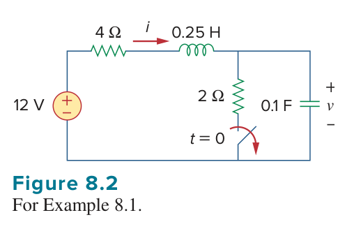

<template #solution>

**課本解答摘要：** 開關切換前已達穩態，故電感視為短路、電容視為開路，得 $i(0^-)=2\,\mathrm{A}$、$v(0^-)=4\,\mathrm{V}$。連續性給出相同的 $0^+$ 值；切換後由 KCL/KVL 得 $di(0^+)/dt=0$、$dv(0^+)/dt=20\,\mathrm{V/s}$；穩態時 $i(\infty)=0$、$v(\infty)=12\,\mathrm{V}$。

</template>
</PracticeCard>

<PracticeCard id="ch8-pr1" type="practice" title="Practice Problem 8.1" source="課本 p.314" topic="二階電路 / 練習題">

The switch in Fig. 8.4 was open for a long time but closed at t = 0. Determine: (a) i(0+), v(0+), (b) di(0+)∕dt, dv(0+)∕dt, (c) i(∞), v(∞)

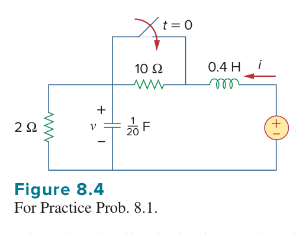

<template #solution>

**課本答案：** (a) $i(0^+)=2\,\mathrm{A}$、$v(0^+)=4\,\mathrm{V}$；(b) $di(0^+)/dt=50\,\mathrm{A/s}$、$dv(0^+)/dt=0\,\mathrm{V/s}$；(c) $i(\infty)=12\,\mathrm{A}$、$v(\infty)=24\,\mathrm{V}$。

</template>
</PracticeCard>

<PracticeCard id="ch8-ex2" type="example" title="Example 8.2" source="課本 p.315" topic="二階電路 / 例題">

In the circuit of Fig. 8.5, calculate: (a) iL(0+), vC (0+), vR(0+), (b) diL(0+)∕dt, dvC(0+)∕dt, dvR(0+)∕dt, (c) iL(∞), vC(∞), vR(∞).

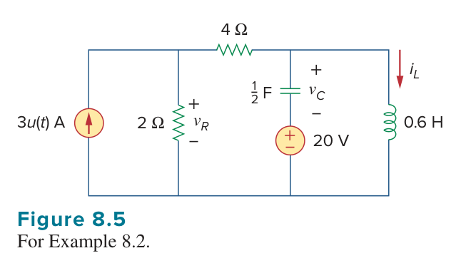

<template #solution>

**課本解答摘要：** $i_L(0^+)=0$、$v_C(0^+)=-20\,\mathrm{V}$，並由切換後的 KCL/KVL 得 $v_R(0^+)=4\,\mathrm{V}$。導數為 $di_L(0^+)/dt=0$、$dv_C(0^+)/dt=2\,\mathrm{V/s}$、$dv_R(0^+)/dt=2/3\,\mathrm{V/s}$。穩態值為 $i_L(\infty)=1\,\mathrm{A}$、$v_C(\infty)=-20\,\mathrm{V}$、$v_R(\infty)=4\,\mathrm{V}$。

</template>
</PracticeCard>

<PracticeCard id="ch8-pr2" type="practice" title="Practice Problem 8.2" source="課本 p.317" topic="二階電路 / 練習題">

For the circuit in Fig. 8.7, find: (a) iL(0+), vC(0+), vR(0+), (b) diL(0+)∕dt, dvC(0+)∕dt, dvR(0+)∕dt, (c) iL(∞), vC(∞), vR(∞).

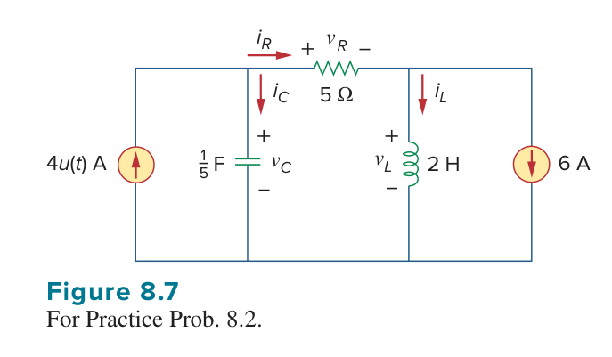

<template #solution>

**課本答案：** (a) $i_L(0^+)=-6\,\mathrm{A}$、$v_C(0^+)=0$、$v_R(0^+)=0$；(b) $di_L(0^+)/dt=0$、$dv_C(0^+)/dt=20\,\mathrm{V/s}$、$dv_R(0^+)/dt=0$；(c) $i_L(\infty)=-2\,\mathrm{A}$、$v_C(\infty)=20\,\mathrm{V}$、$v_R(\infty)=20\,\mathrm{V}$。

</template>
</PracticeCard>

<PracticeCard id="ch8-ex3" type="example" title="Example 8.3" source="課本 p.322" topic="二階電路 / 例題">

In Fig. 8.8, R = 40 Ω, L = 4 H, and C = 1∕4 F. Calculate the characteristic roots of the circuit. Is the natural response overdamped, underdamped, or critically damped?

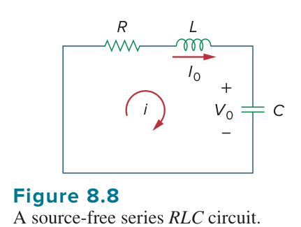

<template #solution>

**課本解答摘要：** $\alpha=R/(2L)=5\,\mathrm{s^{-1}}$、$\omega_0=1/\sqrt{LC}=1\,\mathrm{s^{-1}}$。特徵根 $s_1=-0.101$、$s_2=-9.899\,\mathrm{s^{-1}}$，因此為過阻尼響應。

</template>
</PracticeCard>

<PracticeCard id="ch8-pr3" type="practice" title="Practice Problem 8.3" source="課本 p.322" topic="二階電路 / 練習題">

If R = 10 Ω, L = 5 H, and C = 2 mF in Fig. 8.8, find α, ω0, s₁, and s₂. What type of natural response will the circuit have?

<template #solution>

**課本答案：** $\alpha=1\,\mathrm{s^{-1}}$、$\omega_0=10\,\mathrm{s^{-1}}$、$s_{1,2}=-1\pm j9.95\,\mathrm{s^{-1}}$；欠阻尼。

</template>
</PracticeCard>

<PracticeCard id="ch8-ex4" type="example" title="Example 8.4" source="課本 p.322" topic="二階電路 / 例題">

Find i(t) in the circuit of Fig. 8.10. Assume that the circuit has reached steady state at t = 0−

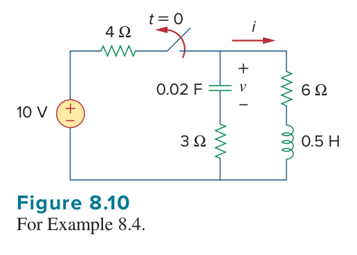

<template #solution>

**課本解答摘要：** 初始值為 $i(0)=1\,\mathrm{A}$、$v_C(0)=6\,\mathrm{V}$；切換後 $R=9\,\Omega$、$\alpha=9\,\mathrm{s^{-1}}$、$\omega_0=10\,\mathrm{s^{-1}}$，根為 $-9\pm j4.359$。利用 $di(0)/dt=-6\,\mathrm{A/s}$ 求常數，得到
$$i(t)=e^{-9t}\bigl(\cos(4.359t)+0.6882\sin(4.359t)\bigr)\,\mathrm{A},\quad t>0.$$

</template>
</PracticeCard>

<PracticeCard id="ch8-pr4" type="practice" title="Practice Problem 8.4" source="課本 p.324" topic="二階電路 / 練習題">

The circuit in Fig. 8.12 has reached steady state at t = 0−. If the make-before-break switch moves to position b at t = 0, calculate i(t) for t > 0.

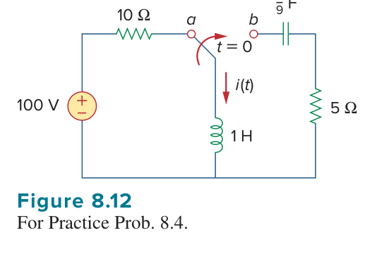

<template #solution>

**課本答案：** $i(t)=e^{-2.5t}(10\cos 1.6583t-15.076\sin 1.6583t)\,\mathrm{A}$。

</template>
</PracticeCard>

<PracticeCard id="ch8-ex5" type="example" title="Example 8.5" source="課本 p.326" topic="二階電路 / 例題">

In the parallel circuit of Fig. 8.13, find v(t) for t > 0, assuming v(0) = 5 V, i(0) = 0, L = 1 H, and C = 10 mF. Consider these cases: R = 1.923 Ω, R = 5 Ω, and R = 6.25 Ω.

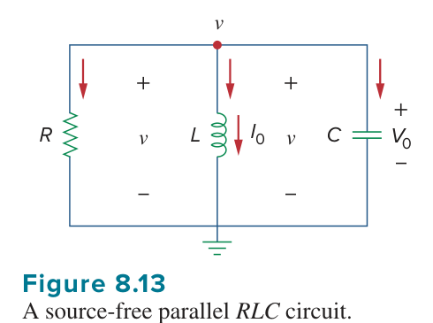

<template #solution>

**課本解答摘要：** 由初始條件 $v(0)=5\,\mathrm{V}$、$dv(0)/dt=-[v(0)+Ri(0)]/(RC)$ 分別套用三種阻尼形式，課本得到
- $R=1.923\,\Omega$：$v(t)=-0.2083e^{-2t}+5.208e^{-50t}\,\mathrm{V}$（過阻尼）；
- $R=5\,\Omega$：$v(t)=(5-50t)e^{-10t}\,\mathrm{V}$（臨界阻尼）；
- $R=6.25\,\Omega$：$v(t)=e^{-8t}(5\cos 6t-6.667\sin 6t)\,\mathrm{V}$（欠阻尼）。

</template>
</PracticeCard>

<PracticeCard id="ch8-pr5" type="practice" title="Practice Problem 8.5" source="課本 p.328" topic="二階電路 / 練習題">

In Fig. 8.13, let R = 2 Ω, L = 0.4 H, C = 25 mF, v(0) = 0, i(0) = 50 mA. Find v(t) for t > 0

<template #solution>

**課本答案：** $v(t)=(-2t)e^{-10t}u(t)\,\mathrm{V}$。

</template>
</PracticeCard>

<PracticeCard id="ch8-ex6" type="example" title="Example 8.6" source="課本 p.328" topic="二階電路 / 例題">

Find v(t) for t > 0 in the RLC circuit of Fig. 8.15.

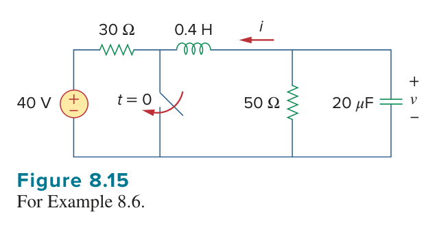

<template #solution>

**課本解答摘要：** 初始電容電壓 $v(0)=25\,\mathrm{V}$，且 $dv(0)/dt=0$。根為 $s_1=-854$、$s_2=-146\,\mathrm{s^{-1}}$；套用初始條件後，
$$v(t)=-5.156e^{-854t}+30.16e^{-146t}\;\mathrm{V},\quad t>0.$$

</template>
</PracticeCard>

<PracticeCard id="ch8-pr6" type="practice" title="Practice Problem 8.6" source="課本 p.330" topic="二階電路 / 練習題">

Refer to the circuit in Fig. 8.17. Find v(t) for t > 0

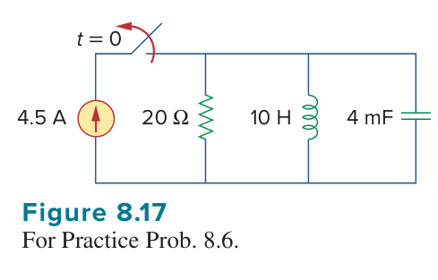

<template #solution>

**課本答案：** $v(t)=150(e^{-10t}-e^{-2.5t})\,\mathrm{V}$。

</template>
</PracticeCard>

<PracticeCard id="ch8-ex7" type="example" title="Example 8.7" source="課本 p.331" topic="二階電路 / 例題">

For the circuit in Fig. 8.19, find v(t) and i(t) for t > 0. Consider these cases: R = 5 Ω, R = 4 Ω, and R = 1 Ω.

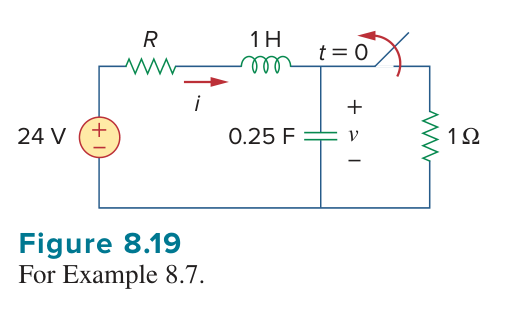

<template #solution>

**課本解答摘要：** 依 $R$ 值分別得到：
- $R=5\,\Omega$：$v(t)=24-\frac{64}{3}e^{-t}+\frac{4}{3}e^{-4t}\,\mathrm{V}$，$i(t)=\frac{4}{3}(4e^{-t}-e^{-4t})\,\mathrm{A}$；
- $R=4\,\Omega$：$v(t)=24-19.2(1+t)e^{-2t}\,\mathrm{V}$，$i(t)=(4.8+9.6t)e^{-2t}\,\mathrm{A}$；
- $R=1\,\Omega$：$v(t)=24+(21.694\sin 1.936t-12\cos 1.936t)e^{-0.5t}\,\mathrm{V}$，$i(t)=(3.1\sin 1.936t+12\cos 1.936t)e^{-0.5t}\,\mathrm{A}$。

</template>
</PracticeCard>

<PracticeCard id="ch8-pr7" type="practice" title="Practice Problem 8.7" source="課本 p.334" topic="二階電路 / 練習題">

Having been in position a for a long time, the switch in Fig. 8.21 is moved to position b at t = 0. Find v(t) and vR(t) for t > 0.

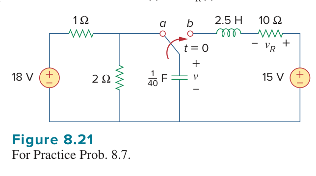

<template #solution>

**課本答案：** $v(t)=15-(1.7321\sin 3.464t+3\cos 3.464t)e^{-2t}\,\mathrm{V}$；$v_R(t)=3.464e^{-2t}\sin 3.464t\,\mathrm{V}$。

</template>
</PracticeCard>

<PracticeCard id="ch8-ex8" type="example" title="Example 8.8" source="課本 p.335" topic="二階電路 / 例題">

In the circuit of Fig. 8.23, find i(t) and iR(t) for t > 0

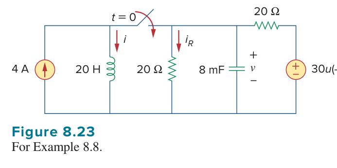

<template #solution>

**課本解答摘要：** 初值為 $i(0)=4\,\mathrm{A}$、$v(0)=15\,\mathrm{V}$；切換後特徵根為 $-11.978$ 與 $-0.5218\,\mathrm{s^{-1}}$。課本結果為
$$i(t)=4+0.0655(e^{-0.5218t}-e^{-11.978t})\;\mathrm{A},$$
$$i_R(t)=0.785e^{-11.978t}-0.0342e^{-0.5218t}\;\mathrm{A},\quad t>0.$$

</template>
</PracticeCard>

<PracticeCard id="ch8-pr8" type="practice" title="Practice Problem 8.8" source="課本 p.337" topic="二階電路 / 練習題">

Find i(t) and v(t) for t > 0 in the circuit of Fig. 8.24

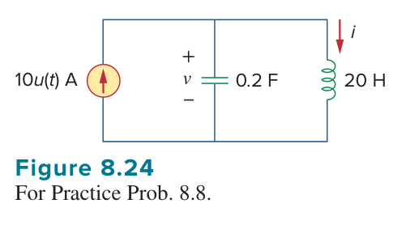

<template #solution>

**課本答案：** $i(t)=10(1-\cos 0.5t)u(t)\,\mathrm{A}$；$v(t)=200\sin 0.5t\,u(t)\,\mathrm{V}$。

</template>
</PracticeCard>

<PracticeCard id="ch8-ex9" type="example" title="Example 8.9" source="課本 p.337" topic="二階電路 / 例題">

Find the complete response v and then i for t > 0 in the circuit of Fig. 8.25

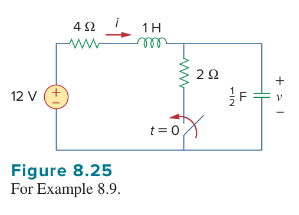

<template #solution>

**課本解答摘要：** 電容電壓與電感電流連續，且 $v(0^+)=12\,\mathrm{V}$、$i(0^+)=0$；穩態值為 $v(\infty)=4\,\mathrm{V}$、$i(\infty)=2\,\mathrm{A}$。特徵根 $-2,-3$，所以
$$v(t)=4+12e^{-2t}-4e^{-3t}\;\mathrm{V},\qquad i(t)=2-6e^{-2t}+4e^{-3t}\;\mathrm{A},\quad t>0.$$

</template>
</PracticeCard>

<PracticeCard id="ch8-pr9" type="practice" title="Practice Problem 8.9" source="課本 p.339" topic="二階電路 / 練習題">

Determine v and i for t > 0 in the circuit of Fig. 8.28.

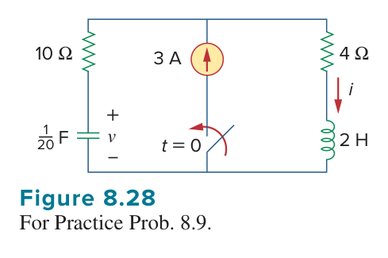

<template #solution>

**課本答案：** $v(t)=12(1-e^{-5t})\,\mathrm{V}$；$i(t)=3(1-e^{-5t})\,\mathrm{A}$。

</template>
</PracticeCard>

<PracticeCard id="ch8-ex10" type="example" title="Example 8.10" source="課本 p.339" topic="二階電路 / 例題">

Find vo(t) for t > 0 in the circuit of Fig. 8.29.

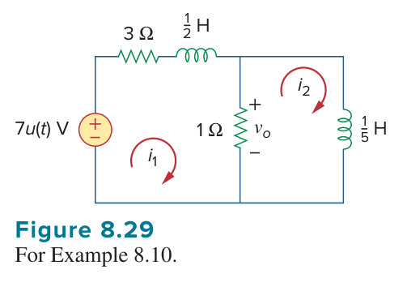

<template #solution>

**課本解答摘要：** 先求兩個電感支路電流，再由輸出支路關係合成。課本結果為
$$v_o(t)=2(e^{-3t}-e^{-10t})\;\mathrm{V},\quad t>0.$$

</template>
</PracticeCard>

<PracticeCard id="ch8-pr10" type="practice" title="Practice Problem 8.10" source="課本 p.341" topic="二階電路 / 練習題">

For t > 0, obtain vo(t) in the circuit of Fig. 8.32. (Hint: First find v1 and v2.)

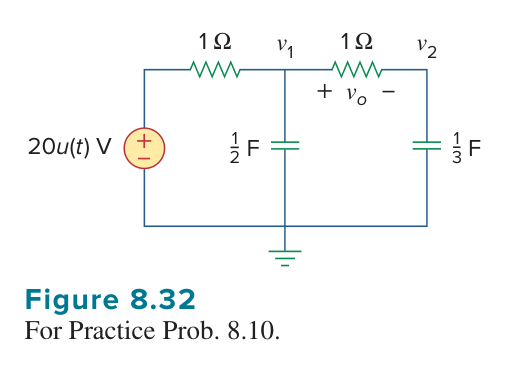

<template #solution>

**課本答案：** $v_o(t)=8(e^{-t}-e^{-6t})\,\mathrm{V}$，$t>0$。

</template>
</PracticeCard>

<PracticeCard id="ch8-ex11" type="example" title="Example 8.11" source="課本 p.342" topic="二階電路 / 例題">

In the op amp circuit of Fig. 8.33, find vo(t) for t > 0 when vs = 10u(t) mV. Let R1 = R2 = 10 kΩ, C1 = 20 μF, and C2 = 100 μF

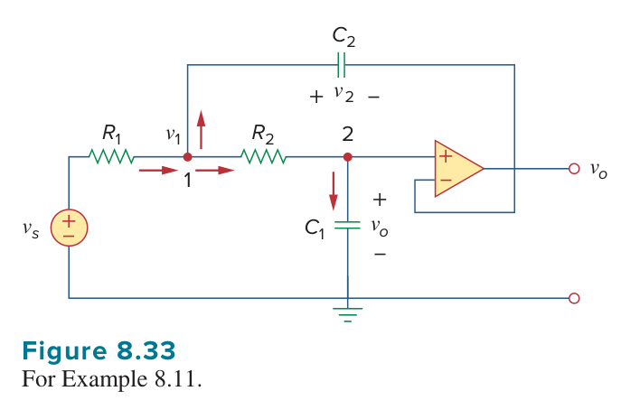

<template #solution>

**課本解答摘要：** 對兩個節點套用 KCL，消去中間變數後得到 $v_o''+2v_o'+5v_o=5v_s$。以 $v_o(0)=0$、$v_o'(0)=0$ 套用初始條件，
$$v_o(t)=10-e^{-t}(10\cos 2t+5\sin 2t)\;\mathrm{mV},\quad t>0.$$

</template>
</PracticeCard>

<PracticeCard id="ch8-pr11" type="practice" title="Practice Problem 8.11" source="課本 p.344" topic="二階電路 / 練習題">

In the op amp circuit shown in Fig. 8.34, vs = 10u(t) V, find vo(t) for t > 0. Assume that R1 = R2 = 10 kΩ, C1 = 20 μF, and C2 = 100 μF.

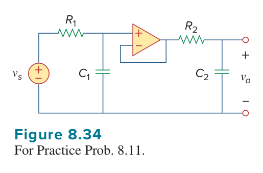

<template #solution>

**課本答案：** $v_o(t)=(10-12.5e^{-t}+2.5e^{-5t})\,\mathrm{V}$，$t>0$。

</template>
</PracticeCard>

<PracticeCard id="ch8-ex12" type="example" title="Example 8.12" source="課本 p.344" topic="二階電路 / 例題">

The input voltage in Fig. 8.35(a) is applied to the circuit in Fig. 8.35(b). Use PSpice to plot v(t) for 0 < t < 4 s.

<template #solution>

**課本解答摘要：** 將兩個 $60\,\Omega$ 電阻與脈波源換成戴維寧等效後，得到 $R=30\,\Omega$、$L=3\,\mathrm{H}$、$C=1/27\,\mathrm{F}$，特徵根為 $-1,-9$。第一段 $0<t<2$ 的響應為 $v(t)=6-6.75e^{-t}+0.75e^{-9t}\,\mathrm{V}$；在 $t=2$ 輸入回到零後，課本解得第二段 $v(t)=5.835e^{-(t-2)}-0.749e^{-9(t-2)}\,\mathrm{V}$。

</template>
</PracticeCard>

<PracticeCard id="ch8-pr12" type="practice" title="Practice Problem 8.12" source="課本 p.346" topic="二階電路 / 練習題">

Find i(t) using PSpice for 0 < t < 4 s if the pulse voltage in Fig. 8.35(a) is applied to the circuit in Fig. 8.38.

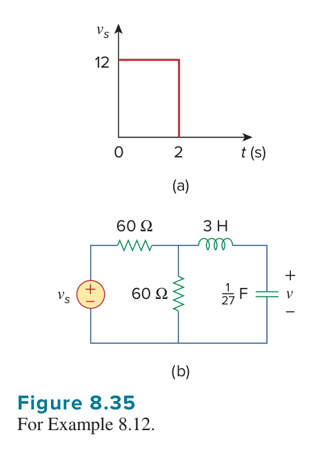

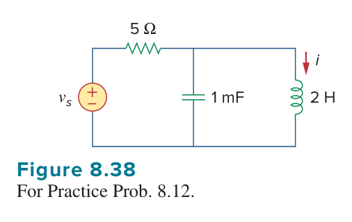

<template #solution>

**課本答案：** 見課本 Figure 8.39 的 PSpice 輸出圖。

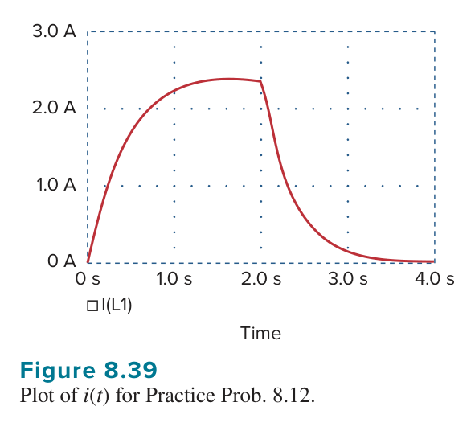

</template>
</PracticeCard>

<PracticeCard id="ch8-ex13" type="example" title="Example 8.13" source="課本 p.346" topic="二階電路 / 例題">

For the circuit in Fig. 8.40, use PSpice to obtain i(t) for 0 < t < 3 s.

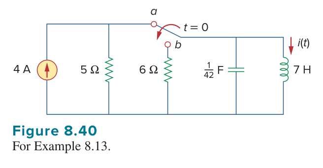

<template #solution>

**課本解答摘要：** PSpice 直流分析先給出初始電容電壓 $0\,\mathrm{V}$ 與電感電流 $4\,\mathrm{A}$；切換後使用平行 RLC 暫態分析。課本的手算曲線為
$$i(t)=4.8e^{-t}-0.8e^{-6t}\;\mathrm{A},\quad t>0.$$

</template>
</PracticeCard>

<PracticeCard id="ch8-pr13" type="practice" title="Practice Problem 8.13" source="課本 p.347" topic="二階電路 / 練習題">

Refer to the circuit in Fig. 8.21 (see Practice Prob. 8.7). Use PSpice to obtain v(t) for 0 < t < 2.

<template #solution>

**課本答案：** 見課本 Figure 8.43 的 PSpice 輸出圖。

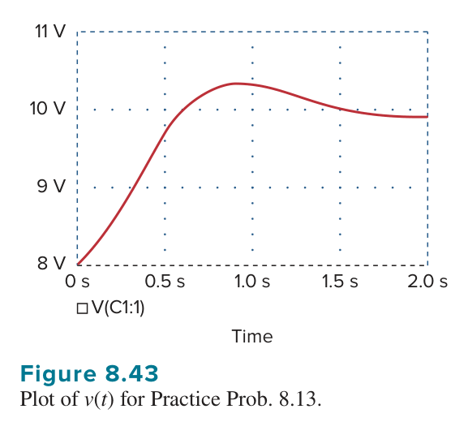

</template>
</PracticeCard>

<PracticeCard id="ch8-ex14" type="example" title="Example 8.14" source="課本 p.349" topic="二階電路 / 例題">

Construct the dual of the circuit in Fig. 8.44

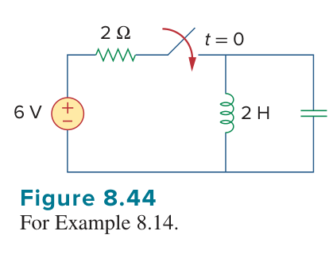

<template #solution>

**課本解答摘要：** 將每個網目轉成對偶網目，並將跨越的元件逐一替換（$L\leftrightarrow C$、電阻換成電導、電壓源換成電流源）。課本的構造圖與重繪後的對偶電路如下。

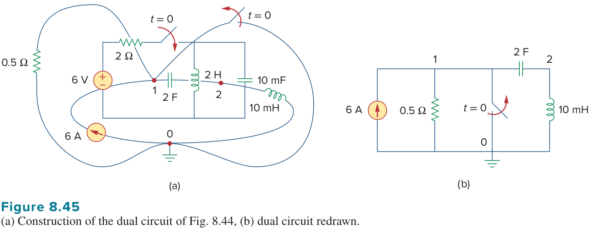

</template>
</PracticeCard>

<PracticeCard id="ch8-pr14" type="practice" title="Practice Problem 8.14" source="課本 p.349" topic="二階電路 / 練習題">

Draw the dual circuit of the one in Fig. 8.46.

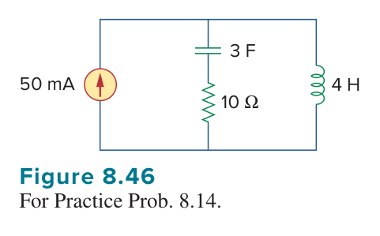

<template #solution>

**課本答案：** 見下圖（對偶電路）。

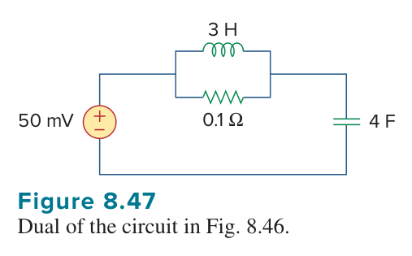

</template>
</PracticeCard>

<PracticeCard id="ch8-ex15" type="example" title="Example 8.15" source="課本 p.349" topic="二階電路 / 例題">

Obtain the dual of the circuit in Fig. 8.48

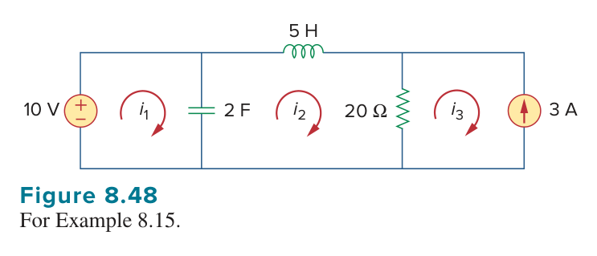

<template #solution>

**課本解答摘要：** 逐一跨越原電路元件構成對偶支路：$2\,\mathrm{F}$ 換成 $2\,\mathrm{H}$，$20\,\Omega$ 換成 $1/20\,\Omega$；電壓源與電流源依網目方向對應，課本並以原電路網目電流核對源極性。構造與重繪電路見下圖。

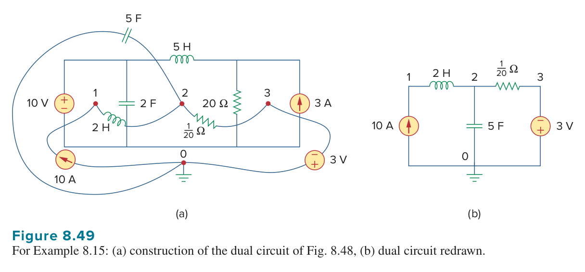

</template>
</PracticeCard>

<PracticeCard id="ch8-pr15" type="practice" title="Practice Problem 8.15" source="課本 p.350" topic="二階電路 / 練習題">

For the circuit in Fig. 8.50, obtain the dual circuit.

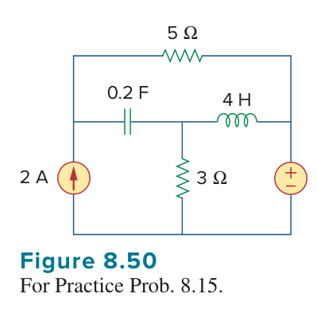

<template #solution>

**課本答案：** 見下圖（對偶電路）。

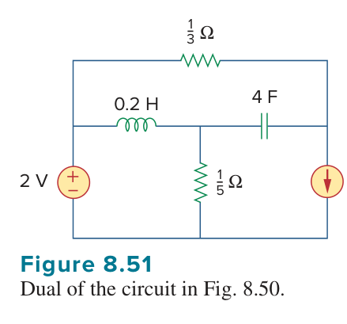

</template>
</PracticeCard>

<PracticeCard id="ch8-ex16" type="example" title="Example 8.16" source="課本 p.351" topic="二階電路 / 例題">

Assuming that the switch in Fig. 8.52 is closed prior to t = 0−, find the inductor voltage vL for t > 0.

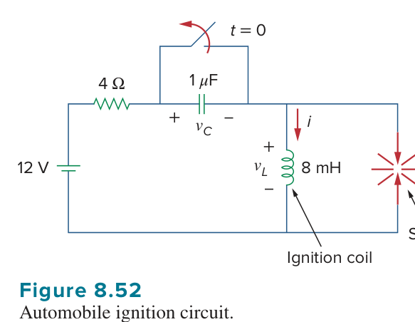

<template #solution>

**課本解答摘要：** 初值 $i(0)=3\,\mathrm{A}$、$di(0)/dt=0$，且欠阻尼根為 $-250\pm j11{,}180\,\mathrm{s^{-1}}$。課本先得到
$$i(t)=e^{-250t}(3\cos 11{,}180t+0.0671\sin 11{,}180t)\;\mathrm{A},$$
再由 $v_L=L,di/dt$ 得 $v_L(t)=-268e^{-250t}\sin 11{,}180t\;\mathrm{V}$。

</template>
</PracticeCard>

<PracticeCard id="ch8-pr16" type="practice" title="Practice Problem 8.16" source="課本 p.353" topic="二階電路 / 練習題">

In Fig. 8.52, find the capacitor voltage vC for t > 0.

<template #solution>

**課本答案：** $v_C(t)=12-12e^{-250t}\cos(11{,}180t)+267.7e^{-250t}\sin(11{,}180t)\,\mathrm{V}$。

</template>
</PracticeCard>

<PracticeCard id="ch8-ex17" type="example" title="Example 8.17" source="課本 p.353" topic="二階電路 / 例題">

The output of a D/A converter is shown in Fig. 8.54(a). If the RLC circuit in Fig. 8.54(b) is used as the smoothing circuit, determine the output voltage vo(t).

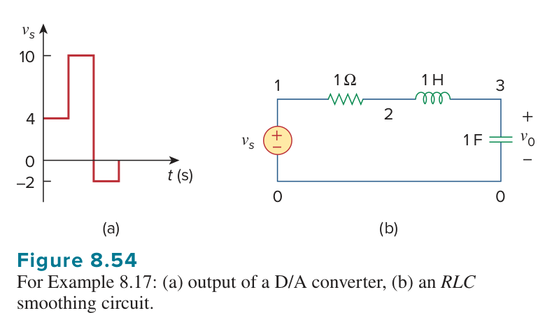

<template #solution>

**課本解答摘要：** 課本以 PSpice 的 VPWL 分段線性脈波模擬輸入，並使用暫態分析繪出輸入與平滑後輸出；原書解答圖如下。

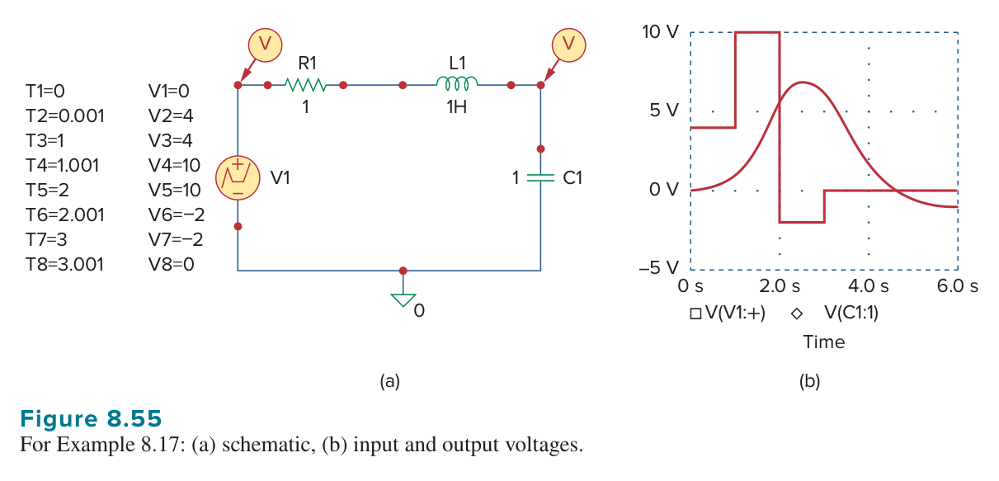

</template>
</PracticeCard>

<PracticeCard id="ch8-pr17" type="practice" title="Practice Problem 8.17" source="課本 p.354" topic="二階電路 / 練習題">

Rework Example 8.17 if the output of the D/A converter is as shown in Fig. 8.56.

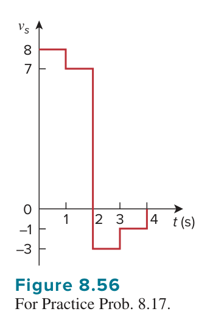

<template #solution>

**課本答案：** 見課本 Figure 8.57 的 PSpice 輸出圖。

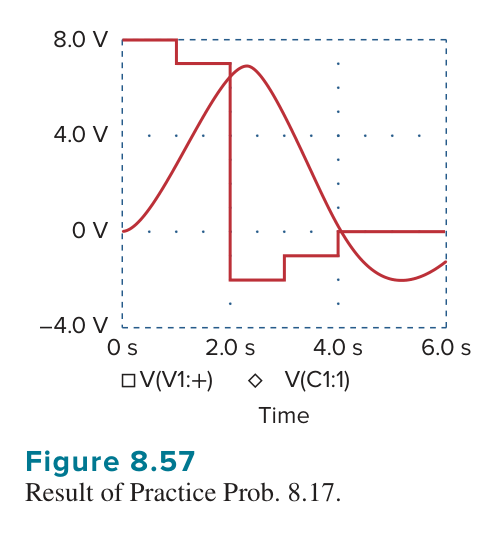

</template>
</PracticeCard>

<PracticeCard id="ch8-problem-01" type="exercise" title="Problem 8.1" source="課本 p.356" topic="二階電路 / 章末習題">

For the circuit in Fig. 8.62, find: (a) i(0+) and v(0+), (b) di(0+)∕dt and dv(0+)∕dt, (c) i(∞) and v(∞).

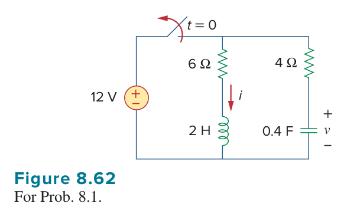

<template #solution>

**課本附錄 D 答案：** $i(0^+)=2\,\mathrm{A}$、$v(0^+)=12\,\mathrm{V}$；$di(0^+)/dt=-4\,\mathrm{A/s}$、$dv(0^+)/dt=-5\,\mathrm{V/s}$；$i(\infty)=0$、$v(\infty)=0$。

</template>
</PracticeCard>

<PracticeCard id="ch8-problem-02" type="exercise" title="Problem 8.2" source="課本 p.356" topic="二階電路 / 章末習題">

Using Fig. 8.63, design a problem to help other students better understand finding initial and final values.

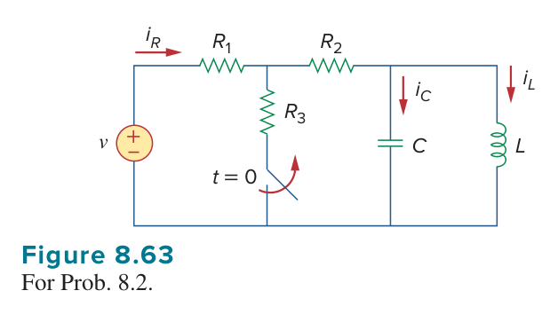

</PracticeCard>

<PracticeCard id="ch8-problem-03" type="exercise" title="Problem 8.3" source="課本 p.357" topic="二階電路 / 章末習題">

Refer to the circuit shown in Fig. 8.64. Calculate: (a) iL(0+), vC(0+), and vR(0+), (b) diL(0+)∕dt, dvC(0+)∕dt, and dvR(0+)∕dt, (c) iL(∞), vC(∞), and vR(∞).

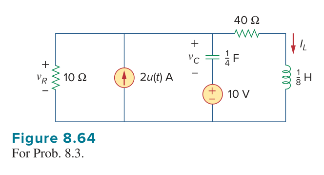

<template #solution>

**課本附錄 D 答案：** (a) $i_L(0^+)=0\,\mathrm{A}$、$v_C(0^+)=-10\,\mathrm{V}$、$v_R(0^+)=0\,\mathrm{V}$；(b) $di_L(0^+)/dt=0$、$dv_C(0^+)/dt=8\,\mathrm{V/s}$、$dv_R(0^+)/dt=8\,\mathrm{V/s}$；(c) $i_L(\infty)=400\,\mathrm{mA}$、$v_C(\infty)=6\,\mathrm{V}$、$v_R(\infty)=16\,\mathrm{V}$.

</template>
</PracticeCard>

<PracticeCard id="ch8-problem-04" type="exercise" title="Problem 8.4" source="課本 p.357" topic="二階電路 / 章末習題">

In the circuit of Fig. 8.65, find: (a) v(0+) and i(0+), (b) dv(0+)∕dt and di(0+)∕dt, (c) v(∞) and i(∞).

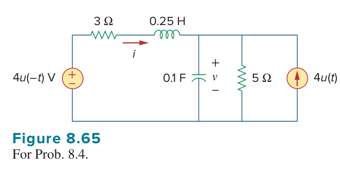

</PracticeCard>

<PracticeCard id="ch8-problem-05" type="exercise" title="Problem 8.5" source="課本 p.357" topic="二階電路 / 章末習題">

Refer to the circuit in Fig. 8.66. Determine: (a) i(0+) and v(0+), (b) di(0+)∕dt and dv(0+)∕dt, (c) i(∞) and v(∞).

<template #solution>

**課本附錄 D 答案：** (a) $i(0^+)=0\,\mathrm{A}$、$v(0^+)=0\,\mathrm{V}$；(b) $di(0^+)/dt=4\,\mathrm{A/s}$、$dv(0^+)/dt=0\,\mathrm{V/s}$；(c) $i(\infty)=2.4\,\mathrm{A}$、$v(\infty)=9.6\,\mathrm{V}$.

</template>
</PracticeCard>

<PracticeCard id="ch8-problem-06" type="exercise" title="Problem 8.6" source="課本 p.357" topic="二階電路 / 章末習題">

In the circuit of Fig. 8.67, find: (a) vR(0+) and vL(0+), (b) dvR(0+)∕dt and dvL(0+)∕dt, (c) vR(∞) and vL(∞).

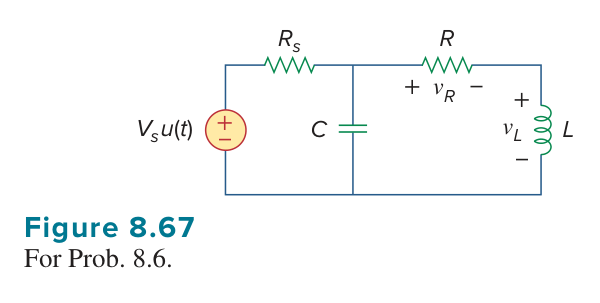

</PracticeCard>

<PracticeCard id="ch8-problem-07" type="exercise" title="Problem 8.7" source="課本 p.357" topic="二階電路 / 章末習題">

A series RLC circuit has R = 20 kΩ, L = 0.2 mH, and C = 5 μF. What type of damping is exhibited by the circuit?

<template #solution>

**課本附錄 D 答案：** **課本附錄 D 答案：** 過阻尼。

</template>
</PracticeCard>

<PracticeCard id="ch8-problem-08" type="exercise" title="Problem 8.8" source="課本 p.357" topic="二階電路 / 章末習題">

Design a problem to help other students better understand source-free RLC circuits.

</PracticeCard>

<PracticeCard id="ch8-problem-09" type="exercise" title="Problem 8.9" source="課本 p.357" topic="二階電路 / 章末習題">

The current in an RLC circuit is described by d²i/dt² + 10 di/dt + 25i = 0 If i(0) = 10 A and di(0)∕dt = 0, find i(t) for t > 0.

<template #solution>

**課本附錄 D 答案：** $i(t)=(10+50t)e^{-5t}\,\mathrm{A}$.

</template>
</PracticeCard>

<PracticeCard id="ch8-problem-10" type="exercise" title="Problem 8.10" source="課本 p.357" topic="二階電路 / 章末習題">

The differential equation that describes the voltage in an RLC network is d²v/dt² + 5 dv/dt + 4v = 0 Given that v(0) = 0, dv(0)∕dt = 10 V/s, obtain v(t).

</PracticeCard>

<PracticeCard id="ch8-problem-11" type="exercise" title="Problem 8.11" source="課本 p.357" topic="二階電路 / 章末習題">

The natural response of an RLC circuit is described by the differential equation d²v/dt² + 2 dv/dt + v = 0 for which the initial conditions are v(0) = 10 V and dv(0)∕dt = 0. Solve for v(t).

<template #solution>

**課本附錄 D 答案：** $v(t)=(10+10t)e^{-t}\,\mathrm{V}$.

</template>
</PracticeCard>

<PracticeCard id="ch8-problem-12" type="exercise" title="Problem 8.12" source="課本 p.357" topic="二階電路 / 章末習題">

If R = 50 Ω, L = 1.5 H, what value of C will make an RLC series circuit: (a) overdamped, (b) critically damped, (c) underdamped?

</PracticeCard>

<PracticeCard id="ch8-problem-13" type="exercise" title="Problem 8.13" source="課本 p.357" topic="二階電路 / 章末習題">

For the circuit in Fig. 8.68, calculate the value of R needed to have a critically damped response.

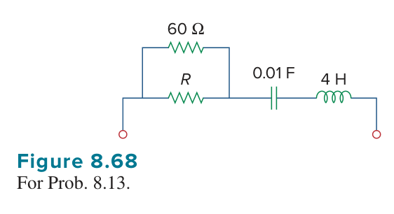

<template #solution>

**課本附錄 D 答案：** $R=120\,\Omega$.

</template>
</PracticeCard>

<PracticeCard id="ch8-problem-14" type="exercise" title="Problem 8.14" source="課本 p.357" topic="二階電路 / 章末習題">

The switch in Fig. 8.69 moves from position A to position B at t = 0 (please note that the switch must connect to point B before it breaks the connection at A, a make-before-break switch). Let v(0) = 0, find v(t) for t > 0.

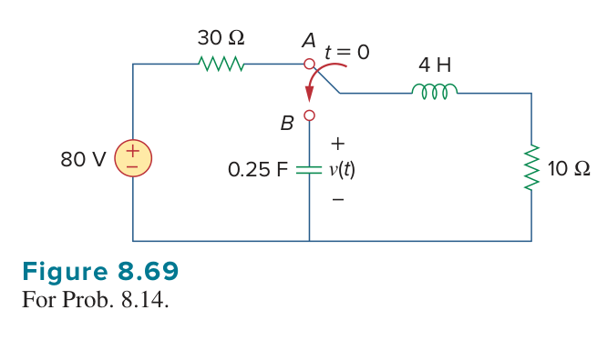

</PracticeCard>

<PracticeCard id="ch8-problem-15" type="exercise" title="Problem 8.15" source="課本 p.358" topic="二階電路 / 章末習題">

The responses of a series RLC circuit are vC(t) = 30 − 10e−20t + 30e−10t V iL(t) = 40e−20t − 60e−10t mA where vC and iL are the capacitor voltage and inductor current, respectively. Determine the values of R, L, and C.

<template #solution>

**課本附錄 D 答案：** $R=750\,\Omega$、$C=200\,\mu\mathrm{F}$、$L=25\,\mathrm{H}$.

</template>
</PracticeCard>

<PracticeCard id="ch8-problem-16" type="exercise" title="Problem 8.16" source="課本 p.358" topic="二階電路 / 章末習題">

Find i(t) for t > 0 in the circuit of Fig. 8.70.

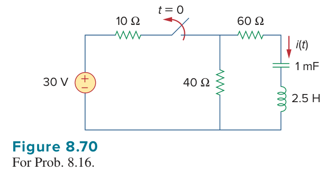

</PracticeCard>

<PracticeCard id="ch8-problem-17" type="exercise" title="Problem 8.17" source="課本 p.358" topic="二階電路 / 章末習題">

In the circuit of Fig. 8.71, the switch instantaneously moves from position A to B at t = 0. Find v(t) for all t ≥ 0.

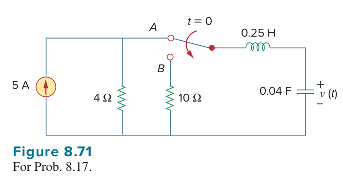

<template #solution>

**課本附錄 D 答案：** $v(t)=21.55e^{-2.679t}-1.55e^{-37.32t}\,\mathrm{V}$.

</template>
</PracticeCard>

<PracticeCard id="ch8-problem-18" type="exercise" title="Problem 8.18" source="課本 p.358" topic="二階電路 / 章末習題">

Find the voltage across the capacitor as a function of time for t > 0 for the circuit in Fig. 8.72. Assume steady-state conditions exist at t = 0−.

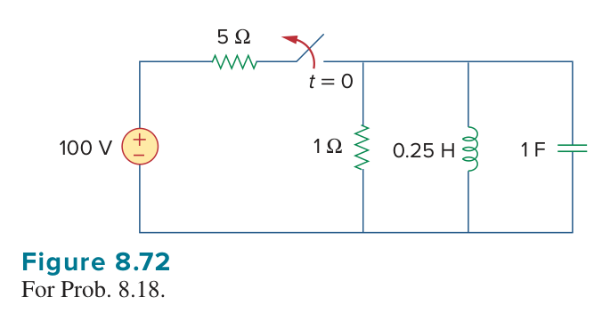

</PracticeCard>

<PracticeCard id="ch8-problem-19" type="exercise" title="Problem 8.19" source="課本 p.358" topic="二階電路 / 章末習題">

Obtain v(t) for t > 0 in the circuit of Fig. 8.73.

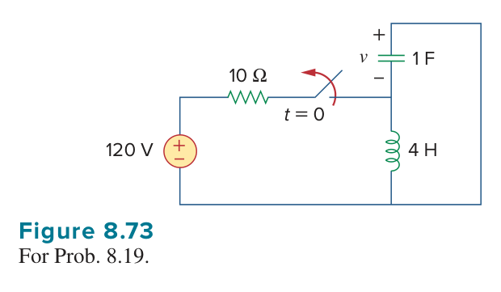

<template #solution>

**課本附錄 D 答案：** $v(t)=24\sin(0.5t)\,\mathrm{V}$.

</template>
</PracticeCard>

<PracticeCard id="ch8-problem-20" type="exercise" title="Problem 8.20" source="課本 p.358" topic="二階電路 / 章末習題">

The switch in the circuit of Fig. 8.74 has been closed for a long time but is opened at t = 0. Determine i(t) for t > 0.

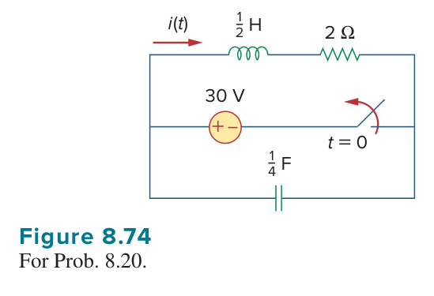

</PracticeCard>

<PracticeCard id="ch8-problem-21" type="exercise" title="Problem 8.21" source="課本 p.358" topic="二階電路 / 章末習題">

Calculate v(t) for t > 0 in the circuit of Fig. 8.75.

<template #solution>

**課本附錄 D 答案：** $v(t)=18e^{-t}-2e^{-9t}\,\mathrm{V}$.

</template>
</PracticeCard>

<PracticeCard id="ch8-problem-22" type="exercise" title="Problem 8.22" source="課本 p.359" topic="二階電路 / 章末習題">

Assuming R = 2 kΩ, design a parallel RLC circuit that has the characteristic equation s² + 100s + 10⁶ = 0.

</PracticeCard>

<PracticeCard id="ch8-problem-23" type="exercise" title="Problem 8.23" source="課本 p.359" topic="二階電路 / 章末習題">

For the network in Fig. 8.76, what value of C is needed to make the response underdamped with unity neper frequency (α = 1) ?

<template #solution>

**課本附錄 D 答案：** $C=40\,\mathrm{mF}$.

</template>
</PracticeCard>

<PracticeCard id="ch8-problem-24" type="exercise" title="Problem 8.24" source="課本 p.359" topic="二階電路 / 章末習題">

The switch in Fig. 8.77 moves from position A to position B at t = 0 (please note that the switch must connect to point B before it breaks the connection at A, a make-before-break switch). Determine i(t) for t > 0.

</PracticeCard>

<PracticeCard id="ch8-problem-25" type="exercise" title="Problem 8.25" source="課本 p.359" topic="二階電路 / 章末習題">

Using Fig. 8.78, design a problem to help other students better understand source-free RLC circuits.

<template #solution>

**課本附錄 D 答案：** 課本標準答案：此為設計題，有多種答案。

</template>
</PracticeCard>

<PracticeCard id="ch8-problem-26" type="exercise" title="Problem 8.26" source="課本 p.359" topic="二階電路 / 章末習題">

The step response of an RLC circuit is given by d²i/dt² + 2 di/dt + 5i = 10 Given that i(0) = 2 and di(0)∕dt = 4, solve for i(t).

</PracticeCard>

<PracticeCard id="ch8-problem-27" type="exercise" title="Problem 8.27" source="課本 p.359" topic="二階電路 / 章末習題">

A branch voltage in an RLC circuit is described by d²v/dt² + 4 dv/dt + 8v = 24 If the initial conditions are v(0) = 0 = dv(0)∕dt, find v(t).

<template #solution>

**課本附錄 D 答案：** $v(t)=\left[3-3(\cos 2t+\sin 2t)e^{-2t}\right]\,\mathrm{V}$.

</template>
</PracticeCard>

<PracticeCard id="ch8-problem-28" type="exercise" title="Problem 8.28" source="課本 p.359" topic="二階電路 / 章末習題">

A series RLC circuit is described by L d²i/dt² + R di/dt + i/C = 10 Find the response when L = 0.5 H, R = 4 Ω, and C = 0.2 F. Let i(0) = 1, di(0)∕dt = 0.

</PracticeCard>

<PracticeCard id="ch8-problem-29" type="exercise" title="Problem 8.29" source="課本 p.359" topic="二階電路 / 章末習題">

Solve the following differential equations subject to the specified initial conditions (a) d²v/dt² + 4v = 12, v(0) = 0, dv(0)∕dt = 2 (b) d²i/dt² + 5 di/dt + 4i = 8, i(0) = −1, di(0)∕dt = 0 (c) d²v/dt² + 2 dv/dt + v = 3, v(0) = 5, dv(0)∕dt = 1 (d) d²i/dt² + 2 di/dt + 5i = 10, i(0) = 4, di(0)∕dt = −2

<template #solution>

**課本附錄 D 答案：** **課本附錄 D 答案：** (a) $v(t)=3-3\cos(2t)+\sin(2t)\,\mathrm{V}$；(b) $i(t)=2-4e^{-t}+e^{-4t}\,\mathrm{A}$；(c) $v(t)=3+(2+3t)e^{-t}\,\mathrm{V}$；(d) $i(t)=2+2e^{-t}\cos(2t)\,\mathrm{A}$.

</template>
</PracticeCard>

<PracticeCard id="ch8-problem-30" type="exercise" title="Problem 8.30" source="課本 p.359" topic="二階電路 / 章末習題">

The step responses of a series RLC circuit are vC = 40 − 10e−2,000t − 10e−4,000t V, t > 0 iL(t) = 3e−2,000t + 6e−4,000t mA, t > 0 (a) Find C. (b) Determine what type of damping is exhibited by the circuit.

</PracticeCard>

<PracticeCard id="ch8-problem-31" type="exercise" title="Problem 8.31" source="課本 p.359" topic="二階電路 / 章末習題">

Consider the circuit in Fig. 8.79. Find vL(0+) and vC(0+).

<template #solution>

**課本附錄 D 答案：** $80\,\mathrm{V}$、$40\,\mathrm{V}$.

</template>
</PracticeCard>

<PracticeCard id="ch8-problem-32" type="exercise" title="Problem 8.32" source="課本 p.359" topic="二階電路 / 章末習題">

For the circuit in Fig. 8.80, find v(t) for t > 0.

</PracticeCard>

<PracticeCard id="ch8-problem-33" type="exercise" title="Problem 8.33" source="課本 p.360" topic="二階電路 / 章末習題">

Find v(t) for t > 0 in the circuit of Fig. 8.81.

<template #solution>

**課本附錄 D 答案：** $v(t)=\left[20+0.2052e^{-4.95t}-10.205e^{-0.05t}\right]\,\mathrm{V}$.

</template>
</PracticeCard>

<PracticeCard id="ch8-problem-34" type="exercise" title="Problem 8.34" source="課本 p.360" topic="二階電路 / 章末習題">

Calculate i(t) for t > 0 in the circuit of Fig. 8.82.

</PracticeCard>

<PracticeCard id="ch8-problem-35" type="exercise" title="Problem 8.35" source="課本 p.360" topic="二階電路 / 章末習題">

Using Fig. 8.83, design a problem to help other students better understand the step response of series RLC circuits.

<template #solution>

**課本附錄 D 答案：** 課本標準答案：此為設計題，有多種答案。

</template>
</PracticeCard>

<PracticeCard id="ch8-problem-36" type="exercise" title="Problem 8.36" source="課本 p.360" topic="二階電路 / 章末習題">

Obtain v(t) and i(t) for t > 0 in the circuit of Fig. 8.84.

</PracticeCard>

<PracticeCard id="ch8-problem-37" type="exercise" title="Problem 8.37" source="課本 p.360" topic="二階電路 / 章末習題">

For the network in Fig. 8.85, solve for i(t) for t > 0.

<template #solution>

**課本附錄 D 答案：** $i(t)=7.5e^{-4t}\,\mathrm{A}$.

</template>
</PracticeCard>

<PracticeCard id="ch8-problem-38" type="exercise" title="Problem 8.38" source="課本 p.360" topic="二階電路 / 章末習題">

Refer to the circuit in Fig. 8.86. Calculate i(t) for t > 0.

</PracticeCard>

<PracticeCard id="ch8-problem-39" type="exercise" title="Problem 8.39" source="課本 p.360" topic="二階電路 / 章末習題">

Determine v(t) for t > 0 in the circuit of Fig. 8.87.

<template #solution>

**課本附錄 D 答案：** $v(t)=(-6-0.021e^{-47.83t}+6.02e^{-0.167t})\,\mathrm{V}$.

</template>
</PracticeCard>

<PracticeCard id="ch8-problem-40" type="exercise" title="Problem 8.40" source="課本 p.360" topic="二階電路 / 章末習題">

The switch in the circuit of Fig. 8.88 is moved from position a to b at t = 0. Assume that the voltage across the capacitor is equal to zero at t = 0 and that the switch is a make-before-break switch. Determine i(t) for all t > 0.

</PracticeCard>

<PracticeCard id="ch8-problem-41" type="exercise" title="Problem 8.41" source="課本 p.361" topic="二階電路 / 章末習題">

For the network in Fig. 8.89, find i(t) for t > 0.

<template #solution>

**課本附錄 D 答案：** $v(t)=727.5e^{-2t}\sin(4.583t)u(t)\,\mathrm{mV}$.

</template>
</PracticeCard>

<PracticeCard id="ch8-problem-42" type="exercise" title="Problem 8.42" source="課本 p.361" topic="二階電路 / 章末習題">

Given the network in Fig. 8.90, find v(t) for t > 0.

</PracticeCard>

<PracticeCard id="ch8-problem-43" type="exercise" title="Problem 8.43" source="課本 p.361" topic="二階電路 / 章末習題">

The switch in Fig. 8.91 is opened at t = 0 after the circuit has reached steady state. Choose R and C such that α = 8 Np/s and ω_d = 30 rad/s.

<template #solution>

**課本附錄 D 答案：** $R=8\,\Omega$、$C=2.075\,\mathrm{mF}$.

</template>
</PracticeCard>

<PracticeCard id="ch8-problem-44" type="exercise" title="Problem 8.44" source="課本 p.361" topic="二階電路 / 章末習題">

A series RLC circuit has the following parameters: R = 1 kΩ, L = 1 H, and C = 10 nF. What type of damping does this circuit exhibit?

</PracticeCard>

<PracticeCard id="ch8-problem-45" type="exercise" title="Problem 8.45" source="課本 p.361" topic="二階電路 / 章末習題">

In the circuit of Fig. 8.92, find v(t) and i(t) for t > 0. Assume i(0) = 0.

<template #solution>

**課本附錄 D 答案：** $i(t)=\left[4-(3\cos(1.3229t)+1.1339\sin(1.3229t))e^{-t/2}\right]\,\mathrm{A}$；$v(t)=6.0475e^{-t/2}\sin(1.3229t)\,\mathrm{V}$.

</template>
</PracticeCard>

<PracticeCard id="ch8-problem-46" type="exercise" title="Problem 8.46" source="課本 p.361" topic="二階電路 / 章末習題">

Using Fig. 8.93, design a problem to help other students better understand the step response of a parallel RLC circuit.

</PracticeCard>

<PracticeCard id="ch8-problem-47" type="exercise" title="Problem 8.47" source="課本 p.361" topic="二階電路 / 章末習題">

Find the output voltage vo(t) in the circuit of Fig. 8.94.

<template #solution>

**課本附錄 D 答案：** $v(t)=200t e^{-10t}\,\mathrm{V}$.

</template>
</PracticeCard>

<PracticeCard id="ch8-problem-48" type="exercise" title="Problem 8.48" source="課本 p.361" topic="二階電路 / 章末習題">

Given the circuit in Fig. 8.95, find i(t) and v(t) for t > 0.

</PracticeCard>

<PracticeCard id="ch8-problem-49" type="exercise" title="Problem 8.49" source="課本 p.361" topic="二階電路 / 章末習題">

Determine i(t) for t > 0 in the circuit of Fig. 8.96.

<template #solution>

**課本附錄 D 答案：** $i(t)=\left[3+(3+6t)e^{-2t}\right]u(t)\,\mathrm{A}$.

</template>
</PracticeCard>

<PracticeCard id="ch8-problem-50" type="exercise" title="Problem 8.50" source="課本 p.362" topic="二階電路 / 章末習題">

For the circuit in Fig. 8.97, find i(t) for t > 0.

</PracticeCard>

<PracticeCard id="ch8-problem-51" type="exercise" title="Problem 8.51" source="課本 p.362" topic="二階電路 / 章末習題">

Find v(t) for t > 0 in the circuit of Fig. 8.98.

<template #solution>

**課本附錄 D 答案：** **課本附錄 D 答案：** $v(t)=-\dfrac{i_0}{\omega_0 C}\sin(\omega_0t)\,\mathrm{V}$，其中 $\omega_0=1/\sqrt{LC}$.

</template>
</PracticeCard>

<PracticeCard id="ch8-problem-52" type="exercise" title="Problem 8.52" source="課本 p.362" topic="二階電路 / 章末習題">

The step response of a parallel RLC circuit is v = 10 + 20e−300t(cos 400t − 2 sin 400t) V, t ≥ 0 when the inductor is 50 mH. Find R and C.

</PracticeCard>

<PracticeCard id="ch8-problem-53" type="exercise" title="Problem 8.53" source="課本 p.362" topic="二階電路 / 章末習題">

After being open for a day, the switch in the circuit of Fig. 8.99 is closed at t = 0. Find the differential equation describing i(t), t > 0.

<template #solution>

**課本附錄 D 答案：** $\dfrac{d^2i}{dt^2}+1.25\dfrac{di}{dt}+400i=600$.

</template>
</PracticeCard>

<PracticeCard id="ch8-problem-54" type="exercise" title="Problem 8.54" source="課本 p.362" topic="二階電路 / 章末習題">

Using Fig. 8.100, design a problem to help other students better understand general second-order circuits.

</PracticeCard>

<PracticeCard id="ch8-problem-55" type="exercise" title="Problem 8.55" source="課本 p.362" topic="二階電路 / 章末習題">

For the circuit in Fig. 8.101, find v(t) for t > 0. Assume v(0+) = 4 V and i(0+) = 2 A.

<template #solution>

**課本附錄 D 答案：** $v(t)=7.448-3.448e^{-7.25t}\,\mathrm{V}$，$t>0$.

</template>
</PracticeCard>

<PracticeCard id="ch8-problem-56" type="exercise" title="Problem 8.56" source="課本 p.362" topic="二階電路 / 章末習題">

In the circuit of Fig. 8.102, find i(t) for t > 0.

</PracticeCard>

<PracticeCard id="ch8-problem-57" type="exercise" title="Problem 8.57" source="課本 p.362" topic="二階電路 / 章末習題">

If the switch in Fig. 8.103 has been closed for a long time before t = 0 but is opened at t = 0, determine: (a) the characteristic equation of the circuit, (b) ix and vR for t > 0.

<template #solution>

**課本附錄 D 答案：** (a) $s^2+20s+36=0$；(b) $i(t)=(-0.75e^{-2t}-1.25e^{-18t})u(t)\,\mathrm{A}$、$v(t)=(6e^{-2t}+10e^{-18t})u(t)\,\mathrm{V}$.

</template>
</PracticeCard>

<PracticeCard id="ch8-problem-58" type="exercise" title="Problem 8.58" source="課本 p.362" topic="二階電路 / 章末習題">

In the circuit of Fig. 8.104, the switch has been in position 1 for a long time but moved to position 2 at t = 0. Find: (a) v(0+), dv(0+)∕dt, (b) v(t) for t ≥ 0.

</PracticeCard>

<PracticeCard id="ch8-problem-59" type="exercise" title="Problem 8.59" source="課本 p.363" topic="二階電路 / 章末習題">

The switch in Fig. 8.105 has been in position 1 for t < 0. At t = 0, it is moved from position 1 to the top of the capacitor at t = 0. Please note that the switch is a make-before-break switch, it stays in contact with position 1 until it makes contact with the top of the capacitor and then breaks the contact at position 1. Given that the initial voltage across the capacitor is equal to zero, determine v(t).

<template #solution>

**課本附錄 D 答案：** $v(t)=-32t e^{-2t}\,\mathrm{V}$.

</template>
</PracticeCard>

<PracticeCard id="ch8-problem-60" type="exercise" title="Problem 8.60" source="課本 p.363" topic="二階電路 / 章末習題">

Obtain i1 and i2 for t > 0 in the circuit of Fig. 8.106.

</PracticeCard>

<PracticeCard id="ch8-problem-61" type="exercise" title="Problem 8.61" source="課本 p.363" topic="二階電路 / 章末習題">

For the circuit in Prob. 8.5, find i and v for t > 0.

<template #solution>

**課本附錄 D 答案：** $i(t)=2.4-2.667e^{-2t}+0.2667e^{-5t}\,\mathrm{A}$；$v(t)=9.6-16e^{-2t}+6.4e^{-5t}\,\mathrm{V}$.

</template>
</PracticeCard>

<PracticeCard id="ch8-problem-62" type="exercise" title="Problem 8.62" source="課本 p.363" topic="二階電路 / 章末習題">

Find the response vR(t) for t > 0 in the circuit of Fig. 8.107. Let R = 3 Ω, L = 2 H, and C = (1/18) F.

</PracticeCard>

<PracticeCard id="ch8-problem-63" type="exercise" title="Problem 8.63" source="課本 p.363" topic="二階電路 / 章末習題">

For the op amp circuit in Fig. 8.108, find the differential equation for i(t).

<template #solution>

**課本附錄 D 答案：** $\dfrac{d^2i(t)}{dt^2}=-\dfrac{v_s}{RCL}$.

</template>
</PracticeCard>

<PracticeCard id="ch8-problem-64" type="exercise" title="Problem 8.64" source="課本 p.363" topic="二階電路 / 章末習題">

Using Fig. 8.109, design a problem to help other students better understand second-order op amp circuits.

</PracticeCard>

<PracticeCard id="ch8-problem-65" type="exercise" title="Problem 8.65" source="課本 p.363" topic="二階電路 / 章末習題">

Determine the differential equation for the op amp circuit in Fig. 8.110. If v1(0+) = 2 V and v2(0+) = 0 V, find vo for t > 0. Let R = 100 kΩ and C = 1 μF.

<template #solution>

**課本附錄 D 答案：** $\dfrac{d^2v_o}{dt^2}-\dfrac{v_o}{R^2C^2}=0$；$v_o(t)=e^{10t}-e^{-10t}\,\mathrm{V}$。課本註明此電路不穩定。

</template>
</PracticeCard>

<PracticeCard id="ch8-problem-66" type="exercise" title="Problem 8.66" source="課本 p.363" topic="二階電路 / 章末習題">

Obtain the differential equations for vo(t) in the op amp circuit of Fig. 8.111.

</PracticeCard>

<PracticeCard id="ch8-problem-67" type="exercise" title="Problem 8.67" source="課本 p.364" topic="二階電路 / 章末習題">

In the op amp circuit of Fig. 8.112, determine vo(t) for t > 0. Let vin = u(t) V, R1 = R2 = 10 kΩ, C1 = C2 = 100 μF.

<template #solution>

**課本附錄 D 答案：** $v(t)=-te^{-t}u(t)\,\mathrm{V}$.

</template>
</PracticeCard>

<PracticeCard id="ch8-problem-68" type="exercise" title="Problem 8.68" source="課本 p.364" topic="二階電路 / 章末習題">

For the step function vs = u(t), use PSpice or MultiSim to find the response v(t) for 0 < t < 6 s in the circuit of Fig. 8.113.

</PracticeCard>

<PracticeCard id="ch8-problem-69" type="exercise" title="Problem 8.69" source="課本 p.364" topic="二階電路 / 章末習題">

Given the source-free circuit in Fig. 8.114, use PSpice or MultiSim to get i(t) for 0 < t < 20 s. Take v(0) = 30 V and i(0) = 2 A.

<template #solution>

**課本附錄 D 答案：** 見課本附錄 D Figure D.17。

</template>
</PracticeCard>

<PracticeCard id="ch8-problem-70" type="exercise" title="Problem 8.70" source="課本 p.364" topic="二階電路 / 章末習題">

For the circuit in Fig. 8.115, use PSpice or MultiSim to obtain v(t) for 0 < t < 4 s. Assume that the capacitor voltage and inductor current at t = 0 are both zero.

</PracticeCard>

<PracticeCard id="ch8-problem-71" type="exercise" title="Problem 8.71" source="課本 p.364" topic="二階電路 / 章末習題">

Obtain v(t) for 0 < t < 4 s in the circuit of Fig. 8.116 using PSpice or MultiSim.

<template #solution>

**課本附錄 D 答案：** 見課本附錄 D Figure D.18。

</template>
</PracticeCard>

<PracticeCard id="ch8-problem-72" type="exercise" title="Problem 8.72" source="課本 p.364" topic="二階電路 / 章末習題">

The switch in Fig. 8.117 has been in position 1 for a long time. At t = 0, it is switched to position 2. Use PSpice or MultiSim to find i(t) for 0 < t < 0.2 s.

</PracticeCard>

<PracticeCard id="ch8-problem-73" type="exercise" title="Problem 8.73" source="課本 p.364" topic="二階電路 / 章末習題">

Design a problem, to be solved using PSpice or MultiSim, to help other students better understand source-free RLC circuits.

<template #solution>

**課本附錄 D 答案：** 課本標準答案：此為設計題，有多種答案。

</template>
</PracticeCard>

<PracticeCard id="ch8-problem-74" type="exercise" title="Problem 8.74" source="課本 p.364" topic="二階電路 / 章末習題">

Draw the dual of the circuit shown in Fig. 8.118.

</PracticeCard>

<PracticeCard id="ch8-problem-75" type="exercise" title="Problem 8.75" source="課本 p.364" topic="二階電路 / 章末習題">

Obtain the dual of the circuit in Fig. 8.119.

<template #solution>

**課本附錄 D 答案：** 見課本附錄 D Figure D.19。

</template>
</PracticeCard>

<PracticeCard id="ch8-problem-76" type="exercise" title="Problem 8.76" source="課本 p.365" topic="二階電路 / 章末習題">

Find the dual of the circuit in Fig. 8.120.

</PracticeCard>

<PracticeCard id="ch8-problem-77" type="exercise" title="Problem 8.77" source="課本 p.365" topic="二階電路 / 章末習題">

Draw the dual of the circuit in Fig. 8.121.

<template #solution>

**課本附錄 D 答案：** 見課本附錄 D Figure D.20。

</template>
</PracticeCard>
