# Chapter 5 課本章末習題

收錄 Alexander & Sadiku《Fundamentals of Electric Circuits》第五章 Problems 與 Comprehensive Problems，題號 5.1–5.93，共 93 題。題幹保留英文原文，引用的圖與前題電路已放在各題卡內；本頁只收錄題目。課本附錄 D 提供奇數題答案，本頁未附解答。

<PracticeFilter prefix="ch5-problem-5-" />
<PracticeProgress :total="93" prefix="ch5-problem-5-" />

<PracticeCard id="ch5-problem-5-1" type="exercise" title="Problem 5.1" source="課本 p.200" topic="運算放大器 / 章末習題">

The equivalent model of a certain op amp is shown in Fig. 5.43. Determine: (a) the input resistance, (b) the output resistance, and (c) the voltage gain in dB.

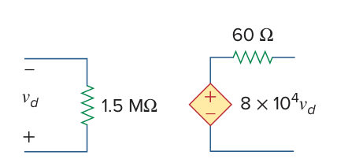

</PracticeCard>

<PracticeCard id="ch5-problem-5-2" type="exercise" title="Problem 5.2" source="課本 p.200" topic="運算放大器 / 章末習題">

The open-loop gain of an op amp is 100,000. Calculate the output voltage when there are inputs of $+10\,\mu\mathrm{V}$ on the inverting terminal and $+20\,\mu\mathrm{V}$ on the noninverting terminal.

</PracticeCard>

<PracticeCard id="ch5-problem-5-3" type="exercise" title="Problem 5.3" source="課本 p.200" topic="運算放大器 / 章末習題">

Determine the output voltage when $+20\,\mu\mathrm{V}$ is applied to the inverting terminal of an op amp and $+30\,\mu\mathrm{V}$ to its noninverting terminal. Assume that the op amp has an open-loop gain of 200,000.

</PracticeCard>

<PracticeCard id="ch5-problem-5-4" type="exercise" title="Problem 5.4" source="課本 p.200" topic="運算放大器 / 章末習題">

The output voltage of an op amp is $-4\,\mathrm{V}$ when the noninverting input is $1\,\mathrm{mV}$. If the open-loop gain of the op amp is $2\times 10^6$, what is the inverting input?

</PracticeCard>

<PracticeCard id="ch5-problem-5-5" type="exercise" title="Problem 5.5" source="課本 p.200" topic="運算放大器 / 章末習題">

For the op amp circuit of Fig. 5.44, the op amp has an open-loop gain of 100,000, an input resistance of $10\,\mathrm{k}\Omega$, and an output resistance of $100\,\Omega$. Find the voltage gain $v_o/v_i$ using the nonideal model of the op amp.

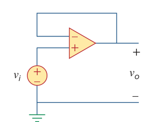

</PracticeCard>

<PracticeCard id="ch5-problem-5-6" type="exercise" title="Problem 5.6" source="課本 p.200" topic="運算放大器 / 章末習題">

Using the same parameters for the 741 op amp in Example 5.1 ($A=200{,}000$, $R_i=2\,\mathrm{M}\Omega$, and $R_o=50\,\Omega$), find $v_o$ in the op amp circuit of Fig. 5.45.

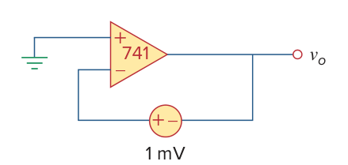

</PracticeCard>

<PracticeCard id="ch5-problem-5-7" type="exercise" title="Problem 5.7" source="課本 p.200" topic="運算放大器 / 章末習題">

The op amp in Fig. 5.46 has $R_i=100\,\mathrm{k}\Omega$, $R_o=100\,\Omega$, and $A=100{,}000$. Find the differential voltage $v_d$ and the output voltage $v_o$.

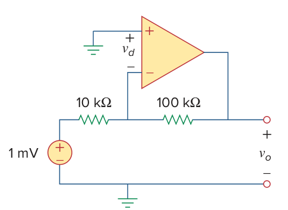

</PracticeCard>

<PracticeCard id="ch5-problem-5-8" type="exercise" title="Problem 5.8" source="課本 p.200" topic="運算放大器 / 章末習題">

Obtain $v_o$ for each of the op amp circuits in Fig. 5.47.

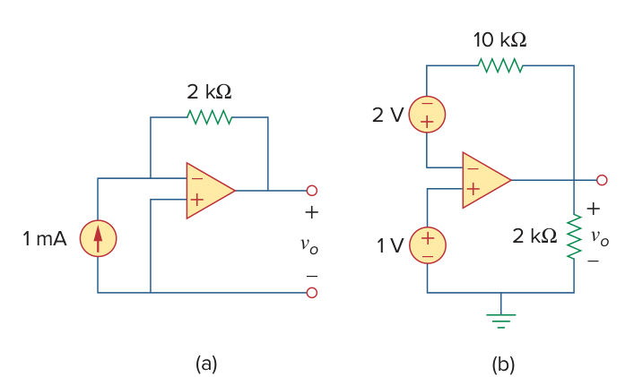

</PracticeCard>

<PracticeCard id="ch5-problem-5-9" type="exercise" title="Problem 5.9" source="課本 p.200" topic="運算放大器 / 章末習題">

Determine $v_o$ for each of the op amp circuits in Fig. 5.48.

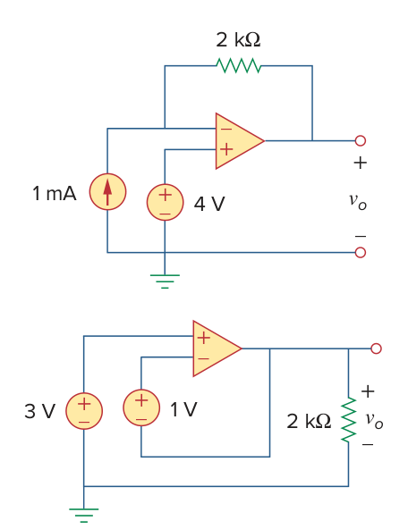

</PracticeCard>

<PracticeCard id="ch5-problem-5-10" type="exercise" title="Problem 5.10" source="課本 p.201" topic="運算放大器 / 章末習題">

Find the gain $v_o/v_s$ of the circuit in Fig. 5.49.

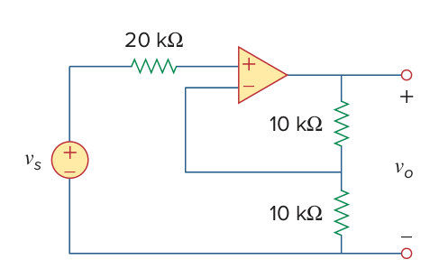

</PracticeCard>

<PracticeCard id="ch5-problem-5-11" type="exercise" title="Problem 5.11" source="課本 p.201" topic="運算放大器 / 章末習題">

Using Fig. 5.50, design a problem to help other students better understand how ideal op amps work.

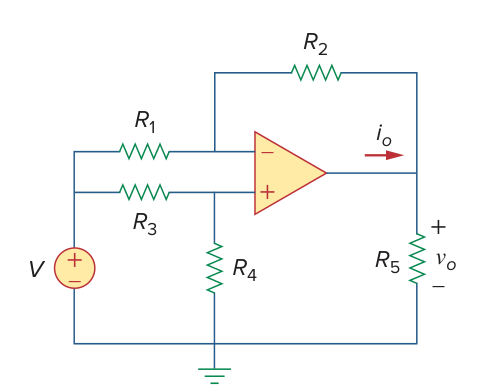

</PracticeCard>

<PracticeCard id="ch5-problem-5-12" type="exercise" title="Problem 5.12" source="課本 p.201" topic="運算放大器 / 章末習題">

Calculate the voltage ratio $v_o/v_s$ for the op amp circuit of Fig. 5.51. Assume that the op amp is ideal.

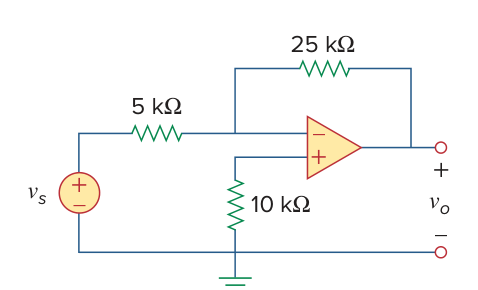

</PracticeCard>

<PracticeCard id="ch5-problem-5-13" type="exercise" title="Problem 5.13" source="課本 p.201" topic="運算放大器 / 章末習題">

Find $v_o$ and $i_o$ in the circuit of Fig. 5.52.

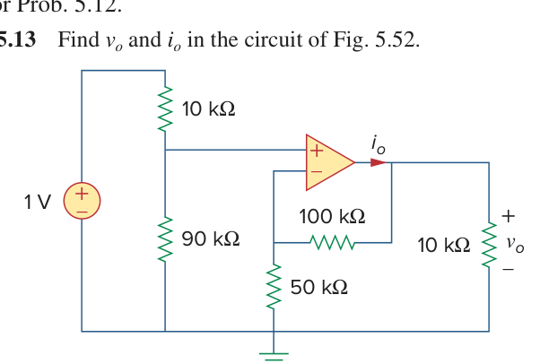

</PracticeCard>

<PracticeCard id="ch5-problem-5-14" type="exercise" title="Problem 5.14" source="課本 p.201" topic="運算放大器 / 章末習題">

Determine the output voltage $v_o$ in the circuit of Fig. 5.53.

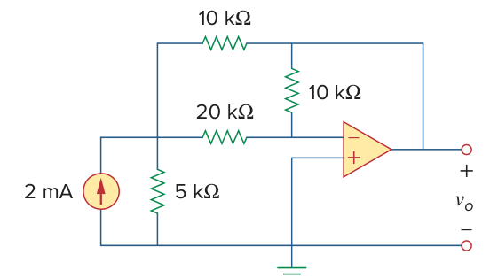

</PracticeCard>

<PracticeCard id="ch5-problem-5-15" type="exercise" title="Problem 5.15" source="課本 p.201" topic="運算放大器 / 章末習題">

(a) Determine the ratio $v_o/i_s$ in the op amp circuit of Fig. 5.54.

(b) Evaluate the ratio for $R_1=20\,\mathrm{k}\Omega$, $R_2=25\,\mathrm{k}\Omega$, and $R_3=40\,\mathrm{k}\Omega$.

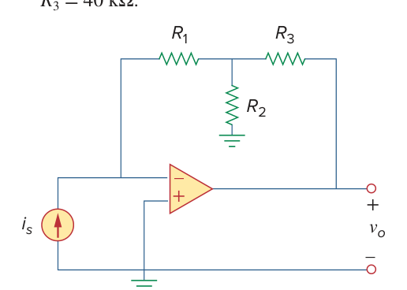

</PracticeCard>

<PracticeCard id="ch5-problem-5-16" type="exercise" title="Problem 5.16" source="課本 p.202" topic="運算放大器 / 章末習題">

Using Fig. 5.55, design a problem to help students better understand inverting op amps.

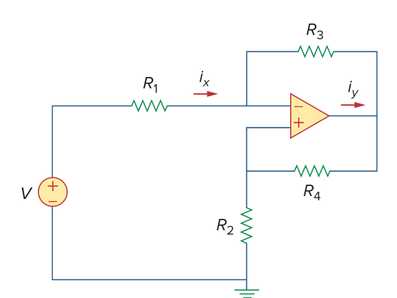

</PracticeCard>

<PracticeCard id="ch5-problem-5-17" type="exercise" title="Problem 5.17" source="課本 p.202" topic="運算放大器 / 章末習題">

Calculate the gain $v_o/v_i$ when the switch in Fig. 5.56 is in: (a) position 1, (b) position 2, and (c) position 3.

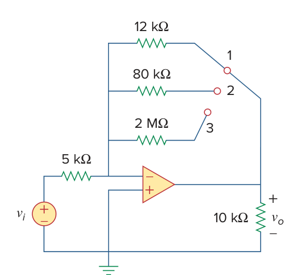

</PracticeCard>

<PracticeCard id="ch5-problem-5-18" type="exercise" title="Problem 5.18" source="課本 p.202" topic="運算放大器 / 章末習題">

For the circuit shown in Fig. 5.57, solve for the Thevenin equivalent circuit looking into terminals A and B. *(Challenging problem.)*

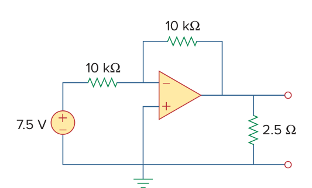

</PracticeCard>

<PracticeCard id="ch5-problem-5-19" type="exercise" title="Problem 5.19" source="課本 p.202" topic="運算放大器 / 章末習題">

Determine $i_o$ in the circuit of Fig. 5.58.

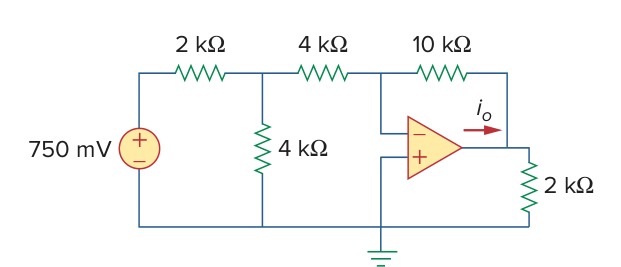

</PracticeCard>

<PracticeCard id="ch5-problem-5-20" type="exercise" title="Problem 5.20" source="課本 p.202" topic="運算放大器 / 章末習題">

In the circuit of Fig. 5.59, calculate $v_o$ of $v_s=2\,\mathrm{V}$.

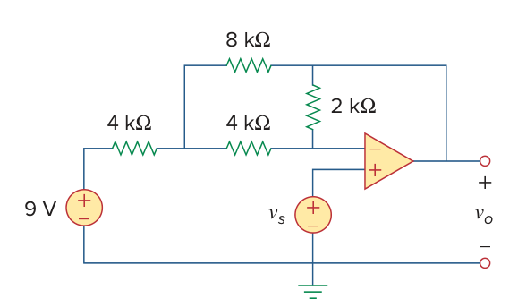

</PracticeCard>

<PracticeCard id="ch5-problem-5-21" type="exercise" title="Problem 5.21" source="課本 p.202" topic="運算放大器 / 章末習題">

Calculate $v_o$ in the op amp circuit of Fig. 5.60.

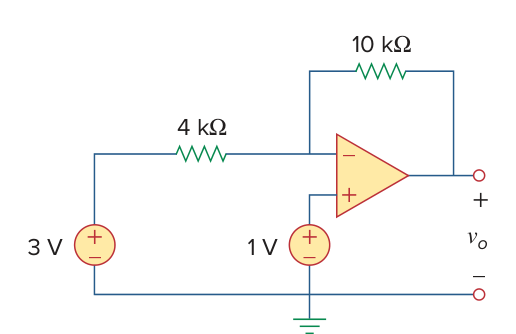

</PracticeCard>

<PracticeCard id="ch5-problem-5-22" type="exercise" title="Problem 5.22" source="課本 p.202" topic="運算放大器 / 章末習題">

Design an inverting amplifier with a gain of $-15$.

</PracticeCard>

<PracticeCard id="ch5-problem-5-23" type="exercise" title="Problem 5.23" source="課本 p.202" topic="運算放大器 / 章末習題">

For the op amp circuit in Fig. 5.61, find the voltage gain $v_o/v_s$.

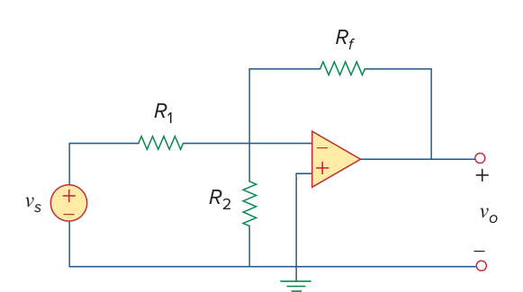

</PracticeCard>

<PracticeCard id="ch5-problem-5-24" type="exercise" title="Problem 5.24" source="課本 p.203" topic="運算放大器 / 章末習題">

In the circuit shown in Fig. 5.62, find $k$ in the voltage transfer function $v_o=kv_s$.

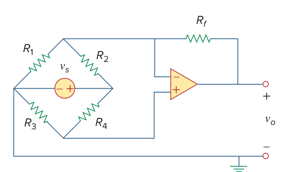

</PracticeCard>

<PracticeCard id="ch5-problem-5-25" type="exercise" title="Problem 5.25" source="課本 p.203" topic="運算放大器 / 章末習題">

Calculate $v_o$ in the op amp circuit of Fig. 5.63.

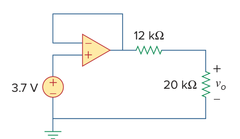

</PracticeCard>

<PracticeCard id="ch5-problem-5-26" type="exercise" title="Problem 5.26" source="課本 p.203" topic="運算放大器 / 章末習題">

Using Fig. 5.64, design a problem to help other students better understand noninverting op amps.

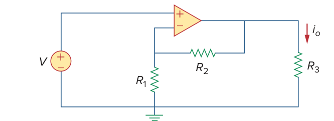

</PracticeCard>

<PracticeCard id="ch5-problem-5-27" type="exercise" title="Problem 5.27" source="課本 p.203" topic="運算放大器 / 章末習題">

Find $v_o$ in the op amp circuit of Fig. 5.65.

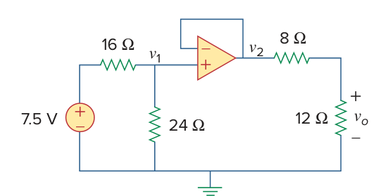

</PracticeCard>

<PracticeCard id="ch5-problem-5-28" type="exercise" title="Problem 5.28" source="課本 p.203" topic="運算放大器 / 章末習題">

Find $i_o$ in the op amp circuit of Fig. 5.66.

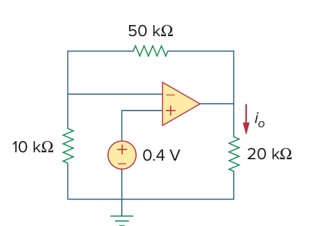

</PracticeCard>

<PracticeCard id="ch5-problem-5-29" type="exercise" title="Problem 5.29" source="課本 p.203" topic="運算放大器 / 章末習題">

Determine the voltage gain $v_o/v_i$ of the op amp circuit in Fig. 5.67.

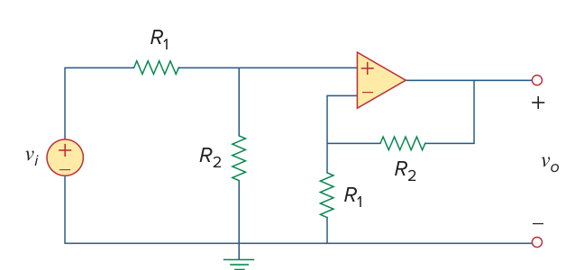

</PracticeCard>

<PracticeCard id="ch5-problem-5-30" type="exercise" title="Problem 5.30" source="課本 p.203" topic="運算放大器 / 章末習題">

In the circuit shown in Fig. 5.68, find $i_x$ and the power absorbed by the $20\,\mathrm{k}\Omega$ resistor.

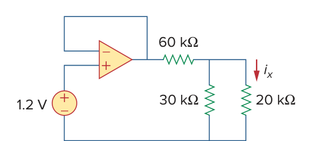

</PracticeCard>

<PracticeCard id="ch5-problem-5-31" type="exercise" title="Problem 5.31" source="課本 p.203" topic="運算放大器 / 章末習題">

For the circuit in Fig. 5.69, find $i_x$.

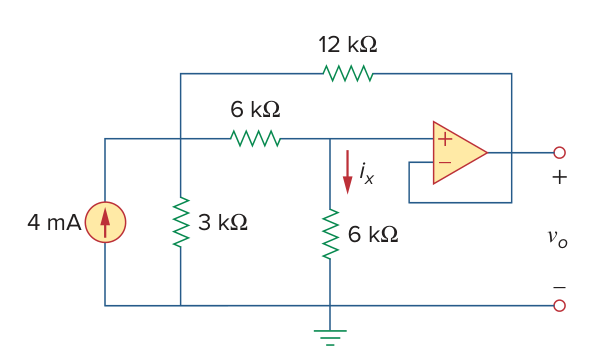

</PracticeCard>

<PracticeCard id="ch5-problem-5-32" type="exercise" title="Problem 5.32" source="課本 p.204" topic="運算放大器 / 章末習題">

Calculate $i_x$ and $v_o$ in the circuit of Fig. 5.70. Find the power dissipated by the $60\,\mathrm{k}\Omega$ resistor.

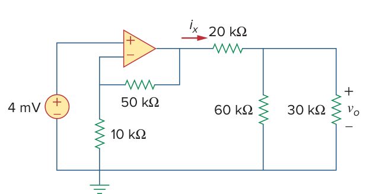

</PracticeCard>

<PracticeCard id="ch5-problem-5-33" type="exercise" title="Problem 5.33" source="課本 p.204" topic="運算放大器 / 章末習題">

Refer to the op amp circuit in Fig. 5.71. Calculate $i_x$ and the power absorbed by the $3\,\mathrm{k}\Omega$ resistor.

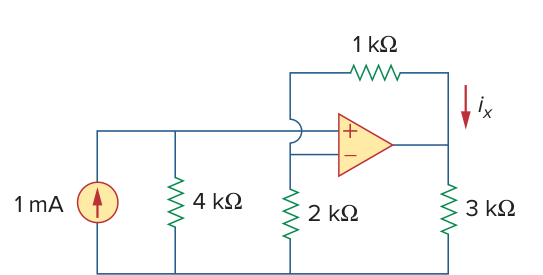

</PracticeCard>

<PracticeCard id="ch5-problem-5-34" type="exercise" title="Problem 5.34" source="課本 p.204" topic="運算放大器 / 章末習題">

Given the op amp circuit shown in Fig. 5.72, express $v_o$ in terms of $v_1$ and $v_2$.

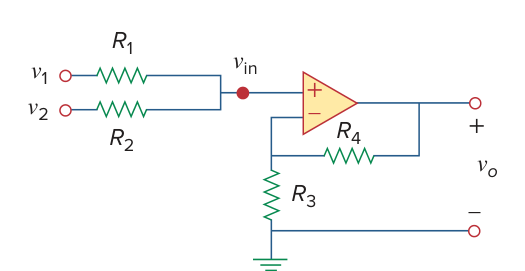

</PracticeCard>

<PracticeCard id="ch5-problem-5-35" type="exercise" title="Problem 5.35" source="課本 p.204" topic="運算放大器 / 章末習題">

Design a noninverting amplifier with a gain of 7.5.

</PracticeCard>

<PracticeCard id="ch5-problem-5-36" type="exercise" title="Problem 5.36" source="課本 p.204" topic="運算放大器 / 章末習題">

For the circuit shown in Fig. 5.73, find the Thevenin equivalent at terminals a-b. *(Hint: To find $R_{Th}$, apply a current source $i_o$ and calculate $v_o$.)*

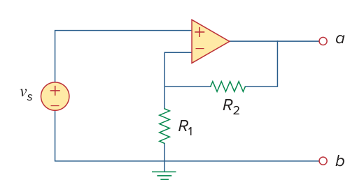

</PracticeCard>

<PracticeCard id="ch5-problem-5-37" type="exercise" title="Problem 5.37" source="課本 p.204" topic="運算放大器 / 章末習題">

Determine the output of the summing amplifier in Fig. 5.74.

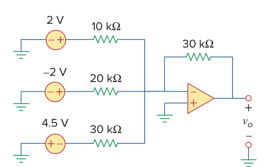

</PracticeCard>

<PracticeCard id="ch5-problem-5-38" type="exercise" title="Problem 5.38" source="課本 p.204" topic="運算放大器 / 章末習題">

Using Fig. 5.75, design a problem to help other students better understand summing amplifiers.

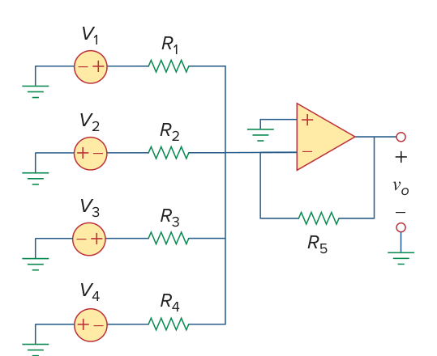

</PracticeCard>

<PracticeCard id="ch5-problem-5-39" type="exercise" title="Problem 5.39" source="課本 p.204" topic="運算放大器 / 章末習題">

For the op amp circuit in Fig. 5.76, determine the value of $v_2$ in order to make $v_o=-16.5\,\mathrm{V}$.

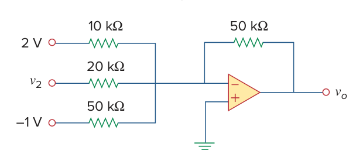

</PracticeCard>

<PracticeCard id="ch5-problem-5-40" type="exercise" title="Problem 5.40" source="課本 p.205" topic="運算放大器 / 章末習題">

Referring to the circuit shown in Fig. 5.77, determine $V_o$ in terms of $V_1$ and $V_2$.

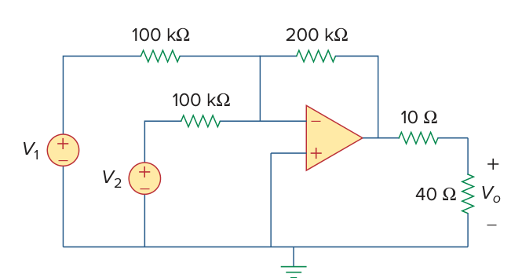

</PracticeCard>

<PracticeCard id="ch5-problem-5-41" type="exercise" title="Problem 5.41" source="課本 p.205" topic="運算放大器 / 章末習題">

An averaging amplifier is a summer that provides an output equal to the average of the inputs. By using proper input and feedback resistor values, one can get $-v_{out}=\frac{1}{4}(v_1+v_2+v_3+v_4)$. Using a feedback resistor of $10\,\mathrm{k}\Omega$, design an averaging amplifier with four inputs.

</PracticeCard>

<PracticeCard id="ch5-problem-5-42" type="exercise" title="Problem 5.42" source="課本 p.205" topic="運算放大器 / 章末習題">

A three-input summing amplifier has input resistors with $R_1=R_2=R_3=75\,\mathrm{k}\Omega$. To produce an averaging amplifier, what value of feedback resistor is needed?

</PracticeCard>

<PracticeCard id="ch5-problem-5-43" type="exercise" title="Problem 5.43" source="課本 p.205" topic="運算放大器 / 章末習題">

A four-input summing amplifier has $R_1=R_2=R_3=R_4=80\,\mathrm{k}\Omega$. What value of feedback resistor is needed to make it an averaging amplifier?

</PracticeCard>

<PracticeCard id="ch5-problem-5-44" type="exercise" title="Problem 5.44" source="課本 p.205" topic="運算放大器 / 章末習題">

Show that the output voltage $v_o$ of the circuit in Fig. 5.78 is
$$
v_o=\frac{R_3+R_4}{R_3(R_1+R_2)}(R_2v_1+R_1v_2)
$$

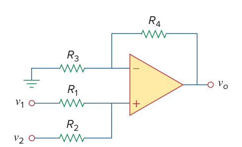

</PracticeCard>

<PracticeCard id="ch5-problem-5-45" type="exercise" title="Problem 5.45" source="課本 p.205" topic="運算放大器 / 章末習題">

Design an op amp circuit to perform the following operation: $v_o=3v_1-2v_2$. All resistances must be $\le 100\,\mathrm{k}\Omega$.

</PracticeCard>

<PracticeCard id="ch5-problem-5-46" type="exercise" title="Problem 5.46" source="課本 p.205" topic="運算放大器 / 章末習題">

Using only two op amps, design a circuit to solve $-v_{out}=\frac{v_1-v_2}{3}+\frac{v_3}{2}$.

</PracticeCard>

<PracticeCard id="ch5-problem-5-47" type="exercise" title="Problem 5.47" source="課本 p.205" topic="運算放大器 / 章末習題">

The circuit in Fig. 5.79 is for a difference amplifier. Find $v_o$ given that $v_1 = 1\,\mathrm{V}$ and $v_2 = 2\,\mathrm{V}$.

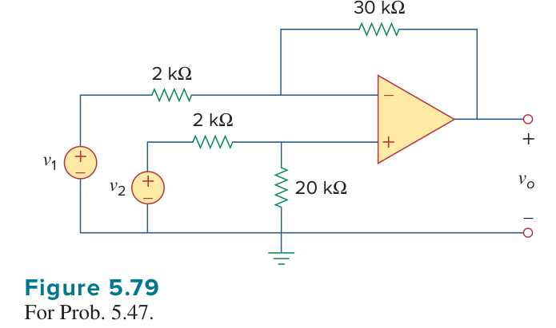

</PracticeCard>

<PracticeCard id="ch5-problem-5-48" type="exercise" title="Problem 5.48" source="課本 p.205" topic="運算放大器 / 章末習題">

The circuit in Fig. 5.80 is a differential amplifier driven by a bridge. Find $v_o$.

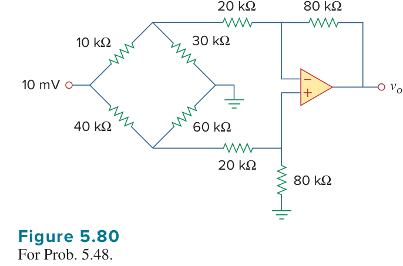

</PracticeCard>

<PracticeCard id="ch5-problem-5-49" type="exercise" title="Problem 5.49" source="課本 p.205" topic="運算放大器 / 章末習題">

Design a difference amplifier to have a gain of 4 and a common-mode input resistance of $20\,\mathrm{k}\Omega$ at each input.

</PracticeCard>

<PracticeCard id="ch5-problem-5-50" type="exercise" title="Problem 5.50" source="課本 p.205" topic="運算放大器 / 章末習題">

Design a circuit to amplify the difference between two inputs by 2.5.

(a) Use only one op amp.

(b) Use two op amps.

</PracticeCard>

<PracticeCard id="ch5-problem-5-51" type="exercise" title="Problem 5.51" source="課本 p.206" topic="運算放大器 / 章末習題">

Using two op amps, design a subtractor.

</PracticeCard>

<PracticeCard id="ch5-problem-5-52" type="exercise" title="Problem 5.52" source="課本 p.206" topic="運算放大器 / 章末習題">

Design an op amp circuit such that

$$
v_o = 4v_1 + 6v_2 - 3v_3 - 5v_4
$$

Let all the resistors be in the range of $20$ to $200\,\mathrm{k}\Omega$.

</PracticeCard>

<PracticeCard id="ch5-problem-5-53" type="exercise" title="Problem 5.53" source="課本 p.206" topic="運算放大器 / 章末習題">

The ordinary difference amplifier for fixed-gain operation is shown in Fig. 5.81(a). It is simple and reliable unless gain is made variable. One way of providing gain adjustment without losing simplicity and accuracy is to use the circuit in Fig. 5.81(b). Another way is to use the circuit in Fig. 5.81(c). Show that:

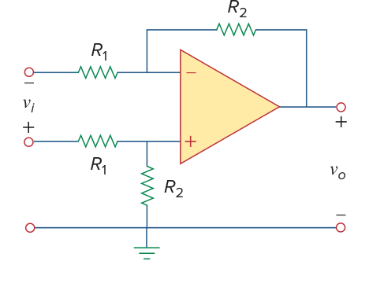

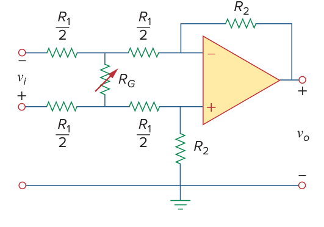

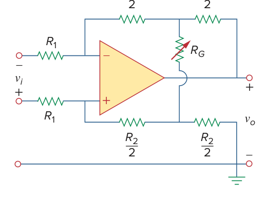

(a) for the circuit in Fig. 5.81(a),

$$
\frac{v_o}{v_i} = \frac{R_2}{R_1}
$$

(b) for the circuit in Fig. 5.81(b),

$$
\frac{v_o}{v_i} = \frac{R_2}{R_1}\frac{1}{1 + \frac{R_1}{2R_G}}
$$

(c) for the circuit in Fig. 5.81(c),

$$
\frac{v_o}{v_i} = \frac{R_2}{R_1}\left(1 + \frac{R_2}{2R_G}\right)
$$

</PracticeCard>

<PracticeCard id="ch5-problem-5-54" type="exercise" title="Problem 5.54" source="課本 p.206" topic="運算放大器 / 章末習題">

Determine the voltage transfer ratio $v_o/v_s$ in the op amp circuit of Fig. 5.82, where $R = 10\,\mathrm{k}\Omega$.

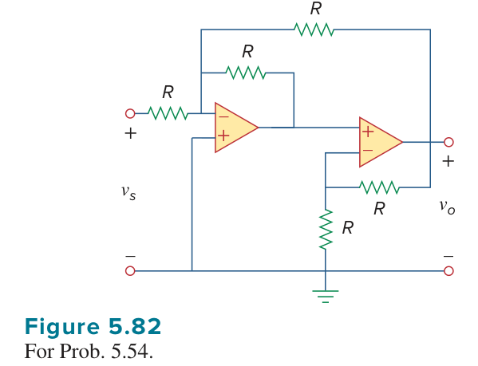

</PracticeCard>

<PracticeCard id="ch5-problem-5-55" type="exercise" title="Problem 5.55" source="課本 p.206" topic="運算放大器 / 章末習題">

In a certain electronic device, a three-stage amplifier is desired, whose overall voltage gain is $42\,\mathrm{dB}$. The individual voltage gains of the first two stages are to be equal, while the gain of the third is to be one-fourth of each of the first two. Calculate the voltage gain of each.

</PracticeCard>

<PracticeCard id="ch5-problem-5-56" type="exercise" title="Problem 5.56" source="課本 p.206" topic="運算放大器 / 章末習題">

Using Fig. 5.83, design a problem to help other students better understand cascaded op amps.

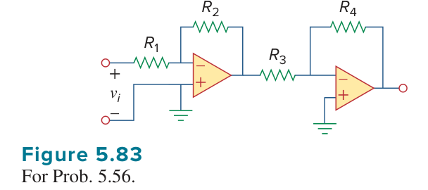

</PracticeCard>

<PracticeCard id="ch5-problem-5-57" type="exercise" title="Problem 5.57" source="課本 p.207" topic="運算放大器 / 章末習題">

Find $v_o$ in the op amp circuit of Fig. 5.84.

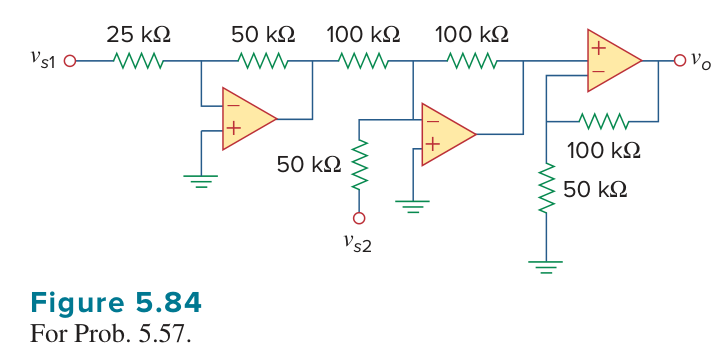

</PracticeCard>

<PracticeCard id="ch5-problem-5-58" type="exercise" title="Problem 5.58" source="課本 p.207" topic="運算放大器 / 章末習題">

Calculate $i_o$ in the op amp circuit of Fig. 5.85.

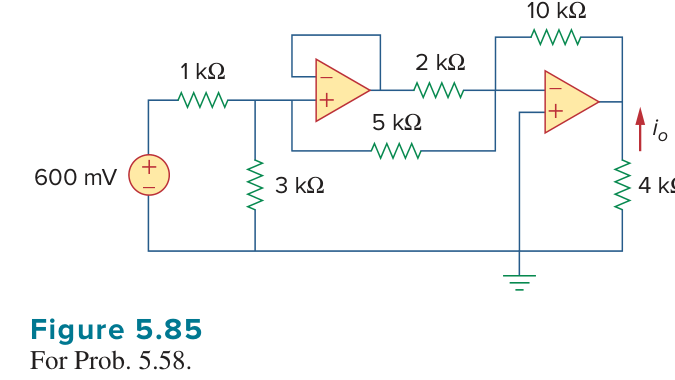

</PracticeCard>

<PracticeCard id="ch5-problem-5-59" type="exercise" title="Problem 5.59" source="課本 p.207" topic="運算放大器 / 章末習題">

In the op amp circuit of Fig. 5.86, determine the voltage gain $v_o/v_s$. Take $R = 10\,\mathrm{k}\Omega$.

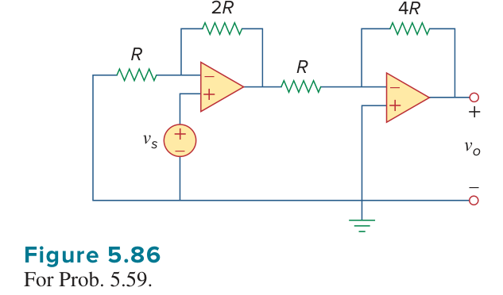

</PracticeCard>

<PracticeCard id="ch5-problem-5-60" type="exercise" title="Problem 5.60" source="課本 p.207" topic="運算放大器 / 章末習題">

Calculate $v_o/v_i$ in the op amp circuit of Fig. 5.87.

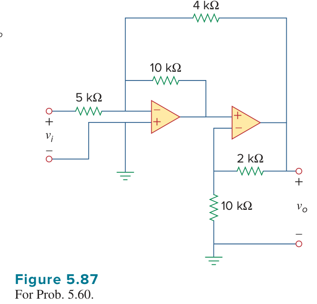

</PracticeCard>

<PracticeCard id="ch5-problem-5-61" type="exercise" title="Problem 5.61" source="課本 p.207" topic="運算放大器 / 章末習題">

Determine $v_o$ in the circuit of Fig. 5.88.

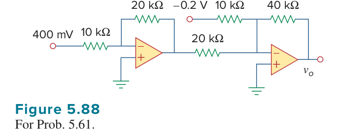

</PracticeCard>

<PracticeCard id="ch5-problem-5-62" type="exercise" title="Problem 5.62" source="課本 p.207" topic="運算放大器 / 章末習題">

Obtain the closed-loop voltage gain $v_o/v_i$ of the circuit in Fig. 5.89.

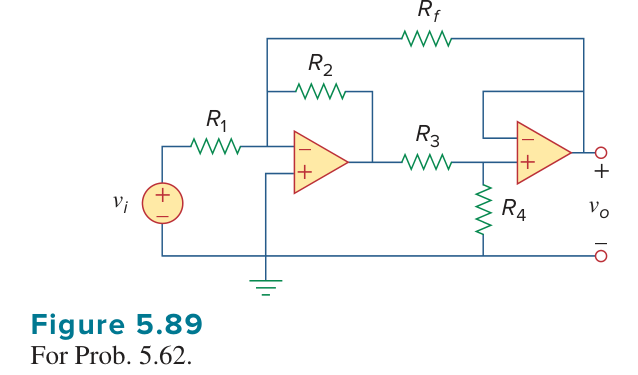

</PracticeCard>

<PracticeCard id="ch5-problem-5-63" type="exercise" title="Problem 5.63" source="課本 p.208" topic="運算放大器 / 章末習題">

Determine the gain $v_o/v_i$ of the circuit in Fig. 5.90.

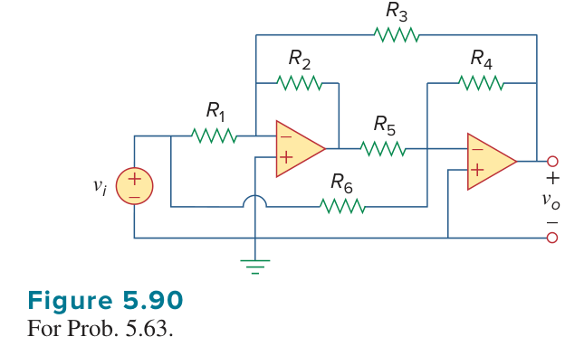

</PracticeCard>

<PracticeCard id="ch5-problem-5-64" type="exercise" title="Problem 5.64" source="課本 p.208" topic="運算放大器 / 章末習題">

For the op amp circuit shown in Fig. 5.91, find $v_o/v_s$.

</PracticeCard>

<PracticeCard id="ch5-problem-5-65" type="exercise" title="Problem 5.65" source="課本 p.208" topic="運算放大器 / 章末習題">

Find $v_o$ in the op amp circuit of Fig. 5.92.

</PracticeCard>

<PracticeCard id="ch5-problem-5-66" type="exercise" title="Problem 5.66" source="課本 p.208" topic="運算放大器 / 章末習題">

For the circuit in Fig. 5.93, find $v_o$.

</PracticeCard>

<PracticeCard id="ch5-problem-5-67" type="exercise" title="Problem 5.67" source="課本 p.208" topic="運算放大器 / 章末習題">

Obtain the output $v_o$ in the circuit of Fig. 5.94.

</PracticeCard>

<PracticeCard id="ch5-problem-5-68" type="exercise" title="Problem 5.68" source="課本 p.208" topic="運算放大器 / 章末習題">

Find $v_o$ in the circuit of Fig. 5.95, assuming that $R_f = \infty$ (open circuit).

</PracticeCard>

<PracticeCard id="ch5-problem-5-69" type="exercise" title="Problem 5.69" source="課本 p.209" topic="運算放大器 / 章末習題">

Repeat the previous problem if $R_f = 10\,\mathrm{k}\Omega$.

</PracticeCard>

<PracticeCard id="ch5-problem-5-70" type="exercise" title="Problem 5.70" source="課本 p.209" topic="運算放大器 / 章末習題">

Determine $v_o$ in the op amp circuit of Fig. 5.96.

</PracticeCard>

<PracticeCard id="ch5-problem-5-71" type="exercise" title="Problem 5.71" source="課本 p.209" topic="運算放大器 / 章末習題">

Determine $v_o$ in the op amp circuit of Fig. 5.97.

</PracticeCard>

<PracticeCard id="ch5-problem-5-72" type="exercise" title="Problem 5.72" source="課本 p.209" topic="運算放大器 / 章末習題">

Find the load voltage $v_L$ in the circuit of Fig. 5.98.

</PracticeCard>

<PracticeCard id="ch5-problem-5-73" type="exercise" title="Problem 5.73" source="課本 p.209" topic="運算放大器 / 章末習題">

Determine the load voltage $v_L$ in the circuit of Fig. 5.99.

</PracticeCard>

<PracticeCard id="ch5-problem-5-74" type="exercise" title="Problem 5.74" source="課本 p.209" topic="運算放大器 / 章末習題">

Find $i_o$ in the op amp circuit of Fig. 5.100.

</PracticeCard>

<PracticeCard id="ch5-problem-5-75" type="exercise" title="Problem 5.75" source="課本 p.209" topic="運算放大器 / 章末習題">

Rework Example 5.11 using the nonideal op amp LM324 instead of $\mu$A741.

</PracticeCard>

<PracticeCard id="ch5-problem-5-76" type="exercise" title="Problem 5.76" source="課本 p.209" topic="運算放大器 / 章末習題">

Solve Problem 5.19 using PSpice or MultiSim and op amp uA741.

</PracticeCard>

<PracticeCard id="ch5-problem-5-77" type="exercise" title="Problem 5.77" source="課本 p.209" topic="運算放大器 / 章末習題">

Solve Problem 5.48 using PSpice or MultiSim and op amp LM324.

</PracticeCard>

<PracticeCard id="ch5-problem-5-78" type="exercise" title="Problem 5.78" source="課本 p.210" topic="運算放大器 / 章末習題">

Use PSpice or MultiSim to obtain $v_o$ in the circuit of Fig. 5.101.

</PracticeCard>

<PracticeCard id="ch5-problem-5-79" type="exercise" title="Problem 5.79" source="課本 p.210" topic="運算放大器 / 章末習題">

Determine $v_o$ in the op amp circuit of Fig. 5.102, using PSpice or MultiSim.

</PracticeCard>

<PracticeCard id="ch5-problem-5-80" type="exercise" title="Problem 5.80" source="課本 p.210" topic="運算放大器 / 章末習題">

Use PSpice or MultiSim to solve Problem 5.70.

</PracticeCard>

<PracticeCard id="ch5-problem-5-81" type="exercise" title="Problem 5.81" source="課本 p.210" topic="運算放大器 / 章末習題">

Use PSpice or MultiSim to verify the results in Example 5.9. Assume nonideal op amps LM324.

</PracticeCard>

<PracticeCard id="ch5-problem-5-82" type="exercise" title="Problem 5.82" source="課本 p.210" topic="運算放大器 / 章末習題">

A five-bit DAC covers a voltage range of 0 to $7.75\,\mathrm{V}$. Calculate how much voltage each bit is worth.

</PracticeCard>

<PracticeCard id="ch5-problem-5-83" type="exercise" title="Problem 5.83" source="課本 p.210" topic="運算放大器 / 章末習題">

Design a six-bit digital-to-analog converter.

(a) If $|V_o| = 1.1875\,\mathrm{V}$ is desired, what should $[V_1V_2V_3V_4V_5V_6]$ be?

(b) Calculate $|V_o|$ if $[V_1V_2V_3V_4V_5V_6] = [011011]$.

(c) What is the maximum value $|V_o|$ can assume?

</PracticeCard>

<PracticeCard id="ch5-problem-5-84" type="exercise" title="Problem 5.84" source="課本 p.210" topic="運算放大器 / 章末習題">

A four-bit R-2R ladder DAC is presented in Fig. 5.103.

(a) Show that the output voltage is given by

$$
-V_o = R_f\left(\frac{V_1}{2R} + \frac{V_2}{4R} + \frac{V_3}{8R} + \frac{V_4}{16R}\right)
$$

(b) If $R_f = 12\,\mathrm{k}\Omega$ and $R = 10\,\mathrm{k}\Omega$, find $|V_o|$ for $[V_1V_2V_3V_4] = [1011]$ and $[V_1V_2V_3V_4] = [0101]$.

</PracticeCard>

<PracticeCard id="ch5-problem-5-85" type="exercise" title="Problem 5.85" source="課本 p.210" topic="運算放大器 / 章末習題">

In the op amp circuit of Fig. 5.104, find the value of $R$ so that the power absorbed by the $10\,\mathrm{k}\Omega$ resistor is $10\,\mathrm{mW}$. Take $v_s = 2\,\mathrm{V}$.

</PracticeCard>

<PracticeCard id="ch5-problem-5-86" type="exercise" title="Problem 5.86" source="課本 p.210" topic="運算放大器 / 章末習題">

Design a voltage controlled ideal current source (within the operating limits of the op amp) where the output current is equal to $200v_s(t)\,\mu\mathrm{A}$.

</PracticeCard>

<PracticeCard id="ch5-problem-5-87" type="exercise" title="Problem 5.87" source="課本 p.211" topic="運算放大器 / 章末習題">

Figure 5.105 displays a two-op amp instrumentation amplifier. Derive an expression for $v_o$ in terms of $v_1$ and $v_2$. How can this amplifier be used as a subtractor?

</PracticeCard>

<PracticeCard id="ch5-problem-5-88" type="exercise" title="Problem 5.88" source="課本 p.211" topic="運算放大器 / 章末習題">

Figure 5.106 shows an instrumentation amplifier driven by a bridge. Obtain the gain $v_o/v_i$ of the amplifier.

</PracticeCard>

<PracticeCard id="ch5-problem-5-89" type="exercise" title="Problem 5.89" source="課本 p.211" topic="運算放大器 / 章末習題">

Design a circuit that provides a relationship between output voltage $v_o$ and input voltage $v_s$ such that

$$
v_o = 12v_s - 10
$$

Two op amps, a $6\,\mathrm{V}$ battery, and several resistors are available.

</PracticeCard>

<PracticeCard id="ch5-problem-5-90" type="exercise" title="Problem 5.90" source="課本 p.211" topic="運算放大器 / 章末習題">

The op amp circuit in Fig. 5.107 is a current amplifier. Find the current gain $i_o/i_s$ of the amplifier.

</PracticeCard>

<PracticeCard id="ch5-problem-5-91" type="exercise" title="Problem 5.91" source="課本 p.211" topic="運算放大器 / 章末習題">

A noninverting current amplifier is portrayed in Fig. 5.108. Calculate the gain $i_o/i_s$. Take $R_1 = 8\,\mathrm{k}\Omega$ and $R_2 = 1\,\mathrm{k}\Omega$.

</PracticeCard>

<PracticeCard id="ch5-problem-5-92" type="exercise" title="Problem 5.92" source="課本 p.212" topic="運算放大器 / 章末習題">

Refer to the bridge amplifier shown in Fig. 5.109. Determine the voltage gain $v_o/v_i$.

</PracticeCard>

<PracticeCard id="ch5-problem-5-93" type="exercise" title="Problem 5.93" source="課本 p.212" topic="運算放大器 / 章末習題">

A voltage-to-current converter is shown in Fig. 5.110, which means that $i_L = Av_i$ if $R_1R_2 = R_3R_4$. Find the constant term $A$.

</PracticeCard>
