# Chapter 6 課本章末習題

收錄 Alexander & Sadiku《Fundamentals of Electric Circuits》第六章 Problems 與 Comprehensive Problems，題號 6.9–6.86，共 78 題。題幹保留英文原文，引用圖表已置於各題卡內；本頁只收錄題目。

<PracticeFilter prefix="ch6-problem-6-" />
<PracticeProgress :total="78" prefix="ch6-problem-6-" />

<PracticeCard id="ch6-problem-6-9" type="exercise" title="Problem 6.9" source="課本 p.241" topic="電容與電感 / 章末習題">

The current through a $0.5\text{-F}$ capacitor is $6(1-e^{-t})\,\mathrm{A}$. Determine the voltage and power at $t=2\,\mathrm{s}$. Assume $v(0)=0$.

</PracticeCard>

<PracticeCard id="ch6-problem-6-10" type="exercise" title="Problem 6.10" source="課本 p.241" topic="電容與電感 / 章末習題">

The voltage across a $5\text{-mF}$ capacitor is shown in Fig. 6.47. Determine the current through the capacitor.

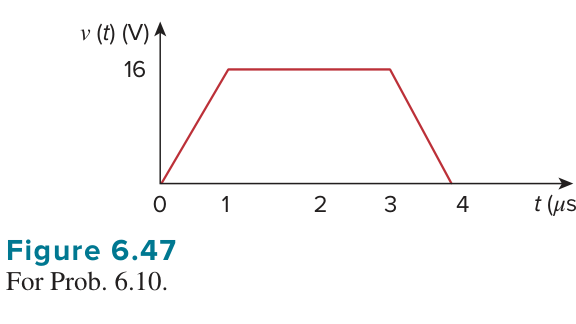

</PracticeCard>

<PracticeCard id="ch6-problem-6-11" type="exercise" title="Problem 6.11" source="課本 p.241" topic="電容與電感 / 章末習題">

A $4\text{-mF}$ capacitor has the current waveform shown in Fig. 6.48. Assuming that $v(0)=10\,\mathrm{V}$, sketch the voltage waveform $v(t)$.

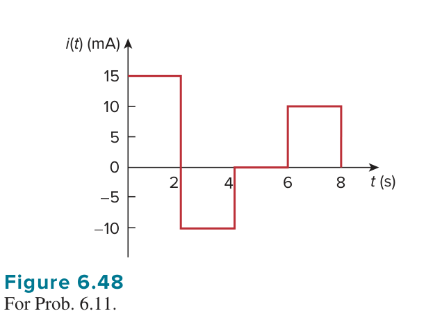

</PracticeCard>

<PracticeCard id="ch6-problem-6-12" type="exercise" title="Problem 6.12" source="課本 p.241" topic="電容與電感 / 章末習題">

A voltage of $45e^{-2{,}000t}\,\mathrm{V}$ appears across a parallel combination of a $100\text{-mF}$ capacitor and a $12\text{-}\Omega$ resistor. Calculate the power absorbed by the parallel combination.

</PracticeCard>

<PracticeCard id="ch6-problem-6-13" type="exercise" title="Problem 6.13" source="課本 p.241" topic="電容與電感 / 章末習題">

Find the voltage across the capacitors in the circuit of Fig. 6.49 under dc conditions.

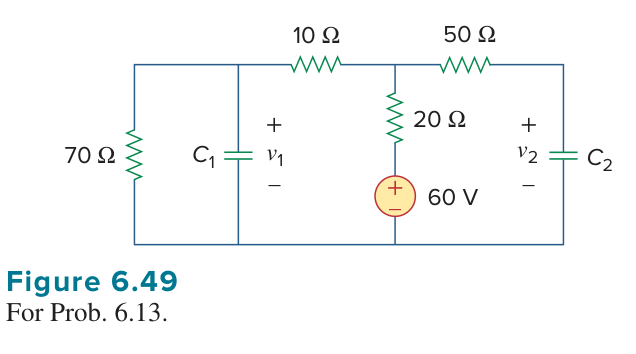

</PracticeCard>

<PracticeCard id="ch6-problem-6-14" type="exercise" title="Problem 6.14" source="課本 p.241" topic="電容與電感 / 章末習題">

Series-connected $20$- and $60\text{-pF}$ capacitors are placed in parallel with series-connected $30$- and $70\text{-pF}$ capacitors. Determine the equivalent capacitance.

</PracticeCard>

<PracticeCard id="ch6-problem-6-15" type="exercise" title="Problem 6.15" source="課本 p.241" topic="電容與電感 / 章末習題">

Two capacitors ($25$ and $75\,\mu\mathrm{F}$) are connected to a $100\text{-V}$ source. Find the energy stored in each capacitor if they are connected in:

(a) parallel

(b) series

</PracticeCard>

<PracticeCard id="ch6-problem-6-16" type="exercise" title="Problem 6.16" source="課本 p.241" topic="電容與電感 / 章末習題">

The equivalent capacitance at terminals $a$-$b$ in the circuit of Fig. 6.50 is $30\,\mu\mathrm{F}$. Calculate the value of $C$.

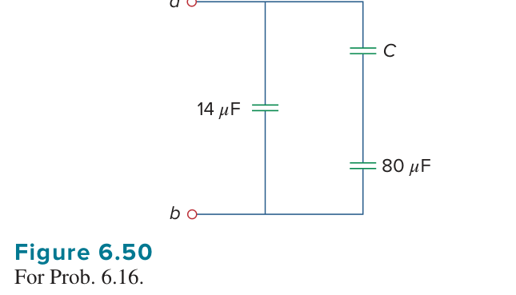

</PracticeCard>

<PracticeCard id="ch6-problem-6-17" type="exercise" title="Problem 6.17" source="課本 p.241" topic="電容與電感 / 章末習題">

Determine the equivalent capacitance for each of the circuits of Fig. 6.51.

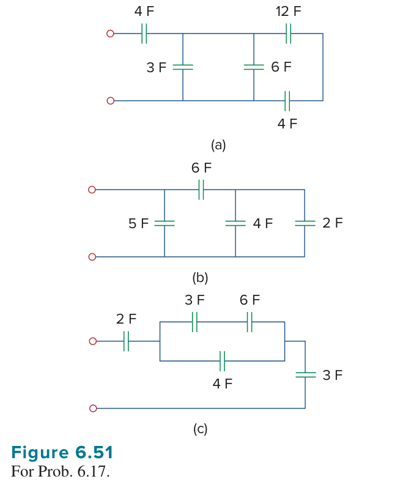

</PracticeCard>

<PracticeCard id="ch6-problem-6-18" type="exercise" title="Problem 6.18" source="課本 p.241" topic="電容與電感 / 章末習題">

Find $C_{\mathrm{eq}}$ in the circuit of Fig. 6.52 if all capacitors are $4\,\mu\mathrm{F}$.

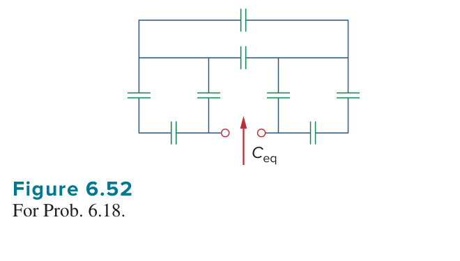

</PracticeCard>

<PracticeCard id="ch6-problem-6-19" type="exercise" title="Problem 6.19" source="課本 p.242" topic="電容與電感 / 章末習題">

Find the equivalent capacitance between terminals $a$ and $b$ in the circuit of Fig. 6.53. All capacitances are in $\mu\mathrm{F}$.

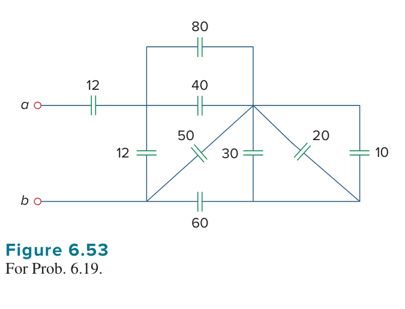

</PracticeCard>

<PracticeCard id="ch6-problem-6-20" type="exercise" title="Problem 6.20" source="課本 p.242" topic="電容與電感 / 章末習題">

Find the equivalent capacitance at terminals $a$-$b$ of the circuit in Fig. 6.54.

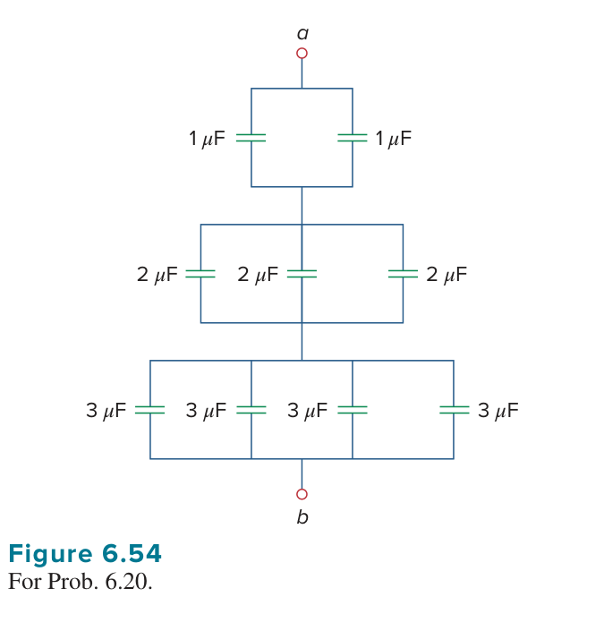

</PracticeCard>

<PracticeCard id="ch6-problem-6-21" type="exercise" title="Problem 6.21" source="課本 p.242" topic="電容與電感 / 章末習題">

Determine the equivalent capacitance at terminals $a$-$b$ of the circuit in Fig. 6.55.

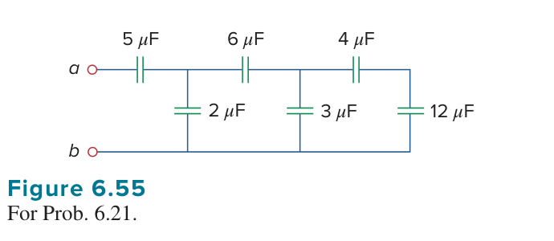

</PracticeCard>

<PracticeCard id="ch6-problem-6-22" type="exercise" title="Problem 6.22" source="課本 p.242" topic="電容與電感 / 章末習題">

Obtain the equivalent capacitance of the circuit in Fig. 6.56.

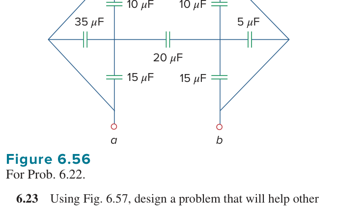

</PracticeCard>

<PracticeCard id="ch6-problem-6-23" type="exercise" title="Problem 6.23" source="課本 p.242" topic="電容與電感 / 章末習題">

Using Fig. 6.57, design a problem that will help other students better understand how capacitors work together when connected in series and in parallel.

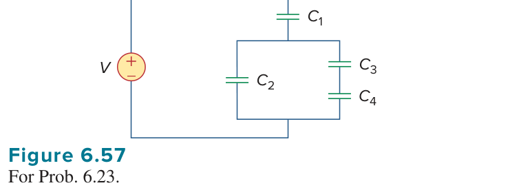

</PracticeCard>

<PracticeCard id="ch6-problem-6-24" type="exercise" title="Problem 6.24" source="課本 p.242" topic="電容與電感 / 章末習題">

Assume that all the capacitors were initially uncharged and that the $90\text{-V}$ source starts at zero and gradually increases to $90\,\mathrm{V}$. What are the final voltages across each capacitor and the energy stored in each capacitor?

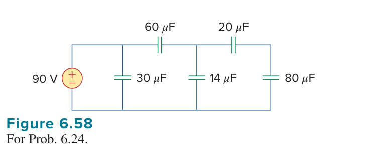

</PracticeCard>

<PracticeCard id="ch6-problem-6-25" type="exercise" title="Problem 6.25" source="課本 p.242–243" topic="電容與電感 / 章末習題">

(a) Show that the voltage-division rule for two capacitors in series as in Fig. 6.59(a) is

$$
v_1=\frac{C_2}{C_1+C_2}v_s,\qquad v_2=\frac{C_1}{C_1+C_2}v_s
$$

assuming that the initial conditions are zero.

(b) For two capacitors in parallel as in Fig. 6.59(b), show that the current-division rule is

$$
i_1=\frac{C_1}{C_1+C_2}i_s,\qquad i_2=\frac{C_2}{C_1+C_2}i_s
$$

assuming that the initial conditions are zero.

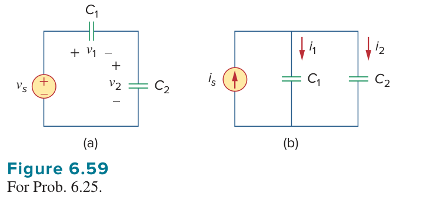

</PracticeCard>

<PracticeCard id="ch6-problem-6-26" type="exercise" title="Problem 6.26" source="課本 p.243" topic="電容與電感 / 章末習題">

Three capacitors, $C_1=5\,\mu\mathrm{F}$, $C_2=10\,\mu\mathrm{F}$, and $C_3=20\,\mu\mathrm{F}$, are connected in parallel across a $150\text{-V}$ source. Determine:

(a) the total capacitance,

(b) the charge on each capacitor,

(c) the total energy stored in the parallel combination.

</PracticeCard>

<PracticeCard id="ch6-problem-6-27" type="exercise" title="Problem 6.27" source="課本 p.243" topic="電容與電感 / 章末習題">

Given that four $4\text{-}\mu\mathrm{F}$ capacitors can be connected in series and in parallel, find the minimum and maximum values that can be obtained by such series/parallel combinations.

</PracticeCard>

<PracticeCard id="ch6-problem-6-28" type="exercise" title="Problem 6.28*" source="課本 p.243" topic="電容與電感 / 章末習題">

Obtain the equivalent capacitance of the network shown in Fig. 6.60.

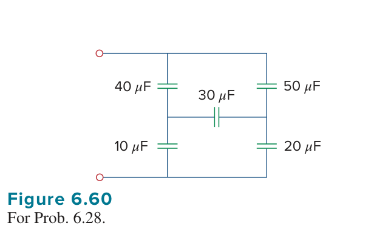

</PracticeCard>

<PracticeCard id="ch6-problem-6-29" type="exercise" title="Problem 6.29" source="課本 p.243" topic="電容與電感 / 章末習題">

Determine $C_{\mathrm{eq}}$ for each circuit in Fig. 6.61.

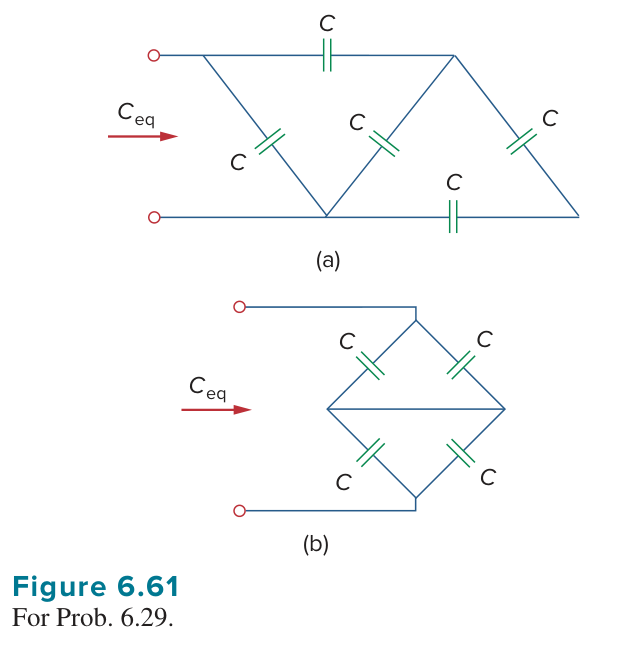

</PracticeCard>

<PracticeCard id="ch6-problem-6-30" type="exercise" title="Problem 6.30" source="課本 p.243" topic="電容與電感 / 章末習題">

Assuming that the capacitors are initially uncharged, find $v_o(t)$ in the circuit of Fig. 6.62.

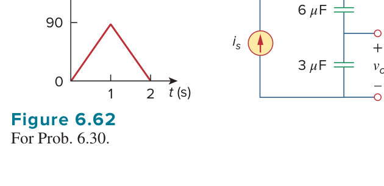

</PracticeCard>

<PracticeCard id="ch6-problem-6-31" type="exercise" title="Problem 6.31" source="課本 p.243" topic="電容與電感 / 章末習題">

If $v(0)=0$, find $v(t)$, $i_1(t)$, and $i_2(t)$ in the circuit of Fig. 6.63.

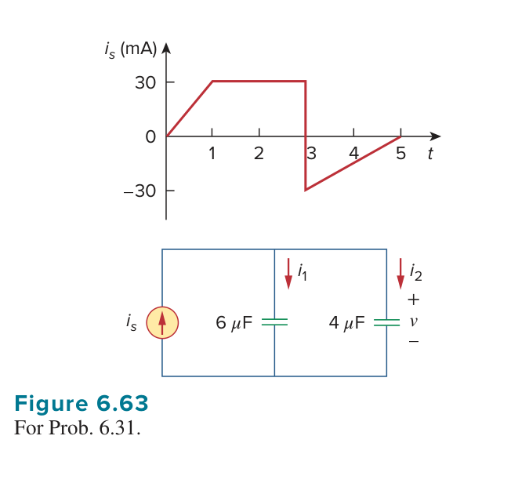

</PracticeCard>

<PracticeCard id="ch6-problem-6-32" type="exercise" title="Problem 6.32" source="課本 p.243" topic="電容與電感 / 章末習題">

In the circuit in Fig. 6.64, let $i_s=50e^{-2t}\,\mathrm{mA}$ and $v_1(0)=50\,\mathrm{V}$, $v_2(0)=20\,\mathrm{V}$. Determine:

(a) $v_1(t)$ and $v_2(t)$,

(b) the energy in each capacitor at $t=0.5\,\mathrm{s}$.

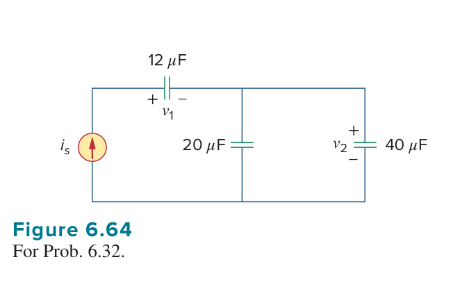

</PracticeCard>

<PracticeCard id="ch6-problem-6-33" type="exercise" title="Problem 6.33" source="課本 p.244" topic="電容與電感 / 章末習題">

Obtain the Thevenin equivalent at the terminals, $a$-$b$, of the circuit shown in Fig. 6.65. Please note that Thevenin equivalent circuits do not generally exist for circuits involving capacitors and resistors. This is a special case where the Thevenin equivalent circuit does exist.

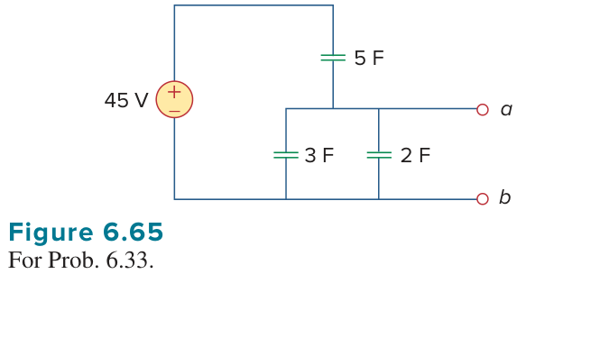

</PracticeCard>

<PracticeCard id="ch6-problem-6-34" type="exercise" title="Problem 6.34" source="課本 p.244" topic="電容與電感 / 章末習題">

The current through a $10\text{-mH}$ inductor is $10e^{-t/2}\,\mathrm{A}$. Find the voltage and the power at $t=3\,\mathrm{s}$.

</PracticeCard>

<PracticeCard id="ch6-problem-6-35" type="exercise" title="Problem 6.35" source="課本 p.244" topic="電容與電感 / 章末習題">

An inductor has a linear change in current from $50\,\mathrm{mA}$ to $100\,\mathrm{mA}$ in $2\,\mathrm{ms}$ and induces a voltage of $160\,\mathrm{mV}$. Calculate the value of the inductor.

</PracticeCard>

<PracticeCard id="ch6-problem-6-36" type="exercise" title="Problem 6.36" source="課本 p.244" topic="電容與電感 / 章末習題">

Design a problem to help other students better understand how inductors work.

</PracticeCard>

<PracticeCard id="ch6-problem-6-37" type="exercise" title="Problem 6.37" source="課本 p.244" topic="電容與電感 / 章末習題">

The current through a $12\text{-mH}$ inductor is $4\sin(100t)\,\mathrm{A}$. Find the voltage, and the energy stored at $t=\frac{\pi}{200}\,\mathrm{s}$.

</PracticeCard>

<PracticeCard id="ch6-problem-6-38" type="exercise" title="Problem 6.38" source="課本 p.244" topic="電容與電感 / 章末習題">

The current through a $40\text{-mH}$ inductor is

$$
i(t)=\begin{cases}
0, & t<0,\\
te^{-2t}\,\mathrm{A}, & t>0.
\end{cases}
$$

Find the voltage $v(t)$.

</PracticeCard>

<PracticeCard id="ch6-problem-6-39" type="exercise" title="Problem 6.39" source="課本 p.244" topic="電容與電感 / 章末習題">

The voltage across a $50\text{-mH}$ inductor is given by

$$
v(t)=[3t^2+2t+4]\,\mathrm{V}\qquad \text{for }t>0.
$$

Determine the current $i(t)$ through the inductor. Assume that $i(0)=0\,\mathrm{A}$.

</PracticeCard>

<PracticeCard id="ch6-problem-6-40" type="exercise" title="Problem 6.40" source="課本 p.244" topic="電容與電感 / 章末習題">

The current through a $5\text{-mH}$ inductor is shown in Fig. 6.66. Determine the voltage across the inductor at $t=1$, $3$, and $5\,\mathrm{ms}$.

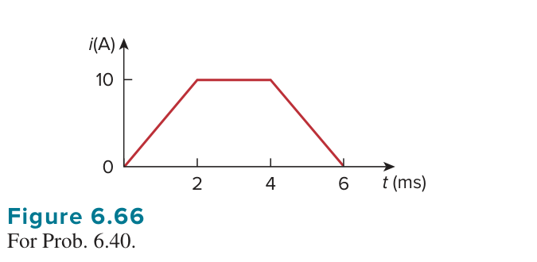

</PracticeCard>

<PracticeCard id="ch6-problem-6-41" type="exercise" title="Problem 6.41" source="課本 p.244" topic="電容與電感 / 章末習題">

The voltage across a $2\text{-H}$ inductor is $20(1-e^{-2t})\,\mathrm{V}$. If the initial current through the inductor is $0.3\,\mathrm{A}$, find the current and the energy stored in the inductor at $t=1\,\mathrm{s}$.

</PracticeCard>

<PracticeCard id="ch6-problem-6-42" type="exercise" title="Problem 6.42" source="課本 p.244" topic="電容與電感 / 章末習題">

If the voltage waveform in Fig. 6.67 is applied across the terminals of a $5\text{-H}$ inductor, calculate the current through the inductor. Assume $i(0)=-1\,\mathrm{A}$.

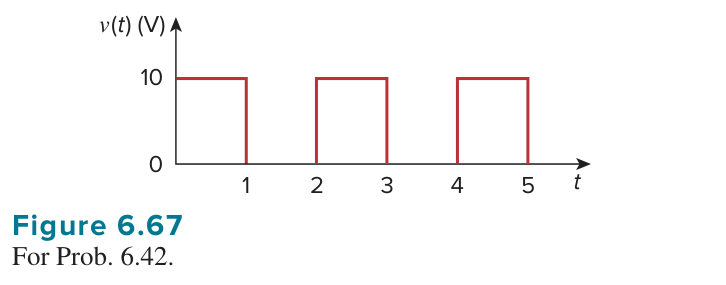

</PracticeCard>

<PracticeCard id="ch6-problem-6-43" type="exercise" title="Problem 6.43" source="課本 p.244" topic="電容與電感 / 章末習題">

The current in an $80\text{-mH}$ inductor increases from $0$ to $60\,\mathrm{mA}$ (steady state). How much energy is stored in the inductor?

</PracticeCard>

<PracticeCard id="ch6-problem-6-44" type="exercise" title="Problem 6.44*" source="課本 p.244" topic="電容與電感 / 章末習題">

A $100\text{-mH}$ inductor is connected in parallel with a $2\text{-k}\Omega$ resistor. The current through the inductor is $i(t)=50e^{-400t}\,\mathrm{mA}$.

(a) Find the voltage $v_L$ across the inductor.

(b) Find the voltage $v_R$ across the resistor.

(c) Does $v_R(t)+v_L(t)=0$?

(d) Calculate the energy stored in the inductor at $t=0$.

</PracticeCard>

<PracticeCard id="ch6-problem-6-45" type="exercise" title="Problem 6.45*" source="課本 p.244" topic="電容與電感 / 章末習題">

If the voltage waveform in Fig. 6.68 is applied to a $10\text{-mH}$ inductor, find the inductor current $i(t)$ for $0<t<2\,\mathrm{s}$. Assume $i(0)=0$.

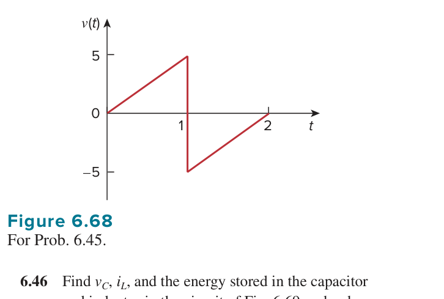

</PracticeCard>

<PracticeCard id="ch6-problem-6-46" type="exercise" title="Problem 6.46" source="課本 p.244" topic="電容與電感 / 章末習題">

Find $v_C$, $i_L$, and the energy stored in the capacitor and inductor in the circuit of Fig. 6.69 under dc conditions.

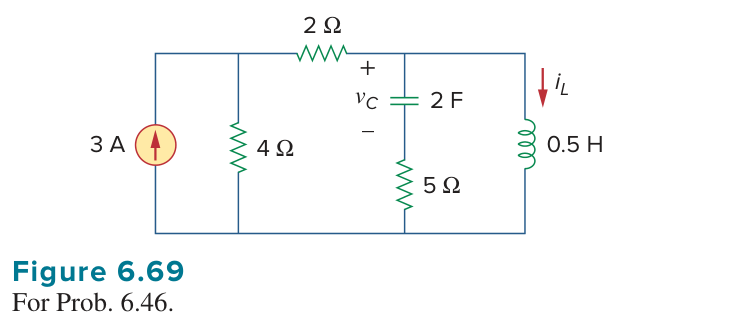

</PracticeCard>

<PracticeCard id="ch6-problem-6-47" type="exercise" title="Problem 6.47" source="課本 p.245" topic="電容與電感 / 章末習題">

For the circuit in Fig. 6.70, calculate the value of $R$ that will make the energy stored in the capacitor the same as that stored in the inductor under dc conditions.

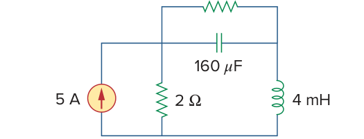

</PracticeCard>

<PracticeCard id="ch6-problem-6-48" type="exercise" title="Problem 6.48" source="課本 p.245" topic="電容與電感 / 章末習題">

Under steady-state dc conditions, find $i$ and $v$ in the circuit in Fig. 6.71.

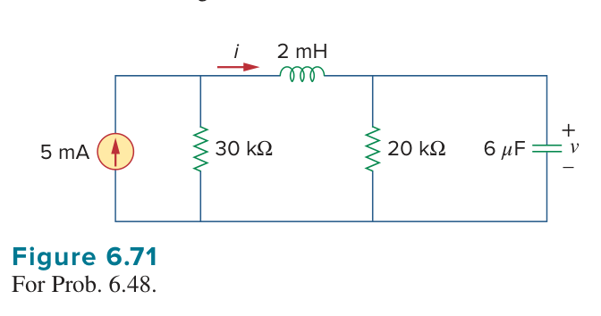

</PracticeCard>

<PracticeCard id="ch6-problem-6-49" type="exercise" title="Problem 6.49" source="課本 p.245" topic="電容與電感 / 章末習題">

Find the equivalent inductance of the circuit in Fig. 6.72. Assume all inductors are $10\text{ mH}$.

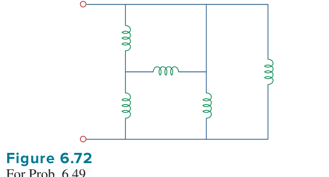

</PracticeCard>

<PracticeCard id="ch6-problem-6-50" type="exercise" title="Problem 6.50" source="課本 p.245" topic="電容與電感 / 章末習題">

An energy-storage network consists of series-connected $16$- and $14\text{-mH}$ inductors in parallel with series-connected $24$- and $36\text{-mH}$ inductors. Calculate the equivalent inductance.

</PracticeCard>

<PracticeCard id="ch6-problem-6-51" type="exercise" title="Problem 6.51" source="課本 p.245" topic="電容與電感 / 章末習題">

Determine $L_{\mathrm{eq}}$ at terminals $a$–$b$ of the circuit in Fig. 6.73.

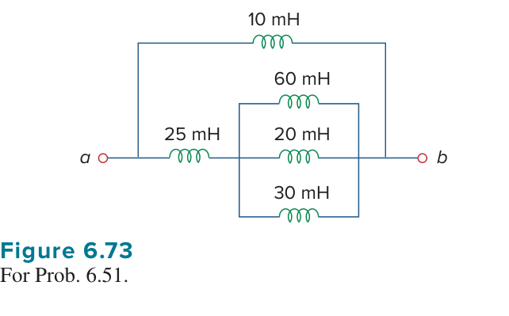

</PracticeCard>

<PracticeCard id="ch6-problem-6-52" type="exercise" title="Problem 6.52" source="課本 p.245" topic="電容與電感 / 章末習題">

Using Fig. 6.74, design a problem to help other students better understand how inductors behave when connected in series and when connected in parallel.

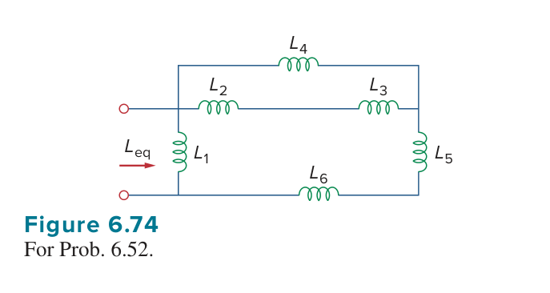

</PracticeCard>

<PracticeCard id="ch6-problem-6-53" type="exercise" title="Problem 6.53" source="課本 p.245" topic="電容與電感 / 章末習題">

Find $L_{\mathrm{eq}}$ at the terminals of the circuit in Fig. 6.75.

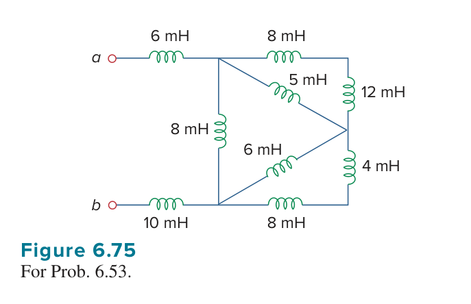

</PracticeCard>

<PracticeCard id="ch6-problem-6-54" type="exercise" title="Problem 6.54" source="課本 p.245" topic="電容與電感 / 章末習題">

Find the equivalent inductance looking into the terminals of the circuit in Fig. 6.76.

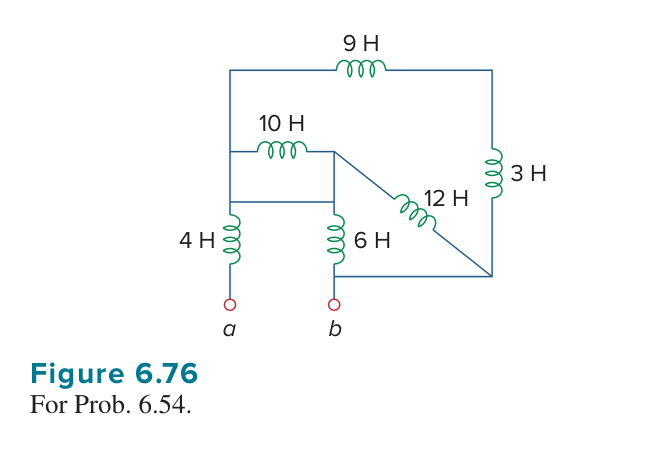

</PracticeCard>

<PracticeCard id="ch6-problem-6-55" type="exercise" title="Problem 6.55" source="課本 p.246" topic="電容與電感 / 章末習題">

Find $L_{\mathrm{eq}}$ in each of the circuits in Fig. 6.77.

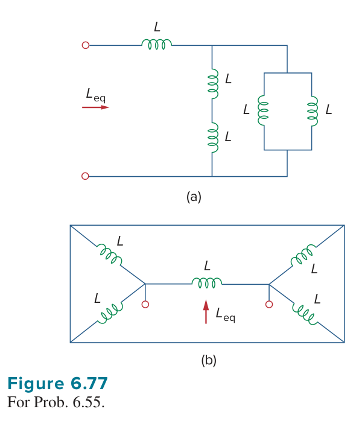

</PracticeCard>

<PracticeCard id="ch6-problem-6-56" type="exercise" title="Problem 6.56" source="課本 p.246" topic="電容與電感 / 章末習題">

Find $L_{\mathrm{eq}}$ in the circuit of Fig. 6.78.

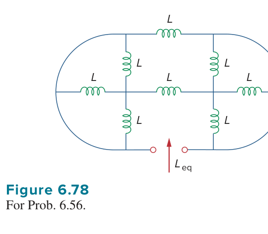

</PracticeCard>

<PracticeCard id="ch6-problem-6-57" type="exercise" title="Problem 6.57" source="課本 p.246" topic="電容與電感 / 章末習題">

Determine $L_{\mathrm{eq}}$ that may be used to represent the inductive network of Fig. 6.79 at the terminals.

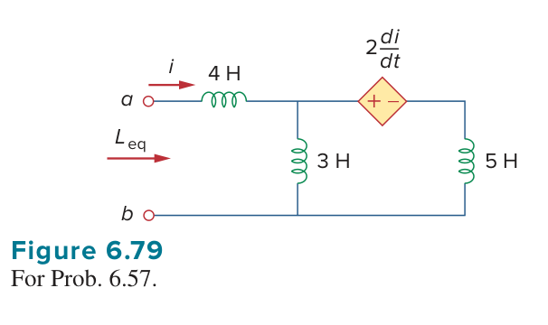

</PracticeCard>

<PracticeCard id="ch6-problem-6-58" type="exercise" title="Problem 6.58" source="課本 p.246" topic="電容與電感 / 章末習題">

The current waveform in Fig. 6.80 flows through a $3\text{-H}$ inductor. Sketch the voltage across the inductor over the interval $0 < t < 6\text{ s}$.

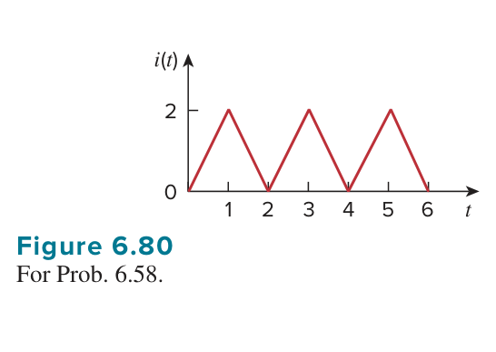

</PracticeCard>

<PracticeCard id="ch6-problem-6-59" type="exercise" title="Problem 6.59" source="課本 p.246" topic="電容與電感 / 章末習題">

(a) For two inductors in series as in Fig. 6.81(a), show that the voltage division principle is $v_1=\frac{L_1}{L_1+L_2}v_s$, $v_2=\frac{L_2}{L_1+L_2}v_s$, assuming that the initial conditions are zero.

(b) For two inductors in parallel as in Fig. 6.81(b), show that the current-division principle is $i_1=\frac{L_2}{L_1+L_2}i_s$, $i_2=\frac{L_1}{L_1+L_2}i_s$, assuming that the initial conditions are zero.

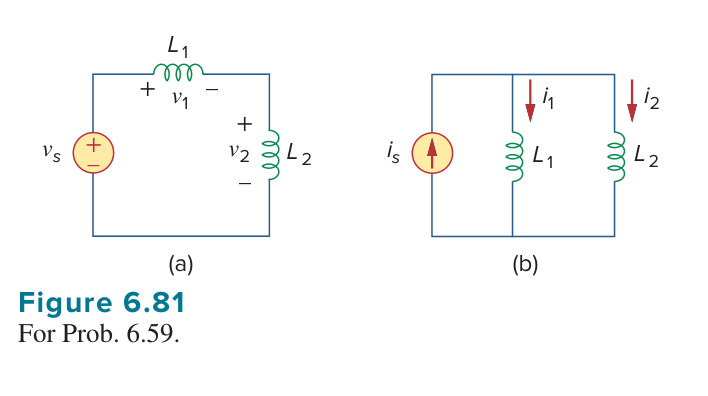

</PracticeCard>

<PracticeCard id="ch6-problem-6-60" type="exercise" title="Problem 6.60" source="課本 p.246" topic="電容與電感 / 章末習題">

In the circuit of Fig. 6.82, $i_o(0)=2\text{ A}$. Determine $i_o(t)$ and $v_o(t)$ for $t>0$.

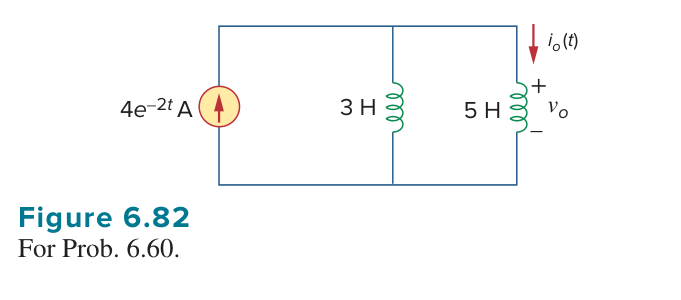

</PracticeCard>

<PracticeCard id="ch6-problem-6-61" type="exercise" title="Problem 6.61" source="課本 p.247" topic="電容與電感 / 章末習題">

Consider the circuit in Fig. 6.83. Find: (a) $L_{\mathrm{eq}}$, $i_1(t)$, and $i_2(t)$ if $i_s=3e^{-t}\text{ mA}$; (b) $v_o(t)$; (c) energy stored in the $20\text{-mH}$ inductor at $t=1\text{ s}$.

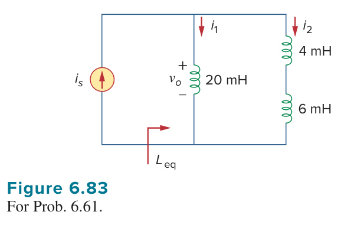

</PracticeCard>

<PracticeCard id="ch6-problem-6-62" type="exercise" title="Problem 6.62" source="課本 p.247" topic="電容與電感 / 章末習題">

Consider the circuit in Fig. 6.84. Given that $v(t)=12e^{-3t}\text{ mV}$ for $t>0$ and $i_1(0)=-10\text{ mA}$, find: (a) $i_2(0)$, (b) $i_1(t)$ and $i_2(t)$.

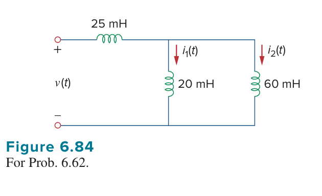

</PracticeCard>

<PracticeCard id="ch6-problem-6-63" type="exercise" title="Problem 6.63" source="課本 p.247" topic="電容與電感 / 章末習題">

In the circuit of Fig. 6.85, sketch $v_o$.

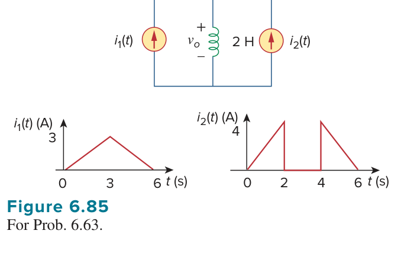

</PracticeCard>

<PracticeCard id="ch6-problem-6-64" type="exercise" title="Problem 6.64" source="課本 p.247" topic="電容與電感 / 章末習題">

A $1\text{-H}$ inductor is in series with the parallel combination of two inductors whose values are $3\text{ H}$ and $6\text{ H}$. A current source of $6\text{ A}$ is connected across the inductor combination. Find the current through each inductor.

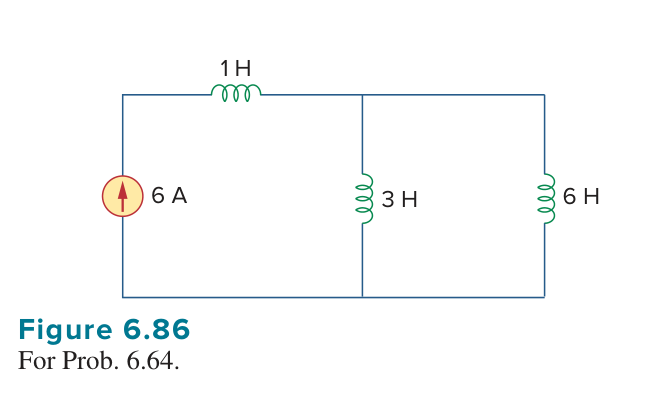

</PracticeCard>

<PracticeCard id="ch6-problem-6-65" type="exercise" title="Problem 6.65" source="課本 p.247" topic="電容與電感 / 章末習題">

The inductors in Fig. 6.87 are initially charged and are connected to the black box at $t=0$. If $i_1(0)=4\text{ A}$, $i_2(0)=-2\text{ A}$, and $v(t)=50e^{-200t}\text{ mV}$, $t\ge 0$, find: (a) the energy initially stored in each inductor, (b) the total energy delivered to the black box from $t=0$ to $t=\infty$, (c) $i_1(t)$ and $i_2(t)$, $t\ge 0$, (d) $i(t)$, $t\ge 0$.

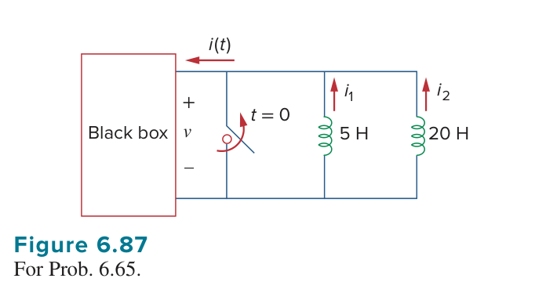

</PracticeCard>

<PracticeCard id="ch6-problem-6-66" type="exercise" title="Problem 6.66" source="課本 p.247" topic="電容與電感 / 章末習題">

The current $i(t)$ through a $20\text{-mH}$ inductor is equal, in magnitude, to the voltage across it for all values of time. If $i(0)=2\text{ A}$, find $i(t)$.

</PracticeCard>

<PracticeCard id="ch6-problem-6-67" type="exercise" title="Problem 6.67" source="課本 p.247" topic="電容與電感 / 章末習題">

An op amp integrator has $R=50\text{ k}\Omega$ and $C=0.04\,\mu\text{F}$. If the input voltage is $v_i=10\sin 50t\text{ mV}$, obtain the output voltage. Assume that at $t=0$, the output is equal to zero.

</PracticeCard>

<PracticeCard id="ch6-problem-6-68" type="exercise" title="Problem 6.68" source="課本 p.248" topic="電容與電感 / 章末習題">

A $10\text{-V}$ dc voltage is applied to an integrator with $R=50\text{ k}\Omega$, $C=100\,\mu\text{F}$ at $t=0$. How long will it take for the op amp to saturate if the saturation voltages are $+12\text{ V}$ and $-12\text{ V}$? Assume that the initial capacitor voltage was zero.

</PracticeCard>

<PracticeCard id="ch6-problem-6-69" type="exercise" title="Problem 6.69" source="課本 p.248" topic="電容與電感 / 章末習題">

An op amp integrator with $R=4\text{ M}\Omega$ and $C=1\,\mu\text{F}$ has the input waveform shown in Fig. 6.88. Plot the output waveform.

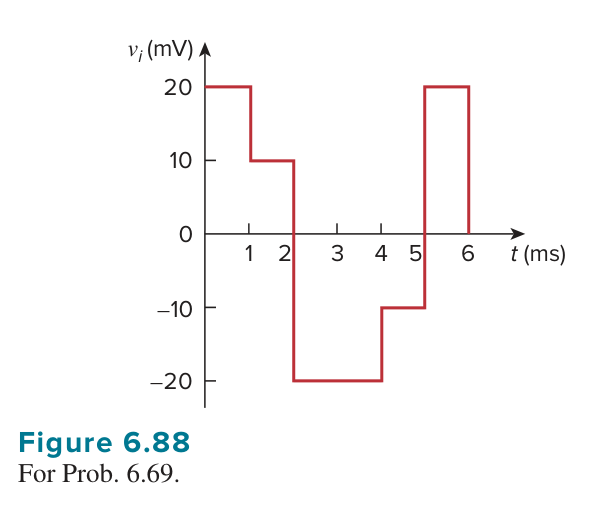

</PracticeCard>

<PracticeCard id="ch6-problem-6-70" type="exercise" title="Problem 6.70" source="課本 p.248" topic="電容與電感 / 章末習題">

Using a single op amp, a capacitor, and resistors of $100\text{ k}\Omega$ or less, design a circuit to implement $v_o=-50\int_0^t v_i(\tau)\,d\tau$. Assume $v_o=0$ at $t=0$.

</PracticeCard>

<PracticeCard id="ch6-problem-6-71" type="exercise" title="Problem 6.71" source="課本 p.248" topic="電容與電感 / 章末習題">

Show how you would use a single op amp to generate $v_o=-\int_0^t(v_1+4v_2+10v_3)\,d\tau$. If the integrating capacitor is $C=2\,\mu\text{F}$, obtain the other component values.

</PracticeCard>

<PracticeCard id="ch6-problem-6-72" type="exercise" title="Problem 6.72" source="課本 p.248" topic="電容與電感 / 章末習題">

At $t=1.5\text{ ms}$, calculate $v_o$ due to the cascaded integrators in Fig. 6.89. Assume that the integrators are reset to $0\text{ V}$ at $t=0$.

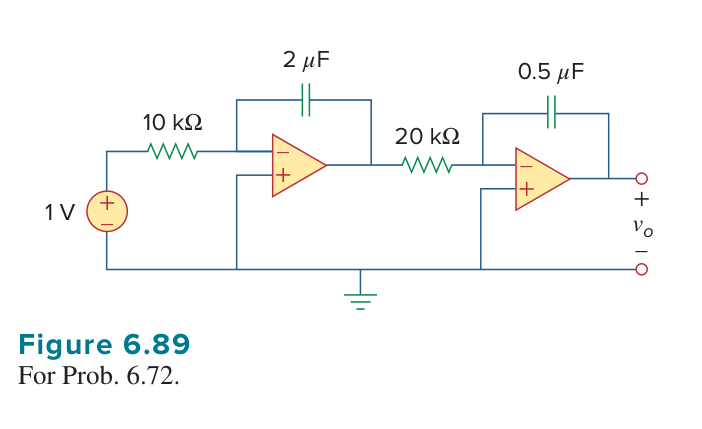

</PracticeCard>

<PracticeCard id="ch6-problem-6-73" type="exercise" title="Problem 6.73" source="課本 p.248" topic="電容與電感 / 章末習題">

Show that the circuit in Fig. 6.90 is a noninverting integrator.

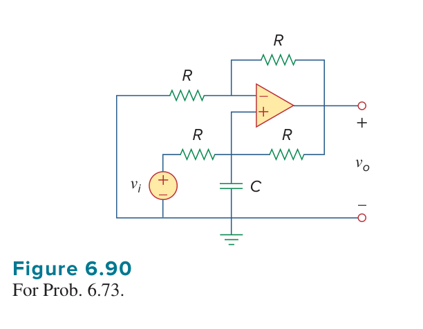

</PracticeCard>

<PracticeCard id="ch6-problem-6-74" type="exercise" title="Problem 6.74" source="課本 p.248" topic="電容與電感 / 章末習題">

The triangular waveform in Fig. 6.91(a) is applied to the input of the op amp differentiator in Fig. 6.91(b). Plot the output.

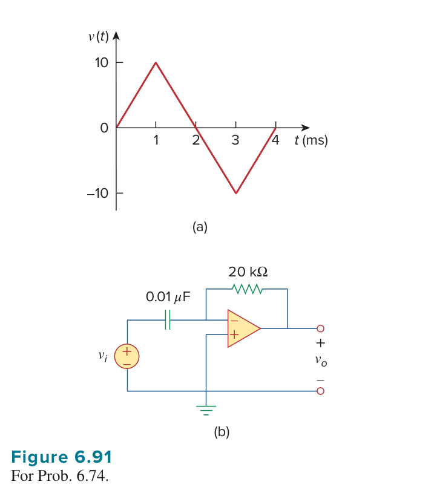

</PracticeCard>

<PracticeCard id="ch6-problem-6-75" type="exercise" title="Problem 6.75" source="課本 p.248" topic="電容與電感 / 章末習題">

An op amp differentiator has $R=250\text{ k}\Omega$ and $C=10\,\mu\text{F}$. The input voltage is a ramp $r(t)=12t\text{ mV}$. Find the output voltage.

</PracticeCard>

<PracticeCard id="ch6-problem-6-76" type="exercise" title="Problem 6.76" source="課本 p.248" topic="電容與電感 / 章末習題">

A voltage waveform has the following characteristics: a positive slope of $20\text{ V/s}$ for $5\text{ ms}$ followed by a negative slope of $10\text{ V/s}$ for $10\text{ ms}$. If the waveform is applied to a differentiator with $R=50\text{ k}\Omega$, $C=10\,\mu\text{F}$, sketch the output voltage waveform.

</PracticeCard>

<PracticeCard id="ch6-problem-6-77" type="exercise" title="Problem 6.77" source="課本 p.249" topic="電容與電感 / 章末習題">

The output $v_o$ of the op amp circuit in Fig. 6.92(a) is shown in Fig. 6.92(b). Let $R_i=R_f=1\text{ M}\Omega$ and $C=1\,\mu\text{F}$. Determine the input voltage waveform and sketch it.

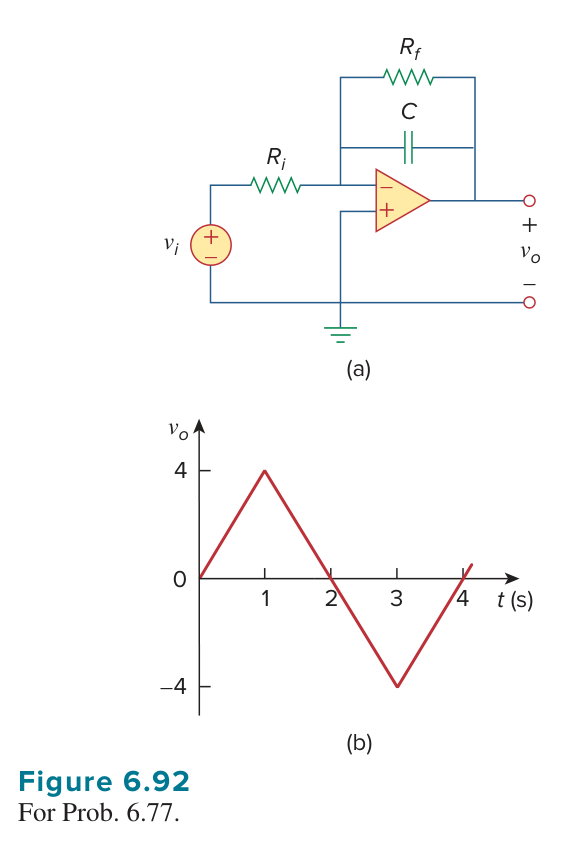

</PracticeCard>

<PracticeCard id="ch6-problem-6-78" type="exercise" title="Problem 6.78" source="課本 p.249" topic="電容與電感 / 章末習題">

Design an analog computer to simulate $\frac{d^2v_o}{dt^2}+2\frac{dv_o}{dt}+v_o=10\sin 2t$, where $v_o(0)=2\text{ V}$ and $v_o\prime(0)=0$.

</PracticeCard>

<PracticeCard id="ch6-problem-6-79" type="exercise" title="Problem 6.79" source="課本 p.249" topic="電容與電感 / 章末習題">

Design an analog computer circuit to solve for $y(t)$, given the following equation and a value for $f(t)$ and that $y(0)=1\text{ V}$: $\frac{dy(t)}{dt}+4y(t)=f(t)$.

</PracticeCard>

<PracticeCard id="ch6-problem-6-80" type="exercise" title="Problem 6.80" source="課本 p.249" topic="電容與電感 / 章末習題">

Figure 6.93 presents an analog computer designed to solve a differential equation. Assuming $f(t)$ is known, set up the equation for $f(t)$.

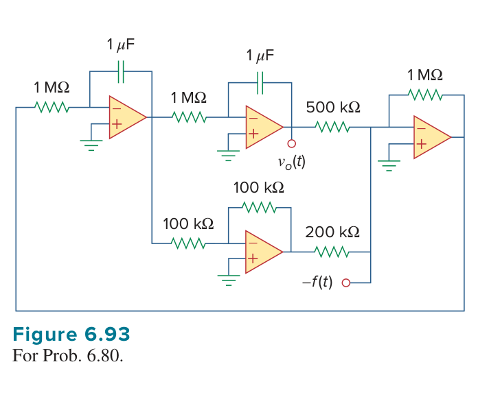

</PracticeCard>

<PracticeCard id="ch6-problem-6-81" type="exercise" title="Problem 6.81" source="課本 p.249" topic="電容與電感 / 章末習題">

Design an analog computer to simulate the following equation to solve for $v(t)$ (assume the initial conditions are zero): $\frac{d^2v}{dt^2}+5v=-2f(t)$.

</PracticeCard>

<PracticeCard id="ch6-problem-6-82" type="exercise" title="Problem 6.82" source="課本 p.249" topic="電容與電感 / 章末習題">

Design an op amp circuit such that $v_o=10v_s+2\int v_s\,dt$, where $v_s$ and $v_o$ are the input voltage and output voltage, respectively.

</PracticeCard>

<PracticeCard id="ch6-problem-6-83" type="exercise" title="Problem 6.83" source="課本 p.249" topic="電容與電感 / 章末習題">

Your laboratory has available a large number of $10\,\mu\text{F}$ capacitors rated at $300\text{ V}$. To design a capacitor bank of $40\,\mu\text{F}$ rated at $600\text{ V}$, how many $10\,\mu\text{F}$ capacitors are needed and how would you connect them?

</PracticeCard>

<PracticeCard id="ch6-problem-6-84" type="exercise" title="Problem 6.84" source="課本 p.249" topic="電容與電感 / 章末習題">

An $8\text{-mH}$ inductor is used in a fusion power experiment. If the current through the inductor is $i(t)=5\sin^2(\pi t)\text{ mA}$, for all $t>0\text{ s}$, find the power being delivered to the inductor and the energy stored in it at $t=0.5\text{ s}$.

</PracticeCard>

<PracticeCard id="ch6-problem-6-85" type="exercise" title="Problem 6.85" source="課本 p.250" topic="電容與電感 / 章末習題">

A square-wave generator produces the voltage waveform shown in Fig. 6.94(a). What kind of a circuit component is needed to convert the voltage waveform to the triangular current waveform shown in Fig. 6.94(b)? Calculate the value of the component, assuming that it is initially uncharged.

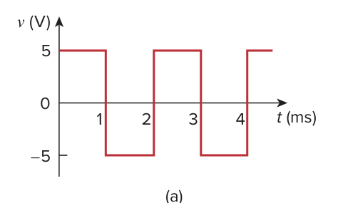

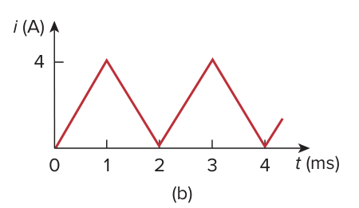

</PracticeCard>

<PracticeCard id="ch6-problem-6-86" type="exercise" title="Problem 6.86" source="課本 p.250" topic="電容與電感 / 章末習題">

An electric motor can be modeled as a series combination of a $12\text{-}\Omega$ resistor and $200\text{-mH}$ inductor. If a current $i(t)=2te^{-10t}\text{ A}$ flows through the series combination, find the voltage across the combination.

</PracticeCard>
