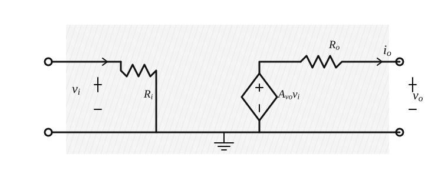
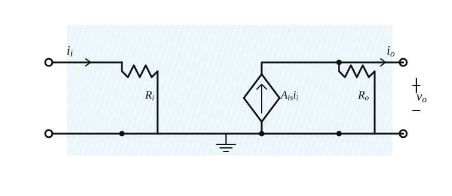
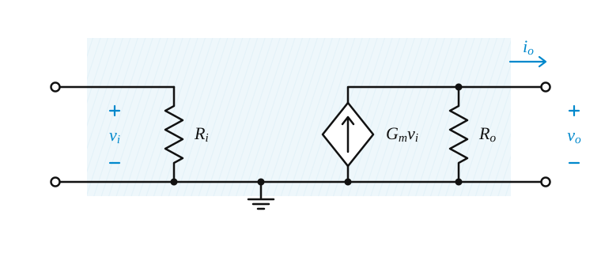
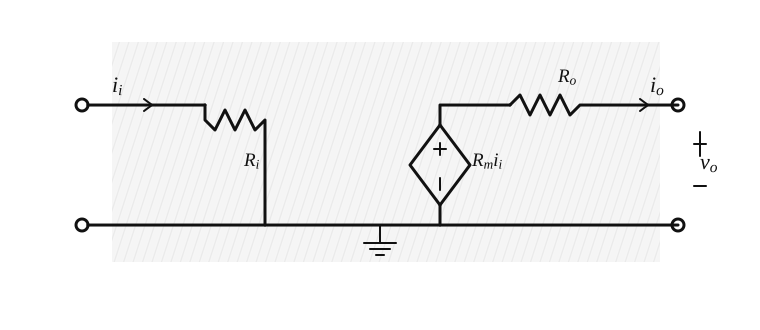
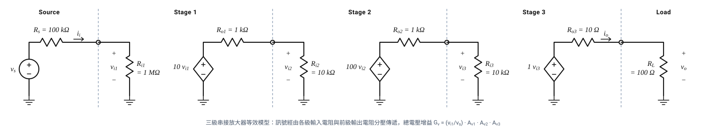

# 0006: 放大器的電路模型 (Circuit Models for Amplifiers)

在電子系統設計中，感興趣的訊號（無論是在系統輸入端、中間級或輸出端）可以是電壓或電流。例如，某些感測器的輸出電阻遠大於放大器的輸入電阻，因此更適合使用電流源來建立模型。同樣地，在某些應用中，放大器的輸出電流比輸出電壓更為重要。

雖然電壓放大器是最常見的，但它只是四種可能放大器類型的其中一種。其餘三種分別為：電流放大器 (Current Amplifier)、轉導放大器 (Transconductance Amplifier) 與轉阻放大器 (Transresistance Amplifier)。

以下示意圖採用相同的閱讀方向：左側是輸入埠，右側是輸出埠；$R_i$ 表示輸入電阻，$R_o$ 表示輸出電阻，菱形受控源則表示由輸入訊號控制的輸出源。理想阻抗值是為了讓對應的電壓或電流訊號能夠有效傳遞，實際放大器則會在這些理想條件附近工作。

## 1. 四種放大器類型 (The Four Amplifier Types)

這四種放大器類型分別針對不同的輸入與輸出訊號組合而設計。以下為其定義與理想特性參數：

### (1) 電壓放大器 (Voltage Amplifier)
* **輸入 / 輸出訊號**：電壓 / 電壓
* **增益參數**：開路電壓增益 (Open-Circuit Voltage Gain)
  $$A_{vo} = \left. \frac{v_o}{v_i} \right|_{i_o=0} \quad (\text{V/V})$$
* **理想特性**：
  * 輸入電阻 $R_i = \infty$
  * 輸出電阻 $R_o = 0$

### (2) 電流放大器 (Current Amplifier)
* **輸入 / 輸出訊號**：電流 / 電流
* **增益參數**：短路電流增益 (Short-Circuit Current Gain)
  $$A_{is} = \left. \frac{i_o}{i_i} \right|_{v_o=0} \quad (\text{A/A})$$
* **理想特性**：
  * 輸入電阻 $R_i = 0$
  * 輸出電阻 $R_o = \infty$

### (3) 轉導放大器 (Transconductance Amplifier)
* **輸入 / 輸出訊號**：電壓 / 電流
* **增益參數**：短路轉導 (Short-Circuit Transconductance)
  $$G_m = \left. \frac{i_o}{v_i} \right|_{v_o=0} \quad (\text{A/V})$$
* **理想特性**：
  * 輸入電阻 $R_i = \infty$
  * 輸出電阻 $R_o = \infty$

### (4) 轉阻放大器 (Transresistance Amplifier)
* **輸入 / 輸出訊號**：電流 / 電壓
* **增益參數**：開路轉阻 (Open-Circuit Transresistance)
  $$R_m = \left. \frac{v_o}{i_i} \right|_{i_o=0} \quad (\text{V/A})$$
* **理想特性**：
  * 輸入電阻 $R_i = 0$
  * 輸出電阻 $R_o = 0$

### 四種模型的比較

| 放大器類型 | 增益參數與定義 | 測試條件 | 理想輸入電阻 $R_i$ | 理想輸出電阻 $R_o$ | 等效受控源 |
| :--- | :--- | :--- | :---: | :---: | :--- |
| **電壓放大器** | $A_{vo}=\left.\dfrac{v_o}{v_i}\right\vert_{i_o=0}$ | 開路 ($i_o=0$) | $\infty$ | $0$ | VCVS：$A_{vo}v_i$ |
| **電流放大器** | $A_{is}=\left.\dfrac{i_o}{i_i}\right\vert_{v_o=0}$ | 短路 ($v_o=0$) | $0$ | $\infty$ | CCCS：$A_{is}i_i$ |
| **轉導放大器** | $G_m=\left.\dfrac{i_o}{v_i}\right\vert_{v_o=0}$ | 短路 ($v_o=0$) | $\infty$ | $\infty$ | VCCS：$G_mv_i$ |
| **轉阻放大器** | $R_m=\left.\dfrac{v_o}{i_i}\right\vert_{i_o=0}$ | 開路 ($i_o=0$) | $0$ | $0$ | CCVS：$R_mi_i$ |

---

## 2. 四種放大器模型之間的關係 (Relationships between the Four Amplifier Models)

雖然對於特定的放大器，通常會有一個最合適的模型，但**任何一種模型都能夠用來表示任何一個放大器**。透過電路等效原理，我們可以推導出各種模型參數之間的轉換關係。

例如，將電流放大器的諾頓等效輸出轉換為戴維寧等效輸出，可以得到開路電壓增益 $A_{vo}$ 與短路電流增益 $A_{is}$ 的關係：
$$A_{vo} = A_{is} \left( \frac{R_o}{R_i} \right)$$

同樣地，與轉導放大器、轉阻放大器的參數關係為：
$$A_{vo} = G_m R_o$$
$$A_{vo} = \frac{R_m}{R_i}$$

藉由這組關係式，只要已知其中一個增益參數及 $R_i$ 和 $R_o$，即可求得其他的增益參數。

將四種表示法放在同一個二埠網路中，可得到更完整的互換關係：

$$A_{vo}=G_mR_o=\frac{R_m}{R_i}=A_{is}\frac{R_o}{R_i}$$

這些等式也說明了為什麼不能只看受控源的增益數字；輸入與輸出電阻會透過分壓或分流，改變實際接上訊號源與負載後的增益。

---

## 3. 多級串接放大器與級間負載效應 (Cascaded Amplifiers)

單一放大級往往難以同時具備高輸入阻抗、高增益與低輸出阻抗，因此工程上常將多級放大器串接。分析時不能直接把每一級的開路電壓增益相乘，必須先把下一級的輸入電阻視為前一級的負載。

對第 $k$ 級而言，其有效負載為：

$$R_{L,k}=R_{i,k+1}\quad (k<n),\qquad R_{L,n}=R_L$$

各級的實際電壓增益為：

$$A_{v,k}=A_{vo,k}\frac{R_{L,k}}{R_{o,k}+R_{L,k}}$$

而第一級輸入端還要承受訊號源分壓：

$$\frac{v_{i1}}{v_s}=\frac{R_{i1}}{R_s+R_{i1}}$$

因此總體電壓增益為：

$$G_v=\frac{v_o}{v_s}=\frac{v_{i1}}{v_s}\prod_{k=1}^{n}A_{v,k}$$

### 級聯範例：三個放大級的實際增益

下圖展示由訊號源、三個串接電壓放大級與負載組成的等效電路，具體呈現級間輸入電阻對前級輸出造成的負載分壓效應。

考慮 $v_s=1\text{ mV}$、$R_s=100\text{ k}\Omega$、$R_L=100\Omega$ 的三級放大器：

- 第 1 級：$R_{i1}=1\text{ M}\Omega$、$A_{vo1}=10$、$R_{o1}=1\text{ k}\Omega$
- 第 2 級：$R_{i2}=10\text{ k}\Omega$、$A_{vo2}=100$、$R_{o2}=1\text{ k}\Omega$
- 第 3 級：$R_{i3}=10\text{ k}\Omega$、$A_{vo3}=1$、$R_{o3}=10\Omega$

由前往後計算訊號電壓：

1. 源端分壓：
   $$v_{i1}=1\text{ mV}\times\frac{1000}{100+1000}=0.909\text{ mV}$$
2. 第 1 級受到第 2 級輸入阻抗負載：
   $$v_{i2}=10\times0.909\times\frac{10}{1+10}=8.26\text{ mV},\qquad A_{v1}=9.09$$
3. 第 2 級受到第 3 級輸入阻抗負載：
   $$v_{i3}=100\times8.26\times\frac{10}{1+10}=751\text{ mV},\qquad A_{v2}=90.9$$
4. 第 3 級受到實際負載 $R_L$：
   $$v_o=1\times751\times\frac{100}{10+100}=683\text{ mV},\qquad A_{v3}=0.909$$

所以：

$$G_v=\frac{v_o}{v_s}=\frac{v_{i1}}{v_s}A_{v1}A_{v2}A_{v3}\approx683\text{ V/V}\approx56.7\text{ dB}$$

這個結果清楚顯示，級間負載會讓每一級的實際增益低於開路增益。

---

## 4. 決定輸入與輸出電阻 (Determining $R_i$ and $R_o$)

從放大器電路模型中，我們可以透過以下測試方法來決定放大器的輸入電阻 $R_i$ 與輸出電阻 $R_o$：

* **決定輸入電阻 $R_i$**：
  在放大器輸入端施加一測試電壓 $v_i$，並量測（或計算）產生的輸入電流 $i_i$，則：
  $$R_i = \frac{v_i}{i_i}$$

* **決定輸出電阻 $R_o$**：
  輸出電阻可定義為開路輸出電壓除以短路輸出電流。另一種等效的求法是：將輸入訊號源關閉（使 $v_s = 0$ 或 $i_s = 0$），此時輸入端的相依電源將為零。接著在輸出端施加一測試電壓 $v_x$，並測量流入放大器輸出端的電流 $i_x$，則：
  $$R_o = \frac{v_x}{i_x}$$

---

## 5. 單向模型 (Unilateral Models)

上述探討的放大器模型均為**單向模型 (Unilateral Models)**，即訊號僅單向地從輸入端流向輸出端。單向模型假設放大器的輸入電壓與電流，完全不受輸出端連接負載的影響。

然而在實際電路中，這並非總是成立。例如，元件內部的寄生電容（如電晶體的極際電容）可能會造成非預期的耦合，使輸出端的部分訊號回饋到輸入端。當我們在後續章節探討雙埠網路 (two-port networks) 的完整模型，以及電晶體的高頻響應時，將會需要引入考慮非單向特性 (nonunilateral nature) 的電路模型。

## 6. 觀念檢測與延伸閱讀

::: details 📝 理想電壓放大器的阻抗條件
為了使電壓放大器在連接任意訊號源與負載時，都能達到最大的電壓傳遞效率，應滿足 $R_i=\infty$ 與 $R_o=0$。前者避免從訊號源分走電壓，後者確保受控電壓完整傳到負載。
:::

延伸閱讀：

- [建立訊號模型與四大放大器等效電路核心思維](/electronics/learning-records/0001-signals-and-amplifiers-foundations)
- [放大器模型、增益計算與頻率響應速查手冊](/electronics/reference/001-amplifier-models-and-frequency-response)
