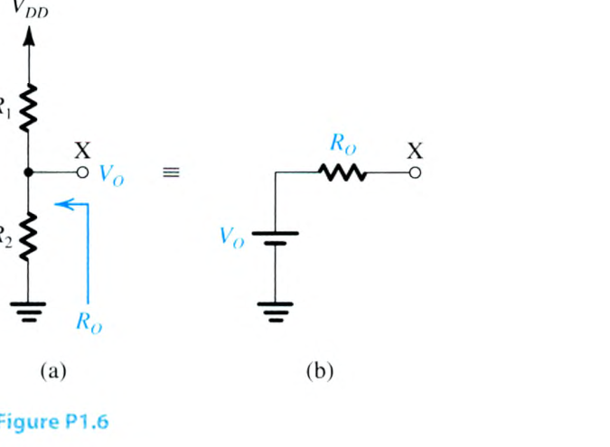
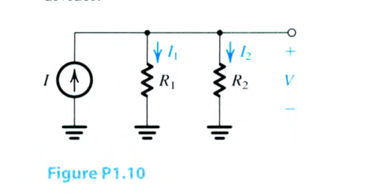
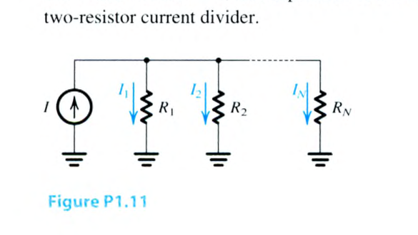
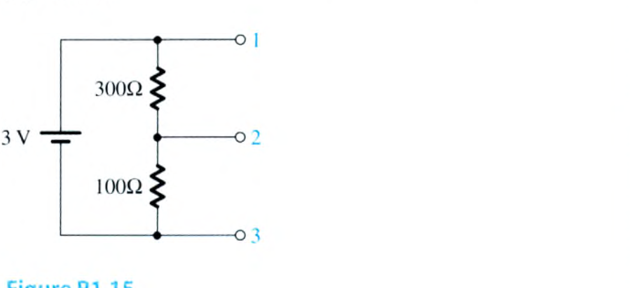
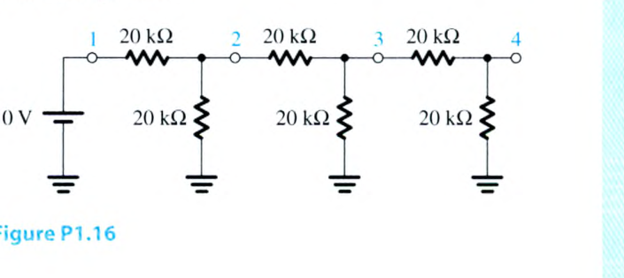
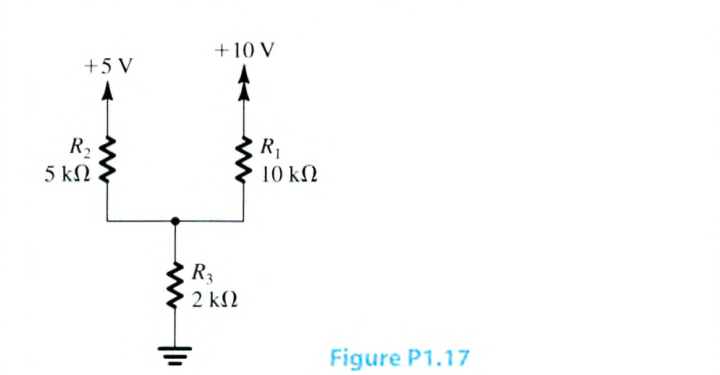
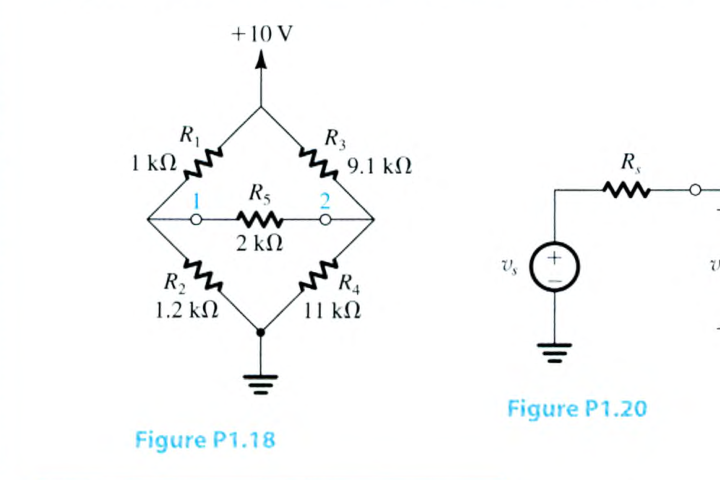
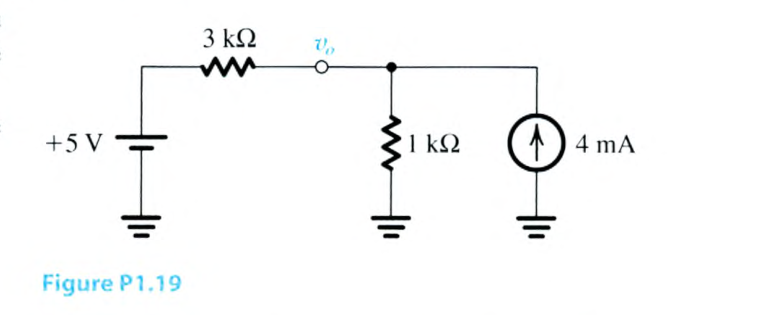
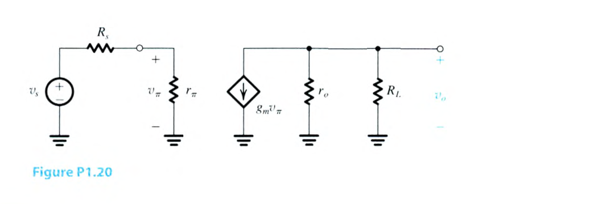

# 電子學 Chapter 1 章末 Problems 1.4–1.20

> 來源：Sedra & Smith, *Microelectronic Circuits*, 8e，`課本.pdf`。本批次逐頁核對 PDF 第 76–78 頁（印刷第 46–48 頁）。答案欄僅在教材未提供答案時標示待補；未自行推算。

<PracticeFilter prefix="electronics-ch1-problem-" />
<PracticeProgress :total="17" prefix="electronics-ch1-problem-" />

<PracticeCard id="electronics-ch1-problem-1-4" type="exercise" title="Problem 1.4" source="Sedra & Smith 8e · PDF p. 76 · 印刷 p. 46" topic="Chapter 1 Problems">

你只有 $5\text{-k}\Omega$ 電阻可用，但數量不限。只使用這些電阻的串聯與並聯組合，實現下列電阻值：$20\text{ k}\Omega$、$1.67\text{ k}\Omega$、$12.5\text{ k}\Omega$、$23.75\text{ k}\Omega$。

<template #solution>

教材答案未提供；待補。

</template>
</PracticeCard>

<PracticeCard id="electronics-ch1-problem-1-5" type="exercise" title="Problem 1.5" source="Sedra & Smith 8e · PDF p. 76 · 印刷 p. 46" topic="Chapter 1 Problems">

在電子電路的分析與測試中，常將一個電阻與另一個電阻並聯，以取得比兩個電阻中較小者還小的非標準電阻值。尤其在電路測試時，一個電阻可能已經安裝好；此時並聯接上的第二個電阻稱為將第一個電阻「分流」（shunt）。若原本的電阻為 $10\text{ k}\Omega$，為使合成電阻值分別降低 $1\%$、$5\%$、$10\%$ 與 $50\%$，所需的分流電阻值為何？以 $1\text{ M}\Omega$、$100\text{ k}\Omega$ 及 $10\text{ k}\Omega$ 分別對 $10\text{ k}\Omega$ 電阻分流時，結果為何？

<template #solution>

教材答案未提供；待補。

</template>
</PracticeCard>

<PracticeCard id="electronics-ch1-problem-1-6" type="exercise" title="Problem 1.6" source="Sedra & Smith 8e · PDF p. 76 · 印刷 p. 46" topic="Chapter 1 Problems">

圖 P1.6(a) 顯示一個雙電阻分壓器。其功能是在輸出節點 $X$ 產生一個小於電源電壓 $V_{DD}$ 的電壓 $V_O$。從節點 $X$ 向電路內看，其等效電路如圖 P1.6(b) 所示。注意，這就是分壓器電路的戴維寧等效。求 $V_O$ 與 $R_O$ 的表示式。

<template #solution>

教材答案未提供；待補。

</template>
</PracticeCard>

<PracticeCard id="electronics-ch1-problem-1-7" type="exercise" title="Problem 1.7" source="Sedra & Smith 8e · PDF p. 76 · 印刷 p. 46" topic="Chapter 1 Problems">

一個使用 $2\text{-k}\Omega$ 與 $1\text{-k}\Omega$ 電阻的雙電阻分壓器，接到以地為參考的 $3\text{-V}$ 電源，並用來提供 $2\text{-V}$ 電壓。畫出電路。假設電阻值精確，輸出電壓（相對於地）與等效輸出電阻各為何？若使用的電阻不是理想元件，而具有 $\pm5\%$ 製造容差，可能得到的極端輸出電壓與輸出電阻各為何？

<template #solution>

教材答案未提供；待補。

</template>
</PracticeCard>

<PracticeCard id="electronics-ch1-problem-1-8" type="exercise" title="Problem 1.8" source="Sedra & Smith 8e · PDF p. 77 · 印刷 p. 47" topic="Chapter 1 Problems · Design">

你有三個 $10\text{ k}\Omega$ 電阻，以及一顆負端接地的 $9\text{-V}$ 電池。使用其中部分或全部電阻組成分壓器，可以設計出多少個大小小於 $9\text{ V}$ 的正電壓源？請依電壓由小到大列出，並求每一個電壓源的輸出電阻（即戴維寧電阻）。

<template #solution>

教材答案未提供；待補。

</template>
</PracticeCard>

<PracticeCard id="electronics-ch1-problem-1-9" type="exercise" title="Problem 1.9" source="Sedra & Smith 8e · PDF p. 77 · 印刷 p. 47" topic="Chapter 1 Problems · Design">

兩個標稱值為 $470\ \Omega$ 與 $1\text{ k}\Omega$ 的電阻，接成分壓器並連到 $+3\text{-V}$ 電源，以產生標稱 $+1\text{-V}$ 輸出。假設電阻值精確，實際產生的輸出電壓為何？應將哪一個電阻與多大的第三個電阻並聯（分流），才能使分壓器輸出為 $1.00\text{ V}$？若還要求輸出電阻恰為 $333\ \Omega$，你有何建議？

<template #solution>

教材答案未提供；待補。

</template>
</PracticeCard>

<PracticeCard id="electronics-ch1-problem-1-10" type="exercise" title="Problem 1.10" source="Sedra & Smith 8e · PDF p. 77 · 印刷 p. 47" topic="Chapter 1 Problems">

圖 P1.10 顯示一個由理想電流源 $I$ 驅動的雙電阻電流分配器。證明

$$
I_1=\frac{R_2}{R_1+R_2}I,\qquad
I_2=\frac{R_1}{R_1+R_2}I,
$$

並求電流分配器兩端形成的電壓 $V$。

<template #solution>

教材答案未提供；待補。

</template>
</PracticeCard>

<PracticeCard id="electronics-ch1-problem-1-11" type="exercise" title="Problem 1.11" source="Sedra & Smith 8e · PDF p. 77 · 印刷 p. 47" topic="Chapter 1 Problems">

圖 P1.11 顯示一個電流源並聯驅動 $N$ 個電阻。證明流過第 $k$ 個電阻的電流為

$$
I_k=\frac{I/R_k}{\displaystyle\sum_{i=1}^{N}1/R_i}.
$$

證明當 $N=2$ 時，此表示式與雙電阻電流分配器的表示式相同。

<template #solution>

教材答案未提供；待補。

</template>
</PracticeCard>

<PracticeCard id="electronics-ch1-problem-1-12" type="exercise" title="Problem 1.12" source="Sedra & Smith 8e · PDF p. 77 · 印刷 p. 47" topic="Chapter 1 Problems · Design">

設計一個簡單的電流分配器，使供給 $6\text{-k}\Omega$ 負載的電流降低為電流源可提供電流的四分之一。

<template #solution>

教材答案未提供；待補。

</template>
</PracticeCard>

<PracticeCard id="electronics-ch1-problem-1-13" type="exercise" title="Problem 1.13" source="Sedra & Smith 8e · PDF p. 77 · 印刷 p. 47" topic="Chapter 1 Problems · Design">

設計者想用一個簡單電路，將訊號電流 $I$ 的五分之一提供給負載電阻 $R$。請提出使用一個電阻的解法。該電阻值應為何？所得電流分配器的輸入電阻為何？對某個 $R$ 值，設計者發現原本最佳可得的電阻高出 $10\%$。請提出使用一個額外電阻即可解決此問題的兩種電路拓撲。每種拓撲所需的電阻值為何？每種情況下電流分配器的輸入電阻為何？

<template #solution>

教材答案未提供；待補。

</template>
</PracticeCard>

<PracticeCard id="electronics-ch1-problem-1-14" type="exercise" title="Problem 1.14" source="Sedra & Smith 8e · PDF p. 77 · 印刷 p. 47" topic="Chapter 1 Problems · Design">

某電流源產生峰值振幅為 $0.5\text{ mA}$ 的正弦訊號。然而，源兩端的電壓不得超過 $1\text{ V}$，否則訊號會失真。在遵守此限制的情況下，可接到該電流源的最大負載電阻為何？若要接上 $10\text{ k}\Omega$ 負載，還需並聯多大的電阻以避免失真？流過 $10\text{ k}\Omega$ 負載的結果電流訊號為何？

<template #solution>

教材答案未提供；待補。

</template>
</PracticeCard>

<PracticeCard id="electronics-ch1-problem-1-15" type="exercise" title="Problem 1.15" source="Sedra & Smith 8e · PDF p. 77 · 印刷 p. 47" topic="Chapter 1 Problems">

對圖 P1.15 的電路，求下列端點之間的戴維寧等效電路：(a) 端點 1 與 2；(b) 端點 2 與 3；(c) 端點 1 與 3。

<template #solution>

教材答案未提供；待補。

</template>
</PracticeCard>

<PracticeCard id="electronics-ch1-problem-1-16" type="exercise" title="Problem 1.16" source="Sedra & Smith 8e · PDF p. 77 · 印刷 p. 47" topic="Chapter 1 Problems">

透過反覆套用戴維寧定理，求圖 P1.16 中節點 4 與地之間的戴維寧等效電路，並據此求接在節點 4 與地之間、電阻值為 $3\text{ k}\Omega$ 的負載所流過的電流。

<template #solution>

教材答案未提供；待補。

</template>
</PracticeCard>

<PracticeCard id="electronics-ch1-problem-1-17" type="exercise" title="Problem 1.17" source="Sedra & Smith 8e · PDF p. 78 · 印刷 p. 48" topic="Chapter 1 Problems">

對圖 P1.17 所示電路，使用下列兩種方法，求三個電阻中的各支路電流，以及其共同節點相對於地的電壓：

(a) **迴路方程式**：分別定義流過 $R_1$ 與 $R_2$ 的支路電流 $I_1$、$I_2$；寫出兩個方程式並求解。

(b) **節點方程式**：定義共同節點的節點電壓 $V$；寫出一個方程式並求解。

你偏好哪一種方法？為什麼？

<template #solution>

教材答案未提供；待補。

</template>
</PracticeCard>

<PracticeCard id="electronics-ch1-problem-1-18" type="exercise" title="Problem 1.18" source="Sedra & Smith 8e · PDF p. 78 · 印刷 p. 48" topic="Chapter 1 Problems">

圖 P1.18 的電路代表一個不平衡電橋的等效電路。例如，壓力感測器可能產生這類等效電路，其中 $R_1$ 至 $R_4$ 會隨壓力變化，而輸出訊號則在端點 1 與 2 之間觀測。現在需要計算檢測器支路 $R_5$ 中的電流，以及 $R_5$ 兩端的電壓。雖然可以使用迴路方程式與節點方程式完成，但有更容易的方法：求節點 1 左側電路的戴維寧等效，以及節點 2 右側電路的戴維寧等效；接著求解簡化後的電路。

<template #solution>

教材答案未提供；待補。

</template>
</PracticeCard>

<PracticeCard id="electronics-ch1-problem-1-19" type="exercise" title="Problem 1.19" source="Sedra & Smith 8e · PDF p. 78 · 印刷 p. 48" topic="Chapter 1 Problems">

如圖 P1.19，兩個電源相連。使用戴維寧等效表示法來協助求出電壓 $v_o$。

<template #solution>

教材答案未提供；待補。

</template>
</PracticeCard>

<PracticeCard id="electronics-ch1-problem-1-20" type="exercise" title="Problem 1.20" source="Sedra & Smith 8e · PDF p. 78 · 印刷 p. 48" topic="Chapter 1 Problems">

對圖 P1.20 所示電路，推導 $v_o/v_s$ 的表示式。

<template #solution>

教材答案未提供；待補。

</template>
</PracticeCard>
