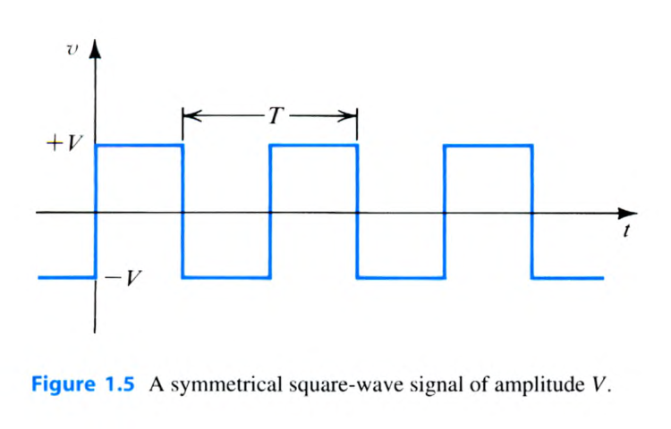
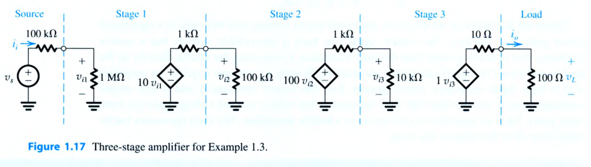
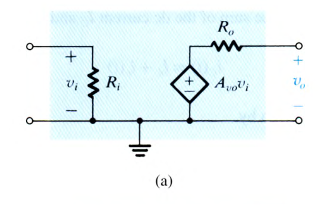
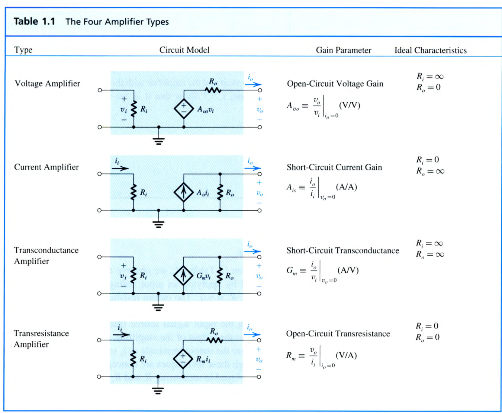
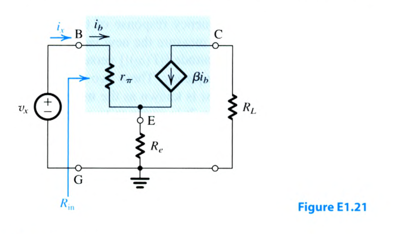
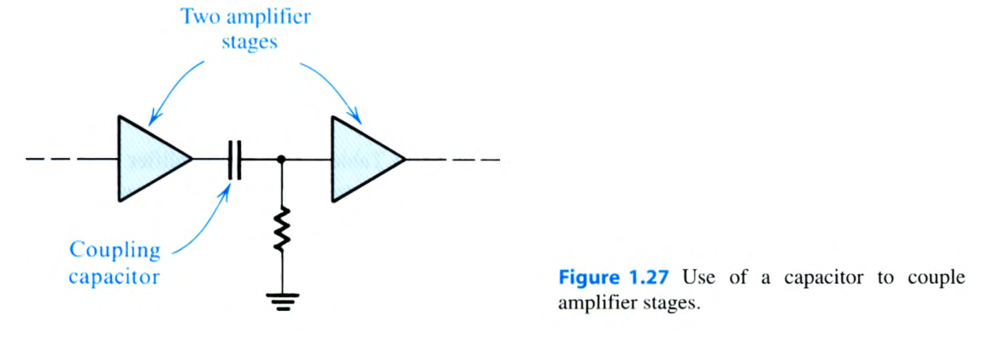
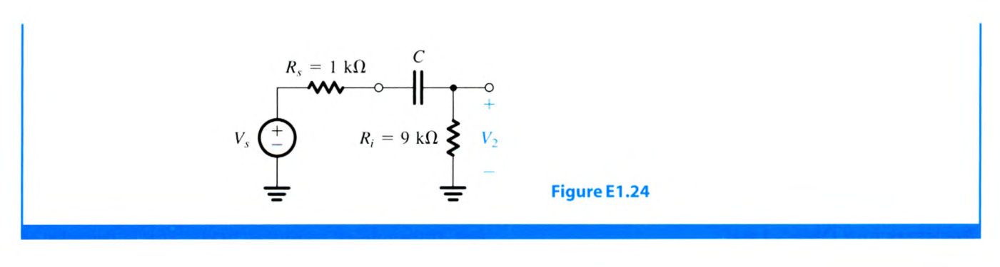

# Chapter 1 Exercises

> 來源：Sedra & Smith, *Microelectronic Circuits*, 8e，`/docs/electronics/課本.pdf`。`source` 同時列出 PDF 頁碼與教材印刷頁碼。題幹保留教材英文原文；教材已提供的 `Ans.` 已納入解答區。

<PracticeFilter prefix="elec-ch1-ex-" />
<PracticeProgress :total="7" prefix="elec-ch1-ex-" />

<PracticeCard type="exercise" id="elec-ch1-ex-1-6" title="週期與頻率換算" source="Exercise 1.6 · 教材 PDF p.42（印刷 p.12）" topic="頻率與週期">

What is the period $T$ of sine waveforms characterized by frequencies of (a) $f=60\text{ Hz}$? (b) $f=10^{-3}\text{ Hz}$? (c) $f=1\text{ MHz}$?

<template #solution>

由 $T=1/f$：

$$
\begin{aligned}
\text{(a)}\quad T&=\frac{1}{60}\text{ s}=16.7\text{ ms},\\
\text{(b)}\quad T&=\frac{1}{10^{-3}}\text{ s}=1000\text{ s},\\
\text{(c)}\quad T&=\frac{1}{10^6}\text{ s}=1\,\mu\text{s}.
\end{aligned}
$$

::: tip 教材答案
$16.7\text{ ms};\ 1000\text{ s};\ 1\,\mu\text{s}$。
:::

</template>
</PracticeCard>

<PracticeCard type="exercise" id="elec-ch1-ex-1-8" title="對稱方波的諧波功率與能量分配" source="Exercise 1.8 · 教材 PDF p.42（印刷 p.12）" topic="傅立葉級數與功率">

When the square-wave signal of Fig. 1.5, whose Fourier series is given in Eq. (1.2), is applied to a resistor, the total power dissipated may be calculated directly using the relationship $P=\frac{1}{T}\int_0^T(v^2/R)\,dt$ or indirectly by summing the contribution of each of the harmonic components, that is, $P=P_1+P_3+P_5+\cdots$, which may be found directly from rms values. Verify that the two approaches are equivalent. What fraction of the energy of a square wave is in its fundamental? In its first five harmonics? In its first seven? First nine? In what number of harmonics is 90% of the energy? (Note that in counting harmonics, the fundamental at $\omega_0$ is the first, the one at $2\omega_0$ is the second, etc.)

為使題幹引用的 Eq. (1.2) 在題卡內可直接使用，教材的方波級數為

$$
v(t)=\frac{4V}{\pi}\left(\sin\omega_0t+\frac{1}{3}\sin3\omega_0t+\frac{1}{5}\sin5\omega_0t+\cdots\right),
\qquad \omega_0=\frac{2\pi}{T}.
$$

<template #solution>

方波在整個週期內滿足 $v^2(t)=V^2$，因此直接計算得

$$
P_{\text{direct}}=\frac{1}{T}\int_0^T\frac{V^2}{R}\,dt=\frac{V^2}{R}.
$$

第 $n$ 個奇次諧波（$n=1,3,5,\ldots$）的峰值為 $4V/(n\pi)$，其 rms 值為 $4V/(n\pi\sqrt{2})$，所以

$$
P_n=\frac{1}{R}\left(\frac{4V}{n\pi\sqrt{2}}\right)^2
=\frac{8V^2}{n^2\pi^2R}.
$$

累加所有奇次諧波後

$$
P_{\text{harmonic}}=\frac{8V^2}{\pi^2R}\sum_{n\ \text{odd}}\frac{1}{n^2}
=\frac{8V^2}{\pi^2R}\cdot\frac{\pi^2}{8}
=\frac{V^2}{R}=P_{\text{direct}}.
$$

因此，前 $N$ 個「諧波位置」的能量比例要以奇次項的部分和除以 $\pi^2/8$。偶次諧波雖被計入位置但功率為零：

$$
\begin{aligned}
\text{fundamental:}\quad &\frac{1}{\pi^2/8}=0.8106\approx0.81,\\
\text{first five:}\quad &\frac{1+1/3^2+1/5^2}{\pi^2/8}=0.9331\approx0.93,\\
\text{first seven:}\quad &\frac{1+1/3^2+1/5^2+1/7^2}{\pi^2/8}=0.9496\approx0.95,\\
\text{first nine:}\quad &\frac{1+1/3^2+1/5^2+1/7^2+1/9^2}{\pi^2/8}=0.9596\approx0.96.
\end{aligned}
$$

前三個諧波位置（$\omega_0,2\omega_0,3\omega_0$）已包含基波與三次諧波，能量比例為 $0.9006$，因此達到 90% 所需的數目是 $3$ 個諧波位置。

::: tip 教材答案
$0.81;\ 0.93;\ 0.95;\ 0.96;\ 3$。
:::

</template>
</PracticeCard>

<PracticeCard type="exercise" id="elec-ch1-ex-1-17" title="三級級聯放大器的等效電壓放大器模型" source="Exercise 1.17 · 教材 PDF p.58（印刷 p.28）" topic="級聯放大器">

(a) Model the three-stage amplifier of Example 1.3 (without the source and load), using the voltage amplifier model of Fig. 1.16(a). What are the values of $R_i$, $A_{vo}$, and $R_o$?

(b) If $R_L$ varies in the range $10\,\Omega$ to $1000\,\Omega$, find the corresponding range of the overall voltage gain, $v_o/v_s$.

<template #solution>

由 Fig. 1.17 的各級參數，先將下一級輸入電阻視為前一級的負載。去除外部訊號源與負載後，整體輸入電阻由第一級決定：

$$
R_i=1\text{ M}\Omega.
$$

第一級與第二級的實際級間電壓增益為

$$
A_{v1}=10\frac{100\text{ k}\Omega}{100\text{ k}\Omega+1\text{ k}\Omega}=9.90\text{ V/V},
$$

$$
A_{v2}=100\frac{10\text{ k}\Omega}{10\text{ k}\Omega+1\text{ k}\Omega}=90.9\text{ V/V}.
$$

最後一級在開路輸出下的增益為 $A_{v3}=1\text{ V/V}$，故整體開路電壓增益為

$$
A_{vo}=A_{v1}A_{v2}A_{v3}\approx(9.90)(90.9)(1)=900\text{ V/V}.
$$

輸出端由最後一級的輸出電阻決定，因此

$$
R_o=10\,\Omega.
$$

保留原訊號源的 $R_s=100\text{ k}\Omega$ 後，整體增益為

$$
\frac{v_o}{v_s}=A_{vo}\frac{R_i}{R_s+R_i}\frac{R_L}{R_o+R_L}
=900\frac{1\text{ M}\Omega}{100\text{ k}\Omega+1\text{ M}\Omega}\frac{R_L}{10\,\Omega+R_L}.
$$

因此

$$
\begin{aligned}
R_L=10\,\Omega&:\quad \frac{v_o}{v_s}=409\text{ V/V},\\
R_L=1000\,\Omega&:\quad \frac{v_o}{v_s}=810\text{ V/V}\quad\text{（四捨五入）}.
\end{aligned}
$$

::: tip 教材答案
$(R_i,A_{vo},R_o)=(1\text{ M}\Omega,900\text{ V/V},10\,\Omega)$；$v_o/v_s$ 的範圍為 $409\text{ V/V}$ 至 $810\text{ V/V}$。
:::

</template>
</PracticeCard>

<PracticeCard type="exercise" id="elec-ch1-ex-1-20" title="轉阻放大器的整體電壓增益" source="Exercise 1.20 · 教材 PDF p.63（印刷 p.33）" topic="四種放大器模型">

Consider a transresistance amplifier having the model shown in the fourth row of Table 1.1. Let the amplifier be fed with a signal current source $i_s$ having a resistance $R_s$, and let the output be connected to a load resistance $R_L$. Show that the overall gain is given by

$$
\frac{v_o}{i_s}=R_m\frac{R_s}{R_s+R_i}\frac{R_L}{R_L+R_o}.
$$

<template #solution>

由 Table 1.1 的轉阻放大器模型，訊號源電流在輸入端分流後流入放大器的電流為

$$
i_i=i_s\frac{R_s}{R_s+R_i}.
$$

轉阻放大器的開路輸出電壓為 $R_m i_i$。輸出端的 $R_o$ 與 $R_L$ 形成分壓，所以負載電壓為

$$
v_o=(R_m i_i)\frac{R_L}{R_L+R_o}.
$$

代入 $i_i$ 並除以 $i_s$，得到

$$
\frac{v_o}{i_s}=R_m\frac{R_s}{R_s+R_i}\frac{R_L}{R_L+R_o}.
$$

::: tip 教材答案
$$\frac{v_o}{i_s}=R_m\frac{R_s}{R_s+R_i}\frac{R_L}{R_L+R_o}.$$
:::

</template>
</PracticeCard>

<PracticeCard type="exercise" id="elec-ch1-ex-1-21" title="BJT 共射極模型的輸入電阻" source="Exercise 1.21 · 教材 PDF p.63（印刷 p.33）" topic="BJT 小訊號模型">

Find the input resistance between terminals B and G in the circuit shown in Fig. E1.21. The voltage $v_x$ is a test voltage with the input resistance $R_{in}$ defined as $R_{in}\equiv v_x/i_x$.

<template #solution>

令流入基極的電流為 $i_b$。由 $r_\pi$ 與射極電阻 $R_e$ 的串聯關係，且受控電流源使射極電流為

$$
i_e=i_b+\beta i_b=(\beta+1)i_b,
$$

可得測試電壓

$$
v_x=i_b r_\pi+i_eR_e
=i_b\left[r_\pi+(\beta+1)R_e\right].
$$

因為 $i_x=i_b$，所以

$$
R_{in}=\frac{v_x}{i_x}=r_\pi+(\beta+1)R_e.
$$

::: tip 教材答案
$$R_{in}=r_\pi+(\beta+1)R_e.$$
:::

</template>
</PracticeCard>

<PracticeCard type="exercise" id="elec-ch1-ex-d1-23" title="轉導放大器驅動超音波換能器的頻寬與增益設計" source="Exercise D1.23 · 教材 PDF p.74（印刷 p.44）" topic="STC 低通頻率響應">

Consider a transconductance amplifier having the model shown in Table 1.1. If the amplifier load consists of a resistance $R_L$ in parallel with a capacitance $C_L$, convince yourself that the voltage transfer function realized, $V_o/V_i$, is of the low-pass STC type. For example, this may be a suitable model when a transistor is driving an ultrasonic transducer. Consider the case where the transducer is a load with $R_L=1\text{ k}\Omega$ and $C_L=4.5\text{ nF}$, and find the largest value of $R_o$ for which a 3-dB bandwidth of at least $40\text{ kHz}$ is provided. With this value of $R_o$, find the minimum value of $G_m$ required to ensure a dc gain of at least $40\text{ dB}$.

<template #solution>

由 Table 1.1 的轉導放大器模型，$G_mV_i$ 的受控電流源驅動並聯的 $R_o$、$R_L$ 與 $C_L$。令

$$
R_P=R_o\parallel R_L,
$$

則輸出電壓轉移函數為

$$
\frac{V_o(s)}{V_i(s)}
=\frac{G_m}{\frac{1}{R_P}+sC_L}
=\frac{G_mR_P}{1+sC_LR_P}.
$$

這是低通 STC 形式，且

$$
f_{3\text{-dB}}=\frac{1}{2\pi C_LR_P}.
$$

要使 $f_{3\text{-dB}}\ge40\text{ kHz}$，並聯等效電阻須滿足

$$
R_P\le\frac{1}{2\pi(4.5\text{ nF})(40\text{ kHz})}=884\,\Omega.
$$

取最大允許的 $R_P=R_o\parallel1\text{ k}\Omega$，解得

$$
R_o=\frac{R_PR_L}{R_L-R_P}
=\frac{(884\,\Omega)(1\text{ k}\Omega)}{1\text{ k}\Omega-884\,\Omega}
\approx7.6\text{ k}\Omega.
$$

在此條件下，至少 $40\text{ dB}$ 的直流增益代表 $G_mR_P\ge100$，因此

$$
G_m\ge\frac{100}{884\,\Omega}=0.113\text{ A/V}=113\text{ mA/V}.
$$

::: tip 教材答案
$R_o=7.6\text{ k}\Omega$；$G_m=113\text{ mA/V}$（最小值）。
:::

</template>
</PracticeCard>

<PracticeCard type="exercise" id="elec-ch1-ex-d1-24" title="級間耦合電容的高通 3-dB 頻率設計" source="Exercise D1.24 · 教材 PDF p.74（印刷 p.44）" topic="STC 高通頻率響應">

Consider the situation illustrated in Fig. 1.27. Let the output resistance of the first voltage amplifier be $1\text{ k}\Omega$ and the input resistance of the second voltage amplifier (including the resistor shown) be $9\text{ k}\Omega$. The resulting equivalent circuit is shown in Fig. E1.24. Convince yourself that $V_2/V_s$ is a high-pass STC function. What is the smallest value for $C$ that will ensure that the 3-dB frequency is not higher than $100\text{ Hz}$?

<template #solution>

Fig. E1.24 中，第一級的輸出電阻成為 $R_s=1\text{ k}\Omega$，第二級的輸入電阻為 $R_i=9\text{ k}\Omega$。因此

$$
\frac{V_2(s)}{V_s(s)}
=\frac{R_i}{R_s+\frac{1}{sC}+R_i}
=\frac{sCR_i}{1+sC(R_s+R_i)}.
$$

這是高通 STC 函數，其 3-dB 頻率為

$$
f_{3\text{-dB}}=\frac{1}{2\pi C(R_s+R_i)}.
$$

要求 $f_{3\text{-dB}}\le100\text{ Hz}$，所以

$$
C\ge\frac{1}{2\pi(100\text{ Hz})(1\text{ k}\Omega+9\text{ k}\Omega)}
=1.59\times10^{-7}\text{ F}
=0.159\,\mu\text{F}.
$$

故最小值（依教材答案取適當有效位數）為 $C=0.16\,\mu\text{F}$。

::: tip 教材答案
$C=0.16\,\mu\text{F}$。
:::

</template>
</PracticeCard>
