# 電子學 Chapter 2 教材缺漏題卡（目前批次）

> 暫存批次：已完成逐頁核對的 Chapter 2 Exercises 13 題，以及章末 Problems 2.1–2.8。圖表裁切暫存於 `/tmp/lp-next/electronics-assets/`；正式匯入時，圖片應對應至 `../assets/images/`。

<PracticeFilter prefix="electronics-ch2-" />
<PracticeProgress :total="21" prefix="electronics-ch2-" />

## Exercises

<PracticeCard id="electronics-ch2-ex-d2-4" type="exercise" title="Exercise D2.4" source="Sedra & Smith, Microelectronic Circuits, 8e — PDF p.102 / printed p.72" topic="Chapter 2">

Use the circuit of Fig. 2.5 to design an inverting amplifier having a gain of −10 and an input resistance of 100 kΩ. Give the values of (R_1) and (R_2).

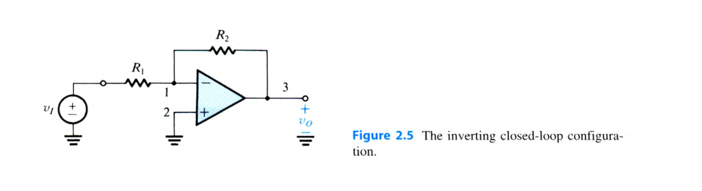

<template #solution>

$R_1=100,\mathrm{k}\Omega,\quad R_2=1,\mathrm{M}\Omega$

</template>

</PracticeCard>

<PracticeCard id="electronics-ch2-ex-2-5" type="exercise" title="Exercise 2.5" source="Sedra & Smith, Microelectronic Circuits, 8e — PDF p.102 / printed p.72" topic="Chapter 2">

The circuit shown in Fig. E2.5(a) can be used to implement a transresistance amplifier (see Table 1.1 in Section 1.5). Such circuits are often used to amplify weak current signals, such as those from photodiodes that detect light for optical communication or proximity sensors. Find the value of the input resistance (R_i), the transresistance (R_m), and the output resistance (R_o) of the transresistance amplifier. If the signal source shown in Fig. E2.5(b) is connected to the input of the transresistance amplifier, find the amplifier output voltage.

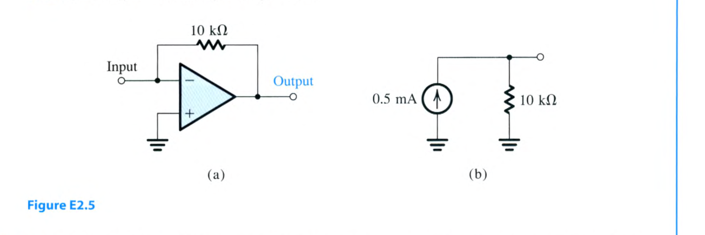

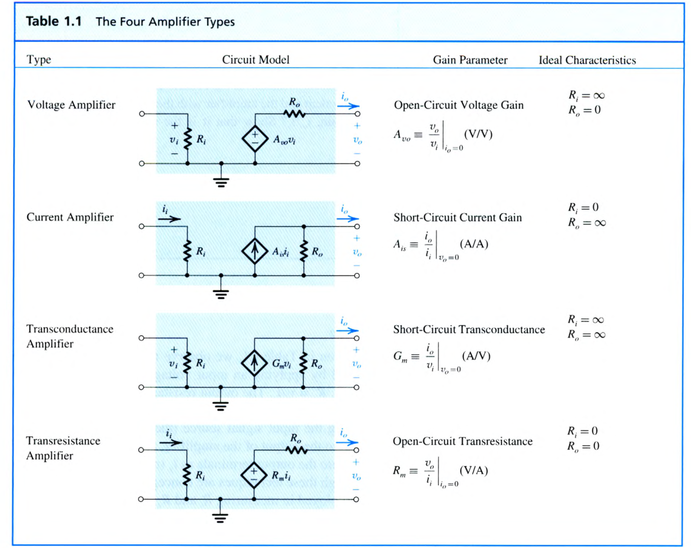

<template #solution>

$R_i=0,\quad R_m=-10,\mathrm{k}\Omega,\quad R_o=0,\quad v_o=-5,\mathrm{V}$

</template>

</PracticeCard>

<PracticeCard id="electronics-ch2-ex-2-6" type="exercise" title="Exercise 2.6" source="Sedra & Smith, Microelectronic Circuits, 8e — PDF p.102 / printed p.72" topic="Chapter 2">

For the circuit in Fig. E2.6 determine the values of (v_1, i_1, i_2, v_o, i_L,) and (i_o). Also determine the voltage gain (v_o/v_1), current gain (i_L/i_1), and power gain (P_o/P_i).

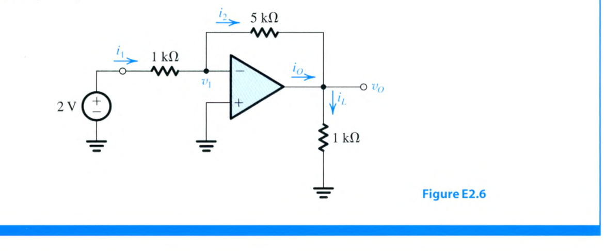

<template #solution>

$v_1=0\,\mathrm{V}; i_1=2\,\mathrm{mA}; i_2=2\,\mathrm{mA}; v_o=-10\,\mathrm{V}; i_L=-10\,\mathrm{mA}; i_o=-12\,\mathrm{mA}$.

$$
\frac{v_o}{v_1}=-5\,\mathrm{V/V}\ (14\,\mathrm{dB}),\qquad
\frac{i_L}{i_1}=-5\,\mathrm{A/A}\ (14\,\mathrm{dB}),\qquad
\frac{P_o}{P_i}=25\,\mathrm{W/W}\ (14\,\mathrm{dB}).
$$

</template>

</PracticeCard>

<PracticeCard id="electronics-ch2-ex-d2-7" type="exercise" title="Exercise D2.7" source="Sedra & Smith, Microelectronic Circuits, 8e — PDF p.104 / printed p.74" topic="Chapter 2">

Design an inverting op-amp circuit to form the weighted sum (v_o) of two inputs (v_1) and (v_2). It is required that (v_o=-(v_1+4v_2)). Choose values for (R_1,R_2,) and (R_f) so that for a maximum output voltage of 4 V the current in the feedback resistor will not exceed 1 mA.

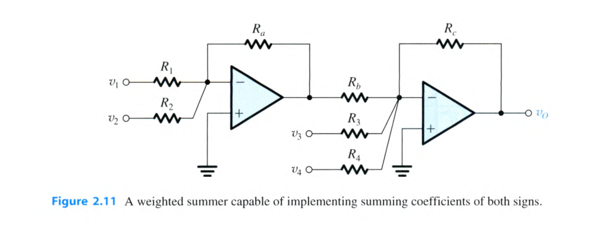

<template #solution>

A possible choice is $R_1=4\,\mathrm{k}\Omega,\quad R_2=1\,\mathrm{k}\Omega,\quad R_f=4\,\mathrm{k}\Omega$.

</template>

</PracticeCard>

<PracticeCard id="electronics-ch2-ex-d2-8" type="exercise" title="Exercise D2.8" source="Sedra & Smith, Microelectronic Circuits, 8e — PDF p.104 / printed p.74" topic="Chapter 2">

Use the idea presented in Fig. 2.11 to design a weighted summer that provides

$$
v_o=2v_1+v_2-4v_3.
$$

<template #solution>

A possible choice is $R_1=5\,\mathrm{k}\Omega, R_2=10\,\mathrm{k}\Omega, R_a=10\,\mathrm{k}\Omega, R_b=10\,\mathrm{k}\Omega, R_3=2.5\,\mathrm{k}\Omega, R_c=10\,\mathrm{k}\Omega$.

</template>

</PracticeCard>

<PracticeCard id="electronics-ch2-ex-2-10" type="exercise" title="Exercise 2.10" source="Sedra & Smith, Microelectronic Circuits, 8e — PDF p.107 / printed p.77" topic="Chapter 2">

If in the circuit of Fig. E2.9 the 1-kΩ resistor is disconnected from ground and connected to a third signal source (v_3), use superposition to determine (v_o) in terms of (v_1,v_2,) and (v_3).

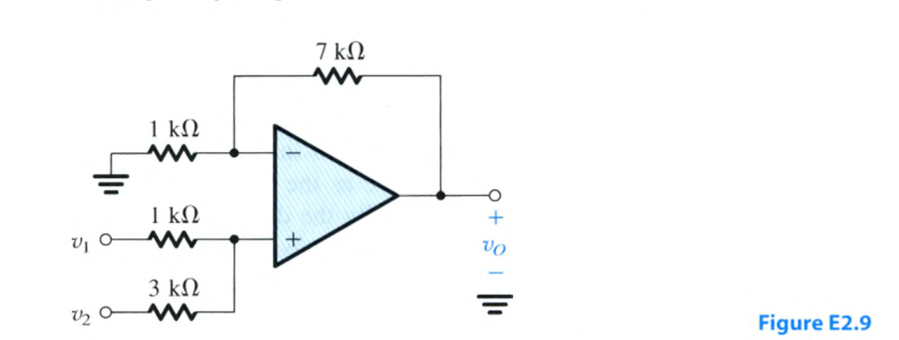

<template #solution>

$$
v_o=6v_1+2v_2-7v_3.
$$

</template>

</PracticeCard>

<PracticeCard id="electronics-ch2-ex-d2-11" type="exercise" title="Exercise D2.11" source="Sedra & Smith, Microelectronic Circuits, 8e — PDF p.107 / printed p.77" topic="Chapter 2">

Design a noninverting amplifier with a gain of 2. At the maximum output voltage of 10 V the current in the voltage divider is to be 10 μA.

<template #solution>

$R_1=R_2=0.5\,\mathrm{M}\Omega$

</template>

</PracticeCard>

<PracticeCard id="electronics-ch2-ex-2-12" type="exercise" title="Exercise 2.12" source="Sedra & Smith, Microelectronic Circuits, 8e — PDF p.108 / printed p.78" topic="Chapter 2">

(a) Show that if the op amp in the circuit of Fig. 2.12 has a finite open-loop gain (A), then the closed-loop gain is given by Eq. (2.11). (b) For $R_1=1\,\mathrm{k}\Omega$ and $R_2=9\,\mathrm{k}\Omega$ find the percentage deviation (ε) of the closed-loop gain from the ideal value of (1+R_2/R_1) for (A=10^3,10^4,) and (10^5). For $v_1=1\,\mathrm{V}$, find in each case the voltage between the two input terminals of the op amp.

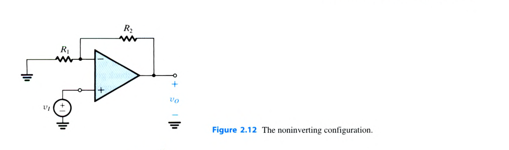

<template #solution>

(ε=-1\%,-0.1\%,-0.01\%); for the three values of (A), respectively,

$$
v_2-v_1=9.9\,\mathrm{mV},\quad 1\,\mathrm{mV},\quad 0.1\,\mathrm{mV}.
$$

</template>

</PracticeCard>

<PracticeCard id="electronics-ch2-ex-2-13" type="exercise" title="Exercise 2.13" source="Sedra & Smith, Microelectronic Circuits, 8e — PDF p.108 / printed p.78" topic="Chapter 2">

For the circuit in Fig. E2.13 find the values of (i_i,v_1,i_1,i_2,v_o,i_L,) and (i_o). Also find the voltage gain (v_o/v_1), the current gain (i_L/i_i), and the power gain (P_L/P_i).

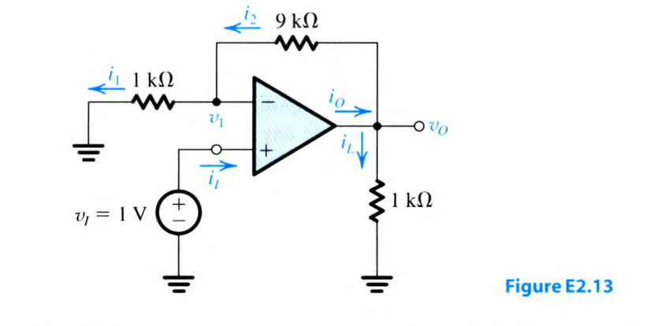

<template #solution>

$i_i=0; v_1=1\,\mathrm{V}; i_1=1\,\mathrm{mA}; i_2=1\,\mathrm{mA}; v_o=10\,\mathrm{V}; i_L=10\,\mathrm{mA}; i_o=11\,\mathrm{mA}$.

$$
\frac{v_o}{v_1}=10\,\mathrm{V/V}\ (20\,\mathrm{dB}),\qquad
\frac{i_L}{i_i}=\infty,qquad
\frac{P_L}{P_i}=\infty.
$$

</template>

</PracticeCard>

<PracticeCard id="electronics-ch2-ex-2-14" type="exercise" title="Exercise 2.14" source="Sedra & Smith, Microelectronic Circuits, 8e — PDF p.108 / printed p.78" topic="Chapter 2">

It is required to connect a transducer having an open-circuit voltage of 1 V and a source resistance of 1 MΩ to a load of 1-kΩ resistance. Find the load voltage if the connection is done (a) directly, and (b) through a unity-gain voltage follower.

<template #solution>

(a) (1\,\mathrm{mV}); (b) (1\,\mathrm{V}).

</template>

</PracticeCard>

<PracticeCard id="electronics-ch2-ex-d2-16" type="exercise" title="Exercise D2.16" source="Sedra & Smith, Microelectronic Circuits, 8e — PDF p.113 / printed p.83" topic="Chapter 2">

Find values for the resistances in the circuit of Fig. 2.16 so that the circuit behaves as a difference amplifier with an input resistance of 20 kΩ and a gain of 10.

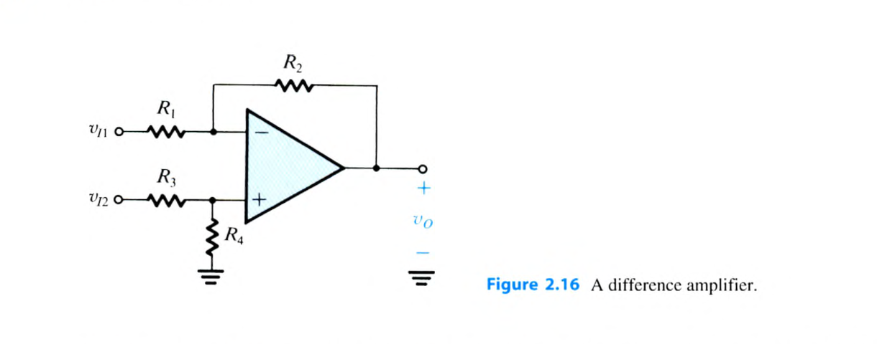

<template #solution>

$R_1=R_3=10\,\mathrm{k}\Omega,\quad R_2=R_4=100\,\mathrm{k}\Omega$

</template>

</PracticeCard>

<PracticeCard id="electronics-ch2-ex-d2-19" type="exercise" title="Exercise D2.19" source="Sedra & Smith, Microelectronic Circuits, 8e — PDF p.127 / printed p.97" topic="Chapter 2">

Use an ideal op amp to design an inverting integrator with an input resistance of 10 kΩ and an integration time constant of (10^{-3}) s. What is the gain magnitude and phase angle of this circuit at 10 rad/s and at 1 rad/s? What is the frequency at which the gain magnitude is unity?

<template #solution>

$R=10\,\mathrm{k}\Omega,\quad C=0.1\,\mu\mathrm{F}$.

At $\omega=10\,\mathrm{rad/s}$, $\lvert V_o/V_i\rvert=100\,\mathrm{V/V}$ and $\phi=+90^\circ$. At $\omega=1\,\mathrm{rad/s}$, $\lvert V_o/V_i\rvert=1000\,\mathrm{V/V}$ and $\phi=+90^\circ$. The gain magnitude is unity at $\omega=1000\,\mathrm{rad/s}$.

</template>

</PracticeCard>

<PracticeCard id="electronics-ch2-ex-d2-20" type="exercise" title="Exercise D2.20" source="Sedra & Smith, Microelectronic Circuits, 8e — PDF p.127 / printed p.97" topic="Chapter 2">

Design a differentiator to have a time constant of 10 s and an input capacitance of 0.01 μF. What is the gain magnitude and phase of this circuit at 10 rad/s, and at (10^3) rad/s? In order to limit the high-frequency gain of the differentiator circuit to 100, a resistor is added in series with the capacitor. Find the required resistor value.

<template #solution>

$C=0.01\,\mu\mathrm{F},\quad R=1\,\mathrm{M}\Omega$.

At $\omega=10\,\mathrm{rad/s}$, $\lvert V_o/V_i\rvert=0.1\,\mathrm{V/V}$ and $\phi=-90^\circ$. At $\omega=10^3\,\mathrm{rad/s}$, $\lvert V_o/V_i\rvert=10\,\mathrm{V/V}$ and $\phi=-90^\circ$. The added series resistor is $10\,\mathrm{k}\Omega$.

</template>

</PracticeCard>

## End-of-Chapter Problems

<PracticeCard id="electronics-ch2-problem-2-1" type="practice" title="Problem 2.1" source="Sedra & Smith, Microelectronic Circuits, 8e — PDF p.148 / printed p.118" topic="Chapter 2">

What is the minimum number of pins required for a so-called dual-op-amp IC package, one containing two op amps? What is the number of pins required for a so-called quad-op-amp package, one containing four op amps?

<template #solution>

教材答案未提供；待補

</template>

</PracticeCard>

<PracticeCard id="electronics-ch2-problem-2-2" type="practice" title="Problem 2.2" source="Sedra & Smith, Microelectronic Circuits, 8e — PDF p.148 / printed p.118" topic="Chapter 2">

The circuit of Fig. P2.2 uses an op amp that is ideal except for having a finite gain (A). Measurements indicate $v_o=2.5\,\mathrm{V}$ when $v_i=1.0\,\mathrm{V}$. What is the op-amp gain (A)?

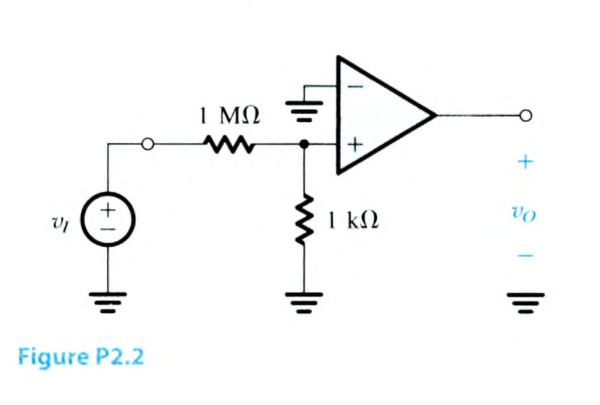

<template #solution>

教材答案未提供；待補

</template>

</PracticeCard>

<PracticeCard id="electronics-ch2-problem-2-3" type="practice" title="Problem 2.3" source="Sedra & Smith, Microelectronic Circuits, 8e — PDF p.148 / printed p.118" topic="Chapter 2">

Measurement of a circuit incorporating what is thought to be an ideal op amp shows the voltage at the op-amp output to be (-3.500\,\mathrm{V}) and that at the negative input to be (-1.000\,\mathrm{V}). For the amplifier to be ideal, what would you expect the voltage at the positive input to be? If the measured voltage at the positive input is (-1.002\,\mathrm{V}), what is likely to be the actual gain of the amplifier?

<template #solution>

教材答案未提供；待補

</template>

</PracticeCard>

<PracticeCard id="electronics-ch2-problem-2-4" type="practice" title="Problem 2.4" source="Sedra & Smith, Microelectronic Circuits, 8e — PDF p.148 / printed p.118" topic="Chapter 2">

A set of experiments is run on an op amp that is ideal except for having a finite gain (A). The results are tabulated below. Are the results consistent? If not, are they reasonable, in view of the possibility of experimental error? What do they show the gain to be? Using this value, predict values of the measurements that were accidentally omitted (the blank entries).

| Experiment # | (v_1) | (v_2) | (v_o) |
| --- | ---: | ---: | ---: |
| 1 | 0.00 | 0.00 | 0.00 |
| 2 | −1.00 | −1.00 | 0.00 |
| 3 | [blank] | −1.00 | −1.00 |
| 4 | 1.00 | 1.02 | 4.01 |
| 5 | 2.01 | 2.00 | −1.99 |
| 6 | 1.99 | 2.00 | 2.00 |
| 7 | 5.10 | [blank] | −5.10 |

<template #solution>

教材答案未提供；待補

</template>

</PracticeCard>

<PracticeCard id="electronics-ch2-problem-2-5" type="practice" title="Problem 2.5" source="Sedra & Smith, Microelectronic Circuits, 8e — PDF p.148 / printed p.118" topic="Chapter 2">

Refer to Exercise 2.3. This problem explores an alternative internal structure for the op amp. In particular, we wish to model the internal structure of a particular op amp using two transconductance amplifiers and one transresistance amplifier. Suggest an appropriate topology. For equal transconductances $G_m$ and a transresistance (R_m), find an expression for the open-loop gain (A). For $G_m=100\,\mathrm{mA/V}$ and $R_m=1\times10^5\,\Omega$, what value of (A) results?

<template #solution>

教材答案未提供；待補

</template>

</PracticeCard>

<PracticeCard id="electronics-ch2-problem-2-6" type="practice" title="Problem 2.6" source="Sedra & Smith, Microelectronic Circuits, 8e — PDF p.148 / printed p.118" topic="Chapter 2">

Two amplifier inputs are expressed in each row of the table below either in terms of their node voltages with respect to ground, (v_1) and (v_2), or in terms of their differential and common-mode voltages, (v_{id}) and (v_{icm}). Complete the table.

| (v_1) | (v_2) | (v_{id}) | (v_{icm}) |
| ---: | ---: | ---: | ---: |
| 0.90 | 0.90 |  |  |
|  |  | 0.50 | 1.00 |
| −1.20 |  |  | −1.10 |
| −0.15 | 0.05 |  |  |
|  |  | −0.20 | 0.00 |

<template #solution>

教材答案未提供；待補

</template>

</PracticeCard>

<PracticeCard id="electronics-ch2-problem-2-7" type="practice" title="Problem 2.7" source="Sedra & Smith, Microelectronic Circuits, 8e — PDF p.148 / printed p.118" topic="Chapter 2">

The two wires leading from the output terminals of a transducer pick up an interference signal that is a 60-Hz, 2-V sinusoid. The output signal of the transducer is sinusoidal of 5-mV amplitude and 1000-Hz frequency. Give expressions for (v_{cm}), (v_d), and the total signal between each wire and the system ground.

<template #solution>

教材答案未提供；待補

</template>

</PracticeCard>

<PracticeCard id="electronics-ch2-problem-2-8" type="practice" title="Problem 2.8" source="Sedra & Smith, Microelectronic Circuits, 8e — PDF p.149 / printed p.119" topic="Chapter 2">

Nonideal (i.e., real) operational amplifiers respond to both the differential and common-mode components of their input signals (refer to Fig. 2.4 for signal representation). Thus the output voltage of the op amp can be expressed as

$$
v_o=A_dv_{id}+A_{cm}v_{icm},
$$

where $A_d$ is the differential gain (referred to simply as (A) in the text) and $A_{cm}$ is the common-mode gain (assumed to be zero in the text). The op amp’s effectiveness in rejecting common-mode signals is measured by its CMRR, defined as

$$
\mathrm{CMRR}=20\log\left\lvert\frac{A_d}{A_{cm}}\right\rvert.
$$

Consider an op amp whose internal structure is of the type shown in Fig. E2.3 except for a mismatch (ΔG_m) between the transconductances of the two channels; that is,

$$
G_{m1}=G_m-\tfrac12\Delta G_m,
\qquad
G_{m2}=G_m+\tfrac12\Delta G_m.
$$

Find expressions for $A_d$, $A_{cm}$, and CMRR. What is the maximum permitted percentage mismatch between the two $G_m$ values if a minimum CMRR of 60 dB is required?

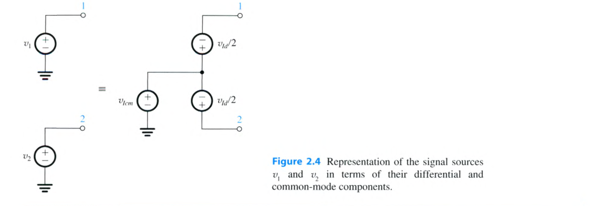

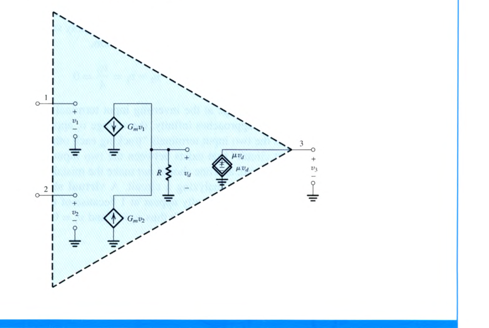

<template #solution>

教材答案未提供；待補

</template>

</PracticeCard>

## 尚未完成

- Exercises：本批次已完成全部指定題號：D2.4、2.5、2.6、D2.7、D2.8、2.10、D2.11、2.12、2.13、2.14、D2.16、D2.19、D2.20。
- End-of-Chapter Problems：2.9–2.127 尚未完成。
