# Chapter 2 Problems 2.61–2.80

> 來源：Sedra & Smith, *Microelectronic Circuits*, 8e，`課本.pdf`。本批次逐頁核對 PDF 第 156–159 頁（印刷第 126–129 頁）。教材未提供本批次答案，解答欄統一標示待補。

<PracticeFilter prefix="electronics-ch2-problem-" />
<PracticeProgress :total="20" prefix="electronics-ch2-problem-" />

<PracticeCard type="practice" id="electronics-ch2-problem-2-61" title="Problem 2.61" source="Sedra & Smith 8e · PDF p. 156 · 印刷 p. 126" topic="Chapter 2 Problems · 有限開迴路增益">

對下列各組運算放大器開迴路增益 $A$ 與名義閉迴路增益 $G_0$，計算實際達到的閉迴路增益 $G$；並計算 $|G|$ 比名義增益幅度 $|G_0|$ 少多少百分比。

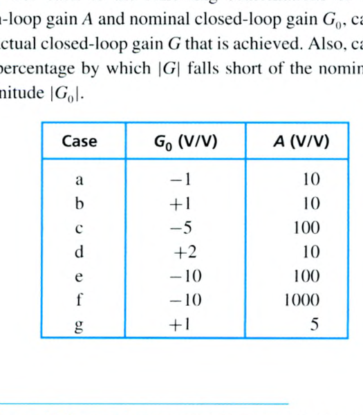

<template #solution>

教材答案未提供；待補。

</template>
</PracticeCard>

<PracticeCard type="practice" id="electronics-ch2-problem-2-62" title="Problem 2.62" source="Sedra & Smith 8e · PDF p. 156 · 印刷 p. 126" topic="Chapter 2 Problems · 電位計與電壓追隨器">

圖 P2.62 所示電路的輸出電壓 $v_o$ 可藉由轉動 $100\,\mathrm{k\Omega}$ 電位計的滑動端加以改變。求 $v_o$ 可變動的範圍。若電位計是「20 圈」裝置，求電位計每轉一圈所對應的 $v_o$ 變化量。

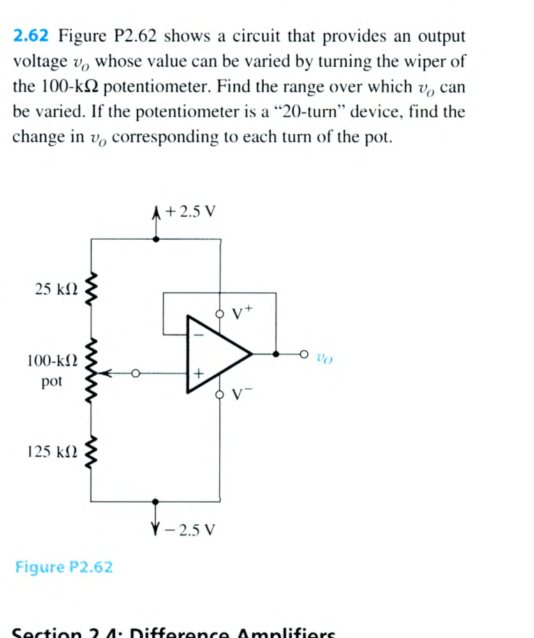

<template #solution>

教材答案未提供；待補。

</template>
</PracticeCard>

<PracticeCard type="practice" id="electronics-ch2-problem-2-63" title="Problem 2.63" source="Sedra & Smith 8e · PDF p. 156 · 印刷 p. 126" topic="Chapter 2 Problems · 差動放大器">

對圖 2.16 的差動放大器，令 $R_1=R_3=5\,\mathrm{k\Omega}$ 且 $R_2=R_4=50\,\mathrm{k\Omega}$，求電壓增益 $v_o/v_{id}$。差動輸入電阻 $R_{id}$ 為何？若兩個關鍵電阻比 $(R_2/R_1)$ 與 $(R_4/R_3)$ 彼此相差 $1\%$，預期共模增益 $A_{cm}$ 為何？在此情況下也求 CMRR。忽略電阻比不匹配對 $A_d$ 數值的影響。

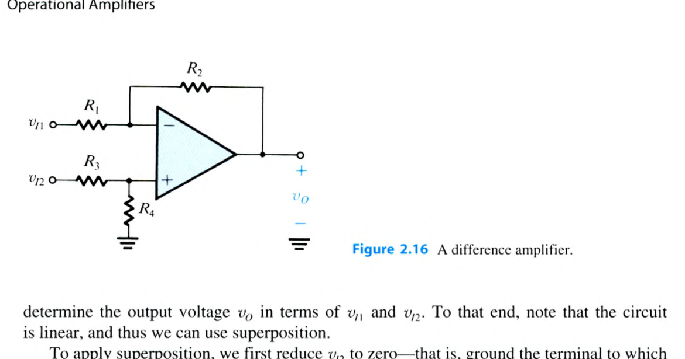

<template #solution>

教材答案未提供；待補。

</template>
</PracticeCard>

<PracticeCard type="practice" id="electronics-ch2-problem-2-64" title="Problem 2.64" source="Sedra & Smith 8e · PDF p. 156 · 印刷 p. 126" topic="Chapter 2 Problems · 差動放大器設計">

使用圖 2.16 的差動放大器組態，並假設運算放大器為理想，設計電路以提供下列差動增益。每一種情況的差動輸入電阻都應為 $10\,\mathrm{k\Omega}$。

1. $1\,\mathrm{V/V}$
2. $5\,\mathrm{V/V}$
3. $10\,\mathrm{V/V}$
4. $25\,\mathrm{V/V}$

<template #solution>

教材答案未提供；待補。

</template>
</PracticeCard>

<PracticeCard type="practice" id="electronics-ch2-problem-2-65" title="Problem 2.65" source="Sedra & Smith 8e · PDF p. 156–157 · 印刷 p. 126–127" topic="Chapter 2 Problems · 差動放大器">

對圖 P2.65 所示電路，將 $v_o$ 表示為 $v_1$ 與 $v_2$ 的函數。求下列各種情況所看到的輸入電阻：只由 $v_1$ 所看到的輸入電阻、只由 $v_2$ 所看到的輸入電阻、接在兩個輸入端之間的電壓源所看到的輸入電阻，以及同時接到兩個輸入端的電壓源所看到的輸入電阻。

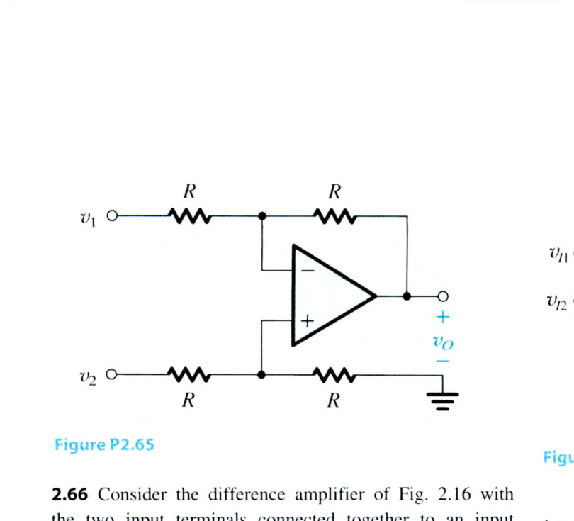

<template #solution>

教材答案未提供；待補。

</template>
</PracticeCard>

<PracticeCard type="practice" id="electronics-ch2-problem-2-66" title="Problem 2.66" source="Sedra & Smith 8e · PDF p. 157 · 印刷 p. 127" topic="Chapter 2 Problems · 共模輸入電阻">

考慮圖 2.16 的差動放大器，將兩個輸入端連接在一起，接至一個輸入共模訊號源。對於 $R_2/R_1=R_4/R_3$，證明輸入共模電阻為

$$
R_{icm}=(R_3+R_4)\mathbin{\|}(R_1+R_2).
$$

<template #solution>

教材答案未提供；待補。

</template>
</PracticeCard>

<PracticeCard type="practice" id="electronics-ch2-problem-2-67" title="Problem 2.67" source="Sedra & Smith 8e · PDF p. 157 · 印刷 p. 127" topic="Chapter 2 Problems · CMRR">

對圖 2.16 的差動放大器，證明若每個電阻的容許誤差為 $\pm100\varepsilon\%$（例如對於 $5\%$ 電阻，$\varepsilon=0.05$），則最壞情況的 CMRR 可近似表示為

$$
\mathrm{CMRR}\approx20\log\left(\frac{K+1}{4\varepsilon}\right),
$$

其中 $K$ 是電阻比 $(R_2/R_1)$ 與 $(R_4/R_3)$ 的名義（理想）值。對於設計差動增益理想值為 $100\,\mathrm{V/V}$ 的放大器，假設運算放大器為理想且使用 $1\%$ 電阻，計算最壞情況 CMRR。若要求 CMRR 為 $80\,\mathrm{dB}$，需要的電阻容許誤差為何？

<template #solution>

教材答案未提供；待補。

</template>
</PracticeCard>

<PracticeCard type="practice" id="electronics-ch2-problem-2-68" title="Problem 2.68" source="Sedra & Smith 8e · PDF p. 157 · 印刷 p. 127" topic="Chapter 2 Problems · 差動放大器">

1. 求圖 P2.68 差動放大器電路的 $A_d$ 與 $A_{cm}$。
2. 若規格指出，只要運算放大器正、負輸入端的共模電壓落在 $\pm2.5\,\mathrm{V}$ 範圍內，運算放大器即可正常工作，則輸入共模訊號 $v_{icm}$ 的範圍限制為何？（這就是差動放大器的共模範圍。）
3. 若在節點 A 與地之間接入一個 $10\,\mathrm{k\Omega}$ 電阻，並在節點 B 與地之間再接入另一個 $10\,\mathrm{k\Omega}$ 電阻，則此時 $A_d$、$A_{cm}$ 與輸入共模範圍各為何？

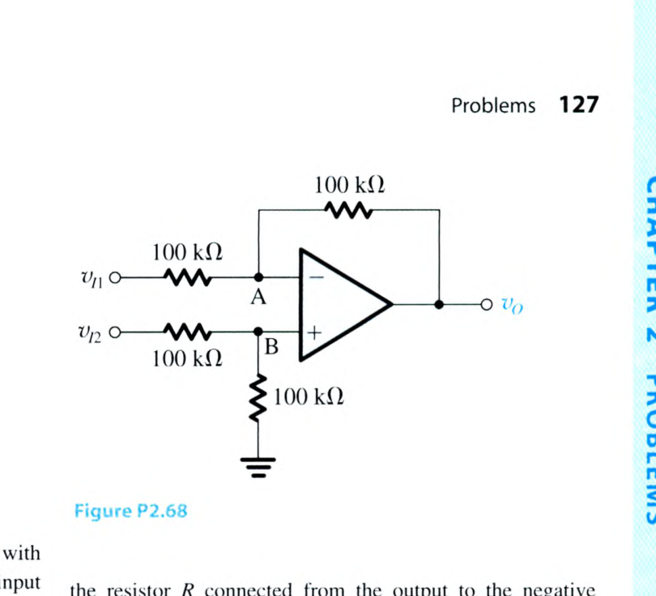

<template #solution>

教材答案未提供；待補。

</template>
</PracticeCard>

<PracticeCard type="practice" id="electronics-ch2-problem-2-69" title="Problem 2.69" source="Sedra & Smith 8e · PDF p. 157 · 印刷 p. 127" topic="Chapter 2 Problems · 高增益差動放大器設計">

為了得到高增益且高輸入電阻的差動放大器，圖 P2.69 的電路除了由電阻 $R$ 提供的負回授外，也採用正回授。具體而言，連接在輸出端的電壓分壓器 $(R_5,R_6)$ 將輸出的一部分，也就是 $\beta v_o$，經由電阻 $R$ 回送至運算放大器的正輸入端。假設 $R_5$ 與 $R_6$ 遠小於 $R$，因此流過 $R$ 的電流遠小於流過電壓分壓器的電流，於是 $\beta\simeq R_6/(R_5+R_6)$。證明差動增益為

$$
A_d=\frac{v_o}{v_{id}}=\frac{1}{1-\beta}.
$$

設計此電路，使差動增益為 $10\,\mathrm{V/V}$ 且差動輸入電阻為 $2\,\mathrm{M\Omega}$。選擇 $R$、$R_5$ 與 $R_6$ 的值，使得 $(R_5+R_6)\le R/100$。

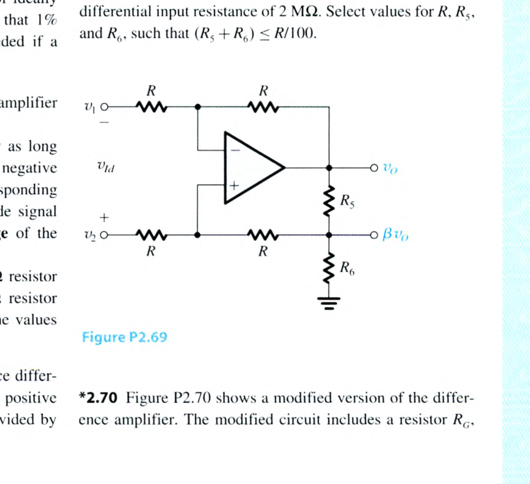

<template #solution>

教材答案未提供；待補。

</template>
</PracticeCard>

<PracticeCard type="practice" id="electronics-ch2-problem-2-70" title="Problem 2.70" source="Sedra & Smith 8e · PDF p. 157–158 · 印刷 p. 127–128" topic="Chapter 2 Problems · 可變增益差動放大器">

圖 P2.70 顯示差動放大器的改良版本。改良後的電路包含一個電阻 $R_G$，可用來改變增益。證明差動電壓增益為

$$
\frac{v_o}{v_{id}}=-2\frac{R_2}{R_1}\left(1+\frac{R_2}{R_G}\right).
$$

（提示：運算放大器輸入端的虛短路使得流過兩個 $R_1$ 電阻的電流為 $v_{id}/(2R_1)$。）

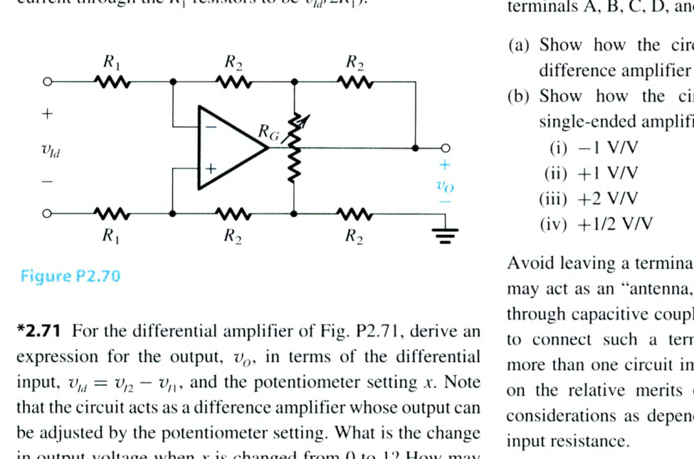

<template #solution>

教材答案未提供；待補。

</template>
</PracticeCard>

<PracticeCard type="practice" id="electronics-ch2-problem-2-71" title="Problem 2.71" source="Sedra & Smith 8e · PDF p. 158 · 印刷 p. 128" topic="Chapter 2 Problems · 電位計可調差動放大器">

對圖 P2.71 的差動放大器，推導以差動輸入 $v_{id}=v_2-v_1$ 與電位計設定 $x$ 表示輸出 $v_o$ 的式子。注意，此電路是一個差動放大器，其輸出可由電位計設定調整。當 $x$ 從 $0$ 變為 $1$ 時，輸出電壓的變化量為何？如何增加此可調範圍？

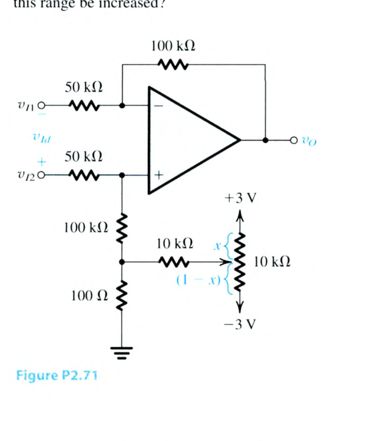

<template #solution>

教材答案未提供；待補。

</template>
</PracticeCard>

<PracticeCard type="practice" id="electronics-ch2-problem-2-72" title="Problem 2.72" source="Sedra & Smith 8e · PDF p. 158 · 印刷 p. 128" topic="Chapter 2 Problems · 差動放大器模組">

圖 P2.72 所示電路代表一種用途廣泛的積體電路，稱為差動放大器模組；不同製造商以不同的零件編號提供，例如 INA105 與 AMP03。它由一個運算放大器與精密電阻組成；透過適當連接端子 A、B、C、D 與 O，可組態成多種應用。

1. 說明如何使用此電路實作單位增益差動放大器。
2. 說明如何使用此電路實作下列單端放大器：
   1. $-1\,\mathrm{V/V}$
   2. $+1\,\mathrm{V/V}$
   3. $+2\,\mathrm{V/V}$
   4. $+1/2\,\mathrm{V/V}$

避免讓任何端子開路，因為這類端子可能像「天線」一樣，透過電容耦合拾取干擾與雜訊。相反地，應找一個適當節點，以冗餘方式連接該端子。若存在不只一種電路實作方式，請考慮對元件匹配的依賴程度與輸入電阻等因素，評論各種方式的相對優缺點。

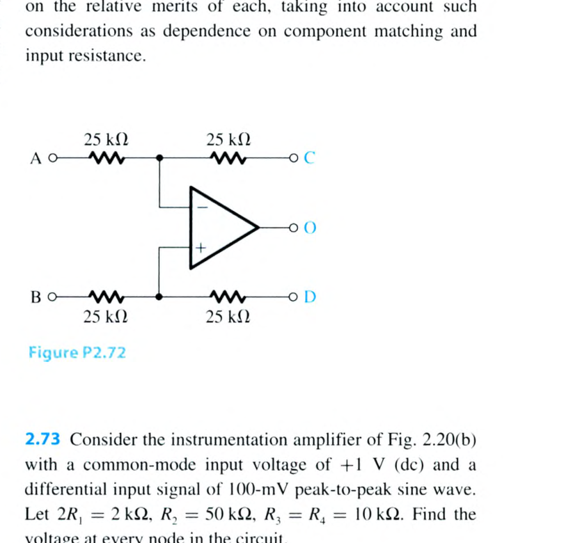

<template #solution>

教材答案未提供；待補。

</template>
</PracticeCard>

<PracticeCard type="practice" id="electronics-ch2-problem-2-73" title="Problem 2.73" source="Sedra & Smith 8e · PDF p. 158 · 印刷 p. 128" topic="Chapter 2 Problems · 儀表放大器">

考慮圖 2.20(b) 的儀表放大器，其共模輸入電壓為 $+1\,\mathrm{V}$（直流），差動輸入訊號為 $100\,\mathrm{mV}$ 峰對峰的正弦波。令 $2R_1=2\,\mathrm{k\Omega}$、$R_2=50\,\mathrm{k\Omega}$、$R_3=R_4=10\,\mathrm{k\Omega}$。求電路中每一個節點的電壓。

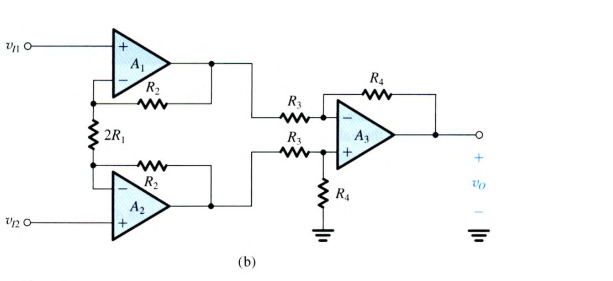

<template #solution>

教材答案未提供；待補。

</template>
</PracticeCard>

<PracticeCard type="practice" id="electronics-ch2-problem-2-74" title="Problem 2.74" source="Sedra & Smith 8e · PDF p. 159 · 印刷 p. 129" topic="Chapter 2 Problems · 儀表放大器">

在圖 2.20(a) 的儀表放大器中，將其中一個 $R_2$ 電阻替換為略有不同的值 $R_2+\Delta R$。求由 $v_{i1}$ 與 $v_{i2}$ 的共模輸入到輸出 $v_o$ 的增益。再藉由修改其中一個 $R_1$ 電阻的值，使此增益為零。

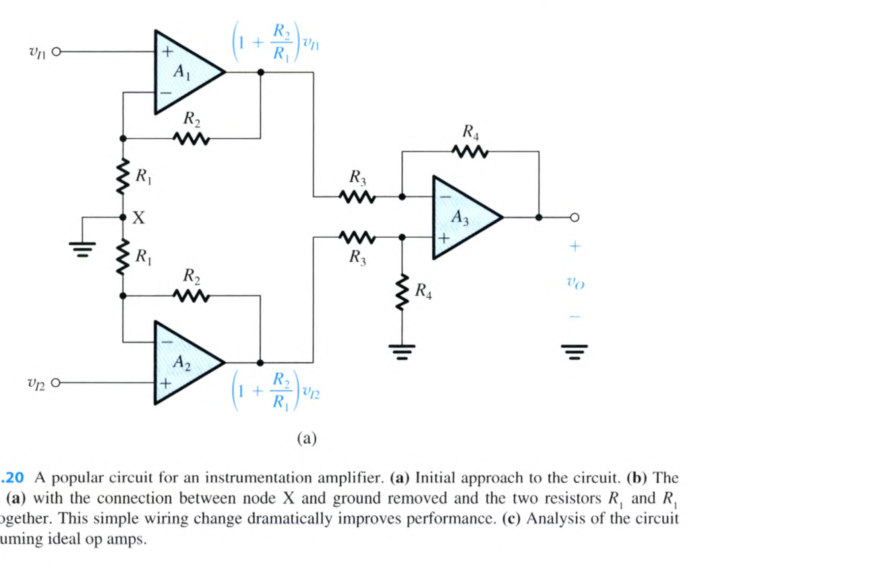

<template #solution>

教材答案未提供；待補。

</template>
</PracticeCard>

<PracticeCard type="practice" id="electronics-ch2-problem-2-75" title="Problem 2.75" source="Sedra & Smith 8e · PDF p. 159 · 印刷 p. 129" topic="Chapter 2 Problems · 儀表放大器與飽和">

1. 考慮圖 2.20(a) 的儀表放大器電路。若運算放大器除了輸出會以圖 1.14 所示方式飽和於 $\pm5\,\mathrm{V}$ 外，皆為理想元件，對於 $R_1=1\,\mathrm{k\Omega}$ 且 $R_2=100\,\mathrm{k\Omega}$，求允許的最大輸入共模訊號。
2. 對圖 2.20(b) 的電路重做上述分析，並評論兩個電路之間的差異。

<template #solution>

教材答案未提供；待補。

</template>
</PracticeCard>

<PracticeCard type="practice" id="electronics-ch2-problem-2-76" title="Problem 2.76" source="Sedra & Smith 8e · PDF p. 159 · 印刷 p. 129" topic="Chapter 2 Problems · 儀表放大器的共模抑制">

1. 將 $v_{i1}$ 與 $v_{i2}$ 以差動與共模分量表示，求圖 2.20(a) 電路中的 $v_{o1}$ 與 $v_{o2}$，再求其差動分量 $v_{o2}-v_{o1}$ 與共模分量 $\tfrac{1}{2}(v_{o1}+v_{o2})$。接著求此儀表放大器第一級的差動增益與共模增益，並據此求 CMRR。
2. 對圖 2.20(b) 重做上述分析，並評論兩個電路之間的差異。

<template #solution>

教材答案未提供；待補。

</template>
</PracticeCard>

<PracticeCard type="practice" id="electronics-ch2-problem-2-77" title="Problem 2.77" source="Sedra & Smith 8e · PDF p. 159 · 印刷 p. 129" topic="Chapter 2 Problems · 儀表放大器 CMRR">

對圖 2.20(b) 類型的儀表放大器，設計者提出令 $R_2=R_3=R_4=100\,\mathrm{k\Omega}$ 且 $2R_1=10\,\mathrm{k\Omega}$。在理想元件的情況下，差動增益、共模增益與 CMRR 為何？若所有電阻均規格為 $\pm1\%$，重新評估這些量的最壞情況值。再針對 $2R_1$ 降為 $1\,\mathrm{k\Omega}$ 的情況，重做後一項分析。對第一級增益對 CMRR 的影響，你得到什麼結論？（提示：可使用式 (2.19) 評估第二級的 $A_{cm}$。）

<template #solution>

教材答案未提供；待補。

</template>
</PracticeCard>

<PracticeCard type="practice" id="electronics-ch2-problem-2-78" title="Problem 2.78" source="Sedra & Smith 8e · PDF p. 159 · 印刷 p. 129" topic="Chapter 2 Problems · 儀表放大器設計">

設計圖 2.20(b) 的儀表放大器電路，使其差動增益可在 $2$ 到 $50$ 的範圍內變化，並使用一個 $100\,\mathrm{k\Omega}$ 電位計作為可變電阻。

<template #solution>

教材答案未提供；待補。

</template>
</PracticeCard>

<PracticeCard type="practice" id="electronics-ch2-problem-2-79" title="Problem 2.79" source="Sedra & Smith 8e · PDF p. 159 · 印刷 p. 129" topic="Chapter 2 Problems · 浮接負載">

圖 P2.79 所示電路的目的，是在最大程度利用可用電源的情況下，對浮接負載（兩端都未接地的負載）提供電壓。

1. 假設運算放大器為理想，對施加於 A 點、峰對峰值為 $1\,\mathrm{V}$ 的正弦波，畫出 B 點與 C 點的電壓波形；並畫出 $v_o$。
2. 電壓增益 $v_o/v_i$ 為何？
3. 假設運算放大器使用 $\pm5\,\mathrm{V}$ 電源，且其輸出以圖 1.14 所示方式飽和於 $\pm4\,\mathrm{V}$，可容許的最大正弦波輸入為何？請同時給出峰對峰值與 rms 值。

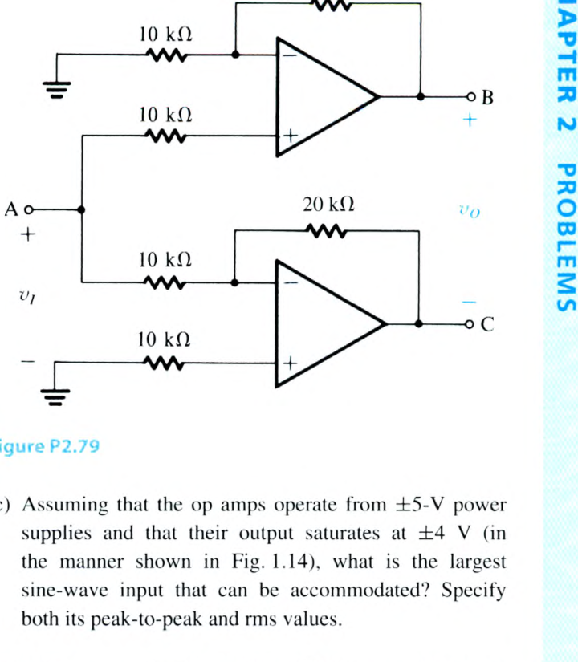

<template #solution>

教材答案未提供；待補。

</template>
</PracticeCard>

<PracticeCard type="practice" id="electronics-ch2-problem-2-80" title="Problem 2.80" source="Sedra & Smith 8e · PDF p. 159–160 · 印刷 p. 129–130" topic="Chapter 2 Problems · 電壓轉電流轉換器">

圖 P2.80 的兩個電路旨在作為電壓轉電流轉換器；也就是說，它們向負載阻抗 $Z_L$ 提供與 $v_i$ 成正比、且與 $Z_L$ 值無關的電流。證明確實如此，並對每個電路求出以 $v_i$ 表示的 $i_o$。評論兩個電路之間的差異。

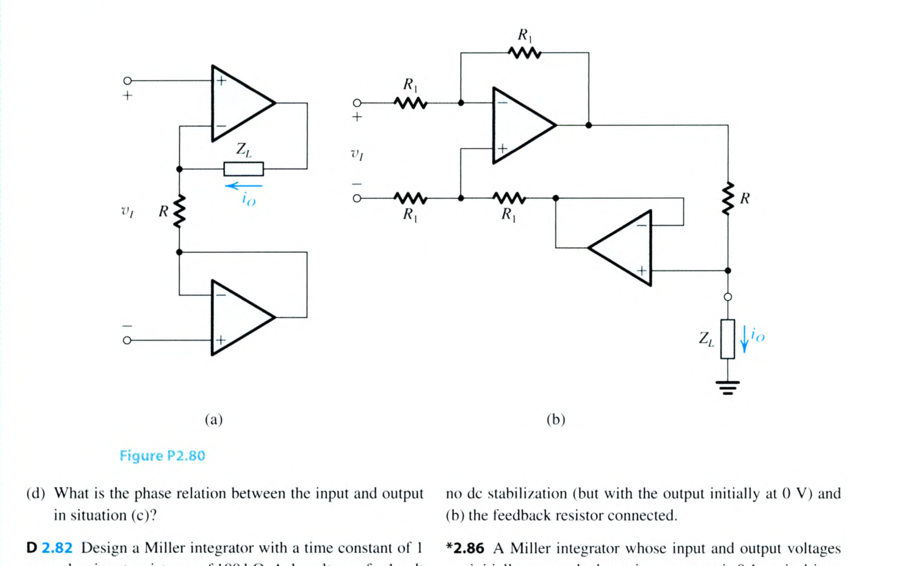

<template #solution>

教材答案未提供；待補。

</template>
</PracticeCard>
