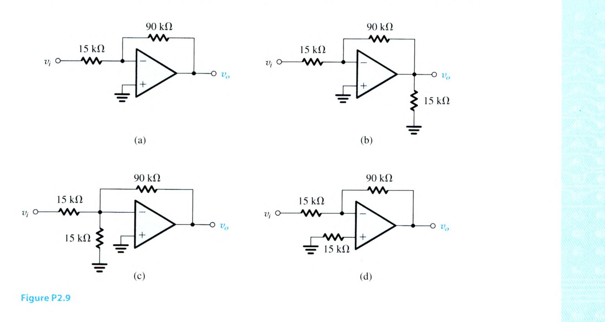
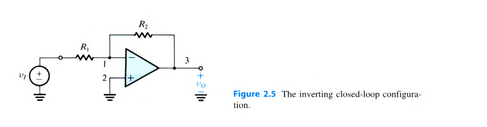
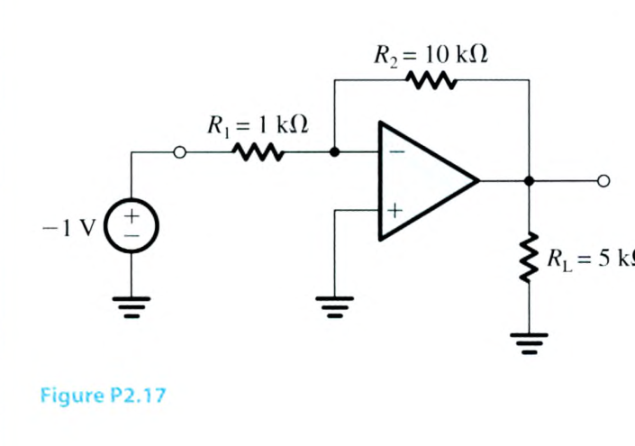
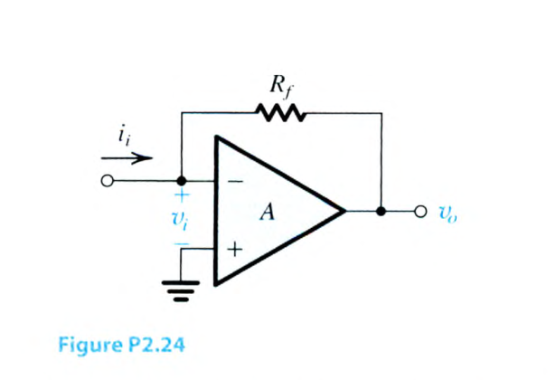

# 電子學 Chapter 2 章末 Problems 2.9–2.24

<PracticeFilter prefix="electronics-ch2-problem-" />
<PracticeProgress :total="16" prefix="electronics-ch2-problem-" />

<PracticeCard type="practice" id="electronics-ch2-problem-2-09" title="Problem 2.9" source="課本 PDF p. 149 / 印刷頁 p. 119" topic="The inverting configuration">

Assuming ideal op amps, find the voltage gain $v_o/v_i$ and input resistance $R_{mathrm{in}}$ of each of the circuits in Fig. P2.9.

<template #solution>

教材答案未提供；待補。

</template>

</PracticeCard>

<PracticeCard type="practice" id="electronics-ch2-problem-2-10" title="Problem 2.10" source="課本 PDF p. 149 / 印刷頁 p. 119" topic="The inverting configuration">

A particular inverting circuit uses an ideal op amp and two $10\text{-}\mathrm{k}\Omega$ resistors. What closed-loop gain would you expect? If a dc voltage of $+1.00\ \mathrm{V}$ is applied at the input, what outputs result? If the $10\text{-}\mathrm{k}\Omega$ resistors are said to be “1% resistors,” having values somewhere in the range $(1\pm0.01)$ times the nominal value, what range of outputs would you expect to actually measure for an input of precisely $1.00\ \mathrm{V}$?

<template #solution>

教材答案未提供；待補。

</template>

</PracticeCard>

<PracticeCard type="practice" id="electronics-ch2-problem-2-11" title="Problem 2.11" source="課本 PDF p. 149 / 印刷頁 p. 119" topic="The inverting configuration">

You are provided with an ideal op amp and three $10\text{-}\mathrm{k}\Omega$ resistors. Using series and parallel resistor combinations, how many different inverting-amplifier circuit topologies are possible? What is the largest (noninfinite) available voltage gain magnitude? What is the smallest (nonzero) available gain magnitude? What are the input resistances in these two cases?

<template #solution>

教材答案未提供；待補。

</template>

</PracticeCard>

<PracticeCard type="practice" id="electronics-ch2-problem-2-12" title="Problem 2.12" source="課本 PDF p. 149 / 印刷頁 p. 119" topic="The inverting configuration">

For ideal op amps operating with the following feedback networks in the inverting configuration, what closed-loop gain results?

(a) $R_1=10\ \mathrm{k}\Omega$, $R_2=20\ \mathrm{k}\Omega$

(b) $R_1=10\ \mathrm{k}\Omega$, $R_2=100\ \mathrm{k}\Omega$

(c) $R_1=10\ \mathrm{k}\Omega$, $R_2=5\ \mathrm{k}\Omega$

(d) $R_1=100\ \mathrm{k}\Omega$, $R_2=5\ \mathrm{M}\Omega$

(e) $R_1=100\ \mathrm{k}\Omega$, $R_2=0.5\ \mathrm{M}\Omega$

<template #solution>

教材答案未提供；待補。

</template>

</PracticeCard>

<PracticeCard type="practice" id="electronics-ch2-problem-2-13" title="Problem 2.13" source="課本 PDF p. 149 / 印刷頁 p. 119" topic="The inverting configuration">

Given an ideal op amp, what are the values of the resistors $R_1$ and $R_2$ to be used to design amplifiers with the closed-loop gains listed below? In your designs, use at least one $10\text{-}\mathrm{k}\Omega$ resistor and another equal or larger resistor.

(a) $-1\ \mathrm{V/V}$

(b) $-10\ \mathrm{V/V}$

(c) $-20\ \mathrm{V/V}$

(d) $-0.5\ \mathrm{V/V}$

<template #solution>

教材答案未提供；待補。

</template>

</PracticeCard>

<PracticeCard type="practice" id="electronics-ch2-problem-2-14" title="Problem 2.14" source="課本 PDF p. 150 / 印刷頁 p. 120" topic="The inverting configuration">

Design an inverting op-amp circuit for which the gain is $-5\ \mathrm{V/V}$ and the total resistance used is $6\ \mathrm{k}\Omega$.

<template #solution>

教材答案未提供；待補。

</template>

</PracticeCard>

<PracticeCard type="practice" id="electronics-ch2-problem-2-15" title="Problem 2.15" source="課本 PDF p. 150 / 印刷頁 p. 120" topic="The inverting configuration">

Using the circuit of Fig. 2.5 and assuming an ideal op amp, design an inverting amplifier with a gain of $26\ \mathrm{dB}$ having the largest possible input resistance under the constraint of having to use resistors no larger than $100\ \mathrm{k}\Omega$. What is the input resistance of your design?

<template #solution>

教材答案未提供；待補。

</template>

</PracticeCard>

<PracticeCard type="practice" id="electronics-ch2-problem-2-16" title="Problem 2.16" source="課本 PDF p. 150 / 印刷頁 p. 120" topic="The inverting configuration">

An ideal op amp is connected as shown in Fig. 2.5 with $R_1=2\ \mathrm{k}\Omega$ and $R_2=8\ \mathrm{k}\Omega$. A symmetrical square-wave signal with levels of $0\ \mathrm{V}$ and $1\ \mathrm{V}$ is applied at the input. Sketch and clearly label the waveform of the resulting output voltage. What is its average value? What is its highest value? What is its lowest value? Also sketch the current waveform through $R_1$, labeling its maximum, minimum, and average.

<template #solution>

教材答案未提供；待補。

</template>

</PracticeCard>

<PracticeCard type="practice" id="electronics-ch2-problem-2-17" title="Problem 2.17" source="課本 PDF p. 150 / 印刷頁 p. 120" topic="The inverting configuration">

For the circuit in Fig. P2.17, assuming an ideal op amp, find the currents through all branches and the voltages at all nodes. Find the power dissipated in each resistor, and the total power dissipated in all resistors. How much power is delivered by the $-1\text{-}\mathrm{V}$ input source? Where does the rest of the power come from?

<template #solution>

教材答案未提供；待補。

</template>

</PracticeCard>

<PracticeCard type="practice" id="electronics-ch2-problem-2-18" title="Problem 2.18" source="課本 PDF p. 150 / 印刷頁 p. 120" topic="The inverting configuration">

In the circuit of Fig. P2.17, what is the current flowing through the output of the ideal op amp? If we wish to use a practical op amp that has a specified maximum output current of $2.5\ \mathrm{mA}$, how may the values of the resistors $R_1$ and $R_2$ be changed so that the gain remains the same?

<template #solution>

教材答案未提供；待補。

</template>

</PracticeCard>

<PracticeCard type="practice" id="electronics-ch2-problem-2-19" title="Problem 2.19" source="課本 PDF p. 150 / 印刷頁 p. 120" topic="The inverting configuration">

An inverting op-amp circuit is fabricated with the resistors $R_1$ and $R_2$ having $x\%$ tolerance (i.e., the value of each resistance can deviate from the nominal value by as much as $\pm x\%$). What is the tolerance on the realized closed-loop gain? Assume the op amp to be ideal. If the nominal closed-loop gain is $-100\ \mathrm{V/V}$ and $x=1$, what is the range of gain values expected from such a circuit?

<template #solution>

教材答案未提供；待補。

</template>

</PracticeCard>

<PracticeCard type="practice" id="electronics-ch2-problem-2-20" title="Problem 2.20" source="課本 PDF p. 150 / 印刷頁 p. 120" topic="The inverting configuration">

An ideal op amp with $5\text{-}\mathrm{k}\Omega$ and $10\text{-}\mathrm{k}\Omega$ resistors is used to create a $+2.5\text{-}\mathrm{V}$ supply from a $-5\text{-}\mathrm{V}$ reference. Sketch the circuit. What are the voltages at the ends of the $5\text{-}\mathrm{k}\Omega$ resistor? If these resistors are so-called $1\%$ resistors, whose actual values are the range bounded by the nominal value $\pm1\%$, what are the limits of the output voltage produced? If the $-5\text{-}\mathrm{V}$ supply can also vary by $\pm1\%$, what is the range of the output voltages that might be found?

<template #solution>

教材答案未提供；待補。

</template>

</PracticeCard>

<PracticeCard type="practice" id="electronics-ch2-problem-2-21" title="Problem 2.21" source="課本 PDF p. 150 / 印刷頁 p. 120" topic="The inverting configuration">

An inverting op-amp circuit for which the required gain is $-50\ \mathrm{V/V}$ uses an op amp whose open-loop gain is only $200\ \mathrm{V/V}$. If the larger resistor used is $100\ \mathrm{k}\Omega$, to what must the smaller be adjusted? With what resistor must a $2\text{-}\mathrm{k}\Omega$ resistor connected to the input be shunted to achieve this goal? (Note that a resistor $R_a$ is said to be shunted by resistor $R_b$ when $R_b$ is placed in parallel with $R_a$.)

<template #solution>

教材答案未提供；待補。

</template>

</PracticeCard>

<PracticeCard type="practice" id="electronics-ch2-problem-2-22" title="Problem 2.22" source="課本 PDF p. 150 / 印刷頁 p. 120" topic="The inverting configuration">

(a) Design an inverting amplifier with a closed-loop gain of $-200\ \mathrm{V/V}$ and an input resistance of $1\ \mathrm{k}\Omega$.

(b) If the op amp is known to have an open-loop gain of $5000\ \mathrm{V/V}$, what do you expect the closed-loop gain of your circuit to be (assuming the resistors have precise values)?

(c) Give the value of a resistor you can place in parallel (shunt) with $R_1$ to restore the closed-loop gain to its nominal value. Use the closest standard $1\%$ resistor value (see Appendix J).

(d) Alternatively, give the closest standard resistor value that may be connected in series with $R_2$ to restore the closed-loop gain to its ideal value.

<template #solution>

教材答案未提供；待補。

</template>

</PracticeCard>

<PracticeCard type="practice" id="electronics-ch2-problem-2-23" title="Problem 2.23" source="課本 PDF p. 150 / 印刷頁 p. 120" topic="The inverting configuration">

An op amp with an open-loop gain of $5000\ \mathrm{V/V}$ is used in the inverting configuration so that its output voltage ranges from $-10\ \mathrm{V}$ to $+10\ \mathrm{V}$. What is the maximum voltage by which the “virtual ground node” departs from its ideal value?

<template #solution>

教材答案未提供；待補。

</template>

</PracticeCard>

<PracticeCard type="practice" id="electronics-ch2-problem-2-24" title="Problem 2.24" source="課本 PDF pp. 150-151 / 印刷頁 pp. 120-121" topic="The inverting configuration">

The circuit in Fig. P2.24 is frequently used to provide an output voltage $v_o$ proportional to an input signal current $i_i$.

Derive expressions for the transresistance $R_m=v_o/i_i$ and the input resistance $R_i=v_i/i_i$ for the following cases:

(a) $A$ is infinite.

(b) $A$ is finite.

<template #solution>

教材答案未提供；待補。

</template>

</PracticeCard>
