# 電子學 Chapter 2 章末 Problems 2.25–2.60

<PracticeFilter prefix="electronics-ch2-problem-" />
<PracticeProgress :total="36" prefix="electronics-ch2-problem-" />

<PracticeCard type="practice" id="electronics-ch2-problem-2-25" title="Problem 2.25" source="課本 PDF p. 151 / 印刷頁 p. 121" topic="The inverting configuration">

Show that for the inverting amplifier if the op-amp gain is $A$, the input resistance is given by

$$
R_{mathrm{in}}=R_1+\frac{R_2}{A+1}.
$$

<template #solution>

教材答案未提供；待補。

</template>

</PracticeCard>

<PracticeCard type="practice" id="electronics-ch2-problem-2-26" title="Problem 2.26" source="課本 PDF p. 151 / 印刷頁 p. 121" topic="The inverting configuration">

Figure P2.26 shows an op amp that is ideal except for having a finite open-loop gain and is used to realize an inverting amplifier whose gain has a nominal magnitude $G=R_2/R_1$. To compensate for the gain reduction due to the finite $A$, a resistor $R_C$ is shunted across $R_1$. Show that perfect compensation is achieved when $R_C$ is selected according to

$$
\frac{R_C}{R_1}=\frac{A-G}{1+G}.
$$

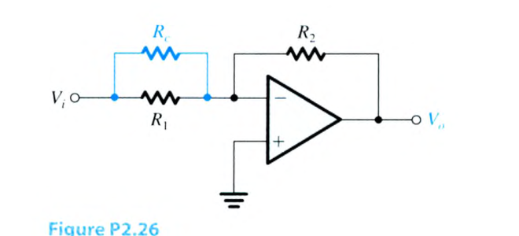

<template #solution>

教材答案未提供；待補。

</template>

</PracticeCard>

<PracticeCard type="practice" id="electronics-ch2-problem-2-27" title="Problem 2.27" source="課本 PDF p. 151 / 印刷頁 p. 121" topic="The inverting configuration">

(a) Use Eq. (2.5) to obtain the amplifier open-loop gain $A$ required to realize a specified closed-loop gain ($G_{\mathrm{nominal}}=-R_2/R_1$) within a specified gain error $\epsilon$,

$$
\epsilon\equiv\left|\frac{G-G_{\mathrm{nominal}}}{G_{\mathrm{nominal}}}\right|.
$$

(b) Design an inverting amplifier for a nominal closed-loop gain of $-30$, an input resistance of $1\ \mathrm{k}\Omega$, and a gain error of $\leq5\%$. Specify $R_1$, $R_2$, and the minimum $A$ required.

<template #solution>

教材答案未提供；待補。

</template>

</PracticeCard>

<PracticeCard type="practice" id="electronics-ch2-problem-2-28" title="Problem 2.28" source="課本 PDF p. 151 / 印刷頁 p. 121" topic="The inverting configuration">

(a) Use Eq. (2.5) to show that a reduction $\Delta A$ in the op-amp gain $A$ gives rise to a reduction $\Delta|G|$ in the magnitude of the closed-loop gain $G$ with $\Delta|G|$ and $\Delta A$ related by

$$
\frac{\Delta|G|/|G|}{\Delta A/A}\simeq\frac{1+R_2/R_1}{A}.
$$

Assume that $(1+R_2/R_1)\ll A$ and $\Delta A/A\ll1$.

(b) If in a closed-loop amplifier with a nominal gain (i.e., $R_2/R_1$) of $100$, $A$ decreases by $10\%$, what is the minimum nominal $A$ required to limit the percentage change in $|G|$ to $0.1\%$?

<template #solution>

教材答案未提供；待補。

</template>

</PracticeCard>

<PracticeCard type="practice" id="electronics-ch2-problem-2-29" title="Problem 2.29" source="課本 PDF p. 151 / 印刷頁 p. 121" topic="The inverting configuration">

An inverting amplifier is accidentally connected with positive feedback as illustrated in Fig. P2.29. Assuming the op amp has a finite gain $A$, find an expression for the closed-loop gain, $v_o/v_i$. Show that if $A=1+(R_2/R_1)$, the closed-loop gain becomes infinite, indicating instability. Real op-amp gain varies with input frequency so that instability is practically inevitable when positive feedback is used.

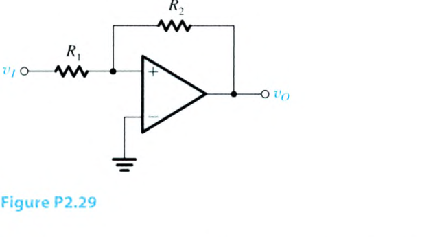

<template #solution>

教材答案未提供；待補。

</template>

</PracticeCard>

<PracticeCard type="practice" id="electronics-ch2-problem-2-30" title="Problem 2.30" source="課本 PDF p. 151 / 印刷頁 p. 121" topic="The inverting configuration">

Consider the circuit in Fig. 2.8 with $R_1=R_2=R_4=2\ \mathrm{M}\Omega$, and assume the op amp to be ideal. Find values for $R_3$ to obtain the following gains:

(a) $-50\ \mathrm{V/V}$

(b) $-20\ \mathrm{V/V}$

(c) $-5\ \mathrm{V/V}$

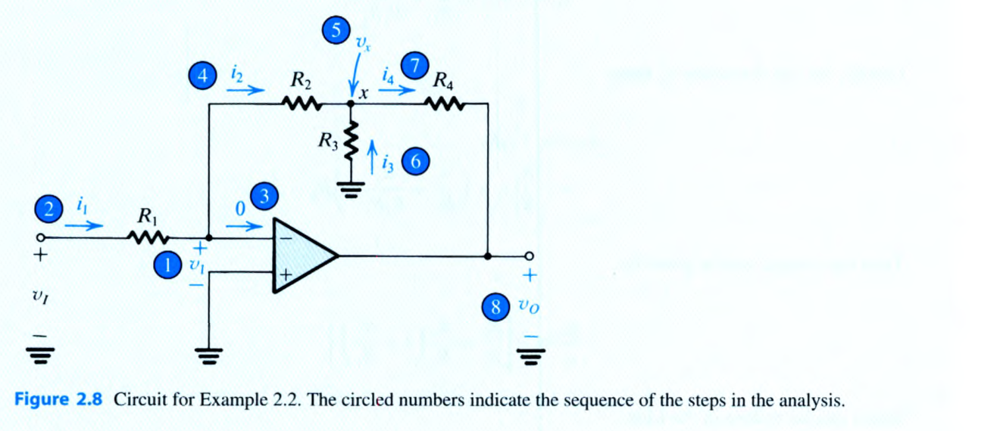

<template #solution>

教材答案未提供；待補。

</template>

</PracticeCard>

<PracticeCard type="practice" id="electronics-ch2-problem-2-31" title="Problem 2.31" source="課本 PDF p. 151 / 印刷頁 p. 121" topic="The inverting configuration">

An inverting op-amp circuit using an ideal op amp must be designed to have a gain of $-200\ \mathrm{V/V}$ using resistors no larger than $1\ \mathrm{M}\Omega$.

(a) For the simple two-resistor circuit, what input resistance would result?

(b) If the circuit in Fig. 2.8 is used with three resistors of maximum value, what input resistance results? What is the value of the smallest resistor needed?

<template #solution>

教材答案未提供；待補。

</template>

</PracticeCard>

<PracticeCard type="practice" id="electronics-ch2-problem-2-32" title="Problem 2.32" source="課本 PDF pp. 151-152 / 印刷頁 pp. 121-122" topic="The inverting configuration">

The inverting circuit with the T network in the feedback is redrawn in Fig. P2.32 in a way that emphasizes the observation that $R_2$ and $R_3$ in effect are in parallel (because the ideal op amp forces a virtual ground at the inverting input terminal). Use this observation to derive an expression for the gain $(v_o/v_i)$ by first finding $(v_x/v_i)$ and $(v_o/v_x)$. For the latter use the voltage-divider rule applied to $R_4$ and $(R_2\parallel R_3)$.

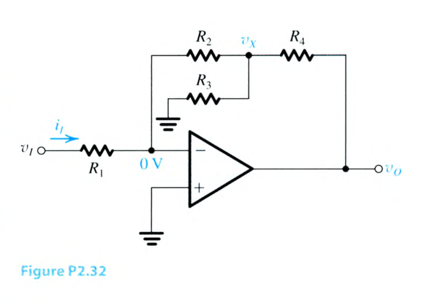

<template #solution>

教材答案未提供；待補。

</template>

</PracticeCard>

<PracticeCard type="practice" id="electronics-ch2-problem-2-33" title="Problem 2.33" source="課本 PDF p. 152 / 印刷頁 p. 122" topic="The inverting configuration">

The circuit in Fig. P2.33 can be considered to be an extension of the circuit in Fig. 2.8.

(a) Find the resistances looking into node 1, $R_1'$, node 2, $R_2'$, node 3, $R_3'$; and node 4, $R_4'$.

(b) Find the currents $I_1$, $I_2$, $I_3$, and $I_4$, in terms of the input current $I$.

(c) Find the voltages at nodes 1, 2, 3, and 4, that is, $V_1$, $V_2$, $V_3$, and $V_4$ in terms of $(IR)$.

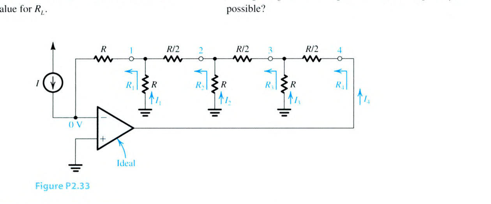

<template #solution>

教材答案未提供；待補。

</template>

</PracticeCard>

<PracticeCard type="practice" id="electronics-ch2-problem-2-34" title="Problem 2.34" source="課本 PDF p. 152 / 印刷頁 p. 122" topic="The inverting configuration">

The circuit in Fig. P2.34 utilizes an ideal op amp.

(a) Find $I_1$, $I_2$, $I_3$, $I_L$, and $V_x$.

(b) If $V_o$ is not to be lower than $-8\ \mathrm{V}$, find the maximum allowed value for $R_L$.

(c) If $R_L$ is varied in the range $100\ \Omega$ to $500\ \mathrm{k}\Omega$, what is the corresponding change in $I_L$ and in $V_o$?

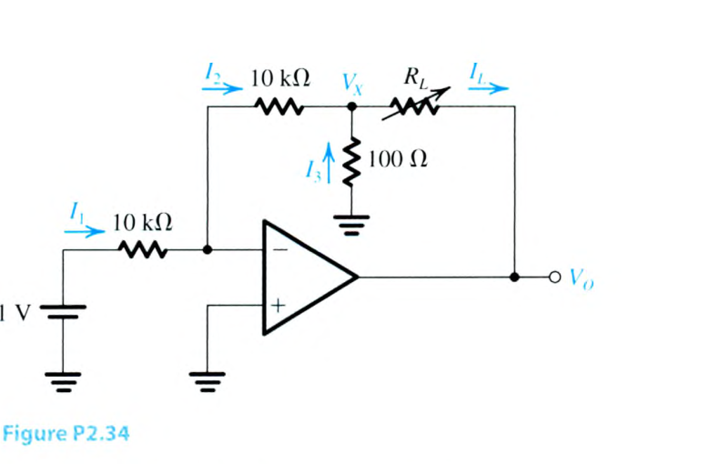

<template #solution>

教材答案未提供；待補。

</template>

</PracticeCard>

<PracticeCard type="practice" id="electronics-ch2-problem-2-35" title="Problem 2.35" source="課本 PDF p. 152 / 印刷頁 p. 122" topic="The inverting configuration">

Use the circuit in Fig. P2.34 as an inspiration to design a circuit that supplies a constant current $I_L$ of $3.1\ \mathrm{mA}$ to a variable resistance $R_L$. Assume the availability of a $1.5\text{-}\mathrm{V}$ battery and design so that the current drawn from the battery is $0.1\ \mathrm{mA}$. For the smallest resistance in the circuit, use $500\ \Omega$. If the op amp saturates at $\pm10\ \mathrm{V}$, what is the maximum value that $R_L$ can have while the current source supplying it operates properly?

<template #solution>

教材答案未提供；待補。

</template>

</PracticeCard>

<PracticeCard type="practice" id="electronics-ch2-problem-2-36" title="Problem 2.36" source="課本 PDF pp. 152-153 / 印刷頁 pp. 122-123" topic="The inverting configuration">

Assuming the op amp to be ideal, it is required to design the circuit shown in Fig. VE 2.2 to implement a current amplifier with gain $i_L/i_i=11\ \mathrm{A/A}$.

(a) Find the required value for $R$.

(b) What are the input and the output resistance of this current amplifier?

(c) If $R_L=1\ \mathrm{k}\Omega$ and the op amp operates in an ideal manner as long as $v_o$ is in the range $\pm12\ \mathrm{V}$, what range of $i_i$ is possible?

(d) If the amplifier is fed with a current source having a current of $0.2\ \mathrm{mA}$ and a source resistance of $10\ \mathrm{k}\Omega$, find $i_L$.

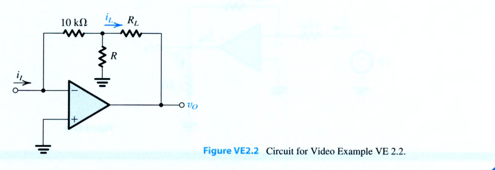

<template #solution>

教材答案未提供；待補。

</template>

</PracticeCard>

<PracticeCard type="practice" id="electronics-ch2-problem-2-37" title="Problem 2.37" source="課本 PDF p. 153 / 印刷頁 p. 123" topic="The inverting configuration">

Design the circuit shown in Fig. P2.37 to have an input resistance of $100\ \mathrm{k}\Omega$ and a gain that can be varied from $-1\ \mathrm{V/V}$ to $-100\ \mathrm{V/V}$ using the $100\text{-}\mathrm{k}\Omega$ potentiometer $R_4$. What voltage gain results when the potentiometer is set exactly at its middle value?

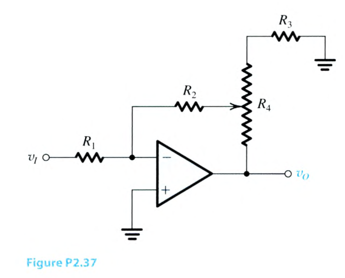

<template #solution>

教材答案未提供；待補。

</template>

</PracticeCard>

<PracticeCard type="practice" id="electronics-ch2-problem-2-38" title="Problem 2.38" source="課本 PDF p. 153 / 印刷頁 p. 123" topic="The weighted summer">

A weighted summer circuit using an ideal op amp as shown in Fig. 2.10 has three inputs using $20\text{-}\mathrm{k}\Omega$ resistors and a feedback resistor of $50\ \mathrm{k}\Omega$. A signal $v_1$ is connected to two of the inputs while a signal $v_2$ is connected to the third. Express $v_o$ in terms of $v_1$ and $v_2$. If $v_1=1\ \mathrm{V}$ and $v_2=-1\ \mathrm{V}$, what is $v_o$?

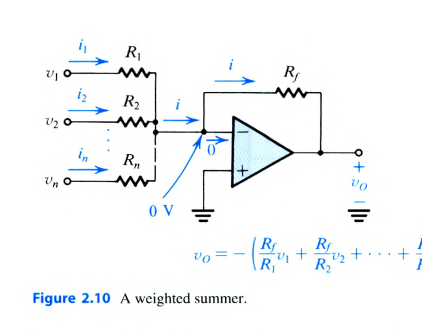

<template #solution>

教材答案未提供；待補。

</template>

</PracticeCard>

<PracticeCard type="practice" id="electronics-ch2-problem-2-39" title="Problem 2.39" source="課本 PDF p. 153 / 印刷頁 p. 123" topic="The weighted summer">

Design an op-amp circuit to provide an output $v_o=-[2v_1+(v_2/2)]$. Choose the lowest possible values of resistors for which the input current (from each input signal source) does not exceed $50\ \mu\mathrm{A}$ for $1\text{-}\mathrm{V}$ input signals.

<template #solution>

教材答案未提供；待補。

</template>

</PracticeCard>

<PracticeCard type="practice" id="electronics-ch2-problem-2-40" title="Problem 2.40" source="課本 PDF p. 153 / 印刷頁 p. 123" topic="The weighted summer">

Use the scheme illustrated in Fig. 2.10 to design an op-amp circuit with inputs $v_1$, $v_2$, and $v_3$, whose output is $v_o=-(1v_1+4v_2+6v_3)$ using the smallest possible resistors but no smaller than $1\ \mathrm{k}\Omega$.

<template #solution>

教材答案未提供；待補。

</template>

</PracticeCard>

<PracticeCard type="practice" id="electronics-ch2-problem-2-41" title="Problem 2.41" source="課本 PDF p. 153 / 印刷頁 p. 123" topic="The weighted summer">

An ideal op amp is connected in the weighted summer configuration of Fig. 2.10. The feedback resistor $R_f=100\ \mathrm{k}\Omega$, and eight $100\text{-}\mathrm{k}\Omega$ resistors are connected to the inverting input terminal of the op amp. Show, by sketching the various circuit configurations, how this basic circuit can be used to implement the following functions:

(a) $v_o=-(v_1+2v_2+5v_3)$

(b) $v_o=-(v_1+v_2+2v_3+4v_4)$

(c) $v_o=-(2v_1+6v_2)$

(d) $v_o=-8v_1$

In each case find the input resistance seen by each of the signal sources supplying $v_1$, $v_2$, $v_3$, and $v_4$. Suggest at least two additional summing functions that you can realize with this circuit. How would you realize a summing coefficient that is $0.5$?

<template #solution>

教材答案未提供；待補。

</template>

</PracticeCard>

<PracticeCard type="practice" id="electronics-ch2-problem-2-42" title="Problem 2.42" source="課本 PDF p. 153 / 印刷頁 p. 123" topic="The weighted summer">

Give a circuit, complete with component values, for a weighted summer that shifts the dc level of a sine-wave signal of $3\sin(\omega t)\ \mathrm{V}$ from zero to $-3\ \mathrm{V}$. Assume that in addition to the sine-wave signal you have a dc reference voltage of $1.5\ \mathrm{V}$ available. Sketch the output signal waveform.

<template #solution>

教材答案未提供；待補。

</template>

</PracticeCard>

<PracticeCard type="practice" id="electronics-ch2-problem-2-43" title="Problem 2.43" source="課本 PDF p. 153 / 印刷頁 p. 123" topic="The weighted summer">

Use two ideal op amps and resistors to implement the summing function

$$
v_o=v_1+3v_2-2v_3-5v_4.
$$

<template #solution>

教材答案未提供；待補。

</template>

</PracticeCard>

<PracticeCard type="practice" id="electronics-ch2-problem-2-44" title="Problem 2.44" source="課本 PDF pp. 153-154 / 印刷頁 pp. 123-124" topic="The weighted summer">

Figure P2.44 shows a circuit for a digital-to-analog converter (DAC). The circuit accepts a 4-bit input binary word $a_3a_2a_1a_0$, where $a_0$, $a_1$, $a_2$, and $a_3$ take the values of 0 or 1, and it provides an analog output voltage $v_o$ proportional to the value of the digital input. Each of the bits of the input word controls the correspondingly numbered switch. For instance, if $a_2$ is 0 then switch $S_2$ connects the $20\text{-}\mathrm{k}\Omega$ resistor to ground, while if $a_2$ is 1 then $S_2$ connects the $20\text{-}\mathrm{k}\Omega$ resistor to the $+5\text{-}\mathrm{V}$ power supply. Show that $v_o$ is given by

$$
v_o=-\frac{R_f}{16}\left[2^0a_0+2^1a_1+2^2a_2+2^3a_3\right],
$$

where $R_f$ is in kilohms. Find the value of $R_f$ so that $v_o$ ranges from 0 to $-5$ volts.

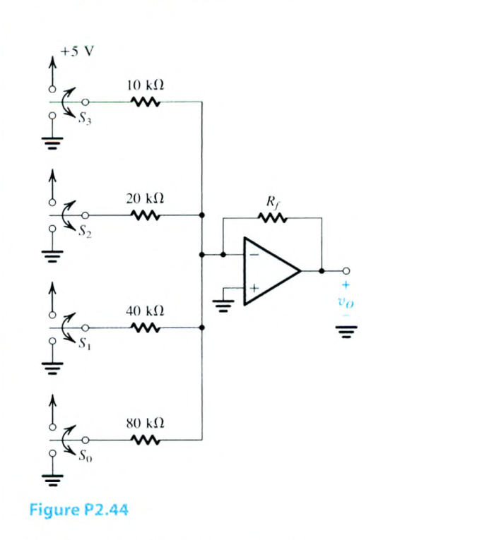

<template #solution>

教材答案未提供；待補。

</template>

</PracticeCard>

<PracticeCard type="practice" id="electronics-ch2-problem-2-45" title="Problem 2.45" source="課本 PDF p. 154 / 印刷頁 p. 124" topic="The noninverting configuration">

Given an ideal op amp to implement designs for the following closed-loop gains, what values of resistors $(R_1,R_2)$ should be used? Use at least one $10\text{-}\mathrm{k}\Omega$ resistor as the smallest resistor in your design.

(a) $+5\ \mathrm{V/V}$

(b) $+10\ \mathrm{V/V}$

(c) $+21\ \mathrm{V/V}$

(d) $+100\ \mathrm{V/V}$

<template #solution>

教材答案未提供；待補。

</template>

</PracticeCard>

<PracticeCard type="practice" id="electronics-ch2-problem-2-46" title="Problem 2.46" source="課本 PDF p. 154 / 印刷頁 p. 124" topic="The noninverting configuration">

Design a circuit based on the topology of the noninverting amplifier to obtain a gain of $+1.5\ \mathrm{V/V}$, using only $10\text{-}\mathrm{k}\Omega$ resistors. Note that there are two possibilities. Which of these can be easily converted to have a gain of either $+1.0\ \mathrm{V/V}$ or $+2.0\ \mathrm{V/V}$ simply by short-circuiting a single resistor in each case?

<template #solution>

教材答案未提供；待補。

</template>

</PracticeCard>

<PracticeCard type="practice" id="electronics-ch2-problem-2-47" title="Problem 2.47" source="課本 PDF p. 154 / 印刷頁 p. 124" topic="The noninverting configuration">

Figure P2.47 shows a circuit for an analog voltmeter of very high input resistance that uses an inexpensive moving-coil meter. The voltmeter measures the voltage $V$ applied between the op amp’s positive-input terminal and ground. The moving-coil meter deflects a small mechanical arm in response to a current. Assuming it produces full-scale deflection when the current passing through it is $100\ \mu\mathrm{A}$, find the value of $R$ such that a full-scale reading is obtained when $V$ is $+10\ \mathrm{V}$. Does the value of the meter resistance affect the voltmeter calibration?

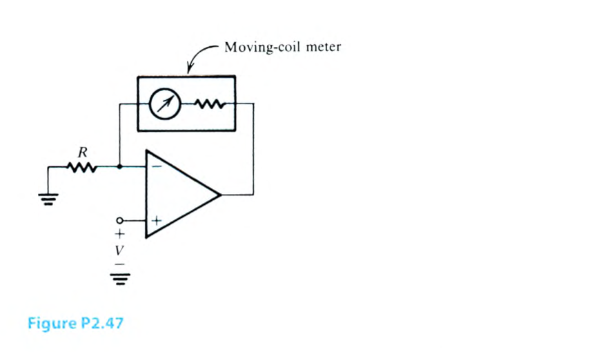

<template #solution>

教材答案未提供；待補。

</template>

</PracticeCard>

<PracticeCard type="practice" id="electronics-ch2-problem-2-48" title="Problem 2.48" source="課本 PDF p. 154 / 印刷頁 p. 124" topic="The noninverting configuration">

(a) Use superposition to show that the output of the circuit in Fig. P2.48 is given by

$$
\begin{aligned}
v_o={}&-\left[\frac{R_f}{R_{N1}}v_{N1}+\frac{R_f}{R_{N2}}v_{N2}+\cdots+\frac{R_f}{R_{Nn}}v_{Nn}\right]\\
&+\left[1+\frac{R_f}{R_N}\right]\left[\frac{R_P}{R_{P1}}v_{P1}+\frac{R_P}{R_{P2}}v_{P2}+\cdots+\frac{R_P}{R_{Pn}}v_{Pn}\right],
\end{aligned}
$$

where $R_N=R_{N1}\parallel R_{N2}\parallel\cdots\parallel R_{Nn}\parallel R_{N0}$, and $R_P=R_{P1}\parallel R_{P2}\parallel\cdots\parallel R_{Pn}\parallel R_{P0}$.

(b) Design a circuit to obtain

$$
v_o=-4v_{N1}+v_{P1}+3v_{P2}.
$$

The smallest resistor used should be $10\ \mathrm{k}\Omega$.

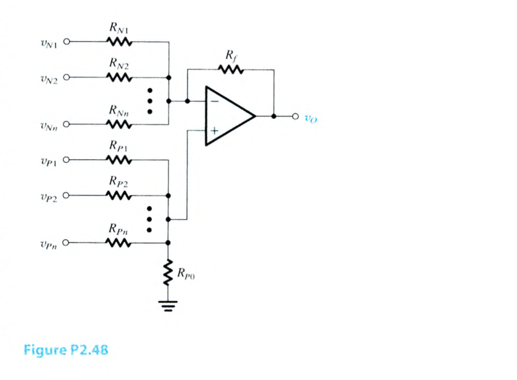

<template #solution>

教材答案未提供；待補。

</template>

</PracticeCard>

<PracticeCard type="practice" id="electronics-ch2-problem-2-49" title="Problem 2.49" source="課本 PDF p. 155 / 印刷頁 p. 125" topic="The noninverting configuration">

Design a circuit, using one ideal op amp, whose output is

$$
v_o=-v_1+2v_2-9v_3+4v_4.
$$

(Hint: Use a structure similar to that shown in general form in Fig. P2.48.)

<template #solution>

教材答案未提供；待補。

</template>

</PracticeCard>

<PracticeCard type="practice" id="electronics-ch2-problem-2-50" title="Problem 2.50" source="課本 PDF p. 155 / 印刷頁 p. 125" topic="The noninverting configuration">

Derive an expression for the voltage gain, $v_o/v_i$, of the circuit in Fig. P2.50.

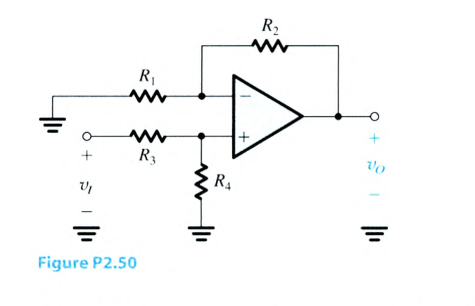

<template #solution>

教材答案未提供；待補。

</template>

</PracticeCard>

<PracticeCard type="practice" id="electronics-ch2-problem-2-51" title="Problem 2.51" source="課本 PDF p. 155 / 印刷頁 p. 125" topic="The noninverting configuration">

For the circuit in Fig. P2.51, use superposition to find $v_o$ in terms of the input voltages $v_1$ and $v_2$. Assume an ideal op amp. For

$$
v_1=10\sin(2\pi\times60t)-0.1\sin(2\pi\times5000t)\ \mathrm{V}
$$

and

$$
v_2=10\sin(2\pi\times60t)+0.1\sin(2\pi\times5000t)\ \mathrm{V},
$$

find $v_o$.

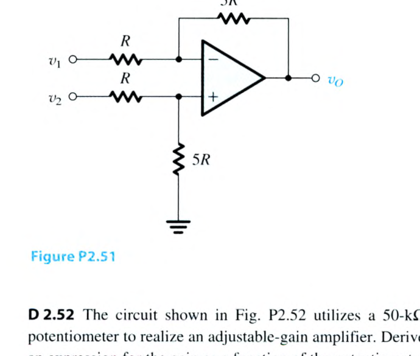

<template #solution>

教材答案未提供；待補。

</template>

</PracticeCard>

<PracticeCard type="practice" id="electronics-ch2-problem-2-52" title="Problem 2.52" source="課本 PDF p. 155 / 印刷頁 p. 125" topic="The noninverting configuration">

The circuit shown in Fig. P2.52 utilizes a $50\text{-}\mathrm{k}\Omega$ potentiometer to realize an adjustable-gain amplifier. Derive an expression for the gain as a function of the potentiometer setting $x$. Assume the op amp to be ideal. What is the range of gains obtained? Show how to add a fixed resistor so that the gain range can be $1$ to $21\ \mathrm{V/V}$. What should the resistor value be?

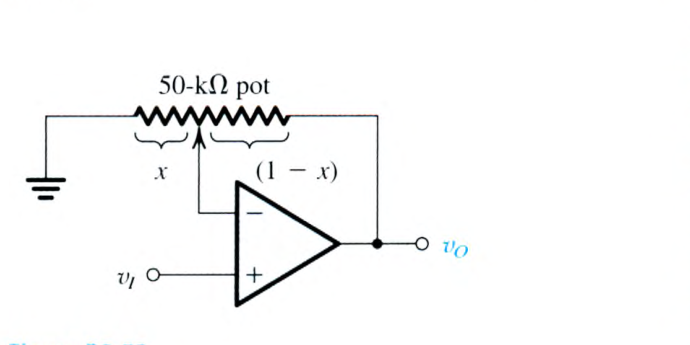

<template #solution>

教材答案未提供；待補。

</template>

</PracticeCard>

<PracticeCard type="practice" id="electronics-ch2-problem-2-53" title="Problem 2.53" source="課本 PDF p. 155 / 印刷頁 p. 125" topic="The noninverting configuration">

Given the availability of resistors of value $1\ \mathrm{k}\Omega$ and $10\ \mathrm{k}\Omega$ only, design a circuit based on the noninverting configuration to realize a gain of $+10\ \mathrm{V/V}$. What is the input resistance of your amplifier?

<template #solution>

教材答案未提供；待補。

</template>

</PracticeCard>

<PracticeCard type="practice" id="electronics-ch2-problem-2-54" title="Problem 2.54" source="課本 PDF p. 155 / 印刷頁 p. 125" topic="The noninverting configuration">

It is required to connect a $10\text{-}\mathrm{V}$ source with a source resistance of $1\ \mathrm{M}\Omega$ to a $1\text{-}\mathrm{k}\Omega$ load. Find the voltage that will appear across the load if:

(a) The source is connected directly to the load.

(b) An inverting amplifier utilizing $100\text{-}\mathrm{k}\Omega$ resistors and an ideal op amp to realize a gain of $-1\ \mathrm{V/V}$ is inserted between the source and load.

(c) A unity-gain op-amp buffer is inserted between the source and load.

In each case find the load current and the current supplied by the source. Where does the load current come from in cases (b) and (c)?

<template #solution>

教材答案未提供；待補。

</template>

</PracticeCard>

<PracticeCard type="practice" id="electronics-ch2-problem-2-55" title="Problem 2.55" source="課本 PDF p. 155 / 印刷頁 p. 125" topic="The noninverting configuration">

Derive an expression for the gain of the voltage follower of Fig. 2.14, assuming the op amp to be ideal except for having a finite gain $A$. Calculate the value of the closed-loop gain for $A=60\ \mathrm{dB}$, $40\ \mathrm{dB}$, and $20\ \mathrm{dB}$. In each case find the percentage error in gain magnitude from the nominal value of unity.

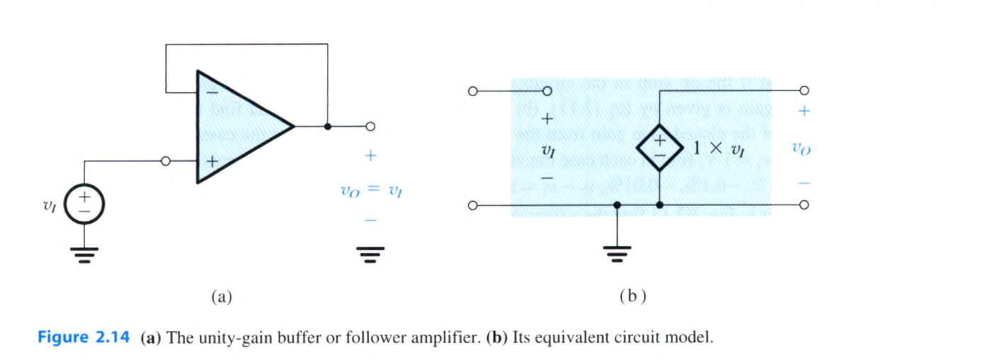

<template #solution>

教材答案未提供；待補。

</template>

</PracticeCard>

<PracticeCard type="practice" id="electronics-ch2-problem-2-56" title="Problem 2.56" source="課本 PDF p. 155 / 印刷頁 p. 125" topic="The noninverting configuration">

A $1\text{-}\mathrm{V}$ peak sinusoid is applied to a voltage follower. Assuming the op amp to be ideal, what is the differential signal appearing at the op-amp input terminals? What is the common-mode signal appearing at the op-amp inputs? How does this compare with the differential and common-mode op-amp input signals arising in an inverting configuration designed for a gain of $-1$?

<template #solution>

教材答案未提供；待補。

</template>

</PracticeCard>

<PracticeCard type="practice" id="electronics-ch2-problem-2-57" title="Problem 2.57" source="課本 PDF pp. 155-156 / 印刷頁 pp. 125-126" topic="Feedback amplifiers">

Complete the following table for feedback amplifiers created using one ideal op amp. Note that $R_{\mathrm{in}}$ signifies input resistance and $R_1$ and $R_2$ are feedback-network resistors as labeled in the inverting and noninverting configurations.

| Case | Gain | $R_{\mathrm{in}}$ | $R_1$ | $R_2$ |
| :--- | :--- | :--- | :--- | :--- |
| a | $-10\ \mathrm{V/V}$ | $20\ \mathrm{k}\Omega$ |  |  |
| b | $-4\ \mathrm{V/V}$ |  | $100\ \mathrm{k}\Omega$ |  |
| c | $-2\ \mathrm{V/V}$ |  |  | $20\ \mathrm{k}\Omega$ |
| d | $+1\ \mathrm{V/V}$ | $\infty$ |  |  |
| e | $+25\ \mathrm{V/V}$ |  | $100\ \mathrm{k}\Omega$ |  |
| f | $+9\ \mathrm{V/V}$ |  |  | $40\ \mathrm{k}\Omega$ |
| g | $-0.5\ \mathrm{V/V}$ | $10\ \mathrm{k}\Omega$ |  |  |

<template #solution>

教材答案未提供；待補。

</template>

</PracticeCard>

<PracticeCard type="practice" id="electronics-ch2-problem-2-58" title="Problem 2.58" source="課本 PDF p. 156 / 印刷頁 p. 126" topic="Feedback amplifiers">

You wish to select an op amp for use in a noninverting configuration having a nominal gain of $+20\ \mathrm{V/V}$. Using Eq. (2.12), find the minimum op-amp gain $A$, expressed in decibels, required to ensure the actual closed-loop gain is within $1\%$ of its nominal value.

<template #solution>

教材答案未提供；待補。

</template>

</PracticeCard>

<PracticeCard type="practice" id="electronics-ch2-problem-2-59" title="Problem 2.59" source="課本 PDF p. 156 / 印刷頁 p. 126" topic="Feedback amplifiers">

A noninverting op-amp circuit with nominal gain of $10\ \mathrm{V/V}$ uses an op amp with open-loop gain of $100\ \mathrm{V/V}$ and a lowest-value resistor of $10\ \mathrm{k}\Omega$. What closed-loop gain actually results? With what value resistor can which resistor be shunted to achieve the nominal gain? If in the manufacturing process, an op amp of gain $200\ \mathrm{V/V}$ were used, what closed-loop gain would result in each case (the uncompensated one, and the compensated one)?

<template #solution>

教材答案未提供；待補。

</template>

</PracticeCard>

<PracticeCard type="practice" id="electronics-ch2-problem-2-60" title="Problem 2.60" source="課本 PDF p. 156 / 印刷頁 p. 126" topic="Feedback amplifiers">

Use Eq. (2.11) to show that if the reduction in the closed-loop gain $G$ from the nominal value $G_0=1+R_2/R_1$ is to be kept less than $x\%$ of $G_0$, then the open-loop gain of the op amp must exceed $G_0$ by at least a factor

$$
F=\left(\frac{100}{x}\right)-1\simeq\frac{100}{x}.
$$

Find the required $F$ for $x=0.01$, $0.1$, $1$, and $10$. Utilize these results to find for each value of $x$ the minimum required open-loop gain to obtain closed-loop gains of $1$, $10$, $10^2$, $10^3$, and $10^4\ \mathrm{V/V}$.

<template #solution>

教材答案未提供；待補。

</template>

</PracticeCard>
