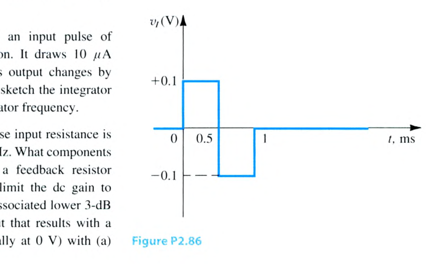
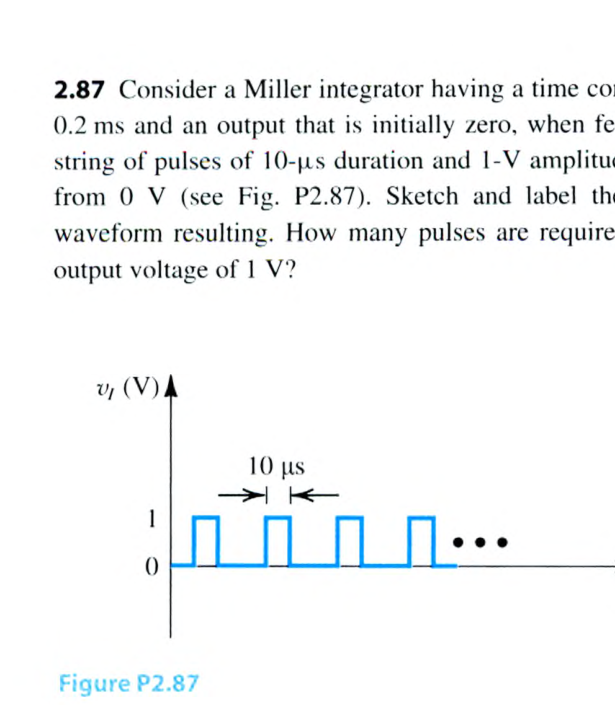
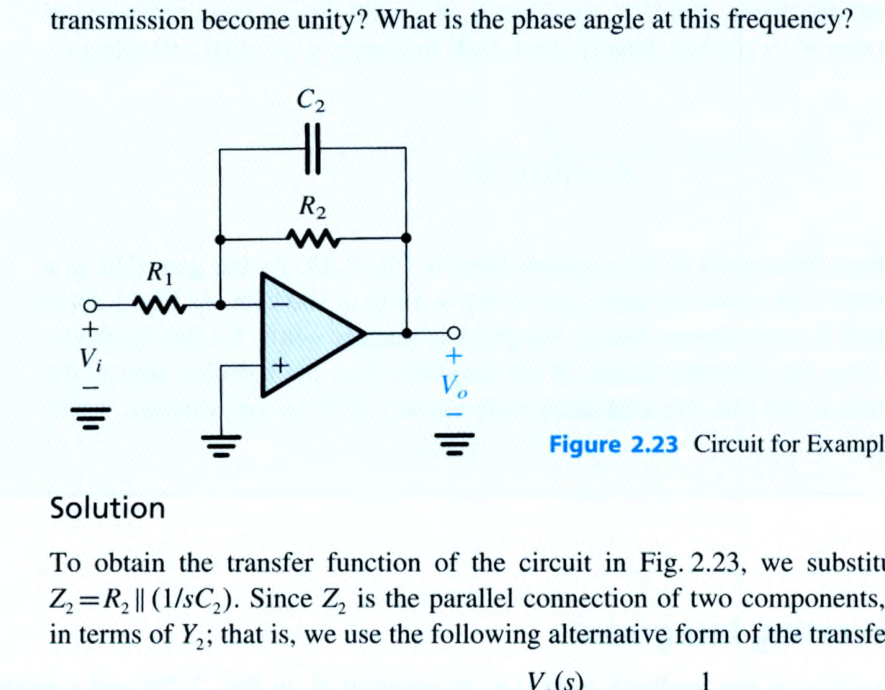
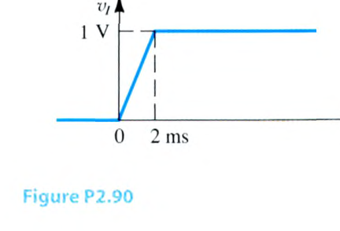
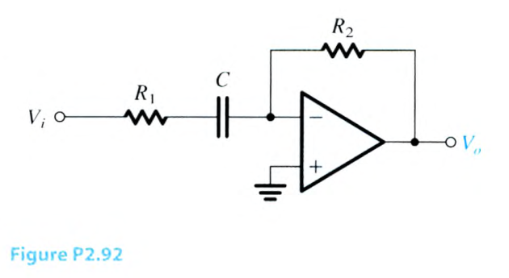
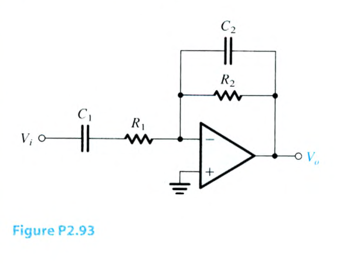
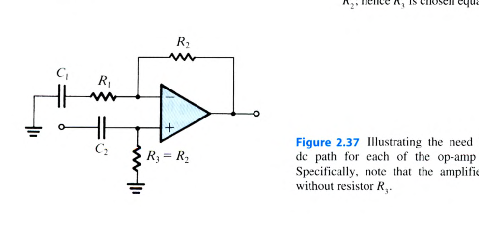
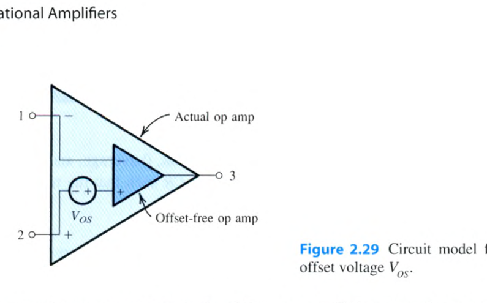
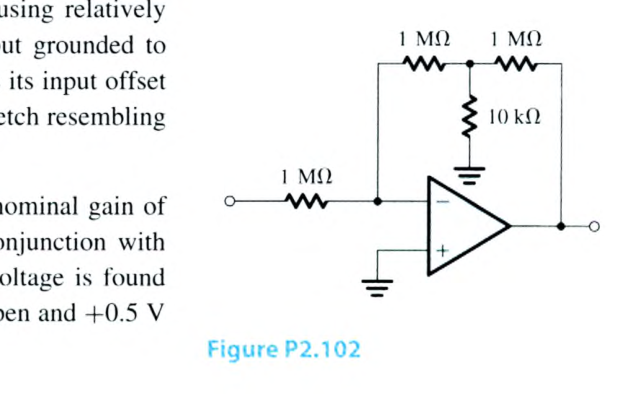
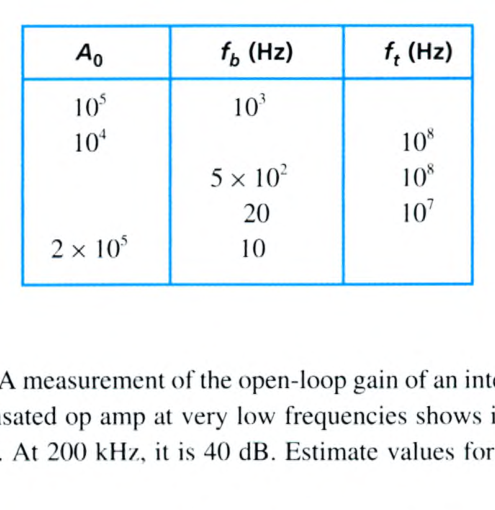

# Chapter 2 Problems 2.81–2.107

> 來源：Sedra & Smith, *Microelectronic Circuits*, 8e，`課本.pdf`。本批次逐頁核對 PDF 第 159–163 頁（印刷第 129–133 頁）。教材未提供本批次答案，解答欄統一標示待補。

<PracticeFilter prefix="electronics-ch2-problem-" />
<PracticeProgress :total="27" prefix="electronics-ch2-problem-" />

<PracticeCard type="practice" id="electronics-ch2-problem-2-81" title="Problem 2.81" source="Sedra & Smith 8e · PDF p. 159 · 印刷 p. 129" topic="Chapter 2 Problems · 米勒積分器">

米勒積分器包含一個理想運算放大器、一個 $10\,\mathrm{k\Omega}$ 電阻 $R$ 與一個 $1\,\mathrm{nF}$ 電容 $C$。其輸入端施加正弦波訊號。

1. 在輸入與輸出訊號振幅相等的頻率（Hz）為何？
2. 在該頻率下，輸出正弦波的相位與輸入正弦波有何關係？
3. 若頻率由第 1 小題所得的頻率降低 10 倍，輸出電壓將改變幾倍？其變化方向是變小還是變大？

<template #solution>

教材答案未提供；待補。

</template>
</PracticeCard>

<PracticeCard type="practice" id="electronics-ch2-problem-2-82" title="Problem 2.82" source="Sedra & Smith 8e · PDF p. 160 · 印刷 p. 130" topic="Chapter 2 Problems · 米勒積分器設計">

設計一個時間常數為 $1\,\mathrm{ms}$、輸入電阻為 $100\,\mathrm{k\Omega}$ 的米勒積分器。在 $t=0$ 時對輸入施加 $-1\,\mathrm{V}$ 直流電壓；此時輸出為 $v_o=-5\,\mathrm{V}$。輸出需要多久才會到達 $0\,\mathrm{V}$？到達 $+5\,\mathrm{V}$ 又需要多久？

<template #solution>

教材答案未提供；待補。

</template>
</PracticeCard>

<PracticeCard type="practice" id="electronics-ch2-problem-2-83" title="Problem 2.83" source="Sedra & Smith 8e · PDF p. 160 · 印刷 p. 130" topic="Chapter 2 Problems · 反相積分器">

一個以運算放大器實作的反相積分器，在 $10\,\mathrm{kHz}$ 測得電壓增益為 $-10\,\mathrm{V/V}$。在什麼頻率下，其增益會降為 $-1\,\mathrm{V/V}$？積分器的時間常數為何？

<template #solution>

教材答案未提供；待補。

</template>
</PracticeCard>

<PracticeCard type="practice" id="electronics-ch2-problem-2-84" title="Problem 2.84" source="Sedra & Smith 8e · PDF p. 160 · 印刷 p. 130" topic="Chapter 2 Problems · 反相積分器">

一個反相積分器接受振幅為 $+100\,\mathrm{mV}$、持續時間為 $1\,\mathrm{ms}$ 的輸入脈衝。它從輸入電壓源汲取 $10\,\mu\mathrm{A}$，且其輸出變化 $-1\,\mathrm{V}$。求 $R$ 與 $C$ 的值，並畫出積分器的幅度響應，標示積分器頻率。

<template #solution>

教材答案未提供；待補。

</template>
</PracticeCard>

<PracticeCard type="practice" id="electronics-ch2-problem-2-85" title="Problem 2.85" source="Sedra & Smith 8e · PDF p. 160 · 印刷 p. 130" topic="Chapter 2 Problems · 米勒積分器設計">

設計一個輸入電阻為 $1\,\mathrm{k\Omega}$、單位增益頻率為 $10\,\mathrm{MHz}$ 的米勒積分器。需要哪些元件？為了長期穩定，在電容兩端接入回授電阻，以將直流增益限制為 $40\,\mathrm{dB}$。此電阻的值為何？相應的低頻 $3\,\mathrm{dB}$ 頻率為何？對於一個 $0.1\,\mu\mathrm{s}$、$1\,\mathrm{V}$ 的正輸入脈衝（初始為 $0\,\mathrm{V}$），畫出並標示下列輸出：

1. 沒有直流穩定化時（但輸出初始為 $0\,\mathrm{V}$）；
2. 接入回授電阻時。

<template #solution>

教材答案未提供；待補。

</template>
</PracticeCard>

<PracticeCard type="practice" id="electronics-ch2-problem-2-86" title="Problem 2.86" source="Sedra & Smith 8e · PDF p. 160 · 印刷 p. 130" topic="Chapter 2 Problems · 米勒積分器">

一個米勒積分器的輸入與輸出電壓初始皆為零，時間常數為 $0.1\,\mathrm{ms}$，並由圖 P2.86 所示訊號驅動。畫出並標示所得的輸出波形。當輸入電平為 $\pm1\,\mathrm{V}$ 時，分別說明在時間常數仍為 $0.1\,\mathrm{ms}$，以及時間常數提高至 $1\,\mathrm{ms}$ 的情況會發生什麼事。

<template #solution>

教材答案未提供；待補。

</template>
</PracticeCard>

<PracticeCard type="practice" id="electronics-ch2-problem-2-87" title="Problem 2.87" source="Sedra & Smith 8e · PDF p. 161 · 印刷 p. 131" topic="Chapter 2 Problems · 米勒積分器">

考慮一個時間常數為 $0.2\,\mathrm{ms}$、輸出初始為零的米勒積分器，輸入為一串由 $0\,\mathrm{V}$ 上升、脈衝寬度為 $10\,\mu\mathrm{s}$、振幅為 $1\,\mathrm{V}$ 的脈衝（見圖 P2.87）。畫出並標示所得的輸出波形。輸出電壓要達到 $1\,\mathrm{V}$ 需要幾個脈衝？

<template #solution>

教材答案未提供；待補。

</template>
</PracticeCard>

<PracticeCard type="practice" id="electronics-ch2-problem-2-88" title="Problem 2.88" source="Sedra & Smith 8e · PDF p. 161 · 印刷 p. 131" topic="Chapter 2 Problems · 一階低通主動濾波器">

圖 2.23 所示電路可實現低通 STC 函數，稱為一階低通主動濾波器。設計此電路，使輸入電阻為 $10\,\mathrm{k\Omega}$、直流增益為 $20\,\mathrm{dB}$、$3\,\mathrm{dB}$ 頻率為 $200\,\mathrm{kHz}$。畫出電路的幅度響應，並標示其為 $0\,\mathrm{dB}$ 的頻率。

<template #solution>

教材答案未提供；待補。

</template>
</PracticeCard>

<PracticeCard type="practice" id="electronics-ch2-problem-2-89" title="Problem 2.89" source="Sedra & Smith 8e · PDF p. 161 · 印刷 p. 131" topic="Chapter 2 Problems · 有限開迴路增益">

證明以有限開迴路增益 $A_0$ 的運算放大器實作的米勒積分器具有低通 STC 傳遞函數。此 STC 函數的極點頻率為何？它與理想積分器的極點頻率相比如何？若理想米勒積分器接受一個 $-1\,\mathrm{V}$ 脈衝，脈衝寬度為 $T=CR$，且在 $t=0$ 時 $v_o=0$，則 $t=T$ 時的輸出電壓為何？對於使用 $A_0=1000$ 的運算放大器之積分器，重做此分析。

<template #solution>

教材答案未提供；待補。

</template>
</PracticeCard>

<PracticeCard type="practice" id="electronics-ch2-problem-2-90" title="Problem 2.90" source="Sedra & Smith 8e · PDF p. 161 · 印刷 p. 131" topic="Chapter 2 Problems · 微分器">

一個時間常數為 $1\,\mathrm{ms}$ 的運算放大器微分器，由圖 P2.90 所示的速率控制階躍驅動。假設 $v_o$ 初始為零，畫出並標示其波形。

<template #solution>

教材答案未提供；待補。

</template>
</PracticeCard>

<PracticeCard type="practice" id="electronics-ch2-problem-2-91" title="Problem 2.91" source="Sedra & Smith 8e · PDF p. 161 · 印刷 p. 131" topic="Chapter 2 Problems · 微分器">

使用一個理想運算放大器與 $1\,\mathrm{nF}$ 電容，設計時間常數為 $10^{-5}\,\mathrm{s}$ 的微分器。畫出此電路的幅度與相位響應，並標示幅度響應等於 $0\,\mathrm{dB}$ 的頻率。再加入一個串聯輸入電阻，使高頻下的增益幅度限制為 $100\,\mathrm{V/V}$。在同一組座標軸上畫出這個改良電路與理想微分器的幅度、相位響應。高頻時相位響應如何改變？

<template #solution>

教材答案未提供；待補。

</template>
</PracticeCard>

<PracticeCard type="practice" id="electronics-ch2-problem-2-92" title="Problem 2.92" source="Sedra & Smith 8e · PDF p. 161 · 印刷 p. 131" topic="Chapter 2 Problems · 一階高通主動濾波器">

圖 P2.92 所示為具有單一時間常數響應的一階高通主動濾波器。推導其傳遞函數，並證明高頻增益為 $-R_2/R_1$、$3\,\mathrm{dB}$ 角頻率為 $\omega_0=1/(CR_1)$。設計此電路，使高頻輸入電阻為 $2\,\mathrm{k\Omega}$、高頻增益為 $40\,\mathrm{dB}$、$3\,\mathrm{dB}$ 頻率為 $2\,\mathrm{MHz}$。傳遞函數幅度等於 1 的頻率為何？

<template #solution>

教材答案未提供；待補。

</template>
</PracticeCard>

<PracticeCard type="practice" id="electronics-ch2-problem-2-93" title="Problem 2.93" source="Sedra & Smith 8e · PDF p. 161–162 · 印刷 p. 131–132" topic="Chapter 2 Problems · 帶通型主動濾波器">

推導圖 P2.93 電路（理想運算放大器）的傳遞函數，並證明其可寫成

$$
\frac{V_o}{V_i}=\frac{-R_2/R_1}{\left[1+\left(\omega_1/j\omega\right)\right]\left[1+j\left(\omega/\omega_2\right)\right]},
$$

其中 $\omega_1=1/(C_1R_1)$、$\omega_2=1/(C_2R_2)$。假設電路設計成 $\omega_2\gg\omega_1$，求下列頻率區域的傳遞函數近似式：

1. $\omega\ll\omega_1$；
2. $\omega_1\ll\omega\ll\omega_2$；
3. $\omega\gg\omega_2$。

使用這些近似式畫出幅度響應的 Bode 圖。注意，此電路在低頻端以高通 STC 網路的方式滾降，在高頻端以低通 STC 網路的方式滾降，因此是一個放大器。設計此電路，使「中頻範圍」的增益為 $40\,\mathrm{dB}$、低頻 $3\,\mathrm{dB}$ 點為 $200\,\mathrm{Hz}$、高頻 $3\,\mathrm{dB}$ 點為 $200\,\mathrm{kHz}$，且在 $\omega\gg\omega_1$ 時的輸入電阻為 $2\,\mathrm{k\Omega}$。

<template #solution>

教材答案未提供；待補。

</template>
</PracticeCard>

<PracticeCard type="practice" id="electronics-ch2-problem-2-94" title="Problem 2.94" source="Sedra & Smith 8e · PDF p. 162 · 印刷 p. 132" topic="Chapter 2 Problems · 輸入偏移電壓">

一個接成反相組態、輸入端接地的運算放大器，具有 $R_2=20\,\mathrm{k\Omega}$ 與 $R_1=2\,\mathrm{k\Omega}$，其輸出直流電壓為 $-80\,\mathrm{mV}$。若已知輸入偏置電流非常小，求輸入偏移電壓。

<template #solution>

教材答案未提供；待補。

</template>
</PracticeCard>

<PracticeCard type="practice" id="electronics-ch2-problem-2-95" title="Problem 2.95" source="Sedra & Smith 8e · PDF p. 162 · 印刷 p. 132" topic="Chapter 2 Problems · 輸入偏移電壓">

一個增益為 $25$ 的非反相放大器使用輸入偏移電壓為 $\pm2\,\mathrm{mV}$ 的運算放大器。當輸入為 $0.1\sin\omega t\,\mathrm{V}$ 時，求輸出。

<template #solution>

教材答案未提供；待補。

</template>
</PracticeCard>

<PracticeCard type="practice" id="electronics-ch2-problem-2-96" title="Problem 2.96" source="Sedra & Smith 8e · PDF p. 162 · 印刷 p. 132" topic="Chapter 2 Problems · 輸入偏移電壓與飽和">

一個閉迴路增益為 $100$ 的非反相放大器，使用輸入偏移電壓為 $3\,\mathrm{mV}$、輸出飽和電平為 $\pm3\,\mathrm{V}$ 的運算放大器。未使輸出削波時，可施加於輸入端的正弦波最大振幅為何？若放大器按照圖 2.37 所示方式以電容耦合，最大可能振幅會變為多少？

<template #solution>

教材答案未提供；待補。

</template>
</PracticeCard>

<PracticeCard type="practice" id="electronics-ch2-problem-2-97" title="Problem 2.97" source="Sedra & Smith 8e · PDF p. 162 · 印刷 p. 132" topic="Chapter 2 Problems · 輸入偏移電壓">

一個接成閉迴路反相組態、增益為 $46\,\mathrm{dB}$ 且使用相對較小電阻值的運算放大器，在輸入接地時測得輸出直流電壓為 $-0.2\,\mathrm{V}$。求其輸入偏移電壓。準備一幅類似圖 2.29 的偏移電壓源模型圖；請仔細注意極性。

<template #solution>

教材答案未提供；待補。

</template>
</PracticeCard>

<PracticeCard type="practice" id="electronics-ch2-problem-2-98" title="Problem 2.98" source="Sedra & Smith 8e · PDF p. 162–163 · 印刷 p. 132–133" topic="Chapter 2 Problems · 偏置電流與偏移電流">

一個名義增益為 $-100\,\mathrm{V/V}$ 的反相放大器，使用不理想運算放大器以及 $100\,\mathrm{k\Omega}$ 與 $10\,\mathrm{M\Omega}$ 電阻。輸入開路時測得輸出電壓為 $+1\,\mathrm{V}$，輸入接地時測得輸出電壓為 $+0.5\,\mathrm{V}$。

1. 此放大器的偏置電流為何？其方向為何？
2. 估算輸入偏移電壓。
3. 在正輸入端與地之間接入一個 $10\,\mathrm{M\Omega}$ 電阻。當輸入保持浮接（斷開）時，測得輸出直流電壓為 $-0.1\,\mathrm{V}$。估算輸入偏移電流。

<template #solution>

教材答案未提供；待補。

</template>
</PracticeCard>

<PracticeCard type="practice" id="electronics-ch2-problem-2-99" title="Problem 2.99" source="Sedra & Smith 8e · PDF p. 162 · 印刷 p. 132" topic="Chapter 2 Problems · 偏置電流補償">

一個增益為 $+10\,\mathrm{V/V}$ 的非反相放大器，以 $100\,\mathrm{k\Omega}$ 作為回授電阻，並由 $5\,\mathrm{k\Omega}$ 訊號源驅動。若放大器偏移電壓為 $0\,\mathrm{mV}$，但偏置電流為 $2\,\mu\mathrm{A}$、偏移電流為 $0.2\,\mu\mathrm{A}$，預期輸出範圍為何？指出應在哪裡加入額外電阻以補償偏置電流。加入後可能的輸出範圍變為何？設計者希望將此放大器用於 $15\,\mathrm{k\Omega}$ 訊號源。此時為補償偏置電流，應使用多大的電阻？應放在何處？

<template #solution>

教材答案未提供；待補。

</template>
</PracticeCard>

<PracticeCard type="practice" id="electronics-ch2-problem-2-100" title="Problem 2.100" source="Sedra & Smith 8e · PDF p. 162 · 印刷 p. 132" topic="Chapter 2 Problems · 交流耦合非反相放大器">

使用圖 2.37 的電路，以不超過 $100\,\mathrm{k\Omega}$ 的電阻建立增益為 $100\,\mathrm{V/V}$ 的交流耦合非反相放大器。$R_1$、$R_2$ 與 $R_3$ 應使用哪些值？若由 $C_1$ 造成的截止頻率為 $10\,\mathrm{kHz}$，由 $C_2$ 造成的截止頻率為 $1\,\mathrm{kHz}$，則 $C_1$ 與 $C_2$ 應使用哪些值？

<template #solution>

教材答案未提供；待補。

</template>
</PracticeCard>

<PracticeCard type="practice" id="electronics-ch2-problem-2-101" title="Problem 2.101" source="Sedra & Smith 8e · PDF p. 162 · 印刷 p. 132" topic="Chapter 2 Problems · 差動放大器偏移">

考慮由理想電壓源驅動的圖 2.16 差動放大器。令 $R_1=R_3=100\,\mathrm{k\Omega}$ 且 $R_2=R_4=1\,\mathrm{M\Omega}$。若運算放大器具有 $V_{OS}=5\,\mathrm{mV}$、$I_B=100\,\mathrm{nA}$ 與 $I_{OS}=20\,\mathrm{nA}$，求輸出端最壞情況（最大）的直流偏移電壓。

<template #solution>

教材答案未提供；待補。

</template>
</PracticeCard>

<PracticeCard type="practice" id="electronics-ch2-problem-2-102" title="Problem 2.102" source="Sedra & Smith 8e · PDF p. 162 · 印刷 p. 132" topic="Chapter 2 Problems · 輸入偏移電壓">

圖 P2.102 所示電路使用偏移電壓為 $\pm3\,\mathrm{mV}$ 的運算放大器。其輸出偏移電壓為何？若輸入透過電容 $C$ 交流耦合，輸出偏移會變為多少？若改為在 $10\,\mathrm{k\Omega}$ 電阻串聯一個大電容，輸出偏移會變為多少？

<template #solution>

教材答案未提供；待補。

</template>
</PracticeCard>

<PracticeCard type="practice" id="electronics-ch2-problem-2-103" title="Problem 2.103" source="Sedra & Smith 8e · PDF p. 163 · 印刷 p. 133" topic="Chapter 2 Problems · 偏移電壓漂移">

使用運算放大器提供的偏移調零功能，一個增益為 $+1000$ 的閉迴路放大器在 $25\,^{\circ}\mathrm{C}$、輸入接地時調整到輸出為零。若輸入偏移電壓漂移規格為 $20\,\mu\mathrm{V}/^{\circ}\mathrm{C}$，在 $-40\,^{\circ}\mathrm{C}$ 與 $85\,^{\circ}\mathrm{C}$ 時，預期輸出為何？雖然無法分別知道 $-40\,^{\circ}\mathrm{C}$ 或 $85\,^{\circ}\mathrm{C}$ 時輸出偏移的極性，但你預期兩者的相對極性為何？

<template #solution>

教材答案未提供；待補。

</template>
</PracticeCard>

<PracticeCard type="practice" id="electronics-ch2-problem-2-104" title="Problem 2.104" source="Sedra & Smith 8e · PDF p. 163 · 印刷 p. 133" topic="Chapter 2 Problems · 偏置電流補償">

一個運算放大器接成閉迴路，增益為 $+100$，並使用 $1\,\mathrm{M\Omega}$ 回授電阻。

1. 若輸入偏置電流為 $200\,\mathrm{nA}$，輸入接地時會產生多少輸出電壓？
2. 若輸入偏移電壓為 $\pm1\,\mathrm{mV}$，且輸入偏置電流如第 1 小題，輸入接地時可能觀察到的最大輸出為何？
3. 若使用偏置電流補償，所需電阻值為何？若偏移電流不超過偏置電流的十分之一，僅由偏移電流造成的輸出偏移電壓為何？
4. 裝妥第 3 小題的偏置電流補償後，由偏移電壓與偏移電流共同造成的最大直流輸出為何？

<template #solution>

教材答案未提供；待補。

</template>
</PracticeCard>

<PracticeCard type="practice" id="electronics-ch2-problem-2-105" title="Problem 2.105" source="Sedra & Smith 8e · PDF p. 163 · 印刷 p. 133" topic="Chapter 2 Problems · 偏置電流補償">

一個預定操作於閉迴路增益 $-100\,\mathrm{V/V}$ 的運算放大器，使用 $10\,\mathrm{k\Omega}$ 與 $1\,\mathrm{M\Omega}$ 電阻，以及偏置電流補償電阻 $R_3$。假設輸入端接理想電壓源，$R_3$ 應為何值？輸入接地時，對某一個運算放大器測得輸出偏移電壓為 $+0.30\,\mathrm{V}$。假設輸入偏移電壓為零，估算輸入偏移電流。若已知輸入偏移電流為偏置電流的十分之一，$R_3$ 應取何值才能使輸出偏移電壓為零？

<template #solution>

教材答案未提供；待補。

</template>
</PracticeCard>

<PracticeCard type="practice" id="electronics-ch2-problem-2-106" title="Problem 2.106" source="Sedra & Smith 8e · PDF p. 163 · 印刷 p. 133" topic="Chapter 2 Problems · 米勒積分器偏移補償">

一個 $R=10\,\mathrm{k\Omega}$、$C=10\,\mathrm{nF}$ 的米勒積分器，使用具有 $V_{OS}=2\,\mathrm{mV}$、$I_B=0.1\,\mu\mathrm{A}$ 與 $I_{OS}=20\,\mathrm{nA}$ 的運算放大器。為提供有限的直流增益，在電容兩端接入一個 $1\,\mathrm{M\Omega}$ 電阻。

1. 為補償 $I_B$ 的影響，在運算放大器正輸入端串聯一個電阻。此電阻值應為何？
2. 接入第 1 小題的電阻後，當輸入接地時，求積分器最壞情況的直流輸出電壓。

<template #solution>

教材答案未提供；待補。

</template>
</PracticeCard>

<PracticeCard type="practice" id="electronics-ch2-problem-2-107" title="Problem 2.107" source="Sedra & Smith 8e · PDF p. 163 · 印刷 p. 133" topic="Chapter 2 Problems · 開迴路增益與頻寬">

下表資料適用於內部補償的運算放大器。填入空白欄位。

<template #solution>

教材答案未提供；待補。

</template>
</PracticeCard>
