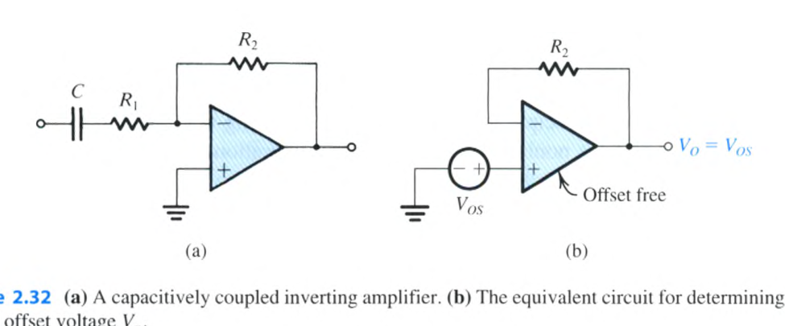

# 電子學 Chapter 2 教材 Exercises 2.23 與 2.28

> 依據《Microelectronic Circuits, 8e》Chapter 2 練習題逐題轉錄；題幹、教材答案與題目引用的圖表均保留在同一張題卡內。

<PracticeFilter prefix="electronics-ch2-exercise-missing-" />
<PracticeProgress :total="2" prefix="electronics-ch2-exercise-missing-" />

<PracticeCard id="electronics-ch2-ex-2-23" type="exercise" title="Exercise 2.23" source="Sedra & Smith, Microelectronic Circuits, 8e — PDF p.130 / printed p.100" topic="Chapter 2">

Consider the same amplifier as in Exercise 2.22—that is, an inverting amplifier with a nominal gain of 1000 constructed from an op amp with an input offset voltage of 3 mV and with output saturation levels of ±10 V—except here let the amplifier be capacitively coupled as in Fig. 2.32(a). (a) What is the dc offset voltage at the output, and what (approximately) is the peak sine-wave signal that can be applied at the input without output clipping? Is there a need for offset trimming? (b) If $R_1=1\,\mathrm{k}\Omega$ and $R_2=1\,\mathrm{M}\Omega$, find the value of the coupling capacitor $C$ that will ensure that the gain will be greater than 57 dB down to 1 kHz.

<template #solution>

(a) $3\,\mathrm{mV}$, $10\,\mathrm{mV}$, and no need for offset trimming; (b) $C=0.16\,\mu\mathrm{F}$.

</template>

</PracticeCard>

<PracticeCard id="electronics-ch2-ex-2-28" type="exercise" title="Exercise 2.28" source="Sedra & Smith, Microelectronic Circuits, 8e — PDF p.141 / printed p.111" topic="Chapter 2">

An op amp having a 106-dB gain at dc and a single-pole frequency response with $f_1=2\,\mathrm{MHz}$ is used to design a noninverting amplifier with nominal dc gain of 100. Find the 3-dB frequency of the closed-loop gain.

<template #solution>

$20\,\mathrm{kHz}$

</template>

</PracticeCard>
