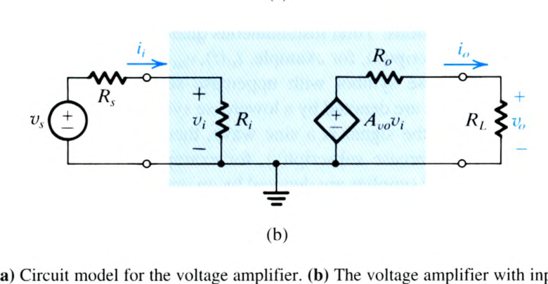
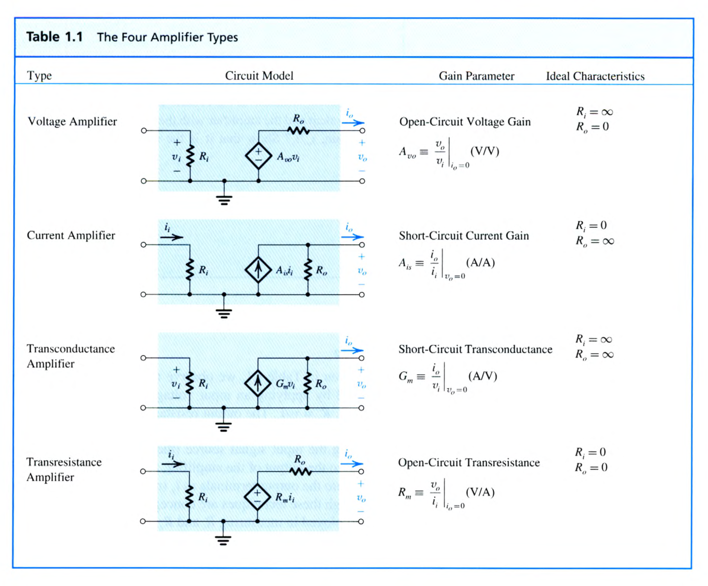
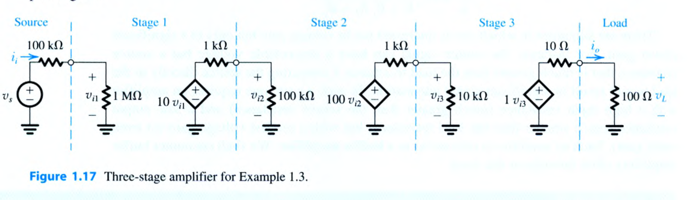
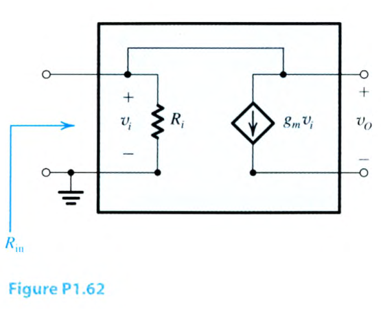
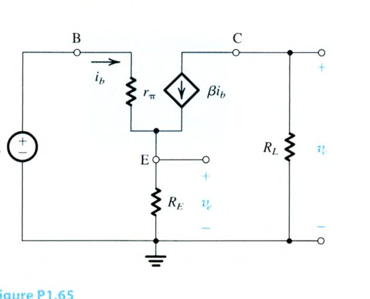

# 電子學 Chapter 1 教材 Problems 1.43–1.65

<PracticeFilter prefix="electronics-ch1-problem-" />
<PracticeProgress :total="23" prefix="electronics-ch1-problem-" />

<PracticeCard type="practice" id="electronics-ch1-problem-1-43" title="Problem 1.43" source="課本.pdf PDF p.81 / 印刷 p.51" topic="數位訊號與取樣">

一個音訊訊號以 $44.1\,\mathrm{kHz}$ 取樣。每個樣本以 $16$ 位元表示。此系統的速度是多少位元/秒？

<template #solution>

教材答案未提供；待補。

</template>

</PracticeCard>

<PracticeCard type="practice" id="electronics-ch1-problem-1-44" title="Problem 1.44" source="課本.pdf PDF p.81 / 印刷 p.51" topic="數位訊號與資料容量">

一張 $10$ 百萬像素的影像中，每個像素以 $8$ 位元表示紅色強度、$8$ 位元表示綠色強度，以及 $8$ 位元表示藍色強度。容量為 $16\,\mathrm{Gbits}$ 的記憶體可以儲存多少張這樣的影像？

<template #solution>

教材答案未提供；待補。

</template>

</PracticeCard>

<PracticeCard type="practice" id="electronics-ch1-problem-1-45" title="Problem 1.45" source="課本.pdf PDF p.81 / 印刷 p.51" topic="放大器增益">

下列列出各種放大器與負載的組合，所列數值皆為均方根值。對每一種情況，求電壓增益、電流增益與功率增益 $(A_v,A_i,A_p)$，並分別以比值及分貝表示：

1. $v_i=100\,\mathrm{mV}$、$i_i=100\,\mu\mathrm{A}$、$v_o=10\,\mathrm{V}$、$R_L=100\,\Omega$。
2. $v_i=10\,\mu\mathrm{V}$、$i_i=100\,\mathrm{nA}$、$v_o=1\,\mathrm{V}$、$R_L=10\,\mathrm{k}\Omega$。
3. $v_i=1\,\mathrm{V}$、$i_i=1\,\mathrm{mA}$、$v_o=5\,\mathrm{V}$、$R_L=10\,\Omega$。

<template #solution>

教材答案未提供；待補。

</template>

</PracticeCard>

<PracticeCard type="practice" id="electronics-ch1-problem-1-46" title="Problem 1.46" source="課本.pdf PDF p.81 / 印刷 p.51" topic="放大器功率與效率">

一個以 $\pm3\,\mathrm{V}$ 電源供電的放大器，在接到 $100\,\Omega$ 負載時，能提供峰值為 $2.2\,\mathrm{V}$ 的正弦波；其輸入峰值為 $0.2\,\mathrm{V}$，且從輸入端汲取的峰值電流為 $1.0\,\mathrm{mA}$。求電壓增益、電流增益與功率增益，並分別以比值及分貝表示。若放大器效率為 $10\%$，求電源功率、電源電流與放大器耗散功率。

<template #solution>

教材答案未提供；待補。

</template>

</PracticeCard>

<PracticeCard type="practice" id="electronics-ch1-problem-1-47" title="Problem 1.47" source="課本.pdf PDF p.81 / 印刷 p.51" topic="放大器飽和與線性範圍">

一個使用對稱雙電源的放大器，已知當訊號延伸至距任一電源 $1.0\,\mathrm{V}$ 以內時會發生飽和。在線性操作時，其增益為 $200\,\mathrm{V/V}$。對於 $\pm5\,\mathrm{V}$ 電源、$\pm10\,\mathrm{V}$ 電源及 $\pm15\,\mathrm{V}$ 電源，分別求最大未失真正弦波輸出的均方根值，以及所需輸入的均方根值。

<template #solution>

教材答案未提供；待補。

</template>

</PracticeCard>

<PracticeCard type="practice" id="electronics-ch1-problem-1-48" title="Problem 1.48" source="課本.pdf PDF p.81 / 印刷 p.51" topic="電壓放大器電路模型">

考慮圖中的電壓放大器電路模型，其中在下列條件下 $A_{vo}=100\,\mathrm{V/V}$：

1. $R_i=10R_s$、$R_L=10R_o$。
2. $R_i=R_s$、$R_L=R_o$。
3. $R_i=R_s/10$、$R_L=R_o/10$。

在每一種情況下，計算總電壓增益 $v_o/v_s$，並分別以直接比值及分貝表示。

<template #solution>

教材答案未提供；待補。

</template>

</PracticeCard>

<PracticeCard type="practice" id="electronics-ch1-problem-1-49" title="Problem 1.49" source="課本.pdf PDF p.81 / 印刷 p.51" topic="負載效應與輸出電流限制">

一個放大器具有 $40\,\mathrm{dB}$ 的小訊號開路電壓增益、$1\,\mathrm{M}\Omega$ 的輸入電阻，以及 $100\,\Omega$ 的輸出電阻；現在驅動一個 $500\,\Omega$ 的負載。接上負載後，預期的電壓增益與功率增益是多少（以分貝表示）？若放大器的輸出峰值電流限制為 $20\,\mathrm{mA}$，對於能維持未失真輸出的最大正弦波輸入，其均方根值是多少？相應可提供的輸出功率是多少？

<template #solution>

教材答案未提供；待補。

</template>

</PracticeCard>

<PracticeCard type="practice" id="electronics-ch1-problem-1-50" title="Problem 1.50" source="課本.pdf PDF p.81–82 / 印刷 p.51–52" topic="電壓模型與電流模型">

一個具有 $10\,\mathrm{mV}$ 內部電壓、$5\,\mathrm{k}\Omega$ 內部電阻的訊號源，接到一個放大器；放大器的輸入電阻為 $1\,\mathrm{k}\Omega$、開路電壓增益為 $100\,\mathrm{V/V}$，輸出電阻為 $200\,\Omega$。放大器再接到一個 $100\,\Omega$ 的負載。

1. 求從訊號源內部電壓到負載的總電壓增益。增益都到哪裡去了？若將訊號源直接接到負載，增益會是多少？這兩個增益的比值是多少？此比值可作為放大器所帶來效益的實用量度。
2. 改以訊號源的諾頓等效電路取代訊號源，並以表 1.1 中的等效電流放大器取代原放大器。電流增益 $i_o/i_s$ 是多少？說明使用電壓放大器模型計算時會得到相同結果。

<template #solution>

教材答案未提供；待補。

</template>

</PracticeCard>

<PracticeCard type="practice" id="electronics-ch1-problem-1-51" title="Problem 1.51" source="課本.pdf PDF p.82 / 印刷 p.52" topic="緩衝放大器">

一個增益為 $1\,\mathrm{V/V}$ 的緩衝放大器，輸入電阻為 $1\,\mathrm{M}\Omega$，輸出電阻為 $20\,\Omega$。它接在一個 $1\,\mathrm{V}$、$200\,\mathrm{k}\Omega$ 的訊號源與一個 $100\,\Omega$ 的負載之間。負載電壓是多少？相應的電壓增益、電流增益與功率增益（以分貝表示）是多少？

<template #solution>

教材答案未提供；待補。

</template>

</PracticeCard>

<PracticeCard type="practice" id="electronics-ch1-problem-1-52" title="Problem 1.52" source="課本.pdf PDF p.82 / 印刷 p.52" topic="串接放大器">

考慮例題 1.3 的串接放大器。將第一級與第二級互換後，求所得的總電壓增益 $v_o/v_s$。將此值與例題 1.3 的結果比較，並加以評論。

<template #solution>

教材答案未提供；待補。

</template>

</PracticeCard>

<PracticeCard type="practice" id="electronics-ch1-problem-1-53" title="Problem 1.53" source="課本.pdf PDF p.82 / 印刷 p.52" topic="串接放大器與級間負載效應">

給定兩個放大器 $A$ 與 $B$，要將它們串接在一個 $10\,\mathrm{mV}$、$100\,\mathrm{k}\Omega$ 的訊號源與一個 $100\,\Omega$ 的負載之間。兩個放大器的電壓增益、輸入電阻與輸出電阻如下：放大器 $A$ 分別為 $100\,\mathrm{V/V}$、$100\,\mathrm{k}\Omega$、$10\,\mathrm{k}\Omega$；放大器 $B$ 分別為 $10\,\mathrm{V/V}$、$10\,\mathrm{k}\Omega$、$1\,\mathrm{k}\Omega$。

你要決定兩個放大器應如何連接。為此，評估訊號源 $S$ 與負載 $L$ 之間的兩種可能連接方式，即 $SABL$ 與 $SBAL$。求每種方式的電壓增益，分別以比值及分貝表示。哪一種放大器排列較佳？

<template #solution>

教材答案未提供；待補。

</template>

</PracticeCard>

<PracticeCard type="practice" id="electronics-ch1-problem-1-54" title="Problem 1.54" source="課本.pdf PDF p.82 / 印刷 p.52" topic="放大器設計">

一位設計者手上有可用的電壓放大器，其輸入電阻為 $100\,\mathrm{k}\Omega$、輸出電阻為 $1\,\mathrm{k}\Omega$，開路電壓增益為 $15$。訊號源的電阻為 $50\,\mathrm{k}\Omega$，並提供 $5\,\mathrm{mV}$ 均方根訊號；系統要求在 $200\,\Omega$ 負載上提供至少 $3\,\mathrm{V}$ 均方根訊號。需要多少個放大器級？實際得到的輸出電壓是多少？

<template #solution>

教材答案未提供；待補。

</template>

</PracticeCard>

<PracticeCard type="practice" id="electronics-ch1-problem-1-55" title="Problem 1.55" source="課本.pdf PDF p.82 / 印刷 p.52" topic="多級放大器設計">

設計一個放大器，使其對 $100\,\Omega$ 負載電阻提供 $0.5\,\mathrm{W}$ 的訊號功率。訊號源提供 $30\,\mathrm{mV}$ 均方根訊號，且其電阻為 $0.5\,\mathrm{M}\Omega$。可用的電壓放大器級有三種類型：

1. 高輸入電阻型：$R_i=1\,\mathrm{M}\Omega$、$A_{vo}=10$、$R_o=10\,\mathrm{k}\Omega$。
2. 高增益型：$R_i=10\,\mathrm{k}\Omega$、$A_{vo}=100$、$R_o=1\,\mathrm{k}\Omega$。
3. 低輸出電阻型：$R_i=10\,\mathrm{k}\Omega$、$A_{vo}=1$、$R_o=20\,\Omega$。

使用上述級的組合設計合適的放大器。你的設計應使用最少的級數，並確保放大器鏈中的任何位置，其訊號電平都不低於 $10\,\mathrm{mV}$。求實現的負載電壓與輸出功率。

<template #solution>

教材答案未提供；待補。

</template>

</PracticeCard>

<PracticeCard type="practice" id="electronics-ch1-problem-1-56" title="Problem 1.56" source="課本.pdf PDF p.82 / 印刷 p.52" topic="電壓放大器規格設計">

你必須設計一個電壓放大器，使其由峰值振幅為 $5\,\mathrm{mV}$、源電阻為 $10\,\mathrm{k}\Omega$ 的訊號源驅動，並在 $1\,\mathrm{k}\Omega$ 負載兩端提供 $2\,\mathrm{V}$ 的峰值輸出。

1. 所需的訊號源至負載電壓增益是多少？
2. 若訊號源可提供的峰值電流為 $0.1\,\mu\mathrm{A}$，允許的最小輸入電阻是多少？對於採用此 $R_i$ 值的設計，求總電流增益與功率增益。
3. 若放大器電源將輸出開路電壓的峰值限制為 $3\,\mathrm{V}$，允許的最大輸出電阻是多少？
4. 對於採用第 2 小題中 $R_i$ 與第 3 小題中 $R_o$ 的設計，放大器所需的開路電壓增益，即 $\left.\dfrac{v_o}{v_i}\right|_{R_L=\infty}$，是多少？
5. 若作為可能的設計選項，可以將 $R_i$ 增加至最接近的 $1\times10^n\,\Omega$ 形式，並將 $R_o$ 減少至最接近的 $1\times10^m\,\Omega$ 形式，求：(i) 可實現的輸入電阻；(ii) 可實現的輸出電阻；(iii) 為符合規格目前所需的開路電壓增益。

<template #solution>

教材答案未提供；待補。

</template>

</PracticeCard>

<PracticeCard type="practice" id="electronics-ch1-problem-1-57" title="Problem 1.57" source="課本.pdf PDF p.82 / 印刷 p.52" topic="電壓放大器分析">

一個電壓放大器的輸入電阻為 $40\,\mathrm{k}\Omega$、輸出電阻為 $100\,\Omega$，增益為 $300\,\mathrm{V/V}$。它接在一個源電阻為 $10\,\mathrm{k}\Omega$、開路電壓為 $10\,\mathrm{mV}$ 的訊號源與一個 $100\,\Omega$ 的負載之間。對此情況：

1. 輸出電壓是多少？
2. 從訊號源到負載的電壓增益是多少？
3. 從放大器輸入端到負載的電壓增益是多少？
4. 若負載兩端的輸出電壓是所需值的兩倍，且有放大器飽和的跡象，請建議一個電阻的配置位置與阻值，使輸出達到所需值。選擇對運作中電路造成最小干擾的配置。（提示：使用並聯而非串聯連接。）

<template #solution>

教材答案未提供；待補。

</template>

</PracticeCard>

<PracticeCard type="practice" id="electronics-ch1-problem-1-58" title="Problem 1.58" source="課本.pdf PDF p.83 / 印刷 p.53" topic="電流放大器">

一個電流放大器向 $1\,\mathrm{k}\Omega$ 的負載電阻提供 $1\,\mathrm{mA}$。當負載電阻增加到 $12\,\mathrm{k}\Omega$ 時，輸出電流降至 $0.5\,\mathrm{mA}$。放大器的短路輸出電流與輸出電阻各是多少？

<template #solution>

教材答案未提供；待補。

</template>

</PracticeCard>

<PracticeCard type="practice" id="electronics-ch1-problem-1-59" title="Problem 1.59" source="課本.pdf PDF p.83 / 印刷 p.53" topic="轉阻放大器">

一個轉阻放大器的 $R_i=100\,\Omega$、$R_o=10\,\Omega$、$R_m=5\,\mathrm{k}\Omega$。它要接在一個 $100\,\mathrm{mV}$、源電阻為 $1\,\mathrm{k}\Omega$ 的訊號源與一個 $1\,\mathrm{k}\Omega$ 的負載之間。求電流增益 $i_o/i_i$、電壓增益 $v_o/v_s$，以及功率增益，並分別以直接比值及分貝表示。

<template #solution>

教材答案未提供；待補。

</template>

</PracticeCard>

<PracticeCard type="practice" id="electronics-ch1-problem-1-60" title="Problem 1.60" source="課本.pdf PDF p.83 / 印刷 p.53" topic="轉導放大器">

一個轉導放大器的 $R_i=2\,\mathrm{k}\Omega$、$G_m=20\,\mathrm{mA/V}$、$R_o=5\,\mathrm{k}\Omega$。它由源電阻為 $500\,\Omega$ 的電壓源驅動，輸出端接上一個 $1\,\mathrm{k}\Omega$ 電阻負載。求所實現的電壓增益。

<template #solution>

教材答案未提供；待補。

</template>

</PracticeCard>

<PracticeCard type="practice" id="electronics-ch1-problem-1-61" title="Problem 1.61" source="課本.pdf PDF p.83 / 印刷 p.53" topic="加權求和放大器設計">

設計者必須在一個 $10\,\mathrm{k}\Omega$ 負載兩端提供輸入訊號 $v_1$ 與 $v_2$ 的加權和 $v_o=10v_1+20v_2$；兩個輸入訊號各自的源電阻都是 $10\,\mathrm{k}\Omega$。她有數個轉導放大器可用，其輸入電阻與輸出電阻皆為 $10\,\mathrm{k}\Omega$，且 $G_m=20\,\mathrm{mA/V}$，另有一組可選用的適當電阻。

畫出適當的放大器拓撲，並選擇附加電阻以產生所需結果。你的設計應使用最少數量的放大器與電阻。（提示：在設計中安排電流相加。）

<template #solution>

教材答案未提供；待補。

</template>

</PracticeCard>

<PracticeCard type="practice" id="electronics-ch1-problem-1-62" title="Problem 1.62" source="課本.pdf PDF p.83 / 印刷 p.53" topic="轉導放大器回授">

圖 P1.62 顯示一個轉導放大器，其輸出回授至輸入端。

1. 求所形成之一埠網路的輸入電阻 $R_{in}$。（提示：在兩個輸入端之間施加測試電壓 $v_x$，並求由訊號源汲取的電流 $i_x$。然後 $R_{in}=v_x/i_x$。）
2. 證明當它由一個電壓源 $v_s$ 驅動，且源電阻 $R_s=R_{in}$ 時，電壓增益為 $\dfrac{v_o}{v_s}=0.5\,\dfrac{v_o}{v_i}$。（這是求輸入電阻的另一種方法。）

<template #solution>

教材答案未提供；待補。

</template>

</PracticeCard>

<PracticeCard type="practice" id="electronics-ch1-problem-1-63" title="Problem 1.63" source="課本.pdf PDF p.83 / 印刷 p.53" topic="電壓感測放大器設計">

你必須設計一個放大器，感測一個轉換器的開路輸出電壓，並在負載電阻兩端提供成比例的電壓。轉換器的等效源電阻指定會在 $1\,\mathrm{k}\Omega$ 至 $10\,\mathrm{k}\Omega$ 的範圍內變化；同樣地，負載電阻也會在 $1\,\mathrm{k}\Omega$ 至 $10\,\mathrm{k}\Omega$ 的範圍內變化。對應於指定的 $R_s$ 變化，負載電壓的變化最多應為 $10\%$。同樣地，對應於指定的 $R_L$ 變化，負載電壓的變化也應限制在 $10\%$ 以內。此外，對應於轉換器 $10\,\mathrm{mV}$ 的開路輸出電壓，放大器應在負載兩端提供至少 $1\,\mathrm{V}$。

需要哪一種放大器？畫出其電路模型，並指定其參數值。為 $R_i$ 與 $R_o$ 指定適當的 $1\times10^m\,\Omega$ 形式數值。

<template #solution>

教材答案未提供；待補。

</template>

</PracticeCard>

<PracticeCard type="practice" id="electronics-ch1-problem-1-64" title="Problem 1.64" source="課本.pdf PDF p.83 / 印刷 p.53" topic="電流感測放大器設計">

你必須設計一個放大器，感測光感測器的短路輸出電流，並在負載電阻兩端提供成比例的電壓。轉換器的等效源電阻指定會在 $1\,\mathrm{k}\Omega$ 至 $10\,\mathrm{k}\Omega$ 的範圍內變化。同樣地，負載電阻已知會在 $1\,\mathrm{k}\Omega$ 至 $10\,\mathrm{k}\Omega$ 的範圍內變化。對應於指定的 $R_s$ 變化，負載電壓的變化最多應為 $10\%$。同樣地，對應於指定的 $R_L$ 變化，負載電壓的變化應限制在 $10\%$ 以內。此外，對於轉換器標稱的 $10\,\mu\mathrm{A}$ 短路輸出電流，放大器必須在負載兩端提供至少 $1\,\mathrm{V}$。

需要哪一種放大器？畫出其電路模型，並指定模型參數的值。為 $R_i$ 與 $R_o$ 指定適當的 $1\times10^m\,\Omega$ 形式數值。

<template #solution>

教材答案未提供；待補。

</template>

</PracticeCard>

<PracticeCard type="practice" id="electronics-ch1-problem-1-65" title="Problem 1.65" source="課本.pdf PDF p.83–84 / 印刷 p.53–54" topic="BJT 小訊號模型">

對於圖 P1.65 的電路，證明：

$$
\frac{v_c}{v_b}=\frac{-\beta R_L}{r_\pi+(\beta+1)R_E}
$$

以及

$$
\frac{v_e}{v_b}=\frac{R_E}{R_E+\left[r_\pi/(\beta+1)\right]}
$$

<template #solution>

教材答案未提供；待補。

</template>

</PracticeCard>
