# 電子學 Chapter 1 教材 Problems 1.66–1.83

<PracticeFilter prefix="electronics-ch1-p1-" />
<PracticeProgress :total="18" prefix="electronics-ch1-p1-" />

<PracticeCard type="practice" id="electronics-ch1-p1-66" title="題目 1.66" source="Sedra & Smith Microelectronic Circuits 8e；PDF p.84 / 印刷 p.54" topic="放大器增益">

一個輸入電阻為 $5\ \mathrm{k}\Omega$ 的放大器，由電流源 $1\ \mu\mathrm{A}$ 與源電阻 $200\ \mathrm{k}\Omega$ 驅動時，其短路輸出電流為 $5\ \mathrm{mA}$。當此放大器驅動 $2\ \mathrm{k}\Omega$ 負載時，觀察到輸出電壓為 $5\ \mathrm{V}$。當連接 $1\ \mathrm{k}\Omega$ 負載時，求電壓增益、電流增益與功率增益，並分別以比值與分貝表示。

<template #solution>

教材答案未提供；待補。

</template>

</PracticeCard>

<PracticeCard type="practice" id="electronics-ch1-p1-67" title="題目 1.67" source="Sedra & Smith Microelectronic Circuits 8e；PDF p.84 / 印刷 p.54" topic="差動放大器">

圖 P1.67(a) 顯示兩個跨導放大器以特殊組態連接。求以 $v_1$ 與 $v_2$ 表示的 $v_o$。令 $g_m=100\ \mathrm{mA/V}$ 且 $R=5\ \mathrm{k}\Omega$。若 $v_1=v_2=1\ \mathrm{V}$，求 $v_o$。另外，當 $v_1=1.01\ \mathrm{V}$ 且 $v_2=0.99\ \mathrm{V}$ 時，求 $v_o$。（注意：此電路稱為差動放大器，並以圖 P1.67(b) 所示符號表示。某一類稱為運算放大器的特殊差動放大器將於第 2 章介紹。）

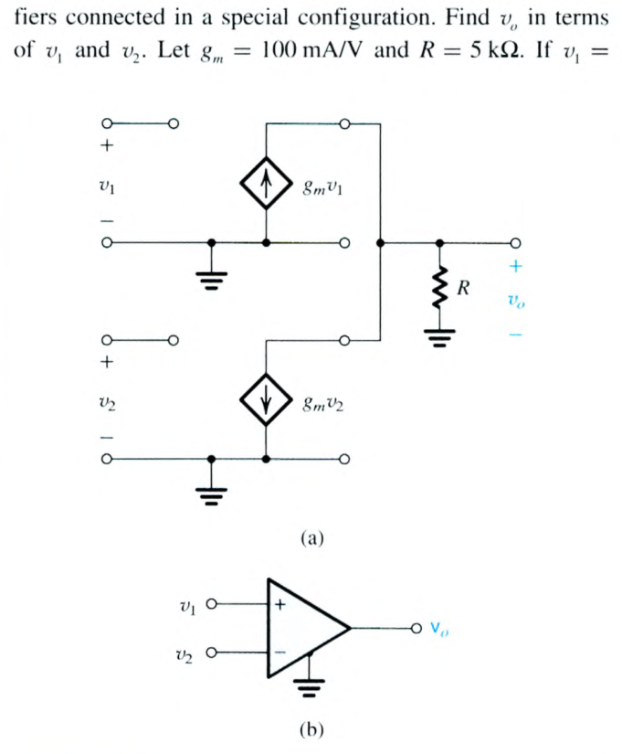

<template #solution>

教材答案未提供；待補。

</template>

</PracticeCard>

<PracticeCard type="practice" id="electronics-ch1-p1-68" title="題目 1.68" source="Sedra & Smith Microelectronic Circuits 8e；PDF p.84 / 印刷 p.54" topic="二埠網路與 g 參數">

任何包含線性放大器的線性二埠網路，都可用附錄 C 所給的四種參數組之一表示。對電壓放大器而言，以 $g$ 參數表示最方便。若放大器的輸入埠標為埠 1、輸出埠標為埠 2，其 $g$ 參數表示由下列兩式描述：

$$
I_1=g_{11}V_1+g_{12}I_2
$$

$$
V_2=g_{21}V_1+g_{22}I_2
$$

圖 P1.68 顯示這兩式的等效電路表示。將此等效電路與圖 1.16(a) 的電壓放大器比較，辨認相對應的電流與電壓，以及放大器等效電路參數與 $g$ 參數之間的對應關係。因此，給出分別對應於 $R_i$、$A_{vo}$ 與 $R_o$ 的 $g$ 參數。注意，另有一個 $g$ 參數在放大器等效電路中沒有對應者。是哪一個？它代表什麼意義？我們對放大器作了哪一項假設，才使此 $g$ 參數不出現在圖 1.16(a) 的等效電路中？

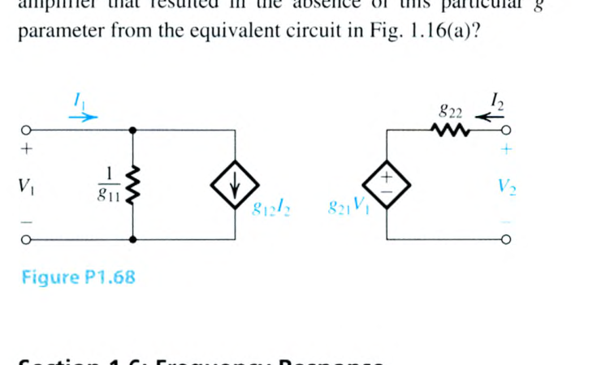

<template #solution>

教材答案未提供；待補。

</template>

</PracticeCard>

<PracticeCard type="practice" id="electronics-ch1-p1-69" title="題目 1.69" source="Sedra & Smith Microelectronic Circuits 8e；PDF p.84–85 / 印刷 p.54–55" topic="單時間常數網路">

使用分壓法，推導圖 1.22 所示電路的轉移函數 $T(s)=V_o(s)/V_i(s)$，並證明這些轉移函數具有表 1.2 頂端所給的形式。

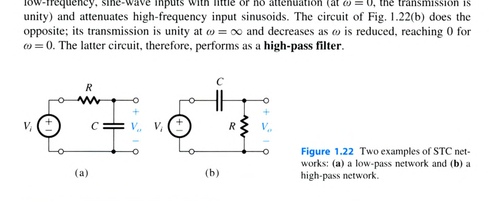

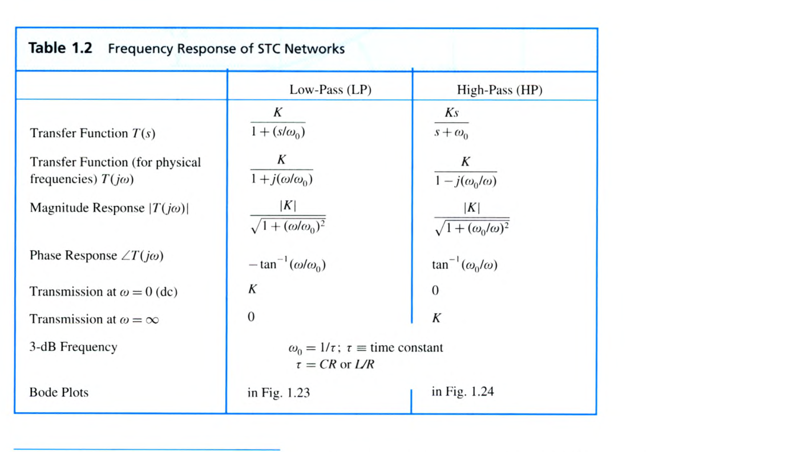

<template #solution>

教材答案未提供；待補。

</template>

</PracticeCard>

<PracticeCard type="practice" id="electronics-ch1-p1-70" title="題目 1.70" source="Sedra & Smith Microelectronic Circuits 8e；PDF p.85 / 印刷 p.55" topic="低通 STC 網路">

圖 VE1.4 顯示一個訊號源連接至放大器的輸入端。這裡 $R_s$ 是源電阻，而 $R_i$ 與 $C_i$ 分別是放大器的輸入電阻與輸入電容。推導 $V_i(s)/V_s(s)$ 的表示式，並證明它屬於低通 STC 類型。當 $R_s=10\ \mathrm{k}\Omega$、$R_i=40\ \mathrm{k}\Omega$ 且 $C_i=5\ \mathrm{pF}$ 時，求 3-dB 頻率與直流增益。

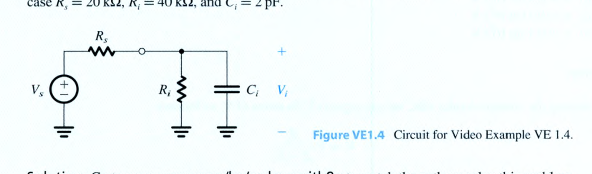

<template #solution>

教材答案未提供；待補。

</template>

</PracticeCard>

<PracticeCard type="practice" id="electronics-ch1-p1-71" title="題目 1.71" source="Sedra & Smith Microelectronic Circuits 8e；PDF p.85 / 印刷 p.55" topic="高通與低通 STC 網路">

對圖 P1.71 所示電路，求轉移函數 $T(s)=V_o(s)/V_i(s)$，並將其整理為表 1.2 中適用的標準形式。它是高通網路還是低通網路？在非常高的頻率下，其傳輸量為何？【直接估計此值，並藉由令 $s\to\infty$ 代入 $T(s)$ 的表示式再次估計。】轉折頻率 $\omega_0$ 為何？當 $R_1=20\ \mathrm{k}\Omega$、$R_2=100\ \mathrm{k}\Omega$ 且 $C=0.1\ \mu\mathrm{F}$ 時，求 $f_0$。$|T(j\omega_0)|$ 的值為何？

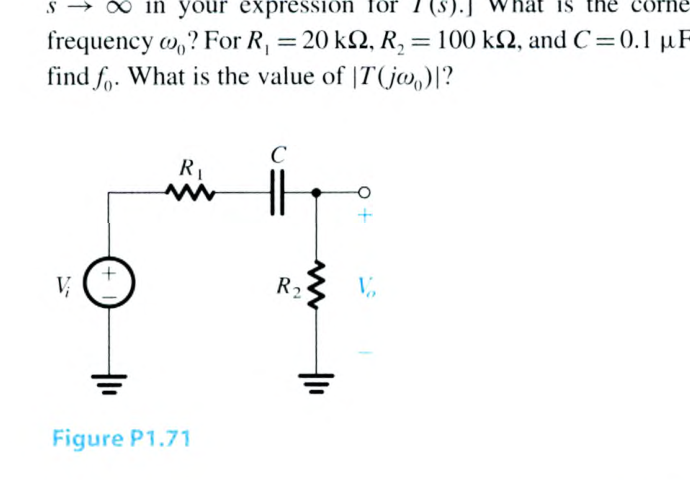

<template #solution>

教材答案未提供；待補。

</template>

</PracticeCard>

<PracticeCard type="practice" id="electronics-ch1-p1-72" title="題目 1.72" source="Sedra & Smith Microelectronic Circuits 8e；PDF p.85 / 印刷 p.55" topic="耦合電容與高通 STC">

要求透過電容 $C$，將具有電阻 $R_s$ 的電壓源 $V_s$ 耦合至負載 $R_L$。推導由源端至負載端的轉移函數（即 $V_L/V_s$），並證明它屬於高通 STC 類型。當 $R_s=4\ \mathrm{k}\Omega$ 且 $R_L=10\ \mathrm{k}\Omega$ 時，求能使 3-dB 頻率不高於 $200\ \mathrm{Hz}$ 的最小耦合電容。

<template #solution>

教材答案未提供；待補。

</template>

</PracticeCard>

<PracticeCard type="practice" id="electronics-ch1-p1-73" title="題目 1.73" source="Sedra & Smith Microelectronic Circuits 8e；PDF p.85 / 印刷 p.55" topic="頻率響應量測">

量測一個放大器的頻率響應得到下表資料。請為表中缺少的項目提供合理的近似值。此外，請為此放大器的幅度頻率響應（亦即 Bode 圖）繪製草圖並清楚標示。

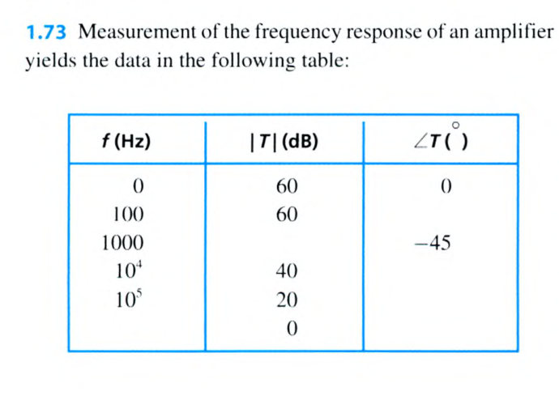

<template #solution>

教材答案未提供；待補。

</template>

</PracticeCard>

<PracticeCard type="practice" id="electronics-ch1-p1-74" title="題目 1.74" source="Sedra & Smith Microelectronic Circuits 8e；PDF p.85 / 印刷 p.55" topic="頻率響應量測">

量測一個放大器的頻率響應得到下表資料。請為表中缺少的項目提供合理的近似值。此外，請為此放大器的幅度頻率響應（Bode 圖）繪製草圖並清楚標示。

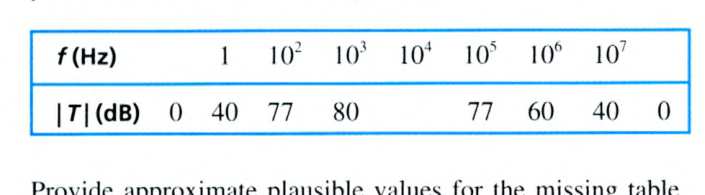

<template #solution>

教材答案未提供；待補。

</template>

</PracticeCard>

<PracticeCard type="practice" id="electronics-ch1-p1-75" title="題目 1.75" source="Sedra & Smith Microelectronic Circuits 8e；PDF p.85 / 印刷 p.55" topic="緩衝器與級聯頻率響應">

圖 P1.75 中的單位增益電壓放大器具有無限大的輸入電阻與零輸出電阻，因此其作用如理想緩衝器。假設各放大器的增益與頻率無關，請說明：當每一個 RC 電路的增益下降 $1.0\ \mathrm{dB}$ 的頻率下，總增益 $V_o/V_i$ 將相對於直流值下降 $3\ \mathrm{dB}$。此頻率以 $CR$ 表示為何？

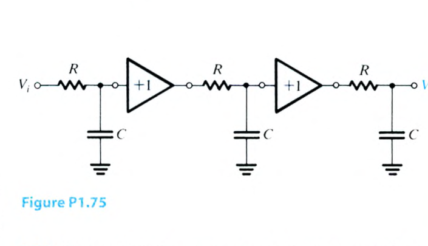

<template #solution>

教材答案未提供；待補。

</template>

</PracticeCard>

<PracticeCard type="practice" id="electronics-ch1-p1-76" title="題目 1.76" source="Sedra & Smith Microelectronic Circuits 8e；PDF p.85 / 印刷 p.55" topic="高頻跨導放大器">

一個輸出電阻為 $100\ \mathrm{k}\Omega$ 的高頻跨導放大器接上負載電容後，量得放大器的 3-dB 頻寬由 $5\ \mathrm{MHz}$ 降至 $100\ \mathrm{kHz}$。估計負載電容的值。若原本的截止頻率可歸因於輸出節點（亦即輸出端與地之間）的一個小寄生電容，則估計該寄生電容為何？

<template #solution>

教材答案未提供；待補。

</template>

</PracticeCard>

<PracticeCard type="practice" id="electronics-ch1-p1-77" title="題目 1.77" source="Sedra & Smith Microelectronic Circuits 8e；PDF p.85–86 / 印刷 p.55–56" topic="多級放大器頻寬設計">

一位設計者希望將三級放大器的整體上限 3-dB 頻率降低至 $5\ \mathrm{kHz}$，因此考慮以電容將兩個節點之一旁路至地：第一級輸出端的節點 A，或第二級輸出端的節點 B。在量測放大器整體頻率響應時，她先將 $1\ \mathrm{nF}$ 電容接到節點 A，再接到節點 B，使 3-dB 頻率分別由 $3\ \mathrm{MHz}$ 降至 $200\ \mathrm{kHz}$ 與 $40\ \mathrm{kHz}$。若她知道每一級放大器的輸入電阻為 $100\ \mathrm{k}\Omega$，則節點 A 的驅動級必須具有多大的輸出電阻？節點 B 呢？她應將何種電容值接到哪一個節點，才能以最經濟的方式解決設計問題？

<template #solution>

教材答案未提供；待補。

</template>

</PracticeCard>

<PracticeCard type="practice" id="electronics-ch1-p1-78" title="題目 1.78" source="Sedra & Smith Microelectronic Circuits 8e；PDF p.86 / 印刷 p.56" topic="耦合電容設計">

一個輸入電阻為 $100\ \mathrm{k}\Omega$、輸出電阻為 $1\ \mathrm{k}\Omega$ 的放大器，要以電容耦合至 $10\ \mathrm{k}\Omega$ 的源與 $1\ \mathrm{k}\Omega$ 的負載。可用電容的值僅具有 $1\times10^{-n}\ \mathrm{F}$ 的形式。為確保與各電容相關的轉折頻率低於 $100\ \mathrm{Hz}$，所需的最小電容值為何？實際得到的轉折頻率為何？若基本放大器的開路電壓增益 $A_{vo}$ 為 $100\ \mathrm{V/V}$，求 $T(s)=V_o(s)/V_s(s)$ 的表示式。

<template #solution>

教材答案未提供；待補。

</template>

</PracticeCard>

<PracticeCard type="practice" id="electronics-ch1-p1-79" title="題目 1.79" source="Sedra & Smith Microelectronic Circuits 8e；PDF p.86 / 印刷 p.56" topic="放大器頻率響應">

一個電壓放大器具有下列轉移函數：

$$
A_v=\frac{1000}{\left(1+j\dfrac{f}{10^5}\right)\left(1+\dfrac{10^2}{jf}\right)}
$$

利用低通與高通 STC 網路的 Bode 圖（圖 1.23 與圖 1.24），繪製 $|A_v|$ 的 Bode 圖。給出 $f=10\ \mathrm{Hz}$、$10^2\ \mathrm{Hz}$、$10^3\ \mathrm{Hz}$、$10^4\ \mathrm{Hz}$、$10^5\ \mathrm{Hz}$、$10^6\ \mathrm{Hz}$、$10^7\ \mathrm{Hz}$ 與 $10^8\ \mathrm{Hz}$ 時增益幅度的近似值。求放大器的頻寬（定義為增益維持在最大值 $3\ \mathrm{dB}$ 以內的頻率範圍）。

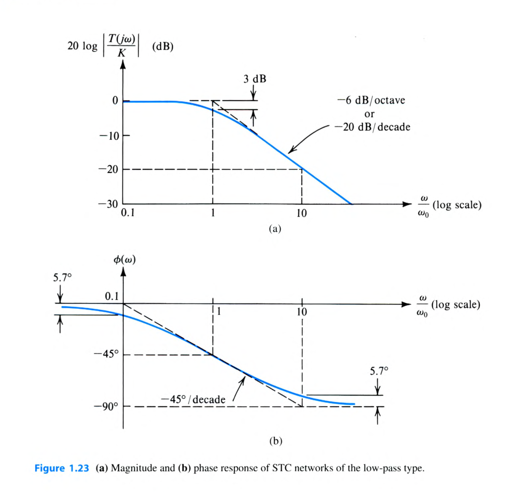

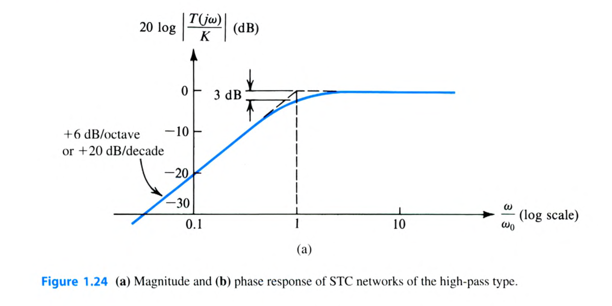

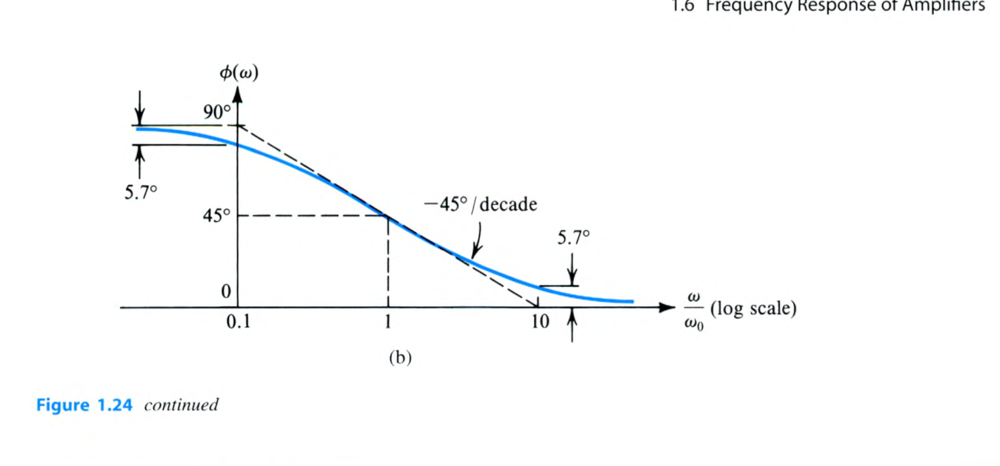

<template #solution>

教材答案未提供；待補。

</template>

</PracticeCard>

<PracticeCard type="practice" id="electronics-ch1-p1-80" title="題目 1.80" source="Sedra & Smith Microelectronic Circuits 8e；PDF p.86 / 印刷 p.56" topic="兩級頻率響應">

對圖 P1.80 所示電路，先求 $T_i(s)=V_i(s)/V_s(s)$ 及其相應的截止（轉折）頻率。接著求 $T_o(s)=V_o(s)/V_i(s)$ 及相應的截止頻率。將每一個轉移函數整理為標準形式（見表 1.2），並將它們相乘形成整體轉移函數 $T(s)=T_i(s)\times T_o(s)$。為 $|T(j\omega)|$ 繪製 Bode 圖。3-dB 截止頻率之間的頻寬為何？

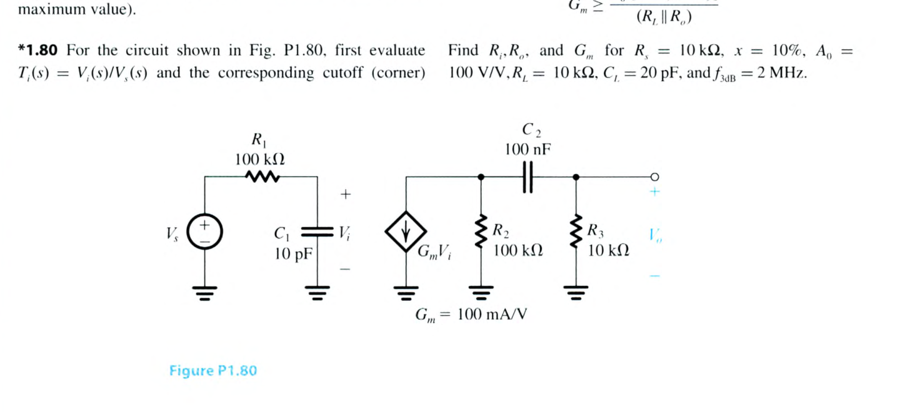

<template #solution>

教材答案未提供；待補。

</template>

</PracticeCard>

<PracticeCard type="practice" id="electronics-ch1-p1-81" title="題目 1.81" source="Sedra & Smith Microelectronic Circuits 8e；PDF p.86 / 印刷 p.56" topic="跨導放大器設計">

一個具有表 1.1 所示等效電路的跨導放大器，由具有源電阻 $R_s$ 的電壓源 $V_s$ 驅動；其輸出連接至由電阻 $R_L$ 與電容 $C_L$ 並聯構成的負載。對給定的 $R_s$、$R_L$ 與 $C_L$，要求指定放大器參數 $R_i$、$G_m$ 與 $R_o$ 的值，以滿足下列設計限制：

(a) 從訊號源耦合至放大器時，輸入訊號至多損失 $x\%$（亦即 $V_i\geq[1-(x/100)]V_s$）。

(b) 放大器的 3-dB 頻率等於或大於指定值 $f_{3\mathrm{dB}}$。

(c) 直流增益 $V_o/V_s$ 等於或大於指定值 $A_0$。

使用低通與高通 STC 網路的 Bode 圖（圖 1.23 與圖 1.24），為 $|A_v|$ 繪製 Bode 圖。給出 $f=10\ \mathrm{Hz}$、$10^2\ \mathrm{Hz}$、$10^3\ \mathrm{Hz}$、$10^4\ \mathrm{Hz}$、$10^5\ \mathrm{Hz}$、$10^6\ \mathrm{Hz}$、$10^7\ \mathrm{Hz}$ 與 $10^8\ \mathrm{Hz}$ 時增益幅度的近似值。求放大器的頻寬（定義為增益維持在最大值 $3\ \mathrm{dB}$ 以內的頻率範圍）。

證明選擇下列數值即可滿足這些限制：

$$
R_i\geq\left(\frac{100}{x}-1\right)R_s
$$

$$
R_o\leq\frac{1}{2\pi f_{3\mathrm{dB}}C_L-(1/R_L)}
$$

$$
G_m\geq\frac{A_0/[1-(x/100)]}{(R_L\parallel R_o)}
$$

求 $R_i$、$R_o$ 與 $G_m$，其中 $R_s=10\ \mathrm{k}\Omega$、$x=10\%$、$A_0=100\ \mathrm{V/V}$、$R_L=10\ \mathrm{k}\Omega$、$C_L=20\ \mathrm{pF}$ 且 $f_{3\mathrm{dB}}=2\ \mathrm{MHz}$。

<template #solution>

教材答案未提供；待補。

</template>

</PracticeCard>

<PracticeCard type="practice" id="electronics-ch1-p1-82" title="題目 1.82" source="Sedra & Smith Microelectronic Circuits 8e；PDF p.87 / 印刷 p.57" topic="補償衰減器">

考慮圖 P1.82 的電路。希望使轉移函數與頻率無關。證明選擇 $C_1=C_2(R_2/R_1)$ 即可達成此目的。在此條件下，該電路稱為補償衰減器，並經常用於示波器探棒的設計。以 $R_1$ 與 $R_2$ 表示補償衰減器的傳輸量。

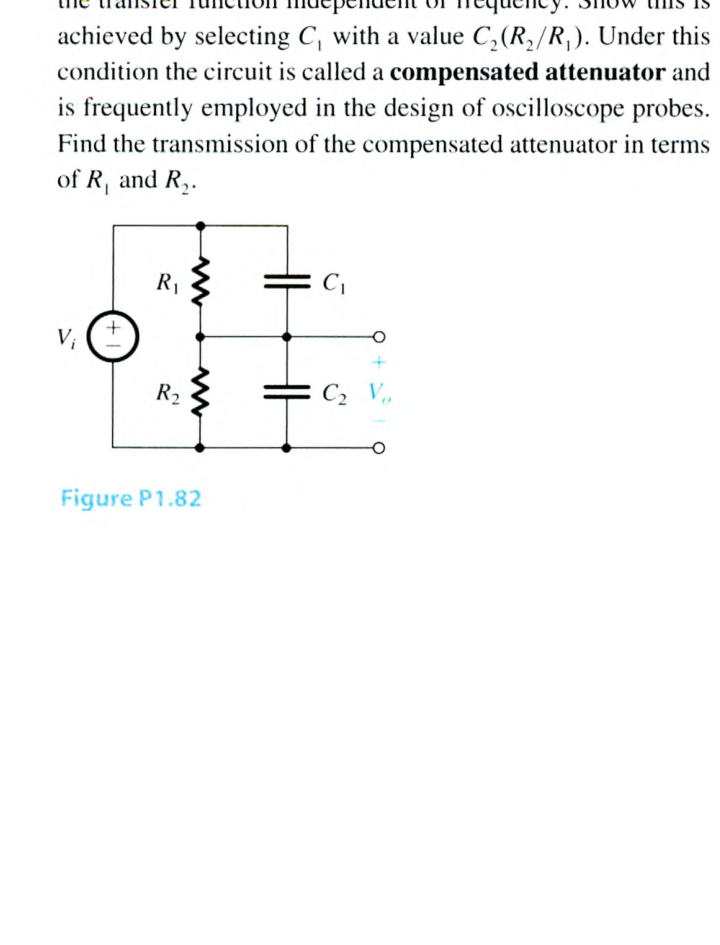

<template #solution>

教材答案未提供；待補。

</template>

</PracticeCard>

<PracticeCard type="practice" id="electronics-ch1-p1-83" title="題目 1.83" source="Sedra & Smith Microelectronic Circuits 8e；PDF p.87 / 印刷 p.57" topic="放大器頻寬與 STC 時間常數">

一個具有圖 1.21 所示類型頻率響應的放大器，被指定在涵蓋 $100\ \mathrm{Hz}$ 至 $1\ \mathrm{kHz}$ 的放大器頻寬內，相移的幅度不得大於 $5.7^\circ$。已知低頻端的增益下降由高通 STC 電路的響應決定，而高頻端的增益下降由低通 STC 電路的響應決定。你預期這兩個 STC 電路的時間常數為何？在定義放大器頻寬的兩個頻率處，相對於最大增益的增益下降（以分貝表示）為何？增益下降 $3\ \mathrm{dB}$ 時的頻率為何？（提示：參考圖 1.23 與圖 1.24。）

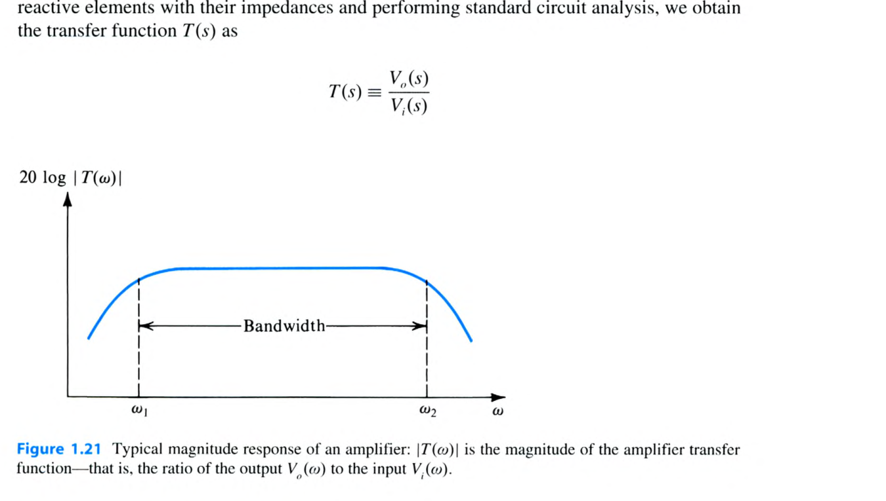

<template #solution>

教材答案未提供；待補。

</template>

</PracticeCard>
