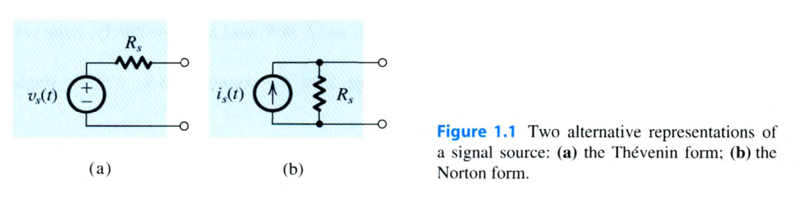
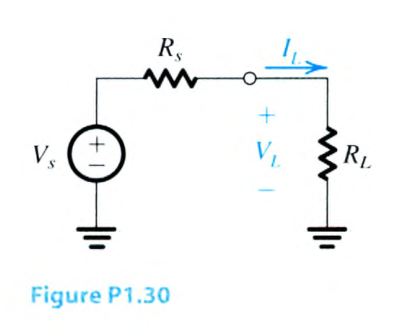
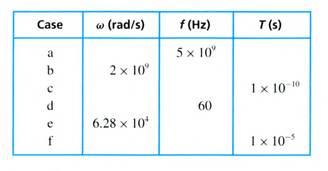
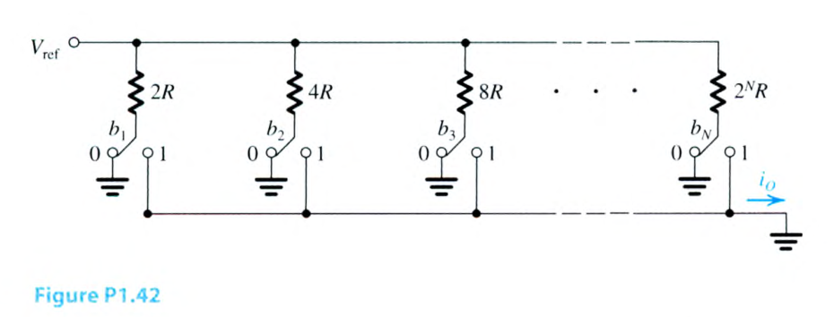

# 電子學 Chapter 1 章末 Problems 1.21–1.42

> 來源：Sedra & Smith, *Microelectronic Circuits*, 8e，`課本.pdf`。本批次逐頁核對 PDF 第 78–81 頁（印刷第 48–51 頁）；答案欄僅依教材答案是否提供填寫，未自行推算。

<PracticeFilter prefix="electronics-ch1-problem-" />
<PracticeProgress :total="22" prefix="electronics-ch1-problem-" />

<PracticeCard type="practice" id="electronics-ch1-problem-1-21" title="Problem 1.21" source="Sedra & Smith 8e · PDF p. 78–79 · 印刷頁 p. 48–49" topic="Chapter 1 Problems · 交流電路與週期訊號">

週期性重複波形（例如正弦波或方波）的週期性，可以只用下列三個參數中的一個完全指定：以弧度每秒（rad/s）表示的角頻率 $ω$、以赫茲（Hz）表示的（傳統）頻率 $f$，或以秒（s）表示的週期 $T$。此外，每一個參數都可以使用與基本單位搭配的字母字首、科學記號，或兩者組合來表示。例如，某一特定週期可以表示為 $100\,\mathrm{ns}$、$0.1\,\mu\mathrm{s}$、$10^{-1}\,\mu\mathrm{s}$、$10^{5}\,\mathrm{ps}$，或 $1\times10^{-7}\,\mathrm{s}$。（電子學所使用的各種字首定義請參閱附錄 J。）對下列每一個量，請以基本單位的科學記號表示其三種等價寫法（例如寫成 $10^{-7}\,\mathrm{s}$，而不是 $10^{-1}\,\mu\mathrm{s}$）。

(a) $T=10^{-4}\,\mu\mathrm{s}$

(b) $f=3\,\mathrm{GHz}$

(c) $\omega=6.28\times10^{4}\,\mathrm{rad/s}$

(d) $T=10^{-7}\,\mathrm{s}$

(e) $f=60\,\mathrm{Hz}$

(f) $\omega=100\,\mathrm{krad/s}$

(g) $f=270\,\mathrm{MHz}$

<template #solution>

教材答案未提供；待補。

</template>
</PracticeCard>

<PracticeCard type="practice" id="electronics-ch1-problem-1-22" title="Problem 1.22" source="Sedra & Smith 8e · PDF p. 79 · 印刷頁 p. 49" topic="Chapter 1 Problems · 複數阻抗">

求下列各基本電路元件在 $60\,\mathrm{Hz}$、$100\,\mathrm{kHz}$ 與 $1\,\mathrm{GHz}$ 下的複數阻抗 $Z$：

(a) $R=1\,\mathrm{k}\Omega$

(b) $C=10\,\mathrm{nF}$

(c) $C=10\,\mathrm{pF}$

(d) $L=10\,\mathrm{mH}$

(e) $L=1\,\mu\mathrm{H}$

<template #solution>

教材答案未提供；待補。

</template>
</PracticeCard>

<PracticeCard type="practice" id="electronics-ch1-problem-1-23" title="Problem 1.23" source="Sedra & Smith 8e · PDF p. 79 · 印刷頁 p. 49" topic="Chapter 1 Problems · 網路複數阻抗">

求下列網路在 $10\,\mathrm{kHz}$ 下的複數阻抗：

(a) $1\,\mathrm{k}\Omega$ 與 $1\,\mathrm{nF}$ 串聯。

(b) $1\,\mathrm{k}\Omega$ 與 $0.01\,\mu\mathrm{F}$ 並聯。

(c) $10\,\mathrm{k}\Omega$ 與 $100\,\mathrm{pF}$ 並聯。

(d) $100\,\mathrm{k}\Omega$ 與 $10\,\mathrm{mH}$ 串聯。

<template #solution>

教材答案未提供；待補。

</template>
</PracticeCard>

<PracticeCard type="practice" id="electronics-ch1-problem-1-24" title="Problem 1.24" source="Sedra & Smith 8e · PDF p. 79 · 印刷頁 p. 49" topic="Chapter 1 Problems · LC 並聯諧振">

寫出電感 $L$ 與電容 $C$ 並聯組合之複數阻抗隨頻率變化的表示式。求阻抗大小變為無限大的頻率。在此頻率下，阻抗的相位會如何變化？在此頻率下，該並聯組合從理想正弦電壓源汲取的電流為何？

<template #solution>

教材答案未提供；待補。

</template>
</PracticeCard>

<PracticeCard type="practice" id="electronics-ch1-problem-1-25" title="Problem 1.25" source="Sedra & Smith 8e · PDF p. 79 · 印刷頁 p. 49" topic="Chapter 1 Problems · 訊號源等效表示">

任一訊號源都能提供開路電壓 $v_{oc}$ 與短路電流 $i_{sc}$。對下列訊號源，求其內部電阻 $R_s$、諾頓電流 $i_s$ 與戴維寧電壓 $v_s$：

(a) $v_{oc}=3\,\mathrm{V}$、$i_{sc}=3\,\mathrm{mA}$。

(b) $v_{oc}=500\,\mathrm{mV}$、$i_{sc}=50\,\mu\mathrm{A}$。

<template #solution>

教材答案未提供；待補。

</template>
</PracticeCard>

<PracticeCard type="practice" id="electronics-ch1-problem-1-26" title="Problem 1.26" source="Sedra & Smith 8e · PDF p. 79 · 印刷頁 p. 49" topic="Chapter 1 Problems · 訊號源等效參數">

某訊號源接上 $100\,\mathrm{k}\Omega$ 電阻負載時產生 $100\,\mu\mathrm{A}$ 的輸出；接上 $10\,\mathrm{k}\Omega$ 電阻負載時產生 $500\,\mu\mathrm{A}$ 的輸出。求其戴維寧電壓、諾頓電流與源電阻。

<template #solution>

教材答案未提供；待補。

</template>
</PracticeCard>

<PracticeCard type="practice" id="electronics-ch1-problem-1-27" title="Problem 1.27" source="Sedra & Smith 8e · PDF p. 79 · 印刷頁 p. 49" topic="Chapter 1 Problems · 訊號源與負載">

一個音訊訊號源連接到揚聲器。連接 $16\,\Omega$ 揚聲器時，訊號源所提供的功率比連接 $32\,\Omega$ 耳機揚聲器時少 $25\%$。源電阻為何？

<template #solution>

教材答案未提供；待補。

</template>
</PracticeCard>

<PracticeCard type="practice" id="electronics-ch1-problem-1-28" title="Problem 1.28" source="Sedra & Smith 8e · PDF p. 79 · 印刷頁 p. 49" topic="Chapter 1 Problems · 感測器源電阻">

某溫度感測器的規格為每攝氏度提供 $2\,\mathrm{mV}/{}^\circ\mathrm{C}$。將它接到 $10\,\mathrm{k}\Omega$ 負載電阻時，測得輸出電壓變化為 $10\,\mathrm{mV}$，相當於溫度變化 $20^\circ\mathrm{C}$。感測器的源電阻為何？

<template #solution>

教材答案未提供；待補。

</template>
</PracticeCard>

<PracticeCard type="practice" id="electronics-ch1-problem-1-29" title="Problem 1.29" source="Sedra & Smith 8e · PDF p. 79 · 印刷頁 p. 49；Figure 1.1 取自 PDF p. 36 · 印刷頁 p. 6" topic="Chapter 1 Problems · 戴維寧與諾頓訊號源">

參考訊號源的戴維寧與諾頓表示法（圖 1.1）。若訊號源提供的電流記為 $i_o$，而出現在訊號源輸出端之間的電壓記為 $v_o$，請對 $0\leq i_o\leq i_s$ 的範圍，繪出並清楚標示 $v_o$ 對 $i_o$ 的關係圖。

<template #solution>

教材答案未提供；待補。

</template>
</PracticeCard>

<PracticeCard type="practice" id="electronics-ch1-problem-1-30" title="Problem 1.30" source="Sedra & Smith 8e · PDF p. 79 · 印刷頁 p. 49" topic="Chapter 1 Problems · 戴維寧與諾頓等效">

考慮下列各組數值的電壓源與負載連接。在每一種情況中，求 $R_L$ 增加 $10\%$ 時，$V_L$ 與 $I_L$ 的百分比變化。哪些情況較適合使用諾頓等效訊號源？在那些情況下，求 $V_S=1\,\mathrm{V}$ 時的諾頓等效電路。

(a) $R_S=5\,\mathrm{k}\Omega$；$R_L=200\,\mathrm{k}\Omega$

(b) $R_S=5\,\Omega$；$R_L=50\,\Omega$

(c) $R_S=2\,\mathrm{k}\Omega$；$R_L=100\,\Omega$

(d) $R_S=150\,\Omega$；$R_L=16\,\Omega$

<template #solution>

教材答案未提供；待補。

</template>
</PracticeCard>

<PracticeCard type="practice" id="electronics-ch1-problem-1-31" title="Problem 1.31" source="Sedra & Smith 8e · PDF p. 79 · 印刷頁 p. 49；Figure 1.1 取自 PDF p. 36 · 印刷頁 p. 6" topic="Chapter 1 Problems · 訊號傳輸損失">

將訊號源連接到相應的訊號處理器或放大器時，在處理器或放大器輸入端通常會產生某種程度的訊號損失。考慮圖 1.1 所示的兩種訊號源表示法，請分別繪出兩張示意圖，顯示每一種訊號源表示法如何連接到訊號處理器的輸入端（以及相應的輸入電阻）。訊號處理器的輸入電阻應為多少，才能使開路電壓的 $95\%$ 傳送到處理器？輸入電阻應為多少，才能使短路訊號電流的 $95\%$ 流入處理器？

<template #solution>

教材答案未提供；待補。

</template>
</PracticeCard>

<PracticeCard type="practice" id="electronics-ch1-problem-1-32" title="Problem 1.32" source="Sedra & Smith 8e · PDF p. 80 · 印刷頁 p. 50" topic="Chapter 1 Problems · 頻率、角頻率與週期">

為熟悉角頻率 $ω$、傳統頻率 $f$ 與週期 $T$ 的典型數值，請完成下表中的各項：

| 案例 | $\omega\ (\mathrm{rad/s})$ | $f\ (\mathrm{Hz})$ | $T\ (\mathrm{s})$ |
| :--- | :--- | :--- | :--- |
| a |  | $5\times10^9$ |  |
| b | $2\times10^9$ |  |  |
| c |  |  | $1\times10^{-10}$ |
| d |  | $60$ |  |
| e | $6.28\times10^4$ |  |  |
| f |  |  | $1\times10^{-5}$ |

<template #solution>

教材答案未提供；待補。

</template>
</PracticeCard>

<PracticeCard type="practice" id="electronics-ch1-problem-1-33" title="Problem 1.33" source="Sedra & Smith 8e · PDF p. 80 · 印刷頁 p. 50" topic="Chapter 1 Problems · 正弦波峰值與均方根值">

對下列一些重要正弦波的峰值或均方根值，計算相應的另一種數值：

(a) $117\,\mathrm{V}$ rms，北美家用電力電壓。

(b) $33.9\,\mathrm{V}$ peak，整流電路中相當常見的電壓。

(c) $220\,\mathrm{V}$ rms，歐洲部分地區的家用電力電壓。

(d) $220\,\mathrm{kV}$ rms，北美高壓輸電線電壓。

<template #solution>

教材答案未提供；待補。

</template>
</PracticeCard>

<PracticeCard type="practice" id="electronics-ch1-problem-1-34" title="Problem 1.34" source="Sedra & Smith 8e · PDF p. 80 · 印刷頁 p. 50" topic="Chapter 1 Problems · 正弦波訊號表示式">

寫出具有下列條件之正弦波電壓訊號的表示式：

(a) 峰值振幅 $3\,\mathrm{V}$、頻率 $20\,\mathrm{kHz}$。

(b) 均方根值 $120\,\mathrm{V}$、頻率 $60\,\mathrm{Hz}$。

(c) 峰對峰值 $0.2\,\mathrm{V}$、頻率 $10^8\,\mathrm{rad/s}$。

(d) 峰值 $100\,\mathrm{mV}$、週期 $1\,\mathrm{ns}$。

<template #solution>

教材答案未提供；待補。

</template>
</PracticeCard>

<PracticeCard type="practice" id="electronics-ch1-problem-1-35" title="Problem 1.35" source="Sedra & Smith 8e · PDF p. 80 · 印刷頁 p. 50" topic="Chapter 1 Problems · 對稱方波">

描述一個峰對峰值振幅為 $2V$、週期為 $0.5\,\mathrm{ms}$ 的對稱方波。繪出其波形。它的平均值為何？最低值為何？最高值為何？頻率為何？請用其正弦波分量寫出它的表示式。

<template #solution>

教材答案未提供；待補。

</template>
</PracticeCard>

<PracticeCard type="practice" id="electronics-ch1-problem-1-36" title="Problem 1.36" source="Sedra & Smith 8e · PDF p. 80 · 印刷頁 p. 50" topic="Chapter 1 Problems · 方波頻譜">

使用頻率選擇電壓表（稱為頻譜分析儀）量測某方波訊號，結果顯示其頻譜包含位於 $98\,\mathrm{kHz}$ 與 $126\,\mathrm{kHz}$ 的相鄰分量（頻譜線），其振幅分別為 $63\,\mathrm{mV}$ 與 $49\,\mathrm{mV}$。直接量測基波時，會得到什麼頻率與振幅？基波的均方根值為何？原始方波的峰對峰值振幅與週期為何？

<template #solution>

教材答案未提供；待補。

</template>
</PracticeCard>

<PracticeCard type="practice" id="electronics-ch1-problem-1-37" title="Problem 1.37" source="Sedra & Smith 8e · PDF p. 80 · 印刷頁 p. 50" topic="Chapter 1 Problems · 方波傅立葉分量">

有一個峰值振幅為 $\hat V$ 且平均值為零的對稱方波，現在要用其前五個（最低頻率的）正弦波分量近似。比較方波與其近似波形的均方根值。百分比差異為何？

<template #solution>

教材答案未提供；待補。

</template>
</PracticeCard>

<PracticeCard type="practice" id="electronics-ch1-problem-1-38" title="Problem 1.38" source="Sedra & Smith 8e · PDF p. 80 · 印刷頁 p. 50" topic="Chapter 1 Problems · 方波與正弦波功率">

求一個週期為 $T$ 的對稱方波之振幅，使其功率與峰值振幅為 $\hat V$、且頻率相同的正弦波相同。此結果是否取決於兩個波形的頻率相等？

<template #solution>

教材答案未提供；待補。

</template>
</PracticeCard>

<PracticeCard type="practice" id="electronics-ch1-problem-1-39" title="Problem 1.39" source="Sedra & Smith 8e · PDF p. 80 · 印刷頁 p. 50" topic="Chapter 1 Problems · 類比與數位訊號">

寫出下列十進位數的二進位表示：$0$、$5$、$13$、$32$ 與 $63$。

<template #solution>

教材答案未提供；待補。

</template>
</PracticeCard>

<PracticeCard type="practice" id="electronics-ch1-problem-1-40" title="Problem 1.40" source="Sedra & Smith 8e · PDF p. 80 · 印刷頁 p. 50" topic="Chapter 1 Problems · 有號幅度表示法與 ADC">

考慮一個採用「有號幅度」（signed-magnitude）格式的 4 位元數位字 $b_3b_2b_1b_0$，其中最高有效位元 $b_3$ 被解讀為符號位元：$0$ 表示正值，$1$ 表示負值。列出此格式能表示的數值。零的表示有何特殊之處？對某一類比數位轉換器（ADC）而言，$b_0$ 每改變一次，就對應到類比輸入變化 $0.5\,\mathrm{V}$。此 ADC 能表示的類比訊號完整範圍為何？對於輸入 $+2.5\,\mathrm{V}$、$-3.0\,\mathrm{V}$、$+2.7\,\mathrm{V}$ 與 $-2.8\,\mathrm{V}$，各會產生什麼有號幅度數位碼？

<template #solution>

教材答案未提供；待補。

</template>
</PracticeCard>

<PracticeCard type="practice" id="electronics-ch1-problem-1-41" title="Problem 1.41" source="Sedra & Smith 8e · PDF p. 80 · 印刷頁 p. 50" topic="Chapter 1 Problems · DAC 解析度與量化誤差">

考慮一個 $N$ 位元 DAC，其輸出範圍從 $0$ 到 $V_{FS}$（下標 $FS$ 表示「滿刻度」）。

(a) 證明最低有效位元（LSB）的變化會使輸出變化 $V_{FS}/(2^N-1)$。這就是轉換器的解析度。

(b) 請說明 DAC 能以至多 $V_{FS}/[2(2^N-1)]$ 的誤差，產生介於 $0$ 與 $V_{FS}$ 之間的任意所需輸出電壓（即解析度的一半）。這稱為轉換器的量化誤差。

(c) 若 $V_{FS}=5\,\mathrm{V}$，要得到 $2\,\mathrm{mV}$ 或更佳的解析度，需要多少位元？實際得到的解析度為何？所造成的量化誤差為何？

<template #solution>

教材答案未提供；待補。

</template>
</PracticeCard>

<PracticeCard type="practice" id="electronics-ch1-problem-1-42" title="Problem 1.42" source="Sedra & Smith 8e · PDF p. 80–81 · 印刷頁 p. 50–51" topic="Chapter 1 Problems · 二進位加權 DAC">

圖 P1.42 顯示一個 $N$ 位元 DAC 的電路。待轉換數位字的 $N$ 個位元各自控制一個開關。當位元為 $0$ 時，開關位於標示為 $0$ 的位置；當位元為 $1$ 時，開關位於標示為 $1$ 的位置。類比輸出是電流 $i_o$。$V_{\mathrm{ref}}$ 是一個固定的參考電壓。

(a) 證明

$$
i_o=\frac{V_{\mathrm{ref}}}{R}\left(\frac{b_1}{2^1}+\frac{b_2}{2^2}+\cdots+\frac{b_N}{2^N}\right).
$$

(b) 哪一個位元是 LSB？哪一個位元是 MSB？

(c) 對 $V_{\mathrm{ref}}=10\,\mathrm{V}$、$R=10\,\mathrm{k}\Omega$ 且 $N=8$ 的情況，求所得 $i_o$ 的最大值。當 LSB 從 $0$ 變為 $1$ 時，$i_o$ 的變化量為何？

<template #solution>

教材答案未提供；待補。

</template>
</PracticeCard>
