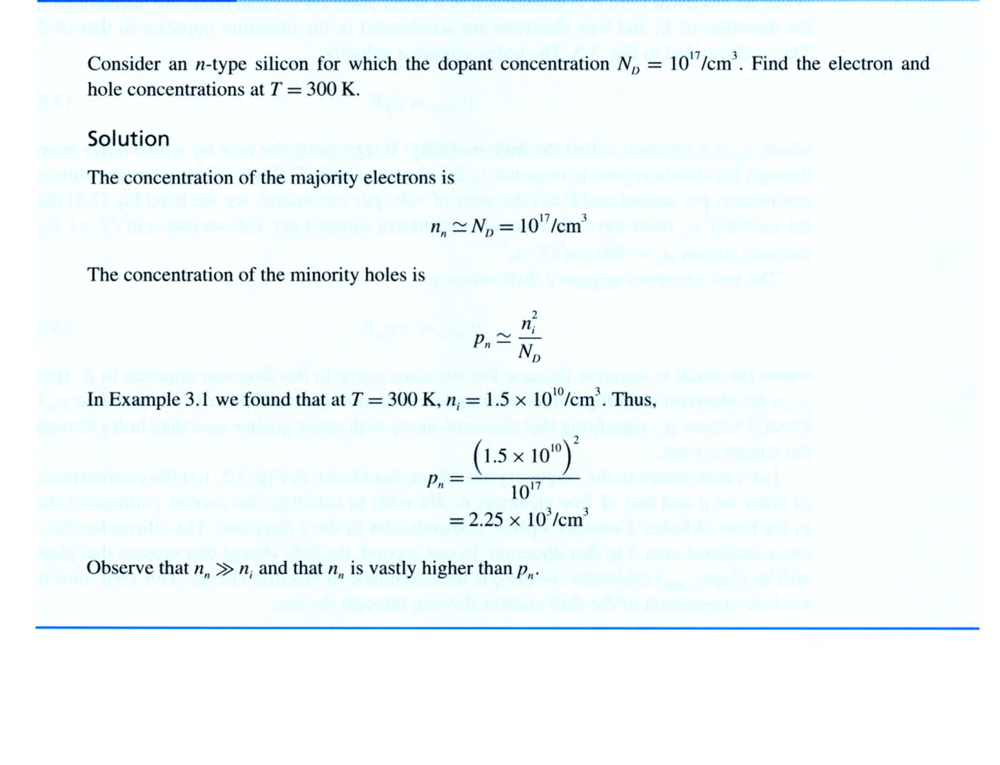
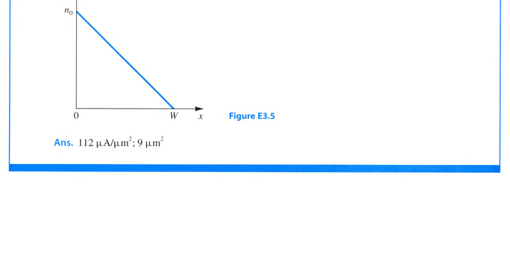
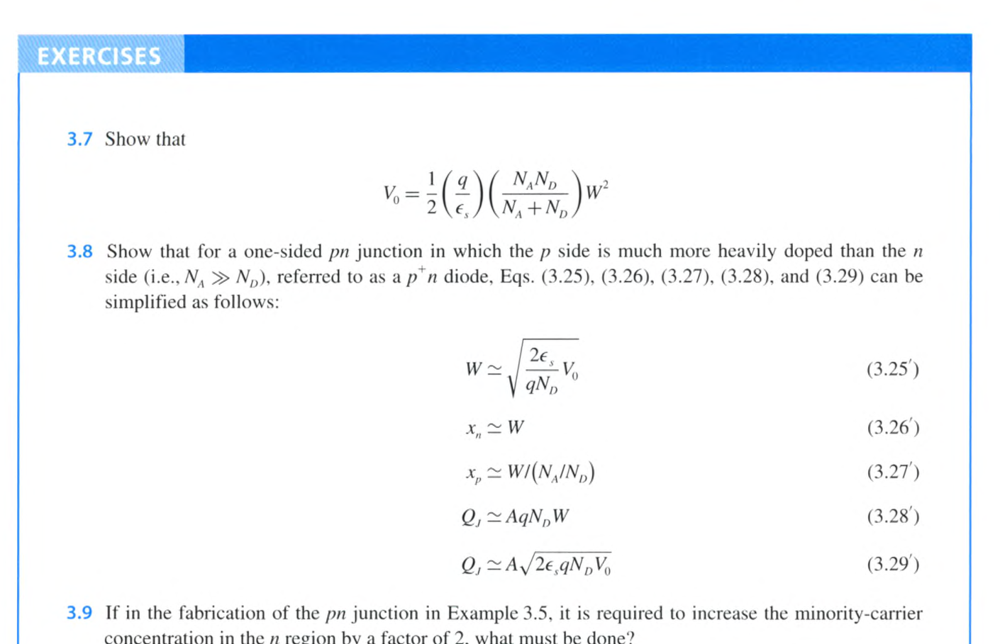
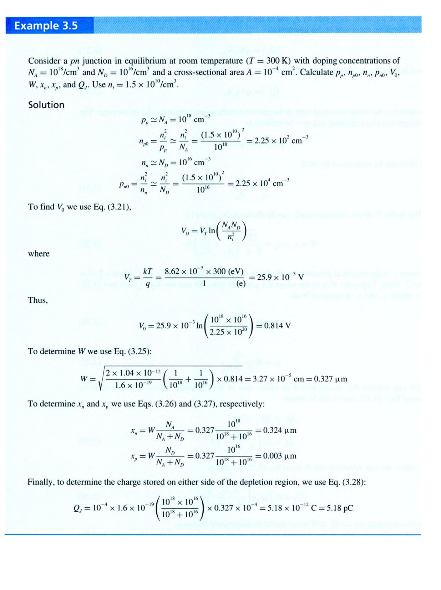
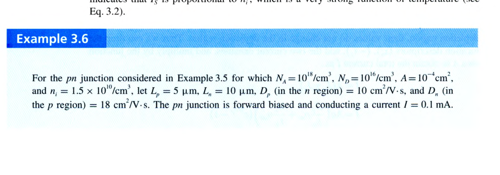

# Chapter 3 章內練習題：半導體

<PracticeCard type="exercise" id="elec-ch3-exercise-3-1" title="本質載子濃度與溫度" source="Exercise 3.1 · Textbook P140" topic="本質半導體">

計算矽在 $T=50\text{ K}$ 與 $350\text{ K}$ 時的本質載子濃度 $n_i$。

<template #solution>

教材答案：$9.6\times10^{-39}\text{ cm}^{-3}$；$4.15\times10^{11}\text{ cm}^{-3}$。

</template>
</PracticeCard>

<PracticeCard type="exercise" id="elec-ch3-exercise-3-2" title="升溫後的 n 型矽載子濃度" source="Exercise 3.2 · Textbook P144" topic="摻雜半導體">

一塊 n 型矽的施體濃度為 $N_D=10^{17}\text{ cm}^{-3}$。求 $T=350\text{ K}$ 時的電子與電洞濃度；本題使用 Exercise 3.1 所得 $350\text{ K}$ 的 $n_i$。

<template #solution>

教材答案：$n_n=10^{17}\text{ cm}^{-3}$，$p_n=1.72\times10^6\text{ cm}^{-3}$。

</template>
</PracticeCard>

<PracticeCard type="exercise" id="elec-ch3-exercise-3-3" title="硼摻雜濃度反推" source="Exercise 3.3 · Textbook P144" topic="摻雜半導體">

矽晶體以硼摻雜。若在 $T=300\text{ K}$ 時，電子濃度比本質載子濃度低 $10^6$ 倍，求受體濃度 $N_A$。

<template #solution>

教材答案：$N_A=1.5\times10^{16}\text{ cm}^{-3}$。

</template>
</PracticeCard>

<PracticeCard type="exercise" id="elec-ch3-exercise-3-4" title="漂移速度、電流密度與電阻" source="Exercise 3.4 · Textbook P147" topic="漂移電流">

一均勻 n 型矽棒長 $2\,\mu\text{m}$，兩端加 $1\text{ V}$。已知 $N_D=10^{16}\text{ cm}^{-3}$、$\mu_n=1350\text{ cm}^2/(\text{V}\cdot\text{s})$，求：

1. 電子漂移速度；
2. 電子通過 $2\,\mu\text{m}$ 所需時間；
3. 漂移電流密度；
4. 若截面積為 $0.25\,\mu\text{m}^2$，求電阻與漂移電流。

<template #solution>

教材答案：$6.75\times10^6\text{ cm/s}$；$30\text{ ps}$；$1.08\times10^4\text{ A/cm}^2$；$37.0\text{ k}\Omega$、$27\,\mu\text{A}$。

</template>
</PracticeCard>

<PracticeCard type="exercise" id="elec-ch3-exercise-3-5" title="線性濃度梯度造成的電子擴散" source="Exercise 3.5 · Textbook P149" topic="擴散電流">

下圖的線性電子濃度分布建立在一塊矽中。若 $n_0=10^{17}\text{ cm}^{-3}$、$W=0.5\,\mu\text{m}$，求電子電流密度（以 $\mu\text{A}/\mu\text{m}^2$ 表示）。若需要 $1\text{ mA}$ 的擴散電流，垂直紙面的截面積應為多少？取 $D_n=35\text{ cm}^2/\text{s}$。

<template #solution>

教材答案：$112\,\mu\text{A}/\mu\text{m}^2$；$9\,\mu\text{m}^2$。

</template>
</PracticeCard>

<PracticeCard type="exercise" id="elec-ch3-exercise-3-6" title="Einstein 關係式" source="Exercise 3.6 · Textbook P150" topic="遷移率與擴散常數">

使用 Einstein 關係式，在 $300\text{ K}$ 下由 $\mu_n=1350\text{ cm}^2/(\text{V}\cdot\text{s})$ 與 $\mu_p=480\text{ cm}^2/(\text{V}\cdot\text{s})$ 求本質矽的 $D_n$ 與 $D_p$。

<template #solution>

教材答案：$D_n=35\text{ cm}^2/\text{s}$，$D_p=12.4\text{ cm}^2/\text{s}$。

</template>
</PracticeCard>

<PracticeCard type="exercise" id="elec-ch3-exercise-3-7" title="由空乏區寬度表示內建電位" source="Exercise 3.7 · Textbook P157" topic="pn 接面">

證明

$$
V_0=\frac{1}{2}\left(\frac{q}{\varepsilon_s}\right)\left(\frac{N_A N_D}{N_A+N_D}\right)W^2.
$$

</PracticeCard>

<PracticeCard type="exercise" id="elec-ch3-exercise-3-8" title="單邊 p+n 接面近似式" source="Exercise 3.8 · Textbook P157" topic="pn 接面">

對 $N_A\gg N_D$ 的單邊 $p^+n$ 接面，從一般式推導並證明：

$$
W\simeq\sqrt{\frac{2\varepsilon_s V_0}{qN_D}},\qquad x_n\simeq W,
$$

$$
x_p\simeq\frac{W}{N_A/N_D},\qquad Q_J\simeq AqN_DW,
$$

$$
Q_J\simeq A\sqrt{2\varepsilon_s qN_DV_0}.
$$

</PracticeCard>

<PracticeCard type="exercise" id="elec-ch3-exercise-3-9" title="少數載子濃度倍增的製程調整" source="Exercise 3.9 · Textbook P157" topic="pn 接面平衡濃度">

沿用下圖所列 Example 3.5 的 pn 接面。若製程要求 n 區的少數載子濃度增加為 2 倍，應如何調整摻雜？

<template #solution>

教材答案：將 $N_D$ 降低為原來的 $1/2$。

</template>
</PracticeCard>

<PracticeCard type="exercise" id="elec-ch3-exercise-3-10" title="單邊接面的尺度電流近似" source="Exercise 3.10 · Textbook P164" topic="pn 接面電流">

證明當 $N_A\gg N_D$ 時，接面尺度電流可近似為

$$
I_S\simeq Aq n_i^2\frac{D_p}{L_pN_D}.
$$

</PracticeCard>

<PracticeCard type="exercise" id="elec-ch3-exercise-3-11" title="降低 ND 對尺度電流的影響" source="Exercise 3.11 · Textbook P164" topic="pn 接面電流">

沿用下圖的 Example 3.6 條件，但將 $N_D$ 降低為原來的 $1/2$。求 $I_S$，以及在 $V=0.605\text{ V}$ 時的接面電流 $I$。

<template #solution>

教材答案：$I_S=1.46\times10^{-14}\text{ A}$；$I=0.2\text{ mA}$。

</template>
</PracticeCard>

<PracticeCard type="exercise" id="elec-ch3-exercise-3-12" title="順向偏壓下的空乏區寬度" source="Exercise 3.12 · Textbook P164" topic="pn 接面偏壓">

沿用下列 Example 3.5 與 3.6 的接面參數，求在 Example 3.6 所得順向電壓 $V_F=0.605\text{ V}$ 下的空乏區寬度 $W$。提示：在反向偏壓公式中以 $-V_F$ 取代 $V_R$。

<template #solution>

教材答案：$W=0.166\,\mu\text{m}$。

</template>
</PracticeCard>

<PracticeCard type="exercise" id="elec-ch3-exercise-3-13" title="反向偏壓下的空乏區與電荷" source="Exercise 3.13 · Textbook P164" topic="pn 接面偏壓">

沿用下列 Example 3.5 與 3.6 的接面參數。當施加 $2\text{ V}$ 反向偏壓時，求空乏區寬度 $W$、空乏區儲存電荷 $Q_J$，以及反向電流 $I$。

<template #solution>

教材答案：$W=0.608\,\mu\text{m}$；$Q_J=9.63\text{ pC}$；$I=7.3\times10^{-15}\text{ A}$（反向大小）。

</template>
</PracticeCard>

<PracticeCard type="exercise" id="elec-ch3-exercise-3-14" title="零偏壓與反向偏壓接面電容" source="Exercise 3.14 · Textbook P167" topic="接面電容">

沿用 Example 3.5 與 3.6 的接面：$V_0=0.814\text{ V}$、$N_A=10^{18}\text{ cm}^{-3}$、$N_D=10^{16}\text{ cm}^{-3}$、$A=10^{-4}\text{ cm}^2$。求 $C_{J0}$ 與 $V_R=2\text{ V}$ 時的 $C_J$。

<template #solution>

教材答案：$C_{J0}=3.2\text{ pF}$；$C_J=1.7\text{ pF}$。

</template>
</PracticeCard>

<PracticeCard type="exercise" id="elec-ch3-exercise-3-15" title="擴散電容公式推導" source="Exercise 3.15 · Textbook P169" topic="擴散電容">

由 $C_d=dQ/dV$、$Q=\tau_T I$ 與 $I\simeq I_Se^{V/V_T}$，推導

$$
C_d=\left(\frac{\tau_T}{V_T}\right)I.
$$

</PracticeCard>

<PracticeCard type="exercise" id="elec-ch3-exercise-3-16" title="少數載子壽命與擴散電容" source="Exercise 3.16 · Textbook P169" topic="擴散電容">

沿用 Example 3.5 與 3.6 的 pn 接面，已知 $D_p=10\text{ cm}^2/\text{s}$、$L_p=5\,\mu\text{m}$，求順向電流 $I=0.1\text{ mA}$ 時的 $\tau_p$ 與 $C_d$；對此接面可取 $I_p\simeq I$。

<template #solution>

教材答案：$\tau_p=25\text{ ns}$；$C_d=96.5\text{ pF}$。

</template>
</PracticeCard>
