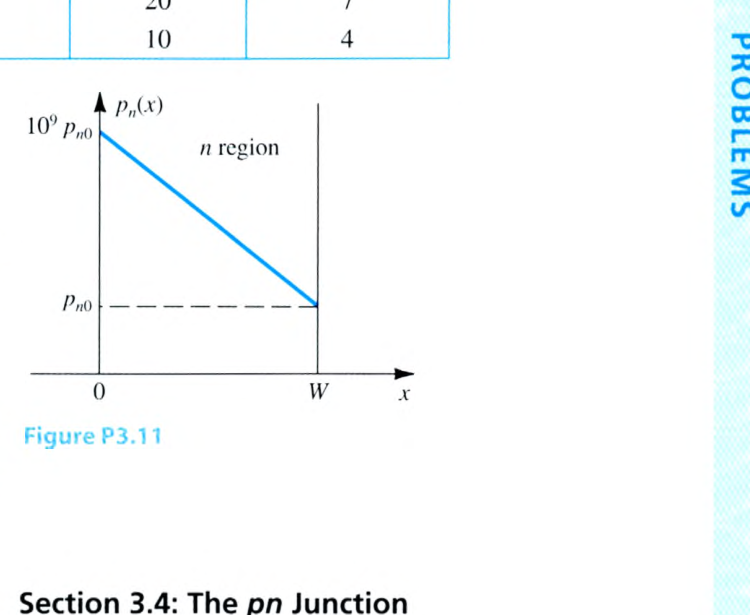
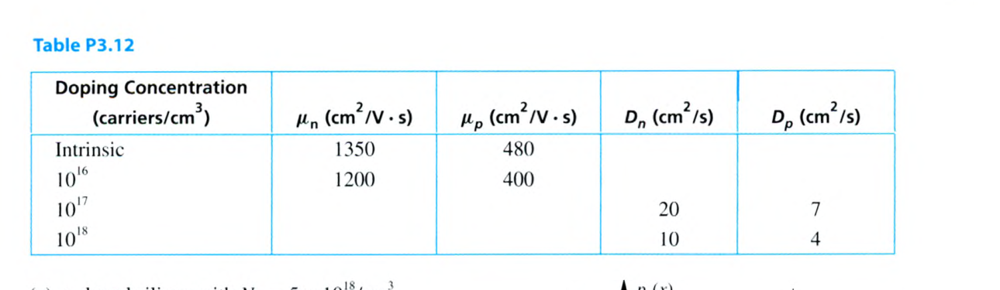

# Chapter 3 Problems 3.1–3.17

<PracticeCard type="exercise" id="elec-ch3-problem-3-1" title="溫度、本質載子濃度與游離比例" source="Problem 3.1 · Textbook P170" topic="本質半導體">

求矽在 $-55^\circ\text{C}$、$0^\circ\text{C}$、$20^\circ\text{C}$、$75^\circ\text{C}$ 與 $125^\circ\text{C}$ 時的本質載子濃度 $n_i$。在各溫度下，被游離的原子比例為何？矽晶體約有 $5\times10^{22}$ 個原子每立方公分。

</PracticeCard>

<PracticeCard type="exercise" id="elec-ch3-problem-3-2" title="砷化鎵的本質載子濃度" source="Problem 3.2 · Textbook P170" topic="本質半導體">

計算砷化鎵（GaAs）在 $T=300\text{ K}$ 時的 $n_i$。取 $B=3.56\times10^{14}\text{ cm}^{-3}\text{K}^{-3/2}$、能隙 $E_g=1.42\text{ eV}$，並與同溫度下的矽比較。

</PracticeCard>

<PracticeCard type="exercise" id="elec-ch3-problem-3-3" title="矽晶圓中的自由電子總數" source="Problem 3.3 · Textbook P170" topic="本質半導體">

一片單晶矽圓形晶圓厚 $300\,\mu\text{m}$、直徑 $15\text{ cm}$。求其在 $T=300\text{ K}$ 時的自由電子總數；取 $n_i=1.5\times10^{10}\text{ cm}^{-3}$。

</PracticeCard>

<PracticeCard type="exercise" id="elec-ch3-problem-3-4" title="p 型矽的多數與少數載子" source="Problem 3.4 · Textbook P170" topic="摻雜半導體">

p 型矽的受體濃度為 $N_A=2\times10^{18}\text{ cm}^{-3}$。求 $T=300\text{ K}$ 時的電洞與電子濃度；取 $n_i=1.5\times10^{10}\text{ cm}^{-3}$。

</PracticeCard>

<PracticeCard type="exercise" id="elec-ch3-problem-3-5" title="由少數電洞濃度反推 ND" source="Problem 3.5 · Textbook P170" topic="摻雜半導體">

一矽晶體以磷摻雜。若在 $T=300\text{ K}$ 時，電洞濃度比本質載子濃度低 $10^5$ 倍，求施體濃度 $N_D$。

</PracticeCard>

<PracticeCard type="exercise" id="elec-ch3-problem-3-6" title="硼摻雜矽的溫度效應" source="Problem 3.6 · Textbook P170" topic="摻雜半導體">

硼摻雜矽層的雜質濃度為 $10^{17}\text{ cm}^{-3}$。分別求 $27^\circ\text{C}$ 與 $125^\circ\text{C}$ 時的電洞、電子濃度，並判定結果為 n 型或 p 型。

</PracticeCard>

<PracticeCard type="exercise" id="elec-ch3-problem-3-7" title="不同材料矽棒的端對端電阻" source="Problem 3.7 · Textbook P170–171" topic="漂移電流">

一長 $15\,\mu\text{m}$、寬 $3\,\mu\text{m}$、厚 $1\,\mu\text{m}$ 的棒材在 $25^\circ\text{C}$ 下由下列材料製成，分別求端對端電阻：

1. 本質矽：取 $n_i=1.5\times10^{10}\text{ cm}^{-3}$、$\mu_n=1350$、$\mu_p=480\text{ cm}^2/(\text{V}\cdot\text{s})$；
2. n 型矽，$N_D=5\times10^{16}\text{ cm}^{-3}$；
3. n 型矽，$N_D=5\times10^{18}\text{ cm}^{-3}$；
4. p 型矽，$N_A=5\times10^{16}\text{ cm}^{-3}$；
5. 鋁，電阻率 $2.8\,\mu\Omega\cdot\text{cm}$。

對摻雜矽，依題意取 $\mu_n=3\mu_p=1200\text{ cm}^2/(\text{V}\cdot\text{s})$；使用 $R=\rho L/A$。

</PracticeCard>

<PracticeCard type="exercise" id="elec-ch3-problem-3-8" title="電子與電洞漂移速度比較" source="Problem 3.8 · Textbook P171" topic="漂移電流">

本質矽層厚 $10\,\mu\text{m}$，跨層施加 $3\text{ V}$。取 $\mu_n=1350\text{ cm}^2/(\text{V}\cdot\text{s})$、$\mu_p=480\text{ cm}^2/(\text{V}\cdot\text{s})$，比較電子與電洞的漂移速度（含方向）。

</PracticeCard>

<PracticeCard type="exercise" id="elec-ch3-problem-3-9" title="由電流反求矽棒長度" source="Problem 3.9 · Textbook P171" topic="漂移電流">

一矽棒截面為 $5\,\mu\text{m}\times4\,\mu\text{m}$，自由電子與電洞濃度分別為 $10^4\text{ cm}^{-3}$ 與 $10^{16}\text{ cm}^{-3}$。若端對端施加 $1\text{ V}$ 時要流過 $0.2\text{ mA}$，求矽棒長度。取 $\mu_n=1200$、$\mu_p=500\text{ cm}^2/(\text{V}\cdot\text{s})$。

</PracticeCard>

<PracticeCard type="exercise" id="elec-ch3-problem-3-10" title="由指定電流密度反求施體濃度" source="Problem 3.10 · Textbook P171" topic="漂移電流">

一長 $10\,\mu\text{m}$ 的施體摻雜矽棒，兩端施加 $1\text{ V}$。若要得到 $2\text{ mA}/\mu\text{m}^2$ 的電流密度，求所需施體濃度；一階近似取 $\mu_n=1350\text{ cm}^2/(\text{V}\cdot\text{s})$。

</PracticeCard>

<PracticeCard type="exercise" id="elec-ch3-problem-3-11" title="線性過量電洞分布的擴散電流" source="Problem 3.11 · Textbook P171" topic="擴散電流">

在室溫 n 型矽區持續注入電洞，形成下圖的穩態過量電洞分布。已知 $N_D=10^{16}\text{ cm}^{-3}$、$n_i=1.5\times10^{10}\text{ cm}^{-3}$、$D_p=12\text{ cm}^2/\text{s}$、$W=50\text{ nm}$，求沿 $x$ 方向的電流密度。

</PracticeCard>

<PracticeCard type="exercise" id="elec-ch3-problem-3-12" title="由 Einstein 關係補齊遷移率與擴散常數" source="Problem 3.12 · Textbook P171" topic="遷移率與擴散常數">

載子遷移率與擴散常數會隨矽的摻雜濃度提高而下降。依下表資料，使用室溫 Einstein 關係式補齊所有空格。

</PracticeCard>

<PracticeCard type="exercise" id="elec-ch3-problem-3-13" title="對稱摻雜 pn 接面的平衡量" source="Problem 3.13 · Textbook P171" topic="pn 接面">

一 pn 接面的 p、n 區皆摻雜為 $5\times10^{16}\text{ cm}^{-3}$，取 $n_i=1.5\times10^{10}\text{ cm}^{-3}$。求開路時的內建電壓、空乏區總寬度、空乏區向 p 與 n 區各自延伸的距離。若接面面積為 $2\,\mu\text{m}^2$，再求接面兩側儲存電荷量的大小。

</PracticeCard>

<PracticeCard type="exercise" id="elec-ch3-problem-3-14" title="非對稱摻雜 pn 接面的平衡量" source="Problem 3.14 · Textbook P171" topic="pn 接面">

一 pn 接面有 $N_A=10^{17}\text{ cm}^{-3}$、$N_D=10^{16}\text{ cm}^{-3}$，取 $n_i=1.5\times10^{10}\text{ cm}^{-3}$。求內建電壓、開路時空乏區寬度 $W$、空乏區在 p 與 n 區內的延伸距離。若接面面積為 $10\,\mu\text{m}^2$，求接面兩側儲存電荷量的大小。

</PracticeCard>

<PracticeCard type="exercise" id="elec-ch3-problem-3-15" title="空乏區儲存電荷估算" source="Problem 3.15 · Textbook P171" topic="pn 接面">

一個 $10\,\mu\text{m}\times10\,\mu\text{m}$ 接面，其一側空乏層厚 $0.1\,\mu\text{m}$，該側摻雜濃度為 $5\times10^{17}\text{ cm}^{-3}$。估算儲存的總電荷量。

</PracticeCard>

<PracticeCard type="exercise" id="elec-ch3-problem-3-16" title="單邊接面的內建電位與電荷" source="Problem 3.16 · Textbook P171" topic="pn 接面">

一 pn 接面滿足 $N_A\gg N_D$，空乏層幾乎全位於輕摻雜側，且 $W=0.2\,\mu\text{m}$、$N_D=10^{16}\text{ cm}^{-3}$。求內建電位 $V_0$；若接面面積 $A=10\,\mu\text{m}^2$，再求 $Q_J$。

</PracticeCard>

<PracticeCard type="exercise" id="elec-ch3-problem-3-17" title="摻雜十倍對內建電位的影響" source="Problem 3.17 · Textbook P171" topic="pn 接面">

若 $N_A$ 或 $N_D$ 單獨增加 10 倍，pn 接面的內建電位 $V_0$ 會改變多少？取室溫 $V_T=25.9\text{ mV}$。

</PracticeCard>
