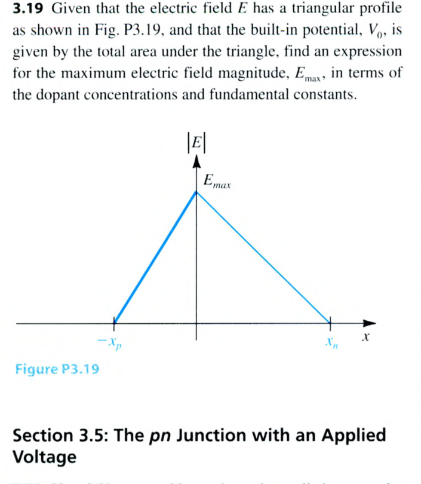
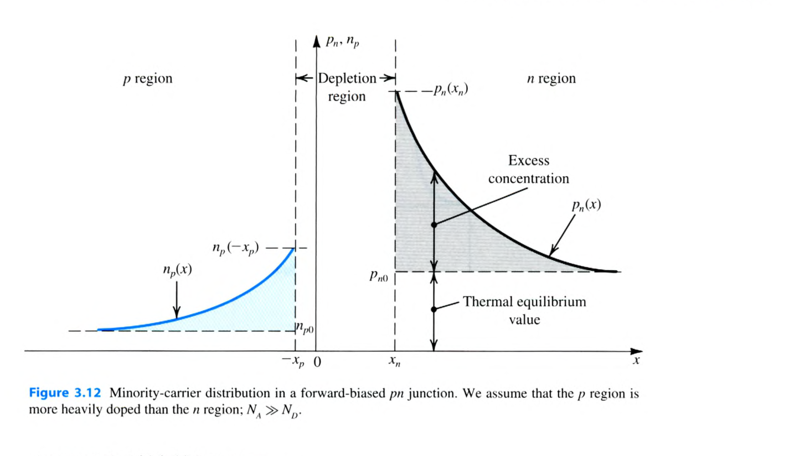

# Chapter 3 Problems 3.18–3.31

<PracticeCard type="exercise" id="elec-ch3-problem-3-18" title="單邊接面電荷密度分布" source="Problem 3.18 · Textbook P172" topic="pn 接面">

對滿足 $N_A\gg N_D\gg n_i$ 的 pn 接面，畫出接面兩側的電荷密度分布。若 $N_D$ 增加為 4 倍，草圖應如何改變？請同時標示高度、寬度與兩側總電荷相等的拘束。

</PracticeCard>

<PracticeCard type="exercise" id="elec-ch3-problem-3-19" title="三角形電場分布的峰值" source="Problem 3.19 · Textbook P172" topic="pn 接面電場">

電場 $E$ 具有下圖所示的三角形分布，內建電位 $V_0$ 等於三角形下的總面積。以摻雜濃度與基本常數表示最大電場大小 $E_{\max}$。

</PracticeCard>

<PracticeCard type="exercise" id="elec-ch3-problem-3-20" title="2 V 反向偏壓下的 W 與 QJ" source="Problem 3.20 · Textbook P172" topic="pn 接面偏壓">

一 pn 接面有 $N_A=10^{17}\text{ cm}^{-3}$、$N_D=10^{16}\text{ cm}^{-3}$、$n_i=1.5\times10^{10}\text{ cm}^{-3}$、接面面積 $A=10\,\mu\text{m}^2$。施加 $2\text{ V}$ 反向偏壓後，求空乏區寬度 $W$ 與儲存電荷 $Q_J$。

</PracticeCard>

<PracticeCard type="exercise" id="elec-ch3-problem-3-21" title="反向偏壓空乏區的尺度律" source="Problem 3.21 · Textbook P172" topic="pn 接面偏壓">

證明 pn 接面加反向偏壓 $V_R$ 時，空乏區寬度與接面電荷為

$$
W=W_0\sqrt{1+\frac{V_R}{V_0}},\qquad
Q_J=Q_{J0}\sqrt{1+\frac{V_R}{V_0}},
$$

其中 $W_0$、$Q_{J0}$ 為平衡狀態的值。

</PracticeCard>

<PracticeCard type="exercise" id="elec-ch3-problem-3-22" title="順向接面的電洞與電子注入比" source="Problem 3.22 · Textbook P172" topic="pn 接面電流">

證明順向偏壓 pn 接面中，電洞注入與電子注入電流之比為

$$
\frac{I_p}{I_n}=\frac{D_pL_nN_A}{D_nL_pN_D}.
$$

再對 $N_A=10^{18}\text{ cm}^{-3}$、$N_D=10^{16}\text{ cm}^{-3}$、$L_p=5\,\mu\text{m}$、$L_n=10\,\mu\text{m}$、$D_p=10\text{ cm}^2/\text{s}$、$D_n=20\text{ cm}^2/\text{s}$ 計算此比值；若總順向電流 $I=100\,\mu\text{A}$，求 $I_p$ 與 $I_n$。

</PracticeCard>

<PracticeCard type="exercise" id="elec-ch3-problem-3-23" title="由接面參數計算 IS 與順向電流" source="Problem 3.23 · Textbook P172" topic="pn 接面電流">

一 pn 接面有 $N_A=10^{17}\text{ cm}^{-3}$、$N_D=10^{16}\text{ cm}^{-3}$、$A=20\,\mu\text{m}^2$、$n_i=1.5\times10^{10}\text{ cm}^{-3}$、$L_p=5\,\mu\text{m}$、$L_n=10\,\mu\text{m}$、$D_p=10\text{ cm}^2/\text{s}$、$D_n=18\text{ cm}^2/\text{s}$。求尺度電流 $I_S$，以及 $V=780\text{ mV}$ 時的電流 $I$。

</PracticeCard>

<PracticeCard type="exercise" id="elec-ch3-problem-3-24" title="升溫 10°C 對尺度電流的影響" source="Problem 3.24 · Textbook P172" topic="溫度效應">

假設 $I_S$ 的溫度依賴主要來自 $I_S\propto n_i^2$。使用

$$
n_i=BT^{3/2}e^{-E_g/(2kT)}
$$

求 $T$ 從 $300\text{ K}$ 升至 $310\text{ K}$ 時 $n_i^2$ 的變化倍數，亦即 $I_S$ 對升溫 $10^\circ\text{C}$ 的近似變化倍數。矽取 $E_g=1.12\text{ eV}$、$k=8.62\times10^{-5}\text{ eV/K}$。

</PracticeCard>

<PracticeCard type="exercise" id="elec-ch3-problem-3-25" title="p+n 單邊接面的順向電流" source="Problem 3.25 · Textbook P172" topic="pn 接面電流">

對 $N_A\gg N_D$ 的 $p^+n$ 接面，證明其順向電流主要由電洞注入構成，且

$$
I\simeq I_p=Aqn_i^2\frac{D_p}{L_pN_D}\left(e^{V/V_T}-1\right).
$$

對 $N_D=10^{16}\text{ cm}^{-3}$、$D_p=10\text{ cm}^2/\text{s}$、$L_p=10\,\mu\text{m}$、$A=10^4\,\mu\text{m}^2$，求 $I_S$，並求 $I=0.2\text{ mA}$ 時的電壓 $V$。取 $T=300\text{ K}$、$n_i=1.5\times10^{10}\text{ cm}^{-3}$。

</PracticeCard>

<PracticeCard type="exercise" id="elec-ch3-problem-3-26" title="崩潰區功率與容許電流" source="Problem 3.26 · Textbook P172" topic="反向崩潰">

一 pn 接面的崩潰電壓為 $12\text{ V}$，最大額定功率為 $0.25\text{ W}$。求使功耗達額定值一半時的連續崩潰電流。若每 $20\text{ ms}$ 中只有 $10\text{ ms}$ 處於崩潰，容許的平均崩潰電流為何？

</PracticeCard>

<PracticeCard type="exercise" id="elec-ch3-problem-3-27" title="指定接面的零偏壓與反偏電容" source="Problem 3.27 · Textbook P172" topic="接面電容">

一 pn 接面有 $N_A=10^{17}\text{ cm}^{-3}$、$N_D=10^{16}\text{ cm}^{-3}$、$n_i=1.5\times10^{10}\text{ cm}^{-3}$、$A=10\,\mu\text{m}^2$。求零偏壓接面電容 $C_{J0}$ 與 $V_R=2\text{ V}$ 時的 $C_J$。

</PracticeCard>

<PracticeCard type="exercise" id="elec-ch3-problem-3-28" title="漸變接面的反向偏壓電容" source="Problem 3.28 · Textbook P173" topic="接面電容">

一接面有 $C_{J0}=0.4\text{ pF}$、$V_0=0.75\text{ V}$、漸變係數 $m=1/3$。由

$$
C_J=\frac{C_{J0}}{\left(1+V_R/V_0\right)^m}
$$

求 $V_R=1\text{ V}$ 與 $3\text{ V}$ 時的 $C_J$。

</PracticeCard>

<PracticeCard type="exercise" id="elec-ch3-problem-3-29" title="平行板觀點推導接面電容" source="Problem 3.29 · Textbook P173" topic="接面電容">

把接面電容視為平行板電容器，令

$$
C_J=\frac{\varepsilon_s A}{W}.
$$

證明此觀點會得到與結合教材式 (3.42)、(3.44) 相同的結果；亦可等價地結合式 (3.44)、(3.45) 驗證。

</PracticeCard>

<PracticeCard type="exercise" id="elec-ch3-problem-3-30" title="擴散電容與電流的比例" source="Problem 3.30 · Textbook P173" topic="擴散電容">

一 pn 接面在順向電流 $I=0.4\text{ mA}$ 時，擴散電容為 $1\text{ pF}$。預測 $I=0.1\text{ mA}$ 時的擴散電容，並求此接面的平均渡越時間 $\tau_T$。室溫取 $V_T=25.9\text{ mV}$。

</PracticeCard>

<PracticeCard type="exercise" id="elec-ch3-problem-3-31" title="短基極二極體與擴散電容" source="Problem 3.31 · Textbook P173" topic="擴散電容">

短基極二極體的 p、n 區寬度分別遠小於 $L_n$、$L_p$，因此兩區的過量少數載子分布為直線，而非下圖的指數分布。假設 $N_A\gg N_D$：

1. 畫出對應於下圖的短基極二極體少數載子分布；
2. 若 p、n 區寬度為 $W_p$、$W_n$，證明

$$
I=Aqn_i^2\left[\frac{D_p}{(W_n-x_n)N_D}+\frac{D_n}{(W_p-x_p)N_A}\right]\left(e^{V/V_T}-1\right),
$$

以及

$$
Q_p=\frac{1}{2}\frac{(W_n-x_n)^2}{D_p}I_p\simeq\frac{1}{2}\frac{W_n^2}{D_p}I_p\quad(W_n\gg x_n);
$$

3. 再假設 $Q\simeq Q_p$、$I\simeq I_p$，證明

$$
C_d=\frac{\tau_T}{V_T}I,\qquad \tau_T=\frac{1}{2}\frac{W_n^2}{D_p};
$$

4. 若設計要求在 $I=1\text{ mA}$ 時限制 $C_d\le 8\text{ pF}$，取 $D_p=10\text{ cm}^2/\text{s}$，求 $W_n$。

</PracticeCard>
