# Chapter 4 章內練習題：二極體

<PracticeProgress total="34" prefix="elec-ch4-exercise-" />

<PracticeCard type="exercise" id="elec-ch4-exercise-4-1" title="半波整流器的轉移特性" source="Exercise 4.1 · PDF p. 208 / 書頁 178" topic="理想二極體">

對 Figure 4.3(a) 的理想二極體電路，繪出輸出電壓 $v_o$ 對輸入電壓 $v_i$ 的轉移特性。

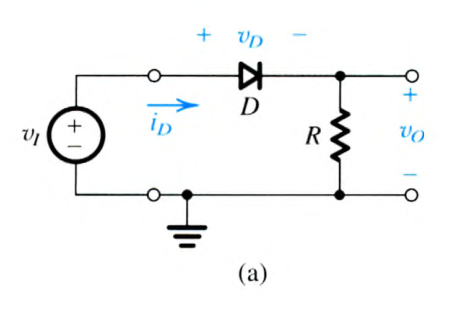

<template #solution>

轉移特性：$v_o=0$（$v_i<0$），$v_o=v_i$（$v_i\ge 0$）。

</template>
</PracticeCard>

<PracticeCard type="exercise" id="elec-ch4-exercise-4-2" title="半波整流器的二極體電壓波形" source="Exercise 4.2 · PDF p. 208 / 書頁 178" topic="理想二極體">

對 Figure 4.3(a) 的理想二極體電路，繪出二極體電壓 $v_D$ 的波形。

<template #solution>

教材答案：$v_D=v_i-v_o$；輸入正半週時 $v_D=0$，負半週時 $v_D=v_i$。

</template>
</PracticeCard>

<PracticeCard type="exercise" id="elec-ch4-exercise-4-3" title="半波整流器的峰值電流與直流輸出" source="Exercise 4.3 · PDF p. 209 / 書頁 179" topic="理想二極體">

Figure 4.3(a) 中輸入 $v_i$ 的峰值為 $10\,\mathrm V$，$R=5\,\mathrm{k\Omega}$。求二極體電流 $i_D$ 的峰值及輸出 $v_o$ 的直流分量。半正弦波平均值為 $V_p/\pi$。

<template #solution>

教材答案：$i_{D,\mathrm{peak}}=2\,\mathrm{mA}$；$V_{O,\mathrm{DC}}=3.18\,\mathrm V$。

</template>
</PracticeCard>

<PracticeCard type="exercise" id="elec-ch4-exercise-4-4" title="理想二極體電路的電流與電壓" source="Exercise 4.4 · PDF p. 213 / 書頁 183" topic="理想二極體">

求 Figure E4.4 六個電路各自標示的電流 $I$ 與電壓 $V$。

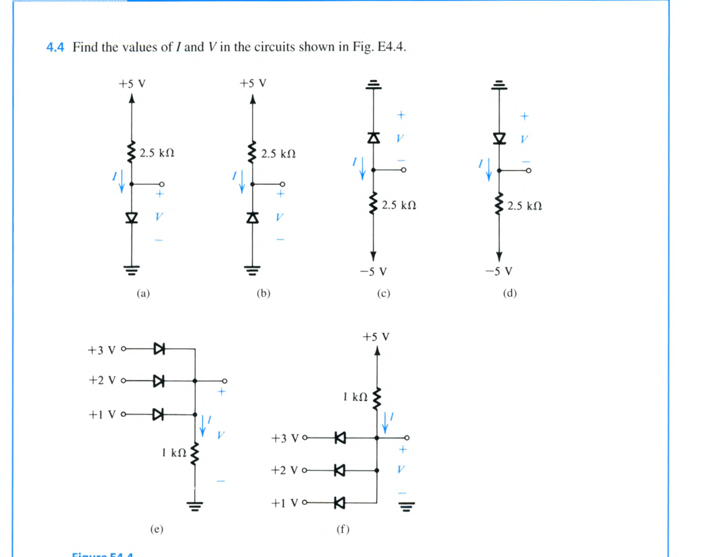

<template #solution>

教材答案： (a) $2\,\mathrm{mA},0\,\mathrm V$；(b) $0\,\mathrm{mA},5\,\mathrm V$；(c) $0\,\mathrm{mA},5\,\mathrm V$；(d) $2\,\mathrm{mA},0\,\mathrm V$；(e) $3\,\mathrm{mA},+3\,\mathrm V$；(f) $4\,\mathrm{mA},+1\,\mathrm V$。

</template>
</PracticeCard>

<PracticeCard type="exercise" id="elec-ch4-exercise-4-5" title="半波整流式交流電壓表" source="Exercise 4.5 · PDF p. 213 / 書頁 183" topic="理想二極體">

Figure E4.5 為交流電壓表電路。動圈式電表的線圈電阻為 $50\,\Omega$，平均電流達 $1\,\mathrm{mA}$ 時滿刻度。輸入正弦波 $v_i$ 為 $20\,\mathrm{V}$ 峰對峰，求使電表滿刻度的串聯電阻 $R$。半正弦波平均值為 $V_p/\pi$。

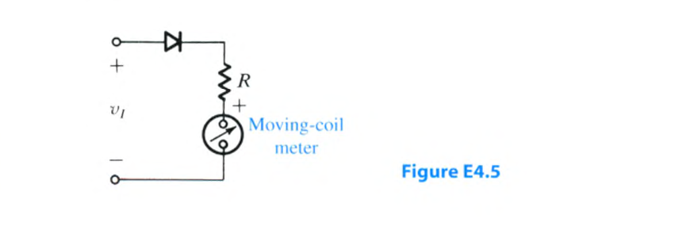

<template #solution>

教材答案：$R=3.133\,\mathrm{k\Omega}$。

</template>
</PracticeCard>

<PracticeCard type="exercise" id="elec-ch4-exercise-4-6" title="限制二極體峰值電流的電阻" source="Exercise 4.6 · PDF p. 214 / 書頁 184" topic="理想二極體">

Figure 4.6 中選擇電阻 $R$，使 $|v_i|<20\,\mathrm V$ 時二極體最大電流為 $50\,\mathrm{mA}$。

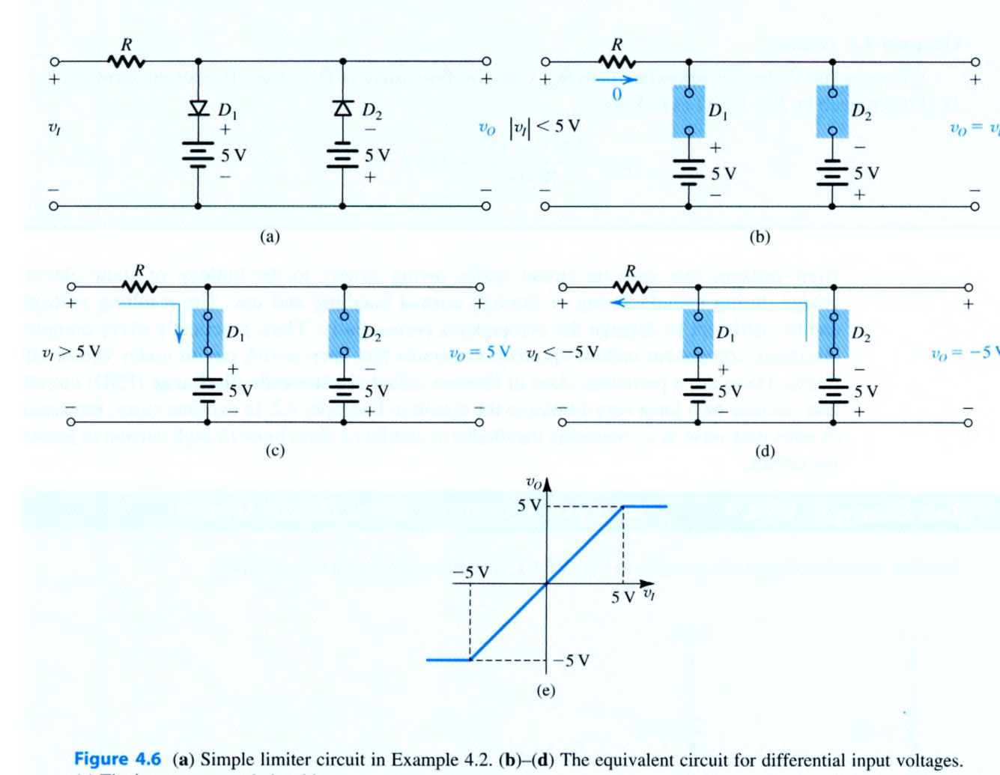

<template #solution>

教材答案：$R=300\,\Omega$。

</template>
</PracticeCard>

<PracticeCard type="exercise" id="elec-ch4-exercise-4-7" title="二極體電流變化造成的電壓變化" source="Exercise 4.7 · PDF p. 219 / 書頁 189" topic="二極體方程式">

若二極體電流由 $0.1\,\mathrm{mA}$ 變為 $10\,\mathrm{mA}$，求二極體電壓的變化量。

<template #solution>

教材答案：$120\,\mathrm{mV}$。

</template>
</PracticeCard>

<PracticeCard type="exercise" id="elec-ch4-exercise-4-8" title="矽二極體於不同電流下的順向壓降" source="Exercise 4.8 · PDF p. 219 / 書頁 189" topic="二極體方程式">

矽接面二極體在 $i=1\,\mathrm{mA}$ 時 $v=0.7\,\mathrm V$。求 $i=0.1\,\mathrm{mA}$ 與 $i=10\,\mathrm{mA}$ 時的壓降。

<template #solution>

教材答案：$0.64\,\mathrm V$；$0.76\,\mathrm V$。

</template>
</PracticeCard>

<PracticeCard type="exercise" id="elec-ch4-exercise-4-9" title="鍺二極體的尺度電流" source="Exercise 4.9 · PDF p. 219 / 書頁 189" topic="二極體方程式">

鍺二極體在順向電流 $0.2\,\mathrm{mA}$ 時的壓降為 $0.3\,\mathrm V$。求尺度電流 $I_S$。

<template #solution>

教材答案：$I_S=1.23\times10^{-9}\,\mathrm A$。

</template>
</PracticeCard>

<PracticeCard type="exercise" id="elec-ch4-exercise-4-10" title="矽二極體尺度電流的溫度變化" source="Exercise 4.10 · PDF p. 219 / 書頁 189" topic="溫度效應">

已知矽二極體在 $25^\circ\mathrm C$ 時 $I_S=10^{-14}\,\mathrm A$，且溫度每上升 $1^\circ\mathrm C$，$I_S$ 增加 $15\%$。求 $125^\circ\mathrm C$ 時的 $I_S$。

<template #solution>

教材答案：$I_S=1.17\times10^{-8}\,\mathrm A$。

</template>
</PracticeCard>

<PracticeCard type="exercise" id="elec-ch4-exercise-4-11" title="反向漏電流的溫度效應" source="Exercise 4.11 · PDF p. 220 / 書頁 190" topic="溫度效應">

Figure E4.11 電路中的二極體是大電流元件，其反向漏電流可視為與電壓無關，並依教材近似在溫度每升高 $10^\circ\mathrm C$ 時加倍。若 $20^\circ\mathrm C$ 時 $V=1\,\mathrm V$，求 $40^\circ\mathrm C$ 與 $0^\circ\mathrm C$ 時的 $V$。

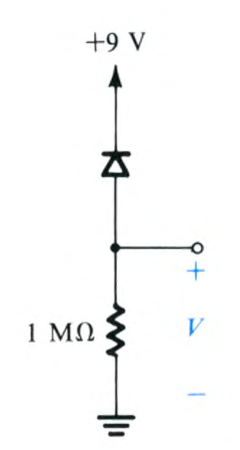

<template #solution>

教材答案：$4\,\mathrm V$；$0.25\,\mathrm V$。

</template>
</PracticeCard>

<PracticeCard type="exercise" id="elec-ch4-exercise-4-12" title="指數模型與定壓降模型分析" source="Exercise 4.12 · PDF p. 225 / 書頁 195" topic="定壓降模型">

Figure 4.10 電路取 $V_{DD}=5\,\mathrm V$、$R=10\,\mathrm{k\Omega}$。已知二極體在 $1\,\mathrm{mA}$ 時壓降為 $0.7\,\mathrm V$，求 $I_D$ 與 $V_D$：(a) 迭代法；(b) $V_D=0.7\,\mathrm V$ 定壓降模型。

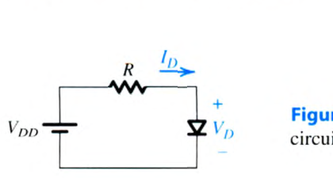

<template #solution>

教材答案：(a) $I_D=0.43\,\mathrm{mA}$、$V_D=0.68\,\mathrm V$；(b) $I_D=0.43\,\mathrm{mA}$、$V_D=0.7\,\mathrm V$。

</template>
</PracticeCard>

<PracticeCard type="exercise" id="elec-ch4-exercise-4-13" title="設計二極體串接電阻以產生輸出電壓" source="Exercise 4.13 · PDF p. 225 / 書頁 195" topic="設計題">

設計 Figure E4.13 電路，使輸出電壓為 $2.4\,\mathrm V$。可用二極體在 $1\,\mathrm{mA}$ 時壓降為 $0.7\,\mathrm V$。

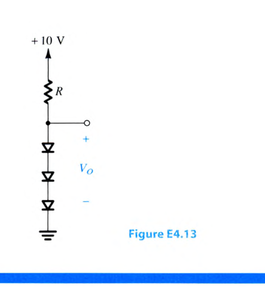

<template #solution>

教材答案：$R=139\,\Omega$。

</template>
</PracticeCard>

<PracticeCard type="exercise" id="elec-ch4-exercise-4-14" title="定壓降模型下的六組二極體電路" source="Exercise 4.14 · PDF p. 225 / 書頁 195" topic="定壓降模型">

將 Exercise 4.4 的六個 Figure E4.4 電路改用 $0.7\,\mathrm V$ 定壓降模型，求各電路標示的 $I$ 與 $V$。

<template #solution>

教材答案：(a) $1.72\,\mathrm{mA},0.7\,\mathrm V$；(b) $0\,\mathrm{mA},5\,\mathrm V$；(c) $0\,\mathrm{mA},5\,\mathrm V$；(d) $1.72\,\mathrm{mA},0.7\,\mathrm V$；(e) $2.3\,\mathrm{mA},+2.3\,\mathrm V$；(f) $3.3\,\mathrm{mA},+1.7\,\mathrm V$。

</template>
</PracticeCard>

<PracticeCard type="exercise" id="elec-ch4-exercise-4-15" title="反向峰值電壓額定值限制" source="Exercise 4.15 · PDF p. 227 / 書頁 197" topic="二極體額定值">

Figure 4.10 中的二極體峰值反向電壓（PIV）為 $30\,\mathrm V$。求可確保安全操作的 $V_{DD}$ 最小值。

<template #solution>

教材答案：$V_{DD}=-30\,\mathrm V$。

</template>
</PracticeCard>

<PracticeCard type="exercise" id="elec-ch4-exercise-4-16" title="齊納二極體工作電壓與最大電流" source="Exercise 4.16 · PDF p. 228 / 書頁 198" topic="齊納二極體">

一顆 $200\,\mathrm{mW}$、$3.5\,\mathrm V$ 齊納二極體在測試電流 $10\,\mathrm{mA}$ 下規格成立，增量電阻為 $10\,\Omega$。反向電流為 $20\,\mathrm{mA}$ 時電壓為何？可安全耗散的最大電流為何？

<template #solution>

教材答案：$3.6\,\mathrm V$；$51\,\mathrm{mA}$。

</template>
</PracticeCard>

<PracticeCard type="exercise" id="elec-ch4-exercise-4-17" title="不同偏壓電流下的二極體小訊號電阻" source="Exercise 4.17 · PDF p. 234 / 書頁 204" topic="小訊號模型">

求二極體在偏壓電流 $0.1\,\mathrm{mA}$、$1\,\mathrm{mA}$ 與 $10\,\mathrm{mA}$ 時的小訊號電阻 $r_d$。

<template #solution>

教材答案：$250\,\Omega$；$25\,\Omega$；$2.5\,\Omega$。

</template>
</PracticeCard>

<PracticeCard type="exercise" id="elec-ch4-exercise-4-18" title="小訊號與指數模型的電流變化比較" source="Exercise 4.18 · PDF p. 234 / 書頁 204" topic="小訊號模型">

二極體偏壓電流為 $1\,\mathrm{mA}$。電壓改變 (a) $-10\,\mathrm{mV}$、(b) $-5\,\mathrm{mV}$、(c) $+5\,\mathrm{mV}$、(d) $+10\,\mathrm{mV}$ 時，分別用 (i) 小訊號模型和 (ii) 指數模型求電流變化。

<template #solution>

教材答案（各組依序為小訊號、指數模型）：(a) $-0.40,-0.33\,\mathrm{mA}$；(b) $-0.20,-0.18\,\mathrm{mA}$；(c) $+0.20,+0.22\,\mathrm{mA}$；(d) $+0.40,+0.49\,\mathrm{mA}$。

</template>
</PracticeCard>

<PracticeCard type="exercise" id="elec-ch4-exercise-4-19" title="設計穩壓電路的輸出與負載調整率" source="Exercise 4.19 · PDF p. 234 / 書頁 204" topic="設計題">

設計 Figure E4.19 電路，使 $I_L=0$ 時 $V_o=3\,\mathrm V$，且每增加 $1\,\mathrm{mA}$ 負載電流時，$V_o$ 改變 $20\,\mathrm{mV}$。 (a) 用二極體小訊號模型求 $R$；(b) 求每顆二極體的 $I_S$；(c) 當 $I_L=1\,\mathrm{mA}$ 時，以指數模型求實際 $V_o$ 變化。

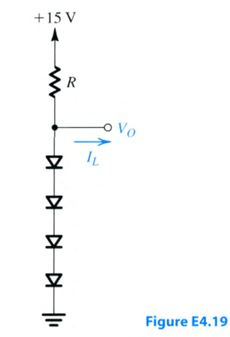

<template #solution>

教材答案：(a) $R=2.4\,\mathrm{k\Omega}$；(b) 每顆 $I_S=4.7\times10^{-16}\,\mathrm A$；(c) $\Delta V_o=-23\,\mathrm{mV}$。

</template>
</PracticeCard>

<PracticeCard type="exercise" id="elec-ch4-exercise-4-20" title="齊納模型參數與電流變化" source="Exercise 4.20 · PDF p. 237 / 書頁 207" topic="齊納二極體">

齊納二極體在 $5\,\mathrm{mA}$ 時標稱電壓為 $6\,\mathrm V$，增量電阻為 $80\,\Omega$。電流減半與加倍時的電壓各為何？齊納等效模型的 $V_{Z0}$ 為何？

<template #solution>

教材答案：$5.8\,\mathrm V$；$6.4\,\mathrm V$；$V_{Z0}=5.6\,\mathrm V$。

</template>
</PracticeCard>

<PracticeCard type="exercise" id="elec-ch4-exercise-4-21" title="半波整流器的導通角、平均值與 PIV" source="Exercise 4.21 · PDF p. 240 / 書頁 210" topic="半波整流">

Figure 4.21(a) 半波整流器使用定壓降 $V_D$ 模型，其中 $V_s$ 為輸入正弦波的峰值。證明導通由 $\theta=\sin^{-1}(V_D/V_s)$ 開始、於 $\pi-\theta$ 結束，總導通角為 $\pi-2\theta$；並推導平均輸出電壓近似式 $V_{O,DC}\simeq(V_s/\pi)-V_D/2$ 與峰值電流 $I_{D,peak}=(V_s-V_D)/R$。當輸入為 $12\,\mathrm{V_{rms}}$、$V_D=0.7\,\mathrm V$、$R=100\,\Omega$ 時，求數值及 PIV。

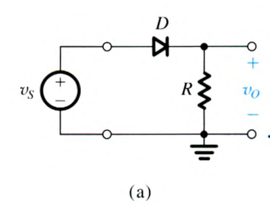

<template #solution>

教材答案：$\theta=2.4^\circ$、導通角 $175^\circ$；$V_{O,DC}=5.05\,\mathrm V$；$I_{D,peak}=163\,\mathrm{mA}$；PIV $=17\,\mathrm V$。

</template>
</PracticeCard>

<PracticeCard type="exercise" id="elec-ch4-exercise-4-22" title="全波整流器的輸出與二極體額定值" source="Exercise 4.22 · PDF p. 242 / 書頁 212" topic="全波整流">

Figure 4.22(a) 全波整流器以定壓降模型分析，$V_s$ 為變壓器次級每半段正弦波的峰值。證明每個輸入過零點附近輸出為零的角度為 $2\sin^{-1}(V_D/V_s)$，平均輸出電壓近似為 $V_{O,DC}\simeq(2/\pi)V_s-V_D$，每顆二極體峰值電流為 $(V_s-V_D)/R$。每半段次級電壓 $v_s$ 的有效值為 $12\,\mathrm{V_{rms}}$、$V_D=0.7\,\mathrm V$、$R=100\,\Omega$ 時，求輸出為正的週期百分比、$V_{O,DC}$、峰值二極體電流與 PIV。

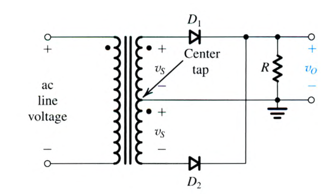

<template #solution>

教材答案：$97.4\%$；$10.1\,\mathrm V$；$163\,\mathrm{mA}$；PIV $=33.2\,\mathrm V$。

</template>
</PracticeCard>

<PracticeCard type="exercise" id="elec-ch4-exercise-4-23" title="橋式整流器的平均輸出與 PIV" source="Exercise 4.23 · PDF p. 244 / 書頁 214" topic="橋式整流">

Figure 4.23(a) 橋式整流器使用定壓降模型，$V_s$ 為變壓器次級輸入正弦波的峰值。推導平均輸出電壓近似式 $V_{O,DC}\simeq(2/\pi)V_s-2V_D$，以及峰值二極體電流 $(V_s-2V_D)/R$。輸入為 $12\,\mathrm{V_{rms}}$、$V_D=0.7\,\mathrm V$、$R=100\,\Omega$ 時，求上述數值與 PIV。

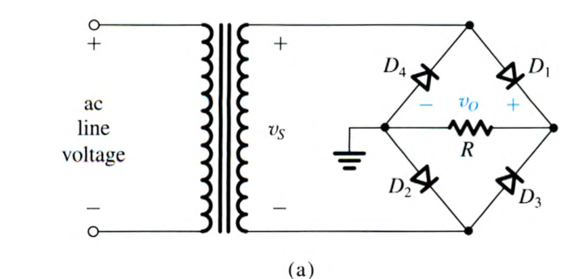

<template #solution>

教材答案：$V_{O,DC}=9.4\,\mathrm V$；$I_{D,peak}=156\,\mathrm{mA}$；PIV $=16.3\,\mathrm V$。

</template>
</PracticeCard>

<PracticeCard type="exercise" id="elec-ch4-exercise-4-24" title="推導全波峰值整流器的漣波與二極體電流式" source="Exercise 4.24 · PDF p. 250 / 書頁 220" topic="峰值整流">

推導全波峰值整流器的下列關係式；其中 $V_p$ 為輸入峰值、$f$ 為輸入頻率、$C$ 為濾波電容、$R$ 為負載、$V_r$ 為峰對峰漣波、$I_L$ 為負載電流。這些式子分別對應原書式 (4.33)–(4.35)。

$$
V_r=\frac{V_p}{2fCR}
$$

$$
i_{D,av}=I_L\left(1+\pi\sqrt{\frac{V_p}{2V_r}}\right)
$$

$$
i_{D,max}=I_L\left(1+2\pi\sqrt{\frac{V_p}{2V_r}}\right)
$$

</PracticeCard>

<PracticeCard type="exercise" id="elec-ch4-exercise-4-25" title="橋式峰值整流器的電容與二極體規格" source="Exercise 4.25 · PDF p. 250 / 書頁 220" topic="峰值整流">

橋式整流器的負載 $R$ 並聯濾波電容 $C$。變壓器次級為 $12\,\mathrm{V_{rms}}$、$60\,\mathrm{Hz}$ 正弦波，$V_D=0.8\,\mathrm V$、$R=100\,\Omega$。求使漣波不超過 $1\,\mathrm V_{p-p}$ 的 $C$、輸出直流電壓、負載電流、二極體導通角、二極體平均與峰值電流、每顆二極體的峰值反向電壓，並指定二極體電流與 PIV 規格。

<template #solution>

教材答案：$C=1281\,\mathrm{\mu F}$；輸出 $15.4\,\mathrm V$（較佳估值 $14.9\,\mathrm V$）；負載電流 $0.15\,\mathrm A$；導通角 $0.36\,\mathrm{rad}=20.7^\circ$；二極體平均電流 $1.45\,\mathrm A$、峰值電流 $2.74\,\mathrm A$；PIV $16.2\,\mathrm V$。選用峰值電流額定 $3.5$–$4\,\mathrm A$、PIV $20\,\mathrm V$ 的二極體。

</template>
</PracticeCard>

<PracticeCard type="exercise" id="elec-ch4-exercise-4-26" title="運算放大器精密半波整流器" source="Exercise 4.26 · PDF p. 252 / 書頁 222" topic="精密整流">

Figure 4.28(a) 超級二極體電路取 $R=1\,\mathrm{k\Omega}$。當 $v_i=10\,\mathrm{mV},1\,\mathrm V,-1\,\mathrm V$ 時，求整流器輸出與運算放大器輸出電壓。運算放大器視為理想，輸出飽和於 $\pm12\,\mathrm V$；二極體在 $1\,\mathrm{mA}$ 時壓降為 $0.7\,\mathrm V$。

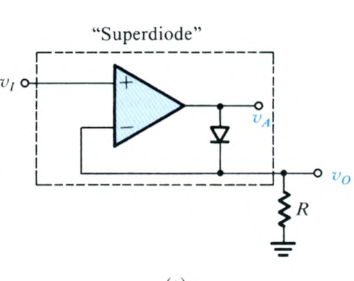

<template #solution>

教材答案（依三種輸入順序，列整流器輸出、運放輸出）：$(10\,\mathrm{mV},0.59\,\mathrm V)$；$(1\,\mathrm V,1.7\,\mathrm V)$；$(0\,\mathrm V,-12\,\mathrm V)$。

</template>
</PracticeCard>

<PracticeCard type="exercise" id="elec-ch4-exercise-4-27" title="反向接二極體的精密整流器" source="Exercise 4.27 · PDF p. 252 / 書頁 222" topic="精密整流">

將 Figure 4.28(a) 中的二極體反向，求輸出 $v_o$ 對輸入 $v_i$ 的轉移特性。

<template #solution>

教材答案：$v_o=0$（$v_i>0$）；$v_o=v_i$（$v_i<0$）。

</template>
</PracticeCard>

<PracticeCard type="exercise" id="elec-ch4-exercise-4-28" title="反向二極體的直流恢復器" source="Exercise 4.28 · PDF p. 255 / 書頁 225" topic="直流恢復">

Figure 4.29 的直流恢復器中，若將二極體反向，輸出 $v_o$ 的直流分量為何？

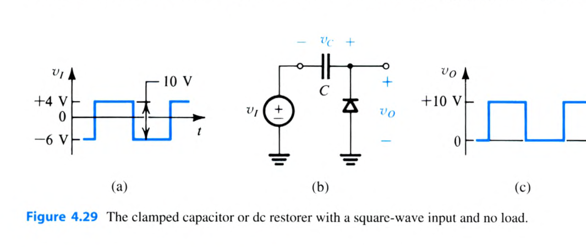

<template #solution>

教材答案：$-5\,\mathrm V$。

</template>
</PracticeCard>

<PracticeCard type="exercise" id="elec-ch4-exercise-4-29" title="自舉電路的電容電壓與 PIV" source="Exercise 4.29 · PDF p. 255 / 書頁 225" topic="自舉電路">

Figure 4.30 自舉電路中 $V_{CC}=5\,\mathrm V$、$V_i=3\,\mathrm V$。假設二極體理想，求電容電壓及二極體峰值反向電壓（PIV）。

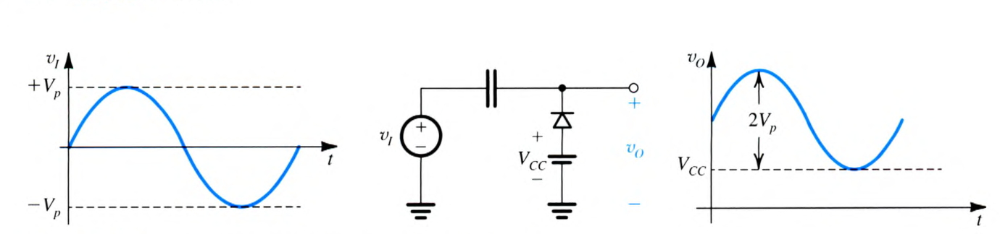

<template #solution>

教材答案：電容電壓 $8\,\mathrm V$；二極體 PIV $6\,\mathrm V$。

</template>
</PracticeCard>

<PracticeCard type="exercise" id="elec-ch4-exercise-4-30" title="變容二極體的電容變化" source="Exercise 4.30 · PDF p. 255 / 書頁 225" topic="變容二極體">

變容二極體在零偏壓時電容 $C_{j0}=100\,\mathrm{fF}$，$V_0=3\,\mathrm V$、$m=3$。其接面電容關係為 $C_j=C_{j0}/(1+V_R/V_0)^m$（原書式 (3.47)）。估算反向偏壓 $V_R=1\,\mathrm V$ 與 $3\,\mathrm V$ 時的電容。

<template #solution>

教材答案：$42.2\,\mathrm{fF}$；$12.5\,\mathrm{fF}$。

</template>
</PracticeCard>

<PracticeCard type="exercise" id="elec-ch4-exercise-4-31" title="光二極體的光電流與暗電流" source="Exercise 4.31 · PDF p. 258 / 書頁 228" topic="光二極體">

反向偏壓光二極體的響應度為 $0.5\,\mathrm{A/W}$，暗電流為 $100\,\mathrm{nA}$。入射光功率為 $1\,\mathrm{mW}$ 時，總反向電流為何？若入射光功率為 $1\,\mathrm{\mu W}$，總反向電流為何？

<template #solution>

教材答案：$0.5\,\mathrm{mA}$；$0.6\,\mathrm{\mu A}$。

</template>
</PracticeCard>

<PracticeCard type="exercise" id="elec-ch4-exercise-4-32" title="光二極體感測器的面積與接面電容" source="Exercise 4.32 · PDF p. 258 / 書頁 228" topic="光二極體">

以響應度 $0.3\,\mathrm{A/W}$ 的反向偏壓光二極體作光感測器。欲在光強度 $10\,\mathrm{mW/m^2}$ 下產生 $1\,\mathrm{\mu A}$ 電流（忽略暗電流），所需光二極體表面積為何？若該偏壓下每 $\mathrm{mm^2}$ 面積的電容為 $10\,\mathrm{pF}$，估算總電容。

<template #solution>

教材答案：面積 $3.3\,\mathrm{cm^2}$；電容 $3.3\,\mathrm{nF}$。

</template>
</PracticeCard>

<PracticeCard type="exercise" id="elec-ch4-exercise-4-33" title="串接紅色 LED 的限流電阻" source="Exercise 4.33 · PDF p. 258 / 書頁 228" topic="LED">

依 Figure E4.33，三顆紅色 LED 串聯接於 $9\,\mathrm V$ 電源。每顆 LED 在 $20\,\mathrm{mA}$ 時順向壓降為 $1.8\,\mathrm V$。求維持 $20\,\mathrm{mA}$ 所需電阻 $R$。

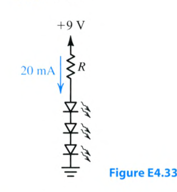

<template #solution>

教材答案：$R=180\,\Omega$。

</template>
</PracticeCard>

<PracticeCard type="exercise" id="elec-ch4-exercise-4-34" title="串接綠色 LED 的限流電阻" source="Exercise 4.34 · PDF p. 258 / 書頁 228" topic="LED">

依 Figure E4.33，改用三顆綠色 LED 串聯接於 $9\,\mathrm V$ 電源；每顆 LED 在 $20\,\mathrm{mA}$ 時順向壓降為 $2.2\,\mathrm V$。求維持 $20\,\mathrm{mA}$ 所需電阻 $R$。

<template #solution>

教材答案：$R=120\,\Omega$。

</template>
</PracticeCard>
