# 第四章 Problems 4.1–4.45

<PracticeProgress total="45" prefix="elec-ch4-problem-4-" />

> 題幹依 Sedra/Smith《Microelectronic Circuits》第 8 版第四章原文翻譯並保留原數值與符號。PDF 頁碼及印刷頁碼列於各卡來源。題目引用的電路圖均置於該卡內。Problem 4.1–4.45 的選答解答屬線上 Appendix L；本地 PDF 未提供，故不附答案。

<PracticeCard id="elec-ch4-problem-4-1" title="Problem 4.1｜理想二極體與電池" type="exercise" source="Sedra/Smith 8e p.230 (PDF 260), Problem 4.1" topic="理想二極體">

一顆 AA 電池的戴維寧等效為 $1.5\,\text{V}$ 電壓源串聯 $2\,\Omega$ 電阻，並接上一顆理想二極體。描述可能發生的兩種狀態。分別求下列接法中的二極體電流與端電壓：

(a) 二極體陰極接電池正端；(b) 二極體陽極接電池正端。

</PracticeCard>

<PracticeCard id="elec-ch4-problem-4-2" title="Problem 4.2｜理想二極體電路" type="exercise" source="Sedra/Smith 8e p.230 (PDF 260), Problem 4.2" topic="理想二極體">

假設圖中二極體皆為理想元件，求各電路標示的電壓與電流。

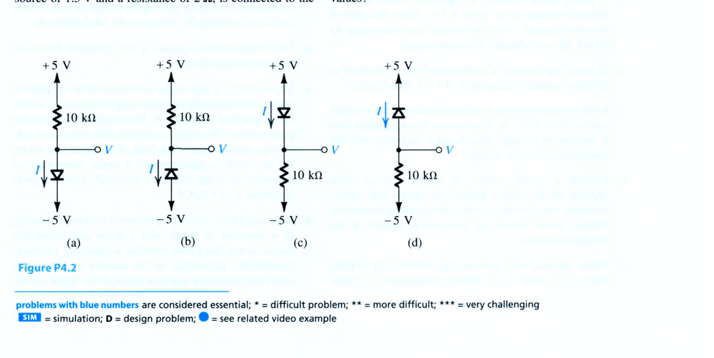

</PracticeCard>

<PracticeCard id="elec-ch4-problem-4-3" title="Problem 4.3｜理想二極體電路" type="exercise" source="Sedra/Smith 8e p.230–231 (PDF 260–261), Problem 4.3" topic="理想二極體">

假設圖中二極體皆為理想元件，求各電路標示的電壓與電流。

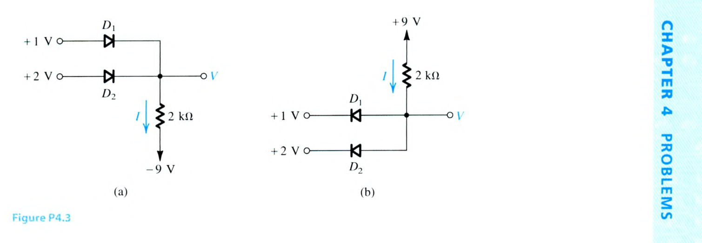

</PracticeCard>

<PracticeCard id="elec-ch4-problem-4-4" title="Problem 4.4｜理想二極體輸出波形" type="exercise" source="Sedra/Smith 8e p.230–232 (PDF 260–262), Problem 4.4" topic="理想二極體">

下列每個理想二極體電路的輸入 $v_i$ 均為頻率 $1\,\text{kHz}$、峰值 $5\,\text{V}$ 的正弦波。畫出輸出 $v_o$ 的波形，並求其正峰值與負峰值。

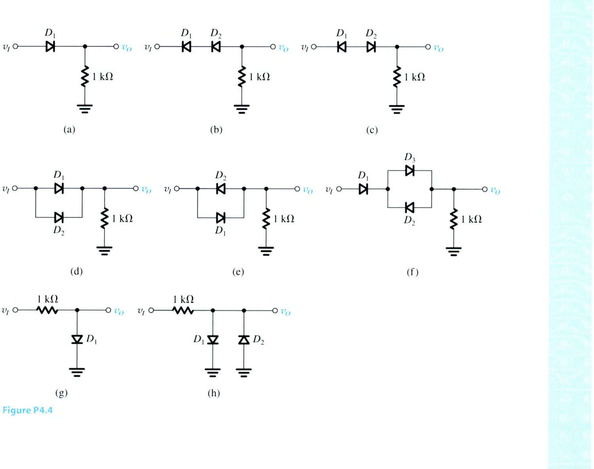

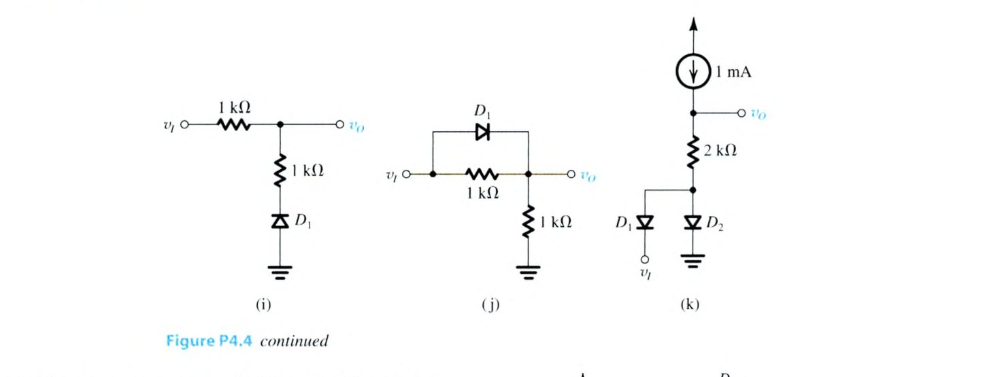

</PracticeCard>

<PracticeCard id="elec-ch4-problem-4-5" title="Problem 4.5｜電池充電器" type="exercise" source="Sedra/Smith 8e p.232 (PDF 262), Problem 4.5" topic="整流與電池充電">

圖示電路為電池充電器模型。$v_i$ 是峰值 $10\,\text{V}$ 的正弦波，$D_1$、$D_2$ 為理想二極體，電流源 $I=100\,\text{mA}$，電池電壓 $B=3\,\text{V}$。畫出並標示電池電流 $i_B$ 波形，求其峰值與平均值。若 $v_i$ 的峰值降低 $10\%$，新的峰值與平均電池電流為何？

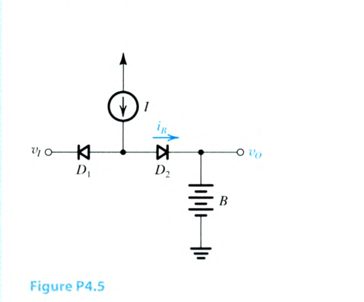

</PracticeCard>

<PracticeCard id="elec-ch4-problem-4-6" title="Problem 4.6｜二極體邏輯閘" type="exercise" source="Sedra/Smith 8e p.232 (PDF 262), Problem 4.6" topic="二極體邏輯">

圖示電路可作為輸入電壓只有高、低兩種狀態的邏輯閘。以 1 表示高、0 表示低，列出四種輸入組合及對應輸出 $X$、$Y$，形成四欄真值表。$X$ 是 $A$、$B$ 的何種邏輯函數？$Y$ 是 $A$、$B$ 的何種邏輯函數？哪些 $A,B$ 組合使 $X=Y$，哪些使 $X$ 與 $Y$ 相反？

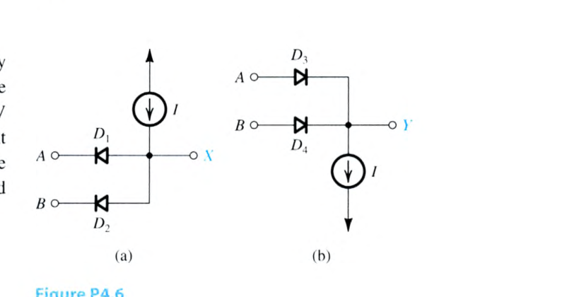

</PracticeCard>

<PracticeCard id="elec-ch4-problem-4-7" title="Problem 4.7｜理想二極體電路" type="exercise" source="Sedra/Smith 8e p.232 (PDF 262), Problem 4.7" topic="理想二極體">

假設 Figure P4.7 中的二極體皆為理想元件，求各電路標示的電壓與電流。

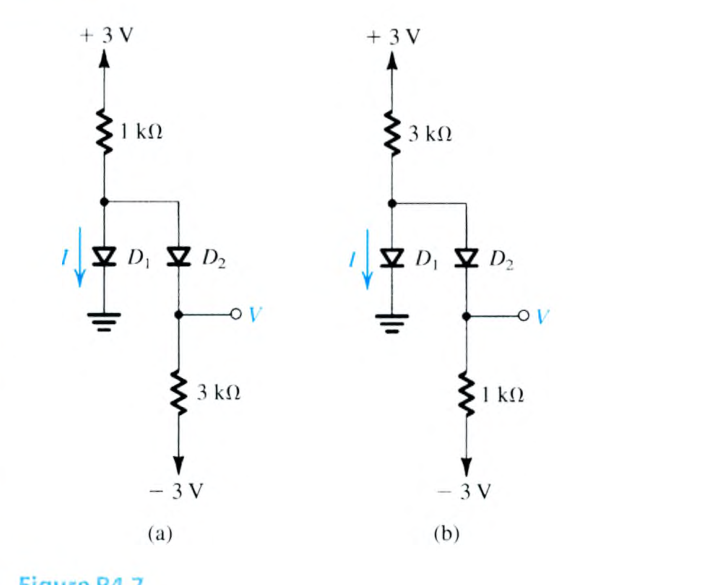

</PracticeCard>

<PracticeCard id="elec-ch4-problem-4-8" title="Problem 4.8｜戴維寧等效與理想二極體" type="exercise" source="Sedra/Smith 8e p.233 (PDF 263), Problem 4.8" topic="戴維寧定理">

假設 Figure P4.8 中的二極體皆為理想元件。利用戴維寧定理簡化電路，並求標示的電流與電壓。

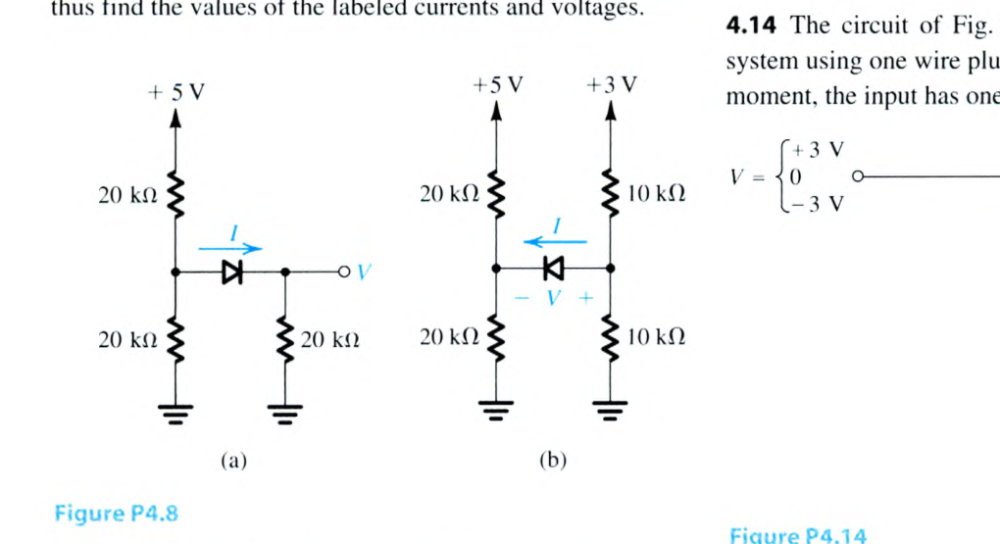

</PracticeCard>

<PracticeCard id="elec-ch4-problem-4-9" title="Problem 4.9｜半波整流器設計" type="exercise" source="Sedra/Smith 8e p.233 (PDF 263), Problem 4.9" topic="整流器">

對 Figure 4.3(a) 的整流器，輸入正弦波有效值為 $120\,\text{V}$，二極體視為理想元件。選擇適當的 $R$，使二極體峰值電流不超過 $40\,\text{mA}$；並求二極體承受的最大反向電壓。

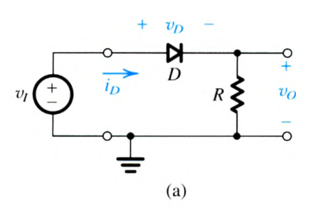

</PracticeCard>

<PracticeCard id="elec-ch4-problem-4-10" title="Problem 4.10｜方波輸入整流器" type="exercise" source="Sedra/Smith 8e p.233 (PDF 263), Problem 4.10" topic="整流器">

將峰對峰值 $10\,\text{V}$、平均值為零的對稱方波，輸入到類似 Figure 4.3(a) 的電路，串聯電阻為 $200\,\Omega$。求輸出電壓峰值與平均值、二極體電流峰值與平均值，以及二極體承受的最大反向電壓。

</PracticeCard>

<PracticeCard id="elec-ch4-problem-4-11" title="Problem 4.11｜非對稱方波整流器" type="exercise" source="Sedra/Smith 8e p.233 (PDF 263), Problem 4.11" topic="整流器">

使用 Figure 4.3(a) 的電路，令 $R=200\,\Omega$，輸入方波在 $+5\,\text{V}$ 與 $-3\,\text{V}$ 間切換。畫出輸出 $v_o$ 波形，求二極體電流的峰值與平均值。

</PracticeCard>

<PracticeCard id="elec-ch4-problem-4-12" title="Problem 4.12｜二極體限流設計" type="exercise" source="Sedra/Smith 8e p.233 (PDF 263), Problem 4.12" topic="電路設計">

對 Figure 4.4(a) 的電池充電電路，電池為 $12\,\text{V}$，輸入 $v_s$ 為峰值 $24\,\text{V}$ 的正弦波（沿用 Example 4.1 的條件）。選擇新的電阻值 $R$，使二極體峰值電流限制為 $50\,\text{mA}$；圖中原有的 $100\,\Omega$ 是待替換的電阻值。

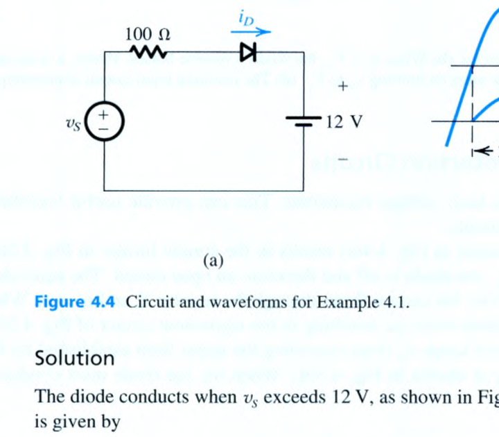

</PracticeCard>

<PracticeCard id="elec-ch4-problem-4-13" title="Problem 4.13｜電池充電器設計" type="exercise" source="Sedra/Smith 8e p.233 (PDF 263), Problem 4.13" topic="電路設計">

重新設計一個類似 Figure 4.4(a)、使用理想二極體的電池充電電路，將電流送入 $12\,\text{V}$ 電池的時間占週期 $25\%$，平均電流為 $100\,\text{mA}$。本題需重新選定輸入正弦波峰對峰值與串聯電阻；圖中的 Example 4.1 數值（$v_s$ 峰值 $24\,\text{V}$、$R=100\,\Omega$）僅為原例題設定，不是本題的設計限制。求所需正弦波峰對峰值、電阻、二極體峰值電流與二極體承受的峰值反向電壓。若電阻只能取一位有效數字、峰對峰電壓只能取最接近的整數伏特，選擇可保證充電電流要求的設計；並求該設計的導通週期比例、二極體平均與峰值電流、峰值反向電壓。

</PracticeCard>

<PracticeCard id="elec-ch4-problem-4-14" title="Problem 4.14｜二極體訊號系統" type="exercise" source="Sedra/Smith 8e p.233 (PDF 263), Problem 4.14" topic="二極體應用">

Figure P4.14 的電路可用於以一條訊號線及共地回路構成的訊號系統。任一時刻輸入 $V$ 為 $+3\,\text{V}$、$0\,\text{V}$ 或 $-3\,\text{V}$。對每一種輸入值，說明紅燈與綠燈的狀態。燈可以分置於不同位置，同一導線上也可接多組相同連接。

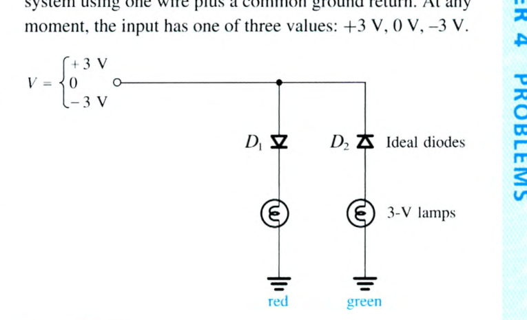

</PracticeCard>

<PracticeCard id="elec-ch4-problem-4-15" title="Problem 4.15｜限幅器安全輸入範圍" type="exercise" source="Sedra/Smith 8e p.233 (PDF 263), Problem 4.15" topic="限幅與保護">

Figure 4.5(a) 限幅器中 $V_+=3\,\text{V}$、$R=100\,\Omega$。二極體規格為最大反向電壓 $10\,\text{V}$、最大順向電流 $50\,\text{mA}$。求可安全施加於 $v_i$ 的最高與最低電壓。

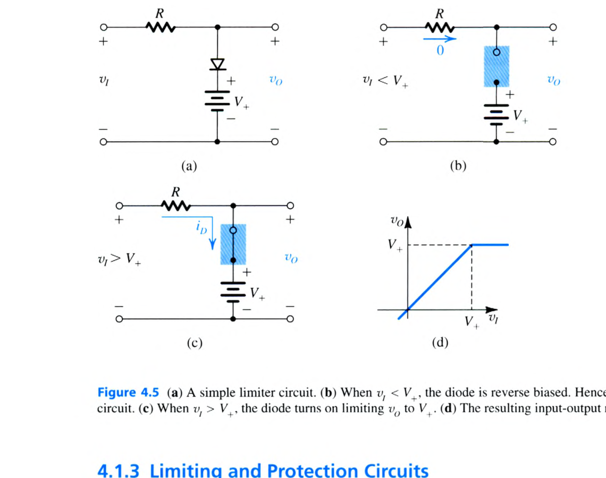

</PracticeCard>

<PracticeCard id="elec-ch4-problem-4-16" title="Problem 4.16｜限幅器電流特性" type="exercise" source="Sedra/Smith 8e p.233 (PDF 263), Problem 4.16" topic="限幅與保護">

Figure 4.5(a) 限幅器中 $V_+=5\,\text{V}$、$R=500\,\Omega$。繪出二極體電流 $i_D$ 對輸入電壓 $v_i$ 的關係圖。若在 $v_o$ 與地之間接上 $1\,\text{k}\Omega$ 負載電阻，圖形如何改變？

</PracticeCard>

<PracticeCard id="elec-ch4-problem-4-17" title="Problem 4.17｜突波下二極體額定值" type="exercise" source="Sedra/Smith 8e p.233 (PDF 263), Problem 4.17" topic="限幅與保護">

Figure 4.6(a) 的二極體必須承受閃電造成的暫態輸入突波 $v_i=\pm200\,\text{V}$。若 $R=100\,\Omega$，二極體須承受的峰值電流與峰值反向電壓各為多少？

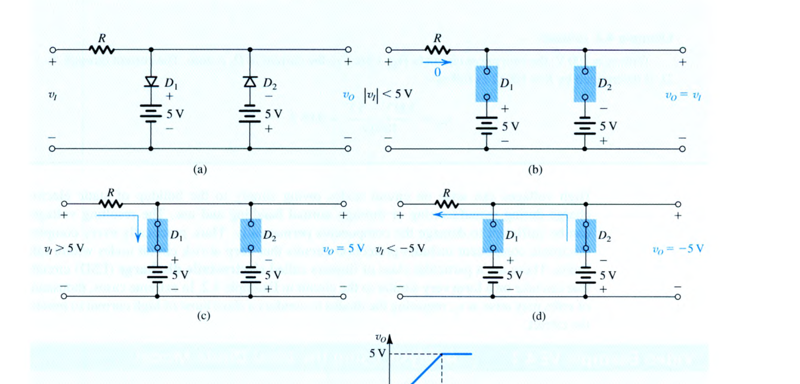

</PracticeCard>

<PracticeCard id="elec-ch4-problem-4-18" title="Problem 4.18｜熱電壓與溫度" type="exercise" source="Sedra/Smith 8e p.233 (PDF 263), Problem 4.18" topic="接面二極體特性">

計算熱電壓 $V_T$ 在 $-55^\circ\text{C}$、$0^\circ\text{C}$、$+40^\circ\text{C}$、$+125^\circ\text{C}$ 時的值。$V_T$ 恰為 $25\,\text{mV}$ 時的溫度為何？

</PracticeCard>

<PracticeCard id="elec-ch4-problem-4-19" title="Problem 4.19｜二極體方程式" type="exercise" source="Sedra/Smith 8e p.233 (PDF 263), Problem 4.19" topic="接面二極體特性">

在室溫下，二極體正向電壓為何時，電流等於 $10^8 I_S$？同一顆二極體在正向電壓 $0.7\,\text{V}$ 時，電流以 $I_S$ 表示為何？

</PracticeCard>

<PracticeCard id="elec-ch4-problem-4-20" title="Problem 4.20｜二極體電流估算" type="exercise" source="Sedra/Smith 8e p.234 (PDF 264), Problem 4.20" topic="接面二極體特性">

某二極體在正向電壓 $0.7\,\text{V}$ 時，電流為 $1.0\,\text{mA}$。若此二極體工作於 $0.6\,\text{V}$，電流是多少？

</PracticeCard>

<PracticeCard id="elec-ch4-problem-4-21" title="Problem 4.21｜電壓微變與電流" type="exercise" source="Sedra/Smith 8e p.234 (PDF 264), Problem 4.21" topic="接面二極體特性">

某二極體在接面電壓 $0.7\,\text{V}$ 時電流為 $1\,\text{mA}$。若接面電壓升至 $0.71\,\text{V}$、$0.8\,\text{V}$，或降至 $0.69\,\text{V}$、$0.6\,\text{V}$，電流各為多少？使電流加倍所需的接面電壓變化量為何？

</PracticeCard>

<PracticeCard id="elec-ch4-problem-4-22" title="Problem 4.22｜由量測估計飽和電流" type="exercise" source="Sedra/Smith 8e p.234 (PDF 264), Problem 4.22" topic="接面二極體特性">

對下列各顆接面二極體的量測資料，估計飽和電流 $I_S$，並求電流為量測值 $10\%$ 時的端電壓：

(a) $V=0.750\,\text{V}$，$I=1.00\,\text{A}$；(b) $V=0.650\,\text{V}$，$I=1.00\,\text{mA}$；(c) $V=0.650\,\text{V}$，$I=10\,\mu\text{A}$；(d) $V=0.700\,\text{V}$，$I=10\,\text{mA}$。

</PracticeCard>

<PracticeCard id="elec-ch4-problem-4-23" title="Problem 4.23｜由量測估計二極體電流" type="exercise" source="Sedra/Smith 8e p.234 (PDF 264), Problem 4.23" topic="接面二極體特性">

下列為不同二極體的電流與二極體電壓量測值。對每一顆二極體，估計 $I_S$ 及電壓為 $750\,\text{mV}$ 時的電流：

(a) $10.0\,\text{mA}, 700\,\text{mV}$；(b) $1.0\,\text{mA}, 700\,\text{mV}$；(c) $10\,\text{A}, 800\,\text{mV}$；(d) $0.1\,\text{mA}, 700\,\text{mV}$；(e) $10\,\mu\text{A}, 600\,\text{mV}$。

</PracticeCard>

<PracticeCard id="elec-ch4-problem-4-24" title="Problem 4.24｜三顆串聯二極體" type="exercise" source="Sedra/Smith 8e p.234 (PDF 264), Problem 4.24" topic="接面二極體特性">

Figure P4.24 電路使用三顆相同二極體，且每顆的 $I_S=10^{-14}\,\text{A}$。在室溫下，求使輸出電壓 $V_O=2.0\,\text{V}$ 所需的電流 $I$。若負載從輸出端抽取 $1\,\text{mA}$，輸出電壓變化多少？溫度上升 $40^\circ\text{C}$ 會造成多少輸出電壓變化？

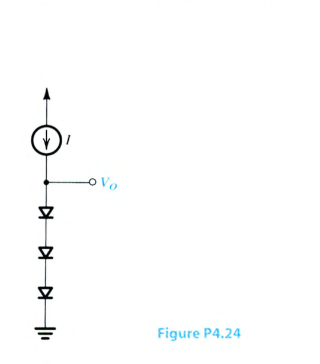

</PracticeCard>

<PracticeCard id="elec-ch4-problem-4-25" title="Problem 4.25｜並聯二極體" type="exercise" source="Sedra/Smith 8e p.234 (PDF 264), Problem 4.25" topic="接面二極體特性">

一顆接面二極體由定電流 $I$ 驅動。若再將一顆相同二極體並聯，原二極體的順向電壓會如何改變？

</PracticeCard>

<PracticeCard id="elec-ch4-problem-4-26" title="Problem 4.26｜不同飽和電流二極體並聯" type="exercise" source="Sedra/Smith 8e p.234 (PDF 264), Problem 4.26" topic="接面二極體特性">

兩顆飽和電流分別為 $I_{S1}$、$I_{S2}$ 的二極體並聯，兩個陰極相連並接地，兩個陽極相連並由定電流 $I$ 驅動。求流經兩顆二極體的電流 $I_{D1}$、$I_{D2}$，以及並聯組合兩端的電壓 $V_D$。

</PracticeCard>

<PracticeCard id="elec-ch4-problem-4-27" title="Problem 4.27｜二極體面積比" type="exercise" source="Sedra/Smith 8e p.234 (PDF 264), Problem 4.27" topic="接面二極體特性">

Figure P4.27 中，$D_1$ 的接面面積是 $D_2$ 的 20 倍。求電壓 $V$。若要使 $V=60\,\text{mV}$，所需的電流 $I_2$ 為何？圖中電流源 $I_1=8\,\text{mA}$。

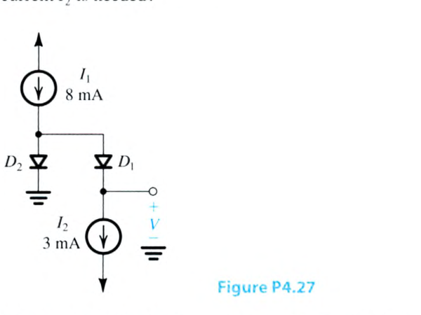

</PracticeCard>

<PracticeCard id="elec-ch4-problem-4-28" title="Problem 4.28｜二極體與電阻" type="exercise" source="Sedra/Smith 8e p.234 (PDF 264), Problem 4.28" topic="接面二極體特性">

Figure P4.28 中兩顆二極體相同。求使 $V=50\,\text{mV}$ 的電阻 $R$；電流源為 $I=1\,\text{mA}$。

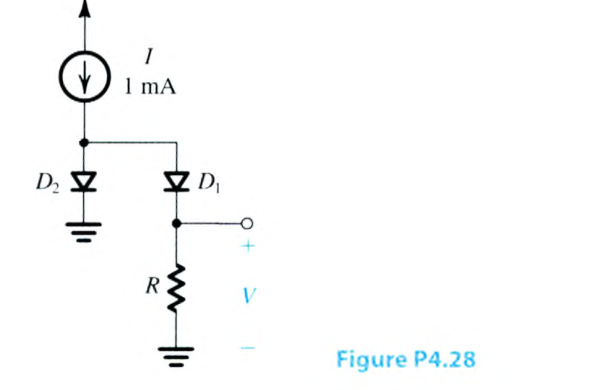

</PracticeCard>

<PracticeCard id="elec-ch4-problem-4-29" title="Problem 4.29｜溫度對二極體電壓的影響" type="exercise" source="Sedra/Smith 8e p.234–235 (PDF 264–265), Problem 4.29" topic="溫度效應">

二極體由定電流 $I=1\,\text{mA}$ 驅動，在 $20^\circ\text{C}$ 時電壓 $V=690\,\text{mV}$。求電流維持 $1\,\text{mA}$ 時，二極體在 $-20^\circ\text{C}$ 與 $+85^\circ\text{C}$ 的電壓。若電流增加至 $5\,\text{mA}$，求二極體在 $-20^\circ\text{C}$、$20^\circ\text{C}$ 與 $85^\circ\text{C}$ 的電壓。

</PracticeCard>

<PracticeCard id="elec-ch4-problem-4-30" title="Problem 4.30｜不同面積二極體的溫度效應" type="exercise" source="Sedra/Smith 8e p.235 (PDF 265), Problem 4.30" topic="溫度效應">

Figure P4.30 中，$D_1$ 是大型、高電流二極體，其反向漏電流高且與所加電壓無關；$D_2$ 是小型、低電流二極體。環境溫度為 $20^\circ\text{C}$ 時，調整 $R_1$ 使 $V_{R1}=V_2=520\,\text{mV}$。量測得 $R_1=520\,\text{k}\Omega$。預期環境溫度變為 $0^\circ\text{C}$ 與 $60^\circ\text{C}$ 時，$V_{R1}$ 和 $V_2$ 各為多少？可使用教材近似：反向漏電流隨溫度每上升 $10^\circ\text{C}$ 加倍；固定順向電流時，二極體壓降每上升 $1^\circ\text{C}$ 約減少 $2\,\text{mV}$。

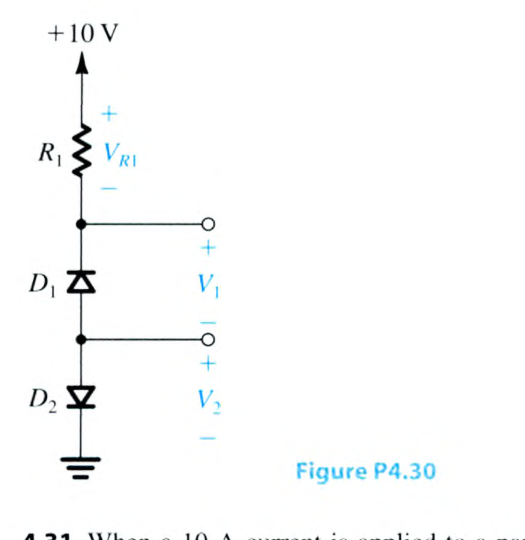

</PracticeCard>

<PracticeCard id="elec-ch4-problem-4-31" title="Problem 4.31｜二極體熱阻" type="exercise" source="Sedra/Smith 8e p.235 (PDF 265), Problem 4.31" topic="熱效應">

對某二極體施加 $10\,\text{A}$ 電流時，接面電壓立即變為 $700\,\text{mV}$。耗散功率使二極體溫度上升後，電壓降低並最終達到 $600\,\text{mV}$。求表觀接面溫升、最終狀態下二極體耗散功率，以及每瓦耗散功率所造成的溫升（熱阻）。

</PracticeCard>

<PracticeCard id="elec-ch4-problem-4-32" title="Problem 4.32｜功率二極體的參考電壓" type="exercise" source="Sedra/Smith 8e p.235 (PDF 265), Problem 4.32" topic="溫度效應">

儀器設計者希望用大型二極體產生小而相對穩定的電壓，因二極體接面壓降對電流的依賴相對較弱。可用功率二極體在額定電流 $10\,\text{A}$ 時的標稱電壓為 $0.8\,\text{V}$。若供應二極體的電流源在 $1\,\text{mA}$ 至 $3\,\text{mA}$ 間變化，且溫度另有 $\pm20^\circ\text{C}$ 變化，預期二極體電壓範圍為何？

</PracticeCard>

<PracticeCard id="elec-ch4-problem-4-33" title="Problem 4.33｜電流鏡與二極體電壓差" type="exercise" source="Sedra/Smith 8e p.235 (PDF 265), Problem 4.33" topic="電流鏡">

承接 Problem 4.32 的目標（由可變電流供應產生相對穩定的小電壓），改以電流鏡精確複製小電流，並將相同電流送入兩顆不同接面面積的二極體，量測其接面電壓差。可用兩種二極體：在順向電壓 $700\,\text{mV}$ 時，一顆電流為 $0.1\,\text{mA}$，另一顆為 $1\,\text{A}$。若每顆二極體的電流相同且介於 $1\,\text{mA}$ 至 $3\,\text{mA}$，電壓差範圍為何？溫度變化 $\pm20^\circ\text{C}$ 對此方法有何影響？

</PracticeCard>

<PracticeCard id="elec-ch4-problem-4-34" title="Problem 4.34｜串聯電阻的二極體" type="exercise" source="Sedra/Smith 8e p.235 (PDF 265), Problem 4.34" topic="接面二極體特性">

推導含小串聯電阻 $r$ 的二極體端電壓與電流的關係式。若 $r=10\,\Omega$，電流從 $1\,\text{mA}$ 增至 $2\,\text{mA}$ 時，電壓改變多少？

</PracticeCard>

<PracticeCard id="elec-ch4-problem-4-35" title="Problem 4.35｜二極體圖解分析" type="exercise" source="Sedra/Smith 8e p.235 (PDF 265), Problem 4.35" topic="二極體模型">

對 Figure 4.10 電路作圖解分析，令 $V_{DD}=1\,\text{V}$、$R=1\,\text{k}\Omega$，二極體 $I_S=10^{-15}\,\text{A}$。在預期負載線交點附近計算少量二極體特性點，以圖解法逐步修正二極體電流估值。求估得的二極體電流與電壓，再以解析方法求對應電壓，並比較解析值與圖解估值的差異。

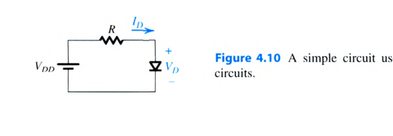

</PracticeCard>

<PracticeCard id="elec-ch4-problem-4-36" title="Problem 4.36｜二極體迭代分析" type="exercise" source="Sedra/Smith 8e p.235 (PDF 265), Problem 4.36" topic="二極體模型">

對 Figure 4.10 電路使用迭代分析，令 $V_{DD}=1.5\,\text{V}$、$R=2\,\text{k}\Omega$、$I_S=10^{-15}\,\text{A}$，求二極體電流與電壓。

</PracticeCard>

<PracticeCard id="elec-ch4-problem-4-37" title="Problem 4.37｜1 mA 二極體的迭代分析" type="exercise" source="Sedra/Smith 8e p.235 (PDF 265), Problem 4.37" topic="二極體模型">

一顆「1 mA 二極體」——即 $i_D=1\,\text{mA}$ 時 $v_D=0.7\,\text{V}$——串聯 $200\,\Omega$ 電阻後接至 $1.0\,\text{V}$ 電源。

(a) 粗略估計預期二極體電流；(b) 使用迭代分析較精確地估計二極體電流。

</PracticeCard>

<PracticeCard id="elec-ch4-problem-4-38" title="Problem 4.38｜限壓模型與指數模型" type="exercise" source="Sedra/Smith 8e p.235 (PDF 265), Problem 4.38" topic="二極體模型">

考慮 Figure 4.10 電路，令 $V_{DD}=3\,\text{V}$、$R=3\,\text{k}\Omega$。

(a) 使用定壓降模型求電流；(b) 求使此解精確成立所需的 $I_S$；(c) 若 $I_S$ 增加 100 倍，電流約改變多少？

</PracticeCard>

<PracticeCard id="elec-ch4-problem-4-39" title="Problem 4.39｜二極體參考電壓設計" type="exercise" source="Sedra/Smith 8e p.235 (PDF 265), Problem 4.39" topic="電路設計">

設計者有一批二極體，每顆在 $0.7\,\text{V}$ 時流過 $2\,\text{mA}$。設計者希望用 $1\,\text{mA}$ 電流源產生 $1.3\,\text{V}$ 參考電壓。提出效果最佳的串、並聯二極體組合，求所需二極體數目及實際得到的電壓。

</PracticeCard>

<PracticeCard id="elec-ch4-problem-4-40" title="Problem 4.40｜定壓降模型限幅器" type="exercise" source="Sedra/Smith 8e p.236 (PDF 266), Problem 4.40" topic="二極體模型">

以定壓降模型（$V_D=0.7\,\text{V}$）重做 Example 4.2：對下列限幅器求輸入與輸出的特性關係；若 $v_i=100\,\text{V}$ 且 $R=100\,\Omega$，求兩顆二極體各自流過的電流。

</PracticeCard>

<PracticeCard id="elec-ch4-problem-4-41" title="Problem 4.41｜定壓降模型電路分析" type="exercise" source="Sedra/Smith 8e p.236 (PDF 266), Problem 4.41" topic="二極體模型">

對下列 Figure P4.2 電路，使用定壓降二極體模型（$V_D=0.7\,\text{V}$），求各電路標示的電壓與電流。

</PracticeCard>

<PracticeCard id="elec-ch4-problem-4-42" title="Problem 4.42｜定壓降模型電路分析" type="exercise" source="Sedra/Smith 8e p.236 (PDF 266), Problem 4.42" topic="二極體模型">

對下列 Figure P4.3 電路，使用定壓降二極體模型（$V_D=0.7\,\text{V}$），求各電路標示的電壓與電流。

</PracticeCard>

<PracticeCard id="elec-ch4-problem-4-43" title="Problem 4.43｜定壓降模型電路分析" type="exercise" source="Sedra/Smith 8e p.236 (PDF 266), Problem 4.43" topic="二極體模型">

對 Figure P4.7 電路，使用定壓降二極體模型（$V_D=0.7\,\text{V}$），求標示的電流與電壓。

</PracticeCard>

<PracticeCard id="elec-ch4-problem-4-44" title="Problem 4.44｜戴維寧等效與定壓降模型" type="exercise" source="Sedra/Smith 8e p.236 (PDF 266), Problem 4.44" topic="戴維寧定理">

對 Figure P4.8 電路使用戴維寧定理簡化電路，求標示的電流與電壓。假設導通二極體可用定壓降模型表示，$V_D=0.7\,\text{V}$。

</PracticeCard>

<PracticeCard id="elec-ch4-problem-4-45" title="Problem 4.45｜定壓降模型整流器設計" type="exercise" source="Sedra/Smith 8e p.236 (PDF 266), Problem 4.45" topic="整流器">

重做 Problem 4.9，將二極體改以定壓降模型（$V_D=0.7\,\text{V}$）表示。Problem 4.9 的完整條件為：Figure 4.3(a) 整流器輸入正弦波有效值 $120\,\text{V}$，選擇適當 $R$ 使二極體峰值電流不超過 $40\,\text{mA}$，並求二極體承受的最大反向電壓。求此模型下的電路設計，並比較結果差異。

</PracticeCard>
