# Chapter 4 Problems 4.46–4.91

> 來源：Sedra/Smith, *Microelectronic Circuits*, 8th ed., Chapter 4, Problems；原始 PDF《課本.pdf》PDF 頁 266–273（印刷頁 236–243）。題幹依原頁影像核對並譯為繁體中文。章末答案附錄未收錄於本地 PDF；本頁不提供未核實答案。

<PracticeProgress total="46" prefix="elec-ch4-problem-" />

<PracticeCard type="exercise" id="elec-ch4-problem-4-46" title="Problem 4.46｜齊納二極體規格表" source="Sedra/Smith 8e · p.236 · Problem 4.46" topic="齊納二極體">

下表列出一組齊納二極體的部分規格。求每列缺漏值，並求各二極體在 $I_Z=10\,\mathrm{mA}$ 時的齊納反向電壓 $V_Z$。

| 型號 | $V_{ZT}$ | $I_{ZT}$ | $r_z$ | $V_{Z0}$ | $V_Z$（$I_Z=10\,\mathrm{mA}$）|
|---|---:|---:|---:|---:|---:|
| (a) | 3 V | 2 mA | 50 Ω | ？ | ？ |
| (b) | 5 V | 5 mA | ？ | 4.5 V | ？ |
| (c) | 6 V | ？ | 150 Ω | 5.7 V | ？ |
| (d) | ？ | 1 mA | 100 Ω | 9 V | ？ |

</PracticeCard>

<PracticeCard type="exercise" id="elec-ch4-problem-4-47" title="Problem 4.47｜齊納功率限制" source="Sedra/Smith 8e · p.236 · Problem 4.47" topic="齊納二極體">

齊納二極體在 $I_Z=5\,\mathrm{mA}$ 時額定工作電壓為 $3\,\mathrm{V}$，增量電阻為 $100\,\Omega$。它經由 $1\,\mathrm{k}\Omega$ 電阻接至電壓源 $V_S$。為避免超過齊納二極體 $40\,\mathrm{mW}$ 的最大功率，$V_S$ 最大可設為多少？此條件下齊納二極體兩端的電壓是多少？

</PracticeCard>

<PracticeCard type="exercise" id="elec-ch4-problem-4-48" title="Problem 4.48｜串聯二極體溫度係數" source="Sedra/Smith 8e · p.236 · Problem 4.48" topic="溫度係數">

固定電流流過一顆 $6\,\mathrm{V}$ 齊納二極體；它的溫度係數為 $+1.5\,\mathrm{mV}/^\circ\mathrm{C}$。此齊納二極體與一顆正向導通的一般二極體串聯，後者的溫度係數為 $-2\,\mathrm{mV}/^\circ\mathrm{C}$。求兩顆二極體串聯總電壓的溫度係數。

</PracticeCard>

<PracticeCard type="exercise" id="elec-ch4-problem-4-49" title="Problem 4.49｜小訊號模型適用範圍" source="Sedra/Smith 8e · p.236 · Problem 4.49" topic="小訊號模型">

小訊號模型通常被認為適用於約 $5\,\mathrm{mV}$ 的電壓變化。此電壓變化分別對應多大的電流百分比變化？正、負訊號都要考慮。若希望電流變化限制在 $10\%$ 以內，允許的正或負電壓訊號最大值為多少？

</PracticeCard>

<PracticeCard type="exercise" id="elec-ch4-problem-4-50" title="Problem 4.50｜並聯二極體與串聯電阻" source="Sedra/Smith 8e · p.236 · Problem 4.50" topic="小訊號電阻">

某應用將十顆「$20\,\mathrm{mA}$ 二極體」並聯，總電流為 $0.1\,\mathrm{A}$。此處的 $20\,\mathrm{mA}$ 二極體指在 $20\,\mathrm{mA}$ 電流時壓降為 $0.7\,\mathrm{V}$ 的二極體。假設各顆匹配良好：

1. 求每顆二極體的電流、每顆的小訊號電阻，以及並聯組合的小訊號電阻。
2. 將此結果與單顆二極體流過 $0.1\,\mathrm{A}$ 時的增量電阻比較。
3. 若每顆二極體另有由接合線造成的 $0.2\,\Omega$ 串聯電阻，求十顆並聯後的等效電阻。若要讓單顆二極體完全等效，其接線電阻應為何？

</PracticeCard>

<PracticeCard type="exercise" id="elec-ch4-problem-4-51" title="Problem 4.51｜電容耦合二極體衰減器" source="Sedra/Smith 8e · pp.236–237 · Problem 4.51" topic="小訊號模型">

電路中 $I$ 為直流電流，$v_s$ 為正弦訊號。$C_1$、$C_2$ 很大，用來耦合訊號進出二極體，同時阻止直流流入訊號源或負載（負載未畫出）。使用二極體小訊號模型，證明輸出電壓的訊號分量為

$$
v_o=v_s\frac{V_T}{V_T+IR_s}.
$$

若 $v_s=10\,\mathrm{mV}$、$R_s=1\,\mathrm{k}\Omega$，求 $I=1\,\mathrm{mA}$、$0.1\,\mathrm{mA}$、$1\,\mu\mathrm{A}$ 時的 $v_o$。另求使 $v_o=v_s/2$ 的 $I$。

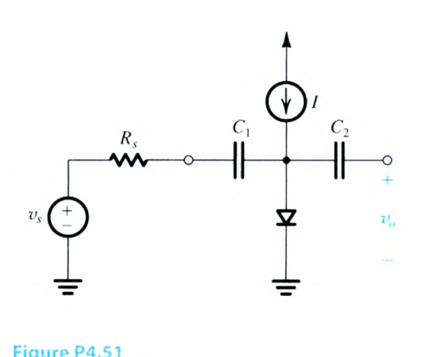

</PracticeCard>

<PracticeCard type="exercise" id="elec-ch4-problem-4-52" title="Problem 4.52｜設定衰減量與訊號限制" source="Sedra/Smith 8e · p.237 · Problem 4.52" topic="小訊號模型">

承接 Problem 4.51 的電容耦合衰減器（電路圖見本卡），令 $R_s=10\,\mathrm{k}\Omega$。二極體在直流電流 $1\,\mathrm{mA}$ 時壓降為 $0.7\,\mathrm{V}$。對小訊號而言，求使 $v_o/v_s$ 分別等於 $0.50$、$0.10$、$0.01$、$0.001$ 所需的偏置電流 $I$。每種情況下，若二極體訊號電流分量限制在其直流電流的 $\pm10\%$，輸入訊號最大可多大？相應輸出訊號為何？

</PracticeCard>

<PracticeCard type="exercise" id="elec-ch4-problem-4-53" title="Problem 4.53｜直流控制的二極體衰減器" source="Sedra/Smith 8e · p.237 · Problem 4.53" topic="小訊號模型">

圖中 $I$ 為 $0$ 至 $1\,\mathrm{mA}$ 間變化的直流電流，$C_1$、$C_2$ 為大型耦合電容。輸入訊號很小，可將兩顆二極體分別以小訊號電阻 $r_{d1}$、$r_{d2}$ 表示。畫出小訊號等效電路，並證明

$$
\frac{v_o}{v_i}=\frac{r_{d2}}{r_{d1}+r_{d2}},\qquad \therefore\qquad \frac{v_o}{v_i}=I,
$$

其中右式中的 $I$ 以 mA 為單位。求 $I=0,1,10,100,500,600,900,990\,\mu\mathrm{A}$ 及 $1\,\mathrm{mA}$ 時的 $v_o/v_i$。此訊號衰減器的傳輸量由直流電流線性控制。

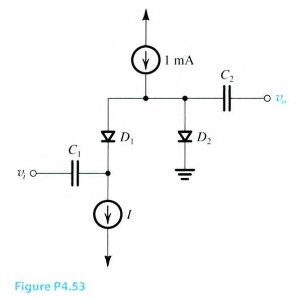

</PracticeCard>

<PracticeCard type="exercise" id="elec-ch4-problem-4-54" title="Problem 4.54｜四二極體訊號傳輸電路" source="Sedra/Smith 8e · p.237 · Problem 4.54" topic="小訊號模型">

電路中的 $D_1$ 至 $D_4$ 完全相同，每顆在 $1\,\mathrm{mA}$ 時壓降為 $0.7\,\mathrm{V}$。

(a) 對小訊號（例如 $10\,\mathrm{mV}$ 峰值），求小訊號等效電路，並求 $I=0,1,10,100\,\mu\mathrm{A},1\,\mathrm{mA},10\,\mathrm{mA}$ 時的小訊號傳輸比 $v_o/v_i$。

(b) 正向導通二極體所能承受的最大訊號電壓幅度為何，才能使相應訊號電流不超過直流偏置電流的 $10\%$？對圖示電路及 $10\,\mathrm{mV}$ 峰值輸入，求使各二極體電流保持在直流值 $\pm10\%$ 內的最小 $I$。

(c) 若 $I=1\,\mathrm{mA}$，求使二極體電流偏離其直流值不超過 $10\%$ 的最大輸出訊號、相應峰值輸入，以及每顆二極體的總電流。

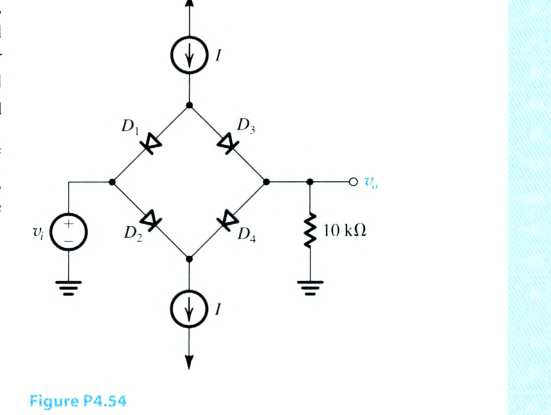

</PracticeCard>

<PracticeCard type="exercise" id="elec-ch4-problem-4-55" title="Problem 4.55｜四二極體電壓轉移特性" source="Sedra/Smith 8e · p.237 · Problem 4.55" topic="二極體指數特性">

承接 Problem 4.54 圖示電路（見本卡），此處使用二極體指數特性求 $-12\,\mathrm{V}\le v_i\le12\,\mathrm{V}$ 的電壓轉移特性 $v_o$ 對 $v_i$。令 $I=1\,\mathrm{mA}$，且每顆二極體在 $1\,\mathrm{mA}$ 時壓降為 $0.7\,\mathrm{V}$。建立表格，列出 $v_o=0,+1,+2,+5,+9,+9.9,+9.99,+10.5,+11,+12\,\mathrm{V}$ 時（負值 $-1,-2,-5,-9,-9.9,-9.99,-10.5,-11,-12\,\mathrm{V}$ 由對稱性外推）：10-kΩ 電阻電流 $i_o$、四顆二極體各自的電流、各自的壓降及輸入電壓 $v_i$。利用表格並向負 $v_i$、負 $v_o$ 延伸，繪出所求轉移特性；另繪出 $I$ 降至 $0.5\,\mathrm{mA}$ 時的轉移特性。

提示：由對稱性，當 $v_o$ 與 $i_o$ 增加時，$i_{D3}$、$i_{D2}$ 等量增加，而 $i_{D4}$、$i_{D1}$ 等量減少。

</PracticeCard>

<PracticeCard type="exercise" id="elec-ch4-problem-4-56" title="Problem 4.56｜二極體相移電路" source="Sedra/Smith 8e · p.238 · Problem 4.56" topic="小訊號模型">

圖中 $I$ 為直流電流，$v_i$ 是頻率 $100\,\mathrm{kHz}$、振幅小於 $10\,\mathrm{mV}$ 的正弦訊號。以隨 $I$ 改變的小訊號電阻 $r_d$ 表示二極體，畫出小訊號等效電路，求正弦輸出電壓 $V_o$ 及 $V_o$ 相對於 $V_i$ 的相位差。求能產生 $-45^\circ$ 相移的 $I$，並求 $I$ 在該值的 $0.1$ 倍至 $10$ 倍範圍內變動時可達到的相移範圍。

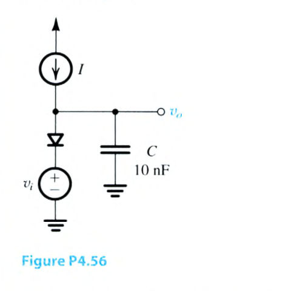

</PracticeCard>

<PracticeCard type="exercise" id="elec-ch4-problem-4-57" title="Problem 4.57｜二極體電壓調節器線路調節率" source="Sedra/Smith 8e · p.238 · Problem 4.57" topic="電壓調節器">

考慮圖示電壓調節器，調整 $R$ 使二極體（亦即輸出端）的電壓 $V_O=0.7\,\mathrm{V}$。

(a) 使用二極體小訊號模型，證明輸入 $V^+$ 改變 $1\,\mathrm{V}$ 時，輸出變化率為

$$
\frac{\Delta V_O}{\Delta V^+}=\frac{V_T}{V^++V_T-0.7}.
$$

此量稱為線路調節率，通常以 mV/V 表示。

(b) 推廣至 $m$ 顆二極體串聯，並調整 $R$ 使每顆二極體兩端電壓為 $0.7\,\mathrm{V}$（$V_O=0.7m\,\mathrm{V}$）。

(c) 計算名目 $V^+=10\,\mathrm{V}$ 時，$m=1$ 與 $m=3$ 的線路調節率。

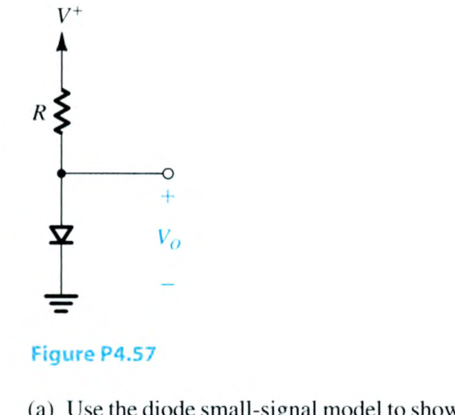

</PracticeCard>

<PracticeCard type="exercise" id="elec-ch4-problem-4-58" title="Problem 4.58｜二極體調節器負載調節率" source="Sedra/Smith 8e · p.238 · Problem 4.58" topic="電壓調節器">

承接 Problem 4.57 的電壓調節器（電路見本卡），現於輸出端接上負載電流 $I_L$。

(a) 若 $I_L$ 足夠小，使輸出變化 $\Delta V_O$ 仍可使用二極體小訊號模型，證明

$$
\frac{\Delta V_O}{I_L}=-(r_d\parallel R).
$$

此量稱為負載調節率，通常以 mV/mA 表示。

(b) 設定 $R$ 使無負載時二極體電壓為 $0.7\,\mathrm{V}$、二極體電流為 $I_D$，證明 (a) 的式子化為

$$
\frac{\Delta V_O}{I_L}= -\left(\frac{V_T}{I_D}\right)\frac{V^+-0.7}{V^+-0.7+V_T}.
$$

選擇能使負載調節率絕對值不超過 $5\,\mathrm{mV/mA}$ 的最低 $I_D$。若 $V^+$ 名目值為 $10\,\mathrm{V}$，求所需 $R$，並以 $I_S$ 表示所需二極體規格。

(c) 推廣 (b) 至 $m$ 顆串聯二極體，並調整 $R$ 使無負載輸出為 $V_O=0.7m\,\mathrm{V}$。

</PracticeCard>

<PracticeCard type="exercise" id="elec-ch4-problem-4-59" title="Problem 4.59｜設計二極體電壓調節器" source="Sedra/Smith 8e · p.238 · Problem 4.59" topic="電壓調節器">

設計二極體電壓調節器，為 $1.5\,\mathrm{k}\Omega$ 負載提供 $1.5\,\mathrm{V}$。使用兩顆二極體，每顆在 $1\,\mathrm{mA}$ 時壓降為 $0.7\,\mathrm{V}$；將二極體串聯，經電阻 $R$ 接至 $+5\,\mathrm{V}$ 電源。求 $R$、接上負載時的二極體電流，並比較二極體功耗與負載功耗。負載移除時輸出電壓增加多少？若負載電阻降為 $1\,\mathrm{k}\Omega$、$750\,\Omega$、$500\,\Omega$，各造成何種變化？所有輸出電壓變化均以二極體小訊號模型計算。

</PracticeCard>

<PracticeCard type="exercise" id="elec-ch4-problem-4-60" title="Problem 4.60｜以二極體串聯替代電池" source="Sedra/Smith 8e · p.239 · Problem 4.60" topic="電壓調節器">

使用兩顆串聯二極體與定電流源構成電壓調節器，替代名目電壓為 $1.5\,\mathrm{V}$ 的碳鋅電池。負載電流介於 $2$ 至 $7\,\mathrm{mA}$。可選定電流源為 $5$、$10$、$15\,\mathrm{mA}$。應選哪一種，理由為何？負載電流在全範圍變動時，輸出電壓會改變多少？

</PracticeCard>

<PracticeCard type="exercise" id="elec-ch4-problem-4-61" title="Problem 4.61｜齊納串聯組合的負載調節" source="Sedra/Smith 8e · p.239 · Problem 4.61" topic="齊納調節器">

設計者需要約 $20\,\mathrm{V}$ 的並聯調節器。有兩種齊納二極體可選：$6.8\,\mathrm{V}$、$r_z=10\,\Omega$，以及 $5.1\,\mathrm{V}$、$r_z=25\,\Omega$。對兩種主要可行組合求負載調節率；計算時忽略調節器電阻 $R$ 的影響。

</PracticeCard>

<PracticeCard type="exercise" id="elec-ch4-problem-4-62" title="Problem 4.62｜齊納並聯調節器線路變化" source="Sedra/Smith 8e · p.239 · Problem 4.62" topic="齊納調節器">

齊納二極體增量電阻為 $10\,\Omega$ 的並聯調節器，經由 $200\,\Omega$ 電阻供電。若未穩壓電源改變 $1.0\,\mathrm{V}$，穩壓輸出電壓相應改變多少？

</PracticeCard>

<PracticeCard type="exercise" id="elec-ch4-problem-4-63" title="Problem 4.63｜設計 7.5 V 齊納調節器" source="Sedra/Smith 8e · p.239 · Problem 4.63" topic="齊納調節器">

設計 $7.5\,\mathrm{V}$ 齊納調節器。齊納二極體在 $10\,\mathrm{mA}$ 時規格電壓為 $7.5\,\mathrm{V}$，增量電阻 $r_z=30\,\Omega$，膝點電流為 $0.5\,\mathrm{mA}$。調節器由 $10\,\mathrm{V}$ 電源供電，名目負載電流為 $5\,\mathrm{mA}$。

求所選 $R$；電源分別高出與低於名目值 $10\%$ 時的輸出電壓；電源高出 $10\%$ 且負載移除時的輸出電壓；電源低於名目值 $10\%$ 時，在齊納電流不低於膝點電流的條件下可供應的最大負載電流，以及該狀況的負載電壓。

</PracticeCard>

<PracticeCard type="exercise" id="elec-ch4-problem-4-64" title="Problem 4.64｜設計 10 V 齊納並聯調節器" source="Sedra/Smith 8e · pp.239–240 · Problem 4.64" topic="齊納調節器">

設計約 $10\,\mathrm{V}$ 的齊納並聯調節器。可用的 1N4740 齊納二極體額定 $10\,\mathrm{V}$、$1\,\mathrm{W}$，在測試電流 $25\,\mathrm{mA}$ 時壓降 $10\,\mathrm{V}$，且該電流下 $r_z=7\,\Omega$。未穩壓電源 $V_S$ 名目為 $20\,\mathrm{V}$，變動範圍可達 $\pm25\%$。調節器需供應 $0$ 至 $20\,\mathrm{mA}$ 負載電流，設計時令最小齊納電流為 $5\,\mathrm{mA}$。

(a) 求 $V_{Z0}$。 (b) 求所需 $R$。 (c) 求線路調節率，以及 $V_S$ 上升 $25\%$ 對應的 $V_O$ 百分比變化。 (d) 求負載調節率，以及由無負載至滿載時 $V_O$ 的百分比變化。 (e) 求設計中齊納最大電流及其功耗。

</PracticeCard>

<PracticeCard type="exercise" id="elec-ch4-problem-4-65" title="Problem 4.65｜反向二極體半波整流器" source="Sedra/Smith 8e · p.239 · Problem 4.65" topic="半波整流">

考慮半波整流器 Fig. 4.21(a)，將二極體反接。令 $v_s$ 為峰值振幅 $5\,\mathrm{V}$ 的正弦波，$R=2\,\mathrm{k}\Omega$。使用二極體定電壓降模型，$V_D=0.7\,\mathrm{V}$。求：(a) 轉移特性；(b) $v_o$ 波形；(c) $v_o$ 平均值；(d) 二極體峰值電流；(e) 二極體峰值反向電壓 PIV。

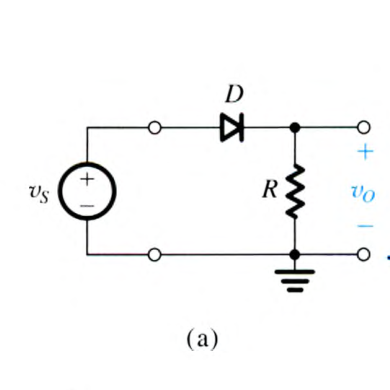

</PracticeCard>

<PracticeCard type="exercise" id="elec-ch4-problem-4-66" title="Problem 4.66｜半波整流器指數特性" source="Sedra/Smith 8e · p.239 · Problem 4.66" topic="半波整流">

使用二極體指數特性，證明當 $v_s$、$v_o$ 均大於零時，Fig. 4.21(a) 電路具有下列轉移關係：

$$
v_o=v_s-v_D\big|_{i_D=1\,\mathrm{mA}}-V_T\ln(v_o/R),
$$

其中 $v_s$、$v_o$ 以伏特表示，$R$ 以 kΩ 表示。可藉由對不同 $v_o$ 求相應的 $v_s$，繪得 $v_o$ 對 $v_s$ 的轉移特性。

</PracticeCard>

<PracticeCard type="exercise" id="elec-ch4-problem-4-67" title="Problem 4.67｜三角波半波整流平均值" source="Sedra/Smith 8e · p.239 · Problem 4.67" topic="半波整流">

半波整流器輸入為平均值零、峰對峰振幅 $6\,\mathrm{V}$ 的三角波，$R=1\,\mathrm{k}\Omega$。二極體以定電壓降模型表示，$V_D=0.7\,\mathrm{V}$。求輸出 $v_o$ 的平均值。

</PracticeCard>

<PracticeCard type="exercise" id="elec-ch4-problem-4-68" title="Problem 4.68｜半波整流器交流電源規格" source="Sedra/Smith 8e · pp.239–240 · Problem 4.68" topic="整流器">

半波整流器接 $500\,\Omega$ 負載，交流市電為 $120\,\mathrm{V_{rms}}$、$60\,\mathrm{Hz}$，經 $12:1$ 降壓變壓器供電。使用矽二極體，任何電流下壓降皆以 $0.7\,\mathrm{V}$ 計。求整流輸出峰值、二極體導通週期比例、輸出平均電壓，以及負載平均電流。

</PracticeCard>

<PracticeCard type="exercise" id="elec-ch4-problem-4-69" title="Problem 4.69｜中心抽頭全波整流器" source="Sedra/Smith 8e · pp.239–240 · Problem 4.69" topic="全波整流">

中心抽頭全波整流器接 $500\,\Omega$ 負載，使用 $120\,\mathrm{V_{rms}}$、$60\,\mathrm{Hz}$ 市電及 $6:1$ 降壓、中心抽頭次級變壓器。使用兩顆矽二極體，任何電流下壓降皆以 $0.7\,\mathrm{V}$ 計。求整流輸出峰值、每顆二極體導通週期比例、輸出平均電壓，以及負載平均電流。

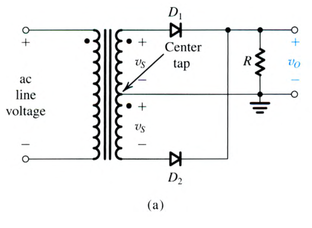

</PracticeCard>

<PracticeCard type="exercise" id="elec-ch4-problem-4-70" title="Problem 4.70｜橋式全波整流器" source="Sedra/Smith 8e · p.240 · Problem 4.70" topic="全波整流">

橋式全波整流器接 $500\,\Omega$ 負載，由 $120\,\mathrm{V_{rms}}$、$60\,\mathrm{Hz}$ 市電經 $6:1$ 降壓變壓器（單一次級繞組）供電。使用四顆二極體，各二極體在任何電流下壓降皆以 $0.7\,\mathrm{V}$ 計。求負載整流電壓峰值、每顆二極體導通週期比例、負載平均電壓及負載平均電流。

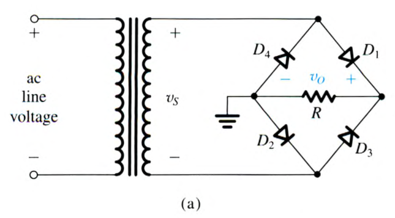

</PracticeCard>

<PracticeCard type="exercise" id="elec-ch4-problem-4-71" title="Problem 4.71｜設計中心抽頭全波整流器" source="Sedra/Smith 8e · p.240 · Problem 4.71" topic="全波整流">

使用 Fig. 4.22(a) 電路設計全波整流器，分別要求：(a) 平均輸出 $10\,\mathrm{V}$；(b) 平均輸出 $25\,\mathrm{V}$；(c) 峰值輸出 $20\,\mathrm{V}$。各情況均求所需變壓器匝數比。假設導通二極體壓降 $0.7\,\mathrm{V}$，交流市電為 $120\,\mathrm{V_{rms}}$。

</PracticeCard>

<PracticeCard type="exercise" id="elec-ch4-problem-4-72" title="Problem 4.72｜設計橋式全波整流器" source="Sedra/Smith 8e · p.240 · Problem 4.72" topic="全波整流">

將 Problem 4.71 的三種設計目標——平均輸出 $10\,\mathrm{V}$、平均輸出 $25\,\mathrm{V}$、峰值輸出 $20\,\mathrm{V}$——改用 Fig. 4.23(a) 橋式整流器實現。每一情況求所需變壓器匝數比；交流市電為 $120\,\mathrm{V_{rms}}$，導通二極體壓降 $0.7\,\mathrm{V}$。

</PracticeCard>

<PracticeCard type="exercise" id="elec-ch4-problem-4-73" title="Problem 4.73｜全波整流二極體 PIV" source="Sedra/Smith 8e · p.240 · Problem 4.73" topic="全波整流">

考慮 Fig. 4.22(a) 全波整流器；變壓器全次級繞組電壓為 $20\,\mathrm{V_{rms}}$。若交流市電為 $220\,\mathrm{V_{rms}}$ 並可能變動 $\pm10\%$，求設計所需二極體 PIV。設計時須採用安全係數；教材未指定其數值，請說明所選值。

</PracticeCard>

<PracticeCard type="exercise" id="elec-ch4-problem-4-74" title="Problem 4.74｜互補輸出整流器" source="Sedra/Smith 8e · p.240 · Problem 4.74" topic="整流器">

圖示電路為互補輸出整流器。繪出並清楚標示 $v_o^+$、$v_o^-$ 波形。假設每顆導通二極體壓降 $0.7\,\mathrm{V}$。若兩個輸出的平均值大小均為 $12\,\mathrm{V}$，求整個次級繞組所需的正弦波振幅，以及各二極體的 PIV。

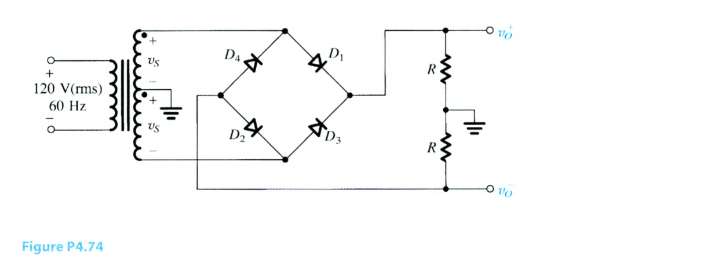

</PracticeCard>

<PracticeCard type="exercise" id="elec-ch4-problem-4-75" title="Problem 4.75｜半波峰值整流與濾波電容" source="Sedra/Smith 8e · p.240 · Problem 4.75" topic="峰值整流">

在 Problem 4.68 的半波整流器上並聯濾波電容，使峰對峰漣波分別為輸出峰值的 (i) $10\%$、(ii) $1\%$。原電路為 $120\,\mathrm{V_{rms}}$、$60\,\mathrm{Hz}$ 市電經 $12:1$ 降壓變壓器供電，$500\,\Omega$ 負載，二極體壓降 $0.7\,\mathrm{V}$。每種漣波條件求：(a) 平均輸出電壓；(b) 二極體導通週期比例；(c) 二極體平均電流；(d) 二極體峰值電流。

</PracticeCard>

<PracticeCard type="exercise" id="elec-ch4-problem-4-76" title="Problem 4.76｜中心抽頭全波峰值整流與濾波" source="Sedra/Smith 8e · p.240 · Problem 4.76" topic="峰值整流">

將 Problem 4.75 的濾波電容分析套用至 Problem 4.69 的中心抽頭全波整流器：$120\,\mathrm{V_{rms}}$、$60\,\mathrm{Hz}$ 市電經 $6:1$ 降壓、中心抽頭變壓器供電，$500\,\Omega$ 負載，兩顆二極體壓降各 $0.7\,\mathrm{V}$。令峰對峰漣波分別為輸出峰值的 $10\%$、$1\%$，每種條件求平均輸出電壓、二極體導通週期比例、二極體平均電流及峰值電流。

</PracticeCard>

<PracticeCard type="exercise" id="elec-ch4-problem-4-77" title="Problem 4.77｜橋式峰值整流與濾波電容" source="Sedra/Smith 8e · p.240 · Problem 4.77" topic="峰值整流">

將 Problem 4.75 的濾波電容分析套用至 Problem 4.70 的橋式全波整流器：$120\,\mathrm{V_{rms}}$、$60\,\mathrm{Hz}$ 市電經 $6:1$ 降壓變壓器供電，$500\,\Omega$ 負載，四顆二極體各壓降 $0.7\,\mathrm{V}$。令峰對峰漣波分別為輸出峰值的 $10\%$、$1\%$，每種條件求平均輸出電壓、二極體導通週期比例、二極體平均電流及峰值電流。

</PracticeCard>

<PracticeCard type="exercise" id="elec-ch4-problem-4-78" title="Problem 4.78｜半波峰值整流電源設計" source="Sedra/Smith 8e · p.240 · Problem 4.78" topic="峰值整流">

設計峰值整流式直流電源，平均輸出 $12\,\mathrm{V}$，最大允許漣波為 $\pm1\,\mathrm{V}$；負載電阻為 $200\,\Omega$。交流市電為 $120\,\mathrm{V_{rms}}$、$60\,\mathrm{Hz}$，經變壓器供電，導通二極體壓降 $0.7\,\mathrm{V}$。若選半波整流：(a) 指定變壓器次級的 rms 電壓；(b) 求濾波電容；(c) 求二極體最大反向電壓及所需 PIV 額定值；(d) 計算二極體在導通期間的平均電流；(e) 計算二極體峰值電流。

</PracticeCard>

<PracticeCard type="exercise" id="elec-ch4-problem-4-79" title="Problem 4.79｜中心抽頭全波峰值整流電源" source="Sedra/Smith 8e · p.241 · Problem 4.79" topic="峰值整流">

將 Problem 4.78 的設計改為採用中心抽頭變壓器的全波整流：平均直流輸出 $12\,\mathrm{V}$、最大漣波 $\pm1\,\mathrm{V}$、$200\,\Omega$ 負載、$120\,\mathrm{V_{rms}}$、$60\,\mathrm{Hz}$ 市電，導通二極體壓降 $0.7\,\mathrm{V}$。求滿足條件所需的變壓器次級、濾波電容及二極體反向電壓/PIV 額定值；另計算二極體在導通期間的平均電流與峰值電流。

</PracticeCard>

<PracticeCard type="exercise" id="elec-ch4-problem-4-80" title="Problem 4.80｜橋式峰值整流電源設計" source="Sedra/Smith 8e · p.241 · Problem 4.80" topic="峰值整流">

將 Problem 4.78 的設計改為橋式全波整流：平均直流輸出 $12\,\mathrm{V}$、最大漣波 $\pm1\,\mathrm{V}$、$200\,\Omega$ 負載、$120\,\mathrm{V_{rms}}$、$60\,\mathrm{Hz}$ 市電，導通二極體壓降 $0.7\,\mathrm{V}$。求所需變壓器次級 rms 電壓、濾波電容、二極體最大反向電壓與 PIV 額定值；另計算二極體在導通期間的平均電流與峰值電流。

</PracticeCard>

<PracticeCard type="exercise" id="elec-ch4-problem-4-81" title="Problem 4.81｜三角波輸入峰值整流器" source="Sedra/Smith 8e · p.241 · Problem 4.81" topic="峰值整流">

半波峰值整流器輸入 $v_s$ 為平均值零、峰對峰振幅 $24\,\mathrm{V}$、頻率 $1\,\mathrm{kHz}$ 的三角波。導通時二極體壓降 $0.7\,\mathrm{V}$，負載 $R=100\,\Omega$，濾波電容 $C=100\,\mu\mathrm{F}$。求平均直流輸出電壓、二極體導通時間區間及最大二極體電流。

</PracticeCard>

<PracticeCard type="exercise" id="elec-ch4-problem-4-82" title="Problem 4.82｜互補輸出整流器雙電源設計" source="Sedra/Smith 8e · p.241 · Problem 4.82" topic="整流器設計">

考慮 Problem 4.74 的互補輸出整流器（電路見本卡），於兩個負載電阻 $R$ 兩端各接一顆相同濾波電容。可用二極體導通壓降為 $0.7\,\mathrm{V}$。設計電路，使兩個直流輸出均為 $\pm12\,\mathrm{V}$，峰對峰漣波不超過 $1\,\mathrm{V}$，且每一電源能為負載電阻供應 $100\,\mathrm{mA}$ 直流電流。完整指定電容、二極體及變壓器。

</PracticeCard>

<PracticeCard type="exercise" id="elec-ch4-problem-4-83" title="Problem 4.83｜精密整流器工作狀態" source="Sedra/Smith 8e · pp.241–242 · Problem 4.83" topic="精密整流器">

圖示精密整流器中的運算放大器為理想元件，輸出飽和電平為 $\pm13\,\mathrm{V}$。二極體導通時壓降為 $0.7\,\mathrm{V}$。對 $v_i=+1,+3,-1,-3\,\mathrm{V}$ 分別求 $v_-$、$v_o$、$v_A$。另對振幅 $5\,\mathrm{V}$、頻率 $1\,\mathrm{kHz}$、平均值零的對稱方波輸入，繪出 $v_o$ 輸出波形並求其平均值。

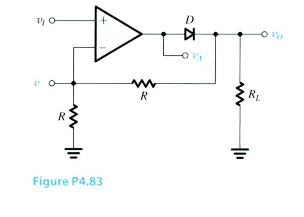

</PracticeCard>

<PracticeCard type="exercise" id="elec-ch4-problem-4-84" title="Problem 4.84｜精密整流器工作狀態（二）" source="Sedra/Smith 8e · p.241 · Problem 4.84" topic="精密整流器">

圖示運算放大器為理想元件，輸出飽和電平為 $\pm12\,\mathrm{V}$。二極體導通時壓降為 $0.7\,\mathrm{V}$。對輸入 (a) $v_i=+1\,\mathrm{V}$、(b) $+3\,\mathrm{V}$、(c) $-1\,\mathrm{V}$、(d) $-3\,\mathrm{V}$，分別求 $v_-$、$v_A$、$v_o$。

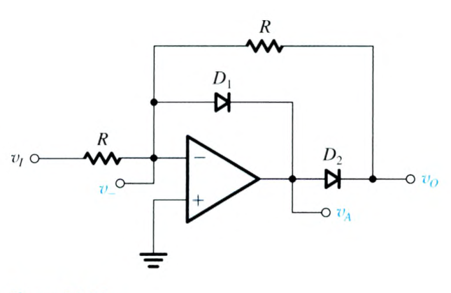

</PracticeCard>

<PracticeCard type="exercise" id="elec-ch4-problem-4-85" title="Problem 4.85｜精密整流器的 AM 訊號" source="Sedra/Smith 8e · p.241 · Problem 4.85" topic="精密整流器">

將下列振幅調變訊號輸入圖示精密整流器：

$$
v_i=[1.5\,\mathrm{V}+1\,\mathrm{V}\sin(2\pi10^3t)]\sin(2\pi10^6t).
$$

若時間常數 $CR=0.1\,\mathrm{ms}$，繪出輸出 $v_o$ 波形；再令 $CR=0.1\,\mu\mathrm{s}$ 重繪。

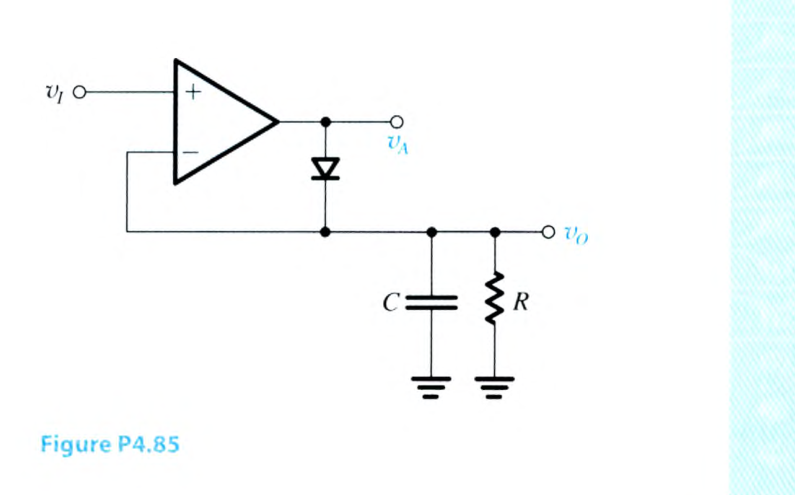

</PracticeCard>

<PracticeCard type="exercise" id="elec-ch4-problem-4-86" title="Problem 4.86｜理想二極體箝位電容" source="Sedra/Smith 8e · p.242 · Problem 4.86" topic="箝位電路">

使用陰極接地的理想二極體箝位電容，輸入為 $5\,\mathrm{V_{rms}}$ 正弦波。求輸出波形的平均（直流）值。

</PracticeCard>

<PracticeCard type="exercise" id="elec-ch4-problem-4-87" title="Problem 4.87｜有負載的箝位電容" source="Sedra/Smith 8e · p.242 · Problem 4.87" topic="箝位電路">

圖示箝位電容接上負載電阻 $R$。輸入 $v_i$ 為頻率 $100\,\mathrm{kHz}$、峰對峰值 $10\,\mathrm{V}$ 的對稱方波，$CR=10\,\mu\mathrm{s}$。繪出輸出 $v_o$ 波形。

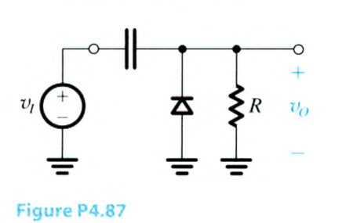

</PracticeCard>

<PracticeCard type="exercise" id="elec-ch4-problem-4-88" title="Problem 4.88｜理想二極體箝位電路組" source="Sedra/Smith 8e · p.242 · Problem 4.88" topic="箝位電路">

對圖中 (a)–(h) 各電路，使用理想二極體，根據同圖所示輸入波形繪出輸出波形，並標示輸出的最高與最低電壓。假設 $CR\gg T$。圖中 (a) 為無二極體的 RC 耦合電路；其餘電路含理想二極體，並依圖配置接地、$-2\,\mathrm{V}$ 基準或 $R$、$2R$ 支路。

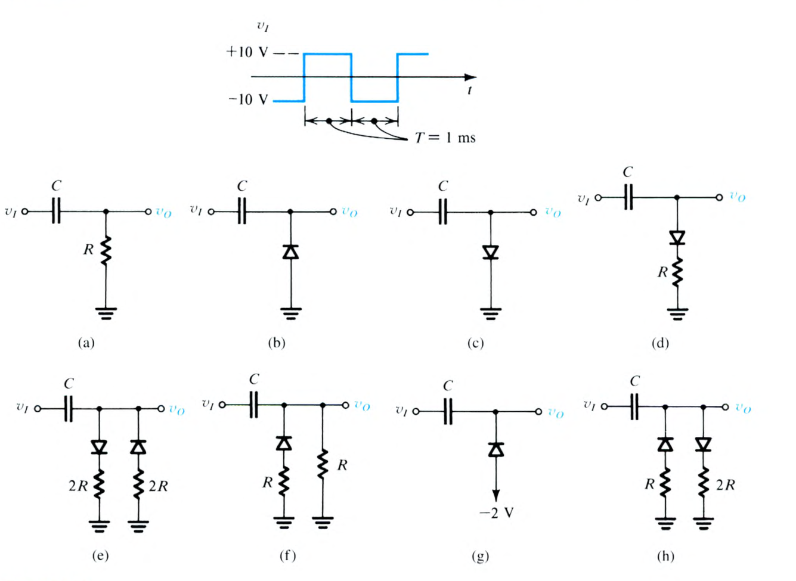

</PracticeCard>

<PracticeCard type="exercise" id="elec-ch4-problem-4-89" title="Problem 4.89｜變容二極體偏壓範圍" source="Sedra/Smith 8e · p.242 · Problem 4.89" topic="變容二極體">

變容二極體零偏壓電容 $C_0=150\,\mathrm{fF}$，參數 $V_0=3\,\mathrm{V}$、$m=3$。求使電容由 $80\,\mathrm{fF}$ 調至 $20\,\mathrm{fF}$ 所需的偏壓電壓範圍。

</PracticeCard>

<PracticeCard type="exercise" id="elec-ch4-problem-4-90" title="Problem 4.90｜光二極體跨阻放大器" source="Sedra/Smith 8e · pp.242–243 · Problem 4.90" topic="光二極體">

反向偏壓光二極體暗電流為 $100\,\mathrm{pA}$，響應度為 $0.5\,\mathrm{A/W}$。它接至圖示跨阻放大器，運算放大器視為理想。求：(a) 光二極體反向偏壓；(b) 無照明時輸出電壓 $v_o$；(c) 入射光功率為 $10\,\mu\mathrm{W}$ 時的 $v_o$。

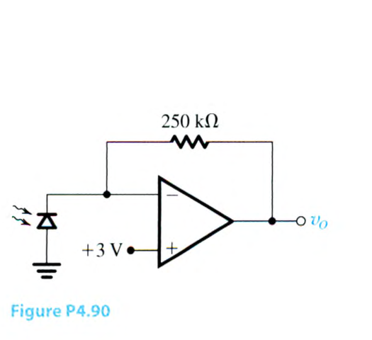

</PracticeCard>

<PracticeCard type="exercise" id="elec-ch4-problem-4-91" title="Problem 4.91｜LED 限流電阻" source="Sedra/Smith 8e · p.243 · Problem 4.91" topic="LED">

LED 由 $3\,\mathrm{V}$ 電池經電阻正向偏壓。求維持 $10\,\mathrm{mA}$ 電流所需的電阻值：(a) 正向壓降 $2.2\,\mathrm{V}$ 的綠色 LED；(b) 正向壓降 $1.8\,\mathrm{V}$ 的紅色 LED。

</PracticeCard>
