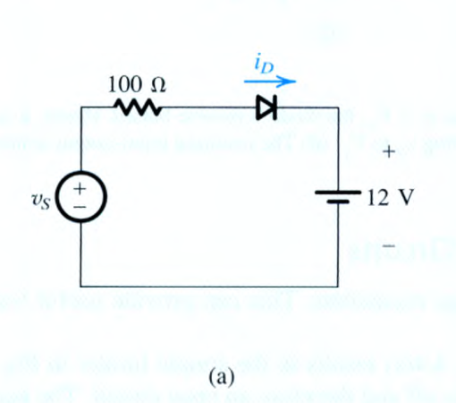
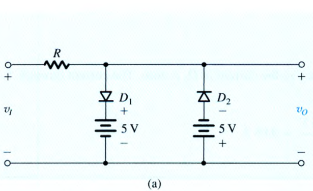
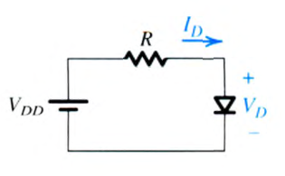
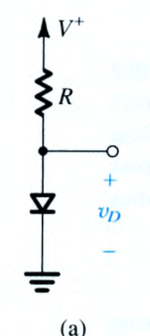
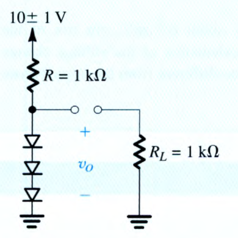
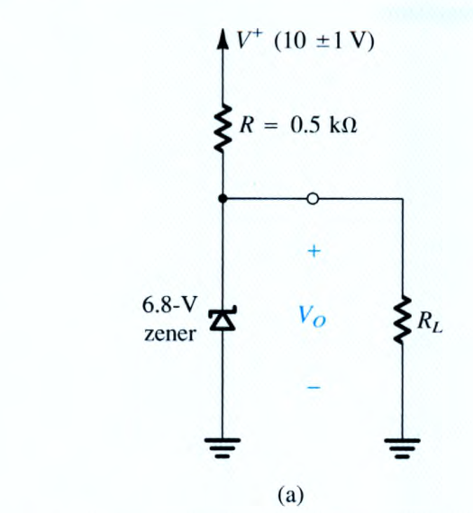
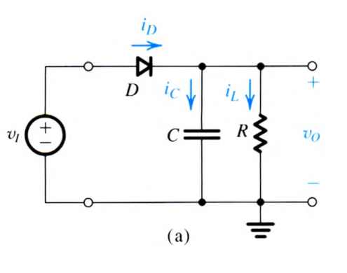
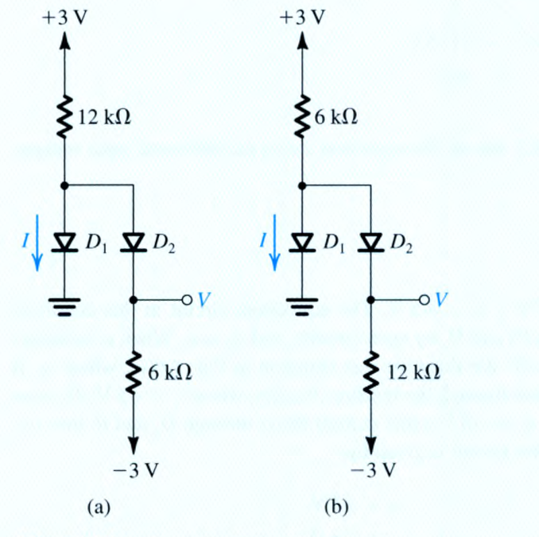
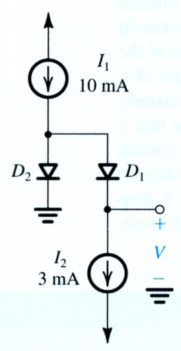
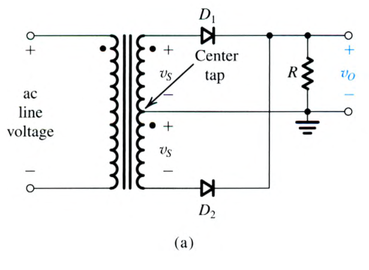

# Chapter 4 二極體例題

<PracticeCard type="example" id="elec-ch4-example-4-1" title="理想二極體電池充電" source="Example 4.1 · Textbook P179" topic="理想二極體">

圖中的理想二極體電路用來為 $12\text{ V}$ 電池充電。輸入 $v_s$ 為峰值 $24\text{ V}$ 的正弦波，串聯電阻為 $100\,\Omega$。求二極體在每週期的導通比例、峰值電流，以及最大反向偏壓。

<template #solution>

二極體在 $v_s>12\text{ V}$ 時導通。令 $24\cos\theta=12$，得 $\theta=60^\circ$，故導通角為 $120^\circ$，占週期的 $1/3$。峰值電流為 $(24-12)/100=0.12\text{ A}$；輸入達負峰值時，最大反向偏壓為 $24+12=36\text{ V}$。

</template>
</PracticeCard>

<PracticeCard type="example" id="elec-ch4-example-4-2" title="雙向理想限幅器" source="Example 4.2 · Textbook P180–P182" topic="限幅電路">

假設圖中的二極體均為理想元件，求輸入輸出特性 $v_o(v_i)$。若 $v_i=100\text{ V}$、$R=100\,\Omega$，各二極體導通的電流是多少？

<template #solution>

當 $-5\text{ V}<v_i<5\text{ V}$ 時，兩個二極體截止，$v_o=v_i$。超過任一限值時，相應二極體導通：

$$
v_o=\begin{cases}-5\text{ V},&v_i<-5\text{ V}\\v_i,&-5\text{ V}\le v_i\le 5\text{ V}\\5\text{ V},&v_i>5\text{ V}\end{cases}
$$

當 $v_i=100\text{ V}$，$D_1$ 的電流為 $(100-5)/100=0.95\text{ A}$，$D_2$ 截止，其電流為零。

</template>
</PracticeCard>

<PracticeCard type="example" id="elec-ch4-example-4-3" title="二極體尺度電流" source="Example 4.3 · Textbook P187–P188" topic="二極體指數特性">

某矽二極體在 $1\text{ mA}$ 時有 $0.7\text{ V}$ 順向壓降。求其尺度電流 $I_S$；同一製程的另一顆二極體在 $1\text{ A}$ 時亦有 $0.7\text{ V}$ 壓降，其 $I_S$ 為何？取 $V_T=25\text{ mV}$。

<template #solution>

使用順向指數模型 $I\simeq I_S e^{V/V_T}$，第一顆的 $I_S=10^{-3}e^{-0.7/0.025}\simeq6.9\times10^{-16}\text{ A}$。第二顆在相同電壓下電流為一千倍，因此 $I_S\simeq6.9\times10^{-13}\text{ A}$。

</template>
</PracticeCard>

<PracticeCard type="example" id="elec-ch4-example-4-4" title="指數模型迭代分析" source="Example 4.4 · Textbook P192–P193" topic="二極體模型">

圖中 $V_{DD}=5\text{ V}$、$R=1\text{ k}\Omega$；二極體在 $1\text{ mA}$ 時的壓降為 $0.7\text{ V}$。用指數模型迭代求 $I_D$ 與 $V_D$，取每十倍電流變化對應約 $60\text{ mV}$ 電壓變化。

<template #solution>

先令 $V_D=0.7\text{ V}$，由 KVL 得 $I_D=(5-0.7)/(1\text{ k}\Omega)=4.3\text{ mA}$。由指數關係更新 $V_D=0.7+0.06\log_{10}(4.3)\simeq0.738\text{ V}$。再回代電路方程得 $I_D=4.262\text{ mA}$，再次更新電壓約為 $0.738\text{ V}$。教材結果為 $I_D=4.262\text{ mA}$、$V_D=0.738\text{ V}$；代回 $5-V_D-I_D R=0$。

</template>
</PracticeCard>

<PracticeCard type="example" id="elec-ch4-example-4-5" title="電源漣波的小訊號分析" source="Example 4.5 · Textbook P201–P202" topic="小訊號模型">

圖中 $R=10\text{ k}\Omega$，電源 $V^+$ 的直流值為 $10\text{ V}$，疊加頻率 $60\text{ Hz}$、峰值 $1\text{ V}$ 的正弦波。二極體在 $1\text{ mA}$ 時壓降為 $0.7\text{ V}$。求二極體直流電壓與其兩端正弦訊號的峰值；取 $V_T=25\text{ mV}$。

<template #solution>

近似 $V_D=0.7\text{ V}$，得 $I_D=(10-0.7)/10\text{ k}\Omega=0.93\text{ mA}$，其值接近題目給定的 $1\text{ mA}$。小訊號電阻 $r_d=V_T/I_D=26.9\,\Omega$。由分壓得訊號峰值 $1\times26.9/(10000+26.9)=2.68\text{ mV}$。

</template>
</PracticeCard>

<PracticeCard type="example" id="elec-ch4-example-4-6" title="三二極體電壓調節" source="Example 4.6 · Textbook P203–P204" topic="電壓調節">

圖中三顆串聯二極體提供約 $2.1\text{ V}$ 的直流電壓。求下列情況引起的輸出電壓百分比變化：(a) 電源電壓變化 $\pm10\%$；(b) 接上 $1\text{ k}\Omega$ 負載。取 $V_T=25\text{ mV}$。

<template #solution>

無負載時，電流約為 $(10-2.1)/1\text{ k}\Omega=7.9\text{ mA}$；每顆二極體的小訊號電阻為 $25/7.9\simeq3.16\,\Omega$；教材將每顆約為 $3.2\,\Omega$，因此三顆合計約 $9.6\,\Omega$。

(a) 電源變化 $\pm1\text{ V}$ 時，輸出變化約為 $\pm1\times9.6/(1000+9.6)=\pm9.5\text{ mV}$，約為 $\pm0.5\%$。 (b) 負載電流約 $2.1\text{ mA}$，輸出約下降 $2.1\text{ mA}\times9.6\,\Omega=20\text{ mV}$，約 $0.95\%$；教材指出使用指數模型計算約下降 $23\text{ mV}$。

</template>
</PracticeCard>

<PracticeCard type="example" id="elec-ch4-example-4-7" title="齊納二極體並聯調節器" source="Example 4.7 · Textbook P205–P207" topic="齊納穩壓">

圖中齊納二極體規格為 $V_Z=6.8\text{ V}$（$I_Z=5\text{ mA}$ 時）、$r_z=20\,\Omega$、$I_{ZK}=0.2\text{ mA}$。電源 $V^+$ 的額定值為 $10\text{ V}$，可變動 $\pm1\text{ V}$。

(a) 額定電源、無負載時求 $V_o$；(b) 求電源變動 $\pm1\text{ V}$ 所致輸出變化及線路調節率；(c) 負載電流 $1\text{ mA}$ 時求輸出變化及負載調節率；(d) 求 $R_L=2\text{ k}\Omega$ 時的輸出變化；(e) 求 $R_L=0.5\text{ k}\Omega$ 時的 $V_o$；(f) 求最壞電源條件下仍可維持崩潰區操作的最小 $R_L$。

<template #solution>

線性齊納模型的截距 $V_{Z0}=6.8-(5\text{ mA})(20\,\Omega)=6.7\text{ V}$。

(a) 無負載時 $I_Z=(10-6.7)/(500+20)=6.35\text{ mA}$，$V_o=6.7+I_Zr_z=6.83\text{ V}$。 (b) 分壓給出 $\Delta V_o=\pm1\times20/(500+20)=\pm38.5\text{ mV}$，線路調節率為 $38.5\text{ mV/V}$。

(c) 教材以 $\Delta I_Z\simeq-1\text{ mA}$ 近似，得 $\Delta V_o\simeq-20\text{ mV}$，負載調節率約 $-20\text{ mV/mA}$。 (d) 以 $I_L\simeq6.8/2\text{ k}\Omega=3.4\text{ mA}$ 估算，$\Delta V_o\simeq-68\text{ mV}$。 (e) 負載過重使齊納二極體截止，分壓後 $V_o=10\times0.5/(0.5+0.5)=5\text{ V}$。 (f) $V^+=9\text{ V}$、$I_Z=I_{ZK}$ 時，負載電流約 $4.4\text{ mA}$，故 $R_L\gtrsim6.7/4.4\text{ mA}\simeq1.5\text{ k}\Omega$。上述負載調節數值沿用教材的小訊號近似。

</template>
</PracticeCard>

<PracticeCard type="example" id="elec-ch4-example-4-8" title="半波峰值整流器" source="Example 4.8 · Textbook P218" topic="峰值整流">

理想二極體峰值整流器如圖，輸入為 $60\text{ Hz}$、峰值 $100\text{ V}$ 的正弦波，負載 $R=10\text{ k}\Omega$。求使輸出峰對峰漣波為 $2\text{ V}$ 所需的電容 $C$，以及二極體每週期的導通比例、導通期間平均電流與峰值電流。

<template #solution>

在小漣波近似下，$C\simeq V_p/(V_r fR)=83.3\,\mu\text{F}$，負載電流 $I_L\simeq V_p/R=10\text{ mA}$。由 $\omega\Delta t\simeq\sqrt{2V_r/V_p}=0.2\text{ rad}$，導通比例為 $0.2/(2\pi)\simeq3.18\%$。

教材的近似式給出導通期間平均二極體電流 $i_{D\mathrm{av}}\simeq I_L(1+\pi\sqrt{2V_p/V_r})=324\text{ mA}$，峰值電流 $i_{D\max}\simeq I_L(1+2\pi\sqrt{2V_p/V_r})=638\text{ mA}$。

</template>
</PracticeCard>

<PracticeCard type="example" id="elec-ch4-video-example-4-1" title="理想二極體電路分析" source="Video Example 4.1 · Textbook P182" topic="理想二極體">

假設圖中所有二極體皆為理想元件，求各電路中標示的電壓與電流。

</PracticeCard>

<PracticeCard type="example" id="elec-ch4-video-example-4-2" title="不同接面面積的指數模型" source="Video Example 4.2 · Textbook P188" topic="二極體指數特性">

圖中 $D_1$ 的接面面積是 $D_2$ 的十倍。求所示電壓 $V$；若要使 $V=60\text{ mV}$，電流 $I_2$ 應為多少？

</PracticeCard>

<PracticeCard type="example" id="elec-ch4-video-example-4-3" title="固定壓降模型分析" source="Video Example 4.3 · Textbook P195" topic="二極體模型">

對圖中的兩個電路，使用二極體固定壓降模型 $V_D=0.7\text{ V}$，求圖示電流與電壓。

</PracticeCard>

<PracticeCard type="example" id="elec-ch4-video-example-4-4" title="中心抽頭全波整流器" source="Video Example 4.4 · Textbook P212" topic="全波整流">

圖中的全波整流器由 $120\text{ V}$（rms）、$60\text{ Hz}$ 電源經 $6:1$ 變壓器供應，負載為 $1\text{ k}\Omega$。兩顆矽二極體在導通時各以固定 $0.7\text{ V}$ 壓降建模。求整流輸出峰值、各二極體每週期導通比例、平均輸出電壓與負載平均電流。

</PracticeCard>
