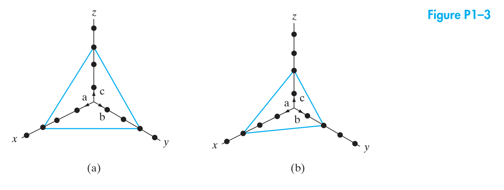
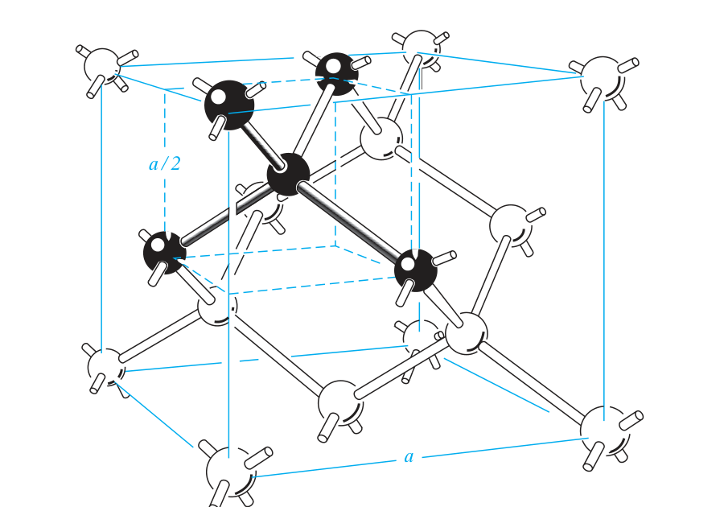
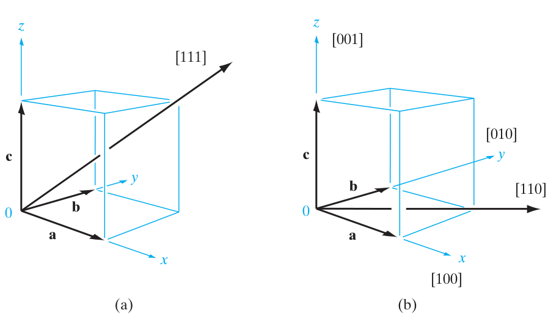
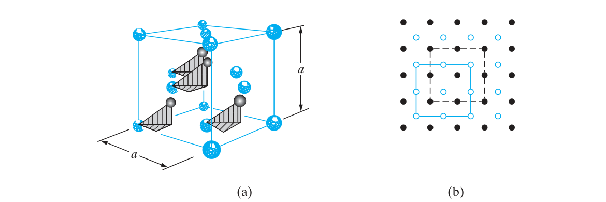
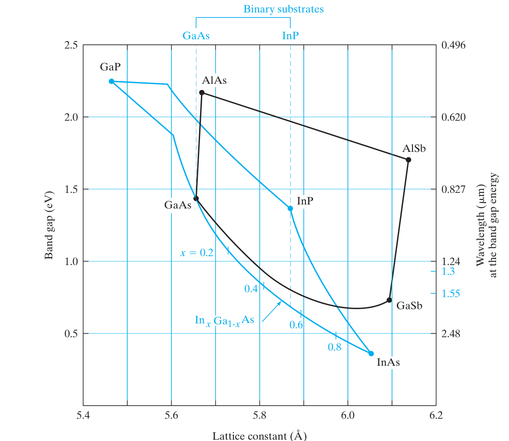
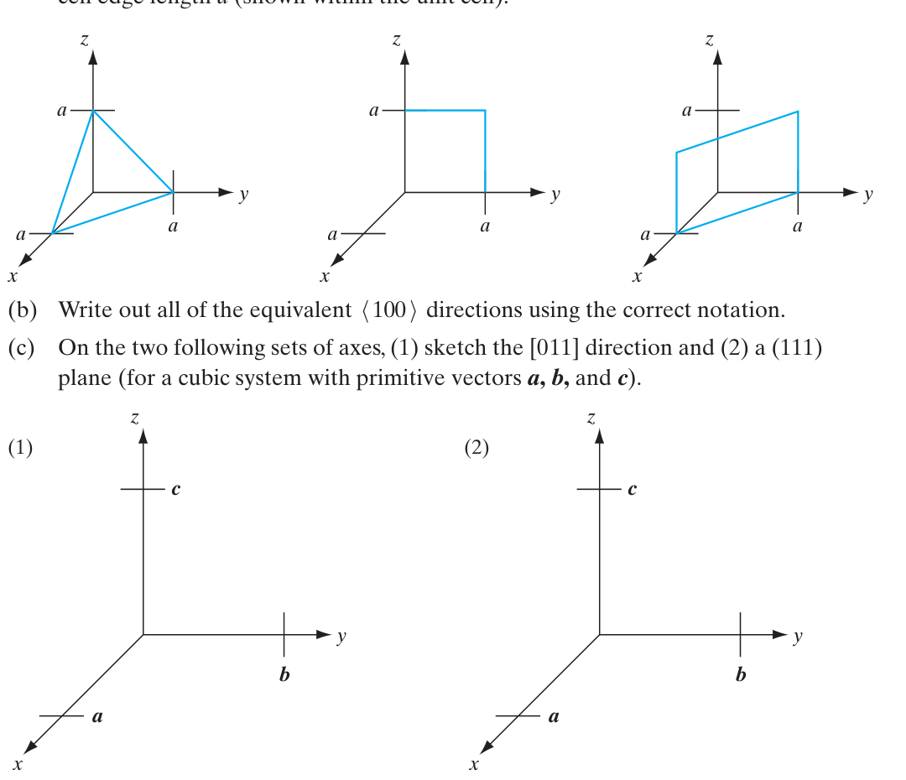
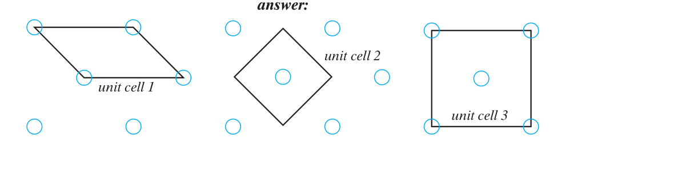
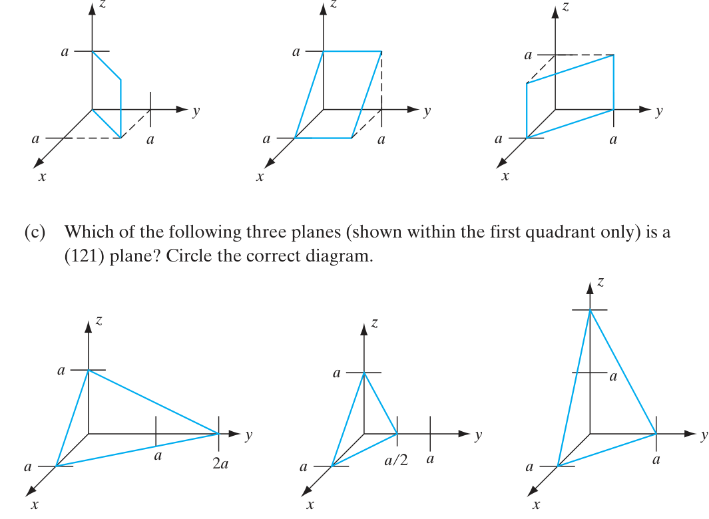
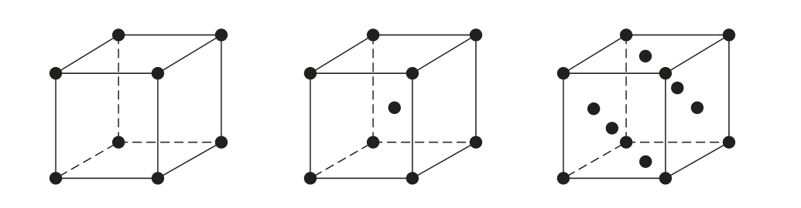

# Chapter 1 題目：Crystal Properties and Growth of Semiconductors

> 來源：Streetman & Banerjee, *Solid State Electronic Devices*, 7th ed.，Problems 1.1–1.19 與 Self Quiz 1–6。每題附中文與英文敘述。

<PracticeFilter prefix="ss-ch1-" />
<PracticeProgress :total="25" prefix="ss-ch1-" />

### Problems

<PracticeCard type="exercise" id="ss-ch1-p1-1" title="Problem 1.1：半導體能隙與波長" source="PDF p.48 / 印刷 p.47" topic="能隙與材料">

使用 Appendix III，列出的半導體中哪一種具有最大的能隙？哪一種具有最小的能隙？若光以能量 $E_g$ 發射，對應的波長各是多少？與 III–V 化合物的第 III 族元素相關的能隙能量，是否呈現明顯的規律？

**English:** Using Appendix III, identify the listed semiconductor with the largest band gap and the one with the smallest band gap. Find the wavelength of light emitted with photon energy equal to each band gap. Is there a clear trend in band-gap energy associated with the group-III element in III–V compounds?

<template #solution>

教材答案：答案頁（印刷 p.596–599；PDF p.597–600）未提供本題答案；需自行解題。

</template>

</PracticeCard>

<PracticeCard type="exercise" id="ss-ch1-p1-2" title="Problem 1.2：bcc 晶格幾何與最大堆積率" source="PDF p.48 / 印刷 p.47" topic="晶格幾何">

對晶格常數為 $3\,\text{Å}$ 的 bcc 晶格，計算最近鄰原子之間的距離、原子半徑，以及每個原子的體積；並求最大堆積率。

**English:** For a bcc lattice with lattice constant $3\,\text{Å}$, calculate the nearest-neighbor distance, atomic radius, volume per atom, and maximum packing fraction.

<template #solution>

教材答案：答案頁未提供；需自行解題。

</template>

</PracticeCard>

<PracticeCard type="exercise" id="ss-ch1-p1-3" title="Problem 1.3：晶面標記" source="PDF p.48 / 印刷 p.47" topic="米勒指數">

標示下圖所示的晶面（Figure P1–3）。

**English:** Label the crystal planes shown in Figure P1–3.

<template #solution>

教材答案：答案頁未提供；需自行解題。

</template>

</PracticeCard>

<PracticeCard type="exercise" id="ss-ch1-p1-4" title="Problem 1.4：bcc 晶格的密度、(110) 面與缺陷" source="PDF p.48 / 印刷 p.47" topic="晶格與缺陷">

繪製具有單原子基底的 bcc 單位晶胞。若原子密度為 $1.6\times10^{22}\,\text{cm}^{-3}$，計算晶格常數；求 $(110)$ 晶面上的單位面積原子密度；求每個原子的半徑；並說明 interstitials（間隙原子）與 vacancies（空缺）是什麼。

**English:** Draw a bcc unit cell with a one-atom basis. Given an atomic density of $1.6\times10^{22}\,\text{cm}^{-3}$, calculate the lattice constant, atomic density per unit area on the $(110)$ plane, and atomic radius. Explain interstitials and vacancies.

<template #solution>

教材答案：答案頁未提供；需自行解題。

</template>

</PracticeCard>

<PracticeCard type="exercise" id="ss-ch1-p1-5" title="Problem 1.5：Si 與 GaAs 的質量密度" source="PDF p.48 / 印刷 p.47" topic="材料密度">

使用 Appendix III 的晶格常數、原子量與 Avogadro 常數，計算 Si 與 GaAs 的密度，並與 Appendix III 所列的密度比較。Si、Ga 與 As 的原子量分別為 (28.1)、(69.7) 與 (74.9)。

**English:** Using the lattice constants in Appendix III, atomic weights, and Avogadro’s number, calculate the densities of Si and GaAs and compare them with Appendix III. Use atomic weights 28.1 for Si, 69.7 for Ga, and 74.9 for As.

<template #solution>

教材答案：答案頁未提供；需自行解題。

</template>

</PracticeCard>

<PracticeCard type="exercise" id="ss-ch1-p1-6" title="Problem 1.6：GaAs 晶格常數與 primitive cell 體積" source="PDF p.48 / 印刷 p.47" topic="晶格常數">

Ga 與 As 的原子半徑分別為 $136\,\text{pm}$ 與 $114\,\text{pm}$。使用硬球近似，求 GaAs 的晶格常數與 primitive cell 的體積。已知 $1\,\text{Å}=100\,\text{pm}$。

**English:** The atomic radii of Ga and As are $136\,\text{pm}$ and $114\,\text{pm}$. Using the hard-sphere approximation, find the GaAs lattice constant and primitive-cell volume. Use $1\,\text{Å}=100\,\text{pm}$.

<template #solution>

教材答案：答案頁未提供；需自行解題。

</template>

</PracticeCard>

<PracticeCard type="exercise" id="ss-ch1-p1-7" title="Problem 1.7：fcc 晶格的面密度與體密度" source="PDF p.48 / 印刷 p.47" topic="fcc 晶格">

繪製晶格常數為 $5\,\text{Å}$、具有單原子基底的 fcc 晶格單位晶胞，並計算 $(110)$ 晶面上的單位面積原子密度與單位體積原子密度。在此晶胞中標示一個 interstitial defect（間隙缺陷）。

**English:** Draw an fcc unit cell with a one-atom basis and lattice constant $5\,\text{Å}$. Calculate the atomic density per unit area on the $(110)$ plane and per unit volume. Mark one interstitial defect in the cell.

<template #solution>

教材答案：答案頁未提供；需自行解題。

</template>

</PracticeCard>

<PracticeCard type="exercise" id="ss-ch1-p1-8" title="Problem 1.8：鑽石晶格的最近鄰" source="PDF p.48 / 印刷 p.47" topic="鑽石晶格">

沿著鑽石晶格的 $\langle110\rangle$ 方向觀看並繪圖，並以 Figure 1–9 為參考；圖中需包含連接最近鄰原子的線段。

**English:** Draw the diamond lattice as viewed along a $\langle110\rangle$ direction, using Figure 1–9 as a reference. Include lines joining nearest-neighbor atoms.

<template #solution>

教材答案：答案頁未提供；需自行解題。

</template>

</PracticeCard>

<PracticeCard type="exercise" id="ss-ch1-p1-9" title="Problem 1.9：bcc 作為兩個互穿 sc 晶格" source="PDF p.48 / 印刷 p.47" topic="晶格表示法">

以圖示說明 bcc 晶格可表示為兩個互穿的 sc 晶格。為簡化圖示，請畫出沿 $\langle100\rangle$ 方向觀看的晶格。

**English:** Illustrate how a bcc lattice can be represented as two interpenetrating simple-cubic lattices. For clarity, draw the lattice viewed along a $\langle100\rangle$ direction.

<template #solution>

教材答案：答案頁未提供；需自行解題。

</template>

</PracticeCard>

<PracticeCard type="exercise" id="ss-ch1-p1-10" title="Problem 1.10：Si 表面密度與 InP 最近鄰距離" source="PDF p.48 / 印刷 p.47" topic="面密度">

​(a) 求 Si 晶圓 $(100)$ 表面上的原子數，單位為 $\text{atoms}/\text{cm}^{2}$。

​(b) InP 中最近鄰 In 原子之間的距離是多少（單位：$\text{Å}$）？

**English:** (a) Find the number of atoms per square centimeter on a Si $(100)$ wafer surface. (b) Find the nearest-neighbor In–In distance in InP, in angstroms.

<template #solution>

教材答案：答案頁未提供；需自行解題。

</template>

</PracticeCard>

<PracticeCard type="exercise" id="ss-ch1-p1-11" title="Problem 1.11：NaCl 硬球模型密度" source="PDF p.49 / 印刷 p.48" topic="離子晶體">

Na$^+$ 與 Cl$^-$ 的離子半徑分別為 $1.0\,\text{Å}$ 與 $1.8\,\text{Å}$，原子量分別為 (23) 與 (35.5)。將離子視為硬球，計算 NaCl 的密度，並與實測密度 $2.17\,\text{g}/\text{cm}^{3}$ 比較。

**English:** The ionic radii of Na$^+$ and Cl$^-$ are $1.0\,\text{Å}$ and $1.8\,\text{Å}$; their atomic weights are 23 and 35.5. Treating the ions as hard spheres, calculate the density of NaCl and compare it with the measured value $2.17\,\text{g}/\text{cm}^{3}$.

<template #solution>

教材答案：答案頁未提供；需自行解題。

</template>

</PracticeCard>

<PracticeCard type="exercise" id="ss-ch1-p1-12" title="Problem 1.12：具有雙原子基底的 sc 晶格" source="PDF p.49 / 印刷 p.48" topic="堆積率">

繪製晶格常數 $a=4\,\text{Å}$ 的 sc 單位晶胞。這是一個雙原子基底：原子 A 位於晶格點，原子 B 從每個晶格點沿 $a/2,0,0$ 位移。假設兩種原子大小相同，且結構為緊密堆積（最近鄰原子彼此接觸）。計算：

​(i) 堆積率，即原子所占總體積的比例；

​(ii) 每單位體積中的 B 原子數；

​(iii) $100$ 晶面上每單位面積的 A 原子數。

**English:** Draw a simple-cubic unit cell with $a=4\,\text{Å}$ and a two-atom basis: A at each lattice point and B displaced by $(a/2,0,0)$. Assuming equal-size atoms in close contact, calculate (i) the packing fraction, (ii) the number of B atoms per unit volume, and (iii) the number of A atoms per unit area on a $(100)$ plane.

<template #solution>

教材答案：答案頁未提供；需自行解題。

</template>

</PracticeCard>

<PracticeCard type="exercise" id="ss-ch1-p1-13" title="Problem 1.13：三種立方晶格的晶胞與最近鄰" source="PDF p.49 / 印刷 p.48" topic="立方晶格">

一個 sc、bcc 與 fcc 晶體的單位晶胞內各有多少個原子？對每一種晶格，最近鄰原子中心到中心的距離，以晶格常數 (a) 表示是多少？

**English:** How many atoms are in the unit cell of each simple-cubic, bcc, and fcc crystal? Express the nearest-neighbor center-to-center distance in each lattice in terms of lattice constant $a$.

<template #solution>

教材答案：答案頁未提供；需自行解題。

</template>

</PracticeCard>

<PracticeCard type="exercise" id="ss-ch1-p1-14" title="Problem 1.14：等價的 {111} 與 {110} 晶面" source="PDF p.49 / 印刷 p.48" topic="等價晶面">

繪製如 Figure 1–7 所示的立方體，並在其中畫出具有不同方向的四個 $\{111\}$ 晶面；再對 $\{110\}$ 晶面重複同樣的作圖。

**English:** Draw a cube as in Figure 1–7 and show four differently oriented members of the $\{111\}$ plane family. Repeat for the $\{110\}$ plane family.

<template #solution>

教材答案：答案頁未提供；需自行解題。

</template>

</PracticeCard>

<PracticeCard type="exercise" id="ss-ch1-p1-15" title="Problem 1.15：硬球最大填充體積比例" source="PDF p.49 / 印刷 p.48" topic="堆積率">

求硬球在 sc、fcc 與鑽石晶格中，能填入單位晶胞體積的最大比例。

**English:** Find the maximum fraction of unit-cell volume occupied by hard spheres in simple-cubic, fcc, and diamond lattices.

<template #solution>

教材答案：答案頁未提供；需自行解題。

</template>

</PracticeCard>

<PracticeCard type="exercise" id="ss-ch1-p1-16" title="Problem 1.16：Ge 與 InP 的密度" source="PDF p.49 / 印刷 p.48" topic="材料密度">

使用 Appendix III 的晶格常數、原子量與 Avogadro 常數，計算 Ge 與 InP 的密度，並與 Appendix III 所列的密度比較。

**English:** Using lattice constants from Appendix III, atomic weights, and Avogadro’s number, calculate the densities of Ge and InP and compare them with Appendix III.

<template #solution>

教材答案：答案頁未提供；需自行解題。

</template>

</PracticeCard>

<PracticeCard type="exercise" id="ss-ch1-p1-17" title="Problem 1.17：由 fcc 建構鑽石晶格" source="PDF p.49 / 印刷 p.48" topic="鑽石晶格">

從一個 fcc 晶格開始，從每個 fcc 原子沿 $(1/4,1/4,1/4)$ 加入原子，以得到鑽石晶格。說明為什麼 Figure 1–8a 中只有四個新增原子出現在鑽石單位晶胞內。

**English:** Starting with an fcc lattice, add atoms displaced by $(1/4,1/4,1/4)$ from each fcc atom to form a diamond lattice. Explain why only four added atoms appear within the diamond unit cell in Figure 1–8a.

<template #solution>

教材答案：答案頁未提供；需自行解題。

</template>

</PracticeCard>

<PracticeCard type="exercise" id="ss-ch1-p1-18" title="Problem 1.18：三元合金的晶格匹配與能隙" source="PDF p.49 / 印刷 p.48" topic="合金與晶格匹配">

假設三元合金的晶格常數隨組成 (x) 線性變化（例如 Figure 1–13 中 InGaAs 的變化）：

​(a) 哪一種 $\mathrm{AlSb}_{x}\mathrm{As}_{1-x}$ 組成可與 InP 晶格匹配？

​(b) 哪一種 $\mathrm{In}_{x}\mathrm{Ga}_{1-x}\mathrm{P}$ 組成可與 GaAs 晶格匹配？

​(c) 上述兩種情況的能隙各是多少？

附註：這種以莫耳分率的線性變化描述晶體性質（例如晶格常數與能隙）的方式稱為 Vegard 定律；以二次多項式擬合資料則稱為 bowing parameter。

**English:** Assume the lattice constant of a ternary alloy varies linearly with composition $x$, as for InGaAs in Figure 1–13. (a) Which $\mathrm{AlSb}_{x}\mathrm{As}_{1-x}$ composition lattice-matches InP? (b) Which $\mathrm{In}_{x}\mathrm{Ga}_{1-x}\mathrm{P}$ composition lattice-matches GaAs? (c) What are their band gaps? The linear composition rule is Vegard’s law; a quadratic fit uses a bowing parameter.

<template #solution>

教材答案：答案頁未提供；需自行解題。

</template>

</PracticeCard>

<PracticeCard type="exercise" id="ss-ch1-p1-19" title="Problem 1.19：InGaAs 晶格匹配與臨界厚度" source="PDF p.49 / 印刷 p.48" topic="異質磊晶">

​(a) 求在 InP 基板上以晶格匹配方式成長的 $\mathrm{In}_{1-x}\mathrm{Ga}_{x}\mathrm{As}$ 組成。晶格常數為 $a_{\mathrm{InAs}}=6.0584\,\text{Å}$、$a_{\mathrm{GaAs}}=5.6533\,\text{Å}$，以及 $a_{\mathrm{InP}}=5.8688\,\text{Å}$。

​(b) 在 GaAs 基板上以假同形（pseudomorphic）方式成長 $\mathrm{In}_{0.2}\mathrm{Ga}_{0.8}\mathrm{As}$ 合金。求成長層的最大厚度。

**English:** (a) Find the composition of $\mathrm{In}_{1-x}\mathrm{Ga}_{x}\mathrm{As}$ lattice-matched to InP, using $a_{\mathrm{InAs}}=6.0584\,\text{Å}$, $a_{\mathrm{GaAs}}=5.6533\,\text{Å}$, and $a_{\mathrm{InP}}=5.8688\,\text{Å}$. (b) Find the maximum thickness for pseudomorphic $\mathrm{In}_{0.2}\mathrm{Ga}_{0.8}\mathrm{As}$ grown on GaAs.

<template #solution>

教材答案：答案頁未提供；需自行解題。

</template>

</PracticeCard>

### Self Quiz

<PracticeCard type="practice" id="ss-ch1-sq1" title="Self Quiz 1：晶面、等價方向與晶面作圖" source="PDF p.50 / 印刷 p.49" topic="米勒指數">

​(a) 對下圖所示、邊長為 (a) 的立方晶胞，使用正確記號標示三個晶面。

​(b) 使用正確記號寫出所有等價的 $\langle100\rangle$ 方向。

​(c) 在下方兩組以 primitive vectors $(\mathbf a,\mathbf b,\mathbf c)$ 為軸的座標上，分別：(1) 畫出 $[011]$ 方向；(2) 畫出 $(111)$ 晶面。

**English:** (a) Use proper notation to identify the three planes in the cube shown, whose edge length is $a$. (b) List all equivalent $\langle100\rangle$ directions. (c) On the supplied primitive-vector axes, draw the $[011]$ direction and the $(111)$ plane.

<template #solution>

教材答案（印刷 p.596，PDF p.597）：(a) 依序為 $(111)$、$100$、$110$。答案頁未列出 (b) 的完整方向清單，也未列出 (c) 的作圖；(b)、(c) 需自行解題。

</template>

</PracticeCard>

<PracticeCard type="practice" id="ss-ch1-sq2" title="Self Quiz 2：primitive cells 與等價晶面" source="PDF p.50–51 / 印刷 p.49–50" topic="primitive cell">

​(a) 下列三個二維晶胞中，哪些是此二維晶格的 primitive cells？請在選項中圈出正確組合：(1)、(2)、(3)、$1\text{ and }2$、$1\text{ and }3$、$2\text{ and }3$，或 $1,2,\text{ and }3$。

​(b) 下列晶面（只畫出第一象限 $0<x,y,z<a$，虛線僅供參考）全部屬於哪一組等價晶面？使用正確記號。

​(c) 下列三個只畫出第一象限的晶面中，哪一個是 $(121)$ 晶面？請圈出正確圖形。

**English:** (a) Which of the three illustrated two-dimensional cells are primitive cells? Choose among cells 1, 2, and 3 or their listed combinations. (b) Identify the family of equivalent planes illustrated in the first octant, using proper notation. (c) Which of the three illustrated first-octant planes is the $(121)$ plane?

<template #solution>

教材答案（印刷 p.596，PDF p.597）：(a) $1\text{ and }2$；(b) $\{110\}$；(c) 圖 B。

</template>

</PracticeCard>

<PracticeCard type="practice" id="ss-ch1-sq3" title="Self Quiz 3：鑽石與 zinc blende 結構" source="PDF p.51 / 印刷 p.50" topic="晶體結構">

​(a) 鑽石與 zinc blende 晶體結構都由「具有雙原子基底的 Bravais 晶格」組成。下列哪一個是此 Bravais 晶格的正確單位晶胞？請圈出正確圖形。

​(b) 下列敘述何者正確？

1. GaAs 具有 diamond / zinc blende 晶體結構。
2. Si 具有 diamond / zinc blende 晶體結構。

**English:** (a) Diamond and zinc-blende structures are Bravais lattices with a two-atom basis. Which illustrated unit cell is the correct Bravais unit cell? (b) Choose diamond or zinc blende for the structure of GaAs and for the structure of Si.

<template #solution>

教材答案（印刷 p.596，PDF p.597）：(a) 圖 C；(b) (1) zinc blende；(2) diamond。

</template>

</PracticeCard>

<PracticeCard type="practice" id="ss-ch1-sq4" title="Self Quiz 4：半導體中的缺陷維度" source="PDF p.52 / 印刷 p.51" topic="晶體缺陷">

舉出半導體中零維、一維、二維與三維缺陷的例子。

**English:** Give examples of zero-, one-, two-, and three-dimensional defects in semiconductors.

<template #solution>

教材答案（印刷 p.596，PDF p.597）：0-D：vacancies、interstitials；1-D：dislocations；2-D：grain boundaries、surfaces。答案頁未列出 3-D 缺陷例子；該部分需自行解題。

</template>

</PracticeCard>

<PracticeCard type="practice" id="ss-ch1-sq5" title="Self Quiz 5：primitive cell、unit cell、lattice 與 crystal" source="PDF p.52 / 印刷 p.51" topic="晶格概念">

​(a) primitive cell 與 unit cell 有何不同？這兩個概念各有什麼用途？

​(b) lattice 與 crystal 有何不同？一維晶格可以有多少種不同形式？

**English:** (a) How does a primitive cell differ from a unit cell, and what is each used for? (b) How does a lattice differ from a crystal, and how many distinct one-dimensional lattices are possible?

<template #solution>

教材答案：答案頁（印刷 p.596–599；PDF p.597–600）未提供本題答案；需自行解題。

</template>

</PracticeCard>

<PracticeCard type="practice" id="ss-ch1-sq6" title="Self Quiz 6：InAs 在不同基板上的臨界厚度" source="PDF p.52 / 印刷 p.51" topic="晶格匹配">

考慮在下列晶體基板上成長 InAs：InP、AlAs、GaAs 與 GaP。哪一種情況下 InAs 層的臨界厚度最大？可使用教材 Figure 1–13。選項為：GaP / GaAs / AlAs / InP。

**English:** Consider InAs grown on InP, AlAs, GaAs, or GaP substrates. On which substrate is its critical thickness greatest? You may use Figure 1–13. Choose GaP, GaAs, AlAs, or InP.

<template #solution>

教材答案（印刷 p.596，PDF p.597）：InP。

</template>

</PracticeCard>
