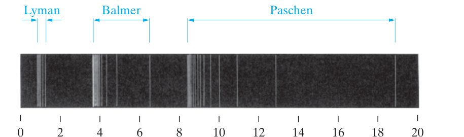
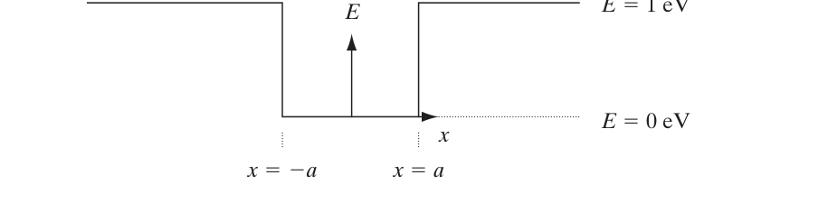
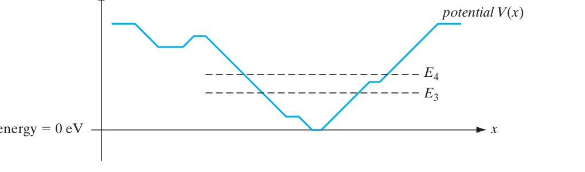
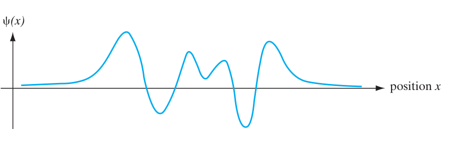
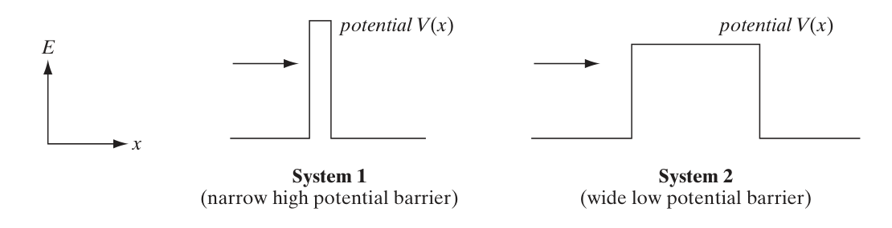

# Chapter 2：Atoms and Electrons — Problems

> 來源：Streetman & Banerjee, *Solid State Electronic Devices*, 7th ed.（`docs/solid-state/sspd-eee-swapnil.pdf`）。本頁完整整理 Chapter 2 的 13 題 Problems 與 6 題 Self Quiz。

<PracticeFilter prefix="ss-ch2-" />
<PracticeProgress :total="19" prefix="ss-ch2-" />

## 老師 2026/10/14 期中考板書對照

> **判讀說明**：以下是與老師課堂板書**同主題的教材練習**，不是老師確認的考試原題。老師的題號與課本 Problem / Self Quiz 題號不同。板書來源：[Notion｜固態電子導論](https://app.notion.com/p/22f038339615421bb7da2c870c0e8997)（可能需要學校帳號權限）。

- **老師第 3 題：氫原子發射光譜** — [Problem 2.3：Lyman／Balmer／Paschen](#card-ss-ch2-p2-3)、[Problem 2.5：Balmer／Rydberg 常數](#card-ss-ch2-p2-5)。老師要求算**頻率 Hz**，而課本題主要算**波長或 Rydberg 常數**。
- **老師第 4 題：一維薛丁格方程式與期望值** — [Problem 2.6：位置期望值](#card-ss-ch2-p2-6)、[Problem 2.12：能量期望值](#card-ss-ch2-p2-12)。兩題皆非「寫出一維不含時薛丁格方程式」原題。
- **老師第 6 題：無限／有限深量子井** — [Problem 2.11：無限深井能階](#card-ss-ch2-p2-11)、[Self Quiz 2：有限深井](#card-ss-ch2-sq2)。老師另外提到有限井能階的超越方程式；Self Quiz 2 未要求該數值求解。
- **老師第 10 題：量子穿隧** — [Problem 2.9：有限位能障壁](#card-ss-ch2-p2-9)、[Self Quiz 4：反射機率](#card-ss-ch2-sq4)。相關概念相同，但並非直接代入老師板書 $T\approx e^{-2\kappa L}$ 的原題。

## Problems

<PracticeCard type="exercise" id="ss-ch2-p2-1" title="Problem 2.1：光電效應實驗" source="PDF p.79 / 印刷 p.78" topic="光電效應">

​(a) 繪製簡單的真空管裝置，以及在光電效應實驗中量測 $E_m$ 的相關電路。電極可放置在密封的玻璃封套中。

​(b) 對固定波長、固定電極材料與配置，繪製預期量到的光電流 (I) 對阻滯電壓 (V) 曲線；請畫出數個不同光強度的情況。

​(c) 鉑的功函數為 $4.09\,\text{eV}$。若以波長 $2440\,\text{Å}$ 的入射光照射 Pt 電極，為使光電流降至零，需要多大的阻滯電位？注意每個電子逸出表面時會損失 $q\Phi$ 的能量。

**English:**

(a) Draw a simple vacuum-tube apparatus and the associated circuit for measuring $E_m$ in the photoelectric-effect experiment. The electrodes may be placed inside a sealed glass envelope.

(b) For a fixed wavelength, electrode material, and electrode configuration, sketch the expected measured photocurrent $I$ versus retarding voltage $V$; show several cases with different light intensities.

(c) Platinum has a work function of $4.09\,\text{eV}$. If Pt is illuminated with incident light of wavelength $2440\,\text{Å}$, what retarding potential is required to reduce the photocurrent to zero? Note that each electron loses energy $q\Phi$ when it escapes from the surface.

<template #solution>

教材答案：答案頁未提供；需自行解題。

</template>

</PracticeCard>

<PracticeCard type="exercise" id="ss-ch2-p2-2" title="Problem 2.2：鋅的光電效應" source="PDF p.79 / 印刷 p.78" topic="光電效應">

在光電效應實驗中，鋅放出光電子的截止波長為 $310\,\text{nm}$。計算鋅的功函數；再計算波長 $2000\,\text{Å}$ 的光所產生光電子的速度（該波長不是截止波長）。

**English:**

In a photoelectric-effect experiment, the cutoff wavelength for photoelectron emission from zinc is $310\,\text{nm}$. Calculate the work function of zinc, and then calculate the speed of photoelectrons produced by light of wavelength $2000\,\text{Å}$ (this wavelength is not the cutoff wavelength).

<template #solution>

教材答案：答案頁未提供；需自行解題。

</template>

</PracticeCard>

<PracticeCard type="exercise" id="ss-ch2-p2-3" title="Problem 2.3：氫原子光譜線" source="PDF p.79–80 / 印刷 p.78–79" topic="原子光譜">

> **課堂板書重點對照（同主題、非原題）**：老師第 3 題｜氫原子發射光譜：老師要求計算兩種系列的**頻率（Hz）**；本題主要算**波長**，屬同主題練習。 [查看 Notion 板書來源](https://app.notion.com/p/22f038339615421bb7da2c870c0e8997)。

​(a) 證明氫原子光譜的各條譜線可以用 Å 表示為

$$
\lambda[\text{Å}]=\frac{911n_1^{2}n^{2}}{n^{2}-n_1^{2}},
$$

其中 Lyman 系列的 $n_1=1$、Balmer 系列的 $n_1=2$、Paschen 系列的 $n_1=3$，且整數 (n) 大於 $n_1$。

​(b) 計算 Lyman 系列 $n=5$、Balmer 系列 $n=7$，以及 Paschen 系列 $n=10$ 的波長 $\lambda$。如 Figure 2–2 繪製結果。三個系列的波長極限各是多少？

**English:**

(a) Show that the wavelengths of the spectral lines of hydrogen can be expressed in Å as
$$
\lambda[\text{Å}]=\frac{911n_1^{2}n^{2}}{n^{2}-n_1^{2}},
$$
where $n_1=1$ for the Lyman series, $n_1=2$ for the Balmer series, and $n_1=3$ for the Paschen series, with the integer $n$ greater than $n_1$.

(b) Calculate the wavelength $\lambda$ for Lyman-series $n=5$, Balmer-series $n=7$, and Paschen-series $n=10$. Plot the results as in Figure 2–2. What are the wavelength limits of the three series?

<template #solution>

教材答案：答案頁未提供；需自行解題。

</template>

</PracticeCard>

<PracticeCard type="exercise" id="ss-ch2-p2-4" title="Problem 2.4：不確定性原理與束縛能" source="PDF p.80 / 印刷 p.79" topic="不確定性原理">

使用 Heisenberg 不確定性原理，估計直徑 $10\,\text{fm}$ 的原子中束縛電子的動量不確定度。再使用所算得的動量不確定度，求最小束縛能。

**English:**

Using the Heisenberg uncertainty principle, estimate the momentum uncertainty of a bound electron in an atom with diameter $10\,\text{fm}$. Then use the momentum uncertainty you obtain to find the minimum binding energy.

<template #solution>

教材答案：答案頁未提供；需自行解題。

</template>

</PracticeCard>

<PracticeCard type="exercise" id="ss-ch2-p2-5" title="Problem 2.5：由 Balmer 線求 Rydberg 常數" source="PDF p.80 / 印刷 p.79" topic="Bohr 模型">

> **課堂板書重點對照（同主題、非原題）**：老師第 3 題｜Balmer 光譜：本題由波長推算 Rydberg 常數，與老師指定的頻率計算不同。 [查看 Notion 板書來源](https://app.notion.com/p/22f038339615421bb7da2c870c0e8997)。

由 Balmer 系列計算可知，氫光譜的第一條譜線波長為 $656.1\,\text{nm}$。Bohr 理論以氫原子電子由第三能階躍遷到第二能階，預測幾乎相同的輻射躍遷。由此求 Rydberg 常數。

**English:**

From calculations for the Balmer series, the wavelength of the first line in the hydrogen spectrum is $656.1\,\text{nm}$. In Bohr theory, this radiation transition is predicted by an electron in a hydrogen atom making a transition from the third energy level to the second. Use this result to determine the Rydberg constant.

<template #solution>

教材答案：答案頁未提供；需自行解題。

</template>

</PracticeCard>

<PracticeCard type="exercise" id="ss-ch2-p2-6" title="Problem 2.6：一維波函數的機率分布" source="PDF p.80 / 印刷 p.79" topic="波函數">

> **課堂板書重點對照（同主題、非原題）**：老師第 4 題｜期望值：本題練習位置期望值；老師另要求寫一維不含時薛丁格方程式。 [查看 Notion 板書來源](https://app.notion.com/p/22f038339615421bb7da2c870c0e8997)。

考慮一個已正規化的電子波函數，教材原式照錄為

$$
\varphi(x)=2\alpha\sqrt{\alpha x}\,e^{-\alpha x}\quad\text{for }x>0,
\qquad \varphi(x)=0\quad\text{for }x<0.
$$

​(a) $P(x)=|\varphi(x)|^{2}$ 在何種 $x$ 值達到峰值？

​(b) 計算 $\langle x\rangle$ 與 $\langle x^{2}\rangle$。

​(c) 粒子位於 $x=0$ 與 $x=1/\alpha$ 之間的機率是多少？

**English:**

Consider a normalized electron wave function, transcribed from the textbook as
$$
\varphi(x)=2\alpha\sqrt{\alpha x}\,e^{-\alpha x}\quad\text{for }x>0,
\qquad \varphi(x)=0\quad\text{for }x<0.
$$
(a) At what value of $x$ does $P(x)=|\varphi(x)|^{2}$ reach its maximum?

(b) Calculate $\langle x\rangle$ and $\langle x^{2}\rangle$.

(c) What is the probability that the particle is between $x=0$ and $x=1/\alpha$?

<template #solution>

教材答案：答案頁未提供；需自行解題。註：本卡的係數、根號內形式與「已正規化」字樣均依 PDF 版面轉錄。

</template>

</PracticeCard>

<PracticeCard type="exercise" id="ss-ch2-p2-7" title="Problem 2.7：分段一維波函數的正規化" source="PDF p.80 / 印刷 p.79" topic="波函數">

一個粒子在一維中由下列波函數描述：

$$
\psi(x)=
\begin{cases}
Be^{-2x}, & x\ge 0,\\
Ce^{+4x}, & x<0,
\end{cases}
$$

其中 $B$ 與 $C$ 為實常數。計算 $B$ 與 $C$，使 $\psi$ 成為有效的波函數。粒子最可能位於哪裡？

**English:**

A particle in one dimension is described by the wave function
$$
\psi(x)=
\begin{cases}
Be^{-2x}, & x\ge 0,\\
Ce^{+4x}, & x<0,
\end{cases}
$$
where $B$ and $C$ are real constants. Calculate $B$ and $C$ so that $\psi$ is a valid wave function. Where is the particle most likely to be found?

<template #solution>

教材答案：答案頁未提供；需自行解題。

</template>

</PracticeCard>

<PracticeCard type="exercise" id="ss-ch2-p2-8" title="Problem 2.8：有限區間內的平面波" source="PDF p.80 / 印刷 p.79" topic="波函數">

電子波函數在 $x=-2\,\text{cm}$ 與 $x=2\,\text{cm}$ 之間為 $Ce^{ikx}$，其他地方皆為零。求 (C) 的值；再求電子位於 $x=0$ 與 $x=4\,\text{cm}$ 之間的機率。

> 轉錄註：PDF 原頁此處負號極淡；依題目支撐區間與後續積分區間判讀為 $-2\,\text{cm}\le x\le 2\,\text{cm}$。

**English:**

The electron wave function is $Ce^{ikx}$ between $x=-2\,\text{cm}$ and $x=2\,\text{cm}$, and is zero everywhere else. Find the value of $C$, and then find the probability that the electron is between $x=0$ and $x=4\,\text{cm}$.

> Transcription note: The minus sign is very faint on the original PDF page; based on the support interval and the subsequent integration interval, it is read as $-2\,\text{cm}\le x\le 2\,\text{cm}$.

<template #solution>

教材答案：答案頁未提供；需自行解題。

</template>

</PracticeCard>

<PracticeCard type="exercise" id="ss-ch2-p2-9" title="Problem 2.9：有限位能障壁與穿隧" source="PDF p.80 / 印刷 p.79" topic="量子穿隧">

> **課堂板書重點對照（同主題、非原題）**：老師第 10 題｜量子穿隧：有限位能障壁的穿透機率概念；本題不是老師板書近似穿透率公式的直接代入題。 [查看 Notion 板書來源](https://app.notion.com/p/22f038339615421bb7da2c870c0e8997)。

定義位能 $V$ 為位置 $x$ 的函數：

$$
V(x)=
\begin{cases}
\infty, & -0.5\,\text{nm}\le x<0,\\
0\,\text{eV}, & 0\le x\le 5\,\text{nm},\\
10\,\text{eV}, & 5\,\text{nm}\le x\le 6\,\text{nm},\\
0, & x>6\,\text{nm}\text{ 或 }x<-0.5\,\text{nm}.
\end{cases}
$$

在 (0) 到 $5\,\text{nm}$ 的區域中放入能量為 $7\,\text{eV}$ 的電子。電子位於 $x<0\,\text{nm}$ 的機率是多少？電子位於 $x>6\,\text{nm}$ 的機率是零還是非零？若以古典力學而非量子力學描述電子，$x>6\,\text{nm}$ 的機率是多少？

**English:**

Define the potential energy $V$ as a function of position $x$:
$$
V(x)=
\begin{cases}
\infty, & -0.5\,\text{nm}\le x<0,\\
0\,\text{eV}, & 0\le x\le 5\,\text{nm},\\
10\,\text{eV}, & 5\,\text{nm}\le x\le 6\,\text{nm},\\
0, & x>6\,\text{nm}\text{ or }x<-0.5\,\text{nm}.
\end{cases}
$$
Place a $7\,\text{eV}$ electron in the region from $0$ to $5\,\text{nm}$. What is the probability of finding the electron at $x<0\,\text{nm}$? Is the probability of finding it at $x>6\,\text{nm}$ zero or nonzero? If the electron were described by classical mechanics rather than quantum mechanics, what would the probability at $x>6\,\text{nm}$ be?

<template #solution>

教材答案：答案頁未提供；需自行解題。

</template>

</PracticeCard>

<PracticeCard type="exercise" id="ss-ch2-p2-10" title="Problem 2.10：碳原子的電子、質子與中子" source="PDF p.80 / 印刷 p.79" topic="電子殼層">

透過分析碳（C）原子的電子殼層結構，討論其中電子、質子與中子的數目。

**English:**

By analyzing the electron-shell structure of a carbon (C) atom, determine the numbers of electrons, protons, and neutrons it contains.

<template #solution>

教材答案：答案頁未提供；需自行解題。

</template>

</PracticeCard>

<PracticeCard type="exercise" id="ss-ch2-p2-11" title="Problem 2.11：無限深量子井的前五個能階" source="PDF p.80 / 印刷 p.79" topic="量子井">

> **課堂板書重點對照（同主題、非原題）**：老師第 6 題｜無限深量子井：計算能階；本題提供具體井寬，是直接相關的計算練習。 [查看 Notion 板書來源](https://app.notion.com/p/22f038339615421bb7da2c870c0e8997)。

計算寬度為 $0.59\,\text{nm}$ 的無限深量子井（QW）中，電子的前五個能階。

**English:**

Calculate the first five energy levels of an electron in an infinite quantum well (QW) of width $0.59\,\text{nm}$.

<template #solution>

教材答案：答案頁未提供；需自行解題。

</template>

</PracticeCard>

<PracticeCard type="exercise" id="ss-ch2-p2-12" title="Problem 2.12：疊加態的期望能量" source="PDF p.80 / 印刷 p.79" topic="量子態">

> **課堂板書重點對照（同主題、非原題）**：老師第 4 題｜期望值：本題為能量期望值，與老師板書的通用期望值公式相關。 [查看 Notion 板書來源](https://app.notion.com/p/22f038339615421bb7da2c870c0e8997)。

原子中的電子由下列波函數描述；以下分式形式依 PDF 版面轉錄：

$$
\varphi(x,t)=e^{-iE_1t/\hbar}\,\varphi_1(x)
  +e^{-iE_2t/\hbar}\,\varphi_2(x).
$$

計算能量的期望值與能量間隔 (Δ E)。

**English:**

An electron in an atom is described by the following wave function; the displayed form is transcribed from the PDF layout:
$$
\varphi(x,t)=e^{-iE_1t/\hbar}\,\varphi_1(x)
  +e^{-iE_2t/\hbar}\,\varphi_2(x).
$$
Calculate the expectation value of the energy and the energy separation $\Delta E$.

<template #solution>

教材答案：答案頁未提供；需自行解題。

</template>

</PracticeCard>

<PracticeCard type="exercise" id="ss-ch2-p2-13" title="Problem 2.13：電子組態與化學反應性" source="PDF p.81 / 印刷 p.80" topic="週期表">

對電子殼層結構為 $1s^{2}2s^{2}2p^{4}$、原子量為 (21) 的原子，示意表示各個 subshell 中的電子數。指出原子核中有多少質子與中子。此原子在化學上是否具有反應性？為什麼？

**English:**

For an atom with electron-shell configuration $1s^{2}2s^{2}2p^{4}$ and atomic mass (21), represent schematically the number of electrons in each subshell. State how many protons and neutrons are in the nucleus. Is this atom chemically reactive? Why?

<template #solution>

教材答案：答案頁未提供；需自行解題。

</template>

</PracticeCard>

## Self Quiz

<PracticeCard type="practice" id="ss-ch2-sq1" title="Self Quiz 1：允許的量子力學波函數" source="PDF p.81 / 印刷 p.80" topic="波函數">

判斷下列定義在 $x\to-\infty$ 到 $x\to+\infty$ 範圍內的一維函數，是否為允許的量子力學波函數；每小題圈選 allowed 或 not allowed。(C) 與 (a) 都是非零且有限的常數。

1. $\Psi(x)=C$（$-|a|<x<|a|$）；其他地方 $\Psi(x)=0$。
2. $\Psi(x)=C\left(e^{x/a}+e^{-x/a}\right)$。
3. $\Psi(x)=C\exp\left(-x^{2}/|a|\right)$。

**English:**

For each one-dimensional function defined over $x\to-\infty$ to $x\to+\infty$, determine whether it is an allowed quantum-mechanical wave function; circle allowed or not allowed for each item. $C$ and $a$ are nonzero, finite constants.

1. $\Psi(x)=C$ for $-|a|<x<|a|$; $\Psi(x)=0$ elsewhere.
2. $\Psi(x)=C\left(e^{x/a}+e^{-x/a}\right)$.
3. $\Psi(x)=C\exp\left(-x^{2}/|a|\right)$.

<template #solution>

教材答案（印刷 p.596，PDF p.597）：(1) not allowed；(2) not allowed；(3) allowed。

</template>

</PracticeCard>

<PracticeCard type="practice" id="ss-ch2-sq2" title="Self Quiz 2：有限深位能井" source="PDF p.81 / 印刷 p.80" topic="量子井">

> **課堂板書重點對照（同主題、非原題）**：老師第 6 題｜有限深量子井：本題是概念判斷，非老師板書所列超越方程式的數值求解。 [查看 Notion 板書來源](https://app.notion.com/p/22f038339615421bb7da2c870c0e8997)。

考慮下圖所示的有限深位能井。

1. 粒子在井中的能量測量值可以是 $0\,\text{eV}$ 嗎？
2. 若粒子能量為 $E<1\,\text{eV}$，粒子位置的測量值可以滿足 $|x|>a$ 嗎？

**English:**

Consider the finite-depth potential well shown below.

1. Can a measurement of the particle's energy in the well be $0\,\text{eV}$?
2. If the particle energy is $E<1\,\text{eV}$, can a measurement of its position satisfy $|x|>a$?

<template #solution>

教材答案（印刷 p.596，PDF p.597）：(1) No；(2) Yes。

</template>

</PracticeCard>

<PracticeCard type="practice" id="ss-ch2-sq3" title="Self Quiz 3：本徵能量與允許波函數" source="PDF p.82 / 印刷 p.81" topic="量子態">

對下圖中最小位能為 $0\,\text{eV}$ 的位能井：

​(a) 粒子的基態本徵能量 $E_1$ 是否可能等於零？請在 yes / no / not enough information provided 中選一項。

​(b) 已知圖中所示的第三與第四高能本徵態，其能量分別為 $E_3$ 與 $E_4$。在不假設粒子處於能量本徵態的情況下，粒子的能量期望值是否可能在某些情況下恰好為 $0.5(E_3+E_4)$？請選 yes / no / not enough information provided。

​(c) 考慮上圖所示連續、平滑且可正規化的波函數 $\Psi(x)$。對於目前位於 (a) 部分 $V(x)$ 之上的粒子，這個波函數是否為允許的量子力學波函數？請選 yes / no / can't tell。

**English:**

Consider the potential well shown above, whose minimum potential is $0\,\text{eV}$.

(a) Could the ground-state eigenenergy $E_1$ of the particle be zero? Choose yes, no, or not enough information provided.

(b) The third and fourth higher-energy eigenstates shown in the figure have energies $E_3$ and $E_4$, respectively. Without assuming that the particle is in an energy eigenstate, could the expectation value of its energy equal $0.5(E_3+E_4)$ in some circumstances? Choose yes, no, or not enough information provided.

(c) Consider the continuous, smooth, normalizable wave function $\Psi(x)$ shown above. For the particle currently above the $V(x)$ in part (a), is this an allowed quantum-mechanical wave function? Choose yes, no, or can't tell.

<template #solution>

教材答案（印刷 p.596，PDF p.597）：(a) No；(b) Yes；(c) Yes。

</template>

</PracticeCard>

<PracticeCard type="practice" id="ss-ch2-sq4" title="Self Quiz 4：位能障壁的反射機率" source="PDF p.82–83 / 印刷 p.81–82" topic="量子穿隧">

> **課堂板書重點對照（同主題、非原題）**：老師第 10 題｜量子穿隧：比較障壁的反射機率，與穿透率相關，但題型不同。 [查看 Notion 板書來源](https://app.notion.com/p/22f038339615421bb7da2c870c0e8997)。

考慮從左側入射的量子力學粒子；兩個系統中粒子具有明確能量，能量由箭頭的垂直位置表示。對下圖兩個系統，粒子在 System 1 中被反射的機率，是否大於在 System 2 中被反射的機率？請選 yes / no / not enough information provided。

**English:**

Consider a quantum-mechanical particle incident from the left. In both systems the particle has a definite energy, represented by the vertical position of the arrow. For the two systems shown below, is the probability that the particle is reflected in System 1 greater than the probability that it is reflected in System 2? Choose yes, no, or not enough information provided.

<template #solution>

教材答案（印刷 p.596，PDF p.597）：Not enough information。

</template>

</PracticeCard>

<PracticeCard type="practice" id="ss-ch2-sq5" title="Self Quiz 5：連續測量的位置與動量" source="PDF p.83 / 印刷 p.82" topic="量子測量">

假設對一個粒子快速連續進行五次精確測量，使測量之間的粒子波函數時間演化可以忽略。測量順序為：(1) 位置、(2) 動量、(3) 動量、(4) 位置、(5) 動量。若前兩次測量結果分別為 $x_o$ 與 $p_o$，後三次測量結果為何？每項各圈選一個答案：

- 測量 (3)：動量，$p_o$ / unknown
- 測量 (4)：位置，$x_o$ / unknown
- 測量 (5)：動量，$p_o$ / unknown

**English:**

Suppose that five precise measurements are made rapidly and consecutively on a particle, so that the time evolution of the particle's wave function between measurements can be neglected. The measurement sequence is: (1) position, (2) momentum, (3) momentum, (4) position, and (5) momentum. If the first two results are $x_o$ and $p_o$, respectively, what are the last three results? Circle one answer for each:

- Measurement (3): momentum, $p_o$ / unknown
- Measurement (4): position, $x_o$ / unknown
- Measurement (5): momentum, $p_o$ / unknown

<template #solution>

教材答案（印刷 p.596，PDF p.597）：測量 (3) 為 $p_o$；測量 (4) 與測量 (5) 均為 unknown。

</template>

</PracticeCard>

<PracticeCard type="practice" id="ss-ch2-sq6" title="Self Quiz 6：古典物理下的光電效應" source="PDF p.83 / 印刷 p.82" topic="光電效應">

若光電效應由古典物理而非量子力學支配，下列實驗會有什麼結果？

​(a) 改變入射輻射的強度時，逸出電子的能量與數目會如何變化？

​(b) 改變光的頻率時，結果又如何？

**English:**

If the photoelectric effect were governed by classical physics rather than quantum mechanics, what results would be obtained in the following experiments?

(a) When the intensity of the incident radiation is changed, how would the energy and number of emitted electrons change?

(b) What would happen when the frequency of the light is changed?

<template #solution>

教材答案（印刷 p.596，PDF p.597）：(a) 能量增加；數目不變。(b) 能量不變；數目減少。

</template>

</PracticeCard>
