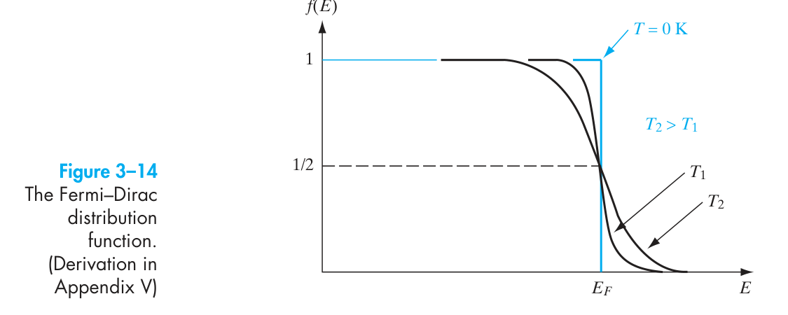
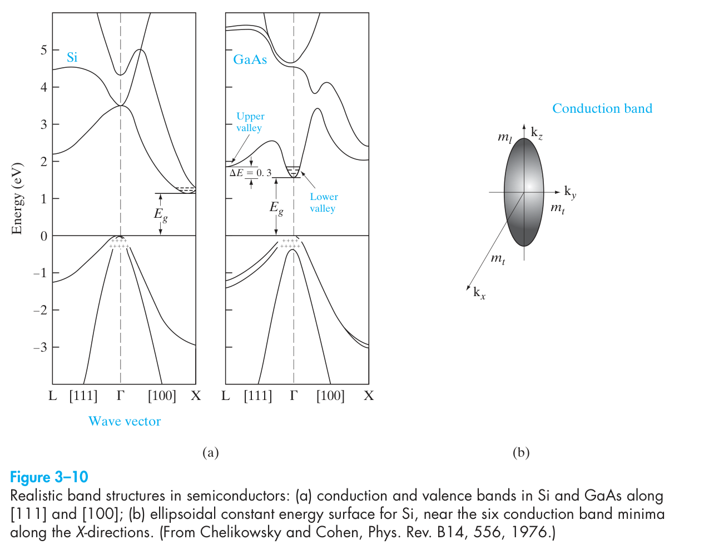
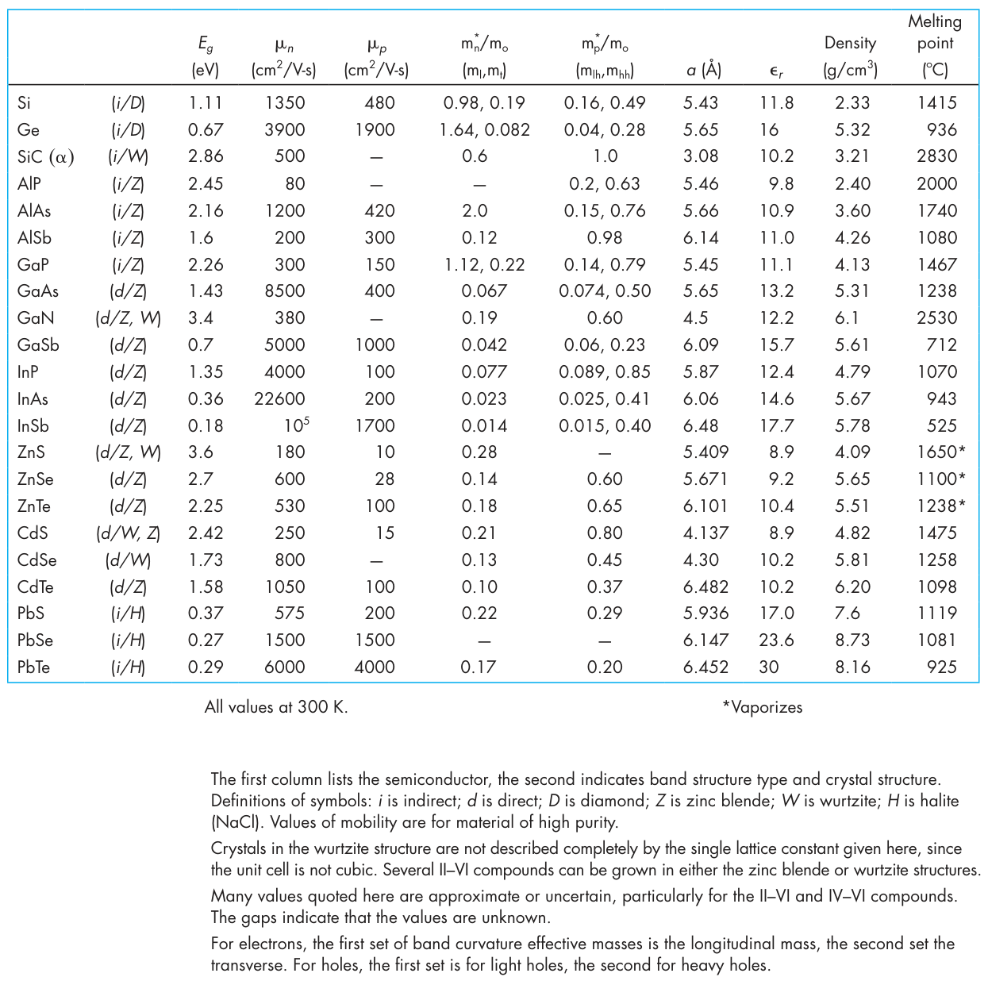
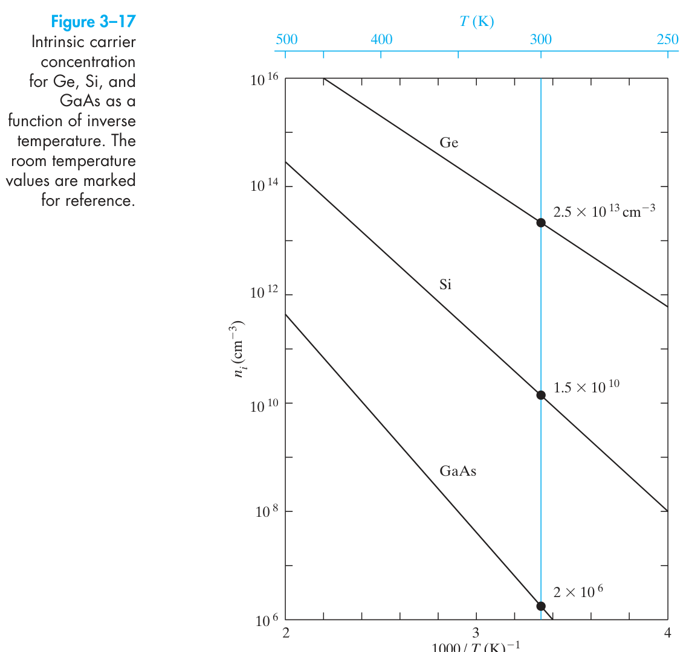
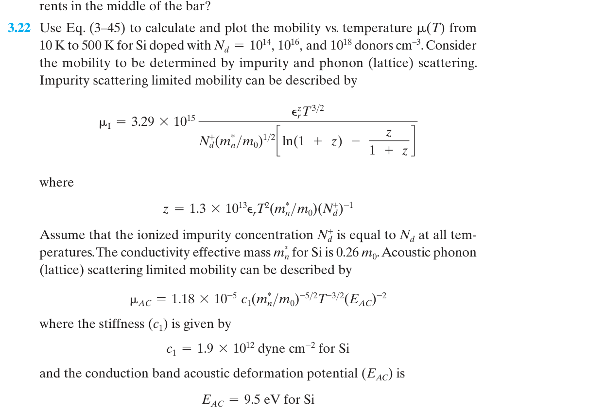
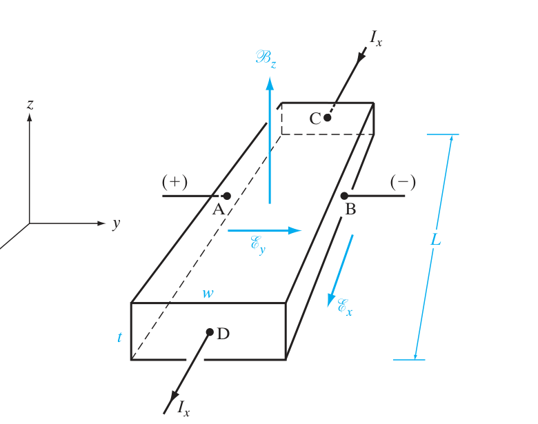
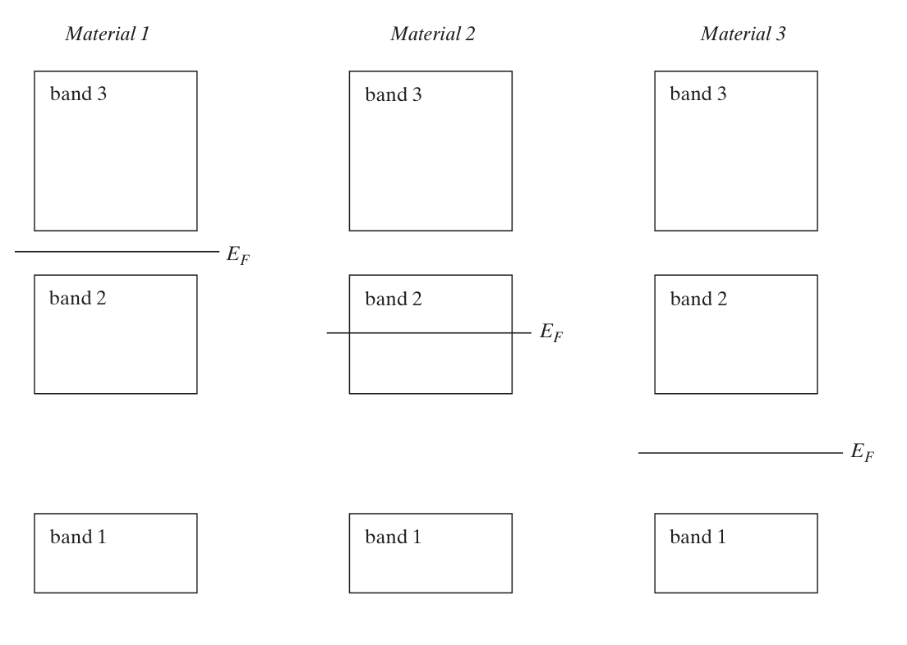
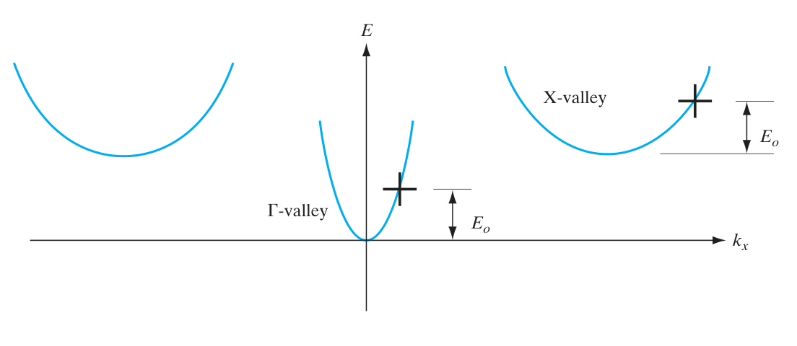
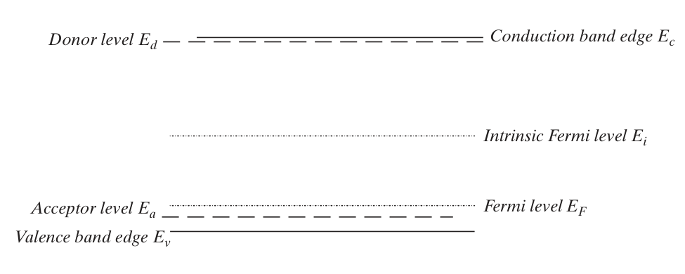

# Chapter 3 題目：Energy Bands and Charge Carriers in Semiconductors

> 來源：Streetman & Banerjee, *Solid State Electronic Devices*, 7th ed.，Problems 3.1–3.26 與 Self Quiz 1–8。每題附中文與英文敘述；所需原教材圖表置於題卡內。

<PracticeFilter prefix="ss-ch3-" />
<PracticeProgress :total="34" prefix="ss-ch3-" />

## 老師 2026/10/14 期中考板書對照

> **判讀說明**：以下題目是與老師課堂板書**同主題的教材練習**，不是老師確認的考試原題。老師題號並非課本 Problem / Self Quiz 題號。板書來源：[Notion｜固態電子導論](https://app.notion.com/p/22f038339615421bb7da2c870c0e8997)（可能需要學校帳號權限）。

- **老師第 1 題：能隙與光子波長**、**第 7 題：直接／間接能隙的 E–k 圖** — [Self Quiz 3：Si／GaAs 能帶及發光波長](#card-ss-ch3-sq3)。
- **老師第 8 題：施主／受主摻雜、n、p、費米能階與霍爾係數** — [Problem 3.3：補償摻雜](#card-ss-ch3-p3-3)、[Problem 3.8：n、p、費米能階](#card-ss-ch3-p3-8)、[Self Quiz 6：n、p、EF−Ei](#card-ss-ch3-sq6)。霍爾部分可接續下面第 11 題。
- **老師第 9 題：n、p 與導電率** — [Problem 3.10：平衡載子](#card-ss-ch3-p3-10)、[Problem 3.11：高溫載子](#card-ss-ch3-p3-11)、[Problem 3.12：導電率](#card-ss-ch3-p3-12)、[Problem 3.14：導電率與電流密度](#card-ss-ch3-p3-14)。
- **老師第 11 題：霍爾效應、載子濃度與遷移率** — [Problem 3.20：霍爾濃度](#card-ss-ch3-p3-20)、[Problem 3.26：霍爾濃度／遷移率](#card-ss-ch3-p3-26)、[Self Quiz 8：量測方式](#card-ss-ch3-sq8)。
- **老師第 12 題：部分游離** — [Problem 3.23：低溫凍結與游離施主濃度](#card-ss-ch3-p3-23)。
- **未在這兩章找到直接對應題卡**：老師第 2 題的 Miller 指數／晶圓類型，以及第 5 題 CZ 拉晶；應另外查第 1 章及相關製程教材。

## Problems

<PracticeCard type="exercise" id="ss-ch3-p3-1" title="Problem 3.1：GaN 的近似束縛能" source="PDF p.135 / 印刷 p.134" topic="束縛能">

求氮化鎵（GaN）的近似束縛能。已知相對介電常數 $\varepsilon_r=9.7$，以及電子有效質量 $m_n^*=0.13m_0$。

**English:**  Find the approximate binding energy for gallium nitride (GaN) having the following specifications: $\varepsilon_r=9.7$, $m_n^*=0.13m_0$.

<template #solution>

教材答案頁未提供；需自行解題。

</template>

</PracticeCard>

<PracticeCard type="exercise" id="ss-ch3-p3-2" title="Problem 3.2：Fermi 函數與能量" source="PDF p.135 / 印刷 p.134" topic="Fermi 函數">

在 $T=300\,\mathrm{K}$ 時，計算 Fermi 函數 $f(E)$ 的數值，並如 Fig. 3–14 所示繪製其對能量（以 eV 為單位）的曲線。取 $E_F=1\,\mathrm{eV}$，並在 Fermi 能階附近讓計算點更密集，以得到平滑曲線。注意 $f(E)$ 在 $E_F$ 附近幾個 $kT$ 的範圍內變化相當快速。證明：高於 $E_F$ 之 $\Delta E$ 的能態被佔據的機率，等於低於 $E_F$ 之 $\Delta E$ 的能態為空的機率。

**English:**  Calculate values for the Fermi function $f(E)$ at $300\,\mathrm{K}$ and plot it versus energy in eV as in Fig. 3–14. Choose $E_F=1\,\mathrm{eV}$ and make the calculated points closer together near the Fermi level to obtain a smooth curve. Notice that $f(E)$ varies quite rapidly within a few $kT$ of $E_F$. Show that the probability that a state $\Delta E$ above $E_F$ is occupied is the same as the probability that the state $\Delta E$ below $E_F$ is empty.

<template #solution>

教材答案頁未提供；需自行解題。

</template>

</PracticeCard>

<PracticeCard type="exercise" id="ss-ch3-p3-3" title="Problem 3.3：矽基板的施體與受體摻雜" source="PDF p.135 / 印刷 p.134" topic="摻雜與載子濃度">

> **課堂板書重點對照（同主題、非原題）**：老師第 8 題｜施主／受主補償摻雜：練習求電子與電洞濃度；老師還要求 $E_F-E_i$ 與霍爾係數。 [查看 Notion 板書來源](https://app.notion.com/p/22f038339615421bb7da2c870c0e8997)。

**(a)** 室溫下，一塊 Si 基板摻有 $2.70\times10^{16}\,\mathrm{cm^{-3}}$ 的施體原子。求該樣品的電子濃度與電洞濃度，並判定基板的型別。給定：$n_i=1.5\times10^{10}\,\mathrm{cm^{-3}}$、$N_c=6.0953\times10^{19}\,\mathrm{cm^{-3}}$、$E_g=1.1\,\mathrm{eV}$。

**(b)** 若上述樣品再過摻雜 $5\times10^{16}\,\mathrm{cm^{-3}}$ 的受體原子，則基板新的電子濃度與電洞濃度為何？受體摻雜後基板的型別為何？

**English:**  **(a)** A Si substrate at room temperature is doped with $2.70\times10^{16}\,\mathrm{cm^{-3}}$ donor atoms. Determine the electron and hole concentrations of the sample and the type of the substrate. [Given: $n_i=1.5\times10^{10}\,\mathrm{cm^{-3}}$, $N_c=6.0953\times10^{19}\,\mathrm{cm^{-3}}$, $E_g=1.1\,\mathrm{eV}$]

**(b)** If the above sample is overdoped with $5\times10^{16}\,\mathrm{cm^{-3}}$ acceptor atoms, what will be the new electron and hole concentrations for the substrate? What will be the type of the substrate after acceptor doping?

<template #solution>

教材答案頁未提供；需自行解題。

</template>

</PracticeCard>

<PracticeCard type="exercise" id="ss-ch3-p3-4" title="Problem 3.4：導帶邊緣附近的能態總數" source="PDF p.135 / 印刷 p.134" topic="能態密度">

推導半導體材料中，能量介於 $E_c$ 與 $E_c+kT$ 之間的能態總數表達式，其中 $E_c$ 為導帶邊緣，$k$ 為 Boltzmann 常數，$T$ 為溫度。求室溫下 Si 的能態密度（DOS）。

**English:**  Derive an expression for the total number of states in a semiconductor material between $E_c$ and $E_c+kT$, where $E_c$ is the conduction-band edge, $k$ is Boltzmann’s constant, and $T$ is the temperature. Determine the DOS for Si at room temperature.

<template #solution>

教材答案頁未提供；需自行解題。

</template>

</PracticeCard>

<PracticeCard type="exercise" id="ss-ch3-p3-5" title="Problem 3.5：AlAs 的 Γ 與 X 谷載子數相等溫度" source="PDF p.135 / 印刷 p.134" topic="多能谷半導體">

在室溫下，內在 AlAs 沿著 $\langle100\rangle$ 方向具有 4 個 X 極小值，且已知 Γ 谷與 X 谷的電子有效質量分別為 $0.15m_0$ 與 $0.76m_0$。電洞有效質量為 $0.76m_0$。若兩者的能量間隔為 $0.40\,\mathrm{eV}$，在何溫度下 Γ 極小值與 X 極小值中的電子數會相等？AlAs 的能隙為 $2.23\,\mathrm{eV}$。

**English:**  At room temperature, an intrinsic AlAs has 4 X minima along the $\langle100\rangle$ directions, and the following data are available: the electron masses for the Γ valley and X valley are $0.15m_0$ and $0.76m_0$. The hole mass is $0.76m_0$. At what temperature will the number of electrons in the Γ minima and X minima be equal if the energy separation between them is $0.40\,\mathrm{eV}$? The band gap for AlAs is $2.23\,\mathrm{eV}$.

<template #solution>

教材答案頁未提供；需自行解題。

</template>

</PracticeCard>

<PracticeCard type="exercise" id="ss-ch3-p3-6" title="Problem 3.6：GaAs Γ 谷有效質量與遷移率" source="PDF p.135 / 印刷 p.134" topic="有效質量與遷移率">

由於依據式 (3–3)，電子有效質量會隨能帶曲率增加而減小，請評論 GaAs 的 Γ 谷電子有效質量與間接 X 谷或 L 谷相比如何（參見 Fig. 3–10）。此有效質量差異如何反映在 Appendix III 所示 GaAs 與 GaP 的電子遷移率上？根據 Fig. 3–10，若在電場中漂移的 GaAs Γ 谷電子突然被提升至 L 谷，預期 GaAs 的導電率會如何變化？

**English:**  Since the effective mass of electrons in a conduction band decreases with increasing curvature of the band according to Eq. (3–3), comment on the electron effective mass in the Γ valley of GaAs compared with the indirect X or L valleys. (See Fig. 3–10.) How is this effective-mass difference reflected in the electron mobility for GaAs and GaP shown in Appendix III? From Fig. 3–10, what would you expect to happen to the conductivity of GaAs if Γ-valley electrons drifting in an electric field were suddenly promoted to the L valley?

<template #solution>

教材答案頁未提供；需自行解題。

</template>

</PracticeCard>

<PracticeCard type="exercise" id="ss-ch3-p3-7" title="Problem 3.7：由 ni 曲線求 Si 能隙" source="PDF p.135 / 印刷 p.134" topic="本質載子濃度">

利用式 (3–23) 計算 Si 的能隙，並繪製 $n_i$ 對 $1000/T$ 的曲線（Fig. 3–17）。

**提示：**半對數圖上的斜率無法直接量測；請從圖上讀取兩個點，並在解題需要時取自然對數。

**English:**  Calculate the band gap of Si from Eq. (3–23) and plot $n_i$ versus $1000/T$ (Fig. 3–17).

**Hint:** The slope cannot be measured directly from a semilogarithmic plot; read the values from two points on the plot and take the natural logarithm as needed for the solution.

<template #solution>

教材答案頁未提供；需自行解題。

</template>

</PracticeCard>

<PracticeCard type="exercise" id="ss-ch3-p3-8" title="Problem 3.8：鍺摻砷後的平衡載子與 Fermi 能階" source="PDF p.136 / 印刷 p.135" topic="Fermi 能階">

> **課堂板書重點對照（同主題、非原題）**：老師第 8、9 題｜平衡電子、電洞濃度及費米能階位置；本題未要求霍爾係數／導電率。 [查看 Notion 板書來源](https://app.notion.com/p/22f038339615421bb7da2c870c0e8997)。

考慮一塊室溫下摻有 $5\times10^{15}\,\mathrm{cm^{-3}}$ 砷（As）原子的 Ge 晶體。求平衡電子濃度、電洞濃度，以及 Fermi 能階相對於本質能階 $E_i$ 與導帶能階 $E_c$ 的位置。另請繪製能帶圖。

**English:**  Consider a Ge crystal at room temperature doped with $5\times10^{15}\,\mathrm{cm^{-3}}$ As atoms. Find the equilibrium electron and hole concentrations, and the position of the Fermi level with respect to the intrinsic energy level ($E_i$) and conduction-band energy ($E_c$). Draw the energy-band diagram also.

<template #solution>

教材答案頁未提供；需自行解題。

</template>

</PracticeCard>

<PracticeCard type="exercise" id="ss-ch3-p3-9" title="Problem 3.9：本質 Ge 的本質能階位置" source="PDF p.136 / 印刷 p.135" topic="本質能階">

理想上，半導體的本質能階應位於能隙中央。假設電子與電洞的有效質量分別為 $m_e=0.041m_0$ 與 $m_p=0.28m_0$，估算 $300\,\mathrm{K}$ 下本質 Ge 的本質能階 $E_i$ 位置。

**English:**  Ideally in a semiconductor, the intrinsic energy level should be in the middle of the band gap. Estimate the position of the intrinsic energy level ($E_i$) for intrinsic Ge at $300\,\mathrm{K}$, assuming the effective mass values for electrons and holes are $m_e=0.041m_0$ and $m_p=0.28m_0$, respectively.

<template #solution>

教材答案頁未提供；需自行解題。

</template>

</PracticeCard>

<PracticeCard type="exercise" id="ss-ch3-p3-10" title="Problem 3.10：低濃度砷摻雜 Ge 的電洞濃度" source="PDF p.136 / 印刷 p.135" topic="補償與載子濃度">

> **課堂板書重點對照（同主題、非原題）**：老師第 8、9 題｜摻雜後電洞濃度、費米能階：對應載子濃度計算部分。 [查看 Notion 板書來源](https://app.notion.com/p/22f038339615421bb7da2c870c0e8997)。

一塊 Ge 樣品摻有 $10^{14}\,\mathrm{cm^{-3}}$ 的砷（As）原子。平衡電洞濃度為何？Fermi 能階相對於本質能階的位置為何？

給定：$n_i=2.5\times10^{13}\,\mathrm{cm^{-3}}$。

**English:**  A Ge sample is doped with $10^{14}\,\mathrm{cm^{-3}}$ As atoms. What will be the equilibrium hole concentration? What is the relative position of the Fermi level with respect to the intrinsic energy level?

Given: $n_i=2.5\times10^{13}\,\mathrm{cm^{-3}}$.

<template #solution>

教材答案頁未提供；需自行解題。

</template>

</PracticeCard>

<PracticeCard type="exercise" id="ss-ch3-p3-11" title="Problem 3.11：高溫新型半導體的載子濃度" source="PDF p.136 / 印刷 p.135" topic="高溫載子統計">

> **課堂板書重點對照（同主題、非原題）**：老師第 9 題｜由摻雜和溫度求電子、電洞濃度；與載子濃度公式相關。 [查看 Notion 板書來源](https://app.notion.com/p/22f038339615421bb7da2c870c0e8997)。

某種新半導體具有 $N_c=10^{19}\,\mathrm{cm^{-3}}$、$N_v=5\times10^{18}\,\mathrm{cm^{-3}}$，以及 $E_g=2\,\mathrm{eV}$。若摻入 $10^{17}$ 個施體（完全游離），請在 $627\,^{\circ}\mathrm{C}$ 下計算電子濃度、電洞濃度與本質載子濃度。繪製簡化能帶圖，並標示 $E_F$ 的位置。

**English:**  A new semiconductor has $N_c=10^{19}\,\mathrm{cm^{-3}}$, $N_v=5\times10^{18}\,\mathrm{cm^{-3}}$, and $E_g=2\,\mathrm{eV}$. If it is doped with $10^{17}$ donors (fully ionized), calculate the electron, hole, and intrinsic carrier concentrations at $627\,^{\circ}\mathrm{C}$. Sketch the simplified band diagram, showing the position of $E_F$.

<template #solution>

教材答案頁未提供；需自行解題。

</template>

</PracticeCard>

<PracticeCard type="exercise" id="ss-ch3-p3-12" title="Problem 3.12：半導體的最小導電率" source="PDF p.136 / 印刷 p.135" topic="導電率">

> **課堂板書重點對照（同主題、非原題）**：老師第 9 題｜導電率：本題從電子／電洞遷移率探討最小導電率。 [查看 Notion 板書來源](https://app.notion.com/p/22f038339615421bb7da2c870c0e8997)。

**(a)** 證明半導體樣品的最小導電率發生在

$$
n_0=n_i\sqrt{\frac{\mu_p}{\mu_n}}.
$$

**提示：**從式 (3–43) 開始，並套用式 (3–24)。

**(b)** 最小導電率 $\sigma_{\min}$ 的表達式為何？

**(c)** 計算 $300\,\mathrm{K}$ 下 Si 的 $\sigma_{\min}$，並與本質導電率比較。

**English:**  **(a)** Show that the minimum conductivity of a semiconductor sample occurs when

$$
n_0=n_i\sqrt{\frac{\mu_p}{\mu_n}}.
$$

**Hint:** Begin with Eq. (3–43) and apply Eq. (3–24).

**(b)** What is the expression for the minimum conductivity $\sigma_{\min}$?

**(c)** Calculate $\sigma_{\min}$ for Si at $300\,\mathrm{K}$ and compare with the intrinsic conductivity.

<template #solution>

教材答案頁未提供；需自行解題。

</template>

</PracticeCard>

<PracticeCard type="exercise" id="ss-ch3-p3-13" title="Problem 3.13：Si 中電子漂移速度與飽和電流" source="PDF p.136 / 印刷 p.135" topic="漂移與速度飽和">

一段長 $2\,\mathrm{cm}$、截面積 $0.1\,\mathrm{cm^2}$ 的 Si，施體摻雜濃度為 $10^{15}\,\mathrm{cm^{-3}}$，且電阻為 $90\,\Omega$。對於高於 $10^5\,\mathrm{V/cm}$ 的電場，Si 中電子的飽和速度為 $10^7\,\mathrm{cm/s}$。若在該試片兩端施加 $100\,\mathrm{V}$，計算電子漂移速度。若施加 $10^6\,\mathrm{V}$，試片中的電流為何？

**English:**  A $2\,\mathrm{cm}$ long piece of Si with cross-sectional area $0.1\,\mathrm{cm^2}$ is doped with donors at $10^{15}\,\mathrm{cm^{-3}}$, and has a resistance of $90\,\Omega$. The saturation velocity of electrons in Si is $10^7\,\mathrm{cm/s}$ for fields above $10^5\,\mathrm{V/cm}$. Calculate the electron drift velocity if we apply a voltage of $100\,\mathrm{V}$ across the piece. What is the current through the piece if we apply a voltage of $10^6\,\mathrm{V}$ across it?

<template #solution>

教材答案頁未提供；需自行解題。

</template>

</PracticeCard>

<PracticeCard type="exercise" id="ss-ch3-p3-14" title="Problem 3.14：摻雜與幾何尺寸對導電的影響" source="PDF p.136 / 印刷 p.135" topic="導電率與電流密度">

> **課堂板書重點對照（同主題、非原題）**：老師第 9 題｜導電率：討論摻雜濃度與幾何尺寸改變時的導電率及電流密度。 [查看 Notion 板書來源](https://app.notion.com/p/22f038339615421bb7da2c870c0e8997)。

在一根 n 型半導體矩形棒中，若棒長變為原來的四倍，而摻雜濃度降為原來的一半；在外加電壓保持不變時，導電率與通過棒的電流密度將如何改變？

**English:** In an n-type semiconductor rectangular bar, if the length of the bar becomes four times its original length and the doping is decreased to half its original value, how will the conductivity and current density through the bar be affected if the applied voltage remains the same?

<template #solution>

教材答案頁未提供；需自行解題。

</template>

</PracticeCard>

<PracticeCard type="exercise" id="ss-ch3-p3-15" title="Problem 3.15：銦摻雜對矽的遷移率與電阻率" source="PDF p.136 / 印刷 p.135" topic="遷移率與電阻率">

預測室溫下，若每一百萬個矽原子中有一個被銦（In）原子取代，矽晶體的遷移率與電阻率會如何改變。已知矽原子濃度為 $5\times10^{28}\,\mathrm{m^{-3}}$、本徵載子濃度為 $1.5\times10^{10}\,\mathrm{cm^{-3}}$、矽的本徵導電率為 $0.00044\,\mathrm{S/m}$、本徵電阻率為 $\rho=2300\,\Omega\cdot\mathrm{m}$，以及電子與電洞遷移率分別為 $0.135\,\mathrm{m^2/(V\,s)}$ 與 $0.048\,\mathrm{m^2/(V\,s)}$。

**English:** Predict the effect on mobility and resistivity of a Si crystal at room temperature if every millionth Si atom is replaced by an atom of indium (In). Given the concentration of Si atoms is $5\times10^{28}\,\mathrm{m^{-3}}$, the intrinsic carrier concentration is $1.5\times10^{10}\,\mathrm{cm^{-3}}$, the intrinsic conductivity of Si is $0.00044\,\mathrm{S/m}$, the intrinsic resistivity of Si is $\rho=2300\,\Omega\cdot\mathrm{m}$, and the electron and hole mobilities are $0.135\,\mathrm{m^2/(V\,s)}$ and $0.048\,\mathrm{m^2/(V\,s)}$, respectively.

<template #solution>

教材答案頁未提供；需自行解題。

</template>

</PracticeCard>

<PracticeCard type="exercise" id="ss-ch3-p3-16" title="Problem 3.16：高電場下矽棒的電流" source="PDF p.136 / 印刷 p.135" topic="漂移電流與速度飽和">

一根長度 $4\,\mu\mathrm{m}$、以 $10^{17}\,\mathrm{cm^{-3}}$ 摻雜的 n 型矽棒，截面積為 $0.01\,\mathrm{cm^2}$。計算外加電壓 $2\,\mathrm{V}$ 時的電流。若電壓提高至 $100\,\mathrm{V}$，電流將改變多少？低電場下電子與電洞遷移率分別為 $1350\,\mathrm{cm^2/(V\,s)}$ 與 $400\,\mathrm{cm^2/(V\,s)}$；高電場速度飽和時，電子速度為 $v_s=10^7\,\mathrm{cm/s}$。

**English:** For a Si bar of length $4\,\mu\mathrm{m}$, doped n-type at $10^{17}\,\mathrm{cm^{-3}}$, calculate the current for an applied voltage of $2\,\mathrm{V}$ with a cross-sectional area of $0.01\,\mathrm{cm^2}$. If the voltage is raised to $100\,\mathrm{V}$, what will be the change in current? Electron and hole mobilities are $1350\,\mathrm{cm^2/(V\,s)}$ and $400\,\mathrm{cm^2/(V\,s)}$ for low electric field. For higher-field saturation, the electron velocity is $v_s=10^7\,\mathrm{cm/s}$.

<template #solution>

教材答案頁未提供；需自行解題。

</template>

</PracticeCard>

<PracticeCard type="exercise" id="ss-ch3-p3-17" title="Problem 3.17：位置電位、能帶與載子運動" source="PDF p.137 / 印刷 p.136" topic="能帶圖與漂移">

某半導體能隙為 $1\,\mathrm{eV}$，有效態密度為 $N_c=10^{19}\,\mathrm{cm^{-3}}$、$N_v=4\times10^{19}\,\mathrm{cm^{-3}}$，電子與電洞遷移率分別為 $4000$ 與 $2500\,\mathrm{cm^2/(V\,s)}$。各位置的電位如下（位置之間的電位呈線性變化）：A 點 $x=0\,\mu\mathrm{m}$、$V=0\,\mathrm{V}$；B 點 $x=2\,\mu\mathrm{m}$、$V=-2\,\mathrm{V}$；C 點 $x=4\,\mu\mathrm{m}$、$V=+4\,\mathrm{V}$；D 點 $x=8\,\mu\mathrm{m}$，且 C 與 D 之間電場為零。

繪製簡化能帶圖，正確標示位置、能量與電場方向。若 B 點的電子濃度為 $10^{18}\,\mathrm{cm^{-3}}$，並假設系統接近平衡，求該處的電洞濃度。若一個位於 B 點導帶邊緣的電子朝 C 點移動，求其到達所需時間。若低電場下散射可忽略，求電子由 C 到 D 所需時間。

**English:** A semiconductor has a band gap of $1\,\mathrm{eV}$, effective densities of states $N_c=10^{19}\,\mathrm{cm^{-3}}$ and $N_v=4\times10^{19}\,\mathrm{cm^{-3}}$, and electron and hole mobilities of $4000$ and $2500\,\mathrm{cm^2/(V\,s)}$, respectively. The potentials at the locations are as follows, with linear variation between locations: point A at $x=0\,\mu\mathrm{m}$, $V=0\,\mathrm{V}$; point B at $x=2\,\mu\mathrm{m}$, $V=-2\,\mathrm{V}$; point C at $x=4\,\mu\mathrm{m}$, $V=+4\,\mathrm{V}$; point D at $x=8\,\mu\mathrm{m}$, with zero electric field between C and D.

Sketch the simplified band diagram, properly labeling positions, energies, and directions of electric fields. If the electron concentration at B is $10^{18}\,\mathrm{cm^{-3}}$ and the system is close to equilibrium, find the hole concentration there. If an electron at the conduction-band edge at B travels toward C, how long does it take to get there? If scattering is negligible at low electric fields, how long does it take to travel from C to D?

<template #solution>

教材答案頁未提供；需自行解題。

</template>

</PracticeCard>

<PracticeCard type="exercise" id="ss-ch3-p3-18" title="Problem 3.18：電位剖面與電子運動" source="PDF p.137 / 印刷 p.136" topic="能帶與載子動力學">

繪製並標示能量與距離：一個能隙 $2\,\mathrm{eV}$ 的半導體，其靜電位剖面為：$x=0$ 至 $1\,\mu\mathrm{m}$ 為 $0\,\mathrm{V}$；$x=1$ 至 $4\,\mu\mathrm{m}$ 從 $0$ 線性增加至 $1.5\,\mathrm{V}$；$x=4$ 至 $5\,\mu\mathrm{m}$ 維持常數。從 $x=0$ 向右發射一電子，其初始動能為 $0.5\,\mathrm{eV}$，且假設沒有散射。求它在 $x=2\,\mu\mathrm{m}$ 的動能。若電子有效質量為 $0.5m_0$，求它由 $x=4$ 到 $5\,\mu\mathrm{m}$ 的行進時間。若施體濃度為 $10^{17}\,\mathrm{cm^{-3}}$，求 $x=4.5\,\mu\mathrm{m}$ 處的電子漂移電流密度。

**English:** Sketch and label the simplified band diagram of a semiconductor with a band gap of $2\,\mathrm{eV}$ subjected to this electrostatic potential profile: $0\,\mathrm{V}$ for $x=0$ to $1\,\mu\mathrm{m}$; linearly increasing from $0$ to $1.5\,\mathrm{V}$ between $1$ and $4\,\mu\mathrm{m}$; and constant from $x=4$ to $5\,\mu\mathrm{m}$. An electron is launched to the right at $x=0$ with kinetic energy $0.5\,\mathrm{eV}$. Assuming no scattering, what is its kinetic energy at $x=2\,\mu\mathrm{m}$? If its effective mass is $0.5m_0$, how long does it take to travel from $x=4$ to $5\,\mu\mathrm{m}$? If the donor density is $10^{17}\,\mathrm{cm^{-3}}$, what is the electron drift current density at $x=4.5\,\mu\mathrm{m}$?

<template #solution>

教材答案頁未提供；需自行解題。

</template>

</PracticeCard>

<PracticeCard type="exercise" id="ss-ch3-p3-19" title="Problem 3.19：能帶圖與能量色散的有效質量" source="PDF p.137 / 印刷 p.136" topic="有效質量">

**(a)** 繪製並標示能隙 $1.5\,\mathrm{eV}$ 半導體的簡化能帶圖：$x=0$ 至 $2\,\mu\mathrm{m}$ 電壓為常數；$x=2$ 至 $4\,\mu\mathrm{m}$ 有指向右方、大小 $2\,\mathrm{V/\mu m}$ 的電場；接著從 $x=4$ 至 $8\,\mu\mathrm{m}$，電壓增加 $3\,\mathrm{V}$。

**(b)** 某半導體電子能帶結構為 $E(k)=(4k^2+5)\,\mathrm{eV}$，其中 $k$ 單位為 $\text{Å}^{-1}$（$1\,\text{Å}=10^{-10}\,\mathrm{m}$）。計算電子有效質量。為什麼有效質量不同於實際電子質量 $9.1\times10^{-31}\,\mathrm{kg}$？

**English:** **(a)** Sketch and label the simplified band diagram of a semiconductor with a band gap of $1.5\,\mathrm{eV}$ subjected to the following: from $x=0$ to $2\,\mu\mathrm{m}$, the voltage is constant; from $x=2$ to $4\,\mu\mathrm{m}$, there is an electric field of $2\,\mathrm{V/\mu m}$ pointing to the right; then from $x=4$ to $8\,\mu\mathrm{m}$, the voltage increases by $3\,\mathrm{V}$.

**(b)** A semiconductor has an electron band structure $E(k)=(4k^2+5)\,\mathrm{eV}$, where $k$ has units of $\text{Å}^{-1}$ ($1\,\text{Å}=10^{-10}\,\mathrm{m}$). Calculate the effective mass of the electrons. Why is the effective mass different from the actual electron mass of $9.1\times10^{-31}\,\mathrm{kg}$?

<template #solution>

教材答案頁未提供；需自行解題。

</template>

</PracticeCard>

<PracticeCard type="exercise" id="ss-ch3-p3-20" title="Problem 3.20：霍爾效應判定摻雜型態與濃度" source="PDF p.137 / 印刷 p.136" topic="霍爾效應">

> **課堂板書重點對照（同主題、非原題）**：老師第 8、11 題｜霍爾效應：由霍爾電壓推回樣品型別與摻雜濃度；題型與老師板書的霍爾係數／載子濃度相關。 [查看 Notion 板書來源](https://app.notion.com/p/22f038339615421bb7da2c870c0e8997)。

一個厚度 $3\,\mathrm{mm}$ 的摻雜矽樣品 A，在電流密度 $J=300\,\mathrm{A/m^2}$、磁場 $B_z=1\,\mathrm{Wb/m^2}$ 下，量得霍爾電壓 $V_y=3\,\mathrm{mV}$。求半導體類型與摻雜濃度。

**English:** A doped Si sample A of thickness $3\,\mathrm{mm}$ shows a Hall voltage of $V_y=3\,\mathrm{mV}$ for current density $J=300\,\mathrm{A/m^2}$ under a magnetic field of $B_z=1\,\mathrm{Wb/m^2}$. Find the type of semiconductor and the doping concentration.

<template #solution>

教材答案頁未提供；需自行解題。

</template>

</PracticeCard>

<PracticeCard type="exercise" id="ss-ch3-p3-21" title="Problem 3.21：摻雜、遷移率與漂移／擴散電流" source="PDF pp.137–138 / 印刷 pp.136–137" topic="輸運現象">

一根長度 $8\,\mu\mathrm{m}$、截面積 $2\,\mu\mathrm{m^2}$ 的半導體棒，均勻摻雜施體，且施體濃度遠大於本徵濃度 $10^{11}\,\mathrm{cm^{-3}}$，使離化雜質散射成為主導。多數載子遷移率為

$$
\mu=\frac{800}{\sqrt{N_d/(10^{20}\,\mathrm{cm^{-3}})}}\;\mathrm{cm^2/(V\,s)}.
$$

若外加電壓 $160\,\mathrm{V}$ 時電子漂移電流為 $10\,\mathrm{mA}$，求棒中的摻雜濃度。若少數載子遷移率為 $500\,\mathrm{cm^2/(V\,s)}$，且電場高於 $100\,\mathrm{kV/cm}$ 時其飽和速度為 $10^6\,\mathrm{cm/s}$，求電洞漂移電流。棒中央的電子與電洞擴散電流各是多少？

**English:** A semiconductor bar of length $8\,\mu\mathrm{m}$ and cross-sectional area $2\,\mu\mathrm{m^2}$ is uniformly doped with donors at a concentration much higher than the intrinsic concentration ($10^{11}\,\mathrm{cm^{-3}}$), so ionized-impurity scattering dominates. The majority-carrier mobility is

$$
\mu=\frac{800}{\sqrt{N_d/(10^{20}\,\mathrm{cm^{-3}})}}\;\mathrm{cm^2/(V\,s)}.
$$

If the electron drift current for an applied voltage of $160\,\mathrm{V}$ is $10\,\mathrm{mA}$, calculate the doping concentration in the bar. If the minority-carrier mobility is $500\,\mathrm{cm^2/(V\,s)}$ and its saturation velocity is $10^6\,\mathrm{cm/s}$ for fields above $100\,\mathrm{kV/cm}$, calculate the hole drift current. What are the electron and hole diffusion currents in the middle of the bar?

<template #solution>

教材答案頁未提供；需自行解題。

</template>

</PracticeCard>

<PracticeCard type="exercise" id="ss-ch3-p3-22" title="Problem 3.22：矽中遷移率與溫度" source="PDF p.138 / 印刷 p.137" topic="散射與遷移率">

使用式 (3–45) 計算並繪製 $10$ 至 $500\,\mathrm{K}$ 間，矽在 $N_d=10^{14}$、$10^{16}$ 與 $10^{18}\,\mathrm{cm^{-3}}$ 下的遷移率 $\mu(T)$。假設遷移率由雜質散射與聲子（晶格）散射共同決定。雜質散射限制的遷移率為

$$
\mu_I=3.29\times10^{15}\frac{\varepsilon_r^2T^{3/2}}{N_d^+(m_n^*/m_0)^{1/2}\left[\ln(1+z)-\frac{z}{1+z}\right]},
$$

其中

$$z=1.3\times10^{13}\varepsilon_rT^2(m_n^*/m_0)(N_d^+)^{-1}.$$

假設所有溫度下離化雜質濃度 $N_d^+=N_d$。矽的導電有效質量 $m_n^*=0.26m_0$。聲子（晶格）散射限制的遷移率為

$$
\mu_{AC}=1.18\times10^{-5}c_1(m_n^*/m_0)^{-5/2}T^{-3/2}(E_{AC})^{-2},
$$

其中矽的剛性 $c_1=1.9\times10^{12}\,\mathrm{dyne\,cm^{-2}}$，導帶聲學變形勢 $E_{AC}=9.5\,\mathrm{eV}$。

**English:** Use Eq. (3–45) to calculate and plot the mobility $\mu(T)$ from $10$ to $500\,\mathrm{K}$ for Si doped with $N_d=10^{14}$, $10^{16}$, and $10^{18}\,\mathrm{cm^{-3}}$ donors. Consider the mobility to be determined by impurity and phonon (lattice) scattering. The impurity-scattering-limited mobility is

$$
\mu_I=3.29\times10^{15}\frac{\varepsilon_r^2T^{3/2}}{N_d^+(m_n^*/m_0)^{1/2}\left[\ln(1+z)-\frac{z}{1+z}\right]},
$$

where $z=1.3\times10^{13}\varepsilon_rT^2(m_n^*/m_0)(N_d^+)^{-1}$. Assume that the ionized impurity concentration $N_d^+$ equals $N_d$ at all temperatures. The conductivity effective mass for Si is $m_n^*=0.26m_0$. The acoustic-phonon (lattice) scattering-limited mobility is

$$
\mu_{AC}=1.18\times10^{-5}c_1(m_n^*/m_0)^{-5/2}T^{-3/2}(E_{AC})^{-2},
$$

where $c_1=1.9\times10^{12}\,\mathrm{dyne\,cm^{-2}}$ for Si and the conduction-band acoustic deformation potential is $E_{AC}=9.5\,\mathrm{eV}$ for Si.

<template #solution>

教材答案頁未提供；需自行解題。

</template>

</PracticeCard>

<PracticeCard type="exercise" id="ss-ch3-p3-23" title="Problem 3.23：考慮凍結效應的遷移率計算" source="PDF p.138 / 印刷 p.137" topic="載子凍結">

> **課堂板書重點對照（同主題、非原題）**：老師第 12 題｜部分游離：低溫載子凍結、施主不完全游離的直接相關練習。 [查看 Notion 板書來源](https://app.notion.com/p/22f038339615421bb7da2c870c0e8997)。

重新處理問題 3.22，考慮低溫時載子凍結回施體的效應，即將離化雜質濃度取為

$$
N_d^+=\frac{N_d}{1+\exp(E_d/kT)},
$$

其中矽的施體游離能 $E_d=45\,\mathrm{meV}$。

**English:** Rework Problem 3.22 considering carrier freeze-out onto donors at low $T$. That is, consider the ionized impurity concentration to be

$$
N_d^+=\frac{N_d}{1+\exp(E_d/kT)},
$$

where the donor ionization energy for Si is $E_d=45\,\mathrm{meV}$.

<template #solution>

教材答案頁未提供；需自行解題。

</template>

</PracticeCard>

<PracticeCard type="exercise" id="ss-ch3-p3-24" title="Problem 3.24：費米分布機率" source="PDF p.138 / 印刷 p.137" topic="費米能階">

考慮室溫下的矽樣品，其能隙 $E_g=1.12\,\mathrm{eV}$。

**(a)** 若費米能階 $E_F$ 正好位於能隙中央，求在 $E=E_C+2kT$ 找到電子的機率。

**(b)** 若費米能階位置滿足 $E_F=E_V$，求在 $E=E_V+kT$ 找到電子的機率。

**English:** Consider a Si sample at room temperature with band gap $E_g=1.12\,\mathrm{eV}$.

**(a)** If the Fermi level $E_F$ is located exactly at the middle of the band gap, what is the probability of finding an electron at $E=E_C+2kT$?

**(b)** If the Fermi level is located such that $E_F=E_V$, what is the probability of finding an electron at $E=E_V+kT$?

<template #solution>

教材答案頁未提供；需自行解題。

</template>

</PracticeCard>

<PracticeCard type="exercise" id="ss-ch3-p3-25" title="Problem 3.25：校正霍爾探針錯位" source="PDF p.139 / 印刷 p.138" topic="霍爾效應">

如 **Fig. 3–25** 所示，將導線焊接到樣品時，很難使霍爾探針 A 與 B 精確對齊。若 B 沿棒長方向從 A 稍微向下游位移，會產生錯誤的霍爾電壓。證明：先讓磁場沿 $+z$ 方向、再沿 $-z$ 方向，量測兩次 $V_{AB}$，即可得到真正的霍爾電壓 $V_H$。

**English:** In soldering wires to a sample such as that shown in Fig. 3–25, it is difficult to align Hall probes A and B precisely. If B is displaced slightly down the length of the bar from A, an erroneous Hall voltage results. Show that the true Hall voltage $V_H$ can be obtained from two measurements of $V_{AB}$, with the magnetic field first in the $+z$ direction and then in the $-z$ direction.

<template #solution>

教材答案頁未提供；需自行解題。

</template>

</PracticeCard>

<PracticeCard type="exercise" id="ss-ch3-p3-26" title="Problem 3.26：霍爾量測的載子型態、濃度與遷移率" source="PDF p.139 / 印刷 p.138" topic="霍爾效應">

> **課堂板書重點對照（同主題、非原題）**：老師第 11 題｜霍爾量測：由量測結果求載子型態、濃度與遷移率，與板書要求高度相關。 [查看 Notion 板書來源](https://app.notion.com/p/22f038339615421bb7da2c870c0e8997)。

考慮一根寬度 $0.02\,\mathrm{cm}$、厚度 $8\,\mu\mathrm{m}$、長度 $0.6\,\mathrm{cm}$ 的矽棒。霍爾量測時，$z$ 方向產生的磁場為 $10^{-5}\,\mathrm{Wb/cm^2}$，電流為 $0.8\,\mathrm{mA}$。若兩端電壓為 $+1\,\mathrm{mV}$，且 $V_{CD}=50\,\mathrm{mV}$，求多數載子的型態、濃度與遷移率。

**English:** Consider a Si bar with width $0.02\,\mathrm{cm}$, thickness $8\,\mu\mathrm{m}$, and length $0.6\,\mathrm{cm}$. During a Hall measurement, the magnetic field generated in the $z$ direction is $10^{-5}\,\mathrm{Wb/cm^2}$ and the current is $0.8\,\mathrm{mA}$. If the voltage at the two ends is $+1\,\mathrm{mV}$ and $V_{CD}=50\,\mathrm{mV}$, find the type, concentration, and mobility of the majority carriers.

<template #solution>

教材答案頁未提供；需自行解題。

</template>

</PracticeCard>

## Self Quiz

<PracticeCard type="practice" id="ss-ch3-sq1" title="Self Quiz 1：能帶與材料分類" source="PDF p.139 / 印刷 p.138" topic="能帶分類">

**(a)** 下列三個圖顯示三種假想晶體材料的不同能帶（能量沿垂直方向變化）；三種材料唯一的差異是所假設的費米能階能量 $E_F$。將每種材料分類為金屬、絕緣體或半導體。

**(b)** 假設你能看穿其中且只能看穿一種材料，最可能是哪一種？材料 1／材料 2／材料 3。

**English:** **(a)** The following three diagrams show three different energy bands of hypothetical crystalline materials, with energy varying vertically. The only difference between the three materials is the assumed Fermi-level energy $E_F$. Characterize each material as a metal, an insulator, or a semiconductor.

**(b)** Assuming you can see through one and only one of the materials in part (a), which one would it most likely be? Material 1 / Material 2 / Material 3.

<template #solution>

教材答案（印刷 p.597／PDF p.598）：(a) 材料 1：半導體；材料 2：金屬；材料 3：絕緣體。(b) 材料 3。

</template>

</PracticeCard>

<PracticeCard type="practice" id="ss-ch3-sq2" title="Self Quiz 2：能量谷與有效質量" source="PDF p.140 / 印刷 p.139" topic="有效質量">

考慮下列導帶能量 $E$ 對波向量 $k_x$ 的色散關係。

**(a)** 哪一個能量谷在 $x$ 方向的有效質量 $m_x$ 較大（圈選一項）？$\Gamma$ 谷／X 谷。

**(b)** 考慮兩個電子，各位於圖中十字標記的位置。哪一個的速度大小較大（圈選一項）？位於 $\Gamma$ 谷者／位於 X 谷者。

**English:** Consider the conduction-band energy $E$ versus wavevector $k_x$ dispersion relation below.

**(a)** Which energy valley has the greater effective mass in the $x$ direction, $m_x$ (circle one)? $\Gamma$ valley / X valley.

**(b)** Consider two electrons, one at each of the positions of the heavy crosses. Which has the greater velocity magnitude (circle one)? The one in the $\Gamma$ valley / the one in the X valley.

<template #solution>

教材答案（印刷 p.597／PDF p.598）：(a) X 谷。(b) 原書印為「$\mu$ valley」，但題目選項只有 $\Gamma$ 谷與 X 谷；由圖中 $\Gamma$ 谷標記點較陡的斜率判定，應選 $\Gamma$ 谷。

</template>

</PracticeCard>

<PracticeCard type="practice" id="ss-ch3-sq3" title="Self Quiz 3：矽與砷化鎵的能帶結構" source="PDF p.141 / 印刷 p.140" topic="直接與間接能隙">

> **課堂板書重點對照（同主題、非原題）**：老師第 1、7 題｜能隙與波長、直接／間接能隙：本題比較 Si／GaAs 的能帶、發光效率與波長；老師第 7 題另要求**繪製 E–k 圖**。 [查看 Notion 板書來源](https://app.notion.com/p/22f038339615421bb7da2c870c0e8997)。

以下問題參照 **Fig. 3–10** 所示的矽與 GaAs 能帶結構。

**(a)** 哪一種材料看起來具有較小的（導帶）電子有效質量，矽或 GaAs？

**(b)** 兩者中哪一種預期能透過電子–電洞復合更有效率地產生光子（光）？

**(c)** 與 (b) 的答案一致，並利用附錄 III，預期發射光子的能量是多少？其波長（以 $\mu\mathrm{m}$ 表示）是多少？它們屬於可見光、紅外線或紫外線？

**(d)** 矽與 GaAs 各有多少個等價的導帶極小值？

**English:** These questions refer to the band structures of Si and GaAs shown in Fig. 3–10.

**(a)** Which material appears to have the lowest conduction-band electron effective mass, Si or GaAs?

**(b)** Which of these would be expected to produce photons (light) more efficiently through electron–hole recombination?

**(c)** Consistent with your answer to part (b) and using Appendix III, what would you expect the energy of the emitted photons to be? What would their wavelength in $\mu\mathrm{m}$ be? Would these be visible, infrared, or ultraviolet?

**(d)** How many equivalent conduction-band minima do Si and GaAs have?

<template #solution>

教材答案（印刷 p.597／PDF p.598）：(a) GaAs；(b) GaAs；(c) $1.4\,\mathrm{eV}$、$0.87\,\mu\mathrm{m}$、紅外線；(d) Si 為 6 個，GaAs 為 1 個。

</template>

</PracticeCard>

<PracticeCard type="practice" id="ss-ch3-sq4" title="Self Quiz 4：力、波向量與電子遷移率" source="PDF p.141 / 印刷 p.140" topic="能帶動力學">

參照 **Fig. 3–10**，其顯示 GaAs 與 Si 沿 [111] 和 [100] 方向的 $E$–$k$ 色散關係，包括價帶與導帶。

**(a)** 忽略兩種材料電子散射率的差異，預期 Si 或 GaAs 具有較大的電子遷移率 $\mu_n$？

**(b)** 若沿 [100] 方向對兩種半導體中、最初位於導帶極小值的電子施加固定力，作用一小段時間且忽略散射；對相同的力 $F$，Si 中 $k$ 的變化量大小相對於 GaAs 是較大、相等還是較小？較大／相等／較小。

**English:** Refer to Fig. 3–10, which shows the $E$ versus $k$ dispersion relations for GaAs and Si along the [111] and [100] directions, including valence and conduction bands.

**(a)** Neglecting differences in electron scattering rates in the two materials, would Si or GaAs be expected to have the greater electron mobility $\mu_n$?

**(b)** If a constant force were applied in the [100] direction for a short period to an electron initially at the conduction-band minimum of each semiconductor, with scattering neglected, would the magnitude of the change in $k$ in Si be greater than, equal to, or smaller than that in GaAs for the same force $F$? Greater / equal / smaller.

<template #solution>

教材答案（印刷 p.597／PDF p.598）：(a) GaAs；(b) 兩者相等。

</template>

</PracticeCard>

<PracticeCard type="practice" id="ss-ch3-sq5" title="Self Quiz 5：摻雜半導體的平衡能帶圖" source="PDF pp.141–142 / 印刷 pp.140–141" topic="費米能階與摻雜">

> **課堂板書重點對照（同主題、非原題）**：老師第 8 題｜受主／施主摻雜及費米能階：本題以能帶圖判斷型別，非求 n、p 與霍爾係數的數值題。 [查看 Notion 板書來源](https://app.notion.com/p/22f038339615421bb7da2c870c0e8997)。

下方為摻雜直接能隙半導體的平衡能帶圖，其中包含本徵費米能階 $E_i$、費米能階 $E_F$、受體能階 $E_a$、施體能階 $E_d$、價帶邊緣 $E_V$ 與導帶邊緣 $E_C$。

**(a)** 該半導體是 n 型、p 型，還是資訊不足？圈選一項：n 型／p 型／資訊不足。

**(b)** 由上述能帶圖（$E_i$ 位於能隙中央），預期導帶態密度有效質量相對於價帶有效質量是較大、相等還是較小？圈選一項：較大／相等／較小。

**(c)** 下列哪些條件單獨就可能導致上述能帶圖？圈選所有正確答案：

1. 非常高的溫度；
2. 非常高的受體摻雜；
3. 非常低的受體摻雜。

**English:** The equilibrium band diagram for a doped direct-gap semiconductor is shown below. It includes the intrinsic Fermi level $E_i$, Fermi level $E_F$, acceptor level $E_a$, donor level $E_d$, valence-band edge $E_V$, and conduction-band edge $E_C$.

**(a)** Is it n-type, p-type, or unknown? Circle one: n-type / p-type / not enough information provided.

**(b)** Based on the band diagram above, with $E_i$ in the middle of the gap, would the conduction-band density-of-states effective mass be greater than, equal to, or smaller than the valence-band effective mass? Circle one: greater than / equal / smaller than.

**(c)** Which, if any, of the following conditions by themselves could lead to the band diagram above? Circle each correct answer: (1) very high temperature; (2) very high acceptor doping; (3) very low acceptor doping.

<template #solution>

教材答案（印刷 p.597／PDF p.598）：(a) p 型；(b) 相等；(c) 非常高的受體摻雜。

</template>

</PracticeCard>

<PracticeCard type="practice" id="ss-ch3-sq6" title="Self Quiz 6：本徵濃度、摻雜與費米能階" source="PDF p.142 / 印刷 p.141" topic="載子濃度">

> **課堂板書重點對照（同主題、非原題）**：老師第 8、9 題｜補償摻雜、n、p 及 $E_F-E_i$：與老師第 8 題的多項要求直接相關，霍爾係數須另練習。 [查看 Notion 板書來源](https://app.notion.com/p/22f038339615421bb7da2c870c0e8997)。

某假想半導體在 $300\,\mathrm{K}$ 的本徵載子濃度為 $1.0\times10^{10}\,\mathrm{cm^{-3}}$，導帶與價帶的有效態密度 $N_c$ 與 $N_v$ 均為 $10^{19}\,\mathrm{cm^{-3}}$。

**(a)** 能隙 $E_g$ 為何？

**(b)** 若半導體摻入 $N_d=1\times10^{16}$ 個施體 $\mathrm{cm^{-3}}$，$300\,\mathrm{K}$ 的平衡電子與電洞濃度是多少？

**(c)** 若同一塊已具有 $N_d=1\times10^{16}\,\mathrm{cm^{-3}}$ 的半導體再摻入 $N_a=2\times10^{16}$ 個受體 $\mathrm{cm^{-3}}$，新的平衡電子與電洞濃度是多少？

**(d)** 與 (c) 的答案一致，費米能階相對於本徵費米能階的位置 $E_F-E_i$ 為何？

**English:** A hypothetical semiconductor has an intrinsic carrier concentration of $1.0\times10^{10}\,\mathrm{cm^{-3}}$ at $300\,\mathrm{K}$, and its conduction- and valence-band effective densities of states, $N_c$ and $N_v$, are both $10^{19}\,\mathrm{cm^{-3}}$.

**(a)** What is the band gap $E_g$?

**(b)** If the semiconductor is doped with $N_d=1\times10^{16}$ donors $\mathrm{cm^{-3}}$, what are the equilibrium electron and hole concentrations at $300\,\mathrm{K}$?

**(c)** If the same piece, already having $N_d=1\times10^{16}$ donors $\mathrm{cm^{-3}}$, is also doped with $N_a=2\times10^{16}$ acceptors $\mathrm{cm^{-3}}$, what are the new equilibrium electron and hole concentrations at $300\,\mathrm{K}$?

**(d)** Consistent with your answer to part (c), what is the Fermi-level position with respect to the intrinsic Fermi level, $E_F-E_i$?

<template #solution>

教材答案（印刷 p.597／PDF p.598）：(a) $1.08\,\mathrm{eV}$；(b) $n_0=10^{16}\,\mathrm{cm}^{-3}$、$p_0=10^4\,\mathrm{cm}^{-3}$；(c) $p_0=10^{16}\,\mathrm{cm}^{-3}$、$n_0=10^4\,\mathrm{cm}^{-3}$；(d) $E_F-E_i=-0.36\,\mathrm{eV}$（原書僅列大小 $0.36\,\mathrm{eV}$；由 p 型判定符號為負）。

</template>

</PracticeCard>

<PracticeCard type="practice" id="ss-ch3-sq7" title="Self Quiz 7：態密度與有效態密度" source="PDF p.142 / 印刷 p.141" topic="態密度">

態密度與有效態密度有何差異？為什麼後者是如此有用的概念？

**English:** What is the difference between density of states and effective density of states, and why is the latter such a useful concept?

<template #solution>

教材答案頁未提供；需自行解題。

</template>

</PracticeCard>

<PracticeCard type="practice" id="ss-ch3-sq8" title="Self Quiz 8：高電場遷移率與量測" source="PDF p.142 / 印刷 p.141" topic="遷移率量測">

> **課堂板書重點對照（同主題、非原題）**：老師第 11 題｜霍爾效應：本題詢問量測載子濃度與遷移率的方法，和板書的兩項要求一致。 [查看 Notion 板書來源](https://app.notion.com/p/22f038339615421bb7da2c870c0e8997)。

**(a)** 在非常高的電場下，遷移率是否仍有意義？為什麼？

**(b)** 如何量測遷移率與載子濃度？

**English:** **(a)** Does mobility have any meaning at very high field? Why?

**(b)** How do you measure mobility and carrier concentration?

<template #solution>

教材答案頁未提供；需自行解題。

</template>

</PracticeCard>
