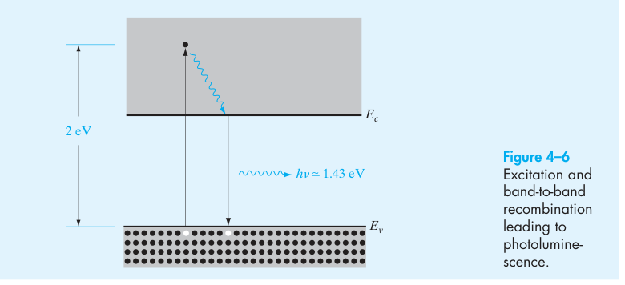
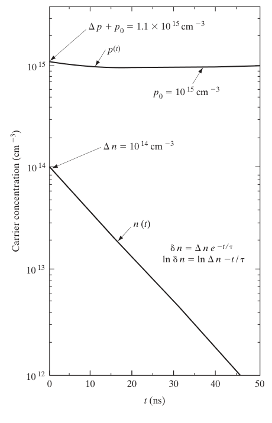
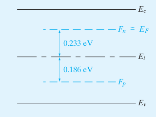
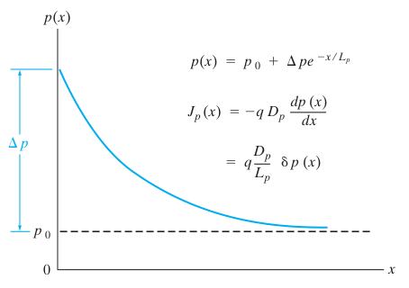
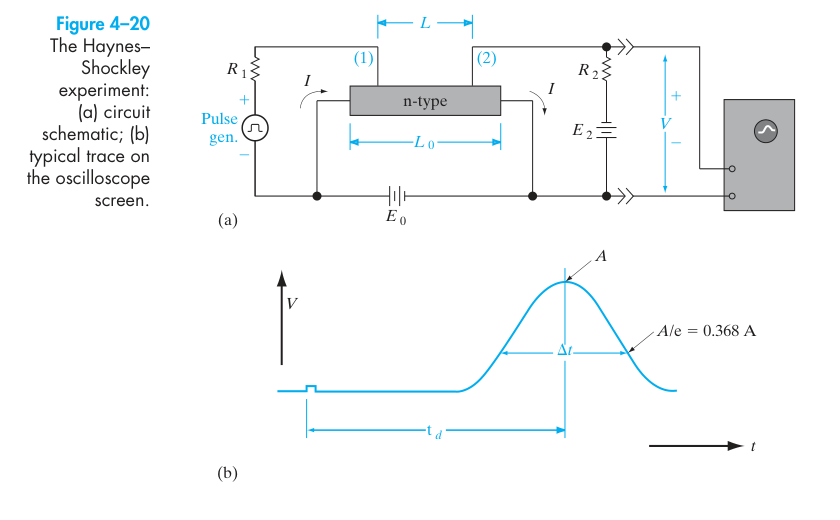
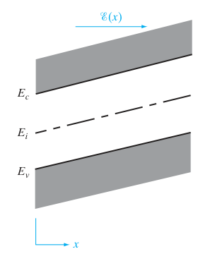
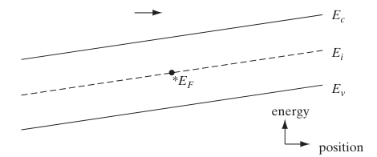
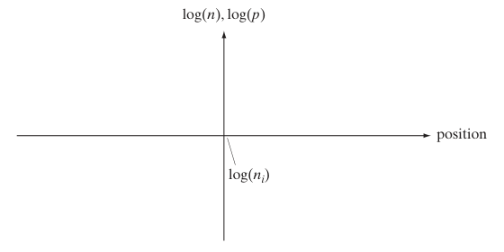

# Chapter 4 題目：Excess Carriers in Semiconductors

> 來源：Streetman & Banerjee, *Solid State Electronic Devices*, 7th ed.，Examples 4–1–4–5、Problems 4.1–4.25 與 Self Quiz 1–6。題目依照教材翻譯；原題中有疑義的單位或材料條件保留並標示。

<PracticeFilter prefix="ss-ch4-" />
<PracticeProgress :total="36" prefix="ss-ch4-" />

## Examples

<PracticeCard type="example" id="ss-ch4-ex4-1" title="Example 4–1：GaAs 的光吸收與發光" source="PDF pp.148–149 / 印刷 pp.147–148" topic="光吸收">

厚度 $0.46\,\mu\mathrm m$ 的 GaAs 樣品受單色光照射，光子能量 $h\nu=2\,\mathrm{eV}$、吸收係數 $\alpha=5\times10^4\,\mathrm{cm^{-1}}$，入射功率 $10\,\mathrm{mW}$。(a) 求樣品每秒吸收的能量；(b) 求復合前電子傳給晶格的多餘熱能速率；(c) 假設量子效率為 100%，求每秒復合所放出的光子數。

<template #solution>

穿透功率約為 $1\,\mathrm{mW}$，因此吸收 $9\,\mathrm{mW}$。每個被吸收光子中，$(2-1.43)/2=0.285$ 的能量轉為熱，故熱功率約 $2.57\,\mathrm{mW}$。每秒吸收及放出的光子數約為 $2.81\times10^{16}$。

</template>

</PracticeCard>

<PracticeCard type="example" id="ss-ch4-ex4-2" title="Example 4–2：過量載子的復合衰減" source="PDF pp.151–152 / 印刷 pp.150–151" topic="復合與生命期">

GaAs 樣品摻有 $10^{15}\,\mathrm{cm^{-3}}$ 受體，內在載子濃度約為 $10^6\,\mathrm{cm^{-3}}$。在 $t=0$ 產生 $10^{14}\,\mathrm{EHP/cm^3}$，載子復合壽命 $\tau_n=\tau_p=10^{-8}\,\mathrm s$。求平衡少數電子濃度，並依圖說明過量載子的時間衰減與低注入近似。

<template #solution>

$p_0\approx10^{15}\,\mathrm{cm^{-3}}$，因此 $n_0=n_i^2/p_0=10^{-3}\,\mathrm{cm^{-3}}$。過量載子以 $\delta n=\delta p=10^{14}e^{-t/\tau_n}\,\mathrm{cm^{-3}}$ 衰減；相較於 $p_0$，過量電洞維持較小。

</template>

</PracticeCard>

<PracticeCard type="example" id="ss-ch4-ex4-3" title="Example 4–3：光激發與準費米能階" source="PDF p.156 / 印刷 p.155" topic="準費米能階">

在 Si 樣品中，每微秒每立方公分產生 $10^{13}$ 個電子電洞對；平衡電子濃度 $n_0=10^{14}\,\mathrm{cm^{-3}}$，電子與電洞壽命皆為 $2\,\mu\mathrm s$。以 $n_i=1.5\times10^{10}\,\mathrm{cm^{-3}}$、$kT=0.0259\,\mathrm{eV}$ 求穩態過量載子濃度、電子及電洞濃度，以及相對於 $E_i$ 的準費米能階。

> Figure 4–11 圖說將此例標為 Example 4–4，但圖中的數據和位置對應本例 Example 4–3。

<template #solution>

光生率為 $10^{19}\,\mathrm{cm^{-3}s^{-1}}$，故 $\delta n=\delta p=2\times10^{13}\,\mathrm{cm^{-3}}$。平衡電洞濃度 $p_0=2.25\times10^6\,\mathrm{cm^{-3}}$，穩態 $n=1.2\times10^{14}\,\mathrm{cm^{-3}}$，$p\approx2\times10^{13}\,\mathrm{cm^{-3}}$。教材給出 $F_n-E_i=0.233\,\mathrm{eV}$、$E_i-F_p=0.186\,\mathrm{eV}$。

</template>

</PracticeCard>

<PracticeCard type="example" id="ss-ch4-ex4-4" title="Example 4–4：注入電洞與儲存電荷" source="PDF pp.167–168 / 印刷 pp.166–167" topic="擴散電流">

一條很長的 p 型 Si 棒，截面積 $0.5\,\mathrm{cm^2}$、$N_a=10^{17}\,\mathrm{cm^{-3}}$。注入電洞使 $x=0$ 的穩態過量電洞濃度為 $5\times10^{16}\,\mathrm{cm^{-3}}$。在 $x=1000\,\text{Å}$ 處，穩態 $F_p$ 與 $E_c$ 的能量差為何？該處電洞電流為何？儲存的過量電洞電荷為何？假設 $\mu_p=500\,\mathrm{cm^2/(V\,s)}$、$\tau_p=10^{-10}\,\mathrm s$。 教材解答另採用 $kT/q=0.0259\,\mathrm V$、$n_i=1.5\times10^{10}\,\mathrm{cm^{-3}}$，並將 $E_c-E_i$ 近似為 $0.55\,\mathrm{eV}$。

> 原題明寫 p 型樣品並注入電洞；教材沿用此前少數載子擴散分布的計算方式，兩者的適用條件需審慎確認。

<template #solution>

教材計算 $D_p=12.95\,\mathrm{cm^2/s}$、$L_p\approx3.6\times10^{-5}\,\mathrm{cm}$，並得到 $E_c-F_p=0.965\,\mathrm{eV}$、電洞電流約 $1.09\times10^3\,\mathrm A$，儲存電荷約 $1.44\times10^{-7}\,\mathrm C$。

</template>

</PracticeCard>

<PracticeCard type="example" id="ss-ch4-ex4-5" title="Example 4–5：Haynes–Shockley 實驗" source="PDF p.171 / 印刷 p.170" topic="遷移率與擴散">

以 n 型 Ge 樣品進行下圖所示的 Haynes–Shockley 實驗。樣品長 $1\,\mathrm{cm}$，探針 (1)、(2) 相距 $0.95\,\mathrm{cm}$，電池電壓 $E_0=2\,\mathrm V$。脈衝從 (1) 注入 $0.25\,\mathrm{ms}$ 後抵達 (2)，脈衝寬度 $\Delta t=117\,\mu\mathrm s$。計算電洞遷移率及擴散係數，並以 Einstein 關係驗算。

<template #solution>

教材得到 $\mu_p=1900\,\mathrm{cm^2/(V\,s)}$、$D_p=49.4\,\mathrm{cm^2/s}$。兩者之比約為 $0.026\,\mathrm V$，符合 $D_p/\mu_p=kT/q$。

</template>

</PracticeCard>

## Problems

<PracticeCard type="exercise" id="ss-ch4-p4-1" title="Problem 4.1：矽中的雜質電荷態" source="PDF p.173 / 印刷 p.172" topic="陷阱與電荷態">

矽樣品中的費米能階 $E_F$ 位於價帶上方 $0.4\,\mathrm{eV}$。預期樣品中大部分 Ga 原子處於何種電荷態？Zn 與 Au 的主要電荷態各為何？此處電荷態意指中性、單正、雙負等。

</PracticeCard>

<PracticeCard type="exercise" id="ss-ch4-p4-2" title="Problem 4.2：光激發下的導電率" source="PDF p.173 / 印刷 p.172" topic="過量載子">

從 $t=0$ 起，光均勻照射一塊矽樣品，使 $t>0$ 時產生過量載子。載子產生率為 $6\times10^{22}/\mathrm{cm^3}$；樣品摻有 $2\times10^{17}/\mathrm{cm^3}$ 的 As 原子。求 $t=5\,\mathrm{ms}$ 時的導電率，並求 $300\,\mathrm{K}$ 時準費米能階的間隔。

> 原題將產生率單位印為 $\mathrm{cm^{-3}}$，未標時間單位；解題前應確認原題條件。

</PracticeCard>

<PracticeCard type="exercise" id="ss-ch4-p4-3" title="Problem 4.3：過量載子衰減" source="PDF p.173 / 印刷 p.172" topic="復合與生命期">

一塊矽摻有 $2\times10^{15}\,\mathrm{cm^{-3}}$ 的施體，並在 $t=0$ 均勻產生 $4\times10^{14}\,\mathrm{cm^{-3}}$ 個電子電洞對。假設 $\tau_n=\tau_p=5\,\mu\mathrm{s}$，繪製如 Figure 4–7 的半對數圖。

</PracticeCard>

<PracticeCard type="exercise" id="ss-ch4-p4-4" title="Problem 4.4：復合係數與穩態濃度" source="PDF p.174 / 印刷 p.173" topic="穩態光激發">

計算 Problem 4.3 所述低階注入的復合係數 $\alpha_r$：矽樣品摻有 $2\times10^{15}\,\mathrm{cm^{-3}}$ 的施體，在 $t=0$ 均勻產生 $4\times10^{14}\,\mathrm{cm^{-3}}$ 個電子電洞對，且 $\tau_n=\tau_p=5\,\mu\mathrm{s}$。假設此 $\alpha_r$ 適用於 GaAs 樣品，該樣品均勻暴露於穩態光生率 $g_{op}=10^{19}\,\mathrm{EHP/(cm^3\cdot s)}$；求穩態過量載子濃度 $\Delta n=\Delta p$。

> 原題前半引用的 Problem 4.3 指矽，後半卻寫 GaAs；材料條件存在歧異，保留原文以供核對。

</PracticeCard>

<PracticeCard type="exercise" id="ss-ch4-p4-5" title="Problem 4.5：摻雜梯度與內建電場" source="PDF p.174 / 印刷 p.173" topic="內建電場">

從一側對本質矽樣品施主摻雜，使 $N_d=N_0\exp(-\alpha x)$。(a) 在 $N_d\gg n_i$ 的範圍內，求平衡內建電場的表達式。(b) 當 $\alpha=1\,\mu\mathrm{m}^{-1}$ 時求電場。(c) 繪製如 Figure 4–15 的能帶圖，並標示電場方向。

</PracticeCard>

<PracticeCard type="exercise" id="ss-ch4-p4-6" title="Problem 4.6：光照下的準費米能階" source="PDF p.174 / 印刷 p.173" topic="穩態光激發">

室溫下，一塊摻有 $10^{15}\,\mathrm{cm^{-3}}$ 施體的矽樣品受到均勻光激發，每秒每立方公分產生 $10^{19}$ 個電子電洞對。求照光時準費米能階間隔及導電率的變化。電子與電洞生命期皆為 $10\,\mu\mathrm{s}$，$D_p=12\,\mathrm{cm^2/s}$。

</PracticeCard>

<PracticeCard type="exercise" id="ss-ch4-p4-7" title="Problem 4.7：關光後的少數載子" source="PDF p.174 / 印刷 p.173" topic="載子生命期">

一塊 n 型矽的摻雜濃度為 $10^{15}\,\mathrm{cm^{-3}}$，照光產生電子電洞對的速率為 $10^{19}\,\mathrm{cm^{-3}s^{-1}}$。若生命期為 $100\,\mathrm{ns}$，穩態少數載子濃度為何？關光後，電洞濃度下降 10% 需多久？電洞濃度降至比熱平衡值高 10% 時又需多久？

</PracticeCard>

<PracticeCard type="exercise" id="ss-ch4-p4-8" title="Problem 4.8：照光下準費米能階分離" source="PDF p.174 / 印刷 p.173" topic="準費米能階">

一塊 n 型矽樣品的 $N_d=10^{15}\,\mathrm{cm^{-3}}$，持續照光使 $g_{op}=10^{21}\,\mathrm{EHP/(cm^3\cdot s)}$。若此激發下 $\tau_n=\tau_p=1\,\mu\mathrm{s}$，計算準費米能階分離 $(F_n-F_p)$，並繪製如 Figure 4–11 的能帶圖。

</PracticeCard>

<PracticeCard type="exercise" id="ss-ch4-p4-9" title="Problem 4.9：摻雜矽棒的電流" source="PDF p.174 / 印刷 p.173" topic="漂移電流">

一根摻雜矽棒長 $2\,\mathrm{cm}$，$N_d=10^{16}\,\mathrm{cm^{-3}}$，橫截面積 $0.05\,\mathrm{cm^2}$。在兩端施加 $10\,\mathrm{V}$ 時電流為何？若在棒中均勻地每秒每立方公分產生 $10^{20}$ 個電子電洞對，且 $\tau_n=\tau_p=10^{-4}\,\mathrm{s}$，新的電流為何？假設高階注入時低階注入的 $\alpha_r$ 不變。若電壓接著增至 $100000\,\mathrm{V}$，新的電流為何？假設 $\mu_p=500\,\mathrm{cm^2/(V\cdot s)}$，電子的適當值須自行選取。

</PracticeCard>

<PracticeCard type="exercise" id="ss-ch4-p4-10" title="Problem 4.10：CdS 光導體設計" source="PDF p.174 / 印刷 p.173" topic="光導體">

使用厚度 $5\,\mu\mathrm{m}$ 的 CdS 薄膜設計並畫出光導體，假設 $\tau_n=\tau_p=10^{-6}\,\mathrm{s}$ 且 $N_d=10^{14}\,\mathrm{cm^{-3}}$。暗態（$g_{op}=0$）電阻須為 $10\,\mathrm{M\Omega}$，且元件須放入邊長 $0.5\,\mathrm{cm}$ 的正方形中，因此需要某種折疊或鋸齒形圖案。激發至 $g_{op}=10^{21}\,\mathrm{EHP/(cm^3\cdot s)}$ 時，電阻變化為何？

</PracticeCard>

<PracticeCard type="exercise" id="ss-ch4-p4-11" title="Problem 4.11：雷射照射矽樣品" source="PDF p.174 / 印刷 p.173" topic="光吸收">

將波長 $\lambda=600\,\mathrm{nm}$、功率 $80\,\mathrm{mW}$ 的雷射束聚焦於厚度 $80\,\mu\mathrm{m}$ 的矽樣品，其吸收係數 $\alpha=8\times10^3/\mathrm{cm}$。假設量子效率為 100%，求每秒放出的光子數，以及應以熱形式傳給樣品的功率。

</PracticeCard>

<PracticeCard type="exercise" id="ss-ch4-p4-12" title="Problem 4.12：線性摻雜與擴散電流" source="PDF p.174 / 印刷 p.173" topic="載子擴散">

一塊厚度 $0.5\,\mu\mathrm{m}$ 的材料經摻雜，使電子濃度沿樣品線性變化。施體濃度由 $x=0$ 處的 0 變至 $x=0.5\,\mu\mathrm{m}$ 處的 $10^{16}\,\mathrm{cm^{-3}}$。寫出總電子及電洞濃度隨距離 $x$ 的方程式。若擴散係數 $D_n=30\,\mathrm{cm^2/(V\cdot sec)}$、$D_p=12\,\mathrm{cm^2/(V\cdot sec)}$，求電子與電洞擴散電流密度，並求費米能階 $E_F$ 隨 $x$ 的表達式。

> 原題將擴散係數單位印為 $\mathrm{cm^2/(V\cdot sec)}$；此處保留原文單位，與一般擴散係數單位有所不同。

</PracticeCard>

<PracticeCard type="exercise" id="ss-ch4-p4-13" title="Problem 4.13：穩態電洞的準費米能階" source="PDF p.175 / 印刷 p.174" topic="穩態擴散">

對 Figure 4–17 的穩態少數電洞分布，在 $p(x)\gg p_0$（即 $F_p$ 位於 $E_F$ 下方）時，求電洞準費米能階位置 $E_i-F_p(x)$ 的表達式，並在能帶圖上畫出 $F_p(x)$ 的變化。注意：少數載子很少時（例如 $\Delta p=n_i$），$F_p$ 與 $E_F$ 仍可能相距甚遠。

</PracticeCard>

<PracticeCard type="exercise" id="ss-ch4-p4-14" title="Problem 4.14：電子擴散電流" source="PDF p.175 / 印刷 p.174" topic="擴散電流">

電子被注入一塊長 $5\,\mu\mathrm{m}$ 的 p 型半導體，濃度由左至右從 $10^{20}\,\mathrm{cm^{-3}}$ 線性變為 0。若電子遷移率為 $500\,\mathrm{cm^2/(V\cdot s)}$ 且電場可忽略，電流密度為何？

</PracticeCard>

<PracticeCard type="exercise" id="ss-ch4-p4-15" title="Problem 4.15：表面光生電子的擴散" source="PDF p.175 / 印刷 p.174" topic="光生載子擴散">

以每秒每平方公分 $10^{17}$ 個光子照射 p 型半導體，光子全在表面 $x=0$ 附近被吸收，樣品升溫至 $500\,\mathrm{K}$。若此材料的少數載子生命期為 $200\,\mathrm{ns}$，電子遷移率為 $2000\,\mathrm{cm^2/(V\cdot s)}$，電洞遷移率為 $500\,\mathrm{cm^2/(V\cdot s)}$，求距表面 $20\,\mu\mathrm{m}$ 處的電子擴散電流密度。

</PracticeCard>

<PracticeCard type="exercise" id="ss-ch4-p4-16" title="Problem 4.16：光激發矽棒的擴散電流" source="PDF p.175 / 印刷 p.174" topic="擴散電流">

一個長矽樣品為 n 型，摻雜濃度 $10^{17}\,\mathrm{cm^{-3}}$，截面積 $0.5\,\mathrm{cm^2}$。雷射光激發使 $x=0\,\mu\mathrm{m}$ 處每秒每立方公分產生 $10^{20}$ 個電子電洞對，載子向右擴散。求 $x=50\,\mu\mathrm{m}$ 處的總擴散電流。電子與電洞生命期皆為 $10\,\mu\mathrm{s}$；$\mu_p=500\,\mathrm{cm^2/(V\cdot s)}$、$D_n=36\,\mathrm{cm^2/s}$。

</PracticeCard>

<PracticeCard type="exercise" id="ss-ch4-p4-17" title="Problem 4.17：濃度梯度與電流方向" source="PDF p.175 / 印刷 p.174" topic="漂移與擴散">

一根 n 型半導體棒內的電子濃度由左至右增加，且電場指向左方。以適當圖示標明電子漂移電流與擴散電流的方向並解釋。若各處電子濃度都加倍，擴散電流與漂移電流如何改變？若各處電子濃度都加上一個相同常數，兩種電流又如何改變？請以適當方程式解釋。

</PracticeCard>

<PracticeCard type="exercise" id="ss-ch4-p4-18" title="Problem 4.18：注入電流與儲存電荷" source="PDF p.175 / 印刷 p.174" topic="穩態擴散">

Figure 4–17 中供應 $x=0$ 電洞注入所需的電流，可由式 (4–40) 在 $x=0$ 求得：$I_p(x=0)=qAD_p\Delta p/L_p$。證明此電流可由穩態過量電洞分布 $\Delta p(x)$ 的儲存電荷積分，再除以平均電洞生命期 $\tau_p$ 而得，並說明為何可得到 $I_p(x=0)$。

</PracticeCard>

<PracticeCard type="exercise" id="ss-ch4-p4-19" title="Problem 4.19：由能帶圖判斷內建電場" source="PDF p.175 / 印刷 p.174" topic="摻雜梯度">

無須運算即可由摻雜梯度對能帶圖的影響推知內建電場方向。以平衡時水平的費米能階為起點，對施體及受體摻雜梯度兩種情況，隨摻雜變化將 $E_i$ 畫在靠近或遠離 $E_F$ 的位置，如 Problem 4.5 的摻雜梯度。根據式 (4–26)，分別標示電場方向。若將少數載子注入雜質梯度區，在兩種情況下它會被加速往哪個方向？

Problem 4.5 的施體分布為 $N_d=N_0\exp(-\alpha x)$，並以 Figure 4–15 說明電場中的能帶：

</PracticeCard>

<PracticeCard type="exercise" id="ss-ch4-p4-20" title="Problem 4.20：摻雜梯度電場的物理解釋" source="PDF p.175–176 / 印刷 p.174–175" topic="內建電場">

Problem 4.5 以 $N_d=N_0\exp(-\alpha x)$ 的摻雜梯度，從式 (4–23) 與 (4–26) 決定內建電場的方向；下圖為其參照的 Figure 4–15。請定性解釋為何必然產生電場並求其方向。

(a) 畫出如 Problem 4.5 的施體摻雜分布，解釋使自由電子不沿梯度擴散所需的電場；再對受體及電洞重做。

(b) 畫出摻雜分布中的一個微觀區域，標出游離施體與由此產生的自由電子；解釋電子試圖向較低濃度擴散時電場的起源與方向。再對受體及電洞重做。

</PracticeCard>

<PracticeCard type="exercise" id="ss-ch4-p4-21" title="Problem 4.21：Haynes–Shockley 實驗" source="PDF p.176 / 印刷 p.175" topic="載子遷移率與擴散">

Haynes–Shockley 實驗使用一塊 p 型矽樣品，長 $2\,\mathrm{cm}$，兩探針相距 $1.8\,\mathrm{cm}$，樣品兩端施加 $5\,\mathrm{V}$。脈衝在 $0.608\,\mathrm{ms}$ 時到達收集位置，脈衝的 separation 為 $180\,\mathrm{sec}$。求少數載子的遷移率及擴散係數，並以愛因斯坦關係驗證。

> 原題印有 “the separation of the pulse is 180 sec”，未說明 separation 的明確定義；此處保留原文敘述與單位，須核對原題。

</PracticeCard>

<PracticeCard type="exercise" id="ss-ch4-p4-22" title="Problem 4.22：均勻摻雜棒的載子電流" source="PDF p.176 / 印刷 p.175" topic="漂移與速度飽和">

一根長 $2\,\mu\mathrm{m}$ 的半導體棒，本質載子濃度 $10^{13}\,\mathrm{cm^{-3}}$，均勻摻入濃度 $2\times10^{13}\,\mathrm{cm^{-3}}$ 的施體及濃度 $10^{13}\,\mathrm{cm^{-3}}$ 的受體。若 $D_n=26\,\mathrm{cm^2/s}$、$D_p=52\,\mathrm{cm^2/s}$，計算施加 $5\,\mathrm{V}$ 時電子與電洞的漂移電流密度。電子在電場低於 $10^5\,\mathrm{V/cm}$ 時處於歐姆區，高於此值以飽和速度 $10^8\,\mathrm{cm/s}$ 移動；電洞在低於 $10^4\,\mathrm{V/cm}$ 時處於歐姆區，高於此值以 $10^5\,\mathrm{cm/s}$ 移動。棒中點的電子與電洞擴散電流密度為何？假設 $T=300\,\mathrm{K}$。

</PracticeCard>

<PracticeCard type="exercise" id="ss-ch4-p4-23" title="Problem 4.23：新半導體的能帶與電流" source="PDF p.176 / 印刷 p.175" topic="載子濃度與電流">

一種新發現的半導體具有 $N_c=10^{19}\,\mathrm{cm^{-3}}$、$N_v=5\times10^{18}\,\mathrm{cm^{-3}}$、$E_g=2\,\mathrm{eV}$。若摻入 $10^{17}$ 個完全游離的施體，計算 $627\,^{\circ}\mathrm{C}$ 時的電子、電洞及本質載子濃度；繪製簡化能帶圖，並指定 $E_F$ 與 $E_i$ 相對能帶邊緣的位置。

若在長 $8\,\mu\mathrm{m}$、寬 $2\,\mu\mathrm{m}$、厚 $1.5\,\mu\mathrm{m}$ 的此材料兩端施加 $5\,\mathrm{V}$，電流為何？電洞及電子擴散係數分別為 $25\,\mathrm{cm^2/s}$ 及 $75\,\mathrm{cm^2/s}$。

> 原題將施體數值印為 $10^{17}$，未明列濃度單位。

</PracticeCard>

<PracticeCard type="exercise" id="ss-ch4-p4-24" title="Problem 4.24：電子與電洞電流" source="PDF p.176 / 印刷 p.175" topic="漂移與速度飽和">

一種新型半導體樣品長 $L=2\,\mu\mathrm{m}$、寬 $W=0.5\,\mu\mathrm{m}$、厚 $0.2\,\mu\mathrm{m}$，本質載子濃度為 $10^{12}\,\mathrm{cm^{-3}}$，游離施體濃度為 $2\times10^{12}\,\mathrm{cm^{-3}}$。沿棒長方向施加 $10\,\mathrm{V}$，假設電子為歐姆行為，而電洞以飽和速度運動，求電子與電洞電流。電子與電洞擴散係數分別為 $20$ 及 $5\,\mathrm{cm^2/(V\cdot s)}$，飽和速度分別為 $10^8$ 及 $10^7\,\mathrm{cm/s}$。

> 原題將擴散係數單位印為 $\mathrm{cm^2/(V\cdot s)}$；此處保留原文單位。

</PracticeCard>

<PracticeCard type="exercise" id="ss-ch4-p4-25" title="Problem 4.25：偏壓下的能帶與電子動能" source="PDF p.176–177 / 印刷 p.175–176" topic="能帶圖與電流密度">

畫出半導體棒的簡化能帶圖並適當標示位置及能量。此棒能隙為 $2\,\mathrm{eV}$，$N_c=10^{19}\,\mathrm{cm^{-3}}$；$0$ 至 $0.2\,\mathrm{cm}$ 為極重摻雜 n+ 區，$0.2$ 至 $0.7\,\mathrm{cm}$ 為摻雜 $10^{17}\,\mathrm{cm^{-3}}$ 的 n 型區，$0.7$ 至 $1\,\mathrm{cm}$ 又為極重摻雜 n+ 區。將 $0.5\,\mathrm{V}$ 電池正端接棒左端；高導電率重摻雜 n+ 區的壓降可忽略。畫出棒的示意圖，並在其正下方對齊能帶圖。

若電子擴散係數為 $100\,\mathrm{cm^2/(V\cdot s)}$，電流密度為何？若電子從棒右端以可忽略動能注入，並在沒有散射下運動，則在 $x=0.1$、$0.6$ 與 $0.9\,\mathrm{cm}$ 處的動能分別為何？

> 原題將擴散係數單位印為 $\mathrm{cm^2/(V\cdot s)}$；此處保留原文單位。

</PracticeCard>

## Self Quiz

<PracticeCard type="practice" id="ss-ch4-sq1" title="Self Quiz 1：光生載子與光功率" source="PDF p.177 / 印刷 p.176" topic="載子產生與復合">

一塊 p 型半導體的能隙為 $1.0\,\mathrm{eV}$，少數載子電子的生命期為 $0.1\,\mu\mathrm{s}$。以光子能量 $2.0\,\mathrm{eV}$ 的光均勻照射此半導體。

(a) 若要產生均勻的電子濃度 $10^{10}\,\mathrm{cm^{-3}}$，需要多大的均勻過量載子產生率？

(b) 為產生 (a) 的過量載子濃度，每立方公分必須吸收多少光功率？答案可用 $\mathrm{eV/(s\cdot cm^3)}$ 表示。

(c) 若載子透過放出光子復合，每立方公分約會產生多少光功率？答案可用 $\mathrm{eV/(s\cdot cm^3)}$ 表示。

<template #solution>

教材選答（PDF p.598）：(a) $10^{17}\,\mathrm{cm^{-3}s^{-1}}$；(b) $2\times10^{17}\,\mathrm{eV/(s\cdot cm^3)}$；(c) $10^{17}\,\mathrm{eV/(s\cdot cm^3)}$。

</template>

</PracticeCard>

<PracticeCard type="practice" id="ss-ch4-sq2" title="Self Quiz 2：陷阱與光吸收" source="PDF p.177 / 印刷 p.176" topic="陷阱與吸收">

(a) 何謂「深」陷阱與「淺」陷阱？哪一種對半導體元件較有害？為什麼？舉出矽中深陷阱的一個例子。

(b) 能量略高於能隙的光子，其吸收長度在矽和 GaAs 中何者較長？為什麼？

(c) 光子的吸收係數隨光子能量增加而增加還是減少？為什麼？

<template #solution>

教材選答（PDF p.598）：(a) 深陷阱較有害；矽中的例子為金（Au）。(b) 矽；矽為間接能隙材料。(c) 增加。

</template>

</PracticeCard>

<PracticeCard type="practice" id="ss-ch4-sq3" title="Self Quiz 3：平衡能帶圖與載子濃度" source="PDF p.178 / 印刷 p.177" topic="平衡能帶圖">

考慮下列具有內建電場 $\mathcal{E}$ 的半導體區域之平衡能帶圖。

(a) 畫出穿過圖中所標示 $E_F$ 點、橫跨整個能帶圖寬度的費米能階。

(b) 在能帶圖上畫出電場方向。電場是常數還是隨位置改變？

(c) 在下圖中畫出並標記整個樣品內的電子與電洞濃度，表示其隨位置的變化。濃度軸為對數刻度，因此濃度隨位置的指數變化會呈現為直線；水平軸對應本質載子濃度 $n_i$。

<template #solution>

教材選答（PDF p.598）：(a) $E_F$ 為水平線。(b) 電場為常數，方向向右。教材選答未列出 (c)。

</template>

</PracticeCard>

<PracticeCard type="practice" id="ss-ch4-sq4" title="Self Quiz 4：平衡時的漂移與擴散方向" source="PDF p.178 / 印刷 p.177" topic="載子通量與電流">

以下各問均使用圖中的平衡能帶與前題 Self Quiz 3 的條件。

(a) 標示此平衡條件下，電洞與電子因擴散及漂移所造成的粒子通量密度 $\phi$ 的方向。

(b) 標示此平衡條件下，電洞與電子因擴散及漂移所造成的電流密度 $j$ 的方向。

</PracticeCard>

<PracticeCard type="practice" id="ss-ch4-sq5" title="Self Quiz 5：半導體元件基本方程式" source="PDF p.179 / 印刷 p.178" topic="元件方程式">

(a) 一般而言，求解半導體元件問題必須求解哪些相關方程式？

(b) 一般而言，半導體元件的傳導電流可有幾個分量？分別為何？

<template #solution>

教材選答（PDF p.598）：(b) 四個分量。教材選答未列出 (a) 與各分量名稱。

</template>

</PracticeCard>

<PracticeCard type="practice" id="ss-ch4-sq6" title="Self Quiz 6：電場與濃度梯度" source="PDF p.179 / 印刷 p.178" topic="漂移與擴散">

(a) 考慮半導體中的一個區域，其電場指向右方（→），而載子濃度往左方增加（←）。標示此區域內由漂移與擴散造成的粒子通量 $\phi$（每項各選一個方向）及電荷電流 $j$ 的方向。

(b) 根據 (a) 的答案，標示此區域內由漂移與擴散造成的電荷電流 $j$ 的方向。

</PracticeCard>
