# Chapter 5 題目：Junctions

> 來源：Streetman & Banerjee, *Solid State Electronic Devices*, 7th ed.。本頁收錄 Examples 5–1 至 5–7、Problems 5.1 至 5.48 與 Self Quiz 1 至 7；題卡目前未附解答。

<PracticeFilter prefix="ss-ch5-" />
<PracticeProgress :total="62" prefix="ss-ch5-" />

## Examples

<PracticeCard type="example" id="ss-ch5-ex5-1" title="Example 5–1：突變接面的平衡能帶" source="PDF p.200 / 印刷 p.199" topic="接面電位">

一個突變 Si $p$–$n$ 接面，$p$ 側 $N_a=10^{18}\,\mathrm{cm^{-3}}$，$n$ 側 $N_d=5\times10^{15}\,\mathrm{cm^{-3}}$。

(a) 計算 $300\,\mathrm K$ 時 $p$ 區與 $n$ 區的費米能階位置。(b) 繪製平衡能帶圖並由圖求接觸電位 $V_0$。(c) 與下式所得結果比較：

$$
V_0=\frac{kT}{q}\ln\left(\frac{N_aN_d}{n_i^2}\right).
$$

</PracticeCard>

<PracticeCard type="example" id="ss-ch5-ex5-2" title="Example 5–2：接面空乏區與電場" source="PDF p.205 / 印刷 p.204" topic="空乏區">

突變 Si 接面具有 $N_a=10^{18}\,\mathrm{cm^{-3}}$、$N_d=5\times10^{15}\,\mathrm{cm^{-3}}$，圓形截面直徑為 $10\,\mu\mathrm m$。在 $300\,\mathrm K$ 平衡時，計算 $x_{n0}$、$x_{p0}$、$Q_+$ 及 $\mathcal E_0$，並參照圖 5–12 按比例繪製電場 $\mathcal E(x)$ 與電荷密度。

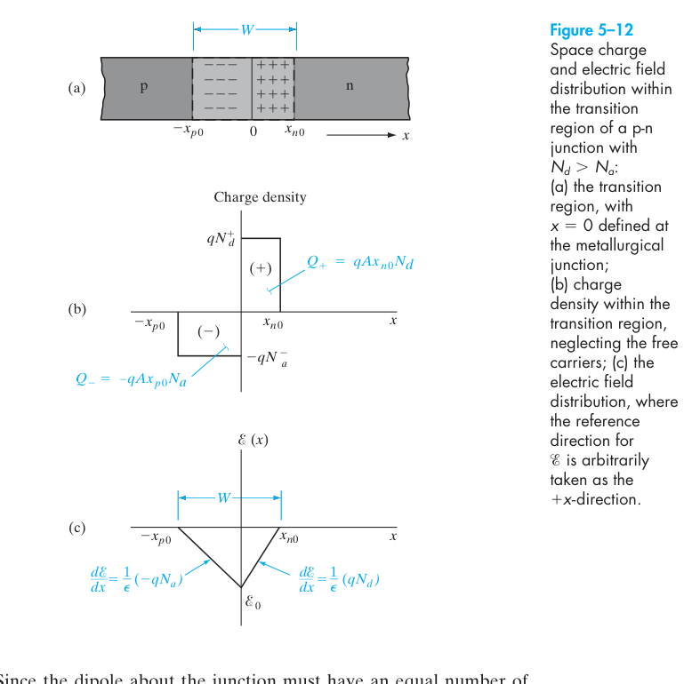

</PracticeCard>

<PracticeCard type="example" id="ss-ch5-ex5-3" title="Example 5–3：n 區電子電流" source="PDF p.218 / 印刷 p.217" topic="接面電流">

求順向偏壓 $p$–$n$ 接面中，$n$ 型材料的電子電流表達式。

</PracticeCard>

<PracticeCard type="example" id="ss-ch5-ex5-4" title="Example 5–4：接面順向與逆向電流" source="PDF p.220–221 / 印刷 p.219–220" topic="二極體電流">

一個面積 $A=10^{-4}\,\mathrm{cm^2}$ 的突變 Si $p$–$n$ 接面，在 $300\,\mathrm K$ 有下列參數：

| 區域 | 參數 |
| --- | --- |
| $p$ 側 | $N_a=10^{17}\,\mathrm{cm^{-3}}$、$\tau_n=0.1\,\mu\mathrm s$、$\mu_p=200$、$\mu_n=700\,\mathrm{cm^2/(V\cdot s)}$ |
| $n$ 側 | $N_d=10^{15}\,\mathrm{cm^{-3}}$、$\tau_p=10\,\mu\mathrm s$、$\mu_n=1300$、$\mu_p=450\,\mathrm{cm^2/(V\cdot s)}$ |

求順向偏壓 $0.5\,\mathrm V$ 及逆向偏壓 $-0.5\,\mathrm V$ 時的電流。

</PracticeCard>

<PracticeCard type="example" id="ss-ch5-ex5-5" title="Example 5–5：反向恢復儲存延遲" source="PDF p.236 / 印刷 p.235" topic="電荷控制">

一個 $p^+$–$n$ 二極體在順向偏壓下通有電流 $I_f$，並在 $t=0$ 時將電流切換為 $-I_r$。利用下列電荷控制方程式及適當的邊界條件求 $Q_p(t)$，再以準穩態近似求儲存延遲時間 $t_{sd}$：

$$
i(t)=\frac{Q_p(t)}{\tau_p}+\frac{dQ_p(t)}{dt}.
$$

</PracticeCard>

<PracticeCard type="example" id="ss-ch5-ex5-6" title="Example 5–6：逆向偏壓下空乏電容" source="PDF p.242 / 印刷 p.241" topic="接面電容">

面積 $10^{-4}\,\mathrm{cm^2}$ 的突變 Si $p$–$n$ 二極體，$p$ 側 $N_a=10^{17}\,\mathrm{cm^{-3}}$，$n$ 側 $N_d=10^{15}\,\mathrm{cm^{-3}}$，平衡接觸電位 $V_0=0.695\,\mathrm V$。求偏壓 $-4\,\mathrm V$ 時的總空乏電容。

</PracticeCard>

<PracticeCard type="example" id="ss-ch5-ex5-7" title="Example 5–7：GaAs–AlGaAs 異質接面" source="PDF p.262 / 印刷 p.261" topic="異質接面">

GaAs–AlGaAs 異質接面中，直接 $\Gamma$ 能隙差約有 $2/3$ 分配於導帶、$1/3$ 分配於價帶。鋁組成為 0.3 時，AlGaAs 為直接能隙材料，能隙為 $1.85\,\mathrm{eV}$（參見圖 3–6）。分別繪製 $N^+$–$\mathrm{Al}_{0.3}\mathrm{Ga}_{0.7}\mathrm{As}$ 與 $n$ 型 GaAs、以及與 $p^+$–GaAs 所形成的兩種異質接面能帶圖。

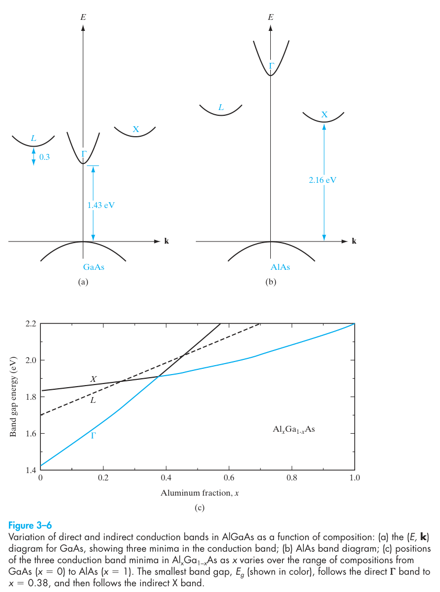

> 教材題幹把 $1.85\,\mathrm{eV}$ 標作 $\Delta E_g^\Gamma$，解答則以該值作 AlGaAs 的能隙，並以 $1.85-1.43\,\mathrm{eV}$ 計算能隙差；此處保留兩者差異。

</PracticeCard>

## Problems

<PracticeCard type="exercise" id="ss-ch5-p5-1" title="Problem 5.1：矽的熱氧化" source="PDF p.266 / 印刷 p.265" topic="熱氧化">

在 $1100\,^\circ\mathrm C$ 的濕氧環境下，於 (100) Si 上生長厚度 $900\,\mathrm{nm}$ 的氧化層，利用下方附錄 VI 曲線，求生長前 $200\,\mathrm{nm}$、接續 $300\,\mathrm{nm}$、最後 $400\,\mathrm{nm}$ 各需要多久。

在氧化層蝕刻一個 $1\,\mathrm{mm}\times1\,\mathrm{mm}$ 的方形窗口，再於 $1150\,^\circ\mathrm C$ 濕氧中重新氧化，使窗口外的氧化層增至 $2000\,\mathrm{nm}$。繪製晶圓截面，標示相對原始矽表面的各層厚度、尺寸與氧化層–矽介面，並計算窗口邊緣的矽及氧化層台階高度。

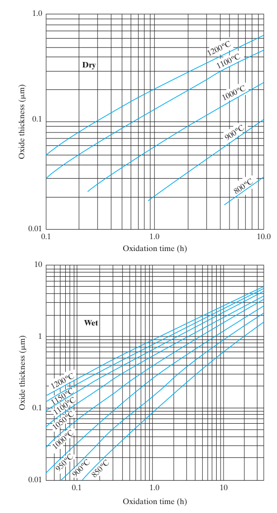

</PracticeCard>

<PracticeCard type="exercise" id="ss-ch5-p5-2" title="Problem 5.2：恆定源與有限源擴散" source="PDF p.266–267 / 印刷 p.265–266" topic="摻雜擴散">

雜質由無限源擴散，使表面濃度 $N_0$ 保持不變時，其分布為

$$
N(x,t)=N_0\operatorname{erfc}\left(\frac{x}{2\sqrt{Dt}}\right),
$$

其中 $D$ 為雜質擴散係數，$t$ 為擴散時間，$\operatorname{erfc}$ 為互補誤差函數。若擴散前將一定數量雜質放置在表面薄層，且擴散期間無雜質進出，則形成高斯分布：

$$
N(x,t)=\frac{N_s}{\sqrt{\pi Dt}}\exp\left[-\left(\frac{x}{2\sqrt{Dt}}\right)^2\right],
$$

$N_s$ 是 $t=0$ 前置於表面的雜質數量，單位 $\mathrm{atoms/cm^2}$。教材式 (4–44) 為 $\delta p(x,t)=\Delta P\exp[-x^2/(4D_pt)]/(2\sqrt{\pi D_pt})$；兩式相差兩倍，為何？圖 P5–2 顯示互補誤差函數與高斯因子，橫軸為 $u=x/(2\sqrt{Dt})$。

將硼擴散入均勻摻雜 $N_d=5\times10^{16}\,\mathrm{cm^{-3}}$ 的 $n$ 型 Si，溫度 $1000\,^\circ\mathrm C$，時間 30 分鐘；硼在 Si 中此溫度下的擴散係數 $D=3\times10^{-14}\,\mathrm{cm^2/s}$。

(a) 若表面濃度保持 $N_0=5\times10^{20}\,\mathrm{cm^{-3}}$，繪出擴散後 $N_a(x)$ 並標出表面下的接面位置。

(b) 若先在表面薄層沉積 $N_s=5\times10^{13}\,\mathrm{cm^{-2}}$ 的硼原子，擴散期間沒有額外硼原子，繪出 $N_a(x)$ 並標出接面位置。

提示：在五個數量級的半對數座標紙繪圖，橫軸由零至 $0.5\,\mu\mathrm m$，$x$ 可選為 $2\sqrt{Dt}$ 的簡單倍數。

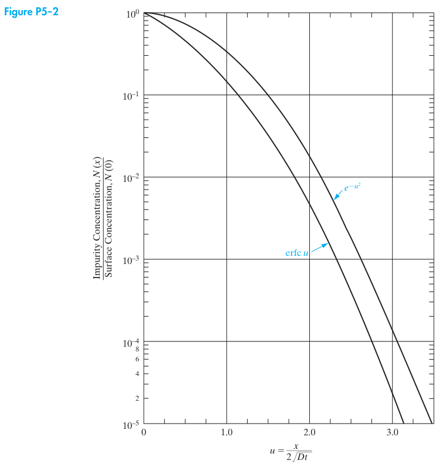

</PracticeCard>

<PracticeCard type="exercise" id="ss-ch5-p5-3" title="Problem 5.3：磷恆定源擴散" source="PDF p.267 / 印刷 p.266" topic="摻雜擴散">

假設在 $1000\,^\circ\mathrm C$ 將磷以恆定無限源擴散進 $p$ 型 Si（$N_a=2\times10^{16}\,\mathrm{cm^{-3}}$），求接面深度達 $1\,\mu\mathrm m$ 所需時間。恆定源的分布為 $N(x,t)=N_0\operatorname{erfc}[x/(2\sqrt{Dt})]$；可使用下列附錄 VII 及 VIII 的固溶度和擴散係數資料。

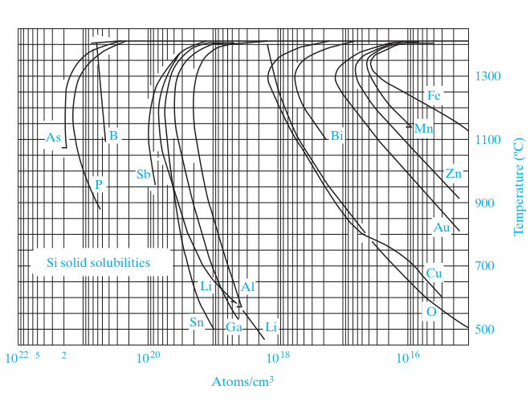

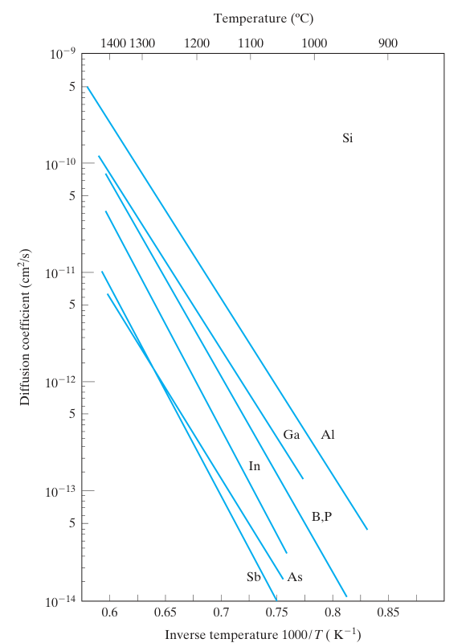

</PracticeCard>

<PracticeCard type="exercise" id="ss-ch5-p5-4" title="Problem 5.4：硼離子佈植" source="PDF p.267 / 印刷 p.266" topic="離子佈植">

利用離子佈植機將高能硼離子注入覆有 $2\,\mu\mathrm m$ 厚氧化層的 Si 基板，使距表面 $0.4\,\mu\mathrm m$ 處的硼峰值濃度為 $5\times10^{18}\,\mathrm{cm^{-3}}$。此投影射程所需的能量及對應展布量為何？若以 30 秒掃描 $100\,\mathrm{cm^2}$ 面積，求佈植劑量及束流電流。

> 原題同時給出 $2\,\mu\mathrm m$ 氧化層厚度與距表面 $0.4\,\mu\mathrm m$ 的峰值位置；參考位置的物理意義需再確認。

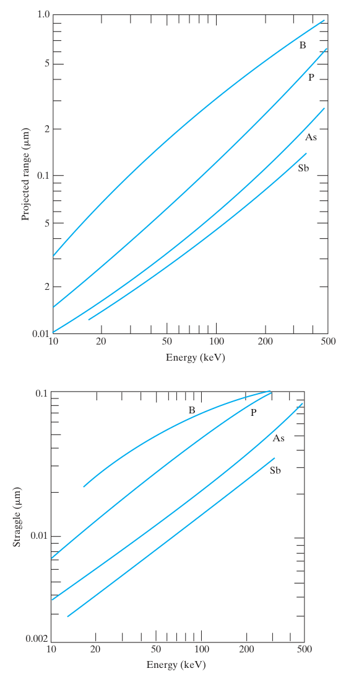

</PracticeCard>

<PracticeCard type="exercise" id="ss-ch5-p5-5" title="Problem 5.5：磷離子佈植分布" source="PDF p.267 / 印刷 p.266" topic="離子佈植">

以 $200\,\mathrm{keV}$ 的磷離子注入 Si，劑量為 $2.1\times10^{14}\,\mathrm{cm^{-2}}$。計算磷分布，並參照下圖 5–4 在半對數座標上繪製曲線；投影射程及展布量可參考附錄 IX。

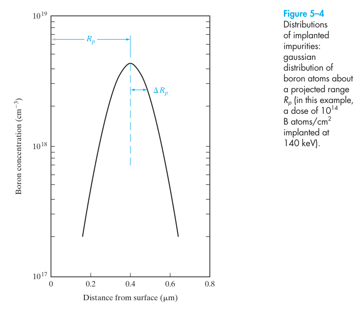

</PracticeCard>

<PracticeCard type="exercise" id="ss-ch5-p5-6" title="Problem 5.6：光罩對準機光學設計" source="PDF p.268 / 印刷 p.267" topic="微影">

考慮圖 P5–6 所示結構的圖案製作。以透鏡的數值孔徑及光源波長為設計參數，設計光罩對準機的光學系統。

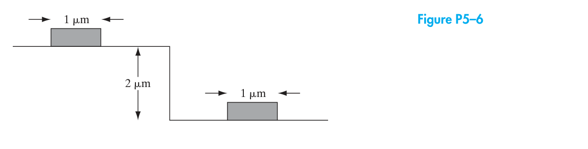

</PracticeCard>

<PracticeCard type="exercise" id="ss-ch5-p5-7" title="Problem 5.7：p⁺–n 接面空乏區" source="PDF p.268 / 印刷 p.267" topic="空乏區">

在一個 Si 的 $p^+$–$n$ 接面中，$n$ 側施體濃度為 $10^{16}\,\mathrm{cm^{-3}}$。若 $n_i=10^{10}\,\mathrm{cm^{-3}}$，相對介電常數 $\varepsilon_r=12$，求逆向偏壓 $100\,\mathrm V$ 時的空乏區寬度，以及 $n$ 側空乏區中點的電場。提示：$p^+$ 表示高度摻雜。

</PracticeCard>

<PracticeCard type="exercise" id="ss-ch5-p5-8" title="Problem 5.8：平衡能帶與電子波向量" source="PDF p.268 / 印刷 p.267" topic="接面能帶">

某半導體能隙為 $0.8\,\mathrm{eV}$，本質載子濃度為 $10^{12}\,\mathrm{cm^{-3}}$。左半部摻有 $10^{18}\,\mathrm{cm^{-3}}$ 的施體，右半部摻有 $10^{17}\,\mathrm{cm^{-3}}$ 的受體。繪製平衡能帶圖，計算並標出接面電位及費米能階位置。若一個位於 $p$ 側導帶邊緣的電子無散射地越過接面至 $n$ 側，假設能帶為拋物線形，求其在該處的波向量。載子有效質量為 $0.2m_0$。

</PracticeCard>

<PracticeCard type="exercise" id="ss-ch5-p5-9" title="Problem 5.9：突變矽接面的空乏電荷" source="PDF p.268 / 印刷 p.267" topic="接面電位與空乏區">

一個突變 Si 接面面積為 $0.0001\,\mathrm{cm^2}$，$n$ 側摻雜 $N_d=5\times10^{17}\,\mathrm{cm^{-3}}$，$p$ 側摻雜 $N_a=10^{17}\,\mathrm{cm^{-3}}$。繪製並標示能帶圖，計算兩側費米能階與本質費米能階的差值、平衡時的內建電位及空乏區寬度。空乏區內暴露的受體總數為多少？

</PracticeCard>

<PracticeCard type="exercise" id="ss-ch5-p5-10" title="Problem 5.10：逆向偏壓下的能帶與電子速度" source="PDF p.268 / 印刷 p.267" topic="逆向偏壓">

一個 $p$–$n$ 接面二極體的 $p$ 側摻雜濃度為 $10^{16}\,\mathrm{cm^{-3}}$，$n$ 側則高度摻雜。本質載子濃度為 $10^9\,\mathrm{cm^{-3}}$、能隙為 $2\,\mathrm{eV}$，且 $\varepsilon_r=15$。繪製逆向偏壓 $2\,\mathrm V$ 的能帶圖，求遠離接面處各能帶邊緣相對於準費米能階的數值，並求 $n$ 側每平方公分的空乏電荷。若一個位於 $p$ 側導帶邊緣的電子無散射地越至 $n$ 側，求其速度。電子與電洞有效質量均為 $0.4m_0$。

</PracticeCard>

<PracticeCard type="exercise" id="ss-ch5-p5-11" title="Problem 5.11：摻雜濃度與空乏電容" source="PDF p.268–269 / 印刷 p.267–268" topic="接面電容">

某 $p$–$n$ 接面中，$n$ 側摻雜濃度為 $p$ 側的五倍。$100\,^\circ\mathrm C$ 時，本質載子濃度為 $10^{11}\,\mathrm{cm^{-3}}$，能隙為 $2\,\mathrm{eV}$。若內建接面電位為 $0.65\,\mathrm V$，求 $p$ 側摻雜濃度。若此半導體的相對介電常數為 10，二極體截面積為 $0.5\,\mathrm{cm^2}$，求逆向偏壓 $2\,\mathrm V$ 時的空乏電容。繪製定性正確的能帶圖，標示此偏壓下的空乏區寬度及電壓降。

</PracticeCard>

<PracticeCard type="exercise" id="ss-ch5-p5-12" title="Problem 5.12：比較接觸電位" source="PDF p.269 / 印刷 p.268" topic="接觸電位">

三個 $p$–$n$ 接面二極體樣品 A、B、C 的受體與施體濃度分別均為 $10^{15}\,\mathrm{cm^{-3}}$ 與 $10^{18}\,\mathrm{cm^{-3}}$。三個樣品的本質載子濃度依序為 $1.5\times10^{10}$、$2\times10^{10}$、$2\times10^6\,\mathrm{cm^{-3}}$。求 $300\,\mathrm K$ 時各自的接觸電位，並比較所得結果。

</PracticeCard>

<PracticeCard type="exercise" id="ss-ch5-p5-13" title="Problem 5.13：n 區電子電流分量" source="PDF p.269 / 印刷 p.268" topic="漂移與擴散電流">

在 $p^+$–$n$ 接面中，中性 $n$ 區的電洞擴散電流為

$$
I_p(x_n)=qA\frac{D_p}{L_p}\,\delta p(x_n).
$$

在中性 $n$ 區的 $x_n$ 點，電子擴散電流與電子漂移電流各為多少？

</PracticeCard>

<PracticeCard type="exercise" id="ss-ch5-p5-14" title="Problem 5.14：平衡接觸電位" source="PDF p.269 / 印刷 p.268" topic="接面電位">

突變 Si $p$–$n$ 接面之 $p$ 側 $N_a=10^{17}\,\mathrm{cm^{-3}}$，$n$ 側 $N_d=10^{16}\,\mathrm{cm^{-3}}$。在 $300\,\mathrm K$ 下：(a) 計算費米能階、繪製平衡能帶圖，並由圖求 $V_0$；(b) 與下式所得的接觸電位比較：

$$
V_0=\frac{kT}{q}\ln\left(\frac{N_aN_d}{n_i^2}\right).
$$

</PracticeCard>

<PracticeCard type="exercise" id="ss-ch5-p5-15" title="Problem 5.15：突變接面的電荷與電場" source="PDF p.269 / 印刷 p.268" topic="空間電荷">

將硼佈植進 $n$ 型 Si（$N_d=10^{16}\,\mathrm{cm^{-3}}$），形成方形截面、面積 $2\times10^{-3}\,\mathrm{cm^2}$ 的突變接面。假設 $p$ 型區域的受體濃度為 $N_a=4\times10^{18}\,\mathrm{cm^{-3}}$。在 $300\,\mathrm K$ 平衡時，計算 $V_0$、$x_{n0}$、$x_{p0}$、$Q_+$ 與 $\mathcal E_0$，並參照圖 5–12 按比例繪製電場及電荷密度。

</PracticeCard>

<PracticeCard type="exercise" id="ss-ch5-p5-16" title="Problem 5.16：電子擴散電流密度" source="PDF p.269 / 印刷 p.268" topic="少數載子擴散">

某 $p$–$n$ 接面二極體的受體、施體及本質載子濃度分別為 $10^{17}$、$10^{18}$ 與 $10^{10}\,\mathrm{cm^{-3}}$，材料相對介電常數為 12。擴散係數分別為 $D_n=49\,\mathrm{cm^2/s}$、$D_p=18\,\mathrm{cm^2/s}$，電子與電洞生命期均為 $25\,\mathrm{ns}$。在順向偏壓 $0.2\,\mathrm V$ 下，計算距離接面為兩倍擴散長度處的電子擴散電流密度。

</PracticeCard>

<PracticeCard type="exercise" id="ss-ch5-p5-17" title="Problem 5.17：n⁺–p 接面逆向電流" source="PDF p.269 / 印刷 p.268" topic="逆向偏壓">

一個 Si 的 $n^+$–$p$ 接面，在 $p$ 側受體摻雜濃度為 $2\times10^{17}\,\mathrm{cm^{-3}}$，截面積為 $10^{-2}\,\mathrm{cm^2}$。若多數載子的生命期為 $10\,\mathrm{ns}$，對應擴散係數為 $400\,\mathrm{cm^2/s}$，估計 $300\,\mathrm K$ 下逆向偏壓 $0.3\,\mathrm V$ 時的電流密度。

</PracticeCard>

<PracticeCard type="exercise" id="ss-ch5-p5-18" title="Problem 5.18：由空間電荷求電場" source="PDF p.269 / 印刷 p.268" topic="空間電荷">

某 $p$–$n$ 接面空乏區的空間電荷分布為 $\rho(x)=qh(2x+3)$，其中 $x$ 是從位於 $x=0$ 的實體接面起算的距離，$h$ 為常數。求所產生電場的表達式。

</PracticeCard>

<PracticeCard type="exercise" id="ss-ch5-p5-19" title="Problem 5.19：接面電容與崩潰前寬度" source="PDF p.269 / 印刷 p.268" topic="空乏區">

(a) 一個面積為 $10^{-2}\,\mathrm{cm^2}$ 的 Si $p^+$–$n$ 接面，其 $n$ 側摻雜 $N_d=10^{15}\,\mathrm{cm^{-3}}$。求逆向偏壓 $10\,\mathrm V$ 時的接面電容。

(b) Si 中的突變 $p^+$–$n$ 接面，其施體摻雜 $N_d=10^{15}\,\mathrm{cm^{-3}}$。即將發生雪崩崩潰前，空乏區厚度 $W$ 為何？

</PracticeCard>

<PracticeCard type="exercise" id="ss-ch5-p5-20" title="Problem 5.20：接面兩側空乏區深度" source="PDF p.270 / 印刷 p.269" topic="空乏區">

在 $p^+$–$n$ 接面二極體中，哪一側的空乏區延伸深度較大？若受體濃度為施體濃度的兩倍，估計並比較兩側延伸深度之比，也比較兩側產生的電場。

</PracticeCard>

<PracticeCard type="exercise" id="ss-ch5-p5-21" title="Problem 5.21：逆偏矽接面的空乏寬度與電容" source="PDF p.270 / 印刷 p.269" topic="空乏區與接面電容">

一個面積為 $2\times10^{-4}\,\mathrm{cm^2}$ 的 Si $p^+$–$n$ 接面，於逆向偏壓 $60\,\mathrm V$ 時，求空乏區寬度、峰值電場及空乏電容。已知：

| 區域 | 參數 |
| --- | --- |
| $p$ 側 | $N_a=10^{19}\,\mathrm{cm^{-3}}$、$\tau_p=10\,\mathrm{ns}$、$\mu_p=800\,\mathrm{cm^2/(V\cdot s)}$、$\mu_n=200\,\mathrm{cm^2/(V\cdot s)}$ |
| $n$ 側 | $N_d=10^{16}\,\mathrm{cm^{-3}}$、$\tau_n=0.1\,\mathrm{ns}$、$\mu_n=1250\,\mathrm{cm^2/(V\cdot s)}$、$\mu_p=1400\,\mathrm{cm^2/(V\cdot s)}$ |

</PracticeCard>

<PracticeCard type="exercise" id="ss-ch5-p5-22" title="Problem 5.22：接面注入效率" source="PDF p.270 / 印刷 p.269" topic="注入效率">

在簡單 $p$–$n$ 二極體中，電洞擴散係數為電子擴散係數的兩倍，$n$ 側少數載子濃度為 $p$ 側少數載子濃度的兩倍。求 $x_n=0$ 處的注入效率。

> 原題將「電洞擴散係數為電子的兩倍」重複敘述了一次；此處保留其條件一次。

</PracticeCard>

<PracticeCard type="exercise" id="ss-ch5-p5-23" title="Problem 5.23：順偏下的載子濃度" source="PDF p.270 / 印刷 p.269" topic="少數載子">

突變 Si $p$–$n$ 接面二極體的面積為 $10^{-4}\,\mathrm{cm^2}$，$N_a=10^{17}\,\mathrm{cm^{-3}}$，$N_d=10^{18}\,\mathrm{cm^{-3}}$，順向偏壓為 $1\,\mathrm V$。電子與電洞遷移率分別為 $\mu_n=1350$、$\mu_p=400\,\mathrm{cm^2/(V\cdot s)}$，且 $\tau_p=\tau_n=10\,\mathrm{ns}$。

(a) 求過剩載子濃度。(b) 求 $x=2L_n$ 與 $2L_p$ 處的電子及電洞濃度。

</PracticeCard>

<PracticeCard type="exercise" id="ss-ch5-p5-24" title="Problem 5.24：接面電位、空乏區與順向電流" source="PDF p.270 / 印刷 p.269" topic="接面電流">

Si $p$–$n$ 接面截面積 $A=0.001\,\mathrm{cm^2}$，$N_a=10^{15}\,\mathrm{cm^{-3}}$，$N_d=10^{20}\,\mathrm{cm^{-3}}$。計算：

(a) 接觸電位 $V_0$；(b) 平衡（零偏壓）時的空間電荷區寬度；(c) 順向偏壓 $0.7\,\mathrm V$ 時的電流。假設電流由擴散主導，$\mu_n=1500$、$\mu_p=450\,\mathrm{cm^2/(V\cdot s)}$，且 $\tau_n=\tau_q=2.5\,\mathrm{ms}$。電子與電洞何者承載主要電流？為什麼？若要使電子電流加倍，應如何做？

> 教材此題將第二個生命期下標印為 $q$；其原意未經確認，故保留原標記。

</PracticeCard>

<PracticeCard type="exercise" id="ss-ch5-p5-25" title="Problem 5.25：接面崩潰逆向偏壓" source="PDF p.270 / 印刷 p.269" topic="崩潰">

假設 $p^+$–$n$ 二極體的 $n$ 區及 $p$ 區厚度分別為 $20\,\mu\mathrm m$ 與 $5\,\mu\mathrm m$。要使二極體崩潰，需施加多少逆向偏壓？已知介電常數 $\varepsilon=11.8$、$N_d=10^{15}\,\mathrm{cm^{-3}}$。

</PracticeCard>

<PracticeCard type="exercise" id="ss-ch5-p5-26" title="Problem 5.26：增加逆向偏壓的影響" source="PDF p.270–271 / 印刷 p.269–270" topic="逆向偏壓">

一個 $p$–$n$ 接面二極體在逆向偏壓 $V_r$ 下工作。若逆向偏壓增加至 $3V_r$，下列量會如何改變？(a) 空乏區寬度；(b) 接觸電位；(c) 接面電容；(d) 崩潰機率。

</PracticeCard>

<PracticeCard type="exercise" id="ss-ch5-p5-27" title="Problem 5.27：p–p⁺ 高低接面能帶" source="PDF p.271 / 印刷 p.270" topic="高低接面">

一根 Si 棒左半部的 $p$ 型摻雜為 $2\times10^{16}\,\mathrm{cm^{-3}}$，右半部的 $p$ 型摻雜為 $10^{18}\,\mathrm{cm^{-3}}$。在 $600\,\mathrm K$、本質載子濃度為 $10^{16}\,\mathrm{cm^{-3}}$ 時，繪製平衡能帶圖，並精確標示遠離摻雜轉換區處的數值。兩側皆為 $p$ 型，這稱為高低接面；注意左側摻雜量與 $n_i$ 相近。無須考慮摻雜轉換區緊鄰處的精確細節。

</PracticeCard>

<PracticeCard type="exercise" id="ss-ch5-p5-28" title="Problem 5.28：接面兩側電流分布" source="PDF p.271 / 印刷 p.270" topic="接面電流">

突變 Si $p$–$n$ 接面面積為 $10^{-4}\,\mathrm{cm^2}$，$p$ 側 $N_a=10^{17}\,\mathrm{cm^{-3}}$，$n$ 側 $N_d=10^{17}\,\mathrm{cm^{-3}}$，順向偏壓為 $0.7\,\mathrm V$。利用圖 3–23 的遷移率並假設 $\tau_n=\tau_p=1\,\mu\mathrm s$，參照圖 5–17 繪製接面兩側 $I_p$、$I_n$ 隨距離的變化，忽略空乏區 $W$ 內復合。

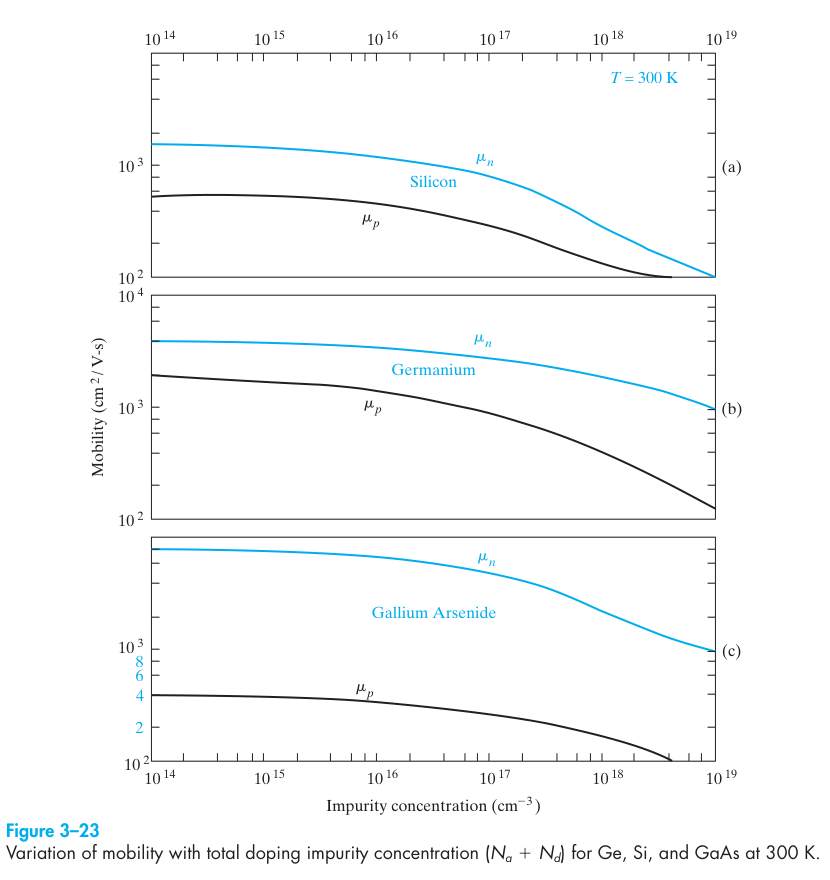

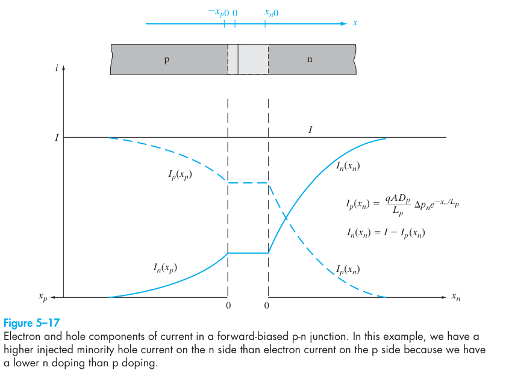

</PracticeCard>

<PracticeCard type="exercise" id="ss-ch5-p5-29" title="Problem 5.29：偏壓與摻雜改變時的接面電容" source="PDF p.271 / 印刷 p.270" topic="接面電容">

一個 $p^+$–$n$ 二極體在逆向偏壓 $5\,\mathrm V$ 時的電容為 $20\,\mathrm{pF}$。若 $p$ 側摻雜加倍且偏壓改為 $20\,\mathrm V$，電容如何變化？若再將偏壓改為 $100\,\mathrm V$，電容如何變化？

</PracticeCard>

<PracticeCard type="exercise" id="ss-ch5-p5-30" title="Problem 5.30：雪崩崩潰與 n 區厚度" source="PDF p.271 / 印刷 p.270" topic="雪崩崩潰">

一個 Ge $p^+$–$n$ 接面二極體的施體摻雜濃度為 $2\times10^{15}\,\mathrm{cm^{-3}}$，相對介電常數為 16。為確保在 $300\,\mathrm V$ 逆向偏壓下發生雪崩崩潰，$n$ 區的最小厚度為何？

</PracticeCard>

<PracticeCard type="exercise" id="ss-ch5-p5-31" title="Problem 5.31：鍺接面的逆偏電容" source="PDF p.271 / 印刷 p.270" topic="接面電容">

求 Ge $p^+$–$n$ 接面在逆向偏壓 $1\,\mathrm V$ 與 $3\,\mathrm V$ 時的電容。已知 $N_d=10^{16}\,\mathrm{cm^{-3}}$、$N_a=10^{18}\,\mathrm{cm^{-3}}$、面積 $10^{-4}\,\mathrm{cm^2}$，以及 Ge 的 $n_i=2\times10^{10}\,\mathrm{cm^{-3}}$。

</PracticeCard>

<PracticeCard type="exercise" id="ss-ch5-p5-32" title="Problem 5.32：德拜長度與空乏近似" source="PDF p.271 / 印刷 p.270" topic="德拜長度">

空乏近似假設空乏區 $W$ 內沒有載子且其外的半導體為電中性。實際上空間電荷在數個德拜長度的距離內變化；$n$ 側德拜長度為

$$
L_D=\left(\frac{\varepsilon_s kT}{q^2N_d}\right)^{1/2}.
$$

對 $p$ 側 $N_a=10^{18}\,\mathrm{cm^{-3}}$、$n$ 側 $N_d$ 分別為 $10^{14}$、$10^{16}$、$10^{18}\,\mathrm{cm^{-3}}$ 的 Si 接面，計算各 $n$ 側德拜長度並與各自的 $W$ 比較。

</PracticeCard>

<PracticeCard type="exercise" id="ss-ch5-p5-33" title="Problem 5.33：反向飽和電流與順向電流" source="PDF p.271 / 印刷 p.270" topic="二極體電流">

一個 Si $p$–$n$ 接面二極體的面積為 $10^4\,\mathrm{cm^2}$，且 $N_a=N_d=10^{17}\,\mathrm{cm^{-3}}$。

(a) 已知 $\mu_n=1500$、$\mu_p=450\,\mathrm{cm^2/(V\cdot s)}$，$\tau_p=\tau_n=2\,\mathrm{ns}$，求逆向飽和電流。(b) 理想因子 $n=1.5$、順向偏壓 $0.2\,\mathrm V$，求順向電流。

> 教材印刷的面積為 $10^4\,\mathrm{cm^2}$；此值是否誤植尚未確認，暫按原文保留。

</PracticeCard>

<PracticeCard type="exercise" id="ss-ch5-p5-34" title="Problem 5.34：短 n 區電洞分布" source="PDF p.272 / 印刷 p.271" topic="載子擴散">

電洞被注入一個 $p^+$–$n$ 二極體，其 $n$ 區寬度與電洞擴散長度 $L_p$ 相近。$n$ 側過剩電洞濃度由 $x_n=0$ 處的 $\Delta p_n$ 線性降至 $x_n=L_p$ 處的零。求解擴散方程式以求過剩電洞濃度。

</PracticeCard>

<PracticeCard type="exercise" id="ss-ch5-p5-35" title="Problem 5.35：窄基極二極體載子濃度" source="PDF p.272 / 印刷 p.271" topic="窄基極二極體">

對於空乏 $n$ 區邊緣復合率很高的窄基極二極體，求 $p$ 區的電子載子濃度及電流密度。

</PracticeCard>

<PracticeCard type="exercise" id="ss-ch5-p5-36" title="Problem 5.36：逆向擴散電流密度" source="PDF p.272 / 印刷 p.271" topic="逆向電流">

考慮逆向偏壓 $5\,\mathrm V$ 的 $n^+$–$p$ 接面，$N_a=5\times10^{17}\,\mathrm{cm^{-3}}$。已知 $D_n=10\,\mathrm{cm^2/s}$、$L_n=45\,\mu\mathrm m$，求擴散造成的逆向電流密度。

</PracticeCard>

<PracticeCard type="exercise" id="ss-ch5-p5-37" title="Problem 5.37：半波整流器" source="PDF p.272 / 印刷 p.271" topic="整流器">

在簡單半波整流器中，圖 5–23(c) 所示二極體與負載電阻串聯。假設二極體偏移電壓 $E_0=0.4\,\mathrm V$、$R=dv/di=400\,\Omega$，負載電阻為 $1\,\mathrm{k\Omega}$，正弦輸入為 $2\sin\omega t$。繪製兩個週期內負載兩端的輸出電壓。

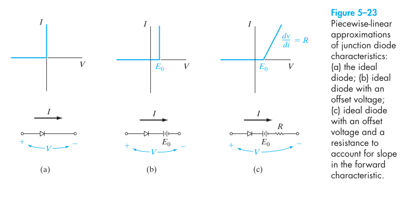

</PracticeCard>

<PracticeCard type="exercise" id="ss-ch5-p5-38" title="Problem 5.38：理想因子與 I–V 曲線" source="PDF p.272 / 印刷 p.271" topic="二極體電流">

理想因子 $n$ 可描述空乏區與中性區內復合的相對重要性。使用式 $I=I'_0(e^{qV/(nkT)}-1)$，對理想因子 1.0、1.2、1.4、1.6、1.8 與 2.0 計算並繪製二極體的 $I$–$V$ 特性。已知 $A=100\,\mu\mathrm{m^2}$，$N_a=N_d=10^{19}\,\mathrm{cm^{-3}}$。

> 教材原題的生命期條件印作「$\tau_n=\tau_p=\mu\mathrm s$」，單位前未印數值；因此無法僅憑原題確定數值曲線，需確認後再計算。

</PracticeCard>

<PracticeCard type="exercise" id="ss-ch5-p5-39" title="Problem 5.39：短區域中儲存的電洞電荷" source="PDF p.272 / 印刷 p.271" topic="載子儲存">

假設電洞由 $p^+$–$n$ 接面注入長度為 $l$ 的短 $n$ 區，且 $\delta p(x_n)$ 從 $x_n=0$ 的 $\Delta p_n$ 線性下降至歐姆接觸處 $x_n=l$ 的零。求過剩電洞分布中的穩態電荷 $Q_p$ 與電流 $I$。

</PracticeCard>

<PracticeCard type="exercise" id="ss-ch5-p5-40" title="Problem 5.40：窄基極二極體" source="PDF p.272 / 印刷 p.271" topic="窄基極二極體">

一個 $p^+$–$n$ 二極體的 $n$ 區寬度 $l$ 小於電洞擴散長度 $L_p$，即 $l<L_p$。順向偏壓下注入的電洞進入短 $n$ 區，因此邊界條件改為 $\delta p(x_n=l)=0$。

(a) 求解擴散方程式，得到

$$
\delta p(x_n)=\frac{\Delta p_n\left[e^{(l-x_n)/L_p}-e^{(x_n-l)/L_p}\right]}{e^{l/L_p}-e^{-l/L_p}}.
$$

(b) 證明二極體電流為

$$
I=\left(\frac{qAD_pp_n}{L_p}\coth\frac{l}{L_p}\right)\left(e^{qV/kT}-1\right).
$$

</PracticeCard>

<PracticeCard type="exercise" id="ss-ch5-p5-41" title="Problem 5.41：窄基極二極體的復合電流" source="PDF p.273 / 印刷 p.272" topic="復合電流">

考慮 $p^+$–$n$ 窄基極二極體，其 $n$ 區長度 $l<L_p$，$\delta p(0)=\Delta p_n$、$\delta p(l)=0$。其過剩電洞分布為

$$
\delta p(x_n)=\frac{\Delta p_n\left[e^{(l-x_n)/L_p}-e^{(x_n-l)/L_p}\right]}{e^{l/L_p}-e^{-l/L_p}}.
$$

(a) 求 $n$ 區內因復合而產生的電流；(b) 證明歐姆接觸處因復合而產生的電流為

$$
I(\text{歐姆接觸})=\left(\frac{qAD_pp_n}{L_p}\operatorname{csch}\frac{l}{L_p}\right)\left(e^{qV/kT}-1\right).
$$

</PracticeCard>

<PracticeCard type="exercise" id="ss-ch5-p5-42" title="Problem 5.42：漸變接面的電場與電容" source="PDF p.273 / 印刷 p.272" topic="漸變接面">

假設 $p^+$–$n$ 接面的 $n$ 區摻雜依 $N_d(x)=Gx^m$ 漸變。空乏區（$W\cong x_{n0}$）從約 $x=0$ 的接面延伸到 $n$ 區中的 $x=W$；$m$ 為負時可忽略 $x=0$ 的奇異點。

(a) 對空乏區積分高斯定律，證明最大電場為 $\mathcal E_0=-qGW^{m+1}/[\varepsilon(m+1)]$。

(b) 求電場隨位置的表達式，再證明 $V_0-V=qGW^{m+2}/[\varepsilon(m+2)]$。

(c) 求空乏區內游離施體的電荷 $Q$，以 $V_0-V$ 表示。

(d) 由 (c) 對 $V_0-V$ 微分，證明電容為

$$
C_j=A\left[\frac{qG\varepsilon^{m+1}}{(m+2)(V_0-V)}\right]^{1/(m+2)}.
$$

</PracticeCard>

<PracticeCard type="exercise" id="ss-ch5-p5-43" title="Problem 5.43：金屬–矽接觸" source="PDF p.273 / 印刷 p.272" topic="金屬半導體接觸">

將功函數 $4.6\,\mathrm{eV}$ 的金屬沉積在 Si 上。Si 電子親和力為 $4\,\mathrm{eV}$，受體摻雜為 $10^{18}\,\mathrm{cm^{-3}}$。繪製平衡能帶圖，標出費米能階、能帶邊緣及真空能階。此接觸是蕭特基接觸還是歐姆接觸？為什麼？金屬功函數需改變多少才能改變接觸種類？參照能帶圖說明。

</PracticeCard>

<PracticeCard type="exercise" id="ss-ch5-p5-44" title="Problem 5.44：GaAs 歐姆接觸設計" source="PDF p.273 / 印刷 p.272" topic="歐姆接觸">

利用 InAs 與中間的漸變 InGaAs 區，為 $n$ 型 GaAs 設計一個歐姆接觸。參考圖 5–44 中金屬與 $n$ 型 GaAs、$n$ 型 InAs 的接觸能帶示意。

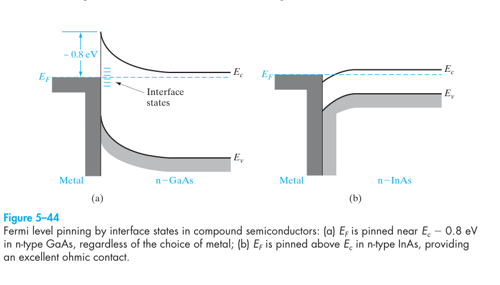

</PracticeCard>

<PracticeCard type="exercise" id="ss-ch5-p5-45" title="Problem 5.45：蕭特基障壁能帶圖" source="PDF p.273 / 印刷 p.272" topic="蕭特基障壁">

功函數 $4.3\,\mathrm{eV}$ 的金屬與 $p$ 型 Si 形成蕭特基障壁。Si 的電子親和力為 $4\,\mathrm{eV}$，受體摻雜濃度為 $10^{17}\,\mathrm{cm^{-3}}$。(a) 繪製平衡能帶圖並標出 $qV_0$ 的數值。(b) 繪製順向偏壓 $0.3\,\mathrm V$ 的能帶圖，並對逆向偏壓 $2\,\mathrm V$ 重複繪製。

</PracticeCard>

<PracticeCard type="exercise" id="ss-ch5-p5-46" title="Problem 5.46：雙面金屬接觸設計" source="PDF p.273 / 印刷 p.272" topic="金屬半導體接觸">

在一個 $n$ 型半導體的一面製作蕭特基二極體，另一面製作歐姆接觸。若電子親和力為 $5\,\mathrm{eV}$、能隙為 $1.5\,\mathrm{eV}$、費米電位為 $0.25\,\mathrm{eV}$，兩種金屬的功函數應為何？請以大於或小於某一數值的形式回答，並繪製結構的能帶圖。

</PracticeCard>

<PracticeCard type="exercise" id="ss-ch5-p5-47" title="Problem 5.47：半導體異質接面" source="PDF p.273–274 / 印刷 p.272–273" topic="異質接面">

半導體材料 A、B 形成異質接面，參數如下；$L_{n,p}$ 與 $\tau_{n,p}$ 為相關少數載子的擴散長度及生命期。

| 材料 | $E_g$ (eV) | $\chi$ (eV) | 摻雜 ($\mathrm{cm^{-3}}$) | 長度 ($\mu\mathrm m$) | $L_{n,p}$ ($\mu\mathrm m$) | $n_i$ ($\mathrm{cm^{-3}}$) | $\tau_{n,p}$ ($\mu\mathrm s$) |
| --- | --- | --- | --- | --- | --- | --- | --- |
| A | 2 | 4 | $N_A=10^{20}$ | 0.5 | 10 | $10^8$ | 10 |
| B | 1 | 5 | $N_D=10^{16}$ | 0.1 | 100 | $10^{10}$ | 1 |

繪製平衡能帶圖，標出能帶邊緣及 $E_F$ 相對於真空能階的能量。若接面順向偏壓使少數載子濃度增加至原來的 $10^6$ 倍，求電流密度。

提示：使用適當近似。這是 $p^+$–$n$ 接面，半導體長度遠小於擴散長度，且元件兩端歐姆接觸處的少數載子濃度為零。

</PracticeCard>

<PracticeCard type="exercise" id="ss-ch5-p5-48" title="Problem 5.48：同質與異質接面能帶" source="PDF p.274 / 印刷 p.273" topic="異質接面">

某 $p$–$n$ 二極體的 $p$ 側摻雜濃度為 $10^{17}\,\mathrm{cm^{-3}}$，$n$ 側為其兩倍。本質載子濃度為 $10^{11}\,\mathrm{cm^{-3}}$，能隙為 $2\,\mathrm{eV}$，且 $\varepsilon_r=15$。繪製平衡能帶圖，標出能帶邊緣相對於費米能階的數值及兩側空乏區寬度。

若改為異質接面，$n$ 側能隙降為 $1\,\mathrm{eV}$，$n$ 側電子親和力為 $4\,\mathrm{eV}$，其他參數保持相同，重複上述分析。異質接面的導帶與價帶偏移量相同。

</PracticeCard>

## Self Quiz

<PracticeCard type="practice" id="ss-ch5-sq1" title="Self Quiz 1：二極體各電流分量" source="PDF p.275 / 印刷 p.274" topic="接面電流">

考慮一個順向偏壓下的理想長 $p$–$n$ 接面二極體：接面突變，且空乏區內沒有復合或產生。在下圖繪出並標示整個元件中總電流 $I_{\mathrm{total}}$、電子總電流 $I_{n,\mathrm{total}}$ 與電洞總電流 $I_{p,\mathrm{total}}$ 隨位置的變化。圖上已標示這些電流在空乏區 $n$ 側邊界的值供參考。提示：接觸處的過剩載子濃度近乎固定為零。

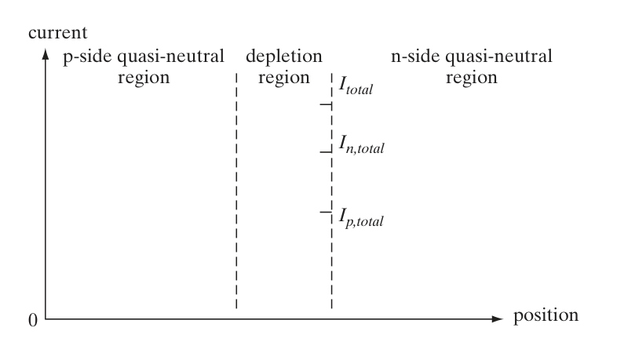

</PracticeCard>

<PracticeCard type="practice" id="ss-ch5-sq2" title="Self Quiz 2：長、短二極體的電洞分布" source="PDF p.275–276 / 印刷 p.274–275" topic="載子擴散">

(a) 考慮 (1) $n$ 側歐姆接觸位於 $x_{\mathrm{contact},1}\gg L_p$ 的長 $p$–$n$ 二極體，以及 (2) $n$ 側歐姆接觸位於距空乏區一個擴散長度以內，即 $x_{\mathrm{contact},2}<L_p$ 的短二極體。兩者在空乏區 $n$ 側邊緣的過剩電洞濃度均為圖示的 $\Delta p$。在下圖繪製兩者於 $n$ 區內的過剩電洞濃度 $\delta p(x_n)$，並標示 (1)、(2)。

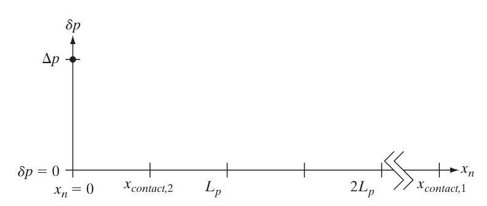

(b) 依照 (a) 的結果，在下圖繪製兩種二極體於該區的電洞擴散電流並標示 (1)、(2)。圖中提供長二極體在空乏區邊緣的電洞電流 $I_{p,1}(x_n=0)$ 供參考。

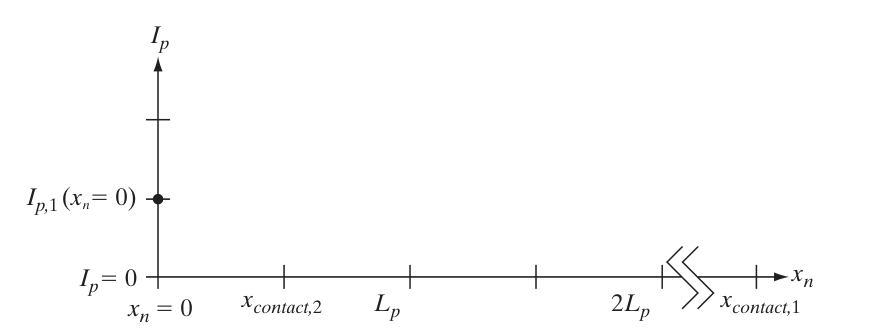

</PracticeCard>

<PracticeCard type="practice" id="ss-ch5-sq3" title="Self Quiz 3：長短二極體電流比較" source="PDF p.276 / 印刷 p.275" topic="二極體電流">

兩個 Si $p$–$n$ 接面二極體除長度外完全相同：一個為長二極體，另一個的接觸距空乏區不到一個擴散長度。施加相同順向偏壓時，哪一個電流較大？

</PracticeCard>

<PracticeCard type="practice" id="ss-ch5-sq4" title="Self Quiz 4：逆偏與空乏電容" source="PDF p.276 / 印刷 p.275" topic="接面電容">

若 $p$–$n$ 接面二極體平衡時的空乏電容為 $C_{d,0}$，接觸電位為 $0.5\,\mathrm V$，要施加多大的逆向偏壓，才能使空乏電容降至 $0.5C_{d,0}$？

</PracticeCard>

<PracticeCard type="practice" id="ss-ch5-sq5" title="Self Quiz 5：空乏與擴散電容" source="PDF p.276 / 印刷 p.275" topic="小訊號模型">

(a) 二極體的空乏電容與擴散電容有何不同？順向偏壓與逆向偏壓下各由何者主導？為什麼？

(b) 為何在二極體等半導體元件中定義小訊號電容與電導有意義？它們如何定義？

</PracticeCard>

<PracticeCard type="practice" id="ss-ch5-sq6" title="Self Quiz 6：假晶異質結構" source="PDF p.276 / 印刷 p.275" topic="異質接面">

在厚基板上生長一層磊晶薄膜，形成假晶異質結構。薄膜晶格常數為 $6\,\text{Å}$、能隙為 $2\,\mathrm{eV}$；基板晶格常數為 $4\,\text{Å}$、能隙為 $1\,\mathrm{eV}$。基板與磊晶層在未受應變時皆為立方晶體。若能帶邊緣不連續量的 60% 位於導帶，繪製此結構的簡化能帶圖，並定性畫出與能帶圖對應的二維晶體結構。

</PracticeCard>

<PracticeCard type="practice" id="ss-ch5-sq7" title="Self Quiz 7：金屬–半導體接觸能帶" source="PDF p.276–277 / 印刷 p.275–276" topic="金屬半導體接觸">

(a) 將圖示金屬與輕摻雜半導體接合後，繪製平衡能帶圖，標示費米能階；以 $q\Phi_m$、$q\Phi_s$、$q\chi$ 與／或 $E_g$ 表示接面處導帶及價帶相對費米能階的差值，以及半導體的能帶彎曲；並定性標出任何電荷空乏層或累積層。假設不存在介面陷阱。

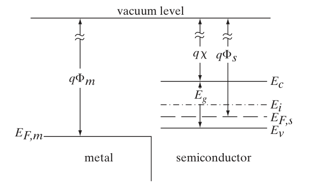

(b) 此接觸是蕭特基接觸還是歐姆接觸？

</PracticeCard>
