# Chapter 6 題目：Field-Effect Transistors

> 來源：Streetman & Banerjee, *Solid State Electronic Devices*, 7th ed.，Chapter 6 Examples 6–1 至 6–3、Problems 6.1–6.35 與 Self Quiz 1–9。圖表與題目依教材核對。

<PracticeFilter prefix="ss-ch6-" />
<PracticeProgress :total="47" prefix="ss-ch6-" />

## Examples

<PracticeCard type="example" id="ss-ch6-ex6-1" title="Example 6–1：MOS 電容與臨界電壓" source="PDF p.312 / 印刷 p.311" topic="MOS 電容">

一個 n⁺ 多晶矽閘極 n 通道 MOS 電晶體製於 p 型 Si 基板，$N_a=5\times10^{15}\,\mathrm{cm^{-3}}$。閘極區 $\mathrm{SiO_2}$ 厚度為 $100\,\mathring{\mathrm A}$，有效界面電荷 $Q_i=4\times10^{10}q\,\mathrm{C/cm^2}$。求 $C$–$V$ 特性中的 $C_i$、$C_{\min}$，以及 $W_m$、$V_{FB}$ 與 $V_T$。

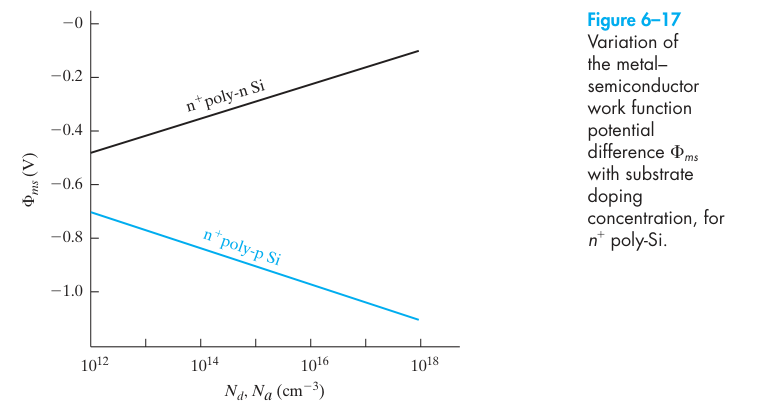

<template #solution>

教材取 $n_i=1.5\times10^{10}\,\mathrm{cm^{-3}}$、$kT/q=0.0259\,\mathrm V$，計得 $\phi_F=0.329\,\mathrm V$、$W_m=0.415\,\mu\mathrm m$。由圖取 $\Phi_{ms}\approx-0.95\,\mathrm V$，得到 $Q_i=6.4\times10^{-9}\,\mathrm{C/cm^2}$、$C_i=3.45\times10^{-7}\,\mathrm{F/cm^2}$、$V_{FB}=-0.969\,\mathrm V$、$Q_d=-3.32\times10^{-8}\,\mathrm{C/cm^2}$。

代入 $V_T=V_{FB}-Q_d/C_i+2\phi_F$ 得 $V_T=-0.215\,\mathrm V$。以 $C_d=\varepsilon_s/W_m\approx2.5\times10^{-8}\,\mathrm{F/cm^2}$ 與 $C_{\min}=C_iC_d/(C_i+C_d)$ 求得 $C_{\min}=2.33\times10^{-8}\,\mathrm{F/cm^2}$。原書在中間步驟將 $C_d$ 的單位印為 F/cm，此處依單位面積電容更正為 F/cm²。

</template>

</PracticeCard>

<PracticeCard type="example" id="ss-ch6-ex6-2" title="Example 6–2：MOSFET 線性區與飽和區電流" source="PDF pp.325–326 / 印刷 pp.324–325" topic="MOSFET 汲極電流">

n 通道 MOSFET 的閘氧化層厚度為 $10\,\mathrm{nm}$，$V_T=0.6\,\mathrm V$，$Z=25\,\mu\mathrm m$、$L=1\,\mu\mathrm m$。求 $V_G=5\,\mathrm V$、$V_D=0.1\,\mathrm V$ 時的汲極電流；再求 $V_G=3\,\mathrm V$、$V_D=5\,\mathrm V$ 的電流，並討論 $V_D=7\,\mathrm V$ 時的情況。電子通道遷移率為 $\overline\mu_n=200\,\mathrm{cm^2/(V\cdot s)}$。

<template #solution>

氧化層電容 $C_i=3.45\times10^{-7}\,\mathrm{F/cm^2}$。第一種情況 $V_D<V_G-V_T$，為線性區；代入

$$
I_D=\frac ZL\overline\mu_n C_i\left[(V_G-V_T)V_D-\frac{V_D^2}{2}\right]
$$

得教材數值 $I_D=7.51\times10^{-4}\,\mathrm A$。第二種情況 $V_D>V_G-V_T=2.4\,\mathrm V$，為飽和區，$I_D=\frac{Z}{2L}\overline\mu_n C_i(V_G-V_T)^2=4.97\times10^{-3}\,\mathrm A$。依此理想飽和模型，$V_D$ 增至 $7\,\mathrm V$ 時電流不再增加。

</template>

</PracticeCard>

<PracticeCard type="example" id="ss-ch6-ex6-3" title="Example 6–3：硼離子佈植與臨界電壓" source="PDF p.334 / 印刷 p.333" topic="離子佈植">

p 通道電晶體的閘氧化層厚 $10\,\mathrm{nm}$。要使 $V_T$ 從 $-1.1\,\mathrm V$ 變成 $-0.5\,\mathrm V$，計算所需硼離子劑量 $F_B$（$\mathrm{B^+\ ions/cm^2}$）。假設佈植的受體在 Si 表面下方形成片狀負電荷。如果硼分布比淺佈植寬得多，$V_T$ 的計算應如何改變？若硼離子束電流為 $10^{-5}\,\mathrm A$、掃描面積為 $650\,\mathrm{cm^2}$，佈植需時多久？

<template #solution>

$C_i=3.45\times10^{-7}\,\mathrm{F/cm^2}$；由 $-0.5=-1.1+qF_B/C_i$ 得 $F_B\approx1.3\times10^{12}\,\mathrm{cm^{-2}}$。若深層分布在最大空乏寬度內近似均勻，應改用基板摻雜項；若分布隨深度變化，需數值求解 Poisson 方程。以 $t=qF_BA/I$ 計得教材結果約 $13.5\,\mathrm s$。

</template>

</PracticeCard>

## Problems

<PracticeCard type="exercise" id="ss-ch6-p6-1" title="Problem 6.1：JFET 夾止電壓" source="PDF p.358 / 印刷 p.357" topic="JFET">

假設圖 6–6 的 JFET 為 Si，兩個 p⁺ 區的受體摻雜濃度為 $10^{18}\,\mathrm{cm^{-3}}$，通道的施體摻雜濃度為 $10^{16}\,\mathrm{cm^{-3}}$。若通道半寬 $a=1\,\mu\mathrm m$，比較 $V_P$ 與 $V_0$。考慮 $V_0$ 時，需施加多少 $V_{GD}$ 才會夾止？若 $V_G=-3\,\mathrm V$，汲極電流在何種 $V_D$ 下飽和？

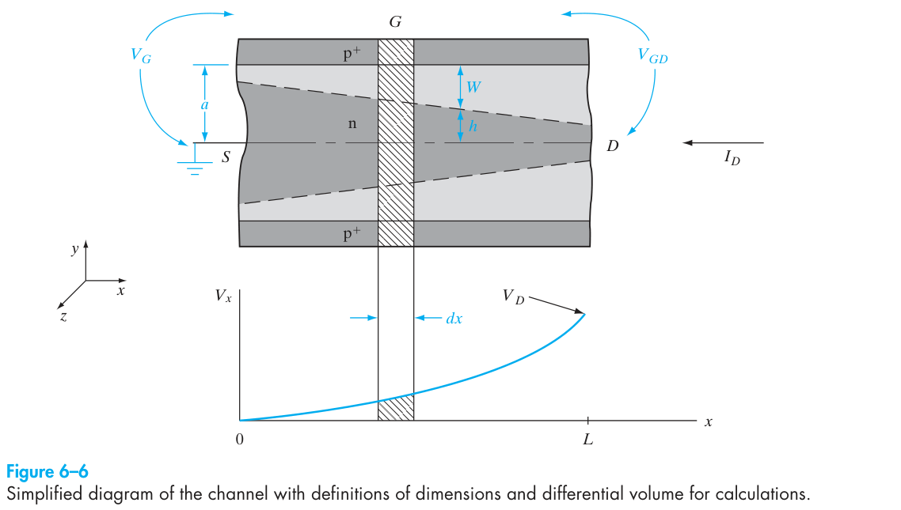

</PracticeCard>

<PracticeCard type="exercise" id="ss-ch6-p6-2" title="Problem 6.2：JFET 飽和電流" source="PDF p.358 / 印刷 p.357" topic="JFET">

對 Problem 6.1 的 Si JFET，假設 $Z/L=10$ 且 $\mu_n=1000\,\mathrm{cm^2/(V\cdot s)}$，計算 $V_G=0,-2,-4,-6\,\mathrm V$ 各情況下的 $I_D(\mathrm{sat.})$，並畫出 $I_D(\mathrm{sat.})$ 對 $V_D(\mathrm{sat.})$ 的圖。

已知 p⁺ 區受體濃度為 $10^{18}\,\mathrm{cm^{-3}}$，通道施體濃度為 $10^{16}\,\mathrm{cm^{-3}}$，通道半寬 $a=1\,\mu\mathrm m$。

</PracticeCard>

<PracticeCard type="exercise" id="ss-ch6-p6-3" title="Problem 6.3：JFET 電流電壓曲線" source="PDF p.358 / 印刷 p.357" topic="JFET">

對 Problems 6.1–6.2 的 Si JFET，畫出 $V_G=0,-2,-4,-6\,\mathrm V$ 時的 $I_D$ 對 $V_D$ 曲線；每條曲線均畫至飽和點為止。

已知 $Z/L=10$、$\mu_n=1000\,\mathrm{cm^2/(V\cdot s)}$，p⁺ 區受體濃度為 $10^{18}\,\mathrm{cm^{-3}}$，通道施體濃度為 $10^{16}\,\mathrm{cm^{-3}}$，通道半寬 $a=1\,\mu\mathrm m$。

</PracticeCard>

<PracticeCard type="exercise" id="ss-ch6-p6-4" title="Problem 6.4：JFET 輸出特性計算" source="PDF p.358 / 印刷 p.357" topic="JFET 電流電壓特性">

使用下列教材式（6–9）及（6–10），計算並繪製 Si JFET 在 $300\,\mathrm K$ 下的 $I_D(V_D,V_G)$。已知 $a=1000\,\mathring{\mathrm A}$、$N_d=7\times10^{17}\,\mathrm{cm^{-3}}$、$Z=100\,\mu\mathrm m$、$L=5\,\mu\mathrm m$。令 $V_D$ 在 $0$ 至 $5\,\mathrm V$ 間變化，$V_G$ 分別為 $0,-1,-2,-3,-4,-5\,\mathrm V$。

$$
I_D=G_0V_P\left[\frac{V_D}{V_P}+\frac{2}{3}\left(\frac{-V_G}{V_P}\right)^{3/2}-\frac{2}{3}\left(\frac{V_D-V_G}{V_P}\right)^{3/2}\right]
$$

夾止後，取飽和電流

$$
I_D(\mathrm{sat.})=G_0V_P\left[\frac{V_G}{V_P}+\frac{2}{3}\left(\frac{-V_G}{V_P}\right)^{3/2}+\frac{1}{3}\right],\quad V_P=\frac{qa^2N_d}{2\varepsilon},\quad G_0=\frac{2aZ}{\rho L}.
$$

</PracticeCard>

<PracticeCard type="exercise" id="ss-ch6-p6-5" title="Problem 6.5：場依賴遷移率與 JFET" source="PDF pp.358–359 / 印刷 pp.357–358" topic="JFET 遷移率">

對 Si JFET，使用場依賴遷移率計算並繪製 $I_D(V_D,V_G)$：通道半寬 $a=1000\,\mathring{\mathrm A}$、$N_d=7\times10^{17}\,\mathrm{cm^{-3}}$、$Z=100\,\mu\mathrm m$，令閘長 $L=0.25,0.50,1.0,2.0,5.0\,\mu\mathrm m$，$V_G=0\,\mathrm V$。低場遷移率 $\mu_0$ 由圖 3–23 取得，飽和速度 $v_s=10^7\,\mathrm{cm/s}$。假設 $\mathcal E=V_D/L$，且汲極電流達到最大值後飽和。討論短閘長元件的優點。

教材給出的場依賴遷移率模型為

$$
\mu(\mathcal E)=\frac{v_d}{\mathcal E}=\frac{\mu_0}{1+(\mu\mathcal E/v_s)}.
$$

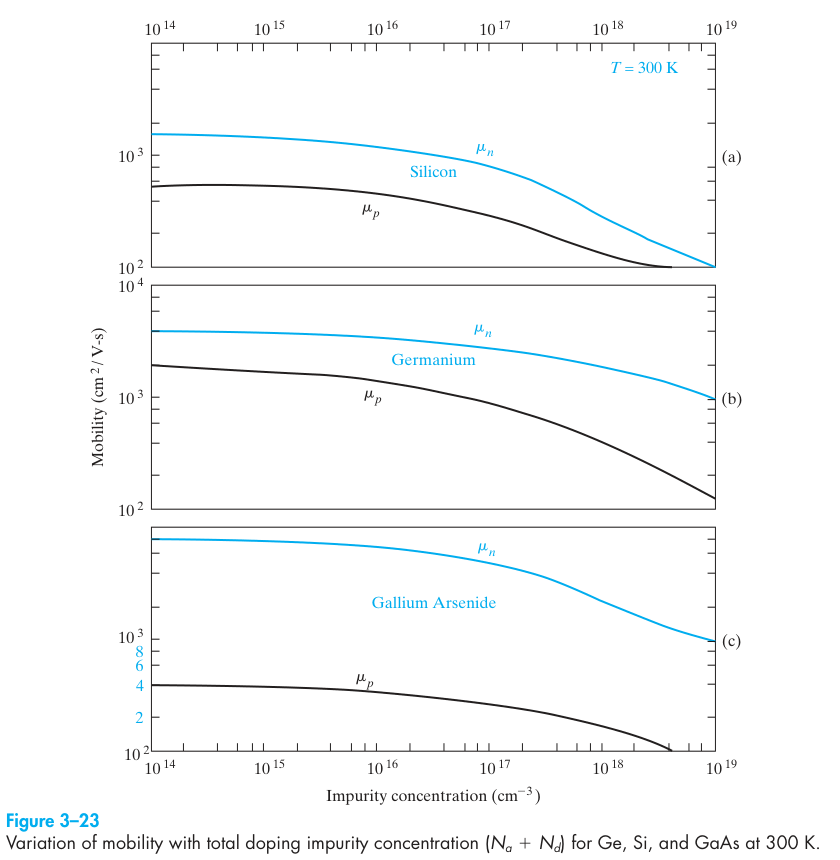

> 分母中的遷移率符號依原題印刷為 $\mu$；應用模型時請留意其隱式形式。

</PracticeCard>

<PracticeCard type="exercise" id="ss-ch6-p6-6" title="Problem 6.6：n 通道 JFET 轉移特性" source="PDF p.359 / 印刷 p.358" topic="JFET">

考慮 n 通道 JFET。畫出其轉移特性曲線，並說明夾止後汲極電流與汲極電壓無關。若基板的施體濃度增加，汲極電流會如何變化？

</PracticeCard>

<PracticeCard type="exercise" id="ss-ch6-p6-7" title="Problem 6.7：MOS 空乏區寬度" source="PDF p.359 / 印刷 p.358" topic="MOS 空乏區">

證明圖 6–15 中空乏區寬度為下式。假設如教材 5.2.3 節的作法，寬度 $W$ 內的載子完全被掃出。

$$
W=\left(\frac{2\varepsilon_s\phi_s}{qN_a}\right)^{1/2}.
$$

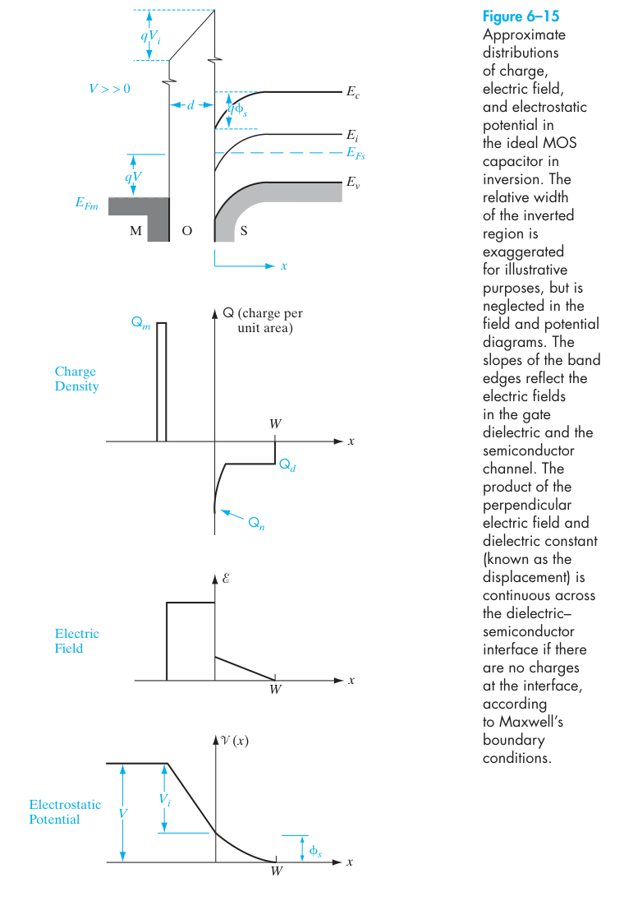

</PracticeCard>

<PracticeCard type="exercise" id="ss-ch6-p6-8" title="Problem 6.8：高介電常數 MOS 電容" source="PDF p.359 / 印刷 p.358" topic="MOS 電容">

一個 MOS 電容在 n 型半導體（$\varepsilon_r=10$、$n_i=10^{13}\,\mathrm{cm^{-3}}$）上使用高介電常數閘極介電層（$\varepsilon_r=25$）。畫出低頻與高頻特性並說明差異，標出累積、空乏、反轉區域，以及平帶電壓與臨界電壓的大致位置。若高頻電容在累積時為 $250\,\mathrm{nF/cm^2}$，在反轉時為 $50\,\mathrm{nF/cm^2}$，計算介電層厚度及反轉時的空乏區寬度。

</PracticeCard>

<PracticeCard type="exercise" id="ss-ch6-p6-9" title="Problem 6.9：p 型矽 MOS 電容" source="PDF p.359 / 印刷 p.358" topic="MOS 電容">

一個 MOS 電容在摻雜濃度 $10^{17}\,\mathrm{cm^{-3}}$ 的 p 型 Si 基板上使用高介電常數閘極介電層（$\varepsilon_r=25$）。畫出低頻與高頻 $C$–$V$ 特性並解釋差異，標示累積、空乏與反轉區域。若累積時高頻電容為 $2\,\mu\mathrm{F/cm^2}$，計算介電層厚度及最小高頻電容。

</PracticeCard>

<PracticeCard type="exercise" id="ss-ch6-p6-10" title="Problem 6.10：CMOS 電容參數" source="PDF p.359 / 印刷 p.358" topic="MOS 電容">

一 CMOS 電容使用 n⁺ 多晶矽金屬閘極，$\mathrm{SiO_2}$ 厚度為 $100\,\mathrm{nm}$，基板載子濃度為 $1.5\times10^{16}\,\mathrm{cm^{-3}}$，氧化層電荷密度為 $8\times10^{-8}\,\mathrm{C/cm^2}$，空乏層電荷密度為 $-6\times10^{-8}\,\mathrm{C/cm^2}$。求：(a) 氧化層電容；(b) 最大空乏寬度；(c) 修正功函數。已知 $\varepsilon_r(\mathrm{SiO_2})=3.9$，$\varepsilon_0=8.854\times10^{-14}\,\mathrm{F/cm}$。

</PracticeCard>

<PracticeCard type="exercise" id="ss-ch6-p6-11" title="Problem 6.11：p 通道 MOS 的 C–V 曲線" source="PDF p.359 / 印刷 p.358" topic="MOS 電容">

一鋁閘極 p 通道 MOS 電晶體製於 $N_d=5\times10^{17}\,\mathrm{cm^{-3}}$ 的 n 型 Si 基板。閘極區 $\mathrm{SiO_2}$ 厚度為 $100\,\mathring{\mathrm A}$，$\phi_{ms}=-0.15\,\mathrm V$，有效界面電荷 $Q_i=5\times10^{10}q\,\mathrm{C/cm^2}$。求 $W_m$、$V_{FB}$ 與 $V_T$，畫出此元件的 $C$–$V$ 曲線，並標出尺度的重要數值。

</PracticeCard>

<PracticeCard type="exercise" id="ss-ch6-p6-12" title="Problem 6.12：n 通道 MOSFET 特性計算" source="PDF p.359 / 印刷 p.358" topic="MOSFET 電流電壓特性">

用教材式（6–50）計算並繪製 $300\,\mathrm K$ 下 n 通道 Si MOSFET 的 $I_D(V_D,V_G)$。氧化層厚度 $d=200\,\mathring{\mathrm A}$，通道遷移率 $\overline\mu_n=1000\,\mathrm{cm^2/(V\cdot s)}$，$Z=100\,\mu\mathrm m$，$L=5\,\mu\mathrm m$，$N_a$ 分別為 $10^{14},10^{15},10^{16},10^{17}\,\mathrm{cm^{-3}}$。令 $V_D$ 從 $0$ 變至 $5\,\mathrm V$，$V_G$ 取 $0,1,2,3,4,5\,\mathrm V$，且假設 $Q_i=5\times10^{11}q\,\mathrm{C/cm^2}$。

$$
I_D=\frac{\overline\mu_n Z C_i}{L}\left[\left(V_G-V_{FB}-2\phi_F-\frac{V_D}{2}\right)V_D-\frac{2\sqrt{2\varepsilon_s qN_a}}{3C_i}\left((V_D+2\phi_F)^{3/2}-(2\phi_F)^{3/2}\right)\right].
$$

</PracticeCard>

<PracticeCard type="exercise" id="ss-ch6-p6-13" title="Problem 6.13：基板摻雜與臨界電壓" source="PDF p.359 / 印刷 p.358" topic="MOS 臨界電壓">

求 Problem 6.2 中 MOS 結構的臨界電壓 $V_T$。要使結構原有臨界電壓降低 20%，基板需摻入多少鋁？

> 原書指定 Problem 6.2，但該題是 JFET 而非 MOS 結構，所指資料無法確定；保留原文引用，待更正後解題。

Problem 6.2 的資料：Si JFET 的 p⁺ 區受體濃度為 $10^{18}\,\mathrm{cm^{-3}}$，通道施體濃度為 $10^{16}\,\mathrm{cm^{-3}}$，通道半寬 $a=1\,\mu\mathrm m$，$Z/L=10$，$\mu_n=1000\,\mathrm{cm^2/(V\cdot s)}$；$V_G$ 分別為 $0,-2,-4,-6\,\mathrm V$。

</PracticeCard>

<PracticeCard type="exercise" id="ss-ch6-p6-14" title="Problem 6.14：MOS 平帶電壓" source="PDF p.360 / 印刷 p.359" topic="平帶電壓">

MOS 電容使用 n⁺ 多晶矽閘極，Si 基板載子濃度為 $2\times10^{16}\,\mathrm{cm^{-3}}$、氧化層厚度為 $80\,\mathrm{nm}$。若氧化層電荷密度為 $2\times10^9\,\mathrm{C/cm^2}$，且 $\phi_{ms}=-0.90\,\mathrm V$，求結構的平帶電壓 $V_{FB}$。

> 電荷密度依原書印刷值照錄，其量級尚待確認。

</PracticeCard>

<PracticeCard type="exercise" id="ss-ch6-p6-15" title="Problem 6.15：p 通道 MOS 能帶與電場" source="PDF p.360 / 印刷 p.359" topic="MOS 能帶圖">

針對 p 通道（n 型基板）情況，重畫圖 6–12、6–13 與 6–15。

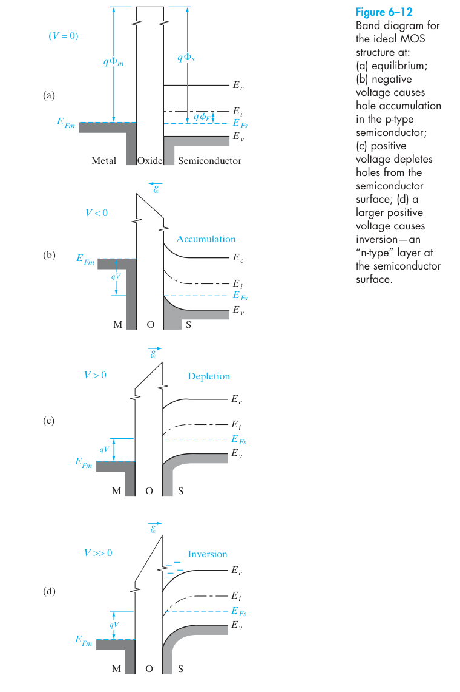

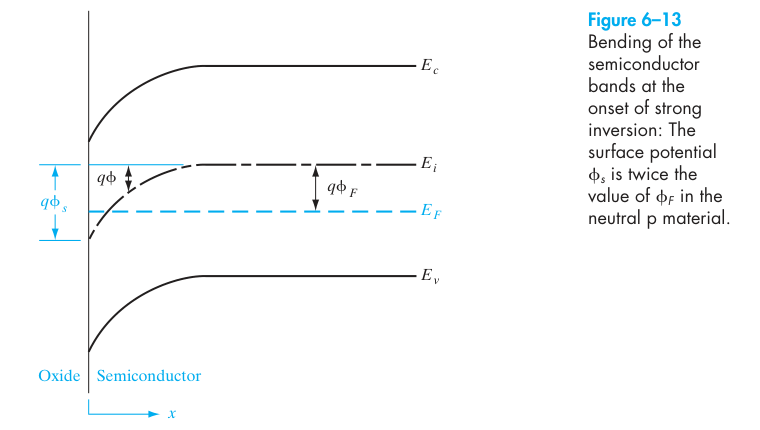

</PracticeCard>

<PracticeCard type="exercise" id="ss-ch6-p6-16" title="Problem 6.16：高介電常數 MOS 電容" source="PDF p.360 / 印刷 p.359" topic="MOS 臨界電壓">

某 MOS 電容將高介電常數 $\mathrm{HfO_2}$ 閘介電層（$\varepsilon_r=25$）沉積於新型 p 型半導體上。該半導體電子親和力為 $4\,\mathrm{eV}$、能隙為 $1.5\,\mathrm{eV}$、相對介電常數為 10、本質載子濃度為 $10^{12}\,\mathrm{cm^{-3}}$。閘極為功函數 $5\,\mathrm{eV}$ 的金屬，介電層厚度為 $100\,\mathring{\mathrm A}$，$N_A=10^{18}\,\mathrm{cm^{-3}}$，固定氧化層電荷為 $5\times10^{10}q\,\mathrm{C/cm^2}$。

求臨界電壓 $V_T$，以及在 $V_T$ 時氧化層與半導體界面及基板深處的電子、電洞濃度。畫出垂直表面的標記能帶圖，並依已知數據標示相關值。再畫出低頻與高頻 $C$–$V$ 曲線、解釋差異；如果氧化層厚度加倍，或基板摻雜濃度加倍，大負閘極偏壓下的特性各如何改變？

</PracticeCard>

<PracticeCard type="exercise" id="ss-ch6-p6-17" title="Problem 6.17：從高頻 C–V 曲線求結構參數" source="PDF pp.360–361 / 印刷 pp.359–360" topic="MOS 電容">

Si MOS 電容的高頻 $C$–$V$ 曲線如下，電容已以強累積時的電容正規化。假設閘極對基板功函數差為 $-0.35\,\mathrm V$，求氧化層厚度與基板摻雜濃度。

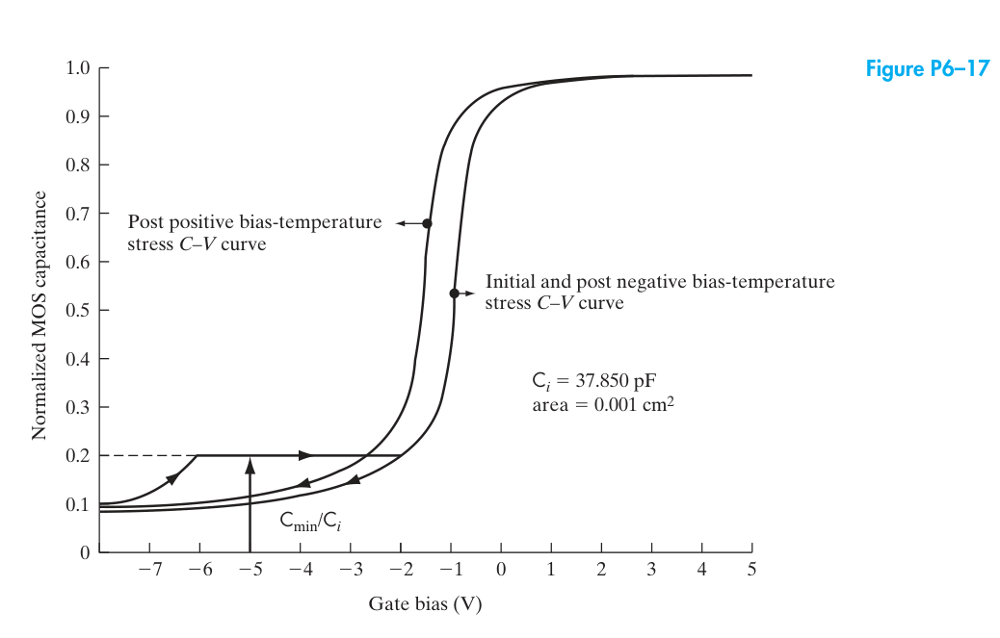

</PracticeCard>

<PracticeCard type="exercise" id="ss-ch6-p6-18" title="Problem 6.18：從 C–V 曲線求平帶電壓" source="PDF p.361 / 印刷 p.360" topic="平帶電壓">

對下圖所示的 Si MOS 電容，求初始平帶電壓。電容已以強累積電容正規化，閘極對基板功函數差為 $-0.35\,\mathrm V$。

</PracticeCard>

<PracticeCard type="exercise" id="ss-ch6-p6-19" title="Problem 6.19：固定氧化層電荷與移動離子" source="PDF p.361 / 印刷 p.360" topic="氧化層電荷">

對下圖所示的 Si MOS 電容，求固定氧化層電荷 $Q_i$ 與移動離子含量。電容已以強累積電容正規化，閘極對基板功函數差為 $-0.35\,\mathrm V$。

</PracticeCard>

<PracticeCard type="exercise" id="ss-ch6-p6-20" title="Problem 6.20：n 通道 MOSFET 反轉電荷與電流" source="PDF p.361 / 印刷 p.360" topic="MOSFET 反轉電荷">

畫出 n 通道增強型 Si MOSFET 的剖面：通道長 $2\,\mu\mathrm m$、寬 $5\,\mu\mathrm m$、高介電常數閘極介電層厚度 $10\,\mathrm{nm}$、相對介電常數 25，基板摻雜濃度 $10^{18}\,\mathrm{cm^{-3}}$。若臨界電壓為 $0.5\,\mathrm V$，求平帶電壓。閘極偏壓為 $3\,\mathrm V$ 時，通道下方總反轉電荷約為多少？在此狀態下畫出通道中央沿深度方向的能帶圖，標示基板深處及介面處的能帶邊緣與費米能階關係。

汲極偏壓為 $0.1\,\mathrm V$ 時求汲極電流。電子遷移率為 $1000\,\mathrm{cm^2/(V\cdot s)}$，電洞有效遷移率為 $200\,\mathrm{cm^2/(V\cdot s)}$。再用「電荷控制法」將反轉電荷除以載子從源極到汲極的傳輸時間，重新計算汲極電流。

</PracticeCard>

<PracticeCard type="exercise" id="ss-ch6-p6-21" title="Problem 6.21：基板偏壓與 MOSFET 驅動電流" source="PDF p.361 / 印刷 p.360" topic="MOS 臨界電壓">

計算 Si n 通道 MOSFET 的 $V_T$：$\phi_{ms}=-0.25\,\mathrm V$、閘極氧化層厚度 $100\,\mathrm{nm}$、$N_A=10^{17}\,\mathrm{cm^{-3}}$、氧化層電荷密度 $5\times10^{18}\,\mathrm{C/cm^2}$、基板偏壓 $-2\,\mathrm V$，$Q_D=6\times10^{-8}\,\mathrm{C/cm^2}$。若通道遷移率 $\mu_n=250\,\mathrm{cm^2/(V\cdot s)}$，閘極偏壓為 $2\,\mathrm V$，求處於飽和區、通道為 $50\,\mathrm{nm}$、長 $2\,\mu\mathrm m$ 的 MOSFET 驅動電流。

> 氧化層電荷密度按原書印刷值照錄，其量級尚待確認。原文稱「50 nm channel」但又稱長度為 $2\,\mu\mathrm m$，未明確指出 50 nm 是哪個尺寸。

</PracticeCard>

<PracticeCard type="exercise" id="ss-ch6-p6-22" title="Problem 6.22：MOSFET 過驅電壓與飽和電流" source="PDF p.361 / 印刷 p.360" topic="MOSFET 飽和電流">

M–SiO₂–Si MOSFET 的導通閘極電壓為 $0.7\,\mathrm V$、電容為 $1\,\mu\mathrm{F/cm^2}$。當 $V_G=V_D=3\,\mathrm V$、通道長度 $70\,\mathrm{nm}$ 時，求過驅電壓。假設基板中費米能階比本質能階低 $0.365\,\mathrm{eV}$，受體摻雜為 $2\times10^{16}\,\mathrm{cm^{-3}}$，通道有效遷移率 $550\,\mathrm{cm^2/(V\cdot s)}$，載子飽和速度 $0.5\times10^7\,\mathrm{cm/s}$，求汲極飽和電流。

</PracticeCard>

<PracticeCard type="exercise" id="ss-ch6-p6-23" title="Problem 6.23：p 通道 MOSFET 驅動電流" source="PDF p.361 / 印刷 p.360" topic="MOSFET 驅動電流">

一 p 通道增強型 MOSFET 使用厚度 $50\,\mathrm{nm}$ 的高介電常數 $\mathrm{HfO_2}$ 閘介電層（$\varepsilon_r=25$），臨界電壓 $-0.6\,\mathrm V$，電洞通道有效遷移率 $150\,\mathrm{cm^2/(V\cdot s)}$。元件寬 $50\,\mu\mathrm m$、長 $2\,\mu\mathrm m$，在 $V_G=-3\,\mathrm V$、$V_D=-0.05\,\mathrm V$ 時驅動電流為何？在此閘極偏壓下飽和電流為何？畫出閘極與汲極皆為 $-3\,\mathrm V$ 時元件剖面的反轉層，並在下方定性畫出通道電位隨位置的變化。

</PracticeCard>

<PracticeCard type="exercise" id="ss-ch6-p6-24" title="Problem 6.24：長通道 nMOSFET 小訊號參數" source="PDF p.361 / 印刷 p.360" topic="MOSFET 小訊號">

一長通道 nMOSFET 的 $V_T=1\,\mathrm V$。要得到 $I_D(\mathrm{sat.})=0.1\,\mathrm{mA}$ 且 $V_D(\mathrm{sat.})=5\,\mathrm V$，求所需 $V_G$。求 $V_D=10\,\mathrm V$ 時的小訊號輸出電導 $g$ 與轉導 $g_m(\mathrm{sat.})$。畫出此 MOSFET 剖面，並示意 $V_D=1,5,10\,\mathrm V$ 時的反轉電荷與空乏電荷分布。再求 $V_G-V_T=3\,\mathrm V$ 且 $V_D=4\,\mathrm V$ 時的新 $I_D$。

</PracticeCard>

<PracticeCard type="exercise" id="ss-ch6-p6-25" title="Problem 6.25：基板偏壓與界面載子濃度" source="PDF pp.361–362 / 印刷 pp.360–361" topic="MOS 臨界電壓">

計算 Si n 通道 MOSFET 的 $V_T$：閘極對基板功函數差 $\phi_{ms}=-1.5\,\mathrm{eV}$、閘極氧化層厚度 $100\,\mathring{\mathrm A}$、$N_A=10^{18}\,\mathrm{cm^{-3}}$、固定氧化層電荷 $5\times10^{10}q\,\mathrm{C/cm^2}$、基板偏壓 $-2.5\,\mathrm V$。在 $V_T$ 時，氧化層–Si 界面與基板深處的電子和電洞濃度各為何？畫出在 $V_T$ 時垂直表面的標記能帶圖，顯示費米電位。

</PracticeCard>

<PracticeCard type="exercise" id="ss-ch6-p6-26" title="Problem 6.26：n⁺ 多晶矽閘極臨界電壓" source="PDF p.362 / 印刷 p.361" topic="MOS 臨界電壓">

求使用 n⁺ 多晶矽閘極的 Si n 通道 MOSFET 臨界電壓 $V_T$。閘極氧化層厚度 $100\,\mathring{\mathrm A}$、$N_a=10^{18}\,\mathrm{cm^{-3}}$、固定氧化層電荷 $5\times10^{10}q\,\mathrm{C/cm^2}$。

</PracticeCard>

<PracticeCard type="exercise" id="ss-ch6-p6-27" title="Problem 6.27：線性區與飽和區電流" source="PDF p.362 / 印刷 p.361" topic="MOSFET 汲極電流">

一 n 通道 MOSFET 的閘極氧化層厚度 $30\,\mathrm{nm}$、臨界電壓 $0.7\,\mathrm V$、$Z=30\,\mu\mathrm m$、元件長度 $0.9\,\mu\mathrm m$。計算 $V_G=3\,\mathrm V$、$V_D=0.2\,\mathrm V$ 時的汲極電流。若電子通道遷移率為 $200\,\mathrm{cm^2/(V\cdot s)}$，驅動 MOS 進入飽和區所需的汲極電流為何？

</PracticeCard>

<PracticeCard type="exercise" id="ss-ch6-p6-28" title="Problem 6.28：由特性曲線求臨界電壓" source="PDF p.362 / 印刷 p.361" topic="MOSFET 特性">

對圖 P6–28 的 MOSFET 特性，分別求線性區與飽和區的 $V_T$ 和 $k_N$。假設通道遷移率 $\overline{\mu}_n=500\,\mathrm{cm^2/(V\cdot s)}$，$V_{FB}=0$。

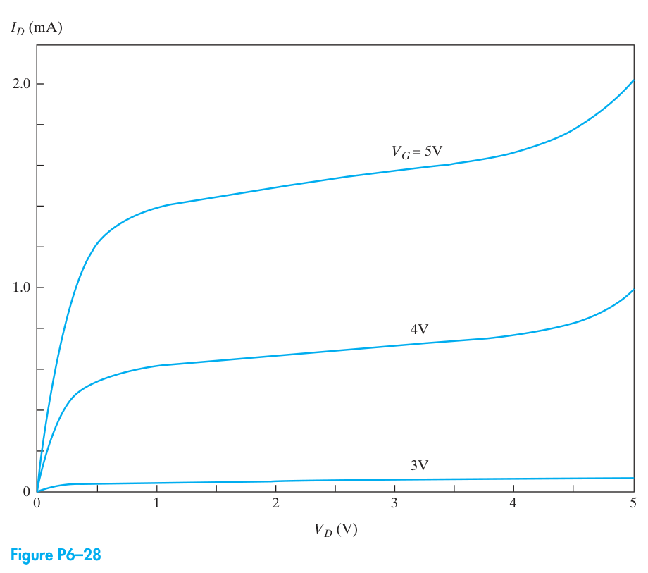

</PracticeCard>

<PracticeCard type="exercise" id="ss-ch6-p6-29" title="Problem 6.29：由特性曲線求氧化層厚度" source="PDF p.362 / 印刷 p.361" topic="MOSFET 特性">

對圖 P6–28 的 MOSFET，以作圖法或迭代法求閘極氧化層厚度與基板摻雜濃度。已知通道遷移率 $\overline{\mu}_n=500\,\mathrm{cm^2/(V\cdot s)}$，$V_{FB}=0$。

</PracticeCard>

<PracticeCard type="exercise" id="ss-ch6-p6-30" title="Problem 6.30：磷離子佈植與臨界電壓" source="PDF p.363 / 印刷 p.362" topic="離子佈植">

一 n 通道 MOSFET 的閘極氧化層厚度為 $20\,\mathrm{nm}$。要將臨界電壓從 $1.5\,\mathrm V$ 降至 $1\,\mathrm V$，需要摻入多少磷離子（$\mathrm{ions/cm^2}$）？若磷離子佈植持續 15 秒，束電流為 $10^{-6}\,\mathrm A$，佈植束能掃描多少面積？

</PracticeCard>

<PracticeCard type="exercise" id="ss-ch6-p6-31" title="Problem 6.31：基板偏壓與空乏電荷" source="PDF p.363 / 印刷 p.362" topic="基板偏壓效應">

對 Problem 6.5 的結構，求空乏電荷 $Q_D$ 與臨界電壓 $V_T$。如果基板與源極間施加 $0.4\,\mathrm V$ 反向偏壓，基板偏壓效應將如何影響 $V_T$？

> 原書指定 Problem 6.5，但該題描述 JFET；這裡的 MOS 臨界電壓與被引用資料的關係尚待確認。

被引用的 Si JFET 資料為 $a=1000\,\mathring{\mathrm A}$、$N_d=7\times10^{17}\,\mathrm{cm^{-3}}$、$Z=100\,\mu\mathrm m$、$L=0.25,0.50,1.0,2.0,5.0\,\mu\mathrm m$、$V_G=0\,\mathrm V$、$v_s=10^7\,\mathrm{cm/s}$，且 $\mathcal E=V_D/L$。低場遷移率可由下圖取得。

</PracticeCard>

<PracticeCard type="exercise" id="ss-ch6-p6-32" title="Problem 6.32：p 通道 MOS 電流曲線" source="PDF p.363 / 印刷 p.362" topic="MOSFET 特性">

對氧化層厚度為 $10\,\mu\mathrm m$、$V_T=-1.1\,\mathrm V$ 的薄氧化層 p 通道電晶體，畫出若干 $V_G$ 值下的 $I_D$ 對 $V_D$ 曲線。假設夾止後 $I_D(\mathrm{sat.})$ 保持不變，$\overline{\mu}_p=200\,\mathrm{cm^2/(V\cdot s)}$，且 $Z=10L$。

> 原書將 $10\,\mu\mathrm m$ 稱為薄氧化層；厚度單位尚待確認，題目依印刷內容照錄。

</PracticeCard>

<PracticeCard type="exercise" id="ss-ch6-p6-33" title="Problem 6.33：MOS 截止頻率" source="PDF p.363 / 印刷 p.362" topic="高頻 MOSFET">

MOS 電晶體高頻性能指標之一為截止頻率 $f_c=g_m/(2\pi C_GLZ)$，其中大部分電壓範圍內閘極電容 $C_G$ 基本上等於 $C_i$。以材料參數與元件尺寸表示夾止後的 $f_c$，並計算下列電晶體的 $f_c$：p 通道 MOSFET，氧化層厚度 $10\,\mu\mathrm m$，$V_T=-1.1\,\mathrm V$，$\overline{\mu}_p=200\,\mathrm{cm^2/(V\cdot s)}$，$Z=10L$，$L=1\,\mu\mathrm m$。假設夾止後飽和電流保持不變。

> 上述氧化層厚度單位依 Problem 6.32 原書印刷值照錄，尚待確認。

</PracticeCard>

<PracticeCard type="exercise" id="ss-ch6-p6-34" title="Problem 6.34：飽和後輸出電導" source="PDF p.363 / 印刷 p.362" topic="MOSFET 通道長度調變">

當 MOS 電晶體偏壓 $V_D>V_D(\mathrm{sat.})$ 時，有效通道長度減少 $\Delta L$，而電流 $I_D'$ 大於 $I_D(\mathrm{sat.})$，如圖 6–32 所示。假設空乏區 $\Delta L$ 可由類似式（6–30）的關係表示，且跨 $\Delta L$ 的電壓為 $V_D-V_D(\mathrm{sat.})$，證明飽和後電導為

$$
g_D'=\frac{\partial I_D'}{\partial V_D}=I_D(\mathrm{sat.})\frac{\partial}{\partial V_D}\left(\frac{L}{L-\Delta L}\right),
$$

並求以 $V_D$ 表示的 $g_D'$。教材式（6–30）為 $W=\sqrt{2\varepsilon_s\phi_s/(qN_a)}$。

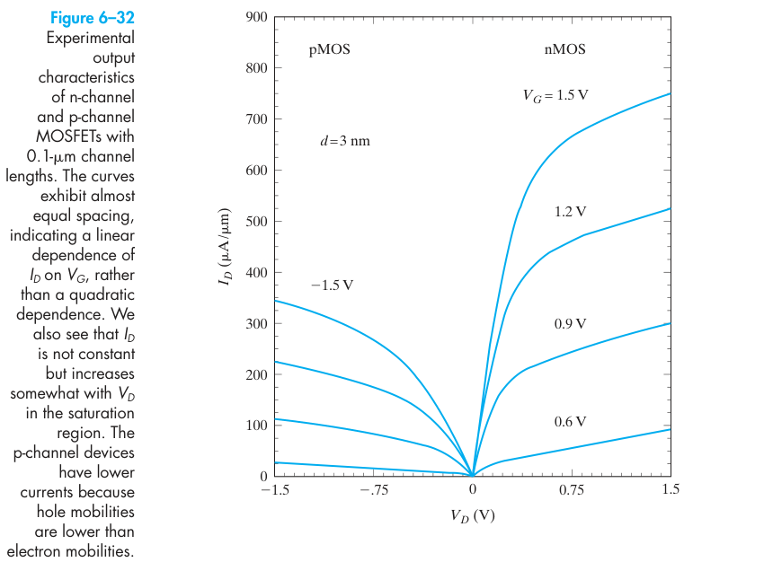

</PracticeCard>

<PracticeCard type="exercise" id="ss-ch6-p6-35" title="Problem 6.35：短通道穿通" source="PDF p.363 / 印刷 p.362" topic="MOSFET 穿通">

由圖 6–44 可見，短通道元件的源極與汲極接面空乏區可能接觸，稱為穿通。假設 n 通道 Si MOSFET 的源極與汲極摻雜濃度為 $10^{20}\,\mathrm{donors/cm^3}$，長度 $1\,\mu\mathrm m$ 的通道摻雜濃度為 $10^{16}\,\mathrm{acceptors/cm^3}$。若源極與基板接地，何種汲極電壓會造成穿通？

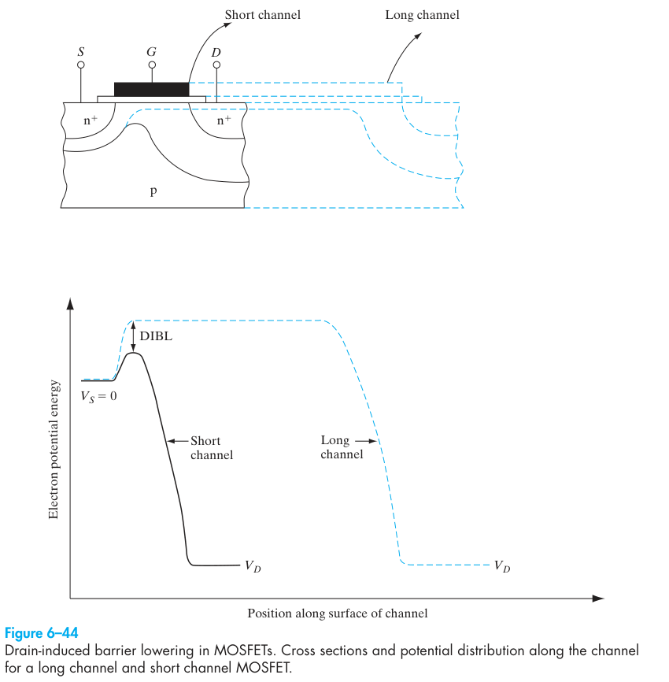

</PracticeCard>

## Self Quiz

<PracticeCard type="practice" id="ss-ch6-sq1" title="Self Quiz 1：主動與被動元件" source="PDF p.364 / 印刷 p.363" topic="主動元件">

(a) 主動元件與被動元件的主要區別為何？

(b) 若元件具有功率增益，輸出交流訊號增加的能量來自何處？

(c) 電流控制與電壓控制的三端主動元件有何不同？何者較佳？

</PracticeCard>

<PracticeCard type="practice" id="ss-ch6-sq2" title="Self Quiz 2：MOSFET 電容與閘極電壓" source="PDF pp.364–365 / 印刷 pp.363–364" topic="MOS 電容">

以下各小題考慮金屬閘極 n 通道 MOSFET 的低頻閘極電容（單位面積）對閘極電壓的特性曲線。

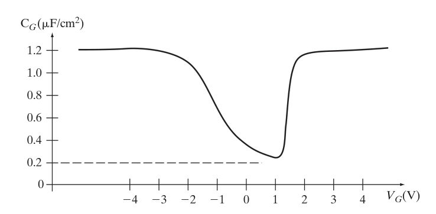

(a) 在圖上標出弱反轉、平帶、強反轉、累積、臨界與空乏的大致區域或位置。

(b) 單位面積的氧化層電容是多少 $\mu\mathrm{F/cm^2}$？

(c) 在圖上畫出此 MOSFET 源極與汲極接地時的高頻曲線。

</PracticeCard>

<PracticeCard type="practice" id="ss-ch6-sq3" title="Self Quiz 3：MOS 電容的能帶圖" source="PDF p.365 / 印刷 p.364" topic="MOS 能帶圖">

將下列 MOS 電容能帶圖分別標示為累積、弱反轉、空乏、強反轉、平帶與臨界；每個選項只使用一次。

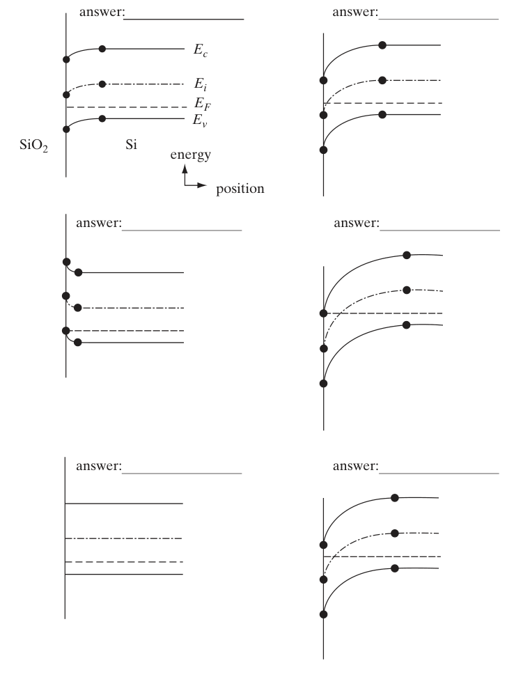

</PracticeCard>

<PracticeCard type="practice" id="ss-ch6-sq4" title="Self Quiz 4：MOSFET 輸出特性判讀" source="PDF p.366 / 印刷 p.365" topic="MOSFET 輸出特性">

考慮下列 MOSFET 的特性曲線。

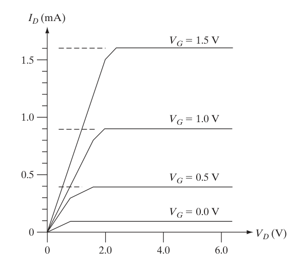

(a) 這是 n 通道還是 p 通道元件？

(b) 看起來是長通道還是短通道元件？

(c) 表觀臨界電壓 $V_T$ 為何？

(d) 這是空乏型還是增強型 MOSFET？

</PracticeCard>

<PracticeCard type="practice" id="ss-ch6-sq5" title="Self Quiz 5：次臨界擺幅" source="PDF p.366 / 印刷 p.365" topic="次臨界擺幅">

要降低（改善）MOSFET 的次臨界斜率，應當：

(a) 增加或減少氧化層厚度？

(b) 增加或減少基板摻雜濃度？

對上述兩種方法，各說出一項限制其改善次臨界擺幅程度的因素或效應。

</PracticeCard>

<PracticeCard type="practice" id="ss-ch6-sq6" title="Self Quiz 6：溫度與漏電流" source="PDF p.366 / 印刷 p.365" topic="溫度效應">

提高元件溫度，下列各項會增加、減少或不變？

(a) p–n 二極體的反向飽和電流。

(b) MOSFET 從源極至汲極的次臨界漏電流。

</PracticeCard>

<PracticeCard type="practice" id="ss-ch6-sq7" title="Self Quiz 7：氧化層厚度的影響" source="PDF p.367 / 印刷 p.366" topic="MOS 電容與臨界電壓">

假設沒有缺陷或陷阱造成的界面電荷，減少 n 通道 MOSFET 的氧化層厚度（增加氧化層電容），下列參數會增加、減少或基本不變？

(a) 平帶電壓 $V_{FB}$。

(b) 臨界電壓 $V_T$。

(c) 次臨界斜率。

</PracticeCard>

<PracticeCard type="practice" id="ss-ch6-sq8" title="Self Quiz 8：MOSFET 轉導與輸出特性" source="PDF p.367 / 印刷 p.366" topic="MOSFET 轉導">

考慮下列 MOSFET 的特性曲線。

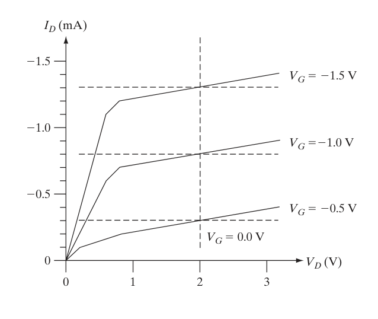

> 原題的橫軸刻度印為正值，而 (a)、(b) 指定 $V_D=-1.0\,\mathrm V$；此處保留教材原貌，尚待確認符號。

(a) 當 $V_D=-1.0\,\mathrm V$ 時，轉導 $g_m$ 為何？以 mho 為單位。

(b) 當 $V_D=-1.0\,\mathrm V$ 時，表觀臨界電壓為何？

(c) 此元件看起來是長通道還是短通道？

(d) 這是 n 通道還是 p 通道元件？

(e) 這是空乏型還是增強型 MOSFET？

</PracticeCard>

<PracticeCard type="practice" id="ss-ch6-sq9" title="Self Quiz 9：MOSFET 數據合理性" source="PDF p.368 / 印刷 p.367" topic="次臨界擺幅">

一名電機與電腦工程系高年級學生在元件製作課程中，提出以下曲線，聲稱它們是一個他在 $300\,\mathrm K$ 下製作並量測的 n 通道 MOSFET 的特性。

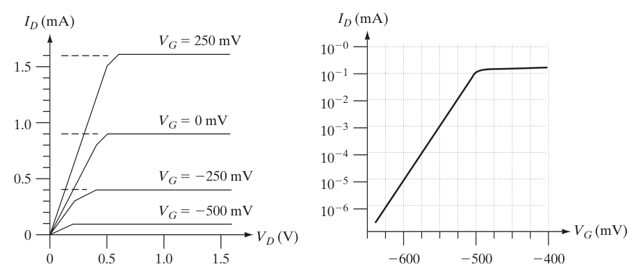

(a) 若相信此數據，這是常開／空乏型，還是常關／增強型 MOSFET？

(b) 若相信此數據，此元件看起來是長通道還是短通道？

(c) 若相信此數據，該 MOSFET 的次臨界斜率／擺幅 $S$ 為何？

(d) 該學生後來因偽造數據而遭退學。除了曲線不夠平滑外，圖中有什麼明顯不符合物理的特徵，本應引起懷疑？

</PracticeCard>
