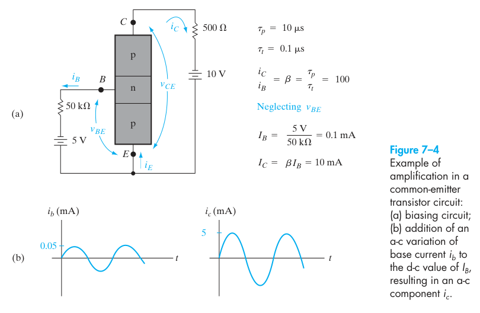
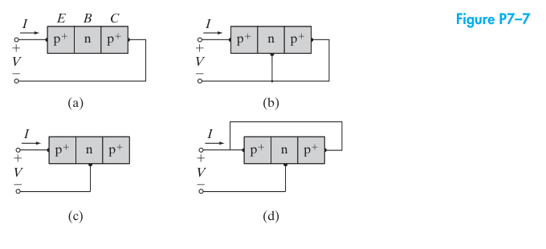
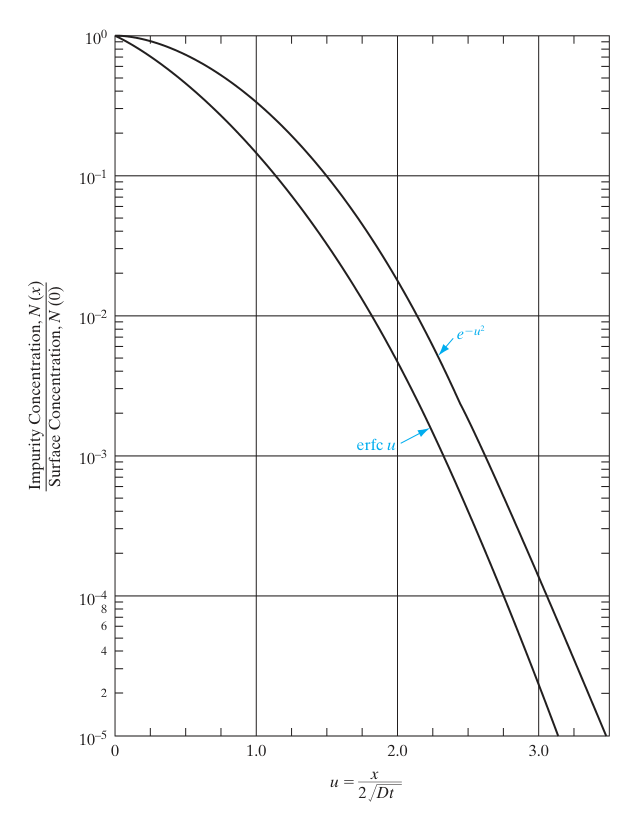
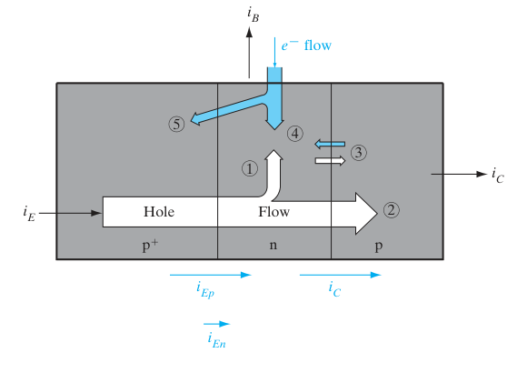
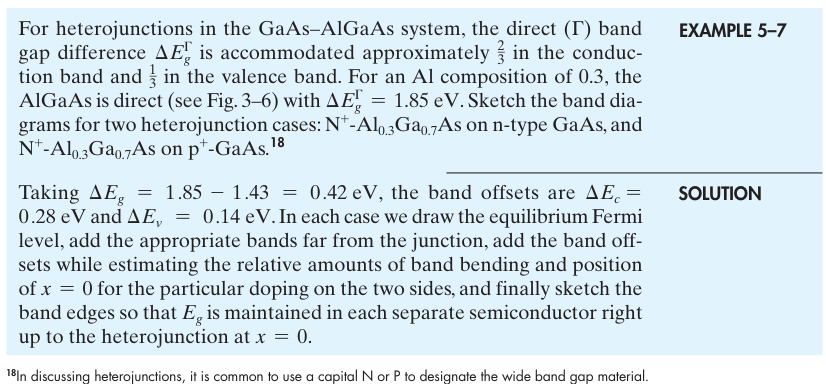
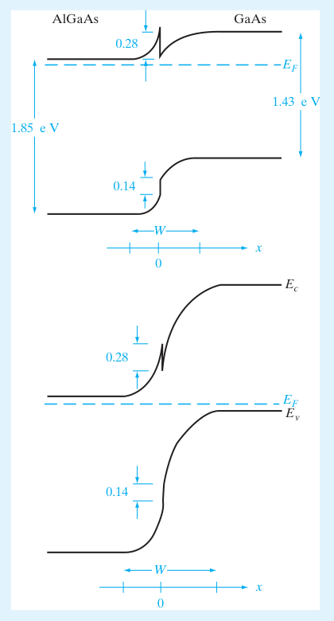
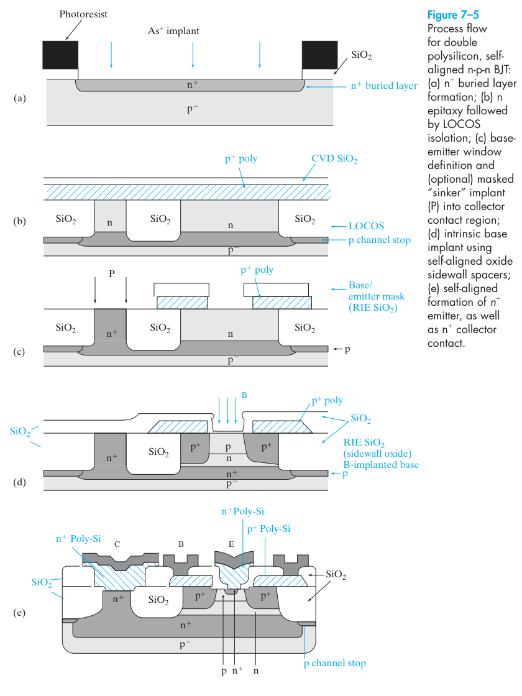
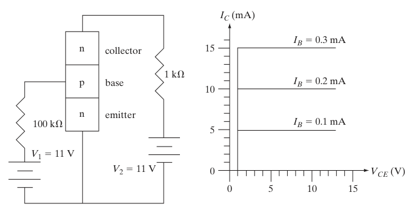
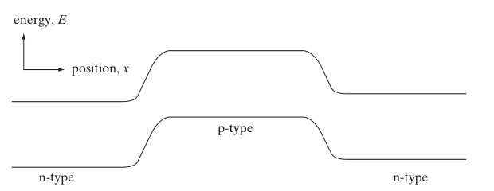

# Chapter 7 題目：Bipolar Junction Transistors

> 來源：Streetman & Banerjee, *Solid State Electronic Devices*, 7th ed.

<PracticeFilter prefix="ss-ch7-" />
<PracticeProgress :total="35" prefix="ss-ch7-" />

## Examples

<PracticeCard type="example" id="ss-ch7-ex7-1" title="Example 7–1：穩態基極電荷與電流增益" source="PDF p.376 / 印刷 p.375" topic="基極電荷">

(a) 假設 $\tau_n=\tau_p$，以穩態儲存電荷替補的觀點證明式 (7–7)：$i_C/i_B=\beta=\tau_p/\tau_t$。此式假設射極注入效率為 1，且集極飽和電流可忽略。

(b) Figure 7–4 的電晶體中，中性基極區過量電子與電洞的穩態電荷 $Q_n=Q_p$ 為何？

<template #solution>

在穩態下，基極過量電子電荷每 $\tau_p$ 秒替補一次，$i_B=Q_n/\tau_p$；過量電洞電荷每 $\tau_t$ 秒被收集一次，$i_C=Q_p/\tau_t$。由空間電荷中性 $Q_n=Q_p$，得到 $i_C/i_B=\tau_p/\tau_t$。由圖中偏壓與時間，$Q_n=Q_p=i_C\tau_t=i_B\tau_p=10^{-9}\,\mathrm C$（教材 PDF p.376）。

</template>

</PracticeCard>

<PracticeCard type="example" id="ss-ch7-ex7-2" title="Example 7–2：二極體連接的電流分配" source="PDF p.384–385 / 印刷 p.383–384" topic="電晶體電流">

考慮圖中 (b) 的電晶體接法，假設射極注入效率 $\gamma=1$。(a) 求電流 $I$ 的表達式。(b) 電流 $I$ 如何分配至基極及集極引線？

<template #solution>

由 $V_{CB}=0$，得 $\Delta p_C=0$。教材（PDF p.385）給出：

$$
I=I_E=\frac{qAD_p}{L_p}\Delta p_E\coth\left(\frac{W_b}{L_p}\right),\quad
I_C=\frac{qAD_p}{L_p}\Delta p_E\operatorname{csch}\left(\frac{W_b}{L_p}\right),\quad
I_B=\frac{qAD_p}{L_p}\Delta p_E\tanh\left(\frac{W_b}{2L_p}\right).
$$

</template>

</PracticeCard>

<PracticeCard type="example" id="ss-ch7-ex7-3" title="Example 7–3：非理想射極注入效率" source="PDF p.388 / 印刷 p.387" topic="射極注入效率">

將式 (7–20a) 的電洞射極電流擴展至射極注入效率非 1（$\gamma<1$）的情況，推導式 (7–25) 的 $\gamma$。假設射極區長度遠大於射極電子擴散長度。正常偏壓且集極端過量電洞項可忽略時，式 (7–20a) 為

$$
I_{Ep}=qA\frac{D_p^n}{L_p^n}\Delta p_E\coth\left(\frac{W_b}{L_p^n}\right).
$$

<template #solution>

教材（PDF p.388）以 $\gamma=[1+I_{En}/I_{Ep}]^{-1}$ 並代入長射極的電子注入電流，得到

$$
\gamma=\left[1+\frac{L_p^n n_n\mu_n^p}{L_n^p p_p\mu_p^n}\tanh\left(\frac{W_b}{L_p^n}\right)\right]^{-1}.
$$

其中上標指所在區域，下標指載子類型。長射極假設使射極電子電流適用長二極體表達式。

</template>

</PracticeCard>

<PracticeCard type="example" id="ss-ch7-ex7-4" title="Example 7–4：對稱電晶體的飽和電流與增益" source="PDF p.392–394 / 印刷 p.391–393" topic="電流增益">

對稱 $p^+$-n-$p^+$ BJT 面積 $A=10^{-4}\,\mathrm{cm^2}$、基極寬 $W_b=1\,\mu\mathrm m$。射極：$N_a=10^{17}\,\mathrm{cm^{-3}}$、$\tau_n=0.1\,\mu\mathrm s$、$\mu_p=200$、$\mu_n=700\,\mathrm{cm^2/(V\cdot s)}$；基極：$N_d=10^{15}\,\mathrm{cm^{-3}}$、$\tau_p=10\,\mu\mathrm s$、$\mu_n=1300$、$\mu_p=450\,\mathrm{cm^2/(V\cdot s)}$。

(a) 求飽和電流 $I_{ES}=I_{CS}$。(b) 若 $V_{EB}=0.3\,\mathrm V$、$V_{CB}=-40\,\mathrm V$ 且射極注入效率理想，求基極電流 $I_B$。(c) 假設射極區遠長於 $L_n$，求基極傳輸因子 $B$、射極注入效率 $\gamma$ 與電流放大因子 $\beta$。

<template #solution>

教材（PDF pp.393–394）使用 $n_i=1.5\times10^{10}\,\mathrm{cm^{-3}}$、$kT/q=0.0259\,\mathrm V$，得到 $I_{ES}=I_{CS}=4.2\times10^{-13}\,\mathrm A$、$I_B=1.9\times10^{-12}\,\mathrm A$、$B\approx0.99996$、$\gamma\approx0.99885$，並以約數計得 $\beta\approx832$。

</template>

</PracticeCard>

## Problems

<PracticeCard type="exercise" id="ss-ch7-p7-1" title="Problem 7.1：雙擴散電晶體的摻雜分布" source="PDF p.424 / 印刷 p.423" topic="摻雜分布">

利用 Problem 5.2 的資料，畫出下列雙擴散電晶體的摻雜分布 $N_a(x)$ 與 $N_d(x)$：起始晶圓為 n 型 Si，$N_d=10^{16}\,\mathrm{cm^{-3}}$；在表面沉積 $N_s=5\times10^{13}\,\mathrm{cm^{-2}}$ 的硼原子，於 $1100\,^{\circ}\mathrm C$ 擴散 1 小時（硼在該溫度的 $D=3\times10^{-13}\,\mathrm{cm^2/s}$）；接著將晶圓放入 $1000\,^{\circ}\mathrm C$ 磷擴散爐 15 分鐘（磷在該溫度的 $D=3\times10^{-14}\,\mathrm{cm^2/s}$）。射極擴散期間表面濃度維持 $5\times10^{20}\,\mathrm{cm^{-3}}$。因射極擴散溫度較低、時間較短，可假設基極摻雜分布在此期間無明顯變化。由 $N_a(x)$ 與 $N_d(x)$ 圖求基極區寬度。提示：使用五週期半對數紙，讓 $x$ 由 0 變至約 $1.5\,\mu\mathrm m$，取 $2\sqrt{Dt}$ 的簡單倍數為繪圖點。

Problem 5.2 的恆定表面濃度擴散與預沉積薄層擴散公式分別為：

$$
N(x,t)=N_0\operatorname{erfc}\!\left(\frac{x}{2\sqrt{Dt}}\right),\qquad
N(x,t)=\frac{N_s}{\sqrt{\pi Dt}}e^{-x^2/(4Dt)}.
$$

</PracticeCard>

<PracticeCard type="exercise" id="ss-ch7-p7-2" title="Problem 7.2：集極特性與負載線" source="PDF p.424 / 印刷 p.423" topic="負載線">

畫出 Figure 7–4 的電晶體理想集極特性 $(i_C,-v_{CE})$；$i_B$ 由零至 $0.2\,\mathrm{mA}$，間隔 $0.02\,\mathrm{mA}$，$-v_{CE}$ 由零至 $10\,\mathrm V$。在特性圖上畫出該電路的負載線，並以圖解法求 $I_B=0.1\,\mathrm{mA}$ 時 $-V_{CE}$ 的穩態值。

</PracticeCard>

<PracticeCard type="exercise" id="ss-ch7-p7-3" title="Problem 7.3：基極少數載子分布" source="PDF p.424 / 印刷 p.423" topic="載子分布">

在 p-n-p 雙極性接面電晶體（BJT）的基極中，分別取 $W_B/L_p=0.2$ 與 $0.5$，計算少數過量電洞分布 $\delta p(x)/\Delta p_E$；基極距離分別取 $L_p$ 與 $2L_p$。

</PracticeCard>

<PracticeCard type="exercise" id="ss-ch7-p7-4" title="Problem 7.4：BJT 偏壓及效率" source="PDF p.425 / 印刷 p.424" topic="BJT 偏壓">

畫出 npn BJT 在正常主動區、飽和區與截止區的偏壓極性與空乏區。將三圖上下排列，定性反映各偏壓下的空乏寬度與射極、基極、集極的相對摻雜。考慮基極傳輸因子為 $1.0$、射極注入效率為 $0.5$ 的 BJT。基極寬度加倍時，射極注入效率與基極傳輸因子約增加、減少或維持不變多少倍？再考慮射極摻雜增加五倍的情況。以主要方程式解釋，並假設其他 BJT 參數不變。

</PracticeCard>

<PracticeCard type="exercise" id="ss-ch7-p7-5" title="Problem 7.5：npn BJT 電流與能帶" source="PDF p.425 / 印刷 p.424" topic="BJT 電流">

一個 npn BJT 的射極、基極與集極摻雜濃度分別為 $10^{19}$、$5\times10^{18}$、$10^{17}\,\mathrm{cm^{-3}}$，在正常主動區操作，射極—基極電壓為 $1\,\mathrm{V}$。中性基極寬 $100\,\mathrm{nm}$，射極寬 $200\,\mathrm{nm}$，基極復合可忽略。求射極電流、射極注入效率與基極傳輸因子。射極中的電子與電洞遷移率分別為 $500$、$100\,\mathrm{cm^2/(V\,s)}$，基極中分別為 $800$、$250\,\mathrm{cm^2/(V\,s)}$。操作時元件溫度升至 $400\,\mathrm K$，$n_i=10^{12}\,\mathrm{cm^{-3}}$，$\varepsilon_r=15$。定性畫出元件結構、載子濃度及其下方偏壓能帶圖；各處載子壽命均假設為 $0.1\,\mu\mathrm s$。

> 原題未列元件截面積，求總射極電流時須釐清面積。

</PracticeCard>

<PracticeCard type="exercise" id="ss-ch7-p7-6" title="Problem 7.6：npn 電晶體的電流與能帶" source="PDF p.425 / 印刷 p.424" topic="BJT 電流">

將 Figure 7–3 重畫為 $n^+$-p-n BJT，說明正常主動模式的各電流分量及其方向，並畫出平衡與此偏壓條件下的能帶圖。

</PracticeCard>

<PracticeCard type="exercise" id="ss-ch7-p7-7" title="Problem 7.7：pnp 電晶體的增益" source="PDF p.425 / 印刷 p.424" topic="電流增益">

p-n-p 電晶體的射極摻雜為 $5\times10^{18}\,\mathrm{cm^{-3}}$，基極摻雜為 $10^{17}\,\mathrm{cm^{-3}}$，基極寬度為 $0.985\,\mu\mathrm m$，電子與電洞擴散長度均為 $10\,\mu\mathrm m$。假設 $\tau_p=\tau_n=10^{-7}\,\mathrm s$，電子與電洞遷移率分別為 $1250$、$450\,\mathrm{cm^2/(V\,s)}$，求射極注入效率、基極傳輸因子及電晶體增益。

</PracticeCard>

<PracticeCard type="exercise" id="ss-ch7-p7-8" title="Problem 7.8：摻雜與寬度對 BJT 的影響" source="PDF p.425 / 印刷 p.424" topic="電流增益">

(a) 基極摻雜增加十倍、基極寬度減半，假設其他條件不變，正常主動區的集極電流約改變多少倍？(b) 某 BJT 的射極摻雜為基極的 100 倍，射極寬度為基極寬度的 0.1 倍，且射極及基極寬度均遠小於載子擴散長度 $L_n$、$L_p$，求射極注入效率與基極傳輸因子。(c) 假設 $L_n=L_p$，且射極與基極寬度均遠大於擴散長度，重新求兩者。

</PracticeCard>

<PracticeCard type="exercise" id="ss-ch7-p7-9" title="Problem 7.9：電晶體的二極體連接" source="PDF p.425 / 印刷 p.424" topic="二極體連接">

Figure P7–7 的對稱 $p^+$-n-$p^+$ 電晶體以四種方式接成二極體。假設 $V\gg kT/q$，分別畫出基極區內的 $\Delta p(x_n)$。哪種接法最適合作為二極體？為什麼？

</PracticeCard>

<PracticeCard type="exercise" id="ss-ch7-p7-10" title="Problem 7.10：基極擴散方程" source="PDF p.426 / 印刷 p.425" topic="載子分布">

對均勻摻雜的 p-n-p 雙極電晶體，在順向主動區、基極寬度為 $W_B$ 時，解擴散方程以推導少數過量電洞濃度的表達式。

</PracticeCard>

<PracticeCard type="exercise" id="ss-ch7-p7-11" title="Problem 7.11：二極體連接的電流分配" source="PDF p.426 / 印刷 p.425" topic="電晶體電流">

(a) 求 Figure P7–7(b) 電晶體接法的電流 $I$ 表達式，並與 Problem 5.40 的窄基極二極體結果比較。(b) 電流 $I$ 如何在基極與集極引線間分配？

Problem 5.40 的窄基極二極體為 $p^+$-n 接面，其 n 區長度 $l<L_p$，並以 $\delta p(x_n=l)=0$ 為邊界條件。其電流為

$$
I=\frac{qAD_pp_n}{L_p}\coth\!\left(\frac{l}{L_p}\right)\left(e^{qV/kT}-1\right).
$$

</PracticeCard>

<PracticeCard type="exercise" id="ss-ch7-p7-12" title="Problem 7.12：電流分量與傳輸因子" source="PDF p.426 / 印刷 p.425" topic="電流增益">

對 $N_E>N_B>N_C$ 的 p-n-p BJT，畫出正常主動區的主要電流分量及正確方向。若 $I_{Ep}=10\,\mathrm{mA}$、$I_{En}=100\,\mu\mathrm A$、$I_{Cp}=9.8\,\mathrm{mA}$、$I_{Cn}=1\,\mu\mathrm A$，求基極傳輸因子、射極注入效率、共基極電流增益、共射極電流增益與 $I_{CBO}$。若基極儲存的少數載子電荷為 $4.9\times10^{-11}\,\mathrm C$，求基極渡越時間與壽命。

</PracticeCard>

<PracticeCard type="exercise" id="ss-ch7-p7-13" title="Problem 7.13：集極接面的電場與空乏寬度" source="PDF p.426 / 印刷 p.425" topic="空乏區">

$T=300\,\mathrm K$ 的 Si p-n-p BJT，其均勻摻雜為 $N_E=10^{18}$、$N_B=10^{16}$、$N_C=10^{15}\,\mathrm{cm^{-3}}$，冶金基極寬度為 $1.2\,\mu\mathrm m$。(a) 正常偏壓下集極—基極偏壓為 $30\,\mathrm V$，求接面最大電場與單位面積的空乏電容。(b) 忽略射極—基極空乏區，估算此電壓下中性基極寬度的縮減量。

</PracticeCard>

<PracticeCard type="exercise" id="ss-ch7-p7-14" title="Problem 7.14：開路接面飽和電流" source="PDF p.426 / 印刷 p.425" topic="Ebers–Moll 模型">

由式 (7–35) 與 (7–36) 可知，$I_{EO}$ 與 $I_{CO}$ 分別為另一接面開路時射極與集極接面的飽和電流。(a) 由式 (7–32) 證明此結論。(b) 分別求射極接面順向偏壓且集極開路時的 $\Delta p_C$，以及集極接面順向偏壓且射極開路時的 $\Delta p_E$。(c) 畫出 (b) 兩種情況在基極的 $\Delta p(x_n)$。

教材的式 (7–32) 與式 (7–35)、(7–36) 為

$$
\begin{aligned}
I_E&=I_{ES}(e^{qV_{EB}/kT}-1)-\alpha_I I_{CS}(e^{qV_{CB}/kT}-1),\\
I_C&=\alpha_N I_{ES}(e^{qV_{EB}/kT}-1)-I_{CS}(e^{qV_{CB}/kT}-1),\\
I_C&=\alpha_N I_E-I_{CO}(e^{qV_{CB}/kT}-1),\\
I_E&=\alpha_I I_C+I_{EO}(e^{qV_{EB}/kT}-1),
\end{aligned}
$$

其中 $I_{CO}=(1-\alpha_N\alpha_I)I_{CS}$、$I_{EO}=(1-\alpha_N\alpha_I)I_{ES}$。

</PracticeCard>

<PracticeCard type="exercise" id="ss-ch7-p7-15" title="Problem 7.15：對稱 BJT 的飽和電流" source="PDF p.427 / 印刷 p.426" topic="BJT 電流">

對稱 Si $p^+np$ BJT 的射極：$N_a=10^{18}\,\mathrm{cm^{-3}}$、$\tau_n=10^{-6}\,\mathrm s$、$\mu_p=200$、$\mu_n=800\,\mathrm{cm^2/(V\,s)}$；基極：$N_d=10^{16}\,\mathrm{cm^{-3}}$、$\tau_n=10^{-6}\,\mathrm s$、$\mu_p=400$、$\mu_n=1250\,\mathrm{cm^2/(V\,s)}$。基極寬 $0.8\,\mu\mathrm m$，面積 $10^{-4}\,\mathrm{cm^2}$。求飽和電流，以及射極—基極偏壓為 $0.2\,\mathrm V$ 時射極電流的電子與電洞分量。

</PracticeCard>

<PracticeCard type="exercise" id="ss-ch7-p7-16" title="Problem 7.16：渡越時間與開啟暫態" source="PDF p.427 / 印刷 p.426" topic="BJT 暫態">

(a) 注入的電洞渡越基極所需平均時間 $\tau_t$ 為何可能小於基極中的電洞壽命 $\tau_p$？(b) 解釋為何將 BJT 驅入過飽和時，其開啟暫態較快。

</PracticeCard>

<PracticeCard type="exercise" id="ss-ch7-p7-17" title="Problem 7.17：異質接面雙極電晶體設計" source="PDF p.427 / 印刷 p.426" topic="異質接面">

利用 Example 5–7，設計一個具有合理射極注入效率 $\gamma$ 與基極電阻的 n-p-n 異質接面雙極電晶體。

Example 5–7 使用 GaAs–AlGaAs 異質接面：直接能隙差約有三分之二落在導帶、三分之一落在價帶；鋁組成為 0.3 時，AlGaAs 的直接能隙為 $1.85\,\mathrm{eV}$。教材採用 GaAs 能隙 $1.43\,\mathrm{eV}$，因此 $\Delta E_g=0.42\,\mathrm{eV}$，$\Delta E_c=0.28\,\mathrm{eV}$、$\Delta E_v=0.14\,\mathrm{eV}$，並比較 $N^+$-Al$_{0.3}$Ga$_{0.7}$As 對 n 型及 p$^+$ 型 GaAs 接面的平衡能帶。

</PracticeCard>

<PracticeCard type="exercise" id="ss-ch7-p7-18" title="Problem 7.18：基極寬度及摻雜對增益的影響" source="PDF p.427 / 印刷 p.426" topic="電流增益">

BJT 電流放大因子 $\beta$ 對基極寬度與基極／射極摻雜比非常敏感。對 $L_n^p=L_p^n$ 的 p-n-p BJT 計算並畫出 $\beta$：

(a) $n_n=p_p$，$W_b/L_p^n$ 從 0.01 至 1；

(b) $W_b=L_p^n$，$n_n/p_p$ 從 0.01 至 1。

忽略遷移率變化（$\mu_p^n=\mu_n^p$）。

</PracticeCard>

<PracticeCard type="exercise" id="ss-ch7-p7-19" title="Problem 7.19：基極儲存電荷及傳輸因子" source="PDF p.427 / 印刷 p.426" topic="基極電荷">

(a) Figure 7–4 所示電晶體在圖示直流偏壓下，基極中儲存的過量電洞電荷為多少庫侖？

(b) 為什麼 Figure 7–5 所示電晶體在正常與反向模式的基極傳輸因子 $B$ 不同？

> 原題引用 Figure 7–5，但該圖是元件製程示意圖，未直接提供計算正常與反向模式傳輸因子的數值；依教材原文保留。

</PracticeCard>

<PracticeCard type="exercise" id="ss-ch7-p7-20" title="Problem 7.20：偏壓下的中性基極寬度" source="PDF p.427 / 印刷 p.426" topic="基極寬度">

室溫下 Si p-n-p 電晶體具有：$\tau_n=\tau_p=0.1\,\mu\mathrm s$、$D_n=D_p=10\,\mathrm{cm^2/s}$；射極、基極、集極摻雜分別為 $N_E=10^{19}$、$N_B=10^{16}$、$N_C=10^{16}\,\mathrm{cm^{-3}}$；射極寬 $W_E=3\,\mu\mathrm m$，冶金基極寬 $W=1.5\,\mu\mathrm m$（射極—基極及基極—集極接面間距），截面積 $A=10^{-5}\,\mathrm{cm^2}$。當 $V_{CB}=0$、$V_{EB}=0.2\,\mathrm V$ 時，求中性基極寬度 $W_b$；再對 $V_{EB}=0.6\,\mathrm V$ 重算。

</PracticeCard>

<PracticeCard type="exercise" id="ss-ch7-p7-21" title="Problem 7.21：不同偏壓下的傳輸因子與注入效率" source="PDF p.428 / 印刷 p.427" topic="BJT 效率">

對 Problem 7.20 的室溫 Si p-n-p BJT，求 $V_{EB}=0.2$ 與 $0.6\,\mathrm V$ 時的基極傳輸因子與射極注入效率。該元件 $V_{CB}=0$、$\tau_n=\tau_p=0.1\,\mu\mathrm s$、$D_n=D_p=10\,\mathrm{cm^2/s}$、$N_E=10^{19}$、$N_B=N_C=10^{16}\,\mathrm{cm^{-3}}$，射極寬 $3\,\mu\mathrm m$、冶金基極寬 $1.5\,\mu\mathrm m$、截面積 $10^{-5}\,\mathrm{cm^2}$。

</PracticeCard>

<PracticeCard type="exercise" id="ss-ch7-p7-22" title="Problem 7.22：不同偏壓下的增益與電流" source="PDF p.428 / 印刷 p.427" topic="BJT 電流">

對 Problem 7.20 的室溫 Si p-n-p BJT，分別計算 $V_{EB}=0.2$ 與 $0.6\,\mathrm V$ 時的 $\alpha$、$\beta$、$I_E$、$I_B$、$I_C$，以及各情況的基極 Gummel 數。元件條件為 $V_{CB}=0$、$\tau_n=\tau_p=0.1\,\mu\mathrm s$、$D_n=D_p=10\,\mathrm{cm^2/s}$、$N_E=10^{19}$、$N_B=N_C=10^{16}\,\mathrm{cm^{-3}}$，射極寬 $3\,\mu\mathrm m$、冶金基極寬 $1.5\,\mu\mathrm m$、截面積 $10^{-5}\,\mathrm{cm^2}$。

</PracticeCard>

<PracticeCard type="exercise" id="ss-ch7-p7-23" title="Problem 7.23：兩種模型計算電流增益" source="PDF p.428 / 印刷 p.427" topic="電流增益">

室溫 Si p-n-p BJT 的參數如下。遷移率單位皆為 $\mathrm{cm^2/(V\cdot s)}$，摻雜濃度單位皆為 $\mathrm{cm^{-3}}$。

| 區域 | 摻雜濃度 | 生命期 | $\mu_n$ | $\mu_p$ |
| --- | --- | --- | --- | --- |
| 射極 | $N_a=5\times10^{18}$ | $\tau_n=100\,\mathrm{ps}$ | 150 | 100 |
| 基極 | $N_d=10^{16}$ | $\tau_p=2500\,\mathrm{ps}$ | 1500 | 400 |
| 集極 | $N_a=10^{15}$ | $\tau_n=2\,\mu\mathrm s$ | 1500 | 450 |

基極寬 $W_b=0.2\,\mu\mathrm m$，面積 $10^{-4}\,\mathrm{cm^2}$。由 $B$ 與 $\gamma$ 算出 $\beta$，並使用電荷控制模型計算；比較結果。

</PracticeCard>

<PracticeCard type="exercise" id="ss-ch7-p7-24" title="Problem 7.24：基極儲存電荷與截止頻率" source="PDF p.428 / 印刷 p.427" topic="基極電荷">

對 Problem 7.23 的室溫 Si p-n-p BJT，求 $V_{CB}=0$、$V_{EB}=0.7\,\mathrm V$ 時儲存在基極的電荷。若基極渡越時間為主要延遲，$f_T$ 為何？

元件資料如下（濃度單位 $\mathrm{cm^{-3}}$，遷移率單位 $\mathrm{cm^2/(V\cdot s)}$）：射極 $N_a=5\times10^{18}$、$\tau_n=100\,\mathrm{ps}$、$\mu_n=150$、$\mu_p=100$；基極 $N_d=10^{16}$、$\tau_p=2500\,\mathrm{ps}$、$\mu_n=1500$、$\mu_p=400$；集極 $N_a=10^{15}$、$\tau_n=2\,\mu\mathrm s$、$\mu_n=1500$、$\mu_p=450$。基極寬 $0.2\,\mu\mathrm m$，面積 $10^{-4}\,\mathrm{cm^2}$。

</PracticeCard>

<PracticeCard type="exercise" id="ss-ch7-p7-25" title="Problem 7.25：渡越時間與截止頻率" source="PDF p.428 / 印刷 p.427" topic="高頻響應">

$T=300\,\mathrm K$ 的 Si n-p-n 電晶體具有：射極電流 $I_E=1\,\mathrm{mA}$、基極寬度 $W_B=100\,\mathrm{nm}$、集極—基極空乏寬度 $x_{dc}=50\,\mathrm{nm}$、$C_m=0.1\,\mathrm{pF}$、$C_{je}=1\,\mathrm{pF}$、電子擴散係數 $D_n=25\,\mathrm{cm^2/s}$、集極電阻 $r_C=20\,\Omega$、集極電容 $C_S=0.1\,\mathrm{pF}$，以及電子飽和速度 $v_s=2.3\times10^7\,\mathrm{cm/s}$。求基極渡越時間與電晶體截止頻率。

</PracticeCard>

<PracticeCard type="exercise" id="ss-ch7-p7-26" title="Problem 7.26：復合與 BJT 增益" source="PDF p.428 / 印刷 p.427" topic="電流增益">

室溫 n-p-n BJT：射極擴散係數 $D_E=10\,\mathrm{cm^2/s}$、基極擴散係數 $D_B=25\,\mathrm{cm^2/s}$、基極寬 $W_B=0.70\,\mu\mathrm m$、射極寬 $W_E=0.50\,\mu\mathrm m$、射極摻雜 $N_E=10^{18}\,\mathrm{cm^{-3}}$、基極摻雜 $N_B=10^{16}\,\mathrm{cm^{-3}}$、射極與基極復合壽命分別為 $\tau_{E0}=10^{-7}\,\mathrm s$ 與 $\tau_{B0}=5\times10^{-7}\,\mathrm s$、復合電流密度 $J_{r0}=5\times10^{-8}\,\mathrm{A/cm^2}$，外加基極—射極偏壓 $0.5\,\mathrm V$。求 (a) 射極注入效率 $\gamma$；(b) 基極傳輸因子 $B$；(c) 復合因子；(d) 共射極電流增益 $\beta$；(e) 共基極電流增益 $\alpha$。

</PracticeCard>

## Self Quiz

<PracticeCard type="practice" id="ss-ch7-sq1" title="Self Quiz 1：BJT 電路與負載線" source="PDF p.429 / 印刷 p.428" topic="負載線">

考慮下圖 BJT 電路與理想化的電晶體特性。為簡化起見，假設順向偏壓的基極—射極接面壓降恆為 $1\,\mathrm V$。

(a) 共射極增益 $\beta$ 為何？(b) 在特性曲線上畫出負載線。(c) 電路的集極—射極壓降為何？答案誤差不超過 $0.5\,\mathrm V$。(d) 若可改變 $V_1$，何值會使 BJT 進入飽和邊緣？(e) 給定基極電流 $0.1\,\mathrm{mA}$，配合 (b) 的負載線，集極—射極壓降 $V_{CE}$ 為何？答案誤差不超過 $0.5\,\mathrm V$。(f) 假設 $V_1$ 可變，令 BJT 進入飽和所需的最小 $I_B$ 為何？

</PracticeCard>

<PracticeCard type="practice" id="ss-ch7-sq2" title="Self Quiz 2：平衡 BJT 能帶" source="PDF p.430 / 印刷 p.429" topic="能帶圖">

下圖是處於平衡的 n-p-n BJT 能帶圖。畫出費米能階隨位置的變化，定性正確即可。

</PracticeCard>

<PracticeCard type="practice" id="ss-ch7-sq3" title="Self Quiz 3：基極寬度對參數的影響" source="PDF p.430 / 印刷 p.429" topic="BJT 參數">

假設元件其他條件不變，減少 BJT 基極寬度會使下列量增加、不變或減少？(a) 射極注入效率 $\gamma$；(b) 基極傳輸因子 $B$；(c) 共射極增益 $\beta$；(d) Early 電壓大小 $|V_A|$。

</PracticeCard>

<PracticeCard type="practice" id="ss-ch7-sq4" title="Self Quiz 4：npn 電流分量" source="PDF p.430 / 印刷 p.429" topic="BJT 電流">

畫出 n-p-n BJT 的剖面，並以正確箭頭標出主要電流分量。若增加基極摻雜，定性說明各分量如何改變。

</PracticeCard>

<PracticeCard type="practice" id="ss-ch7-sq5" title="Self Quiz 5：基極摻雜對參數的影響" source="PDF p.430 / 印刷 p.429" topic="BJT 參數">

減少 BJT 的基極摻雜會使下列量增加、減少或大致不變？(a) 射極注入效率 $\gamma$；(b) 基極傳輸因子 $B$；(c) Early 電壓大小 $|V_A|$。

</PracticeCard>
