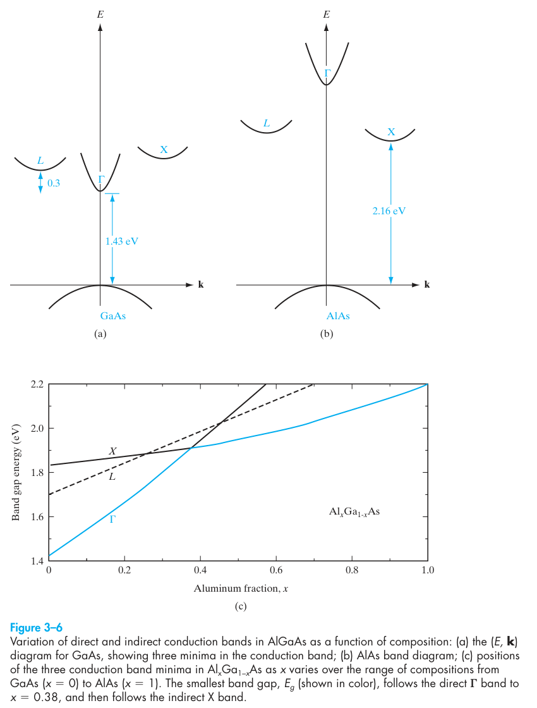
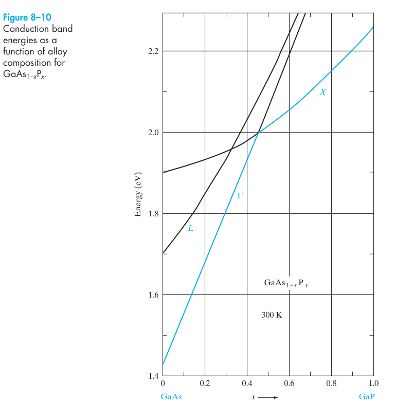
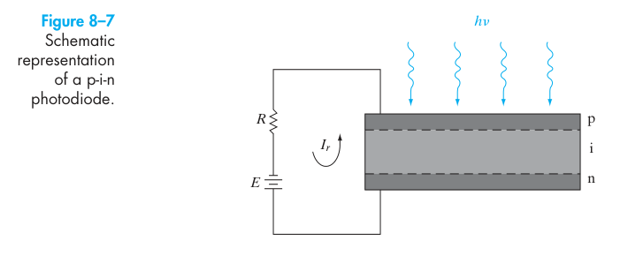
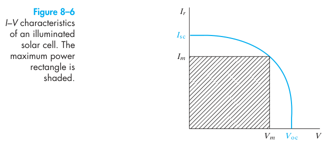
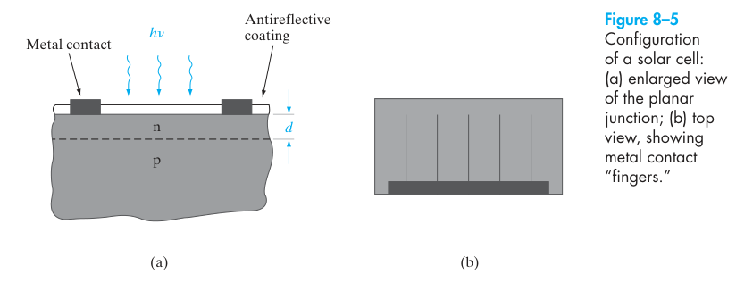
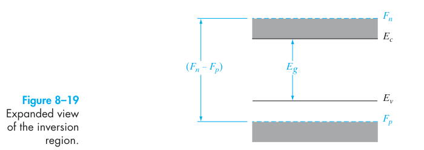
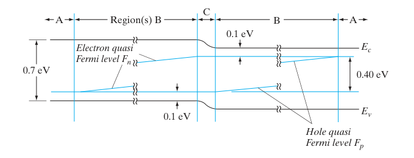

# Chapter 8 題目：Optoelectronic Devices

> 來源：Streetman & Banerjee, *Solid State Electronic Devices*, 7th ed.，Examples 8–1–8–3、Problems 8.1–8.19 與 Self Quiz 1–4。未提供經核對的答案時，題卡不附解答。

<PracticeFilter prefix="ss-ch8-" />
<PracticeProgress :total="26" prefix="ss-ch8-" />

## Examples

<PracticeCard type="example" id="ss-ch8-ex8-1" title="Example 8–1：均勻光照下的電洞擴散電流" source="PDF pp.434–435 / 印刷 pp.433–434" topic="光二極體">

假設一個長 $p^+n$ 二極體受到均勻光照，光生率為 $g_{op}\,\mathrm{EHP/(cm^3\,s)}$。求電洞擴散電流 $I_p(x_n)$ 並計算其在 $x_n=0$ 的值；將結果與光照接面電流方程在 $p^+n$ 接面下的情況比較：

$$
I=qA\left(\frac{L_p}{\tau_p}p_n+\frac{L_n}{\tau_n}n_p\right)(e^{qV/kT}-1)-qAg_{op}(L_p+L_n+W).
$$

<template #solution>

教材以 $D_p\,d^2\delta p/dx_n^2=\delta p/\tau_p-g_{op}$ 及 $L_p^2=D_p\tau_p$ 求得

$$
I_p(x_n)=\frac{qAD_p}{L_p}\left[p_n(e^{qV/kT}-1)-\frac{g_{op}L_p^2}{D_p}\right]e^{-x_n/L_p}.
$$

因此 $I_p(0)=qAD_pp_n(e^{qV/kT}-1)/L_p-qAL_pg_{op}$；它對應於接面電流式中 n 側的電洞分量。

</template>

</PracticeCard>

<PracticeCard type="example" id="ss-ch8-ex8-2" title="Example 8–2：太陽能電池最大功率" source="PDF p.438 / 印刷 p.437" topic="太陽能電池">

一個 Si 太陽能電池在完全日照下，短路電流為 $100\,\mathrm{mA}$、開路電壓為 $0.8\,\mathrm V$，填充因子為 $0.7$。求電池提供給負載的最大功率。

<template #solution>

$P_{\max}=\mathrm{FF}\,I_{sc}V_{oc}=0.7\times100\,\mathrm{mA}\times0.8\,\mathrm V=56\,\mathrm{mW}$。

</template>

</PracticeCard>

<PracticeCard type="example" id="ss-ch8-ex8-3" title="Example 8–3：紅光材料的合金組成" source="PDF p.450 / 印刷 p.449" topic="發光材料">

$\mathrm{Al}_x\mathrm{Ga}_{1-x}\mathrm{As}$ 的組成 $x$ 要取多少才能發出 $680\,\mathrm{nm}$ 的紅光？$\mathrm{GaAs}_{1-x}\mathrm{P}_x$ 的組成又為何？可用下列能隙—成分圖判讀。

<template #solution>

光子能量約為 $E_g=1.24/0.68\approx1.82\,\mathrm{eV}$。教材由圖讀得 $\mathrm{Al}_{0.32}\mathrm{Ga}_{0.68}\mathrm{As}$ 及 $\mathrm{GaAs}_{0.68}\mathrm{P}_{0.32}$。

</template>

</PracticeCard>

## Problems

<PracticeCard type="exercise" id="ss-ch8-p8-1" title="Problem 8.1：PIN 光偵測器" source="PDF p.467 / 印刷 p.466" topic="光偵測器">

對下圖的 p-i-n 光二極體：(a) 解釋為何此偵測器沒有增益；(b) 說明提高弱光靈敏度為何會降低速度；(c) 若偵測波長 $0.6\,\mu\mathrm{m}$ 的光，應使用何種材料與生長基板？

</PracticeCard>

<PracticeCard type="exercise" id="ss-ch8-p8-2" title="Problem 8.2：量子井發光與偵測" source="PDF p.468 / 印刷 p.467" topic="量子井">

在 AlAs 之間夾入厚 $60\,\text{Å}$ 的 GaAs 層製作量子井。GaAs 和 AlAs 的能隙分別為 $1.43$、$2.18\,\mathrm{eV}$；假設能隙差的三分之二出現在導帶不連續處，其餘出現在價帶。GaAs 的電子與電洞有效質量分別為 $0.067m_0$、$0.5m_0$。若以此異質結構製作 LED，GaAs 層能發出的最低光子能量為何？若製成光偵測器，可偵測的最長波長為何？可用無限深位能井近似計算。GaAs 層的導帶和價帶各有多少束縛態？定性畫出這些狀態的電子和電洞機率密度；第二激發態的電洞最可能在距異質界面多遠處？

</PracticeCard>

<PracticeCard type="exercise" id="ss-ch8-p8-3" title="Problem 8.3：太陽能電池電壓" source="PDF p.468 / 印刷 p.467" topic="太陽能電池">

Si 太陽能電池的暗飽和電流為 $2\,\mu\mathrm{A}$，短路電流為 $150\,\mathrm{mA}$。光照時產生的光電流為 $0.1\,\mathrm{mA}$。求電流為 $100\,\mathrm{mA}$ 時對應的電壓。

> 原題同時列出短路電流與光生電流，但兩者數值不一致；此處保留原題，計算前須釐清。

</PracticeCard>

<PracticeCard type="exercise" id="ss-ch8-p8-4" title="Problem 8.4：光導體電流變化" source="PDF p.468 / 印刷 p.467" topic="光導體">

長 $5\,\mu\mathrm{m}$ 的 n 型 Si 光導體摻雜濃度為 $10^{15}\,\mathrm{cm^{-3}}$。光照產生 $10^{20}$ 個電子電洞對 $/\mathrm{cm^3\,s}$，載子復合壽命 $\tau=0.1\,\mu\mathrm{s}$。沿長度施加 $2.5\,\mathrm{V}$ 時，求電流密度變化；若電壓提高到 $2500\,\mathrm{V}$，結果又如何？電場低於 $10^4\,\mathrm{V/cm}$ 時，電子和電洞遷移率分別為 $1500$、$500\,\mathrm{cm^2/(V\,s)}$；更高電場下兩者飽和速度均為 $10^7\,\mathrm{cm/s}$。

</PracticeCard>

<PracticeCard type="exercise" id="ss-ch8-p8-5" title="Problem 8.5：太陽能電池 I–V 曲線" source="PDF p.468 / 印刷 p.467" topic="太陽能電池">

Si 太陽能電池的暗飽和電流 $I_{\mathrm{th}}=5\,\mathrm{nA}$，在光照下短路電流為 $200\,\mathrm{mA}$。依下圖畫出電池的 $I$–$V$ 曲線。注意 $I$ 為負，但圖中以正值 $I_r$ 繪出。

</PracticeCard>

<PracticeCard type="exercise" id="ss-ch8-p8-6" title="Problem 8.6：太陽能電池效率限制" source="PDF p.468 / 印刷 p.467" topic="太陽能電池">

提高太陽能電池效率的主要限制因素為何？

</PracticeCard>

<PracticeCard type="exercise" id="ss-ch8-p8-7" title="Problem 8.7：串聯電阻與太陽能電池" source="PDF p.468 / 印刷 p.467" topic="太陽能電池">

太陽能電池的內部電阻是一大問題，尤其是下圖只能部分接觸的表面薄層。Si 電池暗飽和電流為 $5\,\mathrm{nA}$，光照下短路電流為 $200\,\mathrm{mA}$。若再加入 $1\,\Omega$ 串聯電阻，使電池電壓降低 $IR$，重畫 $I$–$V$ 曲線並與沒有串聯電阻的情況比較。

</PracticeCard>

<PracticeCard type="exercise" id="ss-ch8-p8-8" title="Problem 8.8：太陽能電池與光元件觀念" source="PDF p.468 / 印刷 p.467" topic="光電元件">

(a) 為何太陽能電池必須工作於接面 $I$–$V$ 特性的第四象限？(b) 使用四元合金製作光纖通訊 LED 有何優點？(c) 為何反向偏壓的 GaAs p-n 接面不適合偵測波長 $1\,\mu\mathrm{m}$ 的光？

</PracticeCard>

<PracticeCard type="exercise" id="ss-ch8-p8-9" title="Problem 8.9：短路電流與開路電壓" source="PDF p.468 / 印刷 p.467" topic="太陽能電池">

一個 $2\,\mathrm{cm}\times2\,\mathrm{cm}$ 的 Si 太陽能電池，$I_{\mathrm{th}}=32\,\mathrm{nA}$，在距接面 $L_p=L_n=2\,\mu\mathrm{m}$ 的範圍內光生率為 $10^{18}\,\mathrm{EHP/(cm^3\,s)}$。若空乏層寬度為 $1\,\mu\mathrm{m}$，求短路電流與開路電壓。

</PracticeCard>

<PracticeCard type="exercise" id="ss-ch8-p8-10" title="Problem 8.10：最大輸出功率" source="PDF p.469 / 印刷 p.468" topic="太陽能電池">

太陽能電池輸出的最大功率可由最大化 $I$–$V$ 乘積求得。(a) 證明最大功率條件為

$$
\left(1+\frac{qV_{mp}}{kT}\right)e^{qV_{mp}/kT}=1+\frac{I_{sc}}{I_{th}}.
$$

其中 $V_{mp}$ 為最大功率電壓，$I_{sc}$ 為短路電流大小，$I_{th}$ 為熱反向飽和電流。(b) 當 $I_{sc}\gg I_{th}$ 且 $V_{mp}\gg kT/q$，將方程寫成 $\ln x=C-x$。(c) Si 電池 $I_{th}=1.5\,\mathrm{nA}$，光照使 $I_{sc}=100\,\mathrm{mA}$；用圖解法求 $V_{mp}$。(d) 求該光照下最大輸出功率。

</PracticeCard>

<PracticeCard type="exercise" id="ss-ch8-p8-11" title="Problem 8.11：最大功率矩形" source="PDF p.469 / 印刷 p.468" topic="太陽能電池">

太陽能電池的電壓可寫為

$$
V=\frac{kT}{q}\ln\left(1+\frac{I_{sc}+I}{I_{th}}\right).
$$

令 $I_{th}=1.5\,\mathrm{nA}$、$I_{sc}=100\,\mathrm{mA}$，依下圖畫出 $I$–$V$ 曲線及最大功率矩形。$I$ 為負，但圖中以正值 $I_r$ 繪出；$I_{th}$ 和 $I_{sc}$ 均為正值。

</PracticeCard>

<PracticeCard type="exercise" id="ss-ch8-p8-12" title="Problem 8.12：串聯電阻與填充因子" source="PDF p.469 / 印刷 p.468" topic="太陽能電池">

Si 太陽能電池暗飽和電流為 $5\,\mathrm{nA}$，光照下短路電流為 $200\,\mathrm{mA}$。串聯電阻 $R$ 使電池電壓降低 $IR$。計算並畫出 $R$ 從 $0$ 到 $5\,\Omega$ 時的填充因子，並討論 $R$ 對效率的影響。

</PracticeCard>

<PracticeCard type="exercise" id="ss-ch8-p8-13" title="Problem 8.13：吸收光譜與能隙" source="PDF p.469 / 印刷 p.468" topic="光吸收">

某未知半導體的吸收光譜峰值約在 $364\,\mathrm{nm}$。元件的能隙為何？材料為何？若材料的多數載子能以 $5\times10^5\,\mathrm{cm/s}$ 移動，該載子的質量為何？

> 題目未提供足夠條件，無法僅由吸收峰與載子速度唯一決定材料及載子有效質量。

</PracticeCard>

<PracticeCard type="exercise" id="ss-ch8-p8-14" title="Problem 8.14：發光波長與能隙" source="PDF p.469 / 印刷 p.468" topic="發光">

以能隙 $1.2\,\mathrm{eV}$ 的半導體製作元件，會發出何種波長的輻射？此輻射位於光學範圍嗎？根據這些資訊能否預測該半導體能隙的性質？

</PracticeCard>

<PracticeCard type="exercise" id="ss-ch8-p8-15" title="Problem 8.15：簡併佔據與雷射吸收" source="PDF p.469 / 印刷 p.468" topic="雷射">

下圖的簡併能帶佔據有助滿足雷射「放射必須超過吸收」的要求。說明此簡併如何阻止在發光波長發生能帶間吸收。

</PracticeCard>

<PracticeCard type="exercise" id="ss-ch8-p8-16" title="Problem 8.16：Einstein 係數" source="PDF p.469 / 印刷 p.468" topic="雷射">

考慮兩能階系統，熱平衡時粒子數比為 $n_2/n_1=e^{-h\nu_{12}/kT}$，且穩態吸收與放射滿足 $B_{12}n_1\rho(\nu_{12})=A_{21}n_2+B_{21}n_2\rho(\nu_{12})$。假設溫度極高，使能量密度 $\rho(\nu_{12})$ 趨近無限，證明 $B_{12}=B_{21}$。

</PracticeCard>

<PracticeCard type="exercise" id="ss-ch8-p8-17" title="Problem 8.17：黑體輻射與 Einstein 係數" source="PDF p.470 / 印刷 p.469" topic="雷射">

兩能階系統與黑體輻射場作用；其頻率 $\nu_{12}$ 處每單位頻率的能量密度由 Planck 輻射定律給出：

$$
\rho(\nu_{12})=\frac{8\pi h\nu_{12}^3}{c^3}\left(e^{h\nu_{12}/kT}-1\right)^{-1}.
$$

熱平衡時 $n_2/n_1=e^{-h\nu_{12}/kT}$，且 $B_{12}n_1\rho=A_{21}n_2+B_{21}n_2\rho$。已知 $B_{12}=B_{21}$，求 $A_{21}/B_{12}$。

</PracticeCard>

<PracticeCard type="exercise" id="ss-ch8-p8-18" title="Problem 8.18：AlGaAs 的能隙與粒子數反轉" source="PDF p.470 / 印刷 p.469" topic="半導體雷射">

在 $300\,\mathrm{K}$ 下，使用線性內插法計算 Al 濃度 $x=0.40$ 的 $\mathrm{Al}_x\mathrm{Ga}_{1-x}\mathrm{As}$ 能隙。若內在載子濃度為 $2.1\times10^3\,\mathrm{cm^{-3}}$，計算 $300\,\mathrm{K}$ 下達到粒子數反轉所需的最小載子濃度 $n=p$。

> 圖中直接與間接能隙在 $x$ 約為 0.38 處交會；求 $x=0.40$ 的能隙時須說明內插的是哪一能谷。

</PracticeCard>

<PracticeCard type="exercise" id="ss-ch8-p8-19" title="Problem 8.19：光照下的過量電洞分布" source="PDF p.470 / 印刷 p.469" topic="光二極體">

Si 基底長 $p^+n$ 二極體因光激發所產生的過量電洞分布為

$$
\delta p(x_n)=\left[p_n(e^{qV/kT}-1)-g_{op}\frac{L_p^2}{D_p}\right]e^{-x_n/L_p}+g_{op}\frac{L_p^2}{D_p}.
$$

受體濃度為 $10^{18}\,\mathrm{cm^{-3}}$，電洞擴散係數 $10.36\,\mathrm{cm^2/s}$、遷移率 $400\,\mathrm{cm^2/(V\,s)}$、壽命 $10\,\mathrm{ns}$，外加偏壓 $0.7\,\mathrm{V}$。均勻光照產生 $10^{20}\,\mathrm{EHP/cm^3}$。求距接面 n 側兩倍擴散長度處的過量電洞分布。

> 原題對光生量未標明每秒，且只列出受體濃度；若需數值計算，應先釐清生成率及 n 側摻雜。

</PracticeCard>

## Self Quiz

<PracticeCard type="practice" id="ss-ch8-sq1" title="Self Quiz 1：LED 能帶圖" source="PDF p.471 / 印刷 p.470" topic="LED">

考慮下圖的簡單 LED。假設復合幾乎都是直接復合並發光，順向電流由左側接觸注入的電洞及右側接觸注入的電子組成。

(a) 哪一區域（A、B 或 C）的光復合率最大？(b) 所發射光子的近似能量為多少 eV？(c) 穩態電流 $I=10\,\mathrm{mA}$，若所有光子均逸出，依 (b) 求輸出光功率。提示：瓦特 = 安培 × eV/$q$ = 安培 × 伏特。(d) 空乏區電壓降為 $0.4\,\mathrm{V}$ 時，C 區的準費米能階間距為何？為何小於總順向偏壓 $1.4\,\mathrm{V}$？(e) 消耗的電功率為何？(f) 光輸出功率與電輸入功率之比為何？

</PracticeCard>

<PracticeCard type="practice" id="ss-ch8-sq2" title="Self Quiz 2：太陽能電池最大功率" source="PDF p.471 / 印刷 p.470" topic="太陽能電池">

一個太陽能電池在完全光照下的短路電流為 $50\,\mathrm{mA}$、開路電壓為 $0.7\,\mathrm{V}$。若填充因子為 $0.8$，最大輸出功率為何？

</PracticeCard>

<PracticeCard type="practice" id="ss-ch8-sq3" title="Self Quiz 3：LED 波長與光子偵測" source="PDF p.472 / 印刷 p.471" topic="LED">

以直接能隙 $2.5\,\mathrm{eV}$ 的半導體製作 LED，發光波長為何？能否用它偵測波長 $0.9\,\mu\mathrm{m}$ 與 $0.1\,\mu\mathrm{m}$ 的光子？

</PracticeCard>

<PracticeCard type="practice" id="ss-ch8-sq4" title="Self Quiz 4：太陽能電池的能源應用" source="PDF p.472 / 印刷 p.471" topic="太陽能電池">

作為全球能源，太陽能電池最吸引人的特點為何？為何至今未被更廣泛採用？

</PracticeCard>
